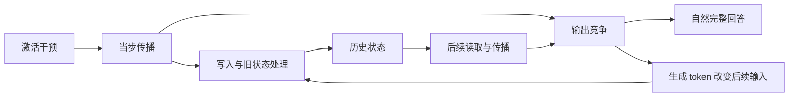

# 缓存机制研究路线图：从局部解释到跨层、跨通道的共同机制

**当前阶段更新（2026-11-05）：先把已有成果写成论文，不继续排下一张实验卡。** 第一阶段交付已完成：[正文工作稿与图表骨架](mechanism-paper-skeleton-2026-11-05.zh-CN.md)、[完整理论—证据连接](cache-mechanism-theory-evidence-spine-2026-11-03.zh-CN.md)、[资产盘点](RESEARCH_ASSET_CATALOG_2026-11-04.zh-CN.md)。写清已支持结论与承重缺口后，才能判断哪项证据真正决定论文贡献；不因写作自动开启测量。下方v7为保留的研究路线，WPC未实现／未运行，KV细拆与SDM无默认队列。无新模型/GPU调用。

日期：2026-11-05；v7。当前下一比较已具体化为[WPC-01：旧数据审计、统一协议比较、判读与停止](mechanism-second-half-v1-2026-11-03/WINDOW_COMPARISON.zh-CN.md)。H1是研究方向，尚无核心主张；P-WPC是有限面板上的可失败预测。与[Proposal v7](mechanism-second-half-v1-2026-11-03/PROPOSAL.zh-CN.md)、[自查](mechanism-second-half-v1-2026-11-03/SELF_CHECK.zh-CN.md)、[To-do](cache-mechanism-todo.zh-CN.md)同步。作者设计审查通过；实现/模型验收未完成；无新实验或模型/GPU授权。旧R1–R5仅保留历史，当前以§4为准。

## 1. 课题现状：观察范围较宽，具体机制解释仍然局部

我们研究的是：**训练完成的模型中，少数通道的激活干预怎样经当步传播、写入、历史状态处理和后续读取，最终改变回答。** 撤针、停止、错答、重复和恢复都是研究条件或现象，不替代这个问题。

目前较具体的计算机制证据主要来自 **Qwen3.5-4B，一个模型、一个参数规模、少数针和特定背景**。其中，L0 的部分原生通道与随机方向已有条件性的写入—状态—读取—回答证据；L12 及新任务结构已有检验，并显示不同响应。它不是一根针的孤例，也不是已能解释整个模型的统一机制。

另一方面，项目的观察覆盖比这条细机制广得多：已有全层、多通道、正负剂量、多模型规模的行为调查；4B 还做过全层缓存差分。**因此，缺口不是“其他层从来没看过”，而是广泛观察与具体计算解释尚未充分连接。**

| 资产层次 | 已有什么 | 当前不能升级成什么 |
|---|---|---|
| 全层行为与内部轨迹 | 多模型/规模的层、通道、剂量调查；4B 有全层轨迹 | 输出相似不证明计算机制相同；轨迹标量不等于完整缓存 |
| 全层缓存比较 | 4B L0–L31，每层一个固定通道、正负两档的缓存类型比较；部分条件有深度组验证 | 每层一个通道不能代表该层所有通道；中、晚层许多读数变化未造成回答失效 |
| L0 跨针关系 | XCHAN 的 V 历史关系、EH-XC 的入口—历史关系在多个原生通道和随机方向上有支持 | 不是任意方向都成立，也未把细粒度写入—读取链全部跨针验证 |
| 局部计算解释 | KUC/LVK/SRU 等以实际计算操作连接写入、状态和读取，并在指定条件下改变完整回答 | 混合/恢复背景的阳性不能自动拼成唯一原生损伤路径 |
| 原生恢复与组合 | NCC/NSR/NQK/NPC 比较 L0/L12 的 S、V 历史、KV 及组合，保留错误形态与反向结果 | 恢复充分不等于唯一损伤来源；S 不是已证实的通用答案仓库 |
| 推广的初步边界 | CGV 有跨层针及新结构结果；NVB/NBR/SIT/NMT 有背景、增量和幅度配置证据 | 分数迁移不等于完整行为迁移；部分匹配不等于统一机制或跨条件验收通过 |

直接入口：[统一理论与结果归档](RESEARCH_ARCHIVE_2026-11-04.zh-CN.md)、[完整资产目录](RESEARCH_ASSET_CATALOG_2026-11-04.zh-CN.md)、[全层缓存结果](../experiments/early-state-localization-stage2-v2-2026-10-30/REPORT.zh-CN.md)、[XCHAN](../experiments/cache-cross-channel-validation-v1-2026-10-31/README.md)、[EH-XC](../experiments/cache-eh-cross-channel-v1-2026-11-02/REPORT.zh-CN.md)。

## 2. 拓宽目标：解释规则覆盖更多条件，而非把一种修复变成万能操作

**总体目标：在明确的干预方式和剂量范围内，从局部机制出发，建立适用于一个模型家族或一类架构、能够覆盖不同层位和不同通道的机制解释，并在新的层位、针眼、任务和模型规模上接受检验。**

这样的解释需要回答：什么时候会产生回答影响，什么时候不会；哪些过程共同存在，哪些会随位置、方向、任务和背景分叉；为什么某种恢复有效、另一种无效。

“覆盖所有层和针眼”是研究希望达到的解释范围，不是声称已经穷举所有通道，更不是要求所有针走同一条路径。有限面板可以支持广泛适用，但不能证明无例外的普遍性。对不适用条件、无效应条件和结构性边界作出正确判断，也是解释的一部分。

近期以 4B 的跨层、层内多针比较为主，同时开展早期任务边界检查；不等全层覆盖完成才解释，也不等局部解释完成才横向检查。某条关系的计算对象、可比操作及工程条件清楚后，同家族其他规模或其他架构的针对性检验即可进入设计讨论。跨模型不是排在所有工作之后的奖励关卡；规模迁移与架构迁移的证据分开，不能互相替代。长期覆盖目标与每一轮的有限增量分开，不要求首轮证明全架构通用。

## 3. 研究骨架怎样横向延伸

沿用[理论—证据骨架](cache-mechanism-theory-evidence-spine-2026-11-03.zh-CN.md)，用[最新归档](RESEARCH_ARCHIVE_2026-11-04.zh-CN.md)补齐后续结果。保留纵向的计算问题，在横向增加可比较的层、通道、任务和模型条件。

下图是研究对象之间的结构关系，不表示每条边都已有完整因果证明，也不要求所有干预都通过递推 S：

| 骨架中的问题 | 已有依据与工具 | 横向延伸时真正要比较什么 |
|---|---|---|
| 干预怎样进入后续计算 | 全层轨迹、入口/历史拆分、EH-XC | 不同层与针的影响更多是当步输出变化，还是进入了可留存历史；同幅随机方向是否同样表现 |
| 哪些历史状态参与作用 | 全层缓存差分、NCC→NPC 的恢复与污染 | S、卷积历史、KV 的作用及组合要求是否保持；哪些条件分叉，哪些根本没有可替换的受损状态 |
| 历史差异如何形成和被更新 | KUC/LVK、NVB、SIT/NMT | 已有写入操作的作用是否在新条件下保持，是否仍依赖输出背景、状态来源和幅度配置 |
| 状态怎样影响后续计算 | SRU、NBR 更正后的读取分析 | 相似状态变化是否产生相似读出和行为；作用不同是否来自可直接检验的读取/传播差异 |
| 计算变化怎样接到回答 | 自然生成、编号选择、完整交付与失败记录 | 内部读数变化何时跨过行为边界；相同异常是否可能对应不同计算过程 |

这意味着：横向延伸的单位是**一条可复用的因果关系及其适用条件**。不是复制一遍 L0 的所有操作，也不是只增加“某层某针让模型答错”的案例。

### 3.1 明确带到新层和新针上的关系

以下是基于已有资产的待推广关系，不是已成立的全层规律。A–C 是近期可直接衔接的入口；D 从一开始约束它们与原生行为的联系，必要的计算检验由具体分叉驱动，不留到全层扫描完成后才考虑。不要求一张卡同时完成四项。

| 关系 | 已有依据 | 横向检验的问题与结果含义 |
|---|---|---|
| A｜状态恢复对回答的条件性作用 | NCC 的两个锚点恢复干净 S 后均为 48/48 正确；其他恢复方式效果不同 | 在同协议下确有回答损伤的新针上，恢复相应下游 S 是否仍足以恢复完整回答？若只联合恢复有效，说明单组充分性的适用范围变了；若无原始损伤，不能计作修复成功。两者都不定位唯一自然损伤来源 |
| B｜跨输入状态对答案选择的作用 | NSR 跨输入干净 S 使 38/48 答错，其中 32 条输出供体答案 | 新层、新针条件下，移植是否使选择系统性转向供体，而不只是任意出错？保持、减弱或消失分别约束这种作用的范围；需保留供受体任务与候选对应，不能直接命名为完整答案存储 |
| C｜单组与组合操作的背景依赖 | NSR/NQK/NPC 中单组污染可被容忍，部分组合致错；NPC 已补出 L0 的两组致错 | 相同来源、时段与接收背景下，单组和组合的回答效应怎样随针变化？检验已见依赖关系能否复用，不预设“必须三组”或三类缓存共同承担全部损伤；仅检查分叉针时，结论只覆盖该子集 |
| D｜写入、历史与读取变化到回答变化的连接 | EH-XC、LVK/SRU 的条件性计算证据，以及 CGV 中分数变化与完整回答变化不一致 | 相似的恢复或移植响应，是否仍由相应写入—读取操作改变后续回答？无明显回答变化时，已有可比读数能否约束差异未形成、未被当前读取或未改变最终选择等解释？未测到的环节保留未知，不用状态距离替代解释 |

A–C 的意义在于给机制施加跨条件约束，D 检验操作响应是否连接到共同计算过程。**修复、供体转移、组合效应都属于取证手段；课题仍要解释影响如何产生、为何有的条件有效而有的无效。** S 不是唯一候选，也不要求所有机制贡献必须同时出现 S 恢复和供体答案转移。

### 3.2 让横向比较能约束解释

在查看新增机制结果前，写明本轮针对哪条关系、预计保持什么、什么结果会否定或限制它。不能等到 R4 才提出预测，也不能把已见的两个锚点重新称为预测检验。

下游可受影响状态的范围、注入层类型和原始损伤程度，是解释响应差异的候选因素，不是天然互斥的三个假说。例如，在损伤程度相近的条件下，层类型或下游范围能否继续解释恢复差异；在计算位置可比的条件下，响应是否主要随损伤程度变化。这些比较只有在候选确实给出不同预期、现有条件足以区分时才具有判别力。因素共同变化而无法分开时，报告关联或不可判，不凭一次横向扫描宣称确定原因。

### 3.3 代表性检查怎样实际触发

把一条关系提升为跨条件共同解释，或以它为基础再加一层局部拆解前，逐条核对：是否已有跨不同深度、多个针的可比证据；是否至少检查过一个非编号任务；是否保留原生基线、自然完整回答与原生/恢复背景身份；是否有可追溯的反例、缺失和不适用项。旧 XCHAN/EH-XC 的覆盖不能自动记到新的写入或读取关系名下。

证据缺项时，先讨论补哪项横向比较及其决策价值，不再以“等关键预测形成”延期。具体覆盖数量和判读标准在后续实验卡中明确，本路线不编造门槛。检查不要求所有结果阳性：可信分叉可以触发有明确问题的局部深入；未检查、工程未过、不可比和科学阴性必须分开。结构不适用的条件不能靠改协议强行变为可恢复条件。当前按§4阶段2先横向，不默认续做KV读取；以后由关键分叉触发局部检验时，最多一轮、任何结果后回横向，不能用定期复查或拆卡延后。本文不构成新增运行授权。

## 4. Roadmap v7：按消除关键不确定性推进

横向比较从一开始就承担**区分解释**的职责；不是"先扫全层，再挑一个点深挖"。每一阶段写明要得到的认识与决策出口；已有证据能满足的阶段直接记为满足，不重做。

| 阶段 | 要得到的认识 | 决策出口 | 现状（2026-11-05） |
|---|---|---|---|
| **1 确定核心候选主张** | 现有支持、最强反例、直接近邻与缺失；哪个候选值得优先检验 | 未形成超出已知规律的解释，不扩大扫描 | **本次完成**：[当前审计](mechanism-second-half-v1-2026-11-03/CORE_CLAIMS.zh-CN.md)将H1标为研究方向；尚无核心主张。旧链为工具/竞争解释，KVC为桥接 |
| **2 关键横向比较** | 同一状态/计算作用在可比条件何时保持或失效，能否区别一般强度/阈值与人工背景解释 | 事前限定支持或撤回的句子；阴性不自动命名剩余机制 | **当前已选WPC-01**：384旧输出审计完成；同一L0方向、两任务、四臂，共同形成/幅度/次数/128上限。缺384新协议输出+16旧桥接，1 GPUh含验收；未运行、未授权 |
| **3 必要的计算检验** | 哪项具体计算作用解释关键横向分叉 | 仅当答案会改变核心解释才开启；最多一轮，任何结果后回阶段2或4 | 可复用SRU等工具；KVC读层/头不自动排队，不穷尽残差 |
| **4 独立确认与边界** | 固定关系能否面对未参与构建的材料，是否接到自然完整回答 | 支持则扩展所支持范围，失败则限制/撤回；不把重放作独立确认 | 当前核心候选所用面板已见；跨任务/深度/模型按主张所需和对象可比性接入，不等局部全图完成 |
| **5 价值兑现** | 是否形成足够重要的解释，或支持更好的诊断/选择/控制 | 决定论文形态；不自动转方法项目 | 尚不能保证核心贡献成立或论文档次；方法用途需实际证据 |

**约束**：
- 主候选必须落成有限、可失败的关系；“背景重要”“不同条件不同”或恢复表不是最终核心结论。
- 旧写入—读取链继续作为机制工具，不被限定为仅解释停止。停止、完整正确、选择方向和内部竞争分别报告。
- 一般强度/阈值、任务协议、下游结构范围与恢复补偿可能并存；某一结果不自动排除所有其他解释。
- 未来因关键横向分叉开启局部检验，最多一轮事前有界工作，任何结果后回横向；不能拆卡重置或无界打包。
- 跨模型若写进主张就是必要证据；若不作此主张可作为范围提升。不能一概排到所有局部工作之后。
- SDM及v5的浅/深状态恢复比较均保留为历史候选；恢复响应不能直接命名唯一/冗余或“内容载体”，未经新自查不实施。
- 本次旧数据审计和具体设计交付即结束，无新GPU/模型授权。H1不是现成主张，P-WPC也不是通用机制规则。
- WPC-01预期全部兑现：只固定共同策略下的恢复增益分叉，下一科学比较回新输入、非L0与随机方向等横向边界，不能先加浅层/头/位置定位。
- 分叉近零/反向/不可判：分别限制、撤回或暂停P-WPC，结束该优先级；回横向关系取舍，不自动换针、加剂量、加长度或补矩阵。
- 干净基线失败、损伤不足或全递推恢复不足：记录可检验性/恢复参照边界，不删题重选阳性；工程/预算未完成另报。
- 这次共同协议同时改幅度、次数和形成流程；效应消失不唯一证明某个旧协议因素。精确阈值及出口以WPC-01 §3–5为准。

### 4.x 历史：v4 的 R1–R5（保留作记录，不再是推进顺序）

### R1｜把现有全层资产与机制骨架对齐

先用已有结果形成简明覆盖表：每层有哪些针、干预时段是什么、是否改变完整回答、是否留下持续影响、已有哪类恢复/污染或计算操作证据。把“已有且可比”“已有但协议不同”“确实缺失”分开。

复用全层调查和阶段二结果；旧阅读标签保留模型辅助来源，不重新包装为人工确认。内部轨迹缺少完整向量的地方直接标缺失，不从范数或哈希反推张量。

**产出：** 一张连接资产与计算问题的覆盖图，以及真正需要补的比较。已有资产对齐是轻量准备，可随 R2 更新，不设为长期整理阶段，也不重做已经完成的全层扫描。

### R2｜先确认同协议基线，再检验全层、多针的关系

**第一步：确认候选针在目标任务上的原始作用。** 旧全层短答题与近期 LVK 编号面板不是同一任务，旧题上的损伤不能直接充当新面板的损伤证据。先复用真正同协议的干净基线 C 与干预基线 T；缺失处才补相应基线。若从已有 LVK 面板衔接，它是已见的开发面板，不代表全部任务。先记录完整回答及损伤形态，已有内部读数作为辅助，不为筛选把全套机制操作铺开。

**第二步：确定比较对象，同时保留全体覆盖。** 覆盖目标包括 L0–L31、层内不同通道与匹配的随机方向。机制操作前确定候选范围、损伤筛选用途与选针规则，不能根据恢复成功与否挑针。明显损伤子集用于回答恢复问题；无损伤和轻微损伤条件留在覆盖图及机制解释中，不能从总体分母消失。开发筛选与确认输入或分析身份分开，避免同一批输入既用于挑最大损伤，又被称作独立验证。分批推进可以，但少量代表针不能冒充全层且层内多针覆盖。

**第三步：按 A–D 的具体关系组织横向检验。** 近期用 A–C 的既有操作关系衔接全层、多针，并穿插 R4 的早期任务检查；D 贯穿解释身份的核对，具体计算操作由能区分解释的差异提出。每项比较说明服务哪条关系、预期差别和适用范围；不冻结统一“四格”或把所有旧操作复制到每根针。S 恢复和跨输入移植可作为起点，但不据此宣称 S 唯一有效或已检验所有组合。组合比较可在有明确问题的子集开展，向更广范围推广须有相应覆盖证据。

可比性贯穿三步：对齐干预时段、实际写入尺度、输入与评估口径；把原始损伤程度列出来，不能按“都用了 −1”就认定跨层等强。状态组按实际 hook、计算顺序及下游对象定义，不能搬用 L0 的固定 13–30 层组。现有固定输入、MLP 注入协议下，本层及上游缓存不被该步注入改写；这一边界不能不加核对地套到其他 hook 或自由生成期间。下游没有相应状态时标为结构不适用，不为凑齐比较而改协议。

**产出：** 按关系 A–D 标注支持、反例、未测和不适用的跨层、多针证据图，并区分无可见损伤、阈下变化、可见行为变化及操作无效。图必须能回答“哪条关系在哪些条件保持或失效”，不是仅列运行覆盖率。S 恢复普遍有效也只支持其条件性作用；整组恢复若只是重放完整有效状态，应归为实现检查。

### R3｜围绕共同关系和分叉做有选择的计算检验

**当前阶段的执行顺序约束（2026-11-05）：** KVC-01之后最多再一轮有界读取计算检验，随后下一项科学比较必须回到R2/R4；符合条件时可接入R5。横向资产核对现在并行准备，不以KV分支成功为前提。下列一般R3原则不得覆盖这一出口。

**本轮目标：** 得到一条可横向检验的读取—答案关系。要求计算对象与时刻明确，操作效应接到自然完整答案的事实方向，并能说明可比操作、背景与失败预期。比较已有写入—递推—读取证据，但不预设同一机制。不以仅找到热点、一般作答破坏、解释全部残差或穷尽层/头/位置为完成尺度。

| 结果 | 本轮收尾 | 下一动作 |
|---|---|---|
| 明确关系或有边界的部分支持 | 固定操作、适用条件、反例与未解释部分 | 横向检验这条关系，不再先细拆 |
| 无预期作用、异号或预测失败 | 撤回/限制候选，保留科学阴性 | 暂停该候选；用已有可靠关系或跨条件分叉开展横向比较 |
| 只有一般损伤、模糊或不可判 | 明确未获得定向计算解释 | 暂停局部分支并回到横向，不追加层/头/时段救假设 |

“下一轮”是一个事前有界的问题，不允许按层组、逐层、逐头、逐token拆卡重置计数，也不能把无界扫描打包为一轮。若尚无法设计有增量的比较，直接进入横向；最多一轮不是必做配额。工程失败不当科学阴性，必要修复遵守原合同且不引入新科学范围，不得成为无限延期理由。

收尾交付结论、范围/反例、可横向检验关系或失败候选、下一项横向缺口。后续只有横向证据产生具体新问题，才重新考虑局部深入；不能因残差未闭合自动续卡。细节与覆盖账本见 [Proposal §6](mechanism-second-half-v1-2026-11-03/PROPOSAL.zh-CN.md#6-当前阶段的深入目标与横向出口)。

按对同类操作的响应比较，而不是仅按停止、错答、重复分类。相同表面异常可能有不同过程；不同表面异常也可能共享某段计算。

对跨层保持的关系，选代表检验其是否真正共享已有的写入—状态—读取作用。对响应发生变化的条件，直接比较哪一个环节不同。复用 LVK/SRU 等工具，但不要求每根针从头拆到每个头，也不预设所有分叉都能归为 S 的内容或 S 的读取。

L0/L12、CGV 新任务结构和不同背景是现成的分叉线索；它们帮助提出问题，不能提前充当“层越深越容易修复”或“S 决定所有答案”的规律。

**产出：** 有证据支持的共同计算关系、条件分支及尚未接通的部分。只深入能够改变跨条件解释的差异，不因一次阴性自动追加层/头扫描。

### R4｜早期检查任务边界，随后以独立材料确认

R4 分两个时点，早期部分与 R2 同行，不能全部留到 R3 之后。先用任务差异判断候选关系是否值得继续深入：可复用 CGV 的表格、两段关系、交换后绑定结构，但[原题](../experiments/cache-chain-generalization-v1-2026-11-03/data/source/new-scenarios-r01.json)的 27 条全部要求输出编号，只能算结构变化，不能算非编号任务。已有短答/事实题资产是非编号候选入口，先核对干净表现、评分和干预协议，不直接把旧题损伤与新编号面板拼成配对结果。已见任务仍是探索资产。

解释形成后，再用未参与构建它的新针、新输入或任务材料检验新增预测。早期边界检查和后续独立确认是两种身份；前者不能被称为留出验证，后者也不能成为早期不检查任务的理由。沿用 R2 的预测登记要求。

自然完整回答仍是重要终点。停止、选错记录、混合输出和截断分开保留；强制前缀的分数属于条件性诊断。CGV 已经出现分数关系迁移而完整回答变化很弱，不能再次用分数代替行为推广。

**产出：** 对解释适用范围的支持、反例或修订。预测失败应具体指出哪条关系不成立，不靠重新挑针、改剂量或换题保持成功叙事。

### R5｜计算对象清楚时，启动模型家族与架构检验

优先用已有 Qwen3.5 不同规模调查资产，检验相同作用关系是否保持；层号不同、宽度不同的模型要按计算对象与相对位置建立对应，不能按相同数字层号直接配对。

其他架构可以检验功能对应：某种状态是否承担类似的历史作用，以及干预怎样经状态更新和读取影响回答。不存在递推 S 的模型不能机械执行 S 替换，也不能仅凭没有 S 就证明该机制为混合架构独有。

跨模型 F1 提供部分工程基础，但[验收记录](../experiments/cross-model-foundation-common-v1-2026-11-02/F1_CHECKS.zh-CN.md)仍有未通过项；不能把“做过预检”写成可直接运行或已有科学结论。R5 在关系、可比计算对象与操作清楚时即可进入研究设计；运行仍需其工程验收和相应授权。不必等待 R2 全层跑完、R3 所有分叉解释完或 R4 全部确认结束。优先选择能区分当前解释的外部条件，不能只为凑模型数量扩展。

**产出：** 哪些关系在模型家族内保持、哪些依赖架构或其他模型条件的证据；单纯跨模型差异不自动归因于架构。

## 5. 推进时必须保留的逻辑边界

1. **广泛覆盖和深入解释相互服务。** 当前优先把视野扩到全层、多针；局部深入由共同关系和分叉提出需要，不把“先把 L0 完全解释完”设为前提。
2. **S 的共同修复作用是待推广关系，不是总体理论的前提。** NCC 中干净 S 可修复，不等于 S 是唯一损伤载体；NSR 中受损 S 单独不致错，跨输入 S 又可带偏答案，说明背景与信息来源必须保留。
3. **有信息与能使用不是同一件事。** 若使用条件受损，恢复干净 S 并不必然恢复回答；供体答案转移也可能涉及查询/选择状态，不能立即等同于完整答案内容都存于 S。
4. **深度不是单一原因。** 注入位置与可受影响下游范围同时变化，L0/L12 还涉及不同通道和损伤程度。不能由两个锚点推出单调深度规律。
5. **结构边界要作为边界使用。** 阶段二已核验，在固定提示、形成期注入且回答前撤针的协议中，L31 缓存 T=C。它不说明在自由生成期间持续干预 L31 也无效；不能为了让该格出现缓存损伤而悄悄改协议。
6. **新方向与随机方向都是研究对象。** 随机方向复现关系，可以支持更广的一般扰动机制；不是必须消除的“不特异”结果。效应相似、操作响应相似、计算过程相同分开检验；有限随机面板不能证明任意方向都成立，未检出差异也不等于等效。
7. **允许形成多条相连的路径。** 共同机制不要求所有层都由同一组变量修复；有解释的分叉比强行统一更有价值。无效、阴性和不适用均进入最终覆盖图。

## 6. 历史衔接说明与仍待补齐的横向缺口

> **v6说明**：本节以下为 v4 文本，其中"最多完成一轮有界 KV 读取检验"已不再是当前交接顺序；当前顺序以 §4 阶段表与 [To-do](cache-mechanism-todo.zh-CN.md) 为准。缺口清单仍有效，但缺口的补法由阶段 2 的比较决定，不按清单逐项铺开。

保留[下半场 Proposal v4](mechanism-second-half-v1-2026-11-03/PROPOSAL.zh-CN.md)关于共同过程、背景依赖和随机方向的研究主旨。根据本次用户明确的拓宽目标，**调整推进顺序：不再要求先把原生/恢复背景的局部差异解释完，才开始跨层拓宽。** 全层、多针的可比关系成为近期主要增量；局部背景问题随需要解释的分叉推进。

已有 NMT 没有满足其冻结的迁移出口，这一事实不改；本文也不宣布 NMT 的具体规则已经可推广。更宽的课题可以基于其他已经成立的因果关系开展横向检验，而不是把某一子实验的出口当作整个课题的开工条件。

同一 L0 面板补两个输出读数可以作为以后针对具体分叉的诊断工具，当前不列为主推进方向。本轮较早整理的[旧记录核对](../experiments/cache-mechanism-broadening-audit-v1-2026-11-04/README.zh-CN.md)保留为资产；其中九格库存、缺失读数及重建计数不是本路线图的实验矩阵或预算。

近期推进方式为：**R1 轻量对齐资产与关系 → R2 同协议基线和分批跨层、多针比较，同时接入 R4 的早期任务检查 → 根据共同响应与分叉进入 R3；计算对象清楚时接入 R5；解释形成后由 R4 独立确认。** 不要求整图完成才解释，也不允许局部深入长期替代横向检查。支持、反例、不可判分别导向代表性深入、具体分叉检验、限制结论或暂停支线；不默认追加实验，也不自动转向方法论文。

**当前交接顺序：横向准备现在开始 → 最多完成一轮有界KV读取检验 → 无论结果如何回到横向科学比较。** 若该读取问题无法形成有效设计，可直接横向。旧SRU链和A–C操作关系都可带出去，不以新KV分支成功为门槛。

当前覆盖按关系分账：XCHAN是L0的10个原生通道＋4随机方向；EH-XC同14方向中8验证通道＋4随机达到联合标签，锚点另列；SRU的细读取行为支持来自L0的N4146/N1210/R0，C1343诊断；KVC是L0/N4146、L0/R0、L3/C7666三个条件，即2个原生通道＋1随机方向、2个施针层位、1类已见事实任务。全层调查不等于细机制全层成立，以上数量不能累加。[当前关系覆盖及来源](mechanism-second-half-v1-2026-11-03/CORE_CLAIMS.zh-CN.md#3-关键证据账本它们实际推进了什么)。

下一段横向优先面对以下缺口，分批选有判别力的比较，不一次铺满矩阵：

- **深度与层型：** 超出早层锚点，用已有全层资产建立可比条件；仅继续增加相似L0方向不算补齐。
- **层内多针：** 非L0的单通道不能代表一层；保留原生与匹配随机比较、无损伤条件。
- **任务：** KVC事实定向与SRU短编号读取的操作/背景不同；WIN-02编号原生针M为天花板。先明确可检验关系，不能用不对齐移植或加剂量凑阳性。
- **背景：** 保留原生C/T、完整回答及恢复身份，比较共同响应与分叉；不把原生连接另设为无限局部前置关卡。
- **独立材料：** 当前面板已见；开发选针与后续确认分开，不以重放充当独立验证。
- **模型：** 对象可比且工程条件具备时接入家族/架构比较，不等4B全图完成，也不机械照搬不存在的状态。

横向卡事前写明所检验关系、缺口、预期保持/失败及不同结果如何改变解释。只补基线不算机制检验；不要求所有结果阳性。当前更新没有指定新针表、矩阵或GPU预算，旧SDT/NMT/EOS草稿不自动排队。

## 7. 最终应形成什么成果

优先目标是H1的一条具体条件规律、对应的计算与完整回答证据及新条件确认。若只剩通用缓存污染、背景依赖或恢复热图，应收缩核心承诺；当前仍有成败风险，不能只按提高覆盖高度安排工作。

一份有证据支持的机制解释及其覆盖图：纵向说明激活干预怎样影响计算和回答，横向列出哪些层、针、任务和模型条件已验证，哪些出现分叉，哪些未测或不适用。每条结论能回到原始结果、具体操作、来源与限制。

阶段性的成功是：从新条件中得到可复用关系或明确反例，并用它改变我们对机制适用范围的理解。全层跑完不等于机制解释完成；局部解释充分也不等于已经跨层通用。

## 附：历史方向级逻辑复查

下文保留v1–v4审查历史，当前以[v6完整自查](mechanism-second-half-v1-2026-11-03/SELF_CHECK.zh-CN.md)为准，不继承历史默认队列。

沿用[实验设计自查规范](experiment-design-self-check.zh-CN.md)和[已知基础审计](cache-mechanism-known-basics-audit-2026-10-31.zh-CN.md)。本附录审查研究方向，不替代后续每张实验卡的设计、实现和授权检查；本文件没有可执行实验设计的“通过”声明。

| 检查 | 当前处理 |
|---|---|
| C01–C02 主线与增量 | 主线稳定；新增认识是关系的跨条件适用及分叉，不是只增加案例 |
| C03–C04 资产与反例 | 复用全层、跨针、计算链与原生组合；保留 CGV/NMT、反向移植和结构边界 |
| C05–C07 操作/路径/耦合 | 本文未冻结具体操作；已明确不同注入时段、缓存对象和接收背景不能混同，具体卡逐项验收 |
| C08–C10 归因/区分/指标 | §3.1 分开恢复、选择转移、组合依赖与计算连接；§3.2 要求预测确有判别力，候选因素不强制互斥；完整回答不被分数替代 |
| C11–C12 失败与成本 | 区分无损伤、不适用、阴性和实现失败；先复用旧资产，不在方向稿编造预算或新增运行 |
| C13–C14 可信度与累积 | R2 区分开发筛选与确认身份，保留无损伤条件及总体覆盖；R4 检验新条件；阴性约束适用范围，不自动加针救假设 |

反方检查：更多层都能恢复 S，仍不能证明同一原生路径；同一错误形态，仍可能有不同计算；整组恢复可能只是替换了几乎全部受影响状态。路线图因此要求由操作响应提出共同关系，再以具体计算检验与新条件检验支持解释，不能直接把覆盖率变成机制结论。相反，某些层不符合已有链条，应保留分叉或适用边界，而不是排除这些层后宣称普遍成立。

修订反方检查：只挑明显损伤针可能制造适用范围偏差，因此 R2 将恢复子集与总体覆盖分开；位置、层类型和损伤程度可能共同变化，因此不宣称三者必能被一次比较淘汰；仅四种状态条件不足以支持唯一性或完整组合结论，因此按关系限定比较与结论。相关历史错误 E01、E07、E14、E19、E20、E22 已分别通过保留总目标、限制路径归因、标注实现检查、允许共同因素和区分筛选/确认处理。尚未定义的样本量、阈值、逐格操作与预算留待具体实验卡，不在方向稿伪造设计验收。

v3 反方复查：线性 R1–R5 会再次延后新任务和模型检查，已改为条件触发；CGV 换结构仍输出编号，已单列其范围；代表性缺失与真反例分开，后者允许有问题导向的分叉深入，避免必须普遍阳性才能继续的循环。完整 C01–C14、历史错误及当前修订比较见 [Proposal 自查](mechanism-second-half-v1-2026-11-03/SELF_CHECK.zh-CN.md)。

本次为同一助手的作者核对，不是独立评审。旧原始文件、失败和更正不修改；理论骨架与资产目录继续作为历史证据入口。

**v4复查：** 科学成功标准与项目退出条件分开；阴性/不可判同样退出当前局部阶段。跨条件证据数量按关系计算，横向准备不等深挖完成；不通过拆卡重置或无界打包规避一轮边界。具体记录见配套自查，本轮0新模型/GPU。
