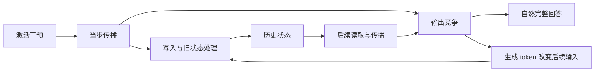

# 缓存机制研究路线图：从局部解释到跨层、跨通道的共同机制

日期：2026-11-04。性质：研究主线与推进逻辑，不是完整实验计划；不冻结实验矩阵、样本量、阈值、预算或运行合同。本次仅文档与既有记录核对，无新增模型/GPU运行。基于远端 `e1a7181d5` 及以下证据入口；该提交新增的是另一条 WSP 线的工作，不改变本文缓存机制结果。

## 1. 课题现状：观察范围较宽，具体机制解释仍然局部

我们研究的是：**训练完成的模型中，少数通道的激活干预怎样经当步传播、写入、历史状态处理和后续读取，最终改变回答。** 撤针、停止、错答、重复和恢复都是研究条件或现象，不替代这个问题。

目前较具体的计算机制证据主要来自 **Qwen3.5-4B，一个模型、一个参数规模、少数针和特定背景**。其中，L0 的部分原生通道与随机方向已有条件性的写入—状态—读取—回答证据；L12 及新任务结构已有检验，并显示不同响应。它不是一根针的孤例，也不是已能解释整个模型的统一机制。

另一方面，项目的观察覆盖比这条细机制广得多：已有全层、多通道、正负剂量、多模型规模的行为调查；4B 还做过全层缓存差分。**因此，缺口不是“其他层从来没看过”，而是广泛观察与具体计算解释尚未充分连接。**

| 资产层次 | 已有什么 | 当前不能升级成什么 |
|---|---|---|
| 全层行为与内部轨迹 | 多模型/规模的层、通道、剂量调查；4B 有全层轨迹 | 输出相似不证明计算机制相同；轨迹标量不等于完整缓存 |
| 全层缓存比较 | 4B L0–L31，每层一个固定通道、正负两档的缓存类型比较；部分条件有深度组验证 | 每层一个通道不能代表该层所有通道；中、晚层许多读数变化未造成回答失效 |
| L0 跨针关系 | XCHAN 的 V 历史关系、EH-XC 的入口—历史关系在多个原生通道和随机方向上有支持 | 不是任意方向都成立，也未把细粒度写入—读取链全部跨针验证 |
| 局部计算解释 | KUC/LVK/SRU 等以实际计算操作连接写入、状态和读取，并在指定条件下改变完整回答 | 混合/恢复背景的阳性不能自动拼成唯一原生损伤路径 |
| 原生恢复与组合 | NCC/NSR/NQK/NPC 比较 L0/L12 的 S、V 历史、KV 及组合，保留错误形态与反向结果 | 恢复充分不等于唯一损伤来源；S 不是已证实的通用答案仓库 |
| 推广的初步边界 | CGV 有跨层针及新结构结果；NVB/NBR/SIT/NMT 有背景、增量和幅度配置证据 | 分数迁移不等于完整行为迁移；部分匹配不等于统一机制或跨条件验收通过 |

直接入口：[统一理论与结果归档](RESEARCH_ARCHIVE_2026-11-04.zh-CN.md)、[完整资产目录](RESEARCH_ASSET_CATALOG_2026-11-04.zh-CN.md)、[全层缓存结果](../experiments/early-state-localization-stage2-v2-2026-10-30/REPORT.zh-CN.md)、[XCHAN](../experiments/cache-cross-channel-validation-v1-2026-10-31/README.md)、[EH-XC](../experiments/cache-eh-cross-channel-v1-2026-11-02/REPORT.zh-CN.md)。

## 2. 拓宽目标：解释规则覆盖更多条件，而非把一种修复变成万能操作

**总体目标：在明确的干预方式和剂量范围内，从局部机制出发，建立适用于一个模型家族或一类架构、能够覆盖不同层位和不同通道的机制解释，并在新的层位、针眼、任务和模型规模上接受检验。**

这样的解释需要回答：什么时候会产生回答影响，什么时候不会；哪些过程共同存在，哪些会随位置、方向、任务和背景分叉；为什么某种恢复有效、另一种无效。

“覆盖所有层和针眼”是研究希望达到的解释范围，不是声称已经穷举所有通道，更不是要求所有针走同一条路径。有限面板可以支持广泛适用，但不能证明无例外的普遍性。对不适用条件、无效应条件和结构性边界作出正确判断，也是解释的一部分。

近期先把 4B 的跨层、层内多针证据补齐，形成可检验的共同关系；随后优先检验同家族其他规模，再考察其他架构中的功能对应。跨模型工作可独立提供证据，不以“先完整解释 4B 的每根针”为必要前提。

## 3. 研究骨架怎样横向延伸

沿用[理论—证据骨架](cache-mechanism-theory-evidence-spine-2026-11-03.zh-CN.md)，用[最新归档](RESEARCH_ARCHIVE_2026-11-04.zh-CN.md)补齐后续结果。保留纵向的计算问题，在横向增加可比较的层、通道、任务和模型条件。

下图是研究对象之间的结构关系，不表示每条边都已有完整因果证明，也不要求所有干预都通过递推 S：

| 骨架中的问题 | 已有依据与工具 | 横向延伸时真正要比较什么 |
|---|---|---|
| 干预怎样进入后续计算 | 全层轨迹、入口/历史拆分、EH-XC | 不同层与针的影响更多是当步输出变化，还是进入了可留存历史；同幅随机方向是否同样表现 |
| 哪些历史状态参与作用 | 全层缓存差分、NCC→NPC 的恢复与污染 | S、卷积历史、KV 的作用及组合要求是否保持；哪些条件分叉，哪些根本没有可替换的受损状态 |
| 历史差异如何形成和被更新 | KUC/LVK、NVB、SIT/NMT | 已有写入操作的作用是否在新条件下保持，是否仍依赖输出背景、状态来源和幅度配置 |
| 状态怎样影响后续计算 | SRU、NBR 更正后的读取分析 | 相似状态变化是否产生相似读出和行为；作用不同是否来自可直接检验的读取/传播差异 |
| 计算变化怎样接到回答 | 自然生成、编号选择、完整交付与失败记录 | 内部读数变化何时跨过行为边界；相同异常是否可能对应不同计算过程 |

这意味着：横向延伸的单位是**一条可复用的因果关系及其适用条件**。不是复制一遍 L0 的所有操作，也不是只增加“某层某针让模型答错”的案例。

## 4. Roadmap：先覆盖，再解释分叉，再检验推广

### R1｜把现有全层资产与机制骨架对齐

先用已有结果形成简明覆盖表：每层有哪些针、干预时段是什么、是否改变完整回答、是否留下持续影响、已有哪类恢复/污染或计算操作证据。把“已有且可比”“已有但协议不同”“确实缺失”分开。

复用全层调查和阶段二结果；旧阅读标签保留模型辅助来源，不重新包装为人工确认。内部轨迹缺少完整向量的地方直接标缺失，不从范数或哈希反推张量。

**产出：** 一张连接资产与计算问题的覆盖图，以及真正需要补的比较。已有资产对齐是轻量准备，可随 R2 更新，不设为长期整理阶段，也不重做已经完成的全层扫描。

### R2｜补齐所有层、层内不同针的可比较机制证据

覆盖范围包括 L0–L31，不只保留 L0/L12 或早中晚几个锚点。已有每层单针是起点；还要纳入层内不同通道与匹配的随机方向，避免把通道特例当层位规律。选取规则在看到新增机制结果之前确定，不能只选最容易恢复的针。

先用现成的状态替换、恢复、反向移植和自然回答工具，检验哪些关系保持、哪些不保持。S 恢复是重要候选，但同时保留其他状态和联合条件的解释空间；没有必要把所有旧操作无差别铺到每个格。

这一阶段的关键是可比性：对齐干预时段、实际写入尺度、输入与评估口径；把原始损伤程度列出来，不能按“都用了 −1”就认定跨层等强。缓存对象按实际架构和时序定义，不能把 L0 的固定 13–30 层 S 组机械搬到所有注入层。

**产出：** 跨层、多针的因果响应图，分别标明无可见损伤、存在阈下变化、可见行为变化、结构上不适用和操作无效。这里的分组是待解释现象，不急于命名机制类型。

### R3｜围绕共同关系和分叉做有选择的计算检验

按对同类操作的响应比较，而不是仅按停止、错答、重复分类。相同表面异常可能有不同过程；不同表面异常也可能共享某段计算。

对跨层保持的关系，选代表检验其是否真正共享已有的写入—状态—读取作用。对响应发生变化的条件，直接比较哪一个环节不同。复用 LVK/SRU 等工具，但不要求每根针从头拆到每个头，也不预设所有分叉都能归为 S 的内容或 S 的读取。

L0/L12、CGV 新任务结构和不同背景是现成的分叉线索；它们帮助提出问题，不能提前充当“层越深越容易修复”或“S 决定所有答案”的规律。

**产出：** 有证据支持的共同计算关系、条件分支及尚未接通的部分。只深入能够改变跨条件解释的差异，不因一次阴性自动追加层/头扫描。

### R4｜在未用于建立解释的针和任务上检验

当有了具体关系，就事先说明它预计在哪些条件成立、哪里不成立、会带来怎样的行为差别，再用新针、新输入或新任务挑战它。旧结果用于选题和构思时，明确其探索身份；不把重新汇总已见面板称为独立确认。

自然完整回答仍是重要终点。停止、选错记录、混合输出和截断分开保留；强制前缀的分数属于条件性诊断。CGV 已经出现分数关系迁移而完整回答变化很弱，不能再次用分数代替行为推广。

**产出：** 对解释适用范围的支持、反例或修订。预测失败应具体指出哪条关系不成立，不靠重新挑针、改剂量或换题保持成功叙事。

### R5｜拓宽到模型家族与其他架构

优先用已有 Qwen3.5 不同规模调查资产，检验相同作用关系是否保持；层号不同、宽度不同的模型要按计算对象与相对位置建立对应，不能按相同数字层号直接配对。

其他架构可以检验功能对应：某种状态是否承担类似的历史作用，以及干预怎样经状态更新和读取影响回答。不存在递推 S 的模型不能机械执行 S 替换，也不能仅凭没有 S 就证明该机制为混合架构独有。

跨模型 F1 提供部分工程基础，但[验收记录](../experiments/cross-model-foundation-common-v1-2026-11-02/F1_CHECKS.zh-CN.md)仍有未通过项；不能把“做过预检”写成可直接运行或已有科学结论。R5 可在计算对象清楚时独立开展，不必等待前四段穷尽所有情况。

**产出：** 哪些关系在模型家族内保持、哪些依赖架构或其他模型条件的证据；单纯跨模型差异不自动归因于架构。

## 5. 推进时必须保留的逻辑边界

1. **广泛覆盖和深入解释相互服务。** 当前优先把视野扩到全层、多针；局部深入由共同关系和分叉提出需要，不把“先把 L0 完全解释完”设为前提。
2. **S 的共同修复作用是待推广关系，不是总体理论的前提。** NCC 中干净 S 可修复，不等于 S 是唯一损伤载体；NSR 中受损 S 单独不致错，跨输入 S 又可带偏答案，说明背景与信息来源必须保留。
3. **有信息与能使用不是同一件事。** 若使用条件受损，恢复干净 S 并不必然恢复回答；供体答案转移也可能涉及查询/选择状态，不能立即等同于完整答案内容都存于 S。
4. **深度不是单一原因。** 注入位置与可受影响下游范围同时变化，L0/L12 还涉及不同通道和损伤程度。不能由两个锚点推出单调深度规律。
5. **结构边界要作为边界使用。** 阶段二已核验，在固定提示、形成期注入且回答前撤针的协议中，L31 缓存 T=C。它不说明在自由生成期间持续干预 L31 也无效；不能为了让该格出现缓存损伤而悄悄改协议。
6. **新方向与随机方向都是研究对象。** 随机方向复现关系，可以支持更广的一般扰动机制；不是必须消除的“不特异”结果。但有限随机面板不能证明任意方向都成立。
7. **允许形成多条相连的路径。** 共同机制不要求所有层都由同一组变量修复；有解释的分叉比强行统一更有价值。无效、阴性和不适用均进入最终覆盖图。

## 6. 与现有路线的衔接和近期优先级

保留[下半场 Proposal v2](mechanism-second-half-v1-2026-11-03/PROPOSAL.zh-CN.md)关于共同过程、背景依赖和随机方向的研究主旨。根据本次用户明确的拓宽目标，**调整推进顺序：不再要求先把原生/恢复背景的局部差异解释完，才开始跨层拓宽。** 全层、多针的可比关系成为近期主要增量；局部背景问题随需要解释的分叉推进。

已有 NMT 没有满足其冻结的迁移出口，这一事实不改；本文也不宣布 NMT 的具体规则已经可推广。更宽的课题可以基于其他已经成立的因果关系开展横向检验，而不是把某一子实验的出口当作整个课题的开工条件。

同一 L0 面板补两个输出读数可以作为以后针对具体分叉的诊断工具，当前不列为主推进方向。本轮较早整理的[旧记录核对](../experiments/cache-mechanism-broadening-audit-v1-2026-11-04/README.zh-CN.md)保留为资产；其中九格库存、缺失读数及重建计数不是本路线图的实验矩阵或预算。

近期工作是 R1 与 R2 的衔接：用已有资产明确缺口，直接走向跨层、层内多针的机制比较。后续每个具体问题独立形成实验设计，复用同一主线；不把 R1–R5 打包为一个巨大实验。

## 7. 最终应形成什么成果

一份有证据支持的机制解释及其覆盖图：纵向说明激活干预怎样影响计算和回答，横向列出哪些层、针、任务和模型条件已验证，哪些出现分叉，哪些未测或不适用。每条结论能回到原始结果、具体操作、来源与限制。

阶段性的成功是：从新条件中得到可复用关系或明确反例，并用它改变我们对机制适用范围的理解。全层跑完不等于机制解释完成；局部解释充分也不等于已经跨层通用。

## 附：方向级逻辑复查

沿用[实验设计自查规范](experiment-design-self-check.zh-CN.md)和[已知基础审计](cache-mechanism-known-basics-audit-2026-10-31.zh-CN.md)。本附录审查研究方向，不替代后续每张实验卡的设计、实现和授权检查；本文件没有可执行实验设计的“通过”声明。

| 检查 | 当前处理 |
|---|---|
| C01–C02 主线与增量 | 主线稳定；新增认识是关系的跨条件适用及分叉，不是只增加案例 |
| C03–C04 资产与反例 | 复用全层、跨针、计算链与原生组合；保留 CGV/NMT、反向移植和结构边界 |
| C05–C07 操作/路径/耦合 | 本文未冻结具体操作；已明确不同注入时段、缓存对象和接收背景不能混同，具体卡逐项验收 |
| C08–C10 归因/区分/指标 | 操作响应与自然路径分开；允许多分支；内部读数不替代完整回答 |
| C11–C12 失败与成本 | 区分无损伤、不适用、阴性和实现失败；先复用旧资产，不在方向稿编造预算或新增运行 |
| C13–C14 可信度与累积 | 已见/新条件、记录核对/模型复现分开；覆盖与深入交替，不自动扩实验救假设 |

反方检查：更多层都能恢复 S，仍不能证明同一原生路径；同一错误形态，仍可能有不同计算；整组恢复可能只是替换了几乎全部受影响状态。路线图因此要求由操作响应提出共同关系，再以具体计算检验与新条件检验支持解释，不能直接把覆盖率变成机制结论。相反，某些层不符合已有链条，应保留分叉或适用边界，而不是排除这些层后宣称普遍成立。

本次为同一助手的作者核对，不是独立评审。旧原始文件、失败和更正不修改；理论骨架与资产目录继续作为历史证据入口。
