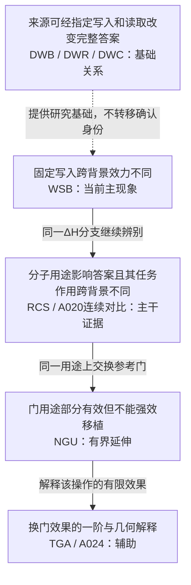

# Acupuncture：历史写入如何在针后获得不同的答案作用

2026-11-16｜A026｜现有结果的主线论证。来源基点`83be25bd9a0a087efdcf349ce3702dff276850b7`。本稿整合已有观察、干预与反证，不是新实验设计、完整自然机制证明或论文录用判断；不新增统计、模型/GPU或局部测量。早期稿件与结果不覆盖。

## 1. 当前核心结论

**在本项目的固定模型与结构化选择任务中，稀疏针留下的历史改变，即使经过指定恢复使原题能够正确作答，仍会改变一份来源写入对完整答案的作用。这个作用取决于写入与接收计算条件的配合：在所检验的强效条件下，它强烈依赖新增读数的分子用途，这项用途的任务作用在H本身也更大，门用途有可测的条件作用；“总logit位移相同、只因起始答案余量不同”，或把输出门当作可双向移植的强增益开关，都不足以说明已有结果。**

这是当前可以提出的**条件性部分机制结论**。其中最具体的实证内容是“何种写入—背景配合有效，以及哪些实际用途能改变来源相关完整回答”；不是首次发现网络会有背景依赖，也不是已经识别针影响所有答案的统一机制。

本稿的主问题始终是：**针改变了重要历史信息的什么计算用途，从而改变答案？** 模型修复、门交换和梯度都是证据工具。主结论不需要先解释所有针、全部任务或每个一阶预测误差；也不能缩成“改内部向量能改输出”。

## 2. 读懂论证只需四个定义

- C：干净运行背景。H：施针后，将指定14层的卷积历史恢复为本输入干净值、其余历史仍来自受针运行的混合背景。C/H无额外供体写入时在原48输入上均答对；H不是未修复的原生受针T，也不代表全面能力恢复。
- 来源/供体：另一条已知输入记录。研究的是答案是否随来源关联地变化，而不是任意错答。净来源分数D_tr是预定对比量，不是正确率、供体跟随百分比或机制解释率。
- ΔC/ΔH：在相应背景中由供体来源操作实际形成并保存的写入改动集合。跨背景重放固定这份改动，不固定接收总状态、当前读取或后续计算。有限精度实际加法保留各运行身份，不能假设整个内部轨迹相同。
- 分子/分母用途：新增历史读数进入中间GDN头内归一化输出的两种计算用途。分子项改变送出的向量，分母项改变共享尺度；这里不是最终答案打分的分母或末端RMS。这是计算定义，不等于已经区分了“语义内容”与“无内容控制”。文中t1为指定联合写入时刻，t2为紧接着的读取时刻，之后继续自然生成完整编号答案。

近期主证据范围为权重冻结的Qwen3.5-4B、固定N4146激活干预方向、上述C/H、48已见输入/六结构场景的完整编号选择。DWC有另一个96新情境面板与两方向，其确认范围另列；不能把配对或重复轨迹当独立题数，也不把编号选择外推为一般开放任务表现。

## 3. 一条连续可讲清的论证

### 第一步：先证明研究对象是有来源关系的写入用途，而不仅是一般损伤

[DWB](../experiments/cache-donor-write-bridge-v2-2026-11-07/REPORT.zh-CN.md)把供体历史的作用限制到指定时刻的联合写入：不持续保留供体V缓冲，只让它影响这次写入，仍可改变完整答案；反向换回自身写入，冲突配对恢复自身答案。[DWR](../experiments/cache-donor-write-readout-v1-2026-11-07/REPORT.zh-CN.md)进一步在同类端点上操纵随后直接读取用途，获得和撤回均有正向证据，初次获得量级尚未确认。[DWC](../experiments/cache-write-read-confirm-v1-2026-11-07/REPORT.zh-CN.md)随后用96新情境确认主方向：获得.311、撤回.473、自身恢复.394；第二方向获得.213，低于预定关注量级的预测成立范围。

这组证据使“历史来源—指定写入—随后用途—完整答案”成为有实证基础的研究对象。它不保证任何内部补丁都具有内容特异性；[NWC](../experiments/cache-native-write-confirm-v1-2026-11-05/REPORT.zh-CN.md)的随机方向也能强烈致错，正是不能只靠错答率宣称内容机制的反证。

**此处的逻辑用途是奠定来源写读关系，不是给后面的每个新解释盖确认章。** DWC含写入k去偏移，且其直接读取D与后面RCS的分子用途不是同一个操作。

### 第二步：固定同一写入后，揭示必须解释的配合关系

[WSB](../experiments/cache-write-signal-background-v1-2026-11-11/REPORT.zh-CN.md)将两份保存的实际写入改动在两个背景交叉重放：

|接收背景|ΔC|ΔH|
|---|---:|---:|
|C|0|0|
|H|.003|.882|

表为净来源分数，每格348配对均交付有效完整编号；两背景无额外写入均答对原题。只有H/ΔH组合强，两种交叉弱。由此可见，在这两份改动和这两个背景内，行为效力不是写入自身可直接携带的固定属性，也不能解释成H对所有写入都强。

这一步提出了具体主现象：**恢复了原题正确作答，不等于恢复了对指定历史写入的作用方式。** 但“背景依赖”只是现象概括，接下来必须给出计算内容。

### 第三步：在强效的ΔH分支上，识别实际影响答案的计算用途

[RCS](../experiments/cache-readout-content-scale-v1-2026-11-15/REPORT.zh-CN.md)复用WSB的ΔH与接收条件，在随后t2把新增分子读数和分母尺度用途分开。H的净来源分数：两用途都关闭.017，仅新增分子.892，仅分母.024，两者原生.882；C四格点估计均0。分子用途的获得/撤回差分别+.875/+.858，均有预定支持。

这说明强来源作用对该新增分子用途具有实际条件依赖，而不只是“内部范数与回答相关”。指定分母用途的两项同时区间上界低于预定+.10正向量级，限制原先的强共享尺度解释。**分母精确为零、近零等效及预定严格分子优势标签都未获得证明**；不能把大阳性和小点估计改写成未通过的标签。

[A020的旧记录连续对比](../experiments/cache-readout-content-scale-v1-2026-11-15/analysis/background-response-r01/REPORT.zh-CN.md)还直接对齐了**同一分子用途**的任务作用：C1=原生11−关闭分子01，在C/H分别为.481120/5.911133 logits，背景差5.430013；另一获得对比10−00也呈同向差。这是同一168冲突配对、48接收者加权的既有描述结果，不是新确认或新显著性检验。它补上了“分子用途影响答案”与“跨背景响应不同”之间的具体对照桥，不能和范数诊断一起全降为辅助。

同一实验记录还显示，完整注入引起的任务logit位移C/H分别约.559/6.796，H−C约6.237、同时区间[5.455,7.019]。所以“位移其实相同，只因H原有答案余量小而翻转”的窄解释不足。较小余量仍可参与；这项总位移包含完整注入的后续响应，**不能直接算成分子路径造成的全部背景差**。分子用途证据和总响应证据是两项并列约束，不合并成自然中介份额。

到此，主线已经从“写入与背景配合”推进到“在强效条件中，新增读数的哪种计算用途对完整来源选择重要”。它只解释ΔH分支的一部分，没有解释ΔC为何在H中仍弱。

### 第四步：进一步证实门用途参与，但否定一个可移植强开关的简单解释

[NGU](../experiments/cache-numerator-gate-use-v1-2026-11-16/REPORT.zh-CN.md)在上述新增分子用途上交换另一背景的参考门场。H换C门后，任务响应下降1.404 logits，完整净来源分数.882→.590；反向C换H门仅+.238 logits，预定区间上界<1，完整来源分数仍0。

因此门用途是有行为后果的具体计算条件，**门场替换的作用不能用局部范数变化来代替**；同时，这个门场并不是在两背景都可移植的强增益开关。前向作用包括高层和后续响应，参考门也可能带有处理后的来源信息，不称无内容系数或独立自然路径。

这一步提供“部分计算原因”的操作证据：以共同01为参照，H换C门后，分子用途背景差由5.430缩至4.026。这是已有端点的描述性比较，不是自然机制比例；可以说门用途操作确实改变了这项背景差，不能说完全没有连接。尚未建立的是一项具体计算关系，说明针后状态为何赋予同ΔH这些不同的用途强度。换门两方向的平均效应差1.166是另一对象，不能用其一阶拟合宣布原5.430全部已解释。

## 4. 证据层级：主干、必要反证、辅助细节

|层级|实验/分析|正文中的作用|删去或降级会损失什么|
|---|---|---|---|
|基础主证据|DWB→DWR→DWC|建立特定来源经指定写入/读取影响完整答案的关系；保留独立材料上的主方向确认|失去另一操作条件的写入—读取关系及有限新材料确认；WSB/RCS自己的来源定向与完整答案证据仍保留|
|核心主证据|WSB|固定写入跨背景，建立重要的有效/无效配合关系|不知道后面用途分析究竟在解释什么现象|
|核心主证据|RCS分子/分母与完整答案；A020连续C1对齐；总位移对比|识别ΔH强效分支中的用途依赖，直接对齐用途背景差，并限制两种具体简单解释|失去用途→答案与同用途跨背景任务差的具体桥；不能由总位移单独归因给分子|
|核心解释的有界延伸|NGU门交换|门用途对任务与完整答案有条件作用，但不构成双向强开关|仍可保留WSB/RCS主结论，但不能加入门用途这一具体认识|
|必须保留的反证/范围|DWC第二方向量级失败、RCS强分母未支持、NGU反向未达强效；NWC随机致错、NGC零新修复|阻止跨方向泛化、把致错当内容、把内部规律当行为机制|把论文写成一条只保留阳性的假链|
|辅助机制分析|A020的局部范数部分、A022门适配/输出投影；TGA一阶校准；A024梯度几何/正负项|解释NGU不对称与限定简单增益/抵消故事；主结果的条件诊断|损失对局部操作的理解，但不会推翻完整答案上的主干证据；A020连续C1对齐不属于此栏|
|辅助可靠性边界|NQ03/04预测误差、BF16数值桥接、hash/预算/钩子检查|限制近似适用范围并保证实施可信|应保留审计与失败，不需要占据科学主张中心|

辅助不等于无价值。TGA原生任务梯度对已存换门补丁预测通过，是实测模型认识；但其U交叉量仍是局部surrogate，且不是新材料上的前瞻预测。无需把它提升为主结论，才能保留其贡献。理论RMS/MLP/读取导数与未运行cross-seed卡都不是实测缺口的填补。

## 5. 哪些箭头可以连接，哪些不能

下图是**论证关系**，不是原模型已识别的自然中介电路；两条证据链的条件不同。

DWC的D用途不等于RCS分子，不能画成DWC证明了RCS中介。RCS的用途关闭01也不是写入J=0，NGU的门交换只改新增分子用途，不能命名为整个门恢复。多项操作有实际端点桥接和共同来源，允许递进论证；它们仍不构成已识别的自然路径比例。

## 6. 真正关键的一个连接

**缺的是：用针后状态中的一项明确计算关系，说明为什么同ΔH的分子用途任务作用在H约5.911、C约.481，以及为什么门用途只承担其中一部分条件作用。**

已有三段桥必须承认：固定恢复条件下的针后背景→响应差；新增分子用途→完整来源选择，且该用途本身的连续任务作用跨背景不同；换门→这一用途背景差的实际缩小。缺口因此不是“没有任何因果连接”，而是这些已有作用还没有收敛成一个说明其强弱如何产生的计算解释。

所需解释可以是净读取、门、向量适配或后续任务映射之间的明确联合关系，未必是单个模块或系数。它需要承接**这项用途背景差**，而不能用“某操作有效”“范数不同”或另一项换门效果差的拟合替代。也不要求先追溯针作用的每个时刻、每一层形成过程；在已形成的针后状态上识别有意义的计算关系，就可能提供所缺的部分解释。只把梯度再拆得更细不会自动完成这件事。

这是本稿指出的机制解释缺口，不是新实验清单。ΔC的弱效、新解释的材料外预测与更宽任务/模型范围是这一解释仍需限定的边界，**不提升为必须同时完成的额外门槛**。允许先建立有价值的一段关系；也不把“完整论证”误写成“完整机制已经完成”。

## 7. 可直接用于汇报的连续表述

我们研究稀疏激活干预怎样改变历史信息对答案的作用。首先，来源写入与随后读取的双向操作证明，在指定条件下，完整答案确实会随历史来源而改变，主方向在新情境得到确认。在另一组对齐的背景比较中，两种原本都能正确作答的背景，对同一份写入改动产生了不同的来源选择效果；这使“写入与接收计算如何配合”成为需要解释的对象。围绕强效分支，我们发现来源选择强烈依赖新增分子读数的用途，而且该用途本身的任务作用在H比C大得多；指定分母强解释未获支持，总位移差也限制了“同样位移、仅起始余量不同”的说法。交换该用途的输出门能缩小这项用途背景差并改变完整来源选择，却不能在C复现预定强效。因此，现有结果已经支持一项用途层面的部分机制结论：特定历史写入的行为效力依赖针后计算条件，并有分子与门用途的具体行为证据。尚未识别的是针后状态中哪项明确计算关系使同一写入取得这些不同的用途强度；梯度分解有助于理解换门局部响应，但不能替代对这项用途背景差的解释。

上述两套条件分别报告，前一套新材料确认不转移给后一套新解释；不宣称已有统一机制或完整自然因果链。这是当前可以连续讲清的科学论证，也是其停止位置。

## 8. 自查、咨询与核验范围

本轮承接[A025主线审查](research-advisor/2026-11-16-mainline-realignment.zh-CN.md)，复核DWB/DWR/DWC/WSB/RCS/NGU/TGA/A024的报告与已完成审计，重读NWC/NGC反证。没有重新评分原始回答或重算科学统计，正文数字为既有冻结结果摘录；同源重分析不算独立确认。来源范围为本仓库固定提交，不做新的文献首次性或发表等级判断。

作者自查：核心句有实测对象、行为终点和明确范围；不把来源定向操纵等同任意致错；不拼DWC与RCS为同一操作；不把RCS总位移归分子份额；不把NGU/TGA的1.166替代原5.430；反证独立保留；主要缺口是机制解释桥，不要求全链/全部范围；没有新设计，故不宣称新实验C01–C14通过。同一独立上下文Advisor已审查核心句、证据层级和关键连接；作者采纳A020连续用途差提升主干、承认已有三段桥、余量解释收紧及DWC确认身份纠正。[原始审查与最终复核](research-advisor/reviews/2026-11-16-26-review.md)／[逐项采纳理由](research-advisor/reviews/2026-11-16-26-disposition.md)。这是AI独立上下文审查，不是独立复现或人类专家认证。
