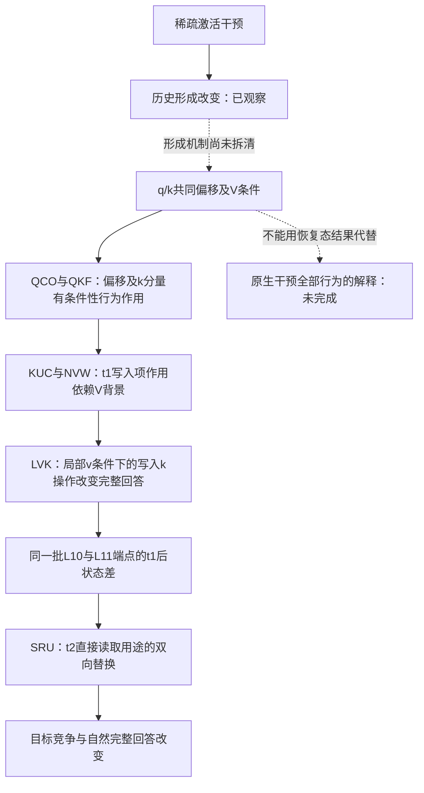

# Acupuncture 缓存机制线：理论与实验证据骨干

> 历史证据快照。后续实验、解释更正和当前边界见[2026-11-04统一归档](RESEARCH_ARCHIVE_2026-11-04.zh-CN.md)。本页原数值与日期保留；旧“尚未／下一步”不作为当前状态。

日期：2026-11-03。证据快照：`d330bb35`，包含 SRU 结果及 `86dbc45` 的解释更正。本文件整理已有理论、合同、报告和归档分析，不新增实验、运行授权或推广计划；推广工作由另一条工作流负责。早期综述保留历史身份，本文件作为截至 SRU 的主线入口。

## 1. 核心问题与当前答案

后续推进见[三项 To-do](cache-mechanism-todo.zh-CN.md)。第一项的[用途拆分方案](cache-native-bridge-plan-v1-2026-11-03.zh-CN.md)尚未运行，不属于本骨干的实验证据。

**核心问题：少数通道的激活干预，怎样改变模型的写入、旧状态处理和后续读取，最终造成显著的回答变化？**

当前最有实证支撑的答案是：在指定模型、编号任务和恢复背景中，干预后形成的 k 相关差异具有可操纵的行为作用；这一作用可以主要由 t1 更新式的新值写入项产生，且强烈依赖该项使用的局部 v。两种写入操作形成的递推状态差，在 t2 通过直接读取这一计算用途，能够双向改变目标竞争与完整回答。

这已经接通一段**有条件的写入—读取—行为作用链**。尚未接通的是：原始针如何具体形成共同偏移与相关 V 变化，以及上述条件性作用怎样完整解释未经恢复的原生干预行为。不能把后半段的成功替换当作前半段已经完成的证明。

### 两条证据链如何对应

| 环节 | 理论链：架构允许什么、条件下能推出什么 | 实验链：实际验证了什么 | 当前状态 |
|---|---|---|---|
| ① 激活入口 | 投影前的激活变化经线性映射进入残差，继而改变后层计算 | 既有原生时序与缓存研究记录了历史形成和后续行为变化 | 入口操作明确；形成机制未完整识别 |
| ② 历史形成 | 当前驱动与已有状态共同决定下一状态；撤针不撤回历史 | QCO 识别各方向内共享的 q/k 缓冲偏移，并做去除/加入；QKF 分出 k 的作用 | 现象与干预关系成立；偏移形成原因未闭合 |
| ③ t1 写入 | k 同时进入旧预测修正和新值写入，v 进入写入项 | KUC 分别操作两项；NVW 检验 V 背景；LVK 把 V 条件落实到当步局部 v | 明确的条件性写入作用 |
| ④ 状态承载 | 更新留下 S，也会通过输出改变下游缓存 | KRD/KHC 给出历史包和 S 的条件性载体证据；LVK 产生 SRU 直接使用的端点 | 载体证据有条件；不是全模型仅有 S |
| ⑤ t2 使用 | 旧 S 在输出中进入直接读取 D 与修正贡献 E | SRU 对 LVK 两端点的 D/E 用途做双向替换，D 的行为作用占优 | 同一端点上的读取计算证据 |
| ⑥ 输出与回答 | 局部输出经后层、输出头和生成反馈变为 token 与序列 | M 与自然完整回答分别记录；直接读取操作改变正确答案数 | 行为连接成立；尚无一般语义与误差预测理论 |

实线表示指定实验条件下有操作证据；虚线表示尚未由同一条原生路径证明的衔接：

图不是自然中介识别图。前几段切换过背景和操作，具体可衔接程度见第 5 节。

## 2. 对象、符号和终点必须固定

主实验模型为 Qwen3.5-4B，冻结 revision `851bf6e8…`，具体全哈希、软件与核路径以各合同和回执为准。后期主线沿用 L0 形成干预、NA 布局、B1 窗口和既有校准；N4146、N1210、R0 为三个有回答缺口的方向，C1343 为诊断方向。R0 是形成期随机方向，**不是**随后 k 编辑的随机对照；后者在 QCO/QKF/KUC/NVW 等实验中另有定义。

| 符号 | 本文含义与防混淆约定 |
|---|---|
| t1、t2、t3 | 形成边界后输出首 token、下一 token、再下一 token 的计算步；不是提示中的第 1/2/3 个 token |
| S | Gated DeltaNet 的递推矩阵状态；采用 key×value 方向 |
| q、k、v | 进入递推核的当前向量，q/k 已按原核处理；不是未经卷积、激活与归一化的缓冲值 |
| 卷积 q/k/V 历史 | 短卷积输入缓冲的相应通道；大写 V 历史与当前小写 v 必须区分 |
| C、T | 完整干净来源与原生受干预来源 |
| V、F 背景 | V：T 上恢复指定 G 层的卷积 V 历史；F：进一步恢复 q/k 历史。F 的其他状态仍来自 T，**F 不等于完整干净 C** |
| L00/L01/L10/L11 | LVK 的局部 v×写入 k 四格：原 v/影子 v × 原 k/影子 k；旧预测修正项保持原 k |
| D、E、W | 本文只指核输出中的直接读取、旧预测修正贡献、新值写入贡献。历史报告中的停止分数 D、状态分解 D=αS 等同名字母不沿用 |
| G 首步分差 | 旧 F 首 token 对解析器停止集合最大 logit 的差；没有固定“天花板”，不能替代实际停止 |
| M | 共同强制前缀下目标区别 token 对固定竞争 token 的 logit 差；目标非首列 32 条为主，先逐输入配对、再六场景等权 |
| Y | 自然生成的完整正确交付；每面板全部 48 条计数，包含停止与失败，不以“已开口”筛分母 |

当前干预的 G 层集合为零起算 `[13,14,16,17,18,20,21,22,24,25,26,28,29,30]`。它是 14 层操作，不是“只改一个层头”的结果；与最初稀疏针的坐标数量也不是同一概念。

自然路线和强制前缀路线分开解释。SRU 的 L10/L11 共 384 个首 token 中，有 6 个 L10 首 token 不等于共同前缀（N4146 两个、N1210 四个）；这些轨迹没有被删除，也不能把 t2 一概叫作其记录选择步。冻结标签是操作性判据，不是统计显著性；层、头、方向和同场景输入不能一并当独立重复样本。

## 3. 理论证据链：逐环的等式、假设与推论

本节是既有架构定义和条件性推导，不是新的实测发现，也不提出新颖性主张。来源为[基础审计及固定版本源码索引](cache-mechanism-known-basics-audit-2026-10-31.zh-CN.md)、[Gated DeltaNet 原论文](https://arxiv.org/html/2412.06464)，具体数值路径由各实验工程验收约束。

### T1. 少数坐标如何进入后续计算

若在 down projection 前给激活向量 a 加上 ηe_j，在同一线性映射处有

\[
\Delta h=\eta W_{\mathrm{down}}e_j.
\]

η 是实际实施的激活改变量，须包含实验规定的校准，不把名义剂量当实际残差幅度。单坐标修改不保证扰动小，也不自动保证功能特异。后续归一化、注意力、门和 MLP 会改变传播，不能把这一个线性等式外推为全模型线性。

固定输入 token 时，本层 MLP 干预不会逆向改变本层已经完成的注意力更新；它可以影响后层与以后步骤。自由生成分叉后，输入 token 也会变化，固定输入下的路径约束不能直接套给整条自然轨迹。

### T2. 当前驱动与历史一起形成下一状态

对一个头、一个局部计算，令

\[
A_t=\alpha_t(I-\beta_tk_tk_t^\top),\quad
B_t=\beta_tk_tv_t^\top,\quad
S_t=A_tS_{t-1}+B_t.
\]

比较两条轨迹 a、b，定义 Δ 为 a−b，则严格有

\[
\Delta S_t=A_t^{(a)}\Delta S_{t-1}
+(A_t^{(a)}-A_t^{(b)})S_{t-1}^{(b)}
+(B_t^{(a)}-B_t^{(b)}).
\]

三个来源是旧差异传递、对同一旧来源的不同处理、当前写入差异。它们会抵消或强化，并非三个独立机制份额。撤针只终止新的入口修改，不强制后续驱动或 ΔS 归零。

若两条局部计算的 k/v/α/β 完全相同，则只剩 ΔS_t=A_tΔS_{t−1}。在当前规范化与门范围下，‖k‖≤1、0≤α,β≤1，得到

\[
\|\Delta S_t\|_F\le\alpha_t\|\Delta S_{t-1}\|_F.
\]

这是固定驱动的局部收缩界。它不保证整模型行为收缩，也不排除不同驱动、读方向、后层或生成反馈放大行为差异。因此“有递推，所以旧差异必在递推内自发放大”不是我们的理论。

### T3. k 的两个用途与 v 的条件

展开 t1 更新：

\[
S_1=\alpha_1S_0
\underbrace{-\alpha_1\beta_1 k_1(k_1^\top S_0)}_{E_1^S：旧预测修正}
\underbrace{+\beta_1k_1v_1^\top}_{W_1^S：新值写入}.
\]

两项共享 k、β。KUC 把两项的 k 来源拆开是人工反事实，不证明天然存在两条独立通道。

**仅在同一局部驱动下、只替换 W 中的 k、固定 v/β/S₀ 与 E**时，

\[
\Delta S_1=\beta_1\Delta k_1v_1^\top.
\]

再在同一局部驱动下比较两种 v，写入的差中差为 β₁Δk₁Δv₁ᵀ。这说明局部更新本来就依赖 k 与 v 的联合变化；“出现某个局部交互”不是独立机制发现。实验未知是这种操作能否解释指定背景中的 M 增强与完整答案变化。

在实际 14 层实验中，浅层操作会改变深层输入、v、门和缓存。因此整个端点的状态差不能一概写成同一个孤立秩一项，更不能把这个局部等式称为全模型中介分解。

### T4. 状态怎样进入下一步输出

原核先更新再读出，o₂=S₂ᵀq₂；于是

\[
o_2=\underbrace{\alpha_2S_1^\top q_2}_{D_2}
\underbrace{-\alpha_2\beta_2(k_2^\top q_2)S_1^\top k_2}_{E_2}
+\underbrace{\beta_2(k_2^\top q_2)v_2}_{W_2}.
\]

固定当前驱动，仅比较旧 S，则

\[
\Delta o_2=\Delta S_1^\top\alpha_2
\left[q_2-\beta_2k_2(k_2^\top q_2)\right].
\]

所以状态范数差不等于读出差；是否沿当前有效读方向投影很重要。但**D 强于 E 不是恒等式**：若 q₂=k₂、‖k₂‖=1、β₂=1，两项差可完全抵消；若 ΔS₁ᵀk₂=0，E 的差为零，D 仍可能非零。

把 T3 的理想局部写入差代入 D，有 ΔD₂=α₂β₁(Δk₁ᵀq₂)v₁。这给出可理解的局部关系：改动的写入方向怎样与后续查询对齐，决定该写入差怎样被直接读到。它不赋予 v“正确答案内容”的语义，也不保证输出 logit 朝正确方向变化。

### T5. 从局部读出到回答，公式没有自动补完

o₂ 还要经过 gated norm、输出投影、残差、后续层和词表头。自然生成又把所选 token 反馈到之后的计算。因而必须分别测量局部张量、条件 M、实际停止与自然 Y。

M 上升不必跨过行为边界，跨过指定两 token 的边界也不保证赢过全词表或完整交付。C1343 的“分差动、答案不动”正是解释必须容纳的结果。当前尚无从任意针坐标、输入内容直接预测最终 Y 的解析理论。

## 4. 实验证据链：每一步增加了哪条约束

下列数字均来自第 8 节链接的归档结果；背景切换与反例属于证据本身。主链用 QCO→QKF→KUC→NVW→LVK→SRU 表达，QKD/QSR 与 KRD/KHC 为诊断和载体支撑，不冒充同一端点上的必经串联。

### E0. 历史形成确实改变，但入口解释仍不完整

早期 CFM-S2 的同起点比较中，窗口第一步同时出现新写入差异与旧来源处理差异，且部分相抵；撤针后也仍有后续写入差异。它排除了“只有相同驱动下旧差异被带下来”的简单叙述，但这些计算分账不识别各项独立的行为贡献。

CFM-S3 的停止侧结果比事实使用侧清楚，事实使用的多数组合因随机参照幅度大而证据不足。早期的停止窗口、事实任务与后期编号任务不是同一实验面板。它们提供背景和约束，不能直接拼成“所有行为已由同一路径解释”。

**交给下一环：** 历史有受干预形成的变化，需要找到可以具体操作且关联回答的变量，而非只看距离或恢复整份缓存。

### E1. QCO：从整体历史差异到可操作的共同偏移

在每个形成方向内，用其他五场景估计卷积 q/k 旧槽的共同偏移 μ。每输入实际差与 μ 的平均余弦为 0.97–0.99；这是缓冲空间的几何描述，不是归一化后核 k 的等式。

在 **V 已恢复、其他状态仍受干预**的背景中：

- 去除共同 q/k 偏移，三个方向的完整正确数由 16/28/38 增到 47/48/48（各分母 48）。
- 把偏移加回 F 的 q/k，分别有 48/47/46 条逐 token 重现 V 的自然输出。
- 随机加入也能造成大量类似错误；定向去除明显优于随机，加入的方向特异性更弱。

**推出：** 各方向内的共同变化有条件性行为作用。**未推出：** 所有针共用一条方向，或入口只通过该偏移起作用。为什么针形成这一偏移，仍是前半段缺口。

### E2. QKF：把共同偏移的行为作用落实到 k 分量

只去除 k 半，三个方向正确数达 44/48、48/48、48/48；只去除 q 半为 16/48、28/48、40/48。预设“k 强于 q”的排序在 N4146/N1210 成立，R0 未满足完整排序条件。

q 半操作对归一化后的 q 改变较小；不能据其弱效应推出读取无关。随机 k 加入也可致错；k 转角是伴随观察，未被单独操纵。

**交给下一环：** 需要解释 k 的作用发生在什么时候、通过更新式的哪个用途，而非用“k重要”作为终点。

### E3. QKD/QSR：诊断把问题引向历史，但简单单项解释失败

QKD 中，仅换 t2 当步 k 的局部反事实仍留下实际核输出差的 91–98%；较大差异落在 D。预期的局部旧预测 H 主导没有成立，J/H 大致各半。

QSR 继续把 ΔD 分成 S/q/α：Rk−V 三个缺口方向均为 mixed，没有生成候选卡；不能说 ΔD 全部由 S 差承担。这里的局部份额不是 logit 因果贡献，更不是回答机制比例。

**交给下一环：** 仅做代数分账不足以回答行为机制，必须对历史和具体计算做操作。这些失败没有被后续阳性抹掉。

### E4. KRD/KHC：历史和 S 的载体作用有条件证据

KRD：交换 t1 后历史包 H（递推 S＋新增注意力 KV），可转移端点 M 缺口的 35–78%，并改变自然回答；H 与 t2 q 联合交换为 75–90%。剩余差额不能直接归给卷积通路。

KHC：**在 q 固定为供体的前提下**拆 H，S 单项效应约为 S+KV 联合效应的 0.96–1.03，KV 对指定 M/Y 的作用较小；例如 N4146 的 V←Rk，S 单项与联合都使正确数 16→40。

**推出：** S 是这一条件下的重要载体。**未推出：** q 自由时仍是同样比例、KV 普遍无用，或 S 是原生全过程唯一必要载体。SRU 后来采用另一对端点和自由响应的 q，属于新的证据，不能说它取消了 KHC 的条件。

### E5. KUC：k 的行为作用可以由 t1 新值写入项产生

只在 t1 的 14 个 G 层替换 k 的两个用途：旧预测修正项、写入项、两项联合；后续正常响应。影子 k 来自同一分支当前输入和编辑过的历史克隆，不写回卷积历史。

在 V/F 恢复背景中，R/A 的写入单项 M 效应为当步完整 k 替换的 0.98–1.06；只换修正项比例约 −0.05 到 0.03，完整正确数不变。N4146 修复侧，只换写入使正确数 16→42；只换修正仍为 16。

这是**计算用途的条件性充分性证据**，不是独立天然通路或自然中介比例。随机加入 Z 也呈写入项承担的形态，故不能说共同偏移独有此机制。

**交给下一环：** 已知效果能在 t1 写入项产生，但其强度是否依赖先恢复 V，必须核实。

### E6. NVW：原生背景阴性迫使解释包含 V 条件

未恢复 V 时，R 的 M 只变 +0.28/+0.41/+0.13；自然完整交付未达多场景改善，N1210 仅 0→1/48，其余为 0。恢复 V 后，同类操作的 M 变化和完整回答变化明显增强，R/A/Z 三族均有稳定跨背景交互。

因此，“改 k 写入本身即可解释原生停止或完整修复”被否定；条件性 k 作用仍保留。整体 q/k 恢复参照 Q−T 很小不构成选择性写入操作的效应上限。

另一个解释也失败：旧状态预测量并不远小于 v，状态空间修正变化量约为写入变化的 0.55–0.66。故修正项行为弱不能简单解释成其张量变化太小。v/写入幅度约增 25% 与 M 增强不成线性比例，也不能排除非线性幅度作用。

**交给下一环：** 需把 V 背景条件落实为局部计算，不能只以“恢复 V 才有效”停止解释。

### E7. LVK：把 V 条件落实到 t1 写入项的局部 v

在 T 背景做局部 v×写入 k 四格。影子 v 只恢复干净来源的 V 历史、仍使用本分支当前输入，故称“干净 V 历史条件下的局部 v”，不称完整干净内容。

旧、新两个 48 输入面板的三个缺口方向均有正 I_local(M)，局部交互/整体 V 恢复交互为 0.87–0.97。更重要的是，局部 v 条件下增加 k 操作，完整正确数净增旧面板 25/20/11、新面板 23/21/10，六组均无改坏。

这里 I_local=[M(L11)−M(L10)]−[M(L01)−M(L00)]，I_block=[M(VW)−M(V)]−[M(L01)−M(L00)]；比较的是 k 效应被两种 v/V 操作增强多少，不是比较两个恢复臂各自的总收益。

新面板的原值为：

| 方向 | 局部 v（L10） | 局部 v＋写入 k（L11） | 整体 V＋写入 k（VW） |
|---|---:|---:|---:|
| N4146 | 16 | 39 | 44 |
| N1210 | 27 | 48 | 48 |
| R0 | 37 | 47 | 48 |

分母均为 48。87–97% 仅为 M 交互比，不是准确率恢复或机制份额；保留 V 历史在 M 均值上的调节较小，不代表完整回答无关紧要（39 与 44 相差五条）。

L10=V、L11=VW 的 t1 输出一致是结构与工程桥接；t1 后旧 V 槽不同，**完整回答近似恢复是实验结果，不是恒等式**。当前的 S 差包含整个 t1 上下游响应，不是每层只有孤立的 βΔkvᵀ。

**交给下一环：** 已形成有明确完整答案差异的 L10/L11 端点，可直接询问它们的状态差怎样被使用。

### E8. SRU：同一写入端点的状态差通过 t2 直接读取获得行为作用

直接沿用 LVK 新面板的 L10/L11，先重建 t1 后 S₁。t2 分别让 D、E 或两者使用另一端点的 S₁；当前 q/k/v/门来自本分支，不钳制供体 q；每层返回其当前驱动下的原生 S₂，不把供体 S 直接接管到缓存。

具体操作为 o_ab=o_native+a·α(S_d−S_r)ᵀq−b·αβ(kᵀq)(S_d−S_r)ᵀk，a,b∈{0,1}。00 是接收者，10 只换 D，01 只换 E，11 联合；两端点各做一次接收者。11 只在同一局部驱动的当步输出上对应供体 S，不是供体整条轨迹。

三缺口方向获得/撤回两侧都达到冻结的 direct_dominant 标签；六个配对的 D 操作在各自六场景的 M 方向均一致。D 单项/联合 M 效应比为 1.02–1.09，联合/原端点 M 缺口为 0.73–0.86。

| 方向 | 获得侧：基线→只换 D / 只换 E / 联合 | 撤回侧：基线→只换 D / 只换 E / 联合 |
|---|---|---|
| N4146 | 16→34 / 15 / 33 | 39→18 / 42 / 19 |
| N1210 | 27→42 / 26 / 42 | 48→33 / 48 / 34 |
| R0 | 37→45 / 34 / 45 | 47→36 / 48 / 38 |

完整回答分母均为 48。D 操作不只是改变内部量；它能双向改变行为。E 的作用较小且反向：获得侧稍减正确数，撤回侧稍增或不变；不能说 E 为零。C1343 上 M 变化但全 48 条仍正确。

**最强结论：** 对这对写入端点，t2 直接读取旧状态这一用途足以获得或撤回相当部分目标优势与完整回答，效果与 D/E 联合操作接近。

**没有推出：** D 是全部自然效应的唯一中介；后续缓存无作用；73–86% 是机制完成度。浅层输出会改变深层输入和新缓存，t2 生成 token 也会影响后续。报告中的短编号选择/完整交付对应不能推广为一般回答在 t2 决定；六条非共同首 token 输入保持单列。

## 5. 连接审计：哪些环节能接，哪些只能并列支持

| 接口 | 可连接的依据 | 必须保留的断点或条件 |
|---|---|---|
| 原针→共同偏移 | QCO 同输入 C/T 历史差、跨场景估计及双向编辑 | 观察到偏移并能编辑，不等于解释了偏移怎样形成；其他内部差异并存 |
| QCO→QKF | 继承相同输入、形成来源、μ，分开 q/k 编辑并桥接旧参照 | 缓冲中的 μ_k 不等于核中归一化 k 的直接加法 |
| QKF→KUC | KUC 完整当步 k 替换与原持续编辑端点 t1 相同，除残留卷积 k 旧槽 | t2 以后不完全等同；持续历史编辑与单步内核编辑不同 |
| KUC→NVW | V/F 一侧相关臂 t1、C-t2、自然 token 与旧存档逐位桥接 | 未恢复背景的阴性不被恢复背景阳性覆盖 |
| NVW→LVK | 旧 L00/L01 与 T/写入臂桥接；L10/L11 与 V/VW 全层 t1 等价，除 V 旧槽 | t1 等价不保证完整序列等价；局部 v 不等于完整 C 的 v |
| LVK→SRU | 同一新面板 L10/L11；t1、00 的 C-t2 和自然完整 token 与 LVK 逐位桥接 | 最紧的一段连接，但 SRU 是读出用途反事实，不是把整个自然中介过程固定后删除 |
| KRD/KHC→SRU | 均支持历史/S相关操作可以影响回答 | 端点不同、q 条件不同、持久交换与一次输出替换不同；只作定性支撑，不能相乘比例 |

**因此可以把已有结果组织成连续研究论证，但不能把所有箭头压成一个已识别的原生自然中介模型。** 后半段 LVK→SRU 的端点衔接最直接；前半段依赖多个有明确条件的干预比较。

## 6. 解释必须同时容纳的反例和失败

| 证据约束 | 排除的过强说法 | 仍可保留的解释 |
|---|---|---|
| NVW 原生背景完整交付无多场景改善 | 写入 k 修复已解释原生停止 | k 的行为作用依赖 V 条件 |
| 随机 k 加入也致错，KUC/KHC 形态相似 | 共同偏移拥有独占计算机制 | 特定偏移去除有较强定向修复；一般扰动可共享计算用途 |
| QKD 旧预测主导失败，QSR 无单项候选 | 大张量份额即可识别行为原因 | 分账用于提出可失败预测，行为关系需操作检验 |
| NVW 修正变化量并不小 | 修正项行为弱只是因为变化量小 | 行为效应依赖投影、传播与背景，具体原因仍未解释 |
| C1343 分差移动但恢复背景答案满分 | 相似局部变化必然致错；M 等于 Y | 竞争余量和全序列生成条件不可省略；原生 C1343 并非始终 48/48 |
| LVK 的 V 残留使新 N4146 多对五条 | 平均 M 调节小等于历史无行为作用 | 连续读数和离散完整回答分别判断 |
| SRU 联合替换未达到供体全部行为 | 直接读取为唯一通路、剩余可按部件分账 | 识别的是一次输出使用操作的条件性效应 |
| 早期首字母提示捷径、固定45头完整交付失败 | 停止修复规则就是答案机制 | 保留共同前缀、完整回答与失败对照的区分 |

早期捷径与固定头边界见 [FC](../experiments/cache-first-token-continuation-v1-2026-11-02/REPORT.zh-CN.md)、[SP](../experiments/cache-shared-prefix-continuation-v1-2026-11-02/REPORT.zh-CN.md)、[FX](../experiments/cache-fixed-v-delivery-v1-2026-11-02/REPORT.zh-CN.md)。这些约束不单独包装成新的机制发现。

## 7. 课题可以承担的中心主张

> 在所研究的 Qwen3.5-4B 编号任务和指定干预背景中，稀疏激活干预形成了具有条件性行为作用的 q/k 历史偏移。对其中 k 分量的操作，其后续回答效应可以主要由 t1 新值写入项产生，并依赖该写入项使用的局部 v。沿用这两种写入端点，在 t2 直接读取中替换其递推状态信息，能够双向改变目标竞争和完整回答，而旧预测修正贡献的单项替换较弱且多为反向。由此，研究从历史材料的恢复推进到一段有干预支持的写入—读取—行为计算关系。

这段话依赖三种不同强度的证据：**架构定义说明计算对象；条件推导约束可能机制；模型干预确认特定操作的实际行为作用。** 三者互相支持，不能互相冒充。

仍未闭合的三个内部问题，不在本文件扩写为新实验：

1. **入口形成：** 为什么这个针形成这类共同偏移和 V 条件，哪些上游计算负责？目前识别了结果和可操作变量，尚无完整形成解释。
2. **状态与目标的对应：** 状态差中哪些方向、特征与目标记录有关，如何在看最终答案之前预测读出方向和行为边界？k=地址、v=正确内容只是可能类比，不是已确立语义。
3. **原生全链：** 恢复背景的写入/读取作用如何与原生停止和其他行为联合起来？现有阴性要求保留条件依赖，不能声称全部原生效应已解释。

后续材料应明确它补哪一个环节、使用哪对端点、改变哪个结论；本文件不安排推广工作，不展开层头扫描，也不要求解释每个剩余百分比才能形成阶段性结论。

## 8. 来源、工程可信度与本次核对范围

以下各项均可从报告进入分析 JSON、冻结记录和原始响应。链接指向仓库路径；本次读取的版本统一为顶部证据快照，历史冻结合同不被本综述改写。

| 实验 | 正式报告 | 合同 | 正式运行与回执目录 |
|---|---|---|---|
| CFM-S2 | [报告](../experiments/cache-formation-mechanism-s2-formation-test-v3-2026-10-31/REPORT.zh-CN.md) | [合同](../experiments/cache-formation-mechanism-s2-formation-test-v3-2026-10-31/CONTRACT.zh-CN.md) | [formal-r01](../experiments/cache-formation-mechanism-s2-formation-test-v3-2026-10-31/runs/formal-r01/) |
| CFM-S3 | [报告](../experiments/cache-formation-mechanism-s3-route-intervention-v3-2026-10-31/REPORT.zh-CN.md) | [合同](../experiments/cache-formation-mechanism-s3-route-intervention-v3-2026-10-31/CONTRACT.zh-CN.md) | [formal-r01](../experiments/cache-formation-mechanism-s3-route-intervention-v3-2026-10-31/runs/formal-r01/) |
| QCO | [报告](../experiments/cache-common-offset-v1-2026-11-02/REPORT.zh-CN.md) | [合同](../experiments/cache-common-offset-v1-2026-11-02/CONTRACT.zh-CN.md) | [formal-r01](../experiments/cache-common-offset-v1-2026-11-02/runs/formal-r01/) |
| QKF | [报告](../experiments/cache-qk-component-factor-v1-2026-11-02/REPORT.zh-CN.md) | [合同](../experiments/cache-qk-component-factor-v1-2026-11-02/CONTRACT.zh-CN.md) | [formal-r01](../experiments/cache-qk-component-factor-v1-2026-11-02/runs/formal-r01/) |
| QKD | [报告](../experiments/cache-k-computation-diagnostic-v1-2026-11-03/REPORT.zh-CN.md) | [合同](../experiments/cache-k-computation-diagnostic-v1-2026-11-03/CONTRACT.zh-CN.md) | [formal-r02](../experiments/cache-k-computation-diagnostic-v1-2026-11-03/runs/formal-r02/) |
| QSR | [报告](../experiments/cache-state-readout-decomposition-v1-2026-11-03/REPORT.zh-CN.md) | [合同](../experiments/cache-state-readout-decomposition-v1-2026-11-03/CONTRACT.zh-CN.md) | [formal-r01](../experiments/cache-state-readout-decomposition-v1-2026-11-03/runs/formal-r01/) |
| KRD | [报告](../experiments/cache-k-repair-dependence-v1-2026-11-03/REPORT.zh-CN.md) | [合同](../experiments/cache-k-repair-dependence-v1-2026-11-03/CONTRACT.zh-CN.md) | [formal-r02](../experiments/cache-k-repair-dependence-v1-2026-11-03/runs/formal-r02/) |
| KHC | [报告](../experiments/cache-k-history-carrier-v1-2026-11-03/REPORT.zh-CN.md) | [合同](../experiments/cache-k-history-carrier-v1-2026-11-03/CONTRACT.zh-CN.md) | [formal-r01](../experiments/cache-k-history-carrier-v1-2026-11-03/runs/formal-r01/) |
| KUC | [报告](../experiments/cache-k-update-causal-v1-2026-11-03/REPORT.zh-CN.md) | [合同](../experiments/cache-k-update-causal-v1-2026-11-03/CONTRACT.zh-CN.md) | [formal-r01](../experiments/cache-k-update-causal-v1-2026-11-03/runs/formal-r01/) |
| NVW | [报告](../experiments/cache-native-v-write-interaction-v1-2026-11-03/REPORT.zh-CN.md) | [合同](../experiments/cache-native-v-write-interaction-v1-2026-11-03/CONTRACT.zh-CN.md) | [formal-r01](../experiments/cache-native-v-write-interaction-v1-2026-11-03/runs/formal-r01/) |
| LVK | [报告](../experiments/cache-local-v-k-v1-2026-11-03/REPORT.zh-CN.md) | [合同](../experiments/cache-local-v-k-v1-2026-11-03/CONTRACT.zh-CN.md) | [formal-r01](../experiments/cache-local-v-k-v1-2026-11-03/runs/formal-r01/) |
| SRU | [报告](../experiments/cache-state-read-use-v1-2026-11-03/REPORT.zh-CN.md) | [合同](../experiments/cache-state-read-use-v1-2026-11-03/CONTRACT.zh-CN.md) | [formal-r01](../experiments/cache-state-read-use-v1-2026-11-03/runs/formal-r01/) |

工程可信度与科学解释分开：

- 报告记录无操作重放、原端点桥接、影子来源不变与局部 FP64 核对；KUC/NVW/LVK 最大相对误差约 2×10⁻⁷，SRU 公式/原核参照误差约 3×10⁻⁸。通过说明所定义操作被正确实现，不证明自然机制唯一。
- 本次读取 QCO 至 SRU 十个实验的正式 worker 回执：状态均为 completed；每轮 27+21 条输入记录，LVK 为 54+42（旧/新两面板）。QKD/KRD 使用修复后正式 r02，未用失败预检冒充科学结果。
- 本次核对报告、关键合同、正式回执与 LVK/SRU 分析数据；LVK/SRU 共 144 份输入记录的 SHA256 均与正式回执相符，文档相对来源链接逐项检查通过。没有加载模型、重跑 GPU 或重算服务器的大张量。属于已有证据审读与文档自查，不是独立模型复现。
- 既有文献的新颖性边界沿用[合并文献审计](literature/merged-prior-art-artemisinin-2026-11-01.zh-CN.md)；本文件不作新的穷尽查重或首次发现主张。

## 9. 文档逻辑自查

这是作者自查，不是独立评审；本文件没有新实验设计，故不将设计清单通过或工程通过冒充新的科学结论。

1. **是否把公式当发现？** 否。T1–T5 独立列为定义/条件推导；真正新增的是具体操作与回答的联系。
2. **是否把不同条件拼成自然全链？** 否。第 5 节逐接口标出持续编辑/单步、恢复/原生、固定 q/自由响应、旧/新面板的差别。
3. **是否把 KUC 的 E 和 SRU 的 E 混为一项？** 否。前者是 t1 状态更新项中的 k 用途，后者是 t2 输出中旧状态修正贡献的 S 用途，时刻与操作对象不同。
4. **是否把局部秩一差当全部状态差？** 否。限定同一局部驱动，并保留上游操作导致深层驱动与新缓存变化。
5. **是否把读数等同回答？** 否。M、实际停止、Y 分列，C1343 与六条首 token 例外保留。
6. **是否抹掉阴性与随机对照？** 否。NVW 原生阴性、QKD/QSR 失败、修正变化量不小、随机同形与早期交付失败均直接约束中心主张。
7. **是否把比例变成解释完成度？** 否。各分母按原实验保留，不跨实验相乘，不把未转移差额分成独立部件份额。
8. **是否擅自扩展任务？** 否。交付一份骨干及导航，不新增推广方案、模型实验或运行预算。

**当前定位：计算形式清楚，条件性的写入—读取—行为链已有实证；入口形成、状态语义及原生全链尚未完整解释。**
