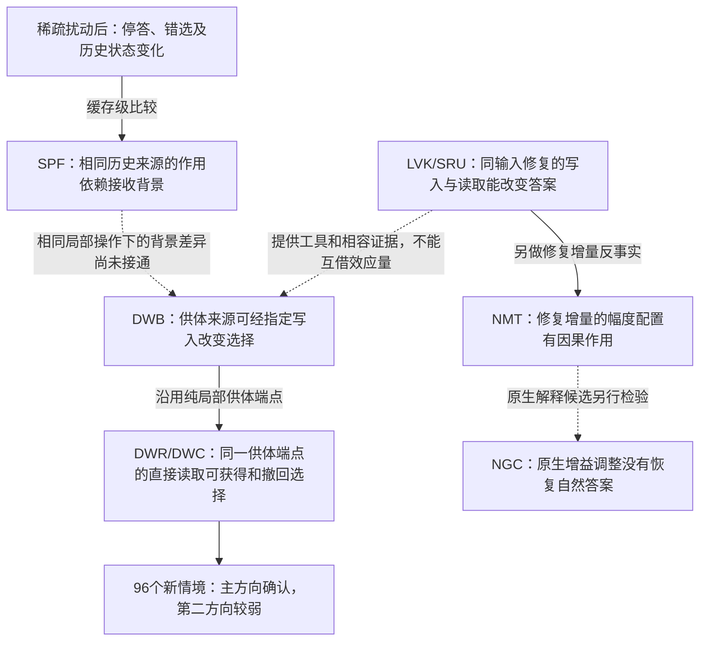

# 现有缓存机制结果支持怎样一篇论文

2026-11-11；证据截点包含NGC-01正式结果，仓库基线`a303e14644dbc8cc6730a5a46a53c46c48f8c45e`。这是现有证据的解释、论文定位与论证框架，不是新实验方案，也没有改写已审论文或历史结果。本文不作录用概率判断，不把目录数或AI审稿分数当研究贡献。

**现有结果支持一篇关于“受扰模型怎样利用历史信息来选择答案”的条件性因果研究。我们已经找到了能定向改变答案的一段写入—读取关系，并确认它具有背景和方向限制；尚未识别稀疏干预自然造成全部停答、错答的原因。**

这里有必要澄清上一轮“停止冲刺”的含义：NGC阴性意味着这次增益补证没有带来期待的新增解释，不能据此说已有论文没有发现。允许可靠地解释重要的一部分，不要求论文先解决整个模型的所有失效。但也不能把不同背景下的阳性相接处写成已经测过。

## 1. 这篇论文实际在问什么

给模型一份短台账，例如绿纸盒是U63、黑纸盒是U52、黑茶杯是U41，再问某个物品的编号。模型本来会答；在读入提示的一段时间里，改变少数激活坐标后，它可能直接结束，也可能开始回答却选错记录。

我们问的是：**变化经过了哪些历史状态和计算，才影响最终答案？** 重点在推理时的内部状态；模型权重没有被修改。“一根针”是一个激活坐标的干预方向，通常在一段token窗口反复施加；少坐标不等于小扰动，更不是已经找到具有唯一语义功能的神经元。R0是随机方向，不能叫第四根天然神经元。

模型里要分开三类历史：短卷积缓冲保留最近几步用于构造当前表示的材料；递推状态S累计此前的计算；全注意力KV是另一套历史存储。它们可以相互影响，当前证据没有给它们划出固定、普遍的语义分工。

所谓“写入”，是在最后一个提示token处，把当前表示写进递推状态；所谓“读取”，是在处理第一个生成token时，让旧状态参与下一次输出。主要局部操作同一时刻覆盖14个指定GDN层，不是单独一层、一个头或整条自然路径。后续层和生成会自由响应。

判断时始终分开三件事：模型有没有交付答案，交付时选了哪条记录，以及原来的历史状态换到其他条件下是否仍能影响选择。内部打分变好，不自动等于完整答案变好。

## 2. 可以承担的核心claim

**建议标题：稀疏激活扰动后的历史信息利用与答案选择。** 可以加副标题“Qwen3.5-4B中的条件性写入—读取因果分析”，直接说明实际机制覆盖。

适合摘要的一句话是：

> 在Qwen3.5-4B的记录检索任务中，历史来源对答案的作用依赖接收运行的计算背景；在指定可作答条件下，来源差异可以经最后提示步的写入和后续直接读取，定向改变完整答案。冻结操作在新材料上确认了主方向的双向作用，同时揭示方向、任务结构和增益解释的边界。

这个中心claim下面有三条主要发现和一条补充发现。

| 主张 | 用人话解释 | 最强证据 | 适用范围 |
|---|---|---|---|
| 历史来源的答案作用依赖接收背景 | 同一份别的输入留下的历史，在一种背景里能把答案带走，在另一种背景里不能 | SPF四格；受针供体状态的DWB移植 | 主要是N4146开发面板；N1210部分前提不可判 |
| 指定写入与后续读取能够定向影响选择 | 让另一个查询的历史参与一次写入，随后改变如何读这份状态，答案会相应转向或转回来 | DWB→DWR→DWC；另有LVK→SRU同输入修复链 | 这些操作及端点下的条件总效果，非唯一自然路径 |
| 这段关系能在同类新材料上作出预测 | 固定操作后再换新实体、记录和查询，主方向仍有预期效应 | DWC的96新情境、六固定结构族 | 第二方向有作用但未达预定强量级；不是跨任务或跨模型 |
| 修复信号的层头幅度配置影响修复效果 | 同一组修复方向，在不同层头上用多大力，会影响k修正及完整回答 | SIT/NMT及后续旧数据审计 | 开发性、含干净V历史参与的修复差值；不是纯原生增益机制 |

NGC提供一项必须写进论文的限制：针相关的增益差可以跨场景预测，但按原合同调整这些增益，没有恢复自然完整答案。它限制第四条向“原生致错原因”的升级，没有否定前三条。

## 3. 第一组发现：能开口、能答对、状态还有没有用，是三件事

FBR用其他场景的平均干净缓冲修复受针运行。四个方向都能开口并交付编号；N4146却只对17/48，其中16题本来就该答第一条，真正目标不在第一条的32题仅对1题。模型恢复输出格式，并不等于它找回了选择目标。

早期FC强行给出正确首字母后达到47/48，看起来很强；但不同候选共享首token后，SP四个方向合计47/48都答第一条，每方向只对4–5/12。前者部分利用了首字母已经透露答案的捷径，不能当作恢复完整选择的证据。

反方向也有结果：受针状态不一定失去全部可用信息。DWB把N1210受针形成的供体递推状态放进干净接收运行，净供体转移达到0.799；N4146同操作只有0.094。可以排除两个方向都统一“删除了选择信息”的解释；不能由N4146较弱推出它没有任何信息。

因此论文可以明确说：**仅看停止、首列错误或恢复成功，无法判定信息是否消失。** 这个判断有本项目的具体反例支撑，但不包装为首次提出存储与访问的区别。

## 4. 第二组发现：同一来源能否改变答案，取决于背景组合

SPF的做法是把另一个查询留下的干净短卷积缓冲换过来，观察接收运行是否朝供体目标回答。为了排除固定答第一条等偏差，使用净供体转移量：供体指向某一行时命中的程度，减去供体指向其他目标时仍命中该行的程度。它不是正确率，0.896不能读成“89.6%的题恢复”。

N4146开发面板的四格结果如下：

| 接收者递推状态 | 其余接收背景干净 | 其余接收背景受针 |
|---|---:|---:|
| 本输入干净状态 | 0.000 | 0.000 |
| 本输入受针状态 | 0.000 | 0.896 |

这说明，仅将受针状态放进干净背景还不足以让供体缓冲带走答案；受针状态和其余受针背景的组合才出现强效应。把自身干净状态换回受针背景，又能压住该效应。

供体身份可以通过V历史操作传递，但q/k条件重要：供体V配自身干净q/k的净转移仍为0.896；配受针q/k只有0.003，虽然开口率为0.997。能说“身份不必由供体q/k提供”，不能说“q/k无关”。

这组结果没有识别两个独立信息源，也没有证明“缓冲接管控制权”。干净背景可能恢复了对同一份信息的使用条件。N1210单独恢复自身S时32/48截断，相关状态压制比较不可判；不能把N4146的完整四格结论直接推广过去。

## 5. 第三组发现：从整块缓存，推进到写入和读取的因果作用

### 5.1 先在同一输入上修复：写入的内容条件与k共同起作用

这里v可粗略理解为拟写入的表示，k决定它与递推状态结合的方式。这是计算解释的辅助说法；v不是已经解码的“正确答案内容”。替换v时使用当前分支输入和自身干净V历史做影子计算，仍不是完整干净运行的v。

LVK在同六场景的新文本面板上得到以下自然完整正确数，每格48题：

| 方向 | 原生受针 | 只用干净V历史计算局部v | 再修正写入k |
|---|---:|---:|---:|
| N4146 | 0 | 16 | 39 |
| N1210 | 1 | 27 | 48 |
| R0 | 1 | 37 | 47 |

单独修正k、保留原生v时，几乎没有完整回答收益。把v条件调整后，同一类k操作才明显起作用。KUC还分开k在更新中的用途：在指定V恢复背景，效应主要能由新值写入项承接，旧预测修正项单独较弱。它们解释的是这项修复如何起作用。

SRU接着沿用同一对写入端点，保持接收者其他当步计算自然响应，只让下一步的“直接读取”使用另一端点的状态。正确数为：

| 方向 | 弱修复端点→读强修复状态 | 强修复端点→读弱修复状态 |
|---|---:|---:|
| N4146 | 16→34 | 39→18 |
| N1210 | 27→42 | 48→33 |
| R0 | 37→45 | 47→36 |

这已经超出“换缓存有用”：一次指定写入形成的状态差，确实可以经下一步的特定读取用途双向改变完整答案。读取操作没有把供体状态整块写进持久缓存；其输出会继续影响后续计算。D与E联合也未搬完全部端点差异，因此不能给未搬完的部分分配自然机制百分比。

### 5.2 再改变来源身份：答案能随来源转向，也能转回来

同输入修复可能只让模型一般性地更容易回答，因此DWB进一步用另一个查询作为供体。操作示意是：接收运行问绿纸盒，供体运行问黑纸盒；我们只让供体的历史参与指定写入，观察完整答案是否随供体身份改变。这是操作说明，不把示例当某条实际成功记录。

在受针接收背景且自身q/k已经恢复的条件下，只在最后提示步让供体V历史参与写入，之后不保留供体V缓冲，净供体转移仍为N4146的0.882、N1210的0.427。反过来保留供体V但将该步写入换回自身，净转移均降至样本值0；两个方向各168个选择冲突配对全部答回自身目标。

这里的“一次”是同一时刻14层联合操作。DO与DD当步输出一致是构造和工程事实；后续自然回答仍能转移，才是实测发现。全348配对中N4146反向臂尚有1条错误，不能写所有输入全部恢复。

这组写入桥接与下述纯局部端点不同：DWB桥接恢复了q/k缓冲；DWR/DWC不整体恢复缓冲，而是在t1写入用途使用自身或供体干净V历史及冻结k去偏移。两组数字不能相减为q/k的贡献。

### 5.3 这条供体链已经做过新材料确认

DWR先在48个已见输入上检验同一供体写入差异的读取；DWC随后冻结操作，生成96个新基础情境，来自六个固定结构族。864个接收输入及大量供体配对共形成81,648条正式轨迹；主统计单位是96情境，不是八万多个独立样本。

在“自身历史写入”和“供体历史写入”两个可作答端点之间，仅替换下一步直接读取所用的状态，结果如下：

| 方向 | 供体端点净转移F | 获得：更跟随供体G | 撤回：减少跟随供体W | 冲突配对答回自身的比例提升R |
|---|---:|---:|---:|---:|
| N4146 | 0.588 | 0.311 [0.291,0.331] | 0.473 [0.452,0.495] | 0.394 [0.374,0.414] |
| N1210 | 0.309 | 0.213 [0.192,0.234] | 0.294 [0.270,0.318] | 0.322 [0.299,0.344] |

括号为95%族内情境配对重抽区间。F/G/W是转移对比量；R才是冲突配对上自身正确比例的提升，不能把整张表叫准确率。

主方向N4146通过事前量级判据。N1210的获得效应为正，但整个区间低于事前0.25门槛，明确属于强量级预测失败。总体成功不代表每个结构族都同样强。

更直观地看反向操作：N4146在3456个冲突配对中，从820次答自身升至2182次；N1210从2021次升至3133次。两个方向的撤回臂均交付完整编号，所以减少供体跟随并非靠让模型不再作答实现。

但原生N4146在864个输入中仅1个自身正确、861个停止无编号；自身局部修复端点已经达到735/864正确。**我们在明确修复后的条件中解释了选择怎样改变，不能把后一步读取结果倒推成原生停答的原因。** N1210的获得臂也有少量停止，已保留分母；不是每条运行都成功。

直接读取D与旧预测修正用途E的作用不同：DWC中E的获得、撤回均小幅反向。不过补丁的方向、幅度和符号本来就不同，尚无等幅几何对照来证明它们承担普遍相反的功能。三路绑定诊断里，N4146供体端点更符合位置预测（0.561），实体和编号预测分别0.217、0.222；这区分了操作下的行为模式，没有发现“纯位置神经元”。

## 6. 第四组发现：修复的力度配置有用，但原生增益解释未成立

NVB/SIT把当步输出背景和留存的修复增量分开，说明同一修复增量在不同背景下效果不同。NMT保留该修复增量的方向，只匹配各层各头的幅度，在可作答恢复背景、固定写入k修正时得到：

| 方向 | 匹配前 | 逐层头幅度匹配 | 完整恢复来源参照 |
|---|---:|---:|---:|
| N4146 | 21/48 | 33/48 | 39/48 |
| N1210 | 36/48 | 43/48 | 48/48 |
| R0 | 42/48 | 45/48 | 47/48 |

这是一项实在的因果结果：在这套修复中，幅度配置会改变答案。另一组固定前缀分数对照显示，统一缩放所有层头或换成随机内容，不能复现逐层头匹配的同等k条件效应。该对照主要是分数层面的证据，不把它改写为表中完整回答的统一缩放对照。

定义尤其重要：所谓“原生来源增量”，是同一背景下“修复v的状态减原生v的状态”，两种来源都含干净V历史参与。匹配目标还使用配对修复运行的幅度。因此不能写“完全不借用干净信息，仅重新分配原生记忆就修好了”。匹配也没有复现全部单格效应；NMT未达到其预定跨条件迁移出口。

后续CPU分解显示幅度和等幅来源方向/结构均有作用；C1343的两者在k条件对比中可以相互抵消，虽然该恢复背景的正确数一直48/48。旧统计只能识别β与归一化k范数的乘积，不支持把行为效应归到β单独一项。

NGC随后检验更接近原生运行的候选：从其他场景预测干净/受针的增益配置差，直接调整写入用途的增益，不移植当前题干净V内容。四方向完整正确数分别为0→0、1→1、1→0、0→0（各48题），没有修复任何错题；干净反向调整也均保持48/48。增益模式有跨场景预测价值，主要行为预期却没有实现。

因此两轮并不矛盾：NMT说明含任务相关修复差值时，其力度配置有用；NGC说明这份原生增益配置调整本身没能恢复自然答案。NGC不能排除其他时刻、其他计算或补偿路线，也没有否定所有增益作用。R0损失1题涉及冻结解析器对额外未完成文字的容忍，详见[原文与评分边界](../experiments/cache-native-gain-v1-2026-11-08/REPORT.zh-CN.md)。

## 7. 其他已经完成的结果，放在哪里

下面覆盖现有缓存主线的主要证据家族及研究起点；工程重试、日志、重复归档不作为额外发现。它们不应在正文按日期堆成实验目录。

| 证据家族 | 已有结果及阴性 | 在论文中的职责 |
|---|---|---|
| 四模型单针观察、双针能力迁移 | 18,272份单针回答、其中7,632份内部轨迹，但固定问题仅8道；2B/9B各1,400题的四项能力测评受损，随机源也可损伤、生成截断多 | 研究动机和现象广度，不借给局部机制当跨模型证据 |
| 联合行为—能力、早层定位和缓存互补 | 正常语气不保证正确；只恢复某组可让24次停止降至0但旧核心匹配仅7/24，反向组合可保持24/24 | 说明仅看开口或表面风格容易误判；非安全人格或唯一载体证明 |
| CFM-S1/S2/S3、E2、形成桥接与组合 | 新写入和旧状态处理都变、可抵消；有内部停止分差承载而未复现停止的情况；事实侧多项证据不足 | 形成期背景与失败记录，不当整模型因果份额 |
| B1/B2/B3/B3P/B4、局部读取、固定头及FX | 若干局部计算候选未通过；固定45头V恢复只有7/48编号交付，严格仅编号0/48；全部V可48/48 | 排除把少数头分数作用升级成可靠回答机制 |
| FC/SP/NFC及SVQ/NR/EH/SK/NQ/QC/QCD/QST | 首token、选择、布局和覆盖条件必须分开；查询交换未按预期转移；覆盖比较还涉及施针次数和剂量 | 方法与边界附录；不能只报最强首字母结果 |
| QCO/QKF | V恢复背景去共同q/k偏移：16/28/38→47/48/48；只去k：44/48/48；只去q：16/28/40 | 局部写入链的来源；随机加入可致错，不称方向独有 |
| QKD/QSR | t2当步k替换仍留下大部分核输出差；S/q/衰减分账是混合结果 | 不把代数分解升级为答案因果解释 |
| KRD/KHC/KUC/NVW | 历史及状态有条件载体作用；新值写入项可承接k作用；未恢复V时自然答案几乎不改善 | 为LVK/SRU提供计算约束，保留原生背景阴性 |
| LVK/SRU | 同输入修复的局部v×k条件作用及同端点直接读取双向作用 | 核心计算证据，数字见§5.1 |
| NVB/NBR/SIT/NMT及幅度审计 | 留存增量作用受输出背景和幅度配置影响；旧投影归因曾更正；单格效应仍不匹配 | 修复效力解释与反例，数字及定义见§6 |
| NCC/NSR/NQK/NPC | L0恢复S可48/48；同题受损S、V、KV各自放入干净背景仍48/48；S+V、S+KV、V+KV为45/32/48，三组为2/48 | 恢复和污染不对称，不能称某一组是唯一损伤载体 |
| CGV | L12局部v使31→48/48，额外k无正向收益；27条新结构虽有分数改善，完整答案仅少量变化 | 真实范围边界；仍是编号任务，不能称机制跨任务 |
| NWR/NWC | 新面板非首列48题：原生来源送入修复端点直接读取，使41/47/46→0/11/17；但随机读取扰动也大量产生首列错号 | 确认指定撤回关系，否定首列错号的来源特异性；不等同DWC供体链确认 |
| FBR/SPF | 恢复作答不等于恢复选择；背景四格及V/q/k条件作用 | 核心问题与背景关系，见§3–4 |
| DWB/DWR/DWC | 来源—指定写入—同端点读取—完整选择，主方向独立材料确认；第二方向量级失败 | 主文最强的正向证据，见§5.2–5.3 |
| WIN-01/02、R1、协议审计 | 事实全前缀受针后恢复全部递推10/48，记录后受针47/48，前者加前段KV也47/48；新增针4个可检验格有救回，但部分预测失败并存在改坏 | 形成窗口影响恢复关系；窗口同时改变位置与次数，不叫固定前后段功能分工 |
| KVC | 事实供体KV使三个方向43/42/43个回答跟随供体（各44）；干净背景同段替换41/44 | 额外KV恢复有事实选择性；未确认SRU/DWC同一读取链跨任务 |
| NGC | 四方向零修复；增益规律与自然答案恢复分离 | 对增益主因叙事的限制，不能遗漏的最新阴性 |

该表的历史来源为[完整补充](mechanism-paper-supplement-v1.8-2026-11-08.zh-CN.md)、[研究归档](RESEARCH_ARCHIVE_2026-11-04.zh-CN.md)及[理论—证据骨干](cache-mechanism-theory-evidence-spine-2026-11-03.zh-CN.md)，它们链接每张旧卡。SDT、WPC、CWR9等未运行方案不计结果。WSP不用于补本论文的视觉证据。

跨规模能力结果完整保留：

| 模型 | MMLU | ARC-C | GSM8K严格评分 | HumanEval |
|---|---:|---:|---:|---:|
| 9B | 70.06%→25.39% | 71.50%→30.00% | 93%→0% | 70%→0% |
| 2B | 54.06%→46.00% | 52.50%→31.00% | 61%→0% | 37%→3% |

这套双通道迁移协议与L0/B1局部机制不同；数学和代码零分中包含大量截断，不能写知识被清除或所有损伤由本文链解释。原有有害行为主终点仍待独立盲评，不能当已完成阳性。

## 8. 如果现在组织论文，结构应该怎样

1. **问题与现象。** 稀疏激活扰动会显著改变回答；用短记录任务拆开交付、选择和信息可利用性。跨模型结果作动机，避免用扫描量压过机制问题。
2. **对象和操作。** 交代三类缓存、施针窗口、t1/t2、完整答案和净转移的区别。说明供体历史实际怎样进入写入，读出替换怎样执行。更新公式属于已知工具。
3. **历史来源为什么不能单独解释结果。** 用FBR、状态恢复/污染和SPF四格展示背景依赖，明确否掉的简单解释。
4. **哪些具体计算确实能改变选择。** LVK/SRU给同输入修复链，DWB给来源到写入，DWR/DWC给同端点读取与新材料确认。这是主文重心；同时展示第二方向及逐族边界。
5. **修复效力的解释及其限制。** 用NMT展示幅度配置的实质作用，随后交代NGC未把它推进成原生答案恢复。二者解释对象不同，不能把一个写成另一个的失败复现。
6. **范围与讨论。** 将NWC随机反例、CGV、WIN/KVC、模型/任务范围及未连接接口统一讨论。完整历史矩阵和失败放补充，并在主文给清楚入口。

论文逻辑应是“问题→排除简单解释→建立具体条件因果关系→前瞻确认→说明解释边界”。不应写成“一根针→增益异常→状态损坏→读取错误→全部答案失败”这样尚未实测闭合的全链。

图中箭头不是自然机制份额。C与D是不同来源对比，B与D之间的虚线尤其不能因为DWC完成而自动画实。

## 9. 论文价值与目前不足

已有贡献是：在一个受扰模型的明确任务中，给出了来源、背景、写入和读取的可干预关系，并用完整答案、反向自身恢复和新材料预测支撑它。它具备写成实证机制论文的内容；“还不是完整原生机制”不等于“只有相关性”或“没有机制结果”。

现有材料仍不足以支撑更强标题：没有证明针的行为效应主要由哪一项原生计算改变造成；没有把SPF的缓存级背景差异归因到同一局部写入关系；没有同一链跨模型或非编号任务的确认；没有通用修复算法或相对强基线的应用收益。DWC已经完成新材料确认，不能再笼统说“全是48题”“还没有任何确认”。

这篇稿的竞争力取决于这段具体认识相对近邻增加多少解释，而非是否凑齐所有未知。已有近邻审计把写读公式、一般缓存交换和“存着不等于会用”排除出宽泛首次性主张；本轮没有新做穷尽查重，因此不宣布首创。NGC后不应继续把“增益失配解释原生损伤”作为已成立的核心卖点。

**我的定位判断：有可保留、可写清的条件性机制贡献，范围和解释增量有限；此前停止本届冲刺的建议针对紧急投入，不是宣布整篇研究毫无价值，也不是要求先完整解释所有停答才允许写论文。**

## 10. 本次自查记录

本轮按以下顺序完成三次作者侧核对，未调用独立评审，也没有重新运行模型。

1. **完整性检查。** 对照v1.8正文/补充、现行核心目标、历史归档和最新NGC结果，覆盖§7的18组主要证据。补入容易遗漏的NMT完整答案恢复、NWC随机反例、DWC新材料确认、WIN/KVC事实与窗口结果及CGV边界。没有把未运行SDT/WPC/CWR9计成实验，也没有借WSP补视觉范围。
2. **因果与措辞检查。** 逐条检查背景、来源和终点。删除/排除旧报告中已更正的“q/k无关”“两个独立信息源”“只存于16–18层”等表述；明确V历史与局部v、DWB桥接与DWC纯局部端点、修复差值与原生写入、直接读取操作与持久状态移植的区别。NGC不被写成全部增益机制的否定；不以“机制未完整”抹去条件性正面贡献。
3. **数字、分母与判据检查。** 从LVK、SRU、NMT、DWC和NGC归档JSON重新提取核心表格，28项定点检查通过；DWC的N1210明确为强量级失败，非“没作用”，也非仍仅跨门槛不可判。对照报告复核SPF/DWB及历史表；保留DWC的96情境、六固定族与重复配对结构。没有把净转移当正确率、分数比例当机制份额，或把NMT原生背景的强制前缀分数当自然恢复。

机器记录见[28项数字检查与来源哈希](cache-paper-claim-evidence-2026-11-11.audit.json)。这不是全仓库逐条原始输出重算：NGC沿用本轮1008条原文复核，DWC沿用已交付的全量重算和CPU恢复验收；其他历史结果按报告、更正及已有审计读取。DWC曾有控制器冻结路径检查失败，后来恢复验收通过，不能称所有实验工程过程均一次无误。

核心结果的直接入口：[SPF](../experiments/cache-selection-precedence-v1-2026-11-06/REPORT.zh-CN.md)、[DWB](../experiments/cache-donor-write-bridge-v2-2026-11-07/REPORT.zh-CN.md)、[DWR](../experiments/cache-donor-write-readout-v1-2026-11-07/REPORT.zh-CN.md)、[DWC](../experiments/cache-write-read-confirm-v1-2026-11-07/REPORT.zh-CN.md)、[LVK](../experiments/cache-local-v-k-v1-2026-11-03/REPORT.zh-CN.md)、[SRU](../experiments/cache-state-read-use-v1-2026-11-03/REPORT.zh-CN.md)、[NMT](../experiments/cache-increment-norm-match-v2-2026-11-03/REPORT.zh-CN.md)、[幅度与等幅来源对照](../experiments/cache-write-factor-audit-2026-11-08/CONTRAST.zh-CN.md)、[NGC](../experiments/cache-native-gain-v1-2026-11-08/REPORT.zh-CN.md)。
