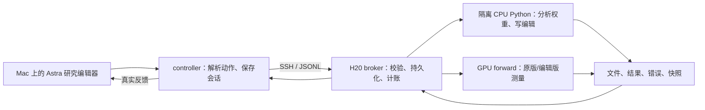

# 102．WSP文本数学与编程的工程及自主搜索

[返回总时间线](../README.zh-CN.md)

**时间定位**：已提取运行收据的最早时间锚点（可含预检） 2026-11-03T13:23:52.482287+08:00；不能当作全部子运行起止。

**当时的目的与设计**

先重建前向、测量、编译权重和研究者工具闭环，做0.8B/4B FA-01验收，再按当时授权启动数学和编程车队。作者私有服务未公开的部分属于本项目重建，不是整套原代码原样复现。

**实际过程、结果与后来更正**

FA-01两模型各8项通过但保留0.8B首失败；旧0.8B数学停于28/50，开发21→43/256，独立验证中断；4B完成50/50，固定候选后2048新练习题1956→1953，31修对34改错。0.8B编程只首64回答，4B编程256回答后诊断中断；两者均没有有效补丁终验。作者成功路线重放和最新自主方案正式0次。各子运行、恢复、拒绝、缓存反例和停止在本章按原记录逐项展开。

**来源身份**：`wsp-process-reproduction-v1-2026-11-03`；本章主体来源提交 `2ed333ea1e2f4ae2358f081ee37dbaf3c26c6274`。下方原文中的状态是各文件写作时的状态，不能把早期“尚未运行”覆盖后期正式收据，也不能将后期结果倒填进早期设计。


## 原设计、执行过程、结果与更正全文

以下按“设计与题目 → 工程/执行记录 → 结果/更正 → 其他历史说明”组织；同类内没有可靠时间时保留路径顺序，不冒充严格先后。正文未删段；仅为本章节重排标题层级、把相对链接指向固定提交。原始字节另外完整保存。

### 原件 1：WSP-PR01 v1：实验设计自查

原路径：`docs/wsp-process-reproduction-self-check-v1-2026-11-03.zh-CN.md`。 [固定提交原文](https://github.com/yuxiexiong/acupuncture/blob/2ed333ea1e2f4ae2358f081ee37dbaf3c26c6274/docs/wsp-process-reproduction-self-check-v1-2026-11-03.zh-CN.md) · [单独阅读副本](../library/f63793bccbaae400.md)；SHA-256：`f63793bccbaae40069968651314cfb13ed1deb2bb465c6e542ed7fd819166750`。

---

#### WSP-PR01 v1：实验设计自查

日期：2026-11-03。规范：experiment-design-self-check v1，已核对远端blob与本地一致（d8acb193250ab60f17389878eb2778243f5d0bd5）。

审查范围：[过程复现计划](https://github.com/yuxiexiong/acupuncture/blob/2ed333ea1e2f4ae2358f081ee37dbaf3c26c6274/docs/wsp-process-reproduction-v1-2026-11-03.zh-CN.md)。身份：同一助手的设计和反方自查，不是独立审查。结论针对逻辑设计；未验收运行器、模型数值或吞吐，未运行实验。

##### 1. 设计卡

1. 主线/问题：本聊天专门研究WSP；本轮从未编辑Qwen3.5-0.8B起步，复现一次50-pass自主诊断—权重修改—验证过程。缓存主线保持原任务，本轮不将其历史实验拼进WSP结果。
2. 增量：现有档案只有作者阅读记录；本轮将取得自己的搜索轨迹、失败分支、候选权重与独立于搜索选择的最终效果。方法复现不要求方法原创，不要求解释全部循环机制。
3. 依据/反例：固定上游README、原初prompt、profiles、evaluate/build_ckpt/mathqa、notices、state及来源收据。作者不同预算获得不同补丁；Gemma未获得类似大提升；原服务未发布且跨批采样不严格复现。有效补丁和过程可复用均不能预先保证。
4. 操作：官方Qwen/Qwen3.5-0.8B revision 2fc06364715b967f1860aea9cf38778875588b17的文本部分；搜索端根据自己收到的证据选择允许的权重修改。冻结模板、thinking、采样、评分、50-pass/300 Python及原限制；不预定层/通道/强度。不采用缓存供体、激活针或作者最终补丁。
5. 估计对象：同请求练习both的操作总效果；冻结后原版与最终版本在相同终验协议下的准确率等差异；观察决策序列与每候选的证据。不是自然路径中介份额。
6. 判读：正向为本次条件下效果支持；负向/无效保留为本次效果复现失败；部分改善按数据集拆开；工程/信息泄漏问题不可判。不同补丁可复现过程，不证明同一内部机制。
7. 范围/成本：一次p50式运行，50成功pass包含自安排练习确认；完整公开终验十项两模型25792回答，CPU/GPU验收和失败另计。GPUh/编辑器费用待工程测量冻结，不虚构准确ETA。
8. 退出：50成功pass后冻结；工程错误/信息泄漏/资源上限暂停并保留证据；不自动增加pass、补抄作者坐标或展开其他模型。

##### 2. C01–C14逐项判断

| ID | 判定 | 理由及计划位置 |
|---|---|---|
| C01 主线 | 通过 | §1明确WSP全过程复现，§5同时覆盖诊断、编辑和终验；不偷换成应用补丁或修复海盗角色 |
| C02 增量 | 通过 | 新增可核对自主搜索轨迹与本环境效果；不是重复作者最终权重，也不伪造原创 |
| C03 资产 | 通过 | §3列真实公开代码与缺失harness、数据、评分组件；§3.2区分在线公开、本地文档、服务器实查和未验收项 |
| C04 假设 | 通过 | §1/7允许原版失败分布不同、搜索无效和不同补丁；不将作者0.8B阳性推广为必然成功 |
| C05 操作 | 通过 | §4定义权重编辑对象、冻结范围、精度、工具及hook索引；具体候选由自适应策略产生，事前列作者坐标反而污染方法复现 |
| C06 路径 | 通过 | 修改后全部下游状态与自回归正常响应；没有固定缓存或强制自然路径不变，报告权重编辑总效果 |
| C07 耦合 | 通过 | 保留绑权、形状、同一候选的整体修改身份与BF16语义；不人工拆k/β；权重改动可能有补偿，只据实际干预推论 |
| C08 归因 | 通过 | §1/5/7区分过程完成、性能改善与机制证据；不同阶段读数不能拼成唯一循环机制；候选有因果措辞时检查其本次对照 |
| C09 区分 | 通过 | 不强设互斥机制；工程对齐、原版分布、候选预测、最终效果分别可失败；不同结果不会都被解释为“作者机制复现” |
| C10 指标 | 通过 | 主终点MATH500/GSM8K avg@n与截断、无答案、错误、长度分开；完整原文留存；循环减少不能代替正确率 |
| C11 失败 | 通过 | §5 P1与§7把模板/权重/服务失效、泄漏及科学阴性分开；不要求复现原93%截断才判工程成功 |
| C12 成本 | 通过（逻辑） | 新前向是获得新自主轨迹所必需；复用practice/代码、一次50pass而非所有八组；§6列真实规模、验收上限与正式成本冻结门槛，不把未实测GPUh当完成 |
| C13 可信度 | 通过（设计） | §2隔离作者答案与本聊天；原题ID及hash、全部采样、候选父版本、冻结/确认、按题聚类；不保证预训练无污染或一次搜索代表稳定性 |
| C14 累积 | 通过 | 阳性/阴性均能留下具体搜索行为、工具适配和适用边界；§7无自动扩展；本轮不要求完整机制闭环才算有价值 |

C12/C13的“通过”是设计安排合理，实际预算、环境隔离和数据身份仍需工程验证，不能解读为已具备执行条件。

##### 3. 与已有文档/作者设计的比较

- 之前WSP档案是原始资料综述，包含作者成功层号、列数、强度和历史结果；本计划将它留在观察端，不给搜索端。
- 海盗修复讨论稿研究不同目标，本轮按用户要求改为原版0.8B的WSP实验8方法复现，不承接其拟干预。
- 保留作者原始任务、practice、接口权限、预算、thinking和评分；40轮handoff、第29轮解释要求及原notices按已公开记录对齐。
- 不把p50c后来出现的96题诊断、4组配对、1152题确认或最终稀疏补丁写死给新搜索者。
- 因原harness缺失而重建工具；evaluate模块路径/缺失grader需适配，保留diff。增加全部sample原文/每次候选快照，是满足观察目标的日志变化，不改变评分。
- 不把10/25/50当同次搜索截断曲线；本轮只覆盖50，其他独立运行不自动启动。
- 文档一般叙述“日志含推理摘要”不足以描述实验8；原README说该实验未输出reasoning summaries，本计划只承诺外显解释和执行记录。

##### 4. 历史错误适用性

- E01：用户要过程复现，不能变成套最终补丁、海盗角色应用或缓存实验。
- E02/E03：作者层号非先验；参数比例小不等于扰动小，保留实际改动范数与BF16改变。
- E04：局部权重—输出代数等式只用于验收，不称机制发现。
- E07/E08/E14/E15/E17/E18/E26：不把改善/候选顺序/内部读数升级为原生路径中介、必要充分或形成闭环；本轮报告总效果及实际对照支持。
- E09/E10/E11：激活与答案同时变化不证明前者独占致因；减少循环/截断与正确率分开；方向不能直接命名为完整数学知识。
- E12：随机方向不是自动有效零分布；只按搜索者实际对照评价其主张，不补称最终支持集完全匹配。
- E16：阴性允许，不调模板制造原作者现象，不用作者补丁补救。
- E19：no-edit/hash/模板/数值一致是工程验收。
- E20：单层/多层、稀疏/稠密、方向/剂量可同时涉及，不能强装互斥候选。
- E21：方法复现无“首次发现”主张；固定公开版本，后续差异有来源记录。
- E22：同题多次采样按题聚类；本聊天已见作者解答；确认后改候选需重标数据身份；一次运行不称方法成功率。
- E23：作者自查、公开记录、工程验收、正式运行及独立复现分别标记。
- E24/E25：过程/局部因果证据有价值，不要求完整机制；不顺手增加所有模型、所有预算或全token全层观测。
- E05/E06/E13：本轮无缓存供体、共享k/β反事实拆分或value补偿，不适用；权重绑权和全轨迹响应已由C06/C07覆盖。

##### 5. 实质反方检查与修正

**反例A：从raw权重重新算作者方向和64列，也可能获得同样分数，却完全没有复现自主发现。**
处理：禁止作者后续代码/最终候选进入搜索端；不写死搜索路线。当前知情助手不扮演盲搜索者。复查C01/C02/C13通过。

**反例B：即使不载入补丁，本聊天和本计划已经泄露层号/公式，新聊天若继承历史仍污染。**
处理：隔离会话、文件挂载和记忆；输入白名单与访问日志；不复制本计划。无法保证预训练无见过资料，准确保留边界。不宣称绝对独立原创发现。

**反例C：照抄evaluate.py可直接跑错non-thinking默认，或因缺weightenv模块报错，还只存部分回答。**
处理：显式qwen35think/think35；导入适配、官方grader及固定样例验收；添加全量文本/token日志，不改提取和采样规则。C05/C10/C11复查通过。

**反例D：获得很高分可能只因缩短生成、关thinking或改判分，甚至把作者原版成绩当新对照。**
处理：固定原模板/32k/采样/boxed；原版和最终版都实跑；所有偏差列出，不能混用评价；截断只作辅终点。

**反例E：只记录解释会形成好看的事后故事；导出的激活可能跨候选或跨token错位。**
处理：forward前绑定权重hash、题目token和请求ID；保留代码/完整反馈/父候选，解释在行动前输出；hook索引与mask工程验收。不用外显解释冒充内在完整思考。

**反例F：50-pass成功调用的口径掩盖大量失败成本，20.3小时被误当我们GPU预算。**
处理：失败、服务等待、编辑器用量和设备秒另记；完整评价计入25792回答；正式资源上限须由工程吞吐冻结。不能把待测上限伪装为完成。

**反例G：要求预留固定1152确认题或重用作者题单，会改变搜索器自由选择及50pass预算。**
处理：只沿用原prompt要求的未用于选择的确认原则；开发/确认由本次轨迹产生并登记。无候选/无剩余确认则保留不足；外部benchmark不返给搜索者。

**反例H：为观察“全部内部过程”存所有层所有token全张量，工作盘爆满，额外重放还改变预算。**
处理：完整保存原工具已请求张量及所有文本/操作，不额外全量观测；定义可见范围；容量规划含最多300GB teacher-forced输出，校验后归档，不能删失败。C12/C14复查通过。

**反例I：作者GPU引擎、seed映射、grader适配不可完全重建，为什么仍可交计划？**
处理：不承诺逐token/位级轨迹重现；承诺公开合同与方法过程复现，必须在P1公开偏差并验收。若关键同题比较/模板/权重身份无法成立，停止为工程未完成，不得当科学结果。

##### 6. 最后状态

- 逻辑设计：通过；以上反例已落实到计划，不将已知问题留给用户代查。
- 只读核对：GitHub公开源码与协议、practice清单、既有服务器资源和包元数据。
- 工程：尚未建立完整harness，未下载/核验0.8B权重；无vLLM/math-verify验收；未做模型前向。
- 授权：本轮只交计划；后续模型/GPU与编辑器费用未启动，逻辑通过不授权运行。
- 正式合同未填完项：实际运行器/模型接口版本、数值容差、seed实现、通知轮次、数据revision与多选适配、长上下文吞吐、实际GPUh/墙钟/费用和失败重试上限。
- 本轮仍回答同一个目标：复现并观察从原始权重到自主搜索结果的全过程，能留下自己的成功或失败证据。

---

### 原件 2：FA-01：前向服务数值验收合同

原路径：`experiments/wsp-process-reproduction-v1-2026-11-03/FORWARD_ACCEPTANCE_CONTRACT.zh-CN.md`。 [固定提交原文](https://github.com/yuxiexiong/acupuncture/blob/2ed333ea1e2f4ae2358f081ee37dbaf3c26c6274/experiments/wsp-process-reproduction-v1-2026-11-03/FORWARD_ACCEPTANCE_CONTRACT.zh-CN.md) · [单独阅读副本](../library/c15b90bf04f204b8.md)；SHA-256：`c15b90bf04f204b8392bf0c6ef99959440f9611c4ea68bca81953c25f3be4397`。

---

#### FA-01：前向服务数值验收合同

2026-11-03 冻结。性质：**工程验收**，不是科学实验；夹具输出只在观察端，不进入任何搜索端。实现见 `forward_service.py`（重建的作者前向服务），执行见 `forward_acceptance.py`，CPU 单测 `test_forward_service.py`。

##### 服务实现要点（作者服务未公开，以下为本项目的重建选择）

- 生成：vLLM，逐（题，样本）一个请求，种子 = sha256(题号)前 32 位 + 样本序号；`both` 两臂同题同种子，分别在两张卡上的独立引擎中运行。原版与编辑版各一个检查点目录，编辑版由已校验快照按 BF16 就近舍入写入。
- 评分：作者 `mathqa.extract/is_correct`（只去掉未公开的 mcqa 导入）。`no_answer_finished` 按 notice 004 的更正口径。配对差 = 编辑减原版，按题聚类的标准误。
- 内部读数：Hugging Face 前向 + 显式钩子。残差索引 r：0=embed_tokens 输出，r=第 r−1 个解码层（0 起）输出；mlp/attention 层号 = 0 起模块号；mlp_act = `layers.i.mlp.down_proj` 输入。生成时的激活由同一读取器重读 prompt + 答案前 8192 token 得到（vLLM 不暴露内部量）。
- teacher-forced：右填充，token_logprobs 第 0 位为 NaN；返回体积先估算，超过 6 GB 拒绝（拒绝不计 pass）。attention 概率用 eager 实现。

##### 判据（任一不过 → 全线停止，不进入搜索；修复后最多重跑一次并记入偏离日志）

| 编号 | 检查 | 通过条件 |
|---|---|---|
| F1 | 检查点身份 | 空快照构建与原文本导出 sha256 相同；夹具编辑只改夹具张量，改动值个数等于快照清单 |
| F2 | 跨引擎一致（原版） | vLLM prompt_logprobs 与 HF token_logprobs：平均 \|Δ\| ≤ 0.05 nat 且 \|Δ\|>0.5 的比例 ≤ 1%；**同时**负对照（vLLM 原版 vs HF 夹具编辑版）必须不通过 |
| F3 | 跨引擎一致（编辑版） | 同 F2 阈值，vLLM 夹具版 vs HF 夹具版 |
| F4 | 索引恒等 | 从 hidden_states[L] 经 final norm + lm_head 重算的 logprob 与 token_logprobs 最大差 ≤ 1e-3；down_proj(mlp_act) 与 MLP 实际输出相对差 ≤ 1e-2；hidden_states[0] 与 embedding 逐位相同 |
| F5 | 钩子中性 | 带/不带读数钩子的 token_logprobs 逐位相同 |
| F6 | 填充 | 8 条文本一批右填充 vs 逐条：最大 \|Δ\| ≤ 0.1、平均 ≤ 0.005 nat（此差同时作为跨引擎差的批次零分布参考） |
| F7 | A/A 配对 | 空快照 `both`（32 道 GSM8K 练习题×2，1024 token）两臂逐字相同的比例 ≥ 0.9 |
| F8 | 生成激活一致 | 生成激活（中层残差，两行：prompt 末位、答案均值）与独立重算的相对差 ≤ 2e-2 |

夹具：8 道 MATH 练习题（固定步长抽取）的评测 prompt + 参考解；夹具编辑 = 第 L/2−2 层 down_proj 加 50% 范数的高斯噪声（种子 7）。这些题目与编辑只用于工程，不给任何搜索者。

##### 只测量、不设门槛（用于冻结正式预算）

- F9a：单条 ~32k token teacher-forced（2 层残差 + 1 层 mlp + logprob）的秒数与峰值显存。
- F9b：原版 256 题×1 样本、max_tokens 4096 的生成吞吐（token/s）与截断比例。不是数学成绩。

##### 离线预演（6.2）

`forward_acceptance.py demo`：F2/F4/F6/F7/F8 的判据函数在合成数据上各演示一次通过、一次不通过；2026-11-03 服务器 CPU 运行全部符合。F1/F3/F5 是逐位或同阈值判据，F2 的真实数据负对照兼作"可不通过"的演示。

##### 资源

每模型准备预算沿用 v2 的 0.5 GPUh（1800 GPU 秒）；此前已记 0.8B 201.93 s、4B 68.70 s。本合同预计每模型约 6–10 次引擎启动 + 短读数，F7 同时占两卡按两倍计。顺序：0.8B 全部判据 → 通过后 4B。

##### 偏离日志

- **r1（2026-11-03，合同执行失败，信息量为零）**：F1/F4/F5 通过；F6 不通过（bf16 整批 vs 逐条最大 0.33 nat、平均 0.0046）；随后 vLLM 读取子进程因生成脚本缺 `__main__` 保护（spawn 模式）初始化失败，F2/F3/F7/F8 未执行。
  - 诊断：同一 8 条夹具，float32 下整批 vs 逐条最大差 4.4e-5、平均 3.9e-6；bf16 下再测最大 0.18（r1 为 0.33，本身不确定）。填充逻辑无误，差异来自 bf16 批形状数值。
- **D1**：F6 原判据描述的是期望而不是 bf16 测量能支持的量。r2 改为 float32 下整批 vs 逐条最大 \|Δ\| ≤ 1e-3（填充逻辑错误会远超此值）；bf16 批次差只记录为 F2 的零分布参考（max/mean/p99/>0.5 比例）。影响：F6 不再约束 bf16 批次数值，bf16 跨引擎一致性仍由 F2/F3 约束。
- **D2**：vLLM 读取脚本加 `__main__` 保护，纯代码错误，无判据变化。
- r2 是合同允许的唯一一次重跑。
- **D3（r2 前）**：排错预跑发现 vLLM 在本架构上不逐 token 确定：同一引擎同顺序重复 16 条只有 5 条逐字相同（1024 token），单独 vs 成批 0/1；`VLLM_BATCH_INVARIANT=1` 报 "not supported for GDN_ATTN"。原 F7（逐字相同 ≥ 0.9）不是测量能支持的量。r2 的 F7 改为 A/A 配对差 \|d\| ≤ 2.5×按题聚类标准误（SE=0 时要求 d=0）；逐字相同比例与首个分叉位置只作描述。影响：配对只在分叉前共享随机数，降低功效但不引入偏倚；作者 notice 002 同样承认跨 pass 不可复现。离线预演同步更新。

---

### 原件 3：原码适配验收合同（运行前冻结）

原路径：`experiments/wsp-process-reproduction-v1-2026-11-03/author-code-reuse-r1/ACCEPTANCE-CONTRACT.zh-CN.md`。 [固定提交原文](https://github.com/yuxiexiong/acupuncture/blob/2ed333ea1e2f4ae2358f081ee37dbaf3c26c6274/experiments/wsp-process-reproduction-v1-2026-11-03/author-code-reuse-r1/ACCEPTANCE-CONTRACT.zh-CN.md) · [单独阅读副本](../library/685c8c697b0f95bb.md)；SHA-256：`685c8c697b0f95bb89970ed5acbf8913409009e0173ef8c8c84e8a0205475a68`。

---

#### 原码适配验收合同（运行前冻结）

2026-11-04，adapter-r1。授权仅工程接口与数值验收，不是正式实验。

本轮问题：冻结作者科学代码后，必要接口是否满足公开协议、返回真实读数？新增的是可核验的调用、文件和数值接线，不是新针或能力提升。沿用来源提交4d09ba6、原0.8B文本模型与Qwen2 tokenizer配置、原数据和采样；不得读取历史作者out作为运行数据。原旧搜索停止不动。

复用engineering-r2的沙箱、snapshot和数值读取器。只适配原mathqa导入、原build_ckpt调用、来源校验与文件编号。用独立目录保存验收；原源码只读，算法不新增候选/阈值。作者失败动作、历史数字断言导致的流程歧义不靠改变源码消除。

验收范围：CPU源码身份、原请求token长度/范围、数学评分及缺失函数显式报错、同题配对SE、持久变量和编辑回读；GPU仅两条短文本的原版/单坐标工程编辑TF，以及1提示×2样本×最多16token的双臂接口检查；另以标准HF完整forward独立核对同样短文本的hidden、MLP、logprob及空编辑。这些短输入是工程测试，不替换作者正式请求。未经数值验收，不把数组存在当测量正确。

预先判据：源码/权重/token身份精确相等；未编辑张量逐元素相等，编辑张量等于作者builder BF16结果；同路径空编辑及重复TF应精确一致；独立标准HF同dtype/attention模式/分批时，已保存hidden/MLP须与参考转FP16逐元素一致，logprob最大误差≤1e-5（同BF16 logits下的FP32 log_softmax）；attention归一化仅用既有BF16+FP16解析舍入界；评分固定已知数学例；配对SE与显式按题均值公式相等至四位。不同引擎随机生成不要求逐token相等，也不据此宣称等价。失败保存，不事后放宽。

验收总硬上限3600 GPU秒，最多3服务请求（两TF一短生成）加≤600 GPU秒独立参考检查，服务预算3000GPU秒。CPU不使用GPU；全部失败也计入。此额度仅验收，不借验收运行正式诊断/排序/选针。硬件空闲方可使用，不抢占；磁盘初始221GB，可用不足20GB停止。不删除历史数据或构建记录。

自查：C01通过，仍为原代码方法复现；C02通过，补可执行接口证据；C03通过，使用原协议/原码/已有数值后端；C04通过，同源码仍有运行时差异；C05通过，仅测试指定短输入及单坐标；C06通过，正常forward/无结果注入；C07通过，配对种子规则冻结披露，不宣称作者私有映射一致；C08通过，数值正确不推能力收益；C09通过，不匹配则否决该接口；C10通过，工程一致性与正确率分开；C11通过，失败不叫阴性；C12通过，CPU优先，3短服务请求和小参考才新增；C13通过，新目录/来源/逐题单位/保留失败；C14通过，验收后仍须正式授权与流程歧义处理。

相关历史错误E19/E22/E23：工程恒等式不是机制发现，工程样例不是能力独立确认，自查不是独立评审；E16不因负结果改算法；E25不扩到4B与编程。其他机制归因类条款不适用本轮接口检查。与BOUNDARY相比只把允许边界变成接口与预定判据，不新增科学假设。

反方最强问题：重放作者选择是事后路径复现，且其日志包含恢复故障与硬编码结果。处理：不称独立发现；原异常/硬编码断言保留并设阻断，不伪造成功，不自动执行完整50次。设计自查通过；工程结果另记，正式运行未授权。

---

### 原件 4：WSP-AP01：作者协议下的自主数学研究过程复现

原路径：`experiments/wsp-process-reproduction-v1-2026-11-03/autonomous-process-r1/PLAN.zh-CN.md`。 [固定提交原文](https://github.com/yuxiexiong/acupuncture/blob/2ed333ea1e2f4ae2358f081ee37dbaf3c26c6274/experiments/wsp-process-reproduction-v1-2026-11-03/autonomous-process-r1/PLAN.zh-CN.md) · [单独阅读副本](../library/3522caa36d8e7430.md)；SHA-256：`3522caa36d8e7430190a9fb1025a0c4c3bfc999639fb5bbce280d102ff43ad50`。

---

#### WSP-AP01：作者协议下的自主数学研究过程复现

##### Material Passport

- Origin Skill: academic-research-suite / experiment-agent
- Origin Mode: plan
- Origin Date: 2026-11-05
- Verification Status: ANALYZED_PLAN_ONLY_NOT_EXECUTED
- Version Label: autonomous-process-r1
- 现有来源：作者固定提交4d09ba6、当前项目源码/验收收据、服务器登录连接失败记录。
- 授权边界：本次仅方案、静态核对与文档交付；不实施新运行代码，不调用编辑器，不执行CPU/GPU验收，不解除暂停。

##### 1. 研究问题与修正

用户目标：使用与作者一致的公开任务、工具能力、基础模型和实验约束，让Astra根据本轮新结果自主诊断、排序、选针、验证并最终提交权重；观察能否获得独立数学测试上的实际提升。不是重放作者选定路径，也不是直接应用最终补丁。

文献已有：作者报告一次p50c自主运行取得明显数学收益，公开了任务、过程代码、请求、部分评分/构建/评测代码；完整数学harness、服务内部实现、practice种子函数和完整运行环境未公开。
项目已有：原始模型与数据、重建工具、部分数值验收、旧自主搜索失败/中断与候选记录、固定路径适配；这些不等于新协议完全验收或自主复现成功。
本轮增量：在尽可能对齐的可审计环境中，重新产生一条依据新反馈的完整决策轨迹，并以冻结后的未提供给编辑器的测试验证其最终效果。

此前“分析代码与作者不同，所以自主研究本身不忠实”的表述过强。必须区分：
- 基础模型、工具语义、提示、预算、评分被我们改掉，是协议/工程偏差；
- AI在作者允许范围内自行选另一诊断、排名、剂量、对照或8k而非32k请求，是研究轨迹差异，不能仅凭不同就判为实现bug；
- 修改工具替AI缩短其明确请求、添加作者未给的候选上限、按观察者建议挑针，才是人为改变实验。
旧结果仍可用于工具/成本诊断和事后研究分析，不用于给新编辑器指路。

##### 2. 复用与自主的明确边界

| 对象 | 本轮规则 | 来源/身份 |
|---|---|---|
| 原始模型 | Qwen/Qwen3.5-0.8B文本部分，revision 2fc06364715b967f1860aea9cf38778875588b17；保持已核对文本权重、作者tokenizer/模板配置 | 已有身份收据；不接续旧编辑 |
| 初始任务 | 使用作者p50c t001原始提示，除部署路径外不加入观察者研究建议；其原文已把重复作为可修故障示例，保留而不声称无先验提示 | 原始prompt |
| 研究AI | gpt-6-astra / max；公开context872000、auto_compact1000000；minimal instructions；全新会话，不fork本对话/旧实验 | 作者t001/run.json；同模型名不证明后端版本快照完全相同 |
| 练习数据 | 作者冻结GSM8K train、MATH train、AIME题池；由AI选择题号和诊断组合 | 原practice文件与哈希 |
| 工具能力 | CPU持久Python权重读写；generate及teacher_forced；内部读数；原评分与检查点构建 | 已公开脚本直接复用；未公开部分按语义重建并披露 |
| 科学资源 | 50次成功forward、至多300次Python；请求上限保持作者协议 | 不规定34生成+16TF，不照抄作者题号或50条请求 |
| 生成条件 | thinking开；temperature0.6/top_p0.95/top_k20/presence_penalty1.5；请求max_tokens不超过32768；both每臂最多256回答，单臂最多512 | AI可按工具协议选择题、n、长度及是否采集激活；调度器不偷改 |
| 研究步骤 | 痛点、对照、指标、候选排序、层/通道、公式、剂量、实验顺序、保留/回滚均由本轮Astra决定 | Python科学代码是新实验产物，不预加载作者分析函数或轨迹 |
| 方法约束 | 无训练/梯度/优化器；不改冻结张量，不做纯整张量缩放，不无条件关闭思考；按任务要求诊断、因果检验、剂量与新题验证 | 约束来自原prompt；我们不额外规定必须方向投影或某种故障 |
| 通知与交接 | 第29turn解释门、每40turn交接、p50c已实际收到的001/002通知按公开位置重建；现有代码位置为46/51，最终以原prompt逐条复核冻结 | 不注入003/004等没有证据表明p50c收到的通知；不制造旧bug |
| 终止与提交 | 50成功调用后由AI最终选择；无效、负向或未找到可靠编辑也保留并诚实提交/记录 | 不把历史75段Python、19次失败、5段失败Python映射用于新运行；不强迫恰好158turn |

**我们复用作者的研究环境与过程规则，不向新AI交付作者已经发现的具体算法答案。** 通用Python库、权重读写和测量工具是初始工具；作者运行中写出的“重复方向、writer排名、稀疏化函数”等是其研究结果。如果预装为指定路线或提示使用，就成为带作者发现指导的实验，不是本轮首选设计。

##### 3. 执行链与知识隔离

计划架构：服务器Codex调用Astra → 同服务器controller → 本地子进程broker → 隔离CPU内核/GPU服务 → 真实反馈 → 原会话Astra；冻结后由观察者评测。Mac只查看日志，关机不应成为依赖。

从现有engineering-r2/controller.py复用消息记录、动作解析、Astra参数、解释门与交接逻辑；复用author-code-reuse-r1/adapter中的原评分/原builder接口、broker与CPU沙箱。只把Mac绝对CLI路径和SSH运输依赖改为服务器本地连接，补持久运行与对账；不重建平台。author_actions.py固定轨迹派发器不进入新入口。

最小隔离：
- 新thread、新空/work、新edit目录、新账本；旧28pass不合并、不续接，不挂载旧生成/针/笔记。
- 编辑器禁用原生shell、浏览器、联网检索、项目文档、记忆、技能及插件工具；需要的计算仅走受控协议。
- Python只见只读/model、/practice和本轮/work，网络/GPU不可见；不能读取observer-upstream、作者日志、比较报告、最终补丁、旧结果或终验题库。
- 新会话初始只接收原prompt，后续只接收本轮实际输出、原通知和本轮笔记。监督者可看作者材料，但不得在运行中以“纠错”名义灌输其针、公式、排名或下一步。
- 保存所有进出消息、工具结果、调用参数/哈希、快照和计费，能事后审计是否因新结果发生改策。
- 不保证大模型预训练或服务内部从未见过公开论文；能保证的是本轮不主动泄漏。未知模型快照/训练污染作为限制。

作者式自主过程不等于没有任何方法指导：原prompt本来就要求先诊断、用干预验证、试剂量、用足统计功效和新问题确认。遵守这些原指令属于方法复用；我们另加“必须选某方向/只能选3列”则不是。

##### 4. 三项有各自停止点的工作包

###### A. 必要接口及自主闭环验收（未来实施，当前未启动）

目的：证明新反馈被新AI正确收到、持久变量/权重读写及前向测量正确、断开Mac不丢动作；不检验研究能力。

复用已有验收，不重复已完成两TF及其预算。补短双臂生成与独立标准HF核对；对自主请求可访问的工具分支检查覆盖：原始texts/chats、padding/token/logprob位置、hidden/MLP/attention、生成激活的prompt位置/前8192token均值、两臂文件和按题配对统计。先核对旧收据，只有未覆盖分支才补小工程夹具，不跑科学题池或作者对照。最后一层hidden是否含final norm等必须按公开语义审计；单纯匹配另一个HF输出不等于作者私有实现已证明相同。

重建与原版差异、容差在看结果前冻结。沿用已有数值验收判据，不因失败放宽。原验收1GPUh封顶是历史范围，不自动覆盖新增自由接口/服务器闭环；缺口确定后单列增量验收预算。

服务器闭环仅用合成工程任务，例如保存整数、读取返回值、一次短文本测量；不诊断数学、不选针。以tmux或现有持久进程方式断开客户端，再连接验证结果仍落盘、会话续接和未重复派发。真实Astra调用也需授权后进行，不用本轮规划代替授权。

退出：任一有科学影响的接口缺陷、未经处理的可访问遗漏或Astra不可连，标记工程未通过；不能借此开始正式搜索。

###### B. 一次新的0.8B自主搜索

输入：冻结的原始模型/题池/协议和经过A验收的工具；一个干净Astra会话。
输出：最多50成功forward与300Python范围内的实际决策、失败、测量、候选及最终提交。
不预设针、方向、层、稀疏度、生成/TF比例或作者成功路径；不增加第二轮来追阳性。
自由生成按本轮请求重新运行，不接原版输出缓存；同action已完成只返回已有响应，不重新执行。
AI选择的练习集验证必须与它自己的选针数据区分并能事后核对；不能要求它恰好使用作者1152道或同一批次。
新发生的科学代码错误由同一AI收到真实错误后决定如何修正；调度器不自动套用作者历史失败跳过表。
可恢复传输/进程bug按已有用户原则最小修复、保留证据，不盲目重放；资源/账号/未知动作暂停，不将工程未完成称阴性。
50成功调用后冻结最终提交及哈希。达到300Python等原科学限制按原协议留档；额外工程安全阈值触发只能叫中断，不能冒充完成。

###### C. 冻结后的独立数学终验

为回答“新AI找到的针是否真的改善数学”，方案明确包括：原版与最终编辑版在MATH-500、GSM8K test的配对问题集合上评测；MATH-500每题4样本，GSM8K每题2样本，使用作者think35协议与原mathqa/build_ckpt/evaluate/merge数值逻辑。只适配缺失包路径，不改公式/采样/评分。evaluate.py尚需weightenv数学导入/数据路径接线与短样例验收；原文件直接存在不代表可运行。

测试题库不挂载给AI，结果不回流选针；最终快照无论好坏都报告，不能看到终验再更换针后继续称首次确认。不直接复用作者原版成绩，也不假定旧自主运行baseline可替代本次对照。数据来源/revision/hash及题数在运行合同中冻结。
主要终点：各benchmark平均正确率的edited−original；按题先聚合样本再配对报告不确定性。观察者可用预先规定的按题差标准误与95%区间作补充统计，标明这是报告分析，不改变作者原评分或给AI反馈。两个benchmark分别报告，不只挑较好的那个。
判读：两项均有明确正向证据，称本次自主搜索得到跨两项数学测试的改善；仅一项支持为部分复现；区间宽/接近零为证据不足；可靠下降为负向；工具错误为工程未完成。达不到作者效应量不等于全部无效；正向也不能自动称复现作者原幅度。
一条新轨迹不能估计WSP自主成功概率，也不能证明唯一故障机制。不得默默增加多次尝试并只报告最好一轮。
不自动添加4B、编程、IFEval、GPQA/MMLU或其他外推；若要复现作者所有扩展benchmark，是另一份范围和预算，不混称已完成。

##### 5. 现在已有与真正缺少

| 项目 | 已有证据 | 剩余工作 |
|---|---|---|
| 原模型、作者文本配置、练习题池、源码哈希 | 已保存和核对；不需重新下载模型 | 新启动合同再次核身份，不更换tokenizer来追结果 |
| 原评分器、原构建器 | 已接入适配层；CPU例与真实单坐标构建通过 | 独立终验evaluate/merge的数学路径接线与小型验收 |
| 生成及内部测量后端 | 两次短TF成功，固定50请求静态检查通过，旧数值收据可复用 | 两项原缺口＋自由接口分支覆盖；不能以固定路径检查代替开放工具全部语义 |
| 自主编辑器controller | 旧版本具备对话/工具闭环、解释门、交接及日志 | 接入当前原评分/构建工具，在服务器本地运行，完整复核原通知与消息限制；不是恢复旧会话 |
| 知识隔离 | CPU bwrap与旧工具禁用逻辑已存在 | 新入口实测只见允许目录/消息，不加载当前仓库上下文、作者路线或旧针 |
| 服务器Codex | 11月5日01:30记录CLI识别ChatGPT登录 | 实际官方服务调用超时/TLS失败，连通性未解决；低effort失败测试不等于max研究调用验收 |
| Mac关机后持续运行 | 服务器有tmux；持久化日志/动作机制已有 | 整个controller/broker在服务器并断线验收；tmux只能防终端断开，不能解决到Astra的网络 |
| 成本、磁盘与观察 | 有H20历史实测、按设备秒账本与旧日志 | 自主负载重新做情景预算，保留终验与验收独立额度；磁盘按自由请求计，不照抄固定路径20GB |

网络当前是首要实际阻塞。用户没有其他常在线服务器；不再把“换一台机器”当已具备方案。先由现有H20的正常网络配置/服务商连通性排查解决；若无法提供可正常访问官方服务的环境，再说明真实阻塞。不能用Mac转发却宣称不依赖Mac，也不能悄悄换模型、API供应商或把实时AI替换成固定重放。

仍不可消除的信息缺口：作者practice seed具体函数、完整库/硬件/测量服务、validator精确容差及服务模型快照。固定并披露我们的选择；公有协议可验收，私有实现不能假称逐位相同。作者已有说明独立生成调用可能因批调度不完全复现，比较应在同次both内进行。禁止挑seed/引擎让成绩接近作者。

##### 6. 预算与ETA的正确口径

本次不继承旧运行48GPUh、固定路径24GPUh等额度作为新授权。新自主搜索尚无可保证的ETA或完整启动预算，原因不是未算固定50条请求，而是下一条请求由AI尚未作出的决定决定。

- 固定路径9–12墙钟小时/16–23GPUh只可作为“若负载恰好相近”的历史情景，不能作自主搜索预测。
- 已实测大批both（每臂240–256长回答）约31–34分钟、1.02–1.14GPUh/次。假设50次全是这种负载，约26–28小时、51–57GPUh，仅这个情景的执行部分；不包括Astra等待、故障、重型TF或更大激活读取，绝非理论上界。
- 科学预算是50成功pass；工程GPU限额必须单列并预先确认。不足时保持原进度与账本暂停商量，不能缩短请求或把预算耗尽叫完成。
- 终验按实际题数算：两模型总回答数 = 2×(500×4 + N_GSM8K_test×2)。max_tokens32768；GPU成本按本地长生成吞吐和实际长度另算。不能把这块隐在搜索预算里。数据资产题数/revision和当前GPU可用性在启动前核验，今天不下载或运行。
- Astra用量、GPU设备小时、墙钟、故障/排队、CPU构建/存储分别记录；不编造美元成本。
- 磁盘20GB只是旧固定路径建议/最低余量，不是新自主搜索总量保证。工具单次TF可到6GB；如果全部50次都用满输出上限，仅这部分就可能300GB，另有生成、编辑快照。用请求预计输出量预检、保留原始证据，不能靠删除旧数据腾出默认额度。该数是容量风险情景，不要求立即采购300GB。

不再为精确ETA新增科学试跑；利用已有实测和本轮真实请求逐步更新。正式前须给出验收、搜索、终验三份范围/上限与接受条件，本计划不是可直接启动的配置。

##### 7. 最小实施顺序（本次不执行）

1. 核对并解决H20→官方Astra连接；不动GPU和其他项目。
2. 复用已写controller与adapter，改为服务器本地闭环；严格排除author_actions历史派发器。
3. 查已有验收覆盖，只补缺失接口、数值与断线续接；用合成夹具，零科学搜索。
4. 冻结初始提示、通知、可见目录、模型/题库/版本、三部分预算与恢复规则；交付可审阅启动清单。
5. 用户明确启动后才建新目录/会话运行B；C也须在明确范围与额度中，不能因B结束就隐式追加。

##### 8. 来源及当前状态

- 作者初始协议：external/wsp-author-code-reuse-r1/upstream/exp8_math/runs/p50c/turns/t001/prompt.txt。
- 作者公开说明/代码：同upstream下exp8_math/README.md、code/{profiles,mathqa,build_ckpt,evaluate,merge}.py、notices；固定revision见../author-code-reuse-r1/sources.json。
- 作者真实编辑器参数：../fleet-v1/runs/author-comparison-r1/observer-only/exp8_math/runs/p50c/turns/t001/run.json；此文件仅观察者读取。
- 当前工具：../engineering-r2/controller.py、../author-code-reuse-r1/adapter/、../sandbox_probe.py；旧源码不热改。
- 数值待办：../author-code-reuse-r1/status.json、ACCEPTANCE-CONTRACT.zh-CN.md。
- 网络实际失败：../server-codex-login-r1/README.zh-CN.md。
- 历史成本：../fleet-v1/runs/cost-audit-r1/README.zh-CN.md。
- 自查：SELF-CHECK.zh-CN.md。设计逻辑通过；工程未通过、网络阻塞、预算未冻结、执行未授权。

---

### 原件 5：WSP-AP01设计自查

原路径：`experiments/wsp-process-reproduction-v1-2026-11-03/autonomous-process-r1/SELF-CHECK.zh-CN.md`。 [固定提交原文](https://github.com/yuxiexiong/acupuncture/blob/2ed333ea1e2f4ae2358f081ee37dbaf3c26c6274/experiments/wsp-process-reproduction-v1-2026-11-03/autonomous-process-r1/SELF-CHECK.zh-CN.md) · [单独阅读副本](../library/5b74a52039bfa433.md)；SHA-256：`5b74a52039bfa43353c0a554ecde95ea927635b2c8e446336e397b9a39db3bde`。

---

#### WSP-AP01设计自查

##### Material Passport

- Origin Skill: academic-research-suite / experiment-agent
- Origin Mode: plan
- Origin Date: 2026-11-05
- Verification Status: SELF_REVIEWED_DESIGN_ONLY
- Version Label: autonomous-process-r1
- 规范：docs/experiment-design-self-check.zh-CN.md v1。审查者为同一助手；没有独立评审或新增模型调用。

##### 设计卡

1. 主线：复现AI通过内部测量和直接权重修改提高数学表现的研究过程。本轮问题：原公开协议与可验收工具条件下，一个新Astra会话能否依据新反馈找到对独立数学测试有效的编辑。
2. 增量：增加一次真正自主的完整轨迹与冻结后的泛化证据，不再把已知路径重算当发现能力。
3. 依据：作者p50c初始协议/实际设置/公开工具、项目已有资产和旧失败。最不利证据：旧自主搜索中多种代理改善未带来可靠能力收益，4B历史阴性；新工程仍有数值/网络缺口。作者单次成功不保证本轮成功。
4. 操作：只静态权重编辑；新初始原版Qwen0.8B，固定模板/采样/工具边界；候选部位/方向/剂量由AI未来决定，是预先规定的自适应策略空间，不是遗漏实验定义。全部动作及实际应用快照记录。
5. 估计对象：最终冻结提交相对原版的MATH-500及GSM8K test按题平均准确率差；加研究轨迹证据。不是独立多次自主搜索成功率或唯一机制归因。
6. 判读：两项支持/部分支持/证据不足/负向分别报告；工程失败单列。不得追作者分数，不能从少重复推出能力改善。
7. 范围成本：只一轮0.8B，A接口验收、B50成功pass搜索、C两数学终验分别核算。现有预算仅情景，启动额度须另行冻结；无当前运行授权。
8. 退出：不增加第二轮追结果；50pass后冻结；原科学限制或工程资源不足记录停止原因与账本，不伪造完成。未知动作先对账再续。

##### C01–C14

| ID | 判定与理由 | 计划位置 |
|---|---|---|
| C01 | 通过：恢复“AI依据新结果自主发现”的原问题，不再替换成成功路径或加载补丁 | §1、2 |
| C02 | 通过：新独立会话及真实轨迹能提供发现过程/最终泛化的新证据；单轮不估可靠成功率 | §1、4B/C |
| C03 | 通过：复用现有模型、题池、controller、sandbox、原评分builder；作者私有源码缺口明确 | §2、3、5、8 |
| C04 | 通过：保留旧搜索无效和工程不齐的反例；作者一次成功不是必然性前提 | §1、4C、5 |
| C05 | 通过：静态权重是操作对象，模型执行/所有下游正常变化；选择规则是原约束下AI自适应，不预填作者针 | §2、4B |
| C06 | 通过：固定接口/输入/预算，开放策略；不加载旧针/补丁，不改请求，不向AI馈入作者路径或终验 | §2、3 |
| C07 | 通过：两臂同题配对、种子映射冻结披露；未知私有映射不称同随机序列，后续生成自然响应 | §4C、5 |
| C08 | 通过：目标为最终总效果及过程复现；不把选中的方向直接命名唯一原因，不称从未见过公开研究 | §3、4C |
| C09 | 通过：正向/部分/不确定/负向皆可，方法同但候选不同仍合法；不按最终像不像作者判断 | §1、4C |
| C10 | 通过：主要终点是独立测试正确率；内部投影/截断/重复为辅助诊断 | §4C |
| C11 | 通过：网络/工具/预算中断不能写阴性；新科学错误交给AI真实处理，未确认动作不重放 | §4A/B |
| C12 | 通过：已有收据优先，不重建平台，不因规划追加试跑；验收/搜索/终验分别计费，不以旧额度默认授权 | §4A、6、7 |
| C13 | 通过：新会话/目录/账本、可见材料白名单、数据分离、最终hash；按题统计，历史面板不当独立新证据 | §3、4C |
| C14 | 通过：成功支持本次自主过程，失败限制其一次可复现性；都不自动扩大实验 | §4B/C、7 |

##### 历史错误处理

- E01：不再把自主发现换成固定代码重放；旧方案保留但不作为当前启动方案。
- E02/E03/E04：不给特定层先验，不把改少等于扰动小，不把验证代数公式当研究成功。
- E05/E06/E07/E08：这些主要针对cache机制分解；本轮不做缓存变量拼换或形成期因果拆分，不能借无关控制扩大设计；仍报告权重操作的完整后果与边界。
- E09/E10/E11/E12：内部变化、停止、语义、准确率分开；配对不自动消除全部非线性或采样影响。
- E13/E14/E15/E17/E18/E20/E26：不作供体记忆移植、唯一形成来源或穷尽路径主张；相关反事实不是本轮承诺。若AI提出类似解释，观察者按它实际证据审查，不能替它补证明。
- E16：不因新阴性认定工具错，不改接口/seed/模型追阳性。
- E19：工程恒等和数值通过只证明工具，不证明数学改善。
- E21：本轮是复现，不主张方法创新或“首次”；作者与我们已有资料明确分开。
- E22：按题为单位，确认题不得参与该会话选针，旧轨迹/作者数据不当本轮观测。
- E23：自查不是独立评审；方案/验收/授权/结果四层分开。
- E24：不要求每次自主搜索识别完整机制才有价值。
- E25：只0.8B单次自主及两数学终验；不自动添加完整扩展benchmarks、多次搜索或其他模型。

##### 与前版的实质比较

保持：原模型、练习、提示和采样、原评分/构建工具、诚实测量、隔离、日志和暂停。
改变：author_actions固定路线→新Astra自主循环；固定50条请求/75段Python→50成功调用/300Python能力上限；作者既定诊断代码→本轮AI生成的代码；没有给终验完整预算→明确列为独立工作包；Mac桥接→拟服务器本地持久控制器。
没有改变：未公开数值后端仍需验收和差异披露；当前不运行；编程/4B不进入范围。
明确废弃的判断：AI自行选择不同候选/公式就是不忠实。必须回到原协议判断，而不是照作者已知答案评分。

##### 实质反方检查与修订

1. 若所有结果变好，是否只是读了作者答案？把作者轨迹和当前聊天隔离；不提供作者算法函数/最终针，不预设重复为唯一故障。原prompt中已有重复示例保留。无法排除预训练污染，限制为本轮未主动泄漏。
2. 若模型没有变好，能否区分工具错和研究失败？验收先于正式，覆盖自由工具而非只固定50请求；工程缺陷仍未通过则不作科学结论。新研究中的合法错误不由观察者偷偷改公式。
3. “复用作者方法”会不会又变成“所有东西自己写”？已公开评分/profile/builder/eval优先直接复用；初始任务逐字用；私有服务只能按契约重建，身份透明，不能承诺逐位相同。
4. 为什么不把作者成功的排名函数做成菜单让AI自由选？这会提供作者实验开始时没有的发现知识；属于另一个有指导的设计，本轮不混入。通用线代库仍正常可用。
5. 新路线的作者式自主不恰好50成功怎么办？工程限额不能充当成功终点；保存未完成，不用复用旧pass/删失败凑50。因原科学上限无法完成则真实报告。
6. 终验只看MATH-500是否够？修订为原始任务两项MATH-500+GSM8K，各自报告；不自动扩到所有通用能力，且不能隐瞒这块成本。
7. 旧9–12h是否可沿用？否；新决策未定，以历史负载情景解释，终验另计；不借“预算够”自动继承历史48h。
8. 用户没有其他机器，是否方案仍假定Mac在线？否；现有服务器到Astra连接是显式硬阻塞，tmux不能替代网络。不能用固定重放来“绕过”这个科学前提。
9. 观察者看过终验/作者结果会否污染？run前冻结终点/代码/评分和报告规则，不反馈结果调针；旧结果不进入编辑器。不要宣称观察者/预训练完全盲法。

##### 结论

**逻辑设计自查通过；工程、网络、资源预算尚未完成，当前不可启动。** 这不是独立评审。已知硬伤（自主/重放混同、把候选不同等同协议错、遗漏终验成本、拿固定请求验收覆盖自由工具）已在计划中修正；剩余是具体实现与可用性待办，不靠免责声明声称已解决。

---

### 原件 6：作者设置对齐与已有进度续接自查

原路径：`experiments/wsp-process-reproduction-v1-2026-11-03/fleet-v1/runs/author-alignment-r1/SELF-CHECK.zh-CN.md`。 [固定提交原文](https://github.com/yuxiexiong/acupuncture/blob/2ed333ea1e2f4ae2358f081ee37dbaf3c26c6274/experiments/wsp-process-reproduction-v1-2026-11-03/fleet-v1/runs/author-alignment-r1/SELF-CHECK.zh-CN.md) · [单独阅读副本](../library/e6b9dad10c093b5d.md)；SHA-256：`e6b9dad10c093b5deb5ef743b22ce15cc6c8f3ed880d67a31d7351122acfecae`。

---

#### 作者设置对齐与已有进度续接自查

版本 author-alignment-r1；规范 docs/experiment-design-self-check.zh-CN.md v1。身份：同一助手自查，不是独立审查。范围为旧合同的工程纠偏与用户授权续跑，不新增科学面板。

设计卡：主线是复现自主权重诊断及修复过程；本轮问题是 0.8B 在已对齐公开设置后能否在剩余原预算内找到可靠改善。新增认识来自继续原来只有 4 pass 的不完整搜索。依据为作者冻结公开轨迹、已有模型/接口验收、用户停止记录；最不利证据是早期消融变差及 4B 阴性。操作只改编辑器上下文/指令/解释门，前向模型、针接口、采样和题池保持冻结；具体后续针由隔离编辑器自主选择。估计对象仍为原合同的 original/edited 配对正确率及完整生成，不能用注意力或方向几何代替。阳性要求原合同的独立确认，弱/负结果照实报告；无完整动作不算成功。复用原 thread、4 次成功 pass 和已有输出，不重置计费，所有故障占用纳入 8 GPU小时。用尽50成功pass或既有资源上限、不可安全恢复故障时退出；不自动换模型、扩大预算或追加隐藏终验。

| 项 | 结论和理由 |
|---|---|
| C01 | 通过：问题仍为0.8B自主修复过程，未转为4B救结果。 |
| C02 | 通过：完成早期不完整搜索能提供有效针/无可靠针的结果，非仅公式校验。 |
| C03 | 通过：公开源、原账、保存输出及CPU公式审计复用，来源见对照报告。 |
| C04 | 通过：允许修正配置后仍无改善；未把作者阳性作为必然目标。 |
| C05 | 通过：编辑器配置改动显式记录；既有模型权重和干预接口未由观察者改动。 |
| C06 | 通过：固定模型/采样/题池；后续搜索自主响应，不保证轨迹与作者相同。 |
| C07 | 不适用：未新建缓存变量拼换；未知作者服务内部实现保留为边界。 |
| C08 | 通过：不声称某一配置差异造成阴性；4B公式的CPU修正不冒充性能修复。 |
| C09 | 通过：可能配置有影响、任务痛点不同、搜索路径偶然性并存，不做排除式归因。 |
| C10 | 通过：正确率、触顶、完整交付分开；原始生成及评分保留。 |
| C11 | 通过：中断turn012只记失败、消耗入账；成功计数仍4，不称阴性。 |
| C12 | 通过：仅恢复已授权0.8B；无额外诊断forward/隐藏终验/4B重跑。 |
| C13 | 通过但有边界：新版本保留旧代码/配置/失败证据；观察者已看作者答案，因此严格隔离搜索编辑器。中途纠偏不能称全程同设置。 |
| C14 | 通过：可靠改善或无可靠改善均可结束；不自动扩大实验。 |

历史错误重点：E02（架构事实已核对，4B norm为1+weight）、E04（公式不是机制发现）、E10（触顶和正确率区分）、E16（阴性不等于实现错）、E22（已看作者解法的观察者不得给隔离编辑器选针）、E23（自查/验收/结果分开）、E25（不追加完整性实验）。其余缓存反事实类错误本次不涉及新操作。

与上版比较：保留原线程、累计账本和实验合同；对齐三个编辑器行为并如实记录历史断点。反方最强问题：既然前12turn条件有差异，后续阳性仍不能称从零完全严格复制。处理：明确交付为纠偏后的过程续跑，不覆盖历史，不另开从零运行；若用户以后要求逐位完全重放，需作者私有实现和原始随机状态，现有资料不够。另一个问题是读过作者答案会污染搜索；处理：观察者证据在隔离目录，编辑器只有原任务、自己的历史与停止反馈，未传递作者层列或答案。

设计结论：在上述过程复现承诺内通过；不支持“全程完全同实现”承诺。工程验收：两项新CPU测试、既有transport恢复/编辑器重试测试及配置门通过；真实续接已启动，待实际新turn收据核对。授权：用户最新明确恢复0.8B数学；预算仍28800GPU秒。复查：没有换问题或用正结果倒推修正，其他模型/编程继续暂停。

---

### 原件 7：既有数据成本审计自查

原路径：`experiments/wsp-process-reproduction-v1-2026-11-03/fleet-v1/runs/cost-audit-r1/SELF-CHECK.zh-CN.md`。 [固定提交原文](https://github.com/yuxiexiong/acupuncture/blob/2ed333ea1e2f4ae2358f081ee37dbaf3c26c6274/experiments/wsp-process-reproduction-v1-2026-11-03/fleet-v1/runs/cost-audit-r1/SELF-CHECK.zh-CN.md) · [单独阅读副本](../library/6c56931875b703f7.md)；SHA-256：`6c56931875b703f7920953ed9f7110d025aadba99d0f452bc75d84c0e683d3fe`。

---

#### 既有数据成本审计自查

设计卡：问题是现有WSP耗时是否由可避免重复/实现开销引起；新增是原作者完整工具账单重算、我们逐动作耗时与重复原版逐token哈希核查。仅CPU读旧文件，不干预模型。估计对象为服务墙钟、GPU预留时间、解码时长与重复token，分开计量。未对缓存重放或新调度做数值验收。完成审计即停止，不自动开展性能实验。

C01通过：仍解释WSP复现效率。C02通过：补齐完整成本分解和ETA口径。C03通过：冻结作者提交及本地快照。C04通过：与既有长输出记录相连，未用新模型代替复现。C05不适用：没有新增干预或因果效应估计。C06通过：对照的硬件/负载差异明列，不冒称匹配。C07通过：来源、计量范围和缺失明列。C08不适用：不做搜索选优或显著性检验。C09通过：23/50实时点与22/50审计快照明确区分。C10通过：GPU忙碌不等于最优，token相同不等于全局确定。C11通过：失败、用户中止、阴性候选分别报告。C12通过：只读，无新增GPU测试。C13通过：原始结果不改写，复用须先解决差异。C14通过：产出可核查的成本责任及有界改进优先级，不自动加实验。

对抗检查：不能因固定种子就宣布所有缓存等价（已发现反例）；不能把GPU小时等同墙钟；不能把作者服务时间当设备时间；不能用H200已修模型评测替代从零搜索成本；不能把剩余全部大批外推称可靠ETA；不能把所有非解码时间称浪费。与上一版预算修订相比：撤回其单一主ETA表述，保留48GPUh完成授权及50成功pass上限。自查是本助手核验，不是独立审查；没有性能改造验收。

---

### 原件 8：预算修订自查

原路径：`experiments/wsp-process-reproduction-v1-2026-11-03/fleet-v1/runs/math-budget-r1/SELF-CHECK.zh-CN.md`。 [固定提交原文](https://github.com/yuxiexiong/acupuncture/blob/2ed333ea1e2f4ae2358f081ee37dbaf3c26c6274/experiments/wsp-process-reproduction-v1-2026-11-03/fleet-v1/runs/math-budget-r1/SELF-CHECK.zh-CN.md) · [单独阅读副本](../library/32c7a77eacf4bb7c.md)；SHA-256：`32c7a77eacf4bb7c3d7d8c2b6d684903f71421649f86e56388bca15712656822`。

---

#### 预算修订自查

规范experiment-design-self-check v1；同一助手自查，不是独立审查。设计卡：主问题仍为0.8B自主权重修复过程；本轮只让原50成功pass合同获得足够资源。依据近期四批真实耗时而不是短输出吞吐；不改变模型/题池/输出上限/采样/干预接口/研究终点。增量为完成原本会被资源截断的过程，不保证阳性。原先已见诊断集仍是探索，不升级为独立确认。成本按设备秒累加，原失败和停止消耗保留，48GPUh总规划额度；50次停止，不追加隐藏测试。

C01通过：原研究问题不变。C02通过：完成原合同，不增加无关实验。C03通过：用原账及四次长输出收据估算。C04通过：面对连续候选无效，仍允许全程阴性。C05通过：只改资源上限，非针或模型操作。C06通过：模型/数据/采样冻结，编辑器正常自主响应。C07不适用：没有新缓存反事实。C08通过：预算与效果不构成因果承诺。C09通过：没有新增或强迫互斥机制解释。C10通过：仍看配对正确率、完成和重复现象，不以pass数量作为成功修复。C11通过：资源不足、工程故障、科学阴性分开。C12通过：继续已有授权50次，不因余量追加任务；按实际长输出计入恢复成本。C13通过：原config备份、状态一致性、原线程及失败保留；实际切换需要单独收据。C14通过：50次结果累积，无论正负都结束该轮。

相关历史错误：E16不由阴性推定实现错误；E22诊断题不变成留出；E23模拟验收不等于真实切换；E25不额外添加控制或终验；其余缓存操作类错误不适用。与前版差异仅8→48GPUh规划上限，成功pass50不变。反方：扩预算可能增加试验选择偏差；处理：没有把原50改成更大的搜索次数，仍按原探索/确认规则判读，报告中记录中途资源修订。另一个反方是48未必足够所有异常情形；处理：48是基于当前规格的保守余量，异常实耗据实报告核算，不把预算当保证完成时间，也不隐瞒失败消耗。

设计结论：通过（预算修订范围）。CPU验收三项通过；执行由用户本次明确授权；真实生效另见applied-receipt.json，下一动作成功收据作为续跑验收。

---

### 原件 9：WSP 工程收尾 r2：冻结验收合同

原路径：`experiments/wsp-process-reproduction-v1-2026-11-03/engineering-r2/ACCEPTANCE.zh-CN.md`。 [固定提交原文](https://github.com/yuxiexiong/acupuncture/blob/2ed333ea1e2f4ae2358f081ee37dbaf3c26c6274/experiments/wsp-process-reproduction-v1-2026-11-03/engineering-r2/ACCEPTANCE.zh-CN.md) · [单独阅读副本](../library/eb6acceabf85c7d7.md)；SHA-256：`eb6acceabf85c7d79907c3eebfb9a42e9563b69f64c8e54742dd258bfe66cba1`。

---

#### WSP 工程收尾 r2：冻结验收合同

2026-11-03；范围：接口、编辑器、调度器。作者的前向服务未公开，因此这里是按公开任务与日志重建接口，不宣称原始服务逐 bit 复刻。用户已授权工程修正与验收，明确禁止启动 50-pass 搜索。

##### 设计卡

主线仍是从原始 Qwen3.5-0.8B / 4B 开始，观察独立编辑器如何诊断、提出编辑、验证和修正；本轮只补齐支持这个过程的工程链路。新增的是返回格式和执行边界的可用性证据，不是新的模型机制或数学能力结果。

复用：作者 `RikiyaT/lm_understand-logs@4d09ba6d6a7e891dd8063974dfe81b3d78e3494f` 的任务、评分代码、practice 与日志接口；我们 FA-01 的原始权重、文本导出、GPU 数值与吞吐收据。FA-01 的 8/8 不覆盖本轮发现的文件格式、注意力映射、编辑器/调度器问题。4B F8 相对误差 0.014622 接近原 0.02 门限，保留为边界，不改门限制造通过。

操作：使用相同冻结模型配置和采样协议；只用两个短合成字符串。每模型最多 2 次 TF 与 1 次短生成 both（每臂 2 样本、16 tokens），选择 embedding、中间及最终 hidden、一个 MLP、最后一个完整注意力层。一次单坐标 up_proj 人工编辑仅用于检查快照、BF16 checkpoint 和装载路径，绝不作为科研候选，也不给未来搜索器看。工程数据与搜索目录完全分开。另用最多 6 个 Astra 回合验证 CPU 变量持久化、SSH、一次短 TF 和正常结束。

终点：schema、维度、dtype、文件存在、有效 token 位置有限性、注意力因果遮罩、只返回请求的 MLP 层、正确快照身份、成功/失败预算分离、原始日志保留、Astra 会话续接和正式搜索拒绝启动。工程输出的正确率不用于推断数学能力。源码一致且接口校验通过才记通过；模型数值失败不解释成科学阴性。

成本：本轮新增 GPU 设备占用时间硬上限合计 3,600 秒（含加载、失败、生成激活重放；both 按两卡计）。主验收每模型上限 1,500 秒，编辑器集成上限 600 秒；CPU 每次外部限时 <=900 秒。既有数值及吞吐测量复用，不重跑完整 benchmark。超限、他人占卡、身份不符或异常输出即暂停，不能自动扩大预算。原作者最终补丁与诊断日志仅 observer 核接口，均不进入编辑器上下文。

##### 与上一版的差别

保留 FA-01 和失败收据；新代码与新验收放 engineering-r2。TF 改为 hidden_<l>、float16 hidden/MLP、[B,T-1] token_logprobs；生成恢复按 item 分组和 samples 数组；mlp=true 只取请求范围；完整注意力通过模块号映射；最终 hidden 对齐 HF post-final-norm 约定。后两项中映射来自当前源码，最终 hidden 约定有作者日志尺度支持但服务器源码未公开，故记录为重建选择。生成激活使用精确生成 token IDs 的 HF 重读，作者是否重分词未知。失败分类从开始就使用修正定义，不重演作者早期 bug。

##### C01–C14 自查（同一助手，不是独立审查）

|项|判定与理由|
|---|---|
|C01|通过：工程支撑过程复现，不把任务换成抄最终编辑或只恢复分数。|
|C02|通过：增量是接口及隔离链路可信度；明确不是科学发现。|
|C03|通过：复用上述源码、原始导出与 FA-01；未公开项标注重建。|
|C04|通过：明确 F8 接近阈值、生成重读未知、FA-01 不足以覆盖接口的反证。|
|C05|通过：合成输入与单坐标测试编辑固定，独立目录，不影响正式模型资产。|
|C06|通过：生成允许原生下游响应；只验证执行，不能从短输出归因。|
|C07|不适用：不提出共享变量因果分解，也不做补偿型机制实验。|
|C08|通过：不使用恢复、必要性等机制因果词；仅作工程装载验证。|
|C09|通过：有错误映射/格式/漏载与正确接口的可区分断言；无科学假设竞争。|
|C10|通过：schema、dtype、哈希和调度收据直接对应本轮承诺；不以答题分数替代。|
|C11|通过：失败记工程失败，保留原记录，修正需新 attempt；不放宽原数值标准。|
|C12|通过：只新增改变路径的验收；旧吞吐和主体数值不重复花费。|
|C13|通过：冻结资产、记录代码哈希、失败与真实设备秒；observer 已见作者日志，不称盲审。|
|C14|通过：成功才交付正式启动清单；失败修具体接口或暂停，不自动跑搜索。|

历史错误：重点防 E19（结构/工程检查冒充发现）、E22（开发数据称留出）、E23（计划/验收/复现混同）、E25（无限扩验收）；其余机制路径类错误不适用于本轮纯工程终点。

反方检查：即使全部通过，也可能与未公开服务内部有差异；因此结论仅限已列契约与合成验收，保留重建选择清单。短样本不能证明长上下文无 OOM；正式搜索前需预算、磁盘与故障退出门禁。观察者读过作者日志会污染研究方向；通过新建独立 Astra 会话、仅任务/工具反馈/本人 notes、工具禁用、隔离 kernel 来减少泄漏，不能声称消除模型预训练知识。

设计结论：本轮工程验收设计通过。工程状态在独立 receipt 中记录，不预填通过。50-pass 正式搜索授权为否。

##### 首次工程检查修正（不是 FA-01 数值容差修改）

0.8B 首个 TF 成功，累计设备时间 6.7724 秒；验收脚本把 BF16 注意力概率的行和误差写死为 <0.002，实际最大误差 0.002197265625，触发检查失败。这个阈值未考虑 BF16 的逐元素舍入。改用与 dtype 独立推导的上界 `2^-8 + 2^-11 + n*2^-25`（BF16 相对舍入 + float16 存储舍入/次正规数）；不能据此改变 FA-01 的 F2/F3/F6/F8 标准。原数组、失败记录和第一版脚本归档保留，复用已经完成的 TF，由 CPU 复查新判据，不重跑 GPU 来寻找通过。

---

### 原件 10：作者原码复用：接口实施与验收

原路径：`experiments/wsp-process-reproduction-v1-2026-11-03/author-code-reuse-r1/INTERFACE-REPORT.zh-CN.md`。 [固定提交原文](https://github.com/yuxiexiong/acupuncture/blob/2ed333ea1e2f4ae2358f081ee37dbaf3c26c6274/experiments/wsp-process-reproduction-v1-2026-11-03/author-code-reuse-r1/INTERFACE-REPORT.zh-CN.md) · [单独阅读副本](../library/01e625becf5a5a4a.md)；SHA-256：`01e625becf5a5a4a97ac50b4156aa185825c06a61e8f3c53d598df61a2860048`。

---

**执行口径更新：** 用户已同意实际成功路径，已实现并通过CPU检查；见[精确清单与副作用审计](https://github.com/yuxiexiong/acupuncture/blob/2ed333ea1e2f4ae2358f081ee37dbaf3c26c6274/experiments/wsp-process-reproduction-v1-2026-11-03/author-code-reuse-r1/SUCCESS-PATH.md)。下文“待答复”是原检查时的历史状态，正式运行仍未授权。

#### 作者原码复用：接口实施与验收

2026-11-04。正式实验未启动，旧0.8B数学与其他实验不恢复。当前机器可读状态见`status.json`；本报告明确区分通过项和待验收项。

##### 已落实的边界

- 作者80段Python代码逐字保存，69条forward请求对象与原件相等；来源固定为4d09ba6。`author_actions.py`派发前重新核验来源和提取文件，不生成新的痛点、排序、候选、剂量或干预算法。没有新Astra会话，没有最终edit.npz。
- 只复用原来经验收的CPU沙箱和数值后端。新增适配是路径、来源哈希、原请求文件编号、原数学评分模块导入和作者builder调用。旧代码与旧实验不热改。broker仅有导入路径与独立source_pass编号的改动，sandbox逐字相同。
- 数学评分直接导入原mathqa文件，不再AST删改原模块；未公开mcqa入口若被调用就明确抛异常，不能假装完成循环检测。
- 检查点由作者原build_ckpt.py生成；适配器随后核对每个未改张量逐元素一致，改动张量与冻结快照的有效BF16哈希一致。适配器不再写第二套替换/舍入算法。
- 实际尝试/成功次数与作者历史文件编号分开，避免略过历史失败后fwd_4变成fwd_3。重复动作ID只能返回已有响应，不能再次执行；未完成动作必须对账。

##### 验收事实

| 检查 | 已观测事实 | 不代表什么 |
|---|---|---|
| 源码身份 | 30文件哈希、80原代码、69请求通过 | 不等于50次过程已跑完 |
| 所有成功请求 | 34生成、16TF，共50条schema/题号/限制检查通过 | 未调用这些真实前向请求 |
| 输入 | 16次TF公开长度全部吻合；服务与沙箱token IDs一致，包括关键lens2/lens4 | 作者没公开完整input_ids数组，不能宣称与其逐token比对已做 |
| 原评分器 | 分数、错误、缺答案、最后boxed与thinking后答案5例通过；依赖版本与公开说明相符 | 不提供未公开mcqa诊断能力 |
| 配对统计 | 两题、每题两样本夹具按题聚合，delta=.25、SE=.75 | 多样本不算更多独立题 |
| 原干预函数 | 原clear_edits/mlp_direction_edit/set_subset_edit定义不改，小矩阵方向投影与非选择列保护通过 | 没有在真实模型上找针或验证能力 |
| 派发 | 原代码/请求不变、source_pass独立、历史失败阻断、正式授权门通过mock检查 | 没有自动批准完整原流程 |
| 真实模型短TF | 原版与单坐标工程编辑两次成功；全部未改权重一致，作者builder有效变化恰为1坐标；已用16.8995GPU秒 | 不是科学候选或能力实验 |
| 双臂短生成、独立HF数值参考 | 当前等待其他项目释放GPU，尚未通过 | 不得称全部验收完成 |

原始收据在`receipts/`，派发检查在`dispatch-acceptance.json`。运行前判据见`ACCEPTANCE-CONTRACT.zh-CN.md`，没有在见到结果后放宽数值阈值。

本次CPU夹具首次误把extract返回元组当字符串；修正的是验收调用，原评分器不改，失败日志cpu-r1.log保留。两次短生成都在GPU_BUSY门前退出，未派发、未计成功、未重复TF；占用来自其他项目的`.venv-bench`正式任务。`finish_acceptance.py`仅等待空闲卡后续接第三次短服务请求，再做≤600GPU秒独立参考核对，最多等待30分钟；它没有调用作者科学动作或启动正式实验的入口。总体上限3600GPU秒。

##### 不能机械重放的原日志段

原日志19次失败forward保留身份，不人为制造相同故障。另5段Python失败的副作用审计如下：

| 原记录行 | 原错误与已发生副作用 | 直接在健康内核重跑的风险 |
|---|---|---|
| 15 | 第2行NameError，尚未执行函数或写notes | 若成功会把原本未发生的11层干预实际应用 |
| 19 | 定义读文件/报告函数并输出配对结果；第17行target19缺失；无权重写入 | 不是失败科学干预；函数在后续重新定义，不能把原错误当新结果 |
| 24 | 仅状态打印，到第5行target19缺失；无写入 | 可作为状态检查，不影响候选 |
| 29 | 创建空headstats，到第6行diffH缺失；尚未计算头贡献或修改权重 | 若成功会额外执行两层strength2干预，改变后续条件 |
| 37 | 读取生成记录、打印比较、开始加载practice；第25行splitlines切断JSONL内部Unicode行分隔符而失败；尚未写splits/方向备份 | 后续38原码改为物理行读取并重建这些变量与文件；应保留该原修复 |

这些结论来自原始报错行与代码顺序，不是通过造假状态模拟错误。当前dispatcher在历史失败段明确阻断，尚未偷偷实施跳过策略。

另原147段含`original.sum()==107`、`edited.sum()==656`的历史结果断言；这些数字不可能作为新实验成功条件。其余形状、题号互斥、非选择列和权重哈希断言仍是有意义的完整性检查，应保留。原代码中的notes/报告还含作者历史数字，须标为作者文字，新实测另存，不能作为我们的实测结论。

已向用户提出执行口径选择：复现作者实际成功路径、核对失败副作用后衔接，历史数字断言保留为原始证据而由新结果报告替代；未答复前不改变正式执行口径，更不启动。这里需要讨论的是原日志的执行含义，不是再找理由改算法。

##### 剩余差异

1. 作者私有practice seed映射和完整运行库/硬件未公开。当前按题固定seed并同样本配对，公开采样参数、题目、n、max_tokens不变；不能说随机序列和作者相同。没有接原版输出缓存。
2. 测量服务是重建后端。hidden/MLP定位、logprob位置、BF16转换需按本次数值验收判据完成；生成激活仍由HF重读实际生成token，作者内部实现未知。最终hidden按现有HF final norm语义披露；关键中间层按公开模块输出读取。
3. validator浮点容差为已披露重建值，不因针被拒绝而放宽。当前标准库版本冻结在`receipts/environment.json`，没有完整作者锁文件可供逐版本对齐。
4. 固定作者已经选择的代码路径属于事后路径计算复现，不能称独立自动发现。这一点不靠接口验收改变。

##### 启动预算（方案，未启动）

固定作者50成功前向路径：34生成+16TF，合计5,984回答；作者日志的平均长度折算约145.47M输出token，全部达到各自原请求上限则约187.70M。16TF按当前输出格式总计约1.00GB。新的严格路径从新目录开始，不能把旧搜索28pass并入新50pass。

利用我们已实测的H20长输出速度：48回答约2509token/s，128回答约4349，240–256约4008–4303。按批量作保守粗插值、每臂60秒启动预留，按两卡同时占用计费，生成约15.0–16.2GPU小时、7.6–8.2墙钟小时。32/64批量没有为此新增基准测试，因此不是精确预测或置信区间。

加入TF、激活读数、构建、CPU分析与速度误差，**整轮粗估16–23GPU小时、9–12墙钟小时；建议启动上限24GPU小时、额外磁盘预留20GB**。排队、未知故障与需要人工决定的科学分歧不包含在墙钟估计内。24是建议预算上限，不是已授权运行或保证在此之内成功。逐请求情景计算见`budget-estimate.json`。

启动前仍须：最后两项验收通过；失败动作/历史成绩断言的执行口径明确；新目录、原科学代码哈希、模型/数据/版本清单与正式预算冻结；用户明确启动。本次验收通过本身不触发正式执行。

##### 自查结论

本轮按ACCEPTANCE-CONTRACT完成C01–C14设计自查，结果报告再次核对C08/C10/C11/C13：算法源身份、接口通过、数值通过与科学阳性四者分开。最强反例仍是同源码不同运行时且固定路径借用了作者选择知识；保留该限制，不使用历史正确数填补新结果。工程尚有资源等待项，当前不能写完整验收通过。

---

### 原件 11：WSP 磁盘清理候选与预算纠正

原路径：`experiments/wsp-process-reproduction-v1-2026-11-03/engineering-r2/resource-audit/REPORT.zh-CN.md`。 [固定提交原文](https://github.com/yuxiexiong/acupuncture/blob/2ed333ea1e2f4ae2358f081ee37dbaf3c26c6274/experiments/wsp-process-reproduction-v1-2026-11-03/engineering-r2/resource-audit/REPORT.zh-CN.md) · [单独阅读副本](../library/efccb3b3f2c2f440.md)；SHA-256：`efccb3b3f2c2f44087c50115bb831d59a602cf655d130a4ec41a1401e8de95a5`。

---

#### WSP 磁盘清理候选与预算纠正

2026-11-03。用户要求先提供清单，不删原始实验数据、不启动搜索。本轮对服务器仅执行读取、目录统计及 /proc 引用检查；**删除 0 文件，新增模型/GPU 运行 0，正式搜索仍为 0/50**。记录：[服务器清单](https://github.com/yuxiexiong/acupuncture/blob/2ed333ea1e2f4ae2358f081ee37dbaf3c26c6274/experiments/wsp-process-reproduction-v1-2026-11-03/engineering-r2/resource-audit/server-inventory.json)、[只读统计脚本](https://github.com/yuxiexiong/acupuncture/blob/2ed333ea1e2f4ae2358f081ee37dbaf3c26c6274/experiments/wsp-process-reproduction-v1-2026-11-03/engineering-r2/resource-audit/read_only_inventory.py)、[作者工作量复算](https://github.com/yuxiexiong/acupuncture/blob/2ed333ea1e2f4ae2358f081ee37dbaf3c26c6274/experiments/wsp-process-reproduction-v1-2026-11-03/engineering-r2/resource-audit/author-workload.json)。

##### 结论与纠正

上一版把 400/600 GB 设置成正式启动空间门槛，并建议额外 1 TB，依据不足，应撤回这个默认要求。它来自“50 次都返回最大 6 GB”等压力情景，不能代表作者实际的混合调用。24/60 GPU 小时同样是极端停止上限，不是正常预计消耗；不能把它们当成复现已经被证明需要的预算。

当前 /workspace 实际空闲 **225.99 GB（210.47 GiB）**。优先清理候选可回收约 **44.07 GB**；加入已被 r2 替代的旧 4B 文本导出，合计约 **52.51 GB**，届时空闲约 **278.50 GB**。仅按作者同量级负载规划，当前空间已经足以进入正式运行前准备，无须先购置 1 TB。独立编辑器可能选择不同规模的分析，所以这不是保证任意合法调用序列都能装下。

当前执行配置仍保持原样且关闭；本轮不改服务器配置、不运行清理。旧 JSON 中的 400/600 GB 和 24/60 小时属于待修订的旧门槛，不能据此再宣称缺少 1 TB 或必须消耗这些 GPU 小时。

##### 第一批候选：44.07 GB

表中 GB 均为十进制。路径共同前缀 `P=/workspace/acupuncture/external/wsp`。容量按实际分配块及硬链接计数估算；不直接把 `du` 显示值相加。执行前还需再次确认没有新任务占用。

|路径|预计实际可释放|为何可列为候选|必须保留|
|---|---:|---|---|
|`P/forward-ckpt-cache/`|19.92 GB|4 份物化完整模型副本：空编辑基线或工程单坐标编辑；源模型和 validated snapshots 均在。两种单坐标模型已有 CPU 重建相同 SHA256 的验收|原始模型、所有 snapshots；先把各 `build.json`/哈希留在缓存之外|
|`P/fa01-0p8b-r1/ckpt/`|3.06 GB|旧验收的基线/合成 fixture checkpoint，原始权重及两个快照完整保留|整个失败 run 的日志、receipt、fixture/empty snapshot；保留构建记录|
|`P/fa01-0p8b-r2/ckpt/`|3.06 GB|验收重跑的可重建完整副本，与 r1 有相同的记录哈希|成功验收证据、快照及构建记录|
|`P/fa01-4b-r1/ckpt/`|16.87 GB|两份 4B 完整副本；已有基线及 fixture snapshot|原始权重、验收数据、快照及构建记录|
|`P/uv-cache/`|**1.17 GB**|下载/构建缓存；共有约 10.83 GB 分配块，但约 9.66 GB 与缓存外安装文件硬链接，删缓存并不能释放那部分|`.venv-wsp` 和其环境冻结记录；不改安装后的依赖|

合计 **44.0745 GB**，预计空闲由 225.99 增至约 **270.06 GB**。checkpoint 的容量包含少量可复用配置文件；将几 KB 的构建记录另存后，回收量几乎不变。不能直接只删权重却留下有效 `build.json` 标记，否则旧加载器可能误判缓存已就绪；若之后授权执行，按缓存条目清除并先保留来源记录。

这里没有把 `fa01-*` 整个目录列为删除对象。构建收据指向的 10 个 snapshot manifest 与其中列出的文件均存在；本轮核了来源与文件存在，未额外扫描 42 GB 权重来重新验证每个旧副本的内容。两种工程单坐标 checkpoint 的 SHA256 重建验证可见[上一轮收据](https://github.com/yuxiexiong/acupuncture/blob/2ed333ea1e2f4ae2358f081ee37dbaf3c26c6274/experiments/wsp-process-reproduction-v1-2026-11-03/engineering-r2/receipts/checkpoint-rebuild.json)。

##### 第二批候选与不建议现在动的目录

|对象|容量/可释放|判断|
|---|---:|---|
|`P/text-Qwen3.5-4B/` 旧导出|8.43 GB|候选。其 receipt 与 r2 均来自同一个 `/data/models/Qwen3.5-4B-851bf6e`，text tensors 已有 bitwise verified 收据；旧 tokenizer class 为 Qwen2Tokenizer，当前使用 Qwen3_5Tokenizer 的 `text-Qwen3.5-4B-r2`。先归档旧 config/tokenizer/export receipt，只清旧派生副本；当前 r2 和 raw 一律保留|
|`P/vllm-cache/` + `P/flashinfer-cache/`|约 0.87 GB|可重新编译，但收益小、会增加后续冷启动；建议保留|
|`P/rustup/tmp/`、`P/cargo-mirror/`|约 0.064 / 0.560 GB|小额可重下载候选，不值得作为主要清理对象；工具链本体保留|
|`/workspace/miniconda/pkgs/`|约 1.74 GB；按硬链接算最多约 0.73 GB|共享包缓存，不直接整目录删除；如后续需要，只用包管理器的安全清理方式，并排除环境软链接依赖|
|`/workspace/hf_cache/`|约 189.09 GB 分配块；删除整个树理论最多释放约 179.17 GB|共享模型/数据下载资产，**不列入第一批**。当前没有发现打开 fd/maps 引用，不代表其他项目不再需要；后台任务队列仍存在，不能擅自清除|
|`/root/.cache/pip/` + `/root/.cache/uv/`|约 0.073 GB|位于根盘，不会增加 /workspace 的空闲空间，收益很小|

`/data` 和 `/workspace` 是不同文件系统：清 `/data` 或 `/root` 不能解决 /workspace 的容量问题。不要把 `/root/.cache/pypoetry/virtualenvs` 当成可丢弃下载缓存，它实际存放运行环境。

##### 不清理的原始资料与运行资产

- `/workspace/acupuncture/experiments/`（约 140 GiB），包括名为 `cache-*` 的机制实验目录。这里的 cache 指模型状态，不是可随手清理的软件下载缓存。
- 其他项目的 `/workspace/cross-model-asr/`、`claude-jump/`、`jevrep/`、`deployed_regime/` 等研究目录。年份旧、体积大或名字带 archive，都不等于可以删。
- WSP `fa01-*` 和 `engineering-r2-*` 的原始数组、回答、日志、失败、receipt、输入、快照及来源清单。
- 原始模型、当前文本导出、practice、作者固定来源、`.venv-wsp`、CUDA 兼容层及必要编译工具。

##### 为什么空间要求应下调

按固定作者来源 `RikiyaT/lm_understand-logs@4d09ba6d6a7e891dd8063974dfe81b3d78e3494f` 的 p50c 成功调用统计：

|项目|作者日志对应负载|
|---|---:|
|成功调用|50 = 34 generate + 16 teacher_forced|
|16 次 TF 返回数组 payload，按接口 dtype 复算|约 **1.001 GB**|
|最大的单次 TF|约 **260.84 MB**|
|首次生成的汇总激活，按 float32 复算|约 **18.48 MB**|
|生成回答数（both 两模型均计入）|5,984|
|生成 token 总量，以日志 mean_tokens×generations 估算|约 145.47M|

这不是读取作者磁盘得出的精确占用：TF dtype 使用已核对接口约定，gen 激活按 float32 估算，`.npy` header/元数据未计；回答、token IDs、分析中间量、候选和快照也另计。即使如此，它足以否定“每个 pass 默认需要 6 GB”的规划方式。

举例说明快照尺度，**仅用于 observer 预算，不给研究编辑器提示编辑方向**：若一次保留两个同尺寸 MLP 矩阵的 float32 文件，0.8B 约 29.36 MB，4B 约 188.74 MB；保留 50 份分别约 1.47 / 9.44 GB。完整推理 checkpoint 在当前实现中是可丢弃的私有派生缓存，不应再按每轮永久保留整个模型估算。

更合适的暂定工作额度是 **0.8B 新增 50 GB、4B 新增 100 GB，另留共享盘 50 GB 余量**。按这个保守但非极端的工作额度，两者全部保留约需 200 GB，当前 226 GB 已覆盖；先清第一批可再增加约 44 GB 缓冲。额度用于监测/暂停，不是对任意自由搜索的完备保证，也不意味着可以删除原始证据腾位置。本轮不把这些额度写入运行配置。

##### 为什么仍然是小时级 GPU，但不应默认 24/60 小时

50 pass 不是生成 50 个回答。作者实际有 33 次 both，加首次 original，共运行 67 个模型臂，生成了约 5,984 条长答案、1.45 亿 tokens。这解释了为什么过程复现不可能仅凭一次短验收的秒级耗时来预计。

按我们已有 FA-01 的 **4,096-token 短输出吞吐**线性外推：

- 0.8B：145.47M / 14,045 token/s ≈ **2.88 GPU 小时，仅解码**。
- 4B：145.47M / 5,124 token/s ≈ **7.89 GPU 小时，仅解码**。

还需加模型装载、checkpoint 构建、前缀处理、TF/激活重读和长输出降速。若按每模型臂约 80 秒冷启动做说明性估算，67 臂额外约 1.49 GPU 设备小时；实际冷启动可变，也不能将 CPU 构建和空闲卡等待混称成 GPU 计算。作为排期参考，**0.8B 约 4–8、4B 约 10–20 GPU 小时**比上一版更贴近作者同量级负载；这是有条件的粗估区间，不是长序列实测、上限承诺或本轮运行授权。

当前调度器的 `gpu_seconds` 是“预留卡数 × 服务进程墙钟”，包含加载及部分 CPU 阶段，不是 GPU 利用率积分；both 的 HF 激活顺序重读阶段也仍按两张卡记账，因此还会高估真正繁忙的 GPU 时间。后续启用前应将预留设备时间与实际推理阶段分开报告，本轮不改代码。

两张卡并行时，GPU 小时不等于实际等候小时：两卡各运行 1 小时合计 2 GPU 小时；但编辑器推理、CPU 分析和串行阶段又会增加日历时间。作者日志报告的成功 forward 总墙钟时间约 9.10 小时，硬件/并行方式未公开，不能直接换算成本机 GPU 小时。

旧 24/60 的问题是将接近“50 轮全部最大生成”的极端包络当成默认预算，并把保守预留描述成了实际资源缺口。现在撤回这种默认解释；未来正式运行前要同步修订旧配置，按实际累计设备秒、token 数、磁盘增量报告，不能拿旧数字当成必需消耗。

##### 资源修订自查

本轮是只读资源核算，不新增科研操作。设计卡：问题是既有复现方案的实际资源需要；增量是硬链接修正后的清理容量和作者实际负载；依据见 JSON；操作仅文件/进程元数据读取和已公开日志复算；估计对象是可回收磁盘与条件性计算时间；阴性/不确定对象保留，不通过清原始数据或减少 pass 来制造可行性；成本 0 GPU；输出清单后停止，不自动清理或搜索。

C01/C02 通过：保持独立过程复现，纠正资源估算而不缩任务；C03/C04 通过：使用现有收据和作者负载，承认自由搜索/32k 吞吐未知；C05/C06/C07 不适用科研干预与路径耦合，读取对象明确且无模型改变；C08/C09/C10 通过：不作机制归因，不把目录大小当可释放空间或短吞吐当长序列实测；C11 通过：预算不足只表示暂停，不表示方法无效；C12/C13 通过：不新增 GPU，数据保留，来源与估计分开；C14 通过：新证据撤回过大的默认门槛，而非继续扩容/加预算。对应既有自查 E23/E25：不混淆计划、实测、授权，也不为穷尽合法极端情况而无限预留。

最强反例：编辑器实际输出可能远大于作者日志。处理是将 50/100 GB 与 4–8/10–20 GPU 小时明确标成工作额度/粗估，保留暂停机制，不能承诺一定完成；不再把理论最大值当默认启动前提。属于同一助手自查，不是独立评审。原始实验资料不删、50-pass 不启动的用户边界继续有效。

---

### 原件 12：Final direct-weight experiment report

原路径：`experiments/wsp-process-reproduction-v1-2026-11-03/fleet-v1/runs/user-stop-r1/math-4b/final_report.md`。 [固定提交原文](https://github.com/yuxiexiong/acupuncture/blob/2ed333ea1e2f4ae2358f081ee37dbaf3c26c6274/experiments/wsp-process-reproduction-v1-2026-11-03/fleet-v1/runs/user-stop-r1/math-4b/final_report.md) · [单独阅读副本](../library/6a848ccb9831763a.md)；SHA-256：`6a848ccb9831763ac5ed22dabc5068522b392ab0676aa7a12c7b95bb540b8bac`。

---

#### Final direct-weight experiment report

##### Submission
No edits retained. All seven remaining candidate tensors were removed using drop_edit,
and their current values were verified exactly equal to load_original. The edited directory is empty.
The experiment did not establish an improvement in mathematical accuracy.

##### Diagnostic path
- Baseline diagnostic generation: 192 cases, 14 failures, including 9 token-limit cutoffs.
  Repeated reconsideration and explicit loops motivated repetition-focused interventions.
- Matched-token probes localized repetition-associated late MLP channels and induction-like
  attention heads. Sparse ablations and both attenuation/amplification of selected heads
  did not establish accuracy gains; some harmed generation.
- A layer-24 DeltaNet head-9 decay intervention was tested at 4x, 16x, and 64x.
  The 16x candidate improved the tuning sample but failed a frozen independent 1024-item validation.
- Distributed rank-one edits targeted MLP output projections at layers 19,27,28,29,30
  and attention output projections at layers 27,30. Suppression and amplification changed
  measured residual accumulation, but that did not establish selective control of harmful loops.
- The frozen final candidate used W'=W+u(u^T W) at those seven matrices.
  No embedding, output readout, final norm, or tensor-wide scaling was submitted.

##### Independent validation
The final candidate was frozen before eight preselected 256-item paired batches.
All 2048 items were used without stopping or retuning.
{
  "all": {
    "n": 2048,
    "original_correct": 1956,
    "edited_correct": 1953,
    "original_accuracy_pct": 95.5078,
    "edited_accuracy_pct": 95.3613,
    "delta_pp": -0.1465,
    "se_pp": 0.3937,
    "ci95_pp": [
      -0.9182,
      0.6253
    ],
    "rescues": 31,
    "regressions": 34,
    "mcnemar_exact_p": 0.80432,
    "cut_original": 53,
    "cut_edited": 54,
    "mean_tokens_original": 7130.6,
    "mean_tokens_edited": 7155.6
  },
  "gsm8k": {
    "n": 512,
    "original_correct": 491,
    "edited_correct": 487,
    "original_accuracy_pct": 95.8984,
    "edited_accuracy_pct": 95.1172,
    "delta_pp": -0.7812,
    "se_pp": 0.6764,
    "ci95_pp": [
      -2.1069,
      0.5444
    ],
    "rescues": 4,
    "regressions": 8,
    "mcnemar_exact_p": 0.3877,
    "cut_original": 11,
    "cut_edited": 10,
    "mean_tokens_original": 4248.1,
    "mean_tokens_edited": 4114.2
  },
  "math": {
    "n": 1536,
    "original_correct": 1465,
    "edited_correct": 1466,
    "original_accuracy_pct": 95.3776,
    "edited_accuracy_pct": 95.4427,
    "delta_pp": 0.0651,
    "se_pp": 0.4741,
    "ci95_pp": [
      -0.8642,
      0.9944
    ],
    "rescues": 27,
    "regressions": 26,
    "mcnemar_exact_p": 1.0,
    "cut_original": 42,
    "cut_edited": 44,
    "mean_tokens_original": 8091.5,
    "mean_tokens_edited": 8169.4
  }
}

The final candidate failed the precommitted gain > 2 SE retention rule.
The 95% paired interval includes both modest harm and modest benefit; there is no demonstrated gain.
Cutoffs were 53 original versus 54 edited, so there was no aggregate truncation reduction either.

##### Prior DeltaNet candidate
{
  "n": 1024,
  "delta_pp": -0.6836,
  "se_pp": 0.5436,
  "rescues": 12,
  "regressions": 19
}

##### Final dense audit
Passes 49 and 50 compared original and frozen edited weights on controlled raw-text probes.
One pair accidentally differed in repetition count and was excluded entirely.
The remaining 15 pairs had identical token sequences.
{
  "productive": {
    "n_probes": 4,
    "body_delta_nat_per_token": 0.021629,
    "close_token_delta_nat": -0.814933,
    "body_direction_delta": -2.112657
  },
  "correction": {
    "n_probes": 4,
    "body_delta_nat_per_token": 0.035432,
    "close_token_delta_nat": -0.80983,
    "body_direction_delta": -3.139441,
    "incorrect_prefix_delta_nat_per_token": 0.113626,
    "correction_delta_nat_per_token": 0.010343
  },
  "unfinished": {
    "n_probes": 4,
    "body_delta_nat_per_token": 0.041108,
    "close_token_delta_nat": -1.097248,
    "body_direction_delta": -3.151061
  },
  "loop": {
    "n_probes": 3,
    "body_delta_nat_per_token": 0.024735,
    "close_token_delta_nat": -0.191729,
    "body_direction_delta": 1.991295,
    "first_repeat_delta_nat_per_token": -0.000807,
    "last_repeat_delta_nat_per_token": 0.010384,
    "direction_accumulation_original": 14.633666,
    "direction_accumulation_edited": 25.875552
  }
}

These small synthetic probes are diagnostic only and cannot override independent generation accuracy.
Activation association, successful manipulation of a residual direction, and improved
teacher-forced likelihood are each insufficient by themselves to establish a mathematical repair.

##### Artifacts
- /work/notes.md
- /work/final_accuracy_audit.json
- /work/final_specificity_audit.json
- /work/final_audit_alignment.json
- /work/final_restoration_checks.json

---

### 原件 13：WSP-PR02：0.8B过程复现与4B独立方法扩展

原路径：`docs/wsp-process-reproduction-0p8b-4b-v2-2026-11-03.zh-CN.md`。 [固定提交原文](https://github.com/yuxiexiong/acupuncture/blob/2ed333ea1e2f4ae2358f081ee37dbaf3c26c6274/docs/wsp-process-reproduction-0p8b-4b-v2-2026-11-03.zh-CN.md) · [单独阅读副本](../library/629dddbb6542028c.md)；SHA-256：`629dddbb6542028c224caf282a1e7e91e997785e832bac76024bf67901836979`。

---

#### WSP-PR02：0.8B过程复现与4B独立方法扩展

日期：2026-11-03。版本：v2增补。状态：设计通过；工程/数值验收未完成，未启动搜索或GPU实验。

本文件在[WSP-PR01完整计划](https://github.com/yuxiexiong/acupuncture/blob/2ed333ea1e2f4ae2358f081ee37dbaf3c26c6274/docs/wsp-process-reproduction-v1-2026-11-03.zh-CN.md)上加入4B，并澄清编辑器调用方式。v1中“只运行一次0.8B”的范围由本文件替代；v1的工具合同、数据、完整日志、评测和退出规则继续适用于两轮。历史计划不删除。

##### 1. 作者到底用什么检查和对比权重

原作者名称是Astra，调用标识为OpenAI `gpt-6-astra`，推理档位`max`。第一轮run.json记录了以下关键参数（只摘录，不是当前可直接运行的完整命令）：

```text
codex exec --json -m gpt-6-astra
-c model_reasoning_effort="max"
```

具体分工：
1. 作者调度程序启动/续接Codex CLI，发送任务与上一轮反馈。
2. Astra提出诊断、生成Python代码或forward请求，阅读数值摘要和文字结果并决定下一步。
3. 作者的持久CPU Python内核读取完整权重并执行数值分析/编辑；不是把全部4B权重以文本一次塞进Astra上下文。
4. 单独forward服务运行被编辑的Qwen，返回原版/候选的生成、评分与内部读数。
5. 作者程序将结果作为下一轮反馈再送给Astra。

因此“用Codex CLI”与“用远程模型服务”不矛盾。公开run.json没有提供足够信息确定作者使用API key、ChatGPT登录或其他接入/计费安排；不能从`codex exec`推断付费方式。官方文档说明Codex CLI支持ChatGPT登录和API key。此官方说明是可用认证方式，不是作者认证方式的证据。

我们的默认路线保持**Codex CLI + gpt-6-astra/max + 自建最小harness**；先只读确认登录方式和实际可用模型，再在执行合同中固定。当前没有切换账号、读取/输出密钥或发起付费模型调用。若无法用原模型，明确列为替代编辑器实验，不静默换名。直接改用API SDK会改变调用包装/上下文管理，不能不说明便称为原调用栈复现。

来源：
- [作者第一轮run.json](https://github.com/RikiyaT/lm_understand-logs/blob/4d09ba6d6a7e891dd8063974dfe81b3d78e3494f/exp8_math/runs/p50c/turns/t001/run.json)，blob `0e1fd6a6658e9d7506c98ab1fab68cb92d5d5b81`。
- [实验8 README](https://github.com/RikiyaT/lm_understand-logs/blob/4d09ba6d6a7e891dd8063974dfe81b3d78e3494f/exp8_math/README.md)。
- [OpenAI认证文档](https://learn.chatgpt.com/docs/auth#openai-authentication)，本轮已读取。

##### 2. 两轮研究怎样安排

| 项目 | A：0.8B过程复现 | B：4B方法扩展 |
|---|---|---|
| 模型 | Qwen/Qwen3.5-0.8B原版 | Qwen/Qwen3.5-4B原版 |
| 固定revision | 2fc06364715b967f1860aea9cf38778875588b17 | 851bf6e806efd8d0a36b00ddf55e13ccb7b8cd0a |
| 目标 | 重建作者实验8的自主诊断、修改和验证过程 | 检验同样的研究方法在4B自身失败上能否形成有效修改 |
| 搜索预算 | 50次成功forward，至多300次Python | 独立50次成功forward，至多300次Python |
| 编辑器 | 原作者模型/档位优先 | 与A固定为同一模型/档位；记录实际服务版本 |
| 起点 | 原始权重，空edit目录 | 原始权重，空edit目录，无扎针、无A的补丁 |
| 可见资料 | 原任务、自己的模型、practice、工具、自身日志 | 对应4B的任务说明、自己的模型、同一practice池、工具、自身日志 |
| 外部评价 | 原版0.8B vs 自己最终版 | 原版4B vs 自己最终版 |
| 结论身份 | 过程复现及本轮效果证据 | 方法在新规模模型上的一次扩展，非作者4B结果复现 |

顺序：**共用工程准备 → 0.8B验收与搜索 → 4B专项验收与搜索 → 两模型各自终验与比较。**
- 4B配置、权重来源和适配可在准备期完成；不需要等0.8B“成功提升”才值得做4B。
- 如果0.8B只是科学阴性但工具验收可靠，仍执行已安排的4B独立尝试；若揭示共用工具错误，先修复并明确受影响运行身份。
- 进入4B前只传递已验收的工具修复，不传递0.8B诊断、候选、方向、层号、强度或评测结果。4B提示与信息白名单在看本次0.8B搜索结果前冻结。
- 若0.8B外部评测与4B工作并行，运行目录、资源及结果权限隔离；不因并行污染4B提示或更改其目标。

研究问题是“相同方法在两种模型上怎样工作”，不是“把0.8B补丁映射到4B”。跨模型只汇报各自相对原版的变化与过程差异；两模型不能支持参数规模的因果规律，一次搜索不能估计稳定成功率。

##### 3. 4B已有资产及真正的适配

已读历史原始下载收据：
[4B下载收据](https://github.com/yuxiexiong/acupuncture/blob/2ed333ea1e2f4ae2358f081ee37dbaf3c26c6274/experiments/qwen35-neuron-steering-2026-10-25/download_receipt.json)与[资产协议](https://github.com/yuxiexiong/acupuncture/blob/2ed333ea1e2f4ae2358f081ee37dbaf3c26c6274/experiments/model-assets-2026-10-26/protocol.json)。

2026-11-03 11:36北京时间只读实查：
- `/data/models/Qwen3.5-4B-851bf6e`存在。
- 两个正式权重分片大小分别5329398688、3990429408字节，与旧核验收据一致；索引、tokenizer和模板存在。
- 当前config的SHA256为`ddc63e1c717afa86c865bb5e01313d89d72bb53b97ad4a8a03ba8510c0621670`，与旧收据一致。
- 本轮未重算约9.3GB权重分片hash、未加载模型；不能把“文件仍在且大小一致”称作当前完整权重hash复验。P0会核验全部正式资产。目录里残留partial文件不读入、不清理。
- 现有资产是原始模型资源；旧4B激活针实验和任务结果不是WSP原版基线或确认集，不带入新搜索。

已读配置差异：

| 文本模型配置 | 0.8B（作者配置） | 4B（现有原版配置） |
|---|---:|---:|
| 层数 | 24 | 32 |
| hidden_size | 1024 | 2560 |
| MLP intermediate_size | 3584 | 9216 |
| 全注意力query/KV heads | 8/2 | 16/4 |
| GDN key/value heads | 16/16 | 16/32 |
| full-attention层（0-based） | 3,7,11,15,19,23 | 3,7,11,15,19,23,27,31 |

必须改变的是profile、原初提示里的真实架构、模块名/形状与索引、缓存/attention hook、文本模型导出和资源分配；不能把24层或MLP宽度写死。residual索引0..32与模块索引0..31分别验收。

两轮保持原版thinking=True、32k生成上限、原数学指令、temperature0.6/top_p0.95/top_k20/presence_penalty1.5。4B使用自身固定revision的模板及分词器，禁止拿0.8B config覆盖它。此为统一WSP实验协议，不宣称4B默认或最优解码成绩。

4B的冻结张量名单按其实际名字映射final norm、输入embedding和输出head，并检查绑权；禁止训练、全张量简单倍乘和只强制终止thinking等规则与A一致。不提前限定只改MLP或固定多少列。

##### 4. 4B从什么问题开始，怎样确认有效

目标仍为提高数学任务表现。第一次诊断由4B搜索者在自己的预算内进行：
- 观察错误答案、完成但无答案、截断/重复等失败类别；
- 自行选择有证据的候选，不由观察者指定“4B也一定是循环病”；
- 不先扎针造出失效，再宣称修好了原版4B；
- 如果原版4B已较好，提升空间小也是结果；不人为削弱原版或换更难题后继续称同一协议。

同一practice池可在两次独立搜索中使用，但每个搜索者仅看自己的结果，自行登记开发/确认题目；禁止把A已知有效题或补丁反馈给B。主评测题集在任何搜索阶段都不可见。

两轮分别记录所有候选、预测、代码、失败、逐题原文、实际请求的张量与成本，沿v1的完整过程日志规则。最终冻结后，各自比较原版和本次最终版：
- 主终点：MATH500、GSM8K的avg@n正确率；
- 分开看错转对/对转错、截断、无答案、长度和其他基准；
- 以题为聚类单位给不确定性，不能把同题多次采样当独立题；
- 4B改动比例、范数、行为改善不能和0.8B直接当同等强度；若两者结果不同，只报告条件性差异；
- 只有本次实际完成的对照支持相应机制措辞，补丁有效不等于唯一病因。

允许0.8B有效/4B无效、两者都有效但路径不同、仅部分基准提升、两者都无效。各自50pass后结束，不因为4B结果弱而自动加预算或移植A的答案。

##### 5. 预算与资源调度

- 共两次独立搜索：**100个成功forward，最多600次Python**；每次generation仍至多512回答，both每模型至多256；teacher-forced沿v1的文本/token及6GB返回限制。
- 同样pass数是同等工具调用上限，**不是同等token用量、计算量或费用**。实际token、被分析张量字节、CPU/GPU设备秒、模型重载与编辑器消耗分别列账。
- 4B较大，使用物理microbatch可避免OOM，但不能悄悄降低逻辑请求容量或把一批拆成多个可见科学pass。请求执行完成后才一次返回并计1pass；seed、分片顺序及批处理差异需冻结，不能许诺跨引擎随机轨迹完全相同。
- 若所请求张量超过原6GB上限，按原合同拒绝并说明尺寸；不得偷偷裁剪。该限制使4B单位pass可读的信息不同，这是资源边界，不补称两模型完全相等的信息预算。
- 模型工程验收拟各至多0.5 GPUh，合计1.0 GPUh；这只是准备预算，当前未运行。正式GPUh/墙钟/编辑器费用上限须分别经过吞吐测量后填写，不能用参数量5倍或作者20.3小时倍乘。
- 两轮完整十项终验各25792回答，合计**51584份**（四个模型状态）。不额外跑作者最终补丁、不新增10/25-pass搜索。
- 一次只运行一条主要搜索，优先用空闲设备做该轮生成/诊断；另卡能否承担终验分片取决于实测资源。现有H20空闲快照会过时，开跑前重新检查，不能干扰其他任务。
- 两轮累计输出可能超过现有工作盘；按候选差分保存、压缩并校验后归档，正式前冻结存储路径与空间门槛。失败原文和请求张量不能因空间不足无记录删除。

##### 6. 设计卡与C01–C14增补自查

规范：已重新读取experiment-design-self-check v1。审查者：同一助手，非独立评审。v1自查继续有效的共同规则以链接引用，本节审查实际改变的范围。

设计卡：
1. 主线：WSP全过程研究；新增问题是该方法在原始4B上的自身诊断/修改是否有效。
2. 增量：得到独立4B搜索过程、原版到最终版的效果和失败边界；不承诺“规模规律”。
3. 依据/反例：原作者0.8B流程、不同预算不同补丁及Gemma弱增益；4B旧激活针结果不是本次静态编辑证据。
4. 操作：两模型各从指定revision原版独立搜索，除模型真实结构/资源适配外保持共同工具合同；无供体、无跨模型补丁、无训练。
5. 估计对象：每模型内最终权重修改相对本模型原版的总效果；两轨迹作描述性比较。
6. 判读：成功/阴性/部分/异号按各基准保留；工程未过不可判，不把差异归因为参数规模。
7. 成本：共100pass/至多600Python/51584终验回答；正式时长费用尚需实测；无重复全模型扫描。
8. 退出：各自预算完成或资源/信息/身份错误暂停；不自动追加第三模型或抄0.8B补丁补救。

| 项 | 判定与理由 |
|---|---|
| C01 | 通过：扩展到4B仍是用户要求的WSP自主过程，不替换为扎针修复 |
| C02 | 通过：新模型独立过程及效果是具体增量；不把原层号迁移当发现 |
| C03 | 通过：复用公开代码/数据/规则，4B旧收据与当前配置/大小核对；未声称完成全hash复验 |
| C04 | 通过：保留低循环模型弱增益反例，允许4B不同失败类别和天花板 |
| C05 | 通过：准确指定两个revision、4B结构与索引适配；候选自适应但操作权限固定 |
| C06 | 通过：候选改变后的下游自由响应，测权重修改总效果，不固定缓存 |
| C07 | 通过：实际绑权及冻结名单核对；无共享k/β拼换或value补偿 |
| C08 | 通过：模型内受控比较，不把不同规模结果当规模因果效应或唯一机制 |
| C09 | 通过：允许两模型有不同路径、部分/无改善；不用0.8B循环假设筛选4B数据 |
| C10 | 通过：正确率为主要终点，循环/截断/格式单列；同评分同数据集 |
| C11 | 通过：结构/资源适配失败与模型科学阴性分开，不能把无提升当自动查错理由 |
| C12 | 通过（设计）：用户明确新增4B一次搜索；复用环境与原始资产，额外预算全列；GPUh待验收不冒称已估准 |
| C13 | 通过（设计）：4B提示提前冻结，独立上下文/目录，不看A结果；相同模型标识不保证服务权重版本未漂移 |
| C14 | 通过：每轮可留下有效或无效边界，4B不以A科学阳性为前提；结束后不自动扩大 |

与v1比较：只增加一轮4B、对应工程适配/预算与跨模型隔离；0.8B流程、评分、观察与不抄补丁规则不变。调用路线由“待确认”补为“作者实证CLI，认证未知”。

历史错误重点：
- E01/E02/E03：不换目标、不预设同层功能、少参数不等于小扰动。
- E04/E07/E08/E09/E11/E14/E15/E17/E18/E20/E26：局部数值、顺序变化和性能修复不能拼成原生机制；两模型不作规模因果归因。
- E10/E12/E16：不以停得早代替正确、不假装随机对照完全匹配、不救阴性。
- E19：结构/hash/数值检查属于工程。
- E21/E22/E23：版本固定、每题聚类、独立搜索不等于独立评审、方法扩展不称原创或原作者4B复现。
- E24/E25：有界扩展一模型，不要求完整机制、不自动加预算/模型。
- E05/E06/E13：无缓存供体和共享更新量反事实，不适用。

最强反方检查及处理：
1. **4B见过A结果，仍可假装自主发现。** → 启动前冻结B提示与白名单，独立上下文，不共享notes/候选。工具修复须与科学发现分开。
2. **4B原本不循环，按0.8B配方会制造问题或无意义。** → 只固定数学目标和方法规则，诊断自由；不要求循环，不人为扎针。
3. **相同50pass被包装成公平计算比较。** → 明确只匹配调用上限，报告真实token/设备时；不作算力归一化优越性结论。
4. **4B更大，默默缩短到8k会让结论失真。** → 保持32k与采样；microbatch语义验收，资源不够则暂停而非改协议。
5. **历史4B验证被当作今天权重完整性。** → 当前仅配置hash和文件大小实查；正式准备补全hash与text-only导出验收。
6. **Codex CLI被说成“无需API/免费”。** → 只据原日志说明客户端和模型；认证、额度、费用另核实，不作免费或API key断言。

复查结论：逻辑设计通过。实现/模型数值验收、运行器和真实预算尚未完成；本轮只有文件/远端资料与服务器只读核对，0模型运行。用户的“帮我安排”落实为两轮计划，未在本轮启动付费搜索或GPU。

---

### 原件 14：WSP-PR01：从原始 Qwen3.5-0.8B 复现自主诊断与权重编辑全过程

原路径：`docs/wsp-process-reproduction-v1-2026-11-03.zh-CN.md`。 [固定提交原文](https://github.com/yuxiexiong/acupuncture/blob/2ed333ea1e2f4ae2358f081ee37dbaf3c26c6274/docs/wsp-process-reproduction-v1-2026-11-03.zh-CN.md) · [单独阅读副本](../library/7994f9fab07937f4.md)；SHA-256：`7994f9fab07937f48b440ea34af1f079faca0816ca3c2f740631c742677d11d7`。

---

#### WSP-PR01：从原始 Qwen3.5-0.8B 复现自主诊断与权重编辑全过程

日期：2026-11-03。版本：v1。目标是复现实验8的一次50-pass方法运行，观察搜索过程；不是应用作者最终补丁，也不是复现全部八组任务。

##### Material Passport

- Origin Skill / Mode：academic-research-suite / experiment-agent / plan。
- Verification Status：PLAN_ONLY；来源与资源只读核对已做，逻辑自查通过；实现、模型数值与性能验收未做。
- 本轮授权：用户要求完整计划与资产/缺口清单。此次未下载权重、未调用编辑器、未启动模型/GPU。
- 主文：[本计划](https://github.com/yuxiexiong/acupuncture/blob/2ed333ea1e2f4ae2358f081ee37dbaf3c26c6274/docs/wsp-process-reproduction-v1-2026-11-03.zh-CN.md)；[作者自查](https://github.com/yuxiexiong/acupuncture/blob/2ed333ea1e2f4ae2358f081ee37dbaf3c26c6274/docs/wsp-process-reproduction-self-check-v1-2026-11-03.zh-CN.md)；[来源及资源收据](https://github.com/yuxiexiong/acupuncture/blob/2ed333ea1e2f4ae2358f081ee37dbaf3c26c6274/docs/wsp-process-reproduction-sources-v1-2026-11-03.json)。

##### 1. 目标、解释与完成标准

“raw”按用户语境解释为**未经WSP编辑的官方 Qwen/Qwen3.5-0.8B 发布权重**，不是随机初始化、不是另找预训练Base型号，也不载入作者发布的编辑后模型。固定作者使用的revision：`2fc06364715b967f1860aea9cf38778875588b17`；复用其文本模型配置、分词与聊天模板，核验文本权重提取不改变数值。

研究问题：在相同起点、可见信息、工具规则及50-pass预算下，一个新的编辑器运行怎样诊断失败、提出和淘汰候选、形成自己的修改，并在未参与选择的题目上表现如何？本轮新增的是**我们自己的可追踪搜索轨迹、可重复执行的过程环境及结果**，不是声称WSP方法原创或完整循环机制已解释。

三种成功必须分开：
1. 工程复现完成：从原始权重到工具调用、候选快照、评分和最终提交的链条可核对。
2. 过程复现完成：新搜索在规则内完成50次成功前向预算，留下全部尝试、失败和决策证据；没有读入作者答案。
3. 效果证据：最终冻结版本相对原版在MATH500/GSM8K及其他评测上的变化。没有改善或找到不同补丁也能构成有效过程结果；不能宣称成功重现作者增益。

本轮默认一次完整50-pass运行。作者10/25-pass为两次另外的独立运行；50-pass的第10/25步只叫本轮中间状态。原始八组实验中的游戏、围棋、迎合及Gemma不是本轮。若以后要复现预算曲线，再各自从原版独立启动，不能拼接本轮结果。

##### 2. 两个环境分开，防止带着答案搜索

**研究/观察端**：可以阅读作者所有日志、最终补丁、历史路径和本计划，负责工程对齐、保存证据和事后比较。

**搜索端**：单独创建不继承本聊天、项目记忆或研究笔记的运行环境。只提供原始初始提示、官方原版模型、作者practice文件、工具接口与搜索者自身产生的/work。不得挂载作者runs、edit、eval、最终报告、我们WSP综述或本计划。搜索代码也不得硬编码作者层号、列集合、方向、系数或其成功候选路径。

本助手已经知道作者答案，因此不能在当前对话直接扮演“未见答案的独立搜索者”。新运行的上下文隔离只能防止本次资料泄漏，不能证明基础模型的训练语料完全没有相关知识。记录这个边界，不声称绝对盲法。

作者过程中的配对续写、方向计算、稀疏化可以由新编辑器自主提出；**不预先要求它发现循环、选MLP、选某层或一定使用秩一补丁**。原初提示本身已举重复生成为允许修复的例子，原样保留并披露这个方法先验。手工逐条执行作者后续成功代码属于轨迹重放，不能替代本次自主搜索；本轮不额外跑一条轨迹重放。

##### 3. 现在已有与仍需准备的资产

###### 3.1 可直接复用的公开材料

上游固定版本：`RikiyaT/lm_understand-logs@4d09ba6d6a7e891dd8063974dfe81b3d78e3494f`。此次通过GitHub读取核对；以下“已公开”不等于已安装、已下载全部文件或已验收可运行。

| 资产 | 具体入口 | 复用方式与边界 |
|---|---|---|
| 原初任务及工具合同 | exp8_math/runs/p50c/turns/t001/prompt.txt | 搜索端起始文本；只修改路径等必要运行身份，保留原文与逐行diff |
| 初始/续接日志、解释、请求和状态 | runs/p50c/turns、tool_calls.jsonl、requests、state.json、message.txt | 观察端校对接口、通知时序、失败、40轮续接；不喂给搜索端 |
| 练习题 | practice/gsm8k_train.jsonl、math_train.jsonl、aime.jsonl | 原字节复用：7469、7275、714题；保留ID、答案、参考解及hash |
| 模型文本配置和模板 | base_model/Qwen3.5-0.8B-text/ | 配合指定官方权重revision；不是重新生成模板 |
| 规则与解码参数 | code/profiles.py | 显式选qwen35think，不能依赖默认qwen3或qwen35 non-thinking |
| checkpoint构建及差分工具 | code/build_ckpt.py、make_edit_diff.py、st_numpy.py | 为我们自己产生的候选构建BF16版本、保存差分；记录路径/导入适配 |
| 数学评分与评测框架 | code/mathqa.py、evaluate.py、merge.py | 复用boxed提取、math-verify及think35协议；先补齐依赖/修正导入路径 |
| 作者的最终差分与结果 | edit/、eval/、work_notes/ | 封存在观察端；最终冻结并完成外部评价后才比较，不应用作者补丁 |

`practice35.py`也公开，但导入了未随实验8完整发布的practice/weightenv组件。我们已有作者实际使用的practice成品，优先按hash复用，不必为了重建同一文件另写一套数据流水线。

###### 3.2 我们现有资源：已实查与未核实分开

北京时间2026-11-03 11:22左右，只读检查既有服务器；未加载模型：
- 两张NVIDIA H20，每张报告97871 MiB显存；当时各用3 MiB、利用率0%、无compute进程。这只是快照，开跑前再核对。
- /workspace空闲314481676288字节，约292.9 GiB；主机MemTotal约479.7 GiB、MemAvailable约466.3 GiB。
- 既有Python环境有torch 2.6.0、transformers 5.20.2、safetensors 0.8.0、datasets 5.1.0，以及numpy/scipy/sklearn/pandas/sympy/networkx/tokenizers。
- **该环境没有检测到vLLM和math-verify**。本次仅查包元数据，不证明其他组件能兼容作者协议。
- 在/workspace/models、项目目录、指定HF缓存及资产目录的有界检查中，未找到0.8B/WSP匹配目录；不是全服务器穷尽性“没有”。尚无经过hash核验的可用原始0.8B资产。
- 本地已有WSP方法档案、来源清单、实验设计自查和历史采集/归档经验；没有已经验收的WSP搜索运行器。
- 本机有Codex CLI路径，但没有验证独立编辑器调用、原模型标识的可用性或费用额度。

###### 3.3 必须准备的部分

| 缺口 | 要做什么 | 完成证据 |
|---|---|---|
| 原版模型及文本导出 | 获取指定revision；按上游配置准备text-only模型，保留名称/形状/数值、绑权关系及tokenizer | revision、逐文件/逐张量hash、原版不可写、空修改导出一致 |
| 搜索编辑器 | 优先原作者gpt-6-astra、max；建立独立上下文与40轮handoff | 可用性、实际模型/CLI版本、配置、费用/用量记录；若不能用，不静默换模型 |
| 调度器与持久Python沙箱 | 实现原接口、代码块执行、输出反馈、预算、续接与提交 | 工具合同测试与完整状态日志 |
| 前向服务 | generate original/edited/both、teacher_forced、激活/attention导出 | 原版同身份、修改生效、同批配对、模板及张量对齐验收 |
| 评测依赖 | vLLM、math-verify；官方IFEval checkers及多选评分/数据准备适配 | 锁定版本、原案例评分核对、完整题数/ID覆盖 |
| 环境与容量 | 独立WSP环境，避免升级现有实验环境；CPU容器不暴露GPU，服务侧运行目标模型 | 包锁/源码commit、GPU兼容、长上下文/内存/磁盘验收 |
| 可观察证据 | 原文、每步请求、权重快照、已请求内部张量、假设与结论、成本 | 所有成功/失败请求有唯一ID、父候选及hash，可由原记录重建表格 |

最关键的公开缺失是agent harness（调度、沙箱、forward server）；作者明确说没有发布。另缺原始practice生成与激活大文件，以及evaluate.py导入的部分评测组件。因此目标是**基于公开规则的过程复现**；不能声称缺失服务的位级重现。将自建部分与原作者代码逐文件分开标记。

##### 4. 需严格复用的实验合同

###### 4.1 搜索端能力与限制

- 原作者编辑器：gpt-6-astra，max；原记录使用Codex CLI，每40轮新会话，由任务、自己的笔记和当前修改续接。原CLI某些配置能否在当前版本表达同样语义需先核验，不能只复制失效参数。
- 持久CPU Python：numpy/scipy/sklearn/torch CPU/pandas/sympy/networkx/safetensors/tokenizers；每次至多900秒、96 GB，输出上限10000字符，至多300次Python执行。
- 接口：NAMES、load、load_original、save_edit、drop_edit、edited、tok。load返回当前修改否则原始值的float32副本；提交及前向按合同转BF16，原始权重不写回。
- 禁止梯度下降、autograd/backward/optimizer及迭代拟合loss；目标模型只能通过预算内forward工具运行；沙箱无网络、无GPU。
- 保持张量名称/形状；禁止改final norm、embedding、lm_head及整张量单纯倍乘；禁止通过全局输出旋钮或强制提前关闭thinking取巧。
- 不把作者最终“稀疏”结果变成初始强制约束。允许其原合同中的神经元、头、方向、回路等候选。

###### 4.2 前向与评分

| 项目 | 固定协议 |
|---|---|
| thinking | enable_thinking=True；输入题目后追加原版step-by-step及boxed指令 |
| 采样 | temperature 0.6、top_p 0.95、top_k 20、presence_penalty 1.5 |
| 生成长度 | 每次至多32768新token，包含思考及答案；保持原EOS/模板 |
| 搜索预算 | 50次成功前向；generation或teacher-forced各计1；失败不抵扣科学pass，但必须记实际资源 |
| generation | 每pass至多512份回答；both总量仍至多512，即每模型至多256；n乘题数计算 |
| teacher-forced | 至多1024文本、每文32768token、总524288token；单pass结果至多6 GB |
| residual/MLP | 原接口residual索引0是embedding、l是第l层后；生成保存prompt末位及答案前8192token平均；MLP记录down_proj输入。明确其与0-based模块层号的映射 |
| attention | 仅full-attention层3/7/11/15/19/23；一次至多2文本、各2048token |
| paired比较 | 同一both请求内原版/修改版同题同采样设置；记录seed与调度。原notice已承认跨请求批处理会改变随机数，不声称跨批严格同seed重现 |
| 数学主评分 | 最后一个boxed答案及作者mathqa/math-verify；不事后改成宽松提取来制造增益 |

teacher-forced读取既有生成时，发送精确raw prompt+answer；`chats`重渲染assistant可能丢thinking。保留字符串、token IDs、padding/attention mask、截取位置和dtype。实际hook边界与采样实现验收后写入运行合同。

##### 5. 从准备到交付的完整顺序

###### P0：冻结输入和隔离信息（CPU/文件准备）

取得并登记上游代码、practice、原版模型、配置和许可；作者结果只在观察端。搜索端起始目录逐项白名单核对。记录所有必要适配、缺失源码和未知版本。

原初prompt与运行中通知分别保存。准备时从逐轮prompt确定001/002通知实际送达轮次；按原p50c从第29轮加入EXPLAIN EVERY STEP，40轮handoff。前28轮保留所有已有回复与代码注释，不另外塞入作者发现。对模板/工具的实现修正使用中性服务说明，全部登记，不加入研究建议。上游缺失的种子映射、服务实现或软件版本若无法还原，冻结替代实现并显式报告差异。

完成标准：来源manifest齐全；搜索环境不能看到作者解答和benchmark；无作者补丁被载入。记录数据污染检查和访问日志。

###### P1：补齐最小运行组件并验收

只补三个相连部件：调度/持久内核、前向服务、评测适配。复用作者checkpoint/数学评分/合并逻辑。当前evaluate.py的模块路径指向weightenv，默认协议也不是本实验；必须显式适配，不能直接默认运行。

先做CPU测试：预算计数与失败、张量权限/名称/形状/有限值、快照与恢复、空编辑BF16导出、断点续接、JSON接口、评分固定样例。再做小规模模型验收：
- no-edit原版与导出版本张量一致；同引擎确定性短文本logits/greedy token一致性或预先冻结数值容差；
- 指定微小试验编辑确实被加载，撤销后返回原版；测试对象/样本属于工程夹具，不把验收结果反馈给搜索端；
- 模板token、thinking、EOS、presence penalty实际生效；generate与teacher-forced对同一token前缀读数对齐；
- hidden/MLP/attention轴、右padding、mask、索引正确，关闭观察hook不改变确定性输出；
- both的两臂确实使用不同权重身份且共享请求/题目；调度与seed规则固定；
- 32k上下文容量、长输出、内存及磁盘写入验收。有限短文本精确性不保证长采样逐token一致。

通过后记录吞吐与预计预算，再冻结执行合同。任何包不兼容、模板错位或修改未加载是工程失败，不能开始正式搜索。原作者完整软件锁/服务实现缺失，不能凭config中transformers_version字段认定其整个实际环境版本。

###### P2：新编辑器自主搜索（50-pass）

使用原任务目标启动，不把作者后续步骤变成脚本。下面是需要观察的研究环节，而非预设答案：
1. 原版行为诊断：它抽了什么题、发现哪类失败、怎样排除格式/长度问题。
2. 定位与假设：用了哪些权重和内部读数、候选依据是什么，是否只有相关性。
3. 修改与反馈：每个候选怎样由当前证据得到，改了什么，剂量及对照怎样选择。
4. 淘汰与保留：同题both比较是否支持预测，失败如何改变下一步，是否存在过拟合/普通损伤。
5. 冻结与留出：搜索者记录开发ID和所有看过的题、在新的题目前冻结候选；确认后不再把已看题称未见。

50-pass包括搜索者自己安排的练习留出确认，不额外赠送作者后来使用的1152题测量预算，也不强迫恰好1152题。开发与确认ID由本次搜索生成，不能复制作者final split；如果候选在确认后继续调整，先前确认数据转入开发。没有足够未见练习题或没有合格候选就如实报告；外部benchmark仍保持封存。

正常完成以50次成功forward及最终提交为准；保留作者300次Python上限。非代码回复在预算未耗尽时按原规则继续。服务故障可恢复同一请求，但不算新科学观测；重复故障触发记录/暂停处理，不能无限重试，也不能暗增成功pass。

###### P3：冻结我们自己的补丁并评价

冻结当前最终submission及BF16有效权重hash后，搜索端停止读取外部结果和改动。按作者build_ckpt导出；原版与本次最终版都在本环境重新评价，不能拿作者原版7.9当我们的对照。

| 数据集 | 题数 | 每题采样 | 每模型回答数 |
|---|---:|---:|---:|
| MATH500 | 500 | 4 | 2000 |
| GSM8K | 1319 | 2 | 2638 |
| AMC23 | 40 | 16 | 640 |
| Minerva Math | 272 | 4 | 1088 |
| OlympiadBench | 674 | 4 | 2696 |
| MMLU-Pro固定子集 | 1000 | 1 | 1000 |
| GPQA Diamond | 198 | 4 | 792 |
| IFEval | 541 | 2 | 1082 |
| AIME2024 | 30 | 16 | 480 |
| AIME2025 | 30 | 16 | 480 |

作者主展示的前八项每模型11936份；公开完整eval另有AIME24/25，全部十项每模型12896份，原版+最终版共25792份。本计划把十项都列入完整终验工作量；若只先做两项主终点，报告明确叫阶段交付，不算完整终验结束。

复用数学数据准备与评分；MMLU子集ID、GPQA选项顺序及多选提取规则需按公开逐题记录核对。IFEval复用官方checkers并按</think>之后答案做strict prompt-level评分。GPQA需合法数据访问，题目和含题目原文只私有保存，不上传公开仓库；缺授权/重建材料时标该项未完成，不悄悄换集。数据revision、ID顺序、提示和评分器都冻结。

主效果分别报告MATH500、GSM8K的avg@n准确率变化；同时列逐题配对变化、wrong→right/right→wrong、截断、完成但无答案、错误答案、长度及其他基准。重复生成不是独立题，置信区间以题为聚类单位；一次搜索不能估计方法跨运行成功率。与作者差距报告实数和不确定性，不自行定一个“接近48.1就通过”的阈值。效果未提高则本轮效果复现未获支持；工程正确不因阴性而回滚。

###### P4：过程回看、作者比较与归档

把实际轨迹按发生顺序串起来：初始失败 → 每个候选依据 → 代码/权重差分 → 前向反馈 → 决策 → 最终冻结及留出结果。最后才与作者轨迹、层/通道/方向/强度/稀疏度和结果比较，不要求得到相同补丁。

交付：
- 每轮原始prompt、可见回复/解释、代码、stdout/stderr、请求、返回及异常；
- 每次forward的原始完整回答、token、评分、finish_reason、候选hash，全部采样保留；
- 作者接口实际请求过的内部张量及元数据，而非仅保存摘要；
- 每个候选的父版本、修改张量、范数/BF16有效改动、提出依据和保留/放弃理由；
- 时间顺序索引和候选结果表，用户能从任一结论返回原始记录；
- 最终权重差分、重建方法、来源hash、数据覆盖、失败及实际成本报告。

作者公开evaluate.py只写每分片前20题的首个sample文本，不能满足“观察全部过程”。我们保留其评分规则，只加完整输出记录：全部sample的text/token/长度/终止原因与逐题分数；标明这是日志增强而非原评分修改。不得无声截断文本再称完整。

这里记录的是模型对外给出的解释和可检查执行证据；exp8 README明确说这些运行没有输出reasoning summaries，不承诺取得模型全部内部思考。观察范围也不等于全模型每token全张量：以原接口请求的读数为准，缺失位置明确留空。更多GPU诊断另列扩展，不暗中插入本次搜索。

##### 6. 成本、容量与开跑前仍需冻结的值

原作者p50c约20.3小时墙钟，158轮、80次Python、50个成功pass；包含约4.7小时不可达等待。它既不是GPUh，也不是本项目ETA；新的随机搜索可以走不同分支。

先准备独立环境；模型验收拟上限0.5 GPUh（两卡各15分钟等价），未授权/未运行。若容量或兼容检查超限，保留失败并重新估算，不借验收无限试错。正式运行不预先编造GPUh：在验收后用实测短/长批吞吐、模型重载和teacher-forced耗时，填完整GPUh、墙钟、编辑器token/费用上限及失败重试限额；这些是启动门槛，当前留作待实测项。

工作量上界与量级：
- 50个pass全是满额长generation时，至多25600份回答、838860800个新token；实际会有teacher-forced和早停。
- 全十项最终评价两版本25792份，生成token上限845152256；不含输入prefill、确认以外的模型验收及引擎成本。
- teacher-forced返回上限6 GB/pass，50次理论累计300 GB；已有292.9 GiB空闲不能直接视为“所有张量足够”。实际需要还包括模型、候选和输出。
- 以作者所需CPU内存96 GB为沙箱上限；GPU不因0.8B小就忽略32k上下文与批量激活。
- 候选保留增量/内容寻址快照，不每次复制全模型；张量按请求保存、压缩和分批归档，校验成功后才释放服务器副本。完整证据超过Git合理大小时，保存到已确认的私有资产存储，Git保留hash/位置/恢复步骤；不能删掉失败原文来省空间。

一张H20优先用于生成/评测、第二张可用于诊断或独立终验分片；实际分配以工程测量为准。两卡空闲不构成运行授权，也不保证速度翻倍。不能因费用或速度静默把32k缩为8k、改thinking或降低采样次数；资源不足则报告未完成/修订范围。

##### 7. 必要偏差、停止与最终状态

不可假装消失的复现差异：
- 作者没有发布原harness及完整环境锁；我们的服务和沙箱需重建。
- 此次搜索路径、题目选择和补丁可能不同；不能用作者坐标给失败搜索救场。
- 基础编辑器服务版本可能漂移；保留实际身份，无法获得同一模型时另记替代复现。
- 添加完整日志是用户目标要求；从第29轮加解释沿原记录，避免为易读擅自改首轮prompt。
- 最终评测中的缺失适配、seed映射和多选数据准备必须解决或显式保留受限身份。

结束/暂停规则：
- 搜索预算到限，冻结结果；无增益仍结束本轮，不自动换层/加pass/换模型重跑。
- 原版失败分布不同，先检查已冻结工程协议；实现无误时保留差异，不调协议制造作者的循环。
- 工程错误、身份/哈希混乱、作者答案泄漏、测试集泄漏、资源硬上限触发时暂停；此前数据标识其可用范围。
- 若新搜索并未做足自身主张需要的因果对照，报告为候选与效果证据不足；不靠事后叙事补成机制结论。
- 完整成功结果最多支持“此条件下一次过程复现及补丁效果”；不证明任意模型可改好，不证明唯一失效机制。

**交付状态：逻辑设计自查通过（作者自查，非独立评审）；源码/资源阅读完成；工程/数值/吞吐验收未完成；执行合同的实际资源与费用上限待验收填写；无新模型/GPU执行。**

##### 8. 原始来源入口

- [实验8总说明与明确缺失项](https://github.com/RikiyaT/lm_understand-logs/blob/4d09ba6d6a7e891dd8063974dfe81b3d78e3494f/exp8_math/README.md)
- [p50c初始提示及工具合同](https://github.com/RikiyaT/lm_understand-logs/blob/4d09ba6d6a7e891dd8063974dfe81b3d78e3494f/exp8_math/runs/p50c/turns/t001/prompt.txt)
- [工具更正notice](https://github.com/RikiyaT/lm_understand-logs/blob/4d09ba6d6a7e891dd8063974dfe81b3d78e3494f/exp8_math/notices/002_tool_facts.txt)
- [模型/预算profile](https://github.com/RikiyaT/lm_understand-logs/blob/4d09ba6d6a7e891dd8063974dfe81b3d78e3494f/exp8_math/code/profiles.py)
- [评测代码](https://github.com/RikiyaT/lm_understand-logs/blob/4d09ba6d6a7e891dd8063974dfe81b3d78e3494f/exp8_math/code/evaluate.py)
- [已有WSP方法档案](https://github.com/yuxiexiong/acupuncture/blob/2ed333ea1e2f4ae2358f081ee37dbaf3c26c6274/docs/literature/weight-space-programming-acupuncture-2026-11-03.zh-CN.md)

---

### 原件 15：WSP 工程说明书：模块、能力、验收与运行历史

原路径：`experiments/wsp-process-reproduction-v1-2026-11-03/ENGINEERING-MANUAL.zh-CN.md`。 [固定提交原文](https://github.com/yuxiexiong/acupuncture/blob/2ed333ea1e2f4ae2358f081ee37dbaf3c26c6274/experiments/wsp-process-reproduction-v1-2026-11-03/ENGINEERING-MANUAL.zh-CN.md) · [单独阅读副本](../library/4fb354c0a8a3a4ce.md)；SHA-256：`4fb354c0a8a3a4ce79ba2f0637b6309e7457f8e332936877a931e486c677cca5`。

---

#### WSP 工程说明书：模块、能力、验收与运行历史

**版本：2026-11-05，工程现状盘点 v1。** 用户本次所说的“WPS”在本项目中指 WSP（Weight Space Programming）。本文整理已有工程与记录，不是启动合同，也没有新增实验授权。

**当前结论：已经有能运行的旧自主研究链路、模型与数据资产、经过有限验收的测量工具，以及接入作者原评分/构建代码的适配层；尚未完成用户最新要求的“服务器独立运行、AI根据新结果自主研究”的新整套系统。没有完成作者效果的成功复现。**

数学包括验收保持暂停；编程已撤出当前任务范围和启动队列，历史代码与数据保留。2026-11-05 02:02 北京时间只读检查本机和 H20 的相关命令行，未发现 WSP/WCP 控制器、桥接或等待器匹配进程；这是一次定点检查，不是持续监控或服务器所有任务都空闲的证明。没有启动模型、调用研究 AI、恢复任务或清理文件。

##### 阅读方式与证据等级

- 想看现在有什么：第 1–4 节。
- 想看测过什么、哪些通过：第 5 节；每项附收据或历史报告。
- 想看实验结果及过去的问题：第 6–8 节。
- 想看资源为什么消耗大、还缺什么：第 9–10 节。
- 想接手或查原件：第 11–12 节。

本文把以下四件事分开：**代码存在 → 特定检查通过 → 整条链路通过 → 科学结果成立**。后一步不能由前一步自动推出。历史测试仅对其记录的输入、版本、阈值和范围负责；“未运行”“因资源门禁未派发”“运行失败”“用户中止”和“完成但没有改善”分别记载。

本文的“当前”以[最新自主方案状态](https://github.com/yuxiexiong/acupuncture/blob/2ed333ea1e2f4ae2358f081ee37dbaf3c26c6274/experiments/wsp-process-reproduction-v1-2026-11-03/autonomous-process-r1/status.json)和[暂停记录](https://github.com/yuxiexiong/acupuncture/blob/2ed333ea1e2f4ae2358f081ee37dbaf3c26c6274/experiments/wsp-process-reproduction-v1-2026-11-03/author-code-reuse-r1/PAUSED_BY_USER.json)为准。旧 README 中的“将继续”“已启动”“等待空卡”“正式搜索未启动”，以及旧 state 中的 `running`、`finished_with_skips`，必须按其日期及后续停止记录理解，不能单独用来重启任务。

##### 1. 工程经历了哪些版本

|版本/目录|实际用途与完成情况|现在如何使用|
|---|---|---|
|本目录根部与 `receipts/r2`、`receipts/r3`|模型下载、文本导出、tokenizer、编译环境、隔离内核、快照与初始生成检查|复用资产和证据；不再从头准备|
|服务器 `external/wsp/fa01-*`|FA-01 前向数值验收，两模型各 8 项通过|旧后端的有限数值依据；本次复制了原始 JSON 收据|
|`engineering-r2/`|修正文件/张量接口，接入 Mac Astra、SSH broker、服务器 CPU/GPU；实际完成过自主运行|可复用控制逻辑和测量后端，但不能称作者完整私有实现|
|`fleet-v1/`|四任务车队、自动切换、恢复和资源账本；包含正式运行及大量故障现场|历史工具；旧车队和等待器均不属于当前执行安排|
|`author-code-reuse-r1/`|停止旧搜索后，提取作者原代码、接原评分/构建器、准备固定成功路径；只完成部分工程验收|通用接口可继续复用；固定科学动作派发器不进入新自主方案|
|`server-codex-login-r1/`|服务器登录已部署；官方服务连接测试失败|登录不等于可独立调用 Astra，网络仍是未解决项|
|`autonomous-process-r1/`|最新目标：全新 AI 会话、作者公开协议、根据本轮反馈自主诊断与选针|目前只有方案、自查和暂停状态，没有新执行入口或正式结果|
|相邻 `wsp-coding-painpoint-v1-2026-11-03/`|WCP 编程数据、评分、隔离、编译干预、阶段调度和部分正式诊断|撤出当前范围；第 7 节仅作历史资产说明|

这不是“从头到尾全部自己写了一个模型”，也不是“已把作者全部源码原样运行”。**模型和公开数据真实复用；公开辅助代码部分直接复用、部分后来修正为直接调用；作者未公开的数学服务与调度由我们重建；旧科学分析由研究 AI 在运行中编写。**

##### 2. 一次自主研究实际怎样运作

历史已跑通的链路为：



|环节|谁负责|需要什么|产物|
|---|---|---|---|
|提出痛点、选对照、构造指标、排序、选针与决定下一步|研究 AI（Astra）|可用的模型服务、正确初始指令、本轮结果|新 Python 代码、forward 请求、笔记与最终选择|
|执行分析、读写允许的权重|CPU 持久内核|CPU/RAM、只读模型和 practice、独立可写 `/work`|分析数组、图表/统计、编辑矩阵|
|检查编辑合法性与冻结快照|broker/快照代码|张量身份、形状、数值与冻结规则|不可变快照、有效改动记录|
|将编辑装成可推理模型|checkpoint builder|原始模型、快照、磁盘|派生 checkpoint、构建哈希；不做训练|
|自由生成|GPU 服务/vLLM|空闲 H20、模型、题目、采样参数|原始 token、文本、长度、结束原因、分数|
|给定文本的内部测量（TF）|GPU 服务/HF hooks|输入 token、请求的层和读数|hidden、MLP、attention、下一 token log-prob 等|
|研究反馈与回滚/保留|Astra 与 controller|本轮返回值、剩余科学调用数|新候选或撤回；失败也进入轨迹|
|最终独立数学评测|观察者评测程序；不让研究 AI 依据终验改针|冻结提交、隔离测试题、单列预算|原版/编辑版配对成绩；当前新方案尚未接完|

“Codex 编辑器”不是编译器。Codex CLI 是调用研究 AI 的客户端；真正把权重文件组合成 checkpoint 的是 Python 构建程序。**固定路线重放可以不用研究 AI，但用户要复现的自主决策过程必须有研究 AI。** 当前计划把 controller 和 Codex 客户端都放到 H20；这项迁移还没有完整实现、验收。`tmux` 只能防终端断开，不能解决 H20 到 Astra 的网络问题。

一个 pass 指一次成功的 forward 服务调用，不是一道题、一个样本或一次 Python 分析。一次 both 请求可包含两臂各数百个回答；另一次 TF 可能只测短文本。因此“50 pass”不对应固定的 token 数或固定时长。失败动作不计成功 pass，但仍可能消耗 GPU、CPU 和 AI 用量。

##### 3. 模块清单：已有代码究竟做什么

以下路径均相对本说明书所在目录；实际部署副本和验收源码哈希以各收据为准。

|模块与入口|职责/输入输出|来源与当前边界|
|---|---|---|
|`prepare_assets.py`、`export_text.py`|下载固定 revision、记录哈希；从 raw 模型导出文本部分|我们的资产工程；已核过文本张量身份，不是重新训练模型|
|`tokenizer_probe.py`、`freeze_prompts.py`|核对模板、分词；冻结模型对应提示|我们的校验/配置；0.8B 对齐作者 Qwen2 文本 profile，不能与当前库 raw 默认类混称|
|`sandbox_kernel.py`、`sandbox_probe.py`|持久 Python、允许的文件/包、模型读取与编辑 API|数学私有内核未公开，属于重建；bwrap 隔离已测试|
|`snapshot_edits.py`、`test_snapshot_edits.py`|查未知/冻结张量、形状、NaN/Inf、纯整张量缩放、路径与快照|重建 validator；精确容差不是作者私有源码证明|
|`engineering-r2/forward_service.py`|请求校验、TF、vLLM 生成、生成激活、数学评分、配对统计和返回格式|测量后端重建；公开接口对齐和有限数值检查已做，作者内部 seed/采集方法未知|
|同目录 `broker.py`|单运行锁、action ID 与请求哈希、CPU 限时、快照、空卡检查、预算和持久响应|工程调度；完成响应可核对取回，不盲重放未知动作|
|同目录 `controller.py`|Astra 回合、动作解析、消息记录、通知、解释门、交接、最终提交|旧 Mac/SSH 自主入口；接入新 adapter 并迁往服务器仍待实现|
|同目录 `server_env.sh`|固定 WSP 环境和 CUDA 链接路径|独立环境，不靠升级其他任务的驱动/环境解决依赖|
|同目录 `acceptance.py`、`checkpoint_acceptance.py`、`scheduler_acceptance.py` 及测试文件|接口、构建、超时/续接等工程检查|保留历史结果；存在测试脚本不等于当前所有分支已执行|
|`fleet-v1/fleet.py`、`resume_after_fleet.py` 及各 run 恢复器|旧四任务编排、收据收集、等待与恢复|当前不用；历史“故障跳过”政策被用户“可修则修”纠正，之后又全部暂停|
|`author-code-reuse-r1/prepare.py`|校验公开来源、提取原动作；不执行它们|30 文件、80 Python 段、69 forward 请求的身份已核对|
|同目录 `build_with_author.py`|绑定本地路径后调用作者原 `build_ckpt.py` 与 `profiles.py`|直接复用构建逻辑；不自己另写 BF16 替换公式|
|同目录 `adapter/forward_service.py`|包裹已验收后端，原样导入 `mathqa`，调用原 builder，检查有效张量|薄适配已写；`mcqa.loop_signals` 缺失入口调用时明确报错，不伪造实现|
|同目录 `adapter/broker.py`、`sandbox_kernel.py`|独立部署、source_pass 身份、暂停门；复用既有隔离内核|不是新版自主控制器已经接通的证明|
|同目录 `adapter/author_actions.py`|按原记录/批准的成功路径派发科学动作|历史重放工具，**不用于最新自主目标**|
|同目录 `adapter/*check*.py`、`acceptance.py`、`finish_acceptance.py`|来源、函数、请求、短 TF/生成及参考数值验收|部分通过；等待器已退出，暂停门保持关闭|
|`autonomous-process-r1/`|新目标、复用边界、知识隔离、验收/搜索/终验工作包|文档方案；没有可宣称已验收的完整新系统|

###### 工具接口的重要约定

- TF 的 log-prob 数组为 `[B,T-1]`，位置 t 表示预测输入 t+1；hidden/MLP 输出存储为 float16。模块层号与仅有完整注意力层的 attention tuple 需要显式映射。
- generation 的公开 JSONL 是每题一行、内含 samples；观察者另留完整原始 token IDs。生成后内部读数通过 HF 重读实际生成 token 采集，不是另生成一次回答。
- 最终 hidden 采用现后端的 post-final-norm 约定。中间层、padding、MLP 输出及 token 对齐有检查；作者私有服务未公开，不能因此宣称所有读数逐位相同。
- 多个样本先在每道题内汇总，再做配对统计；一题生成五次不算五道独立题。
- CPU 内核重启会丢内存变量，已写文件仍可保留；控制器应报告重启，不能假装会话内存无损。
- checkpoint 缓存与“原版回答缓存”是两回事。前者是可重建的模型派生文件；后者会改变原版每次重新采样的反馈，本轮没有接入。

具体接口及版本边界见[engineering-r2 报告](https://github.com/yuxiexiong/acupuncture/blob/2ed333ea1e2f4ae2358f081ee37dbaf3c26c6274/experiments/wsp-process-reproduction-v1-2026-11-03/engineering-r2/README.zh-CN.md)与[原码适配验收报告](https://github.com/yuxiexiong/acupuncture/blob/2ed333ea1e2f4ae2358f081ee37dbaf3c26c6274/experiments/wsp-process-reproduction-v1-2026-11-03/author-code-reuse-r1/INTERFACE-REPORT.zh-CN.md)。

##### 4. 现有模型、数据和公开代码资产

|资产|已记录身份/内容|限制|
|---|---|---|
|Qwen3.5-0.8B raw|revision `2fc06364715b967f1860aea9cf38778875588b17`|保留源权重，不直接接续旧编辑|
|Qwen3.5-4B raw|revision `851bf6e806efd8d0a36b00ddf55e13ccb7b8cd0a`|历史扩展，不在当前新启动范围|
|文本导出|0.8B 320、4B 426 个文本张量；已有逐字节身份检查|去除 vision/MTP 等非文本资产，不等于更换文本权重|
|0.8B tokenizer|作者冻结的 Qwen2 文本配置/模板|不等于当前 transformers 自动选用的 raw Qwen3_5 默认行为|
|4B tokenizer|修正后的 `text-Qwen3.5-4B-r2`；backend/模板与 raw 对齐|早期错误导出保留历史，不能拿旧目录运行|
|练习题池|GSM8K train 7,469；MATH train 7,275；AIME 714|练习/研究反馈集，不能当独立测试集|
|作者公开源|固定 `4d09ba6d6a7e891dd8063974dfe81b3d78e3494f`；提示、profile、评分、构建、评测、通知与过程日志|原文件/源码哈希可核；数学完整 harness、forward 服务、部分依赖未公开|
|作者科学代码提取|80 段 Python 原字符串、69 条 forward 请求，原始成功/失败身份|是作者过去的一条研究轨迹，不是新 AI 的初始工具清单；不向新 AI 注入|
|WSP 环境|历史验收 torch 2.14.0+cu130、vLLM 0.33.0、transformers 5.20.2；专用 `.venv-wsp`|已有冻结文件；不是作者完整环境锁文件，也非本次重新核验全部安装|
|旧结果/编辑/快照|原请求、回答、数组、账本、失败、构建记录与停止收据保留|不删除、不混入新运行、不以旧 baseline 替代新终验|

资产证据：[下载与来源收据](https://github.com/yuxiexiong/acupuncture/blob/2ed333ea1e2f4ae2358f081ee37dbaf3c26c6274/experiments/wsp-process-reproduction-v1-2026-11-03/receipts/r2/asset_receipt.json)、[0.8B 导出](https://github.com/yuxiexiong/acupuncture/blob/2ed333ea1e2f4ae2358f081ee37dbaf3c26c6274/experiments/wsp-process-reproduction-v1-2026-11-03/receipts/r2/text-Qwen3.5-0.8B/text_export_receipt.json)、[4B 修正导出](https://github.com/yuxiexiong/acupuncture/blob/2ed333ea1e2f4ae2358f081ee37dbaf3c26c6274/experiments/wsp-process-reproduction-v1-2026-11-03/receipts/r2/text-Qwen3.5-4B-r2/text_export_receipt.json)、[tokenizer 审计](https://github.com/yuxiexiong/acupuncture/blob/2ed333ea1e2f4ae2358f081ee37dbaf3c26c6274/experiments/wsp-process-reproduction-v1-2026-11-03/fleet-v1/runs/diagnostic-r1/tokenizer.json)、[作者来源清单](https://github.com/yuxiexiong/acupuncture/blob/2ed333ea1e2f4ae2358f081ee37dbaf3c26c6274/experiments/wsp-process-reproduction-v1-2026-11-03/author-code-reuse-r1/sources.json)。没有加载作者最终 `edit.npz` 补丁。

##### 5. 已跑的检查：哪些通过，哪些还没有

###### 5.1 模型与前向数值

|检查|实际结果|能支持的结论与不能支持的结论|
|---|---|---|
|初始环境/隔离/快照|修复安装及 CUDA 编译问题后通过；两个模型短生成 smoke 通过|能加载并短生成；不是长回答吞吐或能力提升验收|
|FA-01 F1|空编辑构建与原权重一致，fixture 有效改动与 manifest 一致，两模型通过|构建身份；不是作者最终针有效|
|FA-01 F2/F3|原版/编辑版跨 vLLM–HF log-prob 检查通过；错误模型配对的负对照未通过|有限输入、预定容差内一致；不是逐位确定性|
|FA-01 F4/F5|hidden/log-prob/MLP 索引与 embedding 对齐、hook 中性检查通过|限定测量位置的实现检查|
|FA-01 F6|FP32 padding 差上界：0.8B 0.00004363、4B 0.00060177，均通过|不表示 BF16 任意批量排列都逐 token 相同|
|FA-01 F7|同权重 A/A 配对检查通过；0.8B 64/64 文本一致，4B 62/64 一致|**通过标准不要求所有生成逐字相同**；4B 有非零采样差异|
|FA-01 F8|激活一致性通过；0.8B worst_rel≈3.59e-9，4B≈0.014622，门限0.02|4B 接近门限，不能外推全场景严格等价|
|engineering-r2：0.8B|2短TF＋1短both/生成激活通过，194.704设备秒|当时版本的接口与合成编辑装载通过|
|engineering-r2：4B|同项通过，238.708设备秒|不能替代新版适配层剩余检查|

FA-01 本次从服务器原样复制：[0.8B 收据](https://github.com/yuxiexiong/acupuncture/blob/2ed333ea1e2f4ae2358f081ee37dbaf3c26c6274/experiments/wsp-process-reproduction-v1-2026-11-03/manual-audit-r1/fa01-0p8b-r2-receipt.json)、[4B 收据](https://github.com/yuxiexiong/acupuncture/blob/2ed333ea1e2f4ae2358f081ee37dbaf3c26c6274/experiments/wsp-process-reproduction-v1-2026-11-03/manual-audit-r1/fa01-4b-r1-receipt.json)、[来源与哈希](https://github.com/yuxiexiong/acupuncture/blob/2ed333ea1e2f4ae2358f081ee37dbaf3c26c6274/experiments/wsp-process-reproduction-v1-2026-11-03/manual-audit-r1/remote-receipt-copies.json)。两模型各 8/8 是这些检查项，不是 8 个科学实验成功。收据中的 407.45/615.20 秒是各验收脚本墙钟，不应直接累加为 GPU 小时。

FA-01 还记录 BF16 批量差的实测最大值约 0.333/0.904；这和经检查的 FP32 padding 指标不是同一个量。不能只引用“8/8”隐藏这些数值差。

初始失败和 smoke 证据在 [r2](https://github.com/yuxiexiong/acupuncture/blob/2ed333ea1e2f4ae2358f081ee37dbaf3c26c6274/experiments/wsp-process-reproduction-v1-2026-11-03/receipts/r2) / [r3](https://github.com/yuxiexiong/acupuncture/blob/2ed333ea1e2f4ae2358f081ee37dbaf3c26c6274/experiments/wsp-process-reproduction-v1-2026-11-03/receipts/r3)；r2 接口原件见 [0.8B](https://github.com/yuxiexiong/acupuncture/blob/2ed333ea1e2f4ae2358f081ee37dbaf3c26c6274/experiments/wsp-process-reproduction-v1-2026-11-03/engineering-r2/receipts/engineering-r2-0p8b-r1-receipt.json)、[4B](https://github.com/yuxiexiong/acupuncture/blob/2ed333ea1e2f4ae2358f081ee37dbaf3c26c6274/experiments/wsp-process-reproduction-v1-2026-11-03/engineering-r2/receipts/engineering-r2-4b-r1-receipt.json)。

###### 5.2 编辑器、恢复、队列与环境

|检查|实际结果|范围/限制|
|---|---|---|
|Astra 工具闭环|4 回合，CPU 持久变量、tokenizer、1短TF与结束通过；6.773设备秒|真实 Mac 路径，不是服务器直接调用|
|Astra 会话续接|两回合 marker 记忆通过；无原生工具事件|不是任意故障都可无损自动恢复|
|CPU 超时与 kernel 恢复|外部超时终止自身内核、重启通知、空编辑最终提交检查通过|重启后变量确实丢失，须保留这一事实|
|checkpoint 再构建|两模型保存快照 CPU 重建，SHA256 与已验收副本一致|可删除授权范围内的派生副本，不可删原始快照|
|CPU 回归|历史 FA-01 三个测试函数＋r2 八项 unittest 通过|只对该版/范围负责，本次未重跑|
|旧四任务连续切换|6 项合成检查通过，包含正常/阴性/故障切换与恢复；另有服务器成功/失败收集检查|模拟50-pass与D/S/V/T/M不算真实研究；原跳过规则已被用户纠正|
|SSH/编辑器有界恢复|同会话原样重试、保存响应取回、未接受动作判定均有测试/实际证据|先核对现场；不是所有失败可无限重试|
|缓存清理后环境|import、张量可读、tokenizer、隔离内核、CPU回归及极小CUDA算术通过|0次模型forward；没有重跑数值验收|
|服务器 Codex 登录|CLI能识别ChatGPT登录|仅登录缓存识别通过|
|服务器直接 Astra|45秒最小请求超时，未得到最终回答|**未通过**；DNS/TCP/TLS观测不足以确定单一根因|

证据：[编辑器集成](https://github.com/yuxiexiong/acupuncture/blob/2ed333ea1e2f4ae2358f081ee37dbaf3c26c6274/experiments/wsp-process-reproduction-v1-2026-11-03/engineering-r2/receipts/editor-integrated/receipt.json)、[会话续接](https://github.com/yuxiexiong/acupuncture/blob/2ed333ea1e2f4ae2358f081ee37dbaf3c26c6274/experiments/wsp-process-reproduction-v1-2026-11-03/engineering-r2/receipts/editor-resume/receipt.json)、[调度收据](https://github.com/yuxiexiong/acupuncture/blob/2ed333ea1e2f4ae2358f081ee37dbaf3c26c6274/experiments/wsp-process-reproduction-v1-2026-11-03/engineering-r2/receipts/engineering-r2-scheduler-r1-receipt.json)、[checkpoint](https://github.com/yuxiexiong/acupuncture/blob/2ed333ea1e2f4ae2358f081ee37dbaf3c26c6274/experiments/wsp-process-reproduction-v1-2026-11-03/engineering-r2/receipts/checkpoint-rebuild.json)、[连续队列](https://github.com/yuxiexiong/acupuncture/blob/2ed333ea1e2f4ae2358f081ee37dbaf3c26c6274/experiments/wsp-process-reproduction-v1-2026-11-03/fleet-v1/receipts/continuous.json)、[诊断恢复](https://github.com/yuxiexiong/acupuncture/blob/2ed333ea1e2f4ae2358f081ee37dbaf3c26c6274/experiments/wsp-process-reproduction-v1-2026-11-03/fleet-v1/runs/diagnostic-r1/README.zh-CN.md)、[清理后环境](https://github.com/yuxiexiong/acupuncture/blob/2ed333ea1e2f4ae2358f081ee37dbaf3c26c6274/experiments/wsp-process-reproduction-v1-2026-11-03/engineering-r2/cleanup-r1/environment-receipt.json)、[服务器登录报告](https://github.com/yuxiexiong/acupuncture/blob/2ed333ea1e2f4ae2358f081ee37dbaf3c26c6274/experiments/wsp-process-reproduction-v1-2026-11-03/server-codex-login-r1/README.zh-CN.md)。

###### 5.3 最新原码适配层

|检查|实际结果|剩余边界|
|---|---|---|
|公开来源与提取身份|30文件、80代码段、69请求通过|源码存在/语法可解析不等于已运行|
|作者50成功请求静态兼容|34生成＋16TF的schema/题号/限制通过；16TF公开长度吻合|没有执行这50请求；不是新自主请求所有分支均覆盖|
|原数学评分器|5个答案抽取/评分例通过；按题配对统计夹具通过|未公开mcqa循环检测不支持；有限例不是所有答案格式证明|
|原构建器|合成CPU BF16/非目标张量检查通过|已直接调用原builder，不是假装整段原harness都有|
|原干预函数|clear_edits、方向投影、subset编辑在小矩阵夹具通过|只是函数检查，没有找到真实模型的新针；新AI不会预装这些科学答案|
|历史成功路径派发|CPU/mock通过：75Python、50forward、24历史失败跳过；去除两条历史正确数断言的执行要求|历史路径方案已被最新自主目标取代，正式重放从未启动|
|真实模型短TF|原版与单坐标工程编辑各1次成功；16.899456设备秒；未改张量身份通过|不是有效科学干预；不能把这2次计入新搜索|
|短双臂生成|两次均在GPU_BUSY门禁前退出，未派发|**未完成**；等待器超时退出后保持暂停|
|独立标准HF参考核对|未执行|**未完成**；不得把旧FA-01当新版全部验收|
|服务器新自主闭环/关Mac续跑|尚未实现完整接线、未验收|**未完成**|
|独立数学终验接线|公开evaluate/merge已保存；缺失包路径、数据冻结和小型验收尚待处理|**未完成**；没有新benchmark成绩|

证据：[接口报告](https://github.com/yuxiexiong/acupuncture/blob/2ed333ea1e2f4ae2358f081ee37dbaf3c26c6274/experiments/wsp-process-reproduction-v1-2026-11-03/author-code-reuse-r1/INTERFACE-REPORT.zh-CN.md)、[全部短检查收据](https://github.com/yuxiexiong/acupuncture/blob/2ed333ea1e2f4ae2358f081ee37dbaf3c26c6274/experiments/wsp-process-reproduction-v1-2026-11-03/author-code-reuse-r1/receipts)、[成功路径核对](https://github.com/yuxiexiong/acupuncture/blob/2ed333ea1e2f4ae2358f081ee37dbaf3c26c6274/experiments/wsp-process-reproduction-v1-2026-11-03/author-code-reuse-r1/SUCCESS-PATH.md)、[当前状态](https://github.com/yuxiexiong/acupuncture/blob/2ed333ea1e2f4ae2358f081ee37dbaf3c26c6274/experiments/wsp-process-reproduction-v1-2026-11-03/author-code-reuse-r1/status.json)。早期“等待GPU”“待用户答复”的历史文本已被暂停状态和最新目标覆盖。

##### 6. 已经跑过哪些正式研究，结果是什么

|研究|最后有效状态|观测结果|可以/不可以下的结论|
|---|---|---|---|
|旧0.8B数学自主搜索|用户停止，28/50成功；turn075验证中断|开发候选21→43/256，+8.59个百分点，报告SE2.94个百分点；独立验证无完整结果|有开发集正向线索；**未确认成功，也不是完成50pass后阴性**|
|旧4B数学自主搜索|完成50/50；129个编辑器回合|固定候选后新练习题2048道：1956→1953；净−0.1465个百分点，SE0.3937；31救回、34损坏|本轮没有可靠净改善；并非证明所有WSP无效或两模型完全等价|
|0.8B编程|诊断未完成，之后暂停并撤出范围|首32题×2=64回答完成；下一批超时，无完整输出|不是负向/完成；已有结果不能当完整D集|
|4B编程|D生成完成，后续诊断/定位中断，之后撤出范围|128题×2=256回答；编辑器传输有一次恢复记录|没有有效针或终验结论|
|固定作者科学路线重放|正式0次|只有提取与工程验收|不能说已复现作者107→656或最终论文效果|
|最新自主方案|正式0次|文档、自查与暂停状态|尚无新轨迹、新最终针或独立终验结果|

###### 数学结果的关键限制

旧0.8B还测过明显有害或无可靠收益的候选：六倍增益24→0/240；后续某单列方向修正21→22/256；一次头消融21→13/256。降低“重复词”概率或内部重复投影，不自动改善数学。最终开发集21→43的线索不能抹去这些失败，也不能替代被中止的验证。

旧4B的2048题来自未与先前生成重合的练习题，候选固定后汇总检查；95%区间约[−0.9182,+0.6253]个百分点。最后清空7个修改张量、核验恢复原值。**这不是作者独立MATH-500/GSM8K test终验**，没有额外隐藏数学终验。

旧0.8B累计已结算38,734.997369设备秒；中断动作另列保守上界1,883.889019秒，合计核算上界40,618.886388秒≈11.283GPUh。未改写旧账；上界包括到首次空闲观测的延迟，不是精确CUDA内核时。旧4B记录60,757.141设备秒≈16.877GPUh。两者不可再加上各自子报告中的同一批耗时造成重复计费。

证据：[0.8B停止收据](https://github.com/yuxiexiong/acupuncture/blob/2ed333ea1e2f4ae2358f081ee37dbaf3c26c6274/experiments/wsp-process-reproduction-v1-2026-11-03/author-code-reuse-r1/stop-receipt.json)、[4B原最终报告](https://github.com/yuxiexiong/acupuncture/blob/2ed333ea1e2f4ae2358f081ee37dbaf3c26c6274/experiments/wsp-process-reproduction-v1-2026-11-03/fleet-v1/runs/user-stop-r1/math-4b/final_report.md)、[保存数据复核](https://github.com/yuxiexiong/acupuncture/blob/2ed333ea1e2f4ae2358f081ee37dbaf3c26c6274/experiments/wsp-process-reproduction-v1-2026-11-03/fleet-v1/runs/user-stop-r1/saved-data-audit.json)、[代码比较报告](https://github.com/yuxiexiong/acupuncture/blob/2ed333ea1e2f4ae2358f081ee37dbaf3c26c6274/experiments/wsp-process-reproduction-v1-2026-11-03/fleet-v1/runs/code-comparison-r1/README.zh-CN.md)。比较报告只供观察者，不进入新编辑器上下文。

##### 7. 编程工程历史资产（已撤出当前范围）

这些资产仍在相邻目录保存，记录它们不代表把编程任务重新放回队列。

|模块|已经完成|限制/运行状态|
|---|---|---|
|数据冻结|MBPP train601–974；参考373/374通过，927排除；88相似候选隔离、另31规范问题排除；剩254中固定D128、V64、S32⊂D；T为HumanEval+164，M为固定GSM8K64|审查非独立复核，不能证明全部参考正确/没有预训练污染|
|评分与执行|14项CPU检查通过：正确/错误、语法/运行/超时/内存、抽取、EvalPlus、权限、按题pass@1、不完整/故障/重复样本拒绝|生成代码在独立bwrap沙箱，非权重分析kernel；不是Linux漏洞安全证明|
|隔离|无网络/GPU/模型/凭据/宿主资料；UID/GID65534；cgroup4GB/1核/16进程，60秒supervisor，最多4worker|验收范围内通过；资源限额不等于任意恶意程序都不可能逃逸|
|编译权重干预|两模型零增益生成一致；±0.5目标列BF16保存重载、非目标张量身份、流式激活均值通过|仅合成短样例；每模型32回答≤128token，不是编程能力提升|
|运行时针/编译针比较|0.8B最大log-prob差0.0755806；4B0.1193173，超过原0.05|**等价检查失败**；用户批准采用编译针，未提高阈值，不能再称两种针等价|
|阶段调度与信息权限|D→S→V→T/M、冻结与一次开封、阶段账本/恢复已实现；11项合成流程/故障检查通过|属于WCP单独设计，不是作者数学流程原样复用|
|真实AI桥接|两独立Mac Astra会话通过，共77.06秒；无原生工具；服务器后台合成流程断开SSH后完成|Mac桥接仍依赖Mac；不等于服务器直接Astra成功|
|正式运行故障与预算|0.8B第二批787.916882设备秒失败补计；用户批准A30→90GPU分钟、总4→5GPUh；版本化恢复复制首批哈希一致|恢复等待器随后被用户停止，不能称新增三批已跑；4B诊断传输恢复后仍被暂停|

两模型初始工程累计428.33设备秒，含64条合成生成及724个TF输入token；调度收尾零新增GPU生成。0.8B预算恢复起点累计1,800.105613设备秒，已含工程/首批/失败，不再和上述数重复相加。故障中未落盘的token只按预留上界记账，不伪称实测；失败CPU耗时未完整记录。

详见[WCP工程报告](https://github.com/yuxiexiong/acupuncture/blob/2ed333ea1e2f4ae2358f081ee37dbaf3c26c6274/experiments/wsp-coding-painpoint-v1-2026-11-03/REPORT.zh-CN.md)、[阶段调度历史说明](https://github.com/yuxiexiong/acupuncture/blob/2ed333ea1e2f4ae2358f081ee37dbaf3c26c6274/experiments/wsp-coding-painpoint-v1-2026-11-03/orchestration/STARTUP.zh-CN.md)、[调度验收收据](https://github.com/yuxiexiong/acupuncture/blob/2ed333ea1e2f4ae2358f081ee37dbaf3c26c6274/experiments/wsp-coding-painpoint-v1-2026-11-03/orchestration/receipts/acceptance.json)、[0.8B预算恢复](https://github.com/yuxiexiong/acupuncture/blob/2ed333ea1e2f4ae2358f081ee37dbaf3c26c6274/experiments/wsp-process-reproduction-v1-2026-11-03/fleet-v1/runs/coding-budget-r1/README.zh-CN.md)。这些旧启动命令现在不应执行。

##### 8. 问题账：发生了什么、解决到哪一步

|问题|已知事实与处理|状态/残留风险|
|---|---|---|
|下载与安装多次中断|保留下载中断、metadata403、wheel安装日志，最终固定源文件与环境|资产准备完成；历史失败不删除|
|GPU启动慢/首次FlashInfer编译失败|CUDA_HOME、compiler/runtime版本与链接问题；固定CUDA13.0.88后编译检查通过|工程问题修复；冷启动、编译不应被混入稳态生成吞吐|
|4B文本导出tokenizer类错误|重做r2导出并检查backend/模板|已修复指定资产；旧导出不作为当前输入|
|Mistral regex warning|缺版本字段引发误判；4B192输入/输出、0.8B128输入/输出与各自正确参考一致|未随意修改tokenizer；0.8B参考是作者profile而非raw默认类|
|接口格式与层索引不齐|TF命名/dtype、log-prob位置、生成JSONL、attention映射、tokenizer API修正|r2限定验收通过；不等于作者私有测量实现完全相同|
|注意力验收阈值/测试自身错误|BF16行和实测0.002197>原0.002；用dtype推导界限重查保存数组；另修正文件数量算术和extract元组误读|改的是相应验收解释/夹具，失败保留；不能笼统说从未改过任何阈值。FA-01 F2/F3/F6/F8未因此放宽|
|短GPU_BUSY|释放过渡期或其他任务占用，门禁阻止派发；部分旧检查稍后成功|新版两个生成尝试仍未完成；不得把等卡当正在计算|
|SSH reset/超时|旧r1中断；后续核对锁、worker、动作目录、账本、响应身份后恢复|传输恢复有实际证据；不是永不丢连接，未知动作不得重放|
|turn048 CPU未被接受|无动作目录/输出，账本未变化且无worker，保存失败响应后让AI续接|未执行其代码，不伪造成功|
|turn063 GPU已算完但控制器断线|校验request/response身份后取回已保存结果|无GPU重算；错误现场保留|
|编辑器Invalid prompt / usage policy|正常研究任务一次被拒；同会话、字节相同提示的一次原样重试成功|具体触发段/服务内部原因未知；不是证明已找出并修复政策规则，不绕过检查|
|编程诊断桥接中断|4B diagnosis-008有保存失败及transport-recovery；编辑器重试成功，GPU未重放|随后用户停止；不能把恢复成功等同编程任务完成|
|最初工程故障直接跳过|旧fleet曾标skipped_engineering，后按用户指示改为先核对修复/续接|跳过不是完成或科学阴性；旧规则不得作为新默认|
|预算与ETA不合理|初始容量/预算粗大；后又低估0.8B长回答及编程D；曾把最重批次情景当主ETA|口径已纠正，旧数字保留；新自主预算尚未冻结|
|重复原版生成|11请求审计约1.147GPUh；其中9次token一致约0.659GPUh，但其他重跑有差异|同seed不保证全文相同；缓存等价未通过，用户选本轮不接缓存|
|编辑器配置开跑前未完全对齐|context/instructions/解释门等后来补齐|不能把中途修正的旧28pass轨迹追称从零严格一致|
|公开代码复用描述过强|旧builder自写、评分导入曾AST适配、私有服务独立重建|新adapter已改原builder/原mathqa；未公开部分仍必须披露|
|将自主科学路线差异等同工程错误|旧AI的对照、无符号排序、整列编辑等与作者轨迹不同，多个候选有害|差异是待分析原因，未做单因素证明；自主AI走不同路线本身不等于违规|
|从“复用方法”滑向“固定答案路线”|提取并准备作者成功路径，虽不加载最终补丁，也使用了作者选择知识|最新目标已纠正；固定派发器不进入新AI运行|
|作者日志失败段与历史成绩断言|5失败Python、19失败forward；某失败段若重跑成功会额外改11层；末尾断言107/656|历史成功路径审计已完成但方案不再默认；新自主运行不得套旧跳过表或强求历史成绩|
|runtime针与编译针BF16不等价|WCP两模型检查超阈值，保留失败|用户选择编译针口径；不能宣称运行时机制结论自动迁移|
|服务器Codex能登录但不能调用|缓存部署与权限正确；连接超时/拒绝/TLS失败，最小请求退出124|尚未解决；不是简单多给sudo权限就能证明可用|
|清理磁盘风险|只删除用户批准的5处缓存；先保全86文件/10构建记录，核对161,321保留文件无缺失/变化|释放约44.11GB；没有授权删除原始数据，当前空间须另查|
|旧文档/状态容易误读|多次恢复产生r1/r2/author-aligned/budget/no-cache路径；旧标题还写“未启动”|本文给版本入口，历史原件不改写；不能拿旧state自动继续|

主要问题证据：[r2失败表](https://github.com/yuxiexiong/acupuncture/blob/2ed333ea1e2f4ae2358f081ee37dbaf3c26c6274/experiments/wsp-process-reproduction-v1-2026-11-03/engineering-r2/receipts/failed-checks.json)、[tokenizer/拒绝诊断](https://github.com/yuxiexiong/acupuncture/blob/2ed333ea1e2f4ae2358f081ee37dbaf3c26c6274/experiments/wsp-process-reproduction-v1-2026-11-03/fleet-v1/runs/diagnostic-r1/README.zh-CN.md)、[turn048恢复](https://github.com/yuxiexiong/acupuncture/blob/2ed333ea1e2f4ae2358f081ee37dbaf3c26c6274/experiments/wsp-process-reproduction-v1-2026-11-03/fleet-v1/runs/transport-r3/README.zh-CN.md)、[turn063恢复](https://github.com/yuxiexiong/acupuncture/blob/2ed333ea1e2f4ae2358f081ee37dbaf3c26c6274/experiments/wsp-process-reproduction-v1-2026-11-03/fleet-v1/runs/no-cache-resume-r1/README.zh-CN.md)、[缓存反例](https://github.com/yuxiexiong/acupuncture/blob/2ed333ea1e2f4ae2358f081ee37dbaf3c26c6274/experiments/wsp-process-reproduction-v1-2026-11-03/fleet-v1/runs/original-cache-r1/README.zh-CN.md)、[历史成本审计](https://github.com/yuxiexiong/acupuncture/blob/2ed333ea1e2f4ae2358f081ee37dbaf3c26c6274/experiments/wsp-process-reproduction-v1-2026-11-03/fleet-v1/runs/cost-audit-r1/README.zh-CN.md)、[缓存清理](https://github.com/yuxiexiong/acupuncture/blob/2ed333ea1e2f4ae2358f081ee37dbaf3c26c6274/experiments/wsp-process-reproduction-v1-2026-11-03/engineering-r2/cleanup-r1/README.zh-CN.md)。

##### 9. 成本、时间、磁盘分别代表什么

**GPU小时不是墙钟小时，不是费用金额，也不是剩余完成时间。** 两张卡分别跑原版/编辑版31–34分钟，账面可约1.02–1.14GPUh；CPU分析、Astra思考、网络重试、等卡可能使墙钟继续增加而GPU账不增长。占卡/加载开销与纯解码也应分列。

历史0.8B第一批128回答约3.85M输出token，116/128碰到32k上限；长批量约4,000–4,350token/s。FA-01的256×4096短输出测得约14,045token/s，不能外推成32k长回答速度。大量长回答与多次大批候选比较是实际耗时的重要来源；编辑器等待和故障也是独立来源，不能把慢全部归因于算法或全部归因于网络。

作者日志的50次成功包含34生成/16TF，生成服务计时约9.099墙钟小时，整个搜索约20.3墙钟小时（其中约4.7小时连接等待）；**作者GPU小时和现金费用未知**。这些是作者日志审计，不是本机结果，更不能拿作者墙钟直接和我们双卡GPUh比较。

旧48GPUh是当时续完旧50pass的规划上限；固定路线16–23GPUh、9–12墙钟小时是另一种已知请求负载的粗估；它们都不是最新自主方案已批准额度或可靠ETA。新AI下一批大小与长短未知，当前没有诚实可保证的整轮ETA。

模型原件、环境、checkpoint缓存、快照、TF数组、生成文本分别占空间。全矩阵编辑即使“只改一列”也可能按完整矩阵保存；长TF读数可很大。旧方案把数百GB直接当启动必要条件过度保守，后来已撤回；但新自由请求也不能机械承诺固定路线20GB足够。需要按实际接口上限与每次请求预检，保留原始证据，不靠删除旧实验凑额度。

当前本文没有重新扫描磁盘或测GPU吞吐；历史270GB等空闲数字均是当时观测，不是现在容量承诺。各阶段计费收据存在重叠，本文没有给一个未经逐动作去重的“全项目总费用”。Astra账号计费与单位卡价也未由这些日志确定。

##### 10. 现在能实现什么，预期实现什么，还缺什么

|能力|现状|还缺的必要证据/工作|
|---|---|---|
|加载固定文本模型、做生成与内部测量|旧版本已实际运行并有限验收|新版自由接口覆盖、短双臂生成及独立HF核对|
|AI看新结果，写分析/改权重/继续试验|旧Mac自主链已实现；曾跑28/50与50/50|与新原评分/构建器接线，重新冻结协议；不能从旧成功倒推新集成成功|
|不加载作者最终补丁|现有流程已遵守|新运行还须隔离作者科学代码、旧候选和观察者分析|
|复用作者公开方法与工具|prompt、数据、profile、公开辅助代码已备；原评分/builder部分已接|公开通知/工具语义最终核对；未公开服务保持显式重建边界|
|Mac关机后完整自主运行|未实现/未验收|先解决H20到Astra连接，再把controller本地化并做合成断线验收|
|新AI独立发现有效针|目前无已确认结果|完整的新自主轨迹、最终冻结，以及未给AI的独立测试|
|复现作者改善幅度|不能保证，也未证明|相同公开设置提高可比性，但随机轨迹、服务快照/私有实现未知；结果必须实测|
|说明“为什么起效”|已有内部读数和失败对照资产|内部指标变化不等于完整因果机制；不能承诺自动找到唯一痛点|
|自动跑4B/编程|旧工程存在，但当前不在授权执行安排|需要用户另行决定；本说明书不排入队列|

最新方案的必要收尾分为已有的三个工作包，不在本说明书另造实验：

1. **工程验收**：官方模型连通、服务器本地闭环、隔离、缺失数值分支、断线对账；只补未覆盖项。
2. **新0.8B自主搜索**：新会话、新目录、新账本、原始模型；50成功forward/最多300Python；AI依本轮结果选择路线，不能把旧28pass拼入，也不强制34生成/16TF。
3. **冻结后独立数学终验**：MATH-500与GSM8K test的原版/编辑版配对；评测接线、题库身份和预算单列，结果不反过来选针。

以上均处于计划/暂停。预算、启动清单和授权尚不能被旧文件替代。完整边界见[最新自主方案](https://github.com/yuxiexiong/acupuncture/blob/2ed333ea1e2f4ae2358f081ee37dbaf3c26c6274/experiments/wsp-process-reproduction-v1-2026-11-03/autonomous-process-r1/PLAN.zh-CN.md)及[自查](https://github.com/yuxiexiong/acupuncture/blob/2ed333ea1e2f4ae2358f081ee37dbaf3c26c6274/experiments/wsp-process-reproduction-v1-2026-11-03/autonomous-process-r1/SELF-CHECK.zh-CN.md)；逻辑自查不是独立审稿，也不是工程通过或运行授权。

必须保留的未知：作者private seed映射、完整运行库/硬件、内部激活采集及validator精确容差、Astra后端模型快照。没有这些信息时可以复现公开协议并披露差异，不能承诺与作者每条token/每个候选/最终分数逐位一致。

##### 11. 数据在哪里，接手时看什么

|位置|内容|使用规则|
|---|---|---|
|本仓库 `experiments/wsp-process-reproduction-v1-2026-11-03/`|工程代码、版本报告、短收据、失败与验收合同|本说明书为导航；具体历史结果追溯对应receipt/hash|
|本机 `external/wsp-fleet-v1/math-0p8b/experiment`|旧0.8B长期续写的编辑器轨迹与响应|不因为旧目录名而从头重跑，不给新AI读取|
|本机 `external/wsp-fleet-v2/`|旧fleet/各次恢复state、launcher/process日志、4B轨迹|多个历史state不是多个仍在运行的实验；暂停记录优先|
|本机 `external/wsp-author-code-reuse-r1/`|作者公开原件、提取代码和请求|观察者资料；不向新AI挂载；不上传曾被拒绝的原作者压缩包或拆包绕过|
|H20 `/workspace/acupuncture/external/wsp/`|模型、FA-01、工程验收、旧数学run、快照、checkpoint、成本账|原数据不删；派生缓存只有明确授权后可处理|
|H20 `.../wsp/fleet-v1/math-0p8b`、`math-4b`|旧数学实际执行现场|响应/锁/账本/进程共同判断动作状态，不能只信本机state|
|H20 `/workspace/acupuncture/external/wcp01/`|编程数据、沙箱、阶段账本、旧run及CLI历史目录|撤出范围但保留，不恢复旧等待器|
|服务器私有 Codex 配置与连接诊断目录|登录缓存、连接测试日志|凭据不显示、不进Git、不挂载给研究内核；连接状态见单独报告|

Git保存工程源码、报告、清单/哈希和适量原始证据；不保存raw模型、环境、凭据或所有大型张量。某些大数组仅在服务器，源码与哈希可追溯不等于Git里已备份全部字节。不能在没有备份/重建核验时删除服务器原件。

查某次动作时，依次对照：**启动合同与代码hash → 原始AI请求 → action ID/request hash → 编辑快照 → worker结果/响应 → 账本 → 控制器收到的反馈**。进程退出而无结果是未完成；有保存响应但Mac断线是可能可恢复；同题的新对照请求不是同一个action；这些情况不能混在一起自动重放。

##### 12. 本说明书自查与交付范围

- 本次是既有工程盘点，没有提出新的科学实验设计、改变科学条件或运行验收；不把先前逻辑自查重新标成整套工程通过。
- 只读核对代码入口、当前暂停状态、历史报告/JSON收据与限定进程；两份FA-01收据从服务器原样复制并计算SHA256。
- 重点检查了四处易误报：旧28/50不是完成；开发正向不是终验阳性；服务器登录不是模型可调用；固定路径函数通过不是自主系统整体验收。
- 保留测试失败、阈值解释修正、未知原因和数值偏差；没有只列通过项。
- 记录新旧路线的区别，撤回“自主算法路线不同就必然没有复现协议”的过强说法；同时不掩盖真实工程偏差和中途配置修正。
- 本文引用的旧报告可能含历史启动命令和过时状态；它们仅供追溯，当前暂停与最新用户指令覆盖它们。
- 本次只交付说明书、导航和小型审计证据，不修改controller/broker/model配置、不启动或终止其他项目、不删除数据。机器可读盘点见[审计索引](https://github.com/yuxiexiong/acupuncture/blob/2ed333ea1e2f4ae2358f081ee37dbaf3c26c6274/experiments/wsp-process-reproduction-v1-2026-11-03/manual-audit-r1/inventory.json)。

可合理期待的是：补齐缺口后，得到一条在作者公开条件下、由新AI依据新反馈产生的可审计研究轨迹，并知道最终针是否带来独立数学收益。**不能预先期待“必然找到同一根针”或“必然复现相同提升”；目前尚无这项保证或结果。**

---

### 原件 16：WSP 交接：前向服务已重建并通过双模型数值验收（FA-01）

原路径：`experiments/wsp-process-reproduction-v1-2026-11-03/HANDOFF-2026-11-03-fa01.zh-CN.md`。 [固定提交原文](https://github.com/yuxiexiong/acupuncture/blob/2ed333ea1e2f4ae2358f081ee37dbaf3c26c6274/experiments/wsp-process-reproduction-v1-2026-11-03/HANDOFF-2026-11-03-fa01.zh-CN.md) · [单独阅读副本](../library/899afa4115d7b7f8.md)；SHA-256：`899afa4115d7b7f888ae2b68b94c305d0b7da8aa459e7acc4e3ef594075b32c0`。

---

#### WSP 交接：前向服务已重建并通过双模型数值验收（FA-01）

2026-11-03。接手方：后续由 Astra 继续。本页只记工程状态；**没有启动任何 50-pass 搜索，没有应用作者补丁，没有任何 WSP 效果结论。**

##### 1. 本阶段完成

| 项 | 状态 | 证据 |
|---|---|---|
| 前向服务重建 `forward_service.py` | 完成 | 生成（vLLM、逐题固定种子、`both` 双卡配对、按题聚类配对 SE、wrong→right 计数、notice 004 口径的失败分类）；teacher-forced（HF+显式钩子：token_logprobs、topk≤50、hidden_states、mlp_act、full-attention 概率，右填充，6 GB 预估拒绝）；生成激活（重读 prompt+前 8192 答案 token）；快照→BF16 检查点构建 |
| 请求校验 CPU 单测 | 通过 | `test_forward_service.py` |
| 验收合同 | 冻结 9ae5c36，r2 修订 cbb4b68 | `FORWARD_ACCEPTANCE_CONTRACT.zh-CN.md`（含偏离日志 D1–D3） |
| 判据离线预演 | 每条判据均演示可过/可不过 | `receipts/fa01-demo-r2.json` |
| 0.8B 验收 | r1 合同执行失败（零信息）；r2 **8/8 通过** | `receipts/fa01-0p8b-r1-receipt.json`、`receipts/fa01-0p8b-r2-receipt.json` |
| 4B 验收 | **8/8 通过**（一次） | `receipts/fa01-4b-r1-receipt.json` |

关键读数（夹具仅工程用，不进入任何搜索端）：

| | 0.8B | 4B |
|---|---:|---:|
| F2 跨引擎平均 \|Δlogprob\|（门槛 0.05） | 0.020 | 0.031 |
| F2 \|Δ\|>0.5 比例（门槛 1%） | 0% | 0.57% |
| F2 负对照（50% 噪声夹具，须不过） | 0.112 / 3.8%，不过 ✓ | 0.092 / 2.9%，不过 ✓ |
| F3 编辑版跨引擎 | 0.020 / 0.05% | 0.029 / 0.66% |
| F6 float32 填充最大差（门槛 1e-3） | 4.4e-5 | 6.0e-4 |
| F7 A/A 配对差（≤2.5 SE） | 0（64/64 逐字同） | +0.016±0.016（62/64 逐字同） |
| F8 生成激活一致（门槛 2e-2） | 3.6e-9 | 1.46e-2 |
| bf16 批次零分布 p99 / max | 0.108 / 0.33 | 0.125 / 0.90 |
| 32k token teacher-forced（2 层残差+1 层 mlp+logprob） | 2.1 s，8.1 GB | 5.1 s，17.2 GB |
| 生成吞吐 256 题×1×4096 token | 1.40 万 tok/s，截断 98.4% | 0.51 万 tok/s，截断 64.5% |

截断比例只是 4096 上限下的工程观测，不是数学成绩，也不是 32k 协议下的结果。

##### 2. 新发现的工程事实（影响后续设计）

1. **vLLM 在 Qwen3.5（GDN）上不逐 token 确定。** 同一引擎同顺序重跑 16 条只有 5 条逐字相同；单独 vs 成批 0/1；`VLLM_BATCH_INVARIANT=1` 报 "not supported for GDN_ATTN"（`receipts/fa01-determinism-probe.txt`）。但 FA-01 里两臂同时起新引擎跑同批时 64/64、62/64 相同。何时确定未查明。含义：`both` 只在分叉前共享随机数，配对降低方差的程度不可保证；配对 SE 从实测算，不引入偏倚。作者 notice 002 有同类承认。
2. **HF 读取走 torch 回退实现**（无 fla / causal_conv1d），对 32k 单条仍可用（上表）；未测满 1024 条/524288 token 的 teacher-forced 耗时。
3. bf16 批形状数值差在 4B 更大（max 0.90 nat），F2 只能抓模板/权重/层号这类大错，分辨不了小于约 0.08 nat 平均效应的权重差异。

##### 3. 开放项（未解决，不要当已知）

- 4B 的 F2/F6/F8 余量明显小于 0.8B；F8 的 1.46%（同一读取器、成批 vs 逐条）成因未查明，0.8B 同项为 3.6e-9。推测为 bf16 批形状数值，**未验证**。
- 资源账：0.8B 工程累计未精确计时，含 r1、float32 诊断、排错预跑与确定性探针，保守估计已接近每模型 0.5 GPUh 准备上限；4B 约 68.7 + 615 +（A/A 第二卡约 136）≈ 820 GPU 秒。

##### 4. 下一步（尚未做）

1. **编辑器接入**：Codex CLI + ChatGPT 登录目前只在用户 Mac 上验证过（探针 cwd `/private/tmp`）；本机与 H20 服务器均无 codex。需二选一：服务器装 codex 并 `codex login --device-auth`，或 harness 跑在 Mac 上经 ssh 调用服务器沙箱/前向服务。
2. **harness**：独立上下文、40 轮续接、notes.md 回显、外部 50 forward / 300 Python 账本、CPU 硬超时、断点恢复、notice 001–004 按原轮次注入、全过程记录、`/work/eval_prompt_format.txt`。前向服务的调用入口：`forward_service.py serve --profile {0p8b|4b} --request R --k K --work W --archive A [--snapshot S]`，快照先经 `snapshot_edits.py` 校验。
3. **建议的锚点检查（需用户批准，约 1–2 GPUh，v1 原计划未含）**：观察端把作者公开补丁装到 0.8B，MATH500 上对照原版/补丁，核对作者 7.9%→48.1%、截断 93%。不进搜索端。
4. 终验数据、GPQA 授权、IFEval/多选评分链仍未准备。

##### 5. 位置

- 代码：本目录 `forward_service.py`、`forward_acceptance.py`、`test_forward_service.py`、`fa01_env.sh`（运行时环境变量）。
- 服务器副本：`/workspace/acupuncture/external/wsp/code-fa01/`；验收输出 `/workspace/acupuncture/external/wsp/fa01-{0p8b-r1,0p8b-r2,4b-r1}/`、排错预跑 `fa01-preflight/`；候选检查点缓存 `external/wsp/forward-ckpt-cache/`（按快照清单哈希）。
- Python：`/workspace/acupuncture/.venv-wsp/bin/python`，先 `. fa01_env.sh`。

---

### 原件 17：WSP 双模型过程复现：工程准备与验收

原路径：`experiments/wsp-process-reproduction-v1-2026-11-03/README.md`。 [固定提交原文](https://github.com/yuxiexiong/acupuncture/blob/2ed333ea1e2f4ae2358f081ee37dbaf3c26c6274/experiments/wsp-process-reproduction-v1-2026-11-03/README.md) · [单独阅读副本](../library/99e0323f5026e3db.md)；SHA-256：`99e0323f5026e3db781ab016ac5a062bae3397ef277f9e22681de9d468fb6846`。

---

#### WSP 双模型过程复现：工程准备与验收

**当前总览｜2026-11-05：** [WSP工程说明书](https://github.com/yuxiexiong/acupuncture/blob/2ed333ea1e2f4ae2358f081ee37dbaf3c26c6274/experiments/wsp-process-reproduction-v1-2026-11-03/ENGINEERING-MANUAL.zh-CN.md)汇总模块、资产、已通过/未完成的验收、历史结果、故障与剩余缺口。数学（含验收）保持暂停，编程撤出当前队列；最新目标为[AI自主过程复现](https://github.com/yuxiexiong/acupuncture/blob/2ed333ea1e2f4ae2358f081ee37dbaf3c26c6274/experiments/wsp-process-reproduction-v1-2026-11-03/autonomous-process-r1/PLAN.zh-CN.md)，不是固定作者路线重放。旧0.8B停于28/50、开发正向尚未独立确认；旧4B完成50/50但无可靠净提升。服务器登录已配置，Astra直连尚未通过。**下文为2026-11-03历史记录，不能作为当前启动或自动续接指令。**

**四项队列接线完成，未启动：** [0.8B数学→4B数学→0.8B编程→4B编程](https://github.com/yuxiexiong/acupuncture/blob/2ed333ea1e2f4ae2358f081ee37dbaf3c26c6274/experiments/wsp-process-reproduction-v1-2026-11-03/fleet-v1/README.zh-CN.md)。正常/阴性继续，工程失败留档跳过；Mac需在线。数学队列范围为50-pass搜索，隐藏终验仍另列。

**已授权清理完成｜2026-11-03：** [执行收据与环境复核](https://github.com/yuxiexiong/acupuncture/blob/2ed333ea1e2f4ae2358f081ee37dbaf3c26c6274/experiments/wsp-process-reproduction-v1-2026-11-03/engineering-r2/cleanup-r1/README.zh-CN.md)：指定缓存清理释放约 44.11 GB，当前空闲约 270 GB；161,321 个保留文件无缺失或变化，构建资料已归档，环境检查通过。正式预算模板已同步为 8/20 GPU 小时、100/150 GB 启动空闲门槛、50 GB 保留线；两端 authorized=false，**仍未启动搜索**。本条及最新启动清单覆盖下方旧预算/缺口说明，旧检查点按其历史时间理解。


**工程收尾 r2｜2026-11-03：** 0.8B、4B 接口/合成编辑验收及 Astra→SSH→隔离内核→前向完整链路已通过；CPU 超时恢复、最终快照和 checkpoint 重建也已验证。[收尾报告与原始证据](https://github.com/yuxiexiong/acupuncture/blob/2ed333ea1e2f4ae2358f081ee37dbaf3c26c6274/experiments/wsp-process-reproduction-v1-2026-11-03/engineering-r2/README.zh-CN.md)、[正式预算与启动清单](https://github.com/yuxiexiong/acupuncture/blob/2ed333ea1e2f4ae2358f081ee37dbaf3c26c6274/experiments/wsp-process-reproduction-v1-2026-11-03/engineering-r2/STARTUP.zh-CN.md)。**两场正式搜索仍为 0/50，两端启动配置关闭。** 当前磁盘不足正式门槛，等待用户决定预算/存储与启动；下方为原工程检查点历史。


2026-11-03，第二个工程检查点。用户要求依次推进，并选择等现有任务结束后使用空闲 GPU。**正式自主搜索与最终评测均未启动。** 本页更新工程状态；旧计划和失败收据保留。

设计沿用 [v1 完整计划](https://github.com/yuxiexiong/acupuncture/blob/2ed333ea1e2f4ae2358f081ee37dbaf3c26c6274/docs/wsp-process-reproduction-v1-2026-11-03.zh-CN.md)、[v1 自查](https://github.com/yuxiexiong/acupuncture/blob/2ed333ea1e2f4ae2358f081ee37dbaf3c26c6274/docs/wsp-process-reproduction-self-check-v1-2026-11-03.zh-CN.md)及 [0.8B＋4B v2 增补](https://github.com/yuxiexiong/acupuncture/blob/2ed333ea1e2f4ae2358f081ee37dbaf3c26c6274/docs/wsp-process-reproduction-0p8b-4b-v2-2026-11-03.zh-CN.md)。工程检查不构成科学结果或完整运行器验收。

##### 已有且已核验

| 项目 | 当前证据 |
|---|---|
| 编辑器 | 当前 ChatGPT 登录可调用 `gpt-6-astra/max`，返回指定标记。输入 6448、输出 29 tokens；[调用参数](https://github.com/yuxiexiong/acupuncture/blob/2ed333ea1e2f4ae2358f081ee37dbaf3c26c6274/experiments/wsp-process-reproduction-v1-2026-11-03/receipts/editor-probe.invocation.json)、[原事件](https://github.com/yuxiexiong/acupuncture/blob/2ed333ea1e2f4ae2358f081ee37dbaf3c26c6274/experiments/wsp-process-reproduction-v1-2026-11-03/receipts/editor-probe.events.jsonl) |
| 0.8B 原始文件 | 固定 revision `2fc06364715b967f1860aea9cf38778875588b17`，9 个正式文件完成哈希校验；[资产收据](https://github.com/yuxiexiong/acupuncture/blob/2ed333ea1e2f4ae2358f081ee37dbaf3c26c6274/experiments/wsp-process-reproduction-v1-2026-11-03/receipts/r2/asset_receipt.json) |
| 4B 原始文件 | revision `851bf6e806efd8d0a36b00ddf55e13ccb7b8cd0a`，12 个正式文件当前哈希复验通过；[收据](https://github.com/yuxiexiong/acupuncture/blob/2ed333ea1e2f4ae2358f081ee37dbaf3c26c6274/experiments/wsp-process-reproduction-v1-2026-11-03/receipts/4b-current-hash-receipt.json) |
| 文本权重 | 0.8B 320 个、4B 426 个文本张量逐张量字节相同，无权重编辑；排除视觉/MTP。[0.8B](https://github.com/yuxiexiong/acupuncture/blob/2ed333ea1e2f4ae2358f081ee37dbaf3c26c6274/experiments/wsp-process-reproduction-v1-2026-11-03/receipts/r2/text-Qwen3.5-0.8B/text_export_receipt.json)、[4B r2](https://github.com/yuxiexiong/acupuncture/blob/2ed333ea1e2f4ae2358f081ee37dbaf3c26c6274/experiments/wsp-process-reproduction-v1-2026-11-03/receipts/r2/text-Qwen3.5-4B-r2/text_export_receipt.json) |
| practice 与作者代码 | 固定作者提交 `4d09ba6d6a7e891dd8063974dfe81b3d78e3494f` 的 25 个选择文件均核验；包含 7469 GSM8K、7275 MATH、714 AIME 练习题，不含最终补丁 |
| 双模型初始提示 | 已在任何新搜索前冻结。0.8B 原样；4B 只改真实架构和 residual 索引范围。[清单](https://github.com/yuxiexiong/acupuncture/blob/2ed333ea1e2f4ae2358f081ee37dbaf3c26c6274/experiments/wsp-process-reproduction-v1-2026-11-03/frozen-prompts/manifest.json)、[4B diff](https://github.com/yuxiexiong/acupuncture/blob/2ed333ea1e2f4ae2358f081ee37dbaf3c26c6274/experiments/wsp-process-reproduction-v1-2026-11-03/frozen-prompts/4b-prompt.diff) |
| CPU 沙箱 | 独立 `.venv-wsp` 下双模型均通过隔离、持久变量、冻结权重和保存/撤销的有限测试；收据见 `receipts/r3/`。原型尚未集成外部执行硬超时与完整预算控制 |
| 候选快照 | `snapshot_edits.py` 对直接写入的 `.npy` 独立复验，拒绝冻结/未知张量、形状错误、非有限数、整张量倍乘、符号链接；快照不随源文件改写。合成 CPU 测试通过，尚未接入前向服务 |
| 数学评分 | 复用作者 `extract/score/math-verify`，5 个确定性案例通过。只排除未公开 `mcqa` 的导入；其缺失函数保持不可用。[评分收据](https://github.com/yuxiexiong/acupuncture/blob/2ed333ea1e2f4ae2358f081ee37dbaf3c26c6274/experiments/wsp-process-reproduction-v1-2026-11-03/receipts/scorer-probe.json) |

编辑器可用性测试不证明作者的认证方式、剩余额度/费用、40 轮续接或完整上下文隔离。当前可沿 Codex CLI 使用 ChatGPT 登录；不能称作不使用远程服务或免费。

##### 分词器身份：已发现并修正的工程问题

- 当前 Transformers 对原始多模态配置解析为 `Qwen3_5Tokenizer`，对初次文本导出却选择 `Qwen2Tokenizer`；两道短数学题 token 相同，**不足以证明完整分词一致**。区别包括 Unicode 组合标记的预分词规则。
- **4B** 使用新的 `text-Qwen3.5-4B-r2`，显式保留原始模型解析出的分词器类；序列化 backend 与 chat template 均完全相同，[完整检查](https://github.com/yuxiexiong/acupuncture/blob/2ed333ea1e2f4ae2358f081ee37dbaf3c26c6274/experiments/wsp-process-reproduction-v1-2026-11-03/receipts/r2/tokenizer-4b-r2-probe.json)。旧导出及其短题收据保留为失败身份历史，不再作为当前 4B 输入。
- **0.8B** 按既定复现协议使用作者提供的文本配置和分词器配置，解析为 `Qwen2Tokenizer`。其权重来自官方 raw，但不能声称分词器等同于当前库加载 raw 多模态配置的默认行为。原 `tokenizer-0p8b-probe.json` 只证明两道短题，不是完整 raw backend 验收。所有 0.8B 工具须统一使用这个冻结的作者 profile，不能中途静默切换。

##### 独立环境与 GPU 状态

服务器 Debian 10 / glibc 2.28，H20，系统驱动 535.161.08。旧 `.venv-bench`、系统驱动均未升级。新环境 `/workspace/acupuncture/.venv-wsp`：Python 3.11.15、torch 2.14.0+cu130、vLLM 0.33.0、Transformers 5.20.2。初次依赖完整清单及构建失败日志在 `receipts/r2/`，后续修正另存 `receipts/r3/`。

仅在 WSP 目录解包 NVIDIA CUDA forward compatibility 库；CUDA/BF16 基础操作及库导入通过，用时 8.96 秒，[收据](https://github.com/yuxiexiong/acupuncture/blob/2ed333ea1e2f4ae2358f081ee37dbaf3c26c6274/experiments/wsp-process-reproduction-v1-2026-11-03/receipts/r2/runtime-import-probe.json)。这不是 Qwen 数值验收。

首次 0.8B 前向尝试在 FlashInfer 采样准备阶段失败，用时 **57.76 秒**，没有产生数学回答，[日志](https://github.com/yuxiexiong/acupuncture/blob/2ed333ea1e2f4ae2358f081ee37dbaf3c26c6274/experiments/wsp-process-reproduction-v1-2026-11-03/receipts/r2/preflight-0p8b-r1.log)、[收据](https://github.com/yuxiexiong/acupuncture/blob/2ed333ea1e2f4ae2358f081ee37dbaf3c26c6274/experiments/wsp-process-reproduction-v1-2026-11-03/receipts/r2/preflight-0p8b-r1/receipt.json)。随后发现未设置 `CUDA_HOME`，以及自动安装的 nvcc/crt/nvvm 13.4 与运行库 13.0 不匹配；按官方 `cuda-toolkit[nvcc]==13.0.3.0` 约束匹配 13.0.88 编译器。编译检查还暴露了 wheel 库目录与 FlashInfer 链接路径不一致；仅在 WSP 工具目录补充链接名与 `LIBRARY_PATH`。修正后采样内核于 CPU 上成功编译/加载（GPU 隐藏），[成功收据](https://github.com/yuxiexiong/acupuncture/blob/2ed333ea1e2f4ae2358f081ee37dbaf3c26c6274/experiments/wsp-process-reproduction-v1-2026-11-03/receipts/r3/compile-sampling-r3.json)。编译失败与后续尝试单独留档，不覆盖首次失败。

`queue_gpu_probe.py` 只安排 **0.8B → 4B 合成题 smoke**：物理 GPU 1 连续两次（间隔 60 秒）无计算 PID、显存低于 128 MiB、利用率为 0 才启动；每模型硬限 600 秒（另有至多 15 秒退出宽限），等待上限 6 小时；0.8B 失败即停止。该空闲检查不是跨项目的原子 GPU 预约，启动前 probe 仍复查占用。不终止其他任务，不自动重试，不进入 50-pass 搜索。

队列已完成：**0.8B、4B 均通过加载和合成题生成 smoke**，进程墙钟分别 75.21、68.70 秒。各 1 次 32-token warmup 和 2 道至多 1024-token 短题；两题共输出 1360 / 1061 tokens，eager 小批吞吐 51.19 / 47.24 token/s。这些不是正式吞吐预测或数学评测成绩。[完整队列状态](https://github.com/yuxiexiong/acupuncture/blob/2ed333ea1e2f4ae2358f081ee37dbaf3c26c6274/experiments/wsp-process-reproduction-v1-2026-11-03/receipts/r3/preflight-queue-r1/state.json)、[0.8B 原始输出](https://github.com/yuxiexiong/acupuncture/blob/2ed333ea1e2f4ae2358f081ee37dbaf3c26c6274/experiments/wsp-process-reproduction-v1-2026-11-03/receipts/r3/preflight-queue-r1/0p8b/receipt.json)、[4B 原始输出](https://github.com/yuxiexiong/acupuncture/blob/2ed333ea1e2f4ae2358f081ee37dbaf3c26c6274/experiments/wsp-process-reproduction-v1-2026-11-03/receipts/r3/preflight-queue-r1/4b/receipt.json)。启动时快照保留在 `receipts/r3/queue-state.json`。

通过 smoke 不代表长上下文、满逻辑批量、空编辑一致性或内部张量数值验收通过，不能由两题吞吐直接估计正式任务总成本。

##### 尚需推进

**2026-11-03 更新：前向服务已重建，0.8B 与 4B 数值验收 FA-01 均 8/8 通过；详见 [交接页](https://github.com/yuxiexiong/acupuncture/blob/2ed333ea1e2f4ae2358f081ee37dbaf3c26c6274/experiments/wsp-process-reproduction-v1-2026-11-03/HANDOFF-2026-11-03-fa01.zh-CN.md)。** 以下为当时的原始清单，第 1–2 项的前向服务部分已由 FA-01 完成；harness、编辑器接入、终验数据仍未完成。

1. 双模型 smoke 已完成。下一项是完整前向服务的实现与数值验收。每模型准备总预算仍为 v2 的至多 0.5 GPUh；每次失败和重试都计资源。将共享初始化及未精确计时诊断保守归给 0.8B 后，本阶段累计约 201.93 秒（0.8B）及 68.70 秒（4B），后续工程运行继续累加。
2. 原作者未公开 agent harness/forward 服务。需重建并验收 generation、teacher-forced、内部张量返回、同请求原版/候选配对、候选快照加载及空编辑一致性。当前只有 CPU 原型、快照校验和 smoke，**没有完整前向服务**。
3. 集成独立编辑器上下文、40 轮续接、外部 50 forward / 300 Python 账本、CPU 硬超时与回收、断点恢复和全过程记录。4B 不能看 0.8B 搜索结果，二者都不能看作者最终补丁/轨迹。
4. 完成有代表性的吞吐与内存验收后冻结正式 GPUh、编辑器和存储上限；当前短 smoke 不足以给可靠总价。完整终验为两模型四状态共 51584 回答，不能按参数量线性猜预算。
5. 终验数据、GPQA 获取授权与数据可用性、IFEval/多选评分链仍需准备；数学核心评分通过不代表十项评测全部可运行。

##### 来源和实现差异

冻结提示来自 [作者实验 8](https://github.com/RikiyaT/lm_understand-logs/tree/4d09ba6d6a7e891dd8063974dfe81b3d78e3494f/exp8_math)，日志/提示遵循 [CC BY 4.0](https://github.com/RikiyaT/lm_understand-logs/blob/4d09ba6d6a7e891dd8063974dfe81b3d78e3494f/LICENSE)，Python 脚本为 MIT，题目保留各自许可。资产 URL、版本和哈希由 `upstream_manifest.json`、`model_manifest.json` 和收据记录；镜像资源只有与冻结哈希匹配才接受。

作者没有公开 validator 容差；本项目整张量倍乘检测使用 `rtol=1e-5, atol=1e-7`。当前 eager smoke 的批量、种子与上下文配置仅用于工程检查，不冒称作者完整推理后端设置。本文区分作者已公开代码、重建接口和仍未知细节。

外部模型、环境、缓存和 wheels 位于 `/workspace/acupuncture/external/wsp/` 或 `.venv-wsp`，不进 Git。没有复制或应用作者最终 MLP 修正；没有新的 WSP 效果或机制结论。

---

### 原件 18：原作者算法与必要工程适配的边界

原路径：`experiments/wsp-process-reproduction-v1-2026-11-03/author-code-reuse-r1/BOUNDARY.zh-CN.md`。 [固定提交原文](https://github.com/yuxiexiong/acupuncture/blob/2ed333ea1e2f4ae2358f081ee37dbaf3c26c6274/experiments/wsp-process-reproduction-v1-2026-11-03/author-code-reuse-r1/BOUNDARY.zh-CN.md) · [单独阅读副本](../library/ef14b254dbcdd00e.md)；SHA-256：`ef14b254dbcdd00ec78e3cf1a77e47aeb2ee7f634f1053e66a1b02c215b6dd1f`。

---

#### 原作者算法与必要工程适配的边界

2026-11-04。用户本次要求：先核对边界，不启动实验。本文是源码与既有记录审计；没有执行作者分析代码、模型前向或生成，没有恢复旧队列。它修正同目录前一报告中“必须取得全部私有实现才可继续”的过宽判断。

##### 结论

可以做到“原作者的诊断、候选排序、干预代码原样复用，只补必要运行接口”。不必拥有与作者相同的SSH、进程管理或沙箱源码。但必须区分三层：不参与数值的传输/文件接口、会影响数值的测量后端、不得改写的研究算法。后两者不能都被称作无影响的工程胶水。

这种实现可以称为“作者公开分析代码与实验协议的复现，使用经验收的重建执行后端”；不能称“作者全部私有服务逐位复制”。作者通知本身说明不同批次的随机数调度会使同请求输出不同，不能以逐token复刻作为已获得的保证。

##### 三层边界

| 部分 | 对实验的影响 | 允许补什么 | 不允许做什么 |
|---|---|---|---|
| SSH、目录映射、进程调度、传输、日志、账本 | 正确实现时不参与模型计算；重复派发、错文件或漏账会污染实验 | 路径适配、原子保存、校验、动作身份和成功/失败计数；重连只取已有响应 | 重连即重跑、丢失败、改题序、用历史作者输出代替新计算 |
| 持久Python内核、NAMES/load/load_original/save_edit/drop_edit/edited | 大部分是存取接口，但dtype、权重版本、是否返回原版、持久状态会改变分析 | 按作者提示实现相同函数签名与语义；CPU float32副本、原始权重只读、编辑保存到独立文件；隔离与限额 | 偷做归一化、截断、舍入、缩放、修改维度；用不同tensor代替；内核丢状态后猜变量 |
| tok、chat template、问题指令 | 决定输入token和分析切片，直接影响方向与排序 | 固定作者模型配置、tokenizer与模板；核对最终input_ids/lengths及raw texts/chats语义 | 为适应硬编码切片补删token、删think、更换模板；只看接口名字便称相同 |
| TF、hidden/MLP/attention读取 | 直接提供找痛点和排序的数据，是关键数值后端 | 调用标准模型实现，按原协议输出指定层、token位置、padding、文件名和形状；明确精度和索引并验收 | 把另一层/另一位置/归一化后的量顶替；为省算力改变输入或平均窗口；读不到就填0 |
| 生成、采样与种子 | 决定失败样本、正确率和候选优劣；批调度、精度、停止条件都可能影响结果 | 原问题/顺序/n/长度、thinking、公开采样参数；原版与候选配对；冻结并披露未知实现选择 | 修改批次科学内容、提前截断、输出缓存替代新比较、挑seed或挑引擎以追作者分数 |
| 数学评分与统计汇总 | 直接影响接受/拒绝候选 | 直接用作者extract/is_correct等函数和公开依赖版本；路径/导入适配；同题聚合，保留原始逐样本结果 | 重写答案规则、用模糊字符串替代math-verify、把“较少触顶”算作答对、改变标准误分析单位 |
| 检查点构建 | float32编辑到BF16的转换影响实际干预 | 调用已准备的作者build_ckpt.py；显式选qwen35think、仅绑定脱敏路径 | 自写另一个替换/舍入算法，再因结果接近就声称完全复用 |
| 诊断方向、评分、候选选择、权重公式、剂量和检查 | 研究方法本身 | 原源码、常量、数据选择与请求原样保留，计算使用本次实际测量 | 添加自己的候选门槛、改成整列消融、换方向、缩小top-k、自己选层或让Astra重新设计 |

“纯工程”只适用于第一行及第二行中经验证的存取部分；前向服务器整体不属于纯工程。

##### 确认后可以收窄的阻塞

1. **数学持久内核**：源码未公开，但初始提示已明确持久变量、7个预置接口/对象、float32加载、保存规则、900秒/96GB、末表达式显示、10k输出截断等。可以补符合该契约的最小内核，不必复制围棋sandbox，也不必重新实现诊断算法。validator未公开的浮点容差仍须单列；不因候选被拒绝而偷偷放宽。
2. **缺失mcqa导入**：静态调用链显示`extract → answer_text/last_boxed/_box_at`、`is_correct → _parsed/mv/_timeouts`及`score`不调用`mcqa_loop_signals`。80段原Python代码也没有直接提及`loop_signals`。因此数学答案评分不必等待完整多选评分模块。
   - 可采用隔离的导入适配，原mathqa文件和评分函数保持不变；缺失诊断入口若被调用，立即明确报错。
   - 不能返回假的False/0或自行写一个相似循环判别器。未来须验证实际调用路径确实未进入该入口；本次静态分析不是完整动态证明。
   - IFEval/GPQA/MMLU相关缺失组件不属于当前数学过程复现的必要前置，不能为它们扩展工程或启动额外终验。
3. **编辑器与Codex调度器**：若复用固定日志中的原分析代码，不需要继续调用Astra来决定下一步，自然也不需要复制其会话交接与服务重试。它们不是算法执行的必要依赖。若将来再做独立自主发现，那是另一种实验，不混入本次。

##### 仍然影响结果，不能靠接口名消除的不确定性

- **随机数映射**：初始提示公开了按问题固定seed和both配对，但未公开实践服务器的具体seed函数。公开evaluate.py中的seed=0及批量SamplingParams是终验实现，不能直接认作实践服务器实现。旧工程的SHA256取前8位再加样本号，也不能称作者原方法。可以做固定、披露的协议级实现；它属于运行时差异，不能宣称随机序列相同，不能按结果调seed。
- **tokenizer/模板**：原代码第8条分析直接写了长度列表，后续又改用raw texts纠正chat重排。适配器必须检查实际token序列和切片可用性；不能为了让源码继续执行而修改文本凑长度。若发现差异，保留现场并定位，不能假装同输入。
- **内部张量语义与精度**：作者提示描述了残差索引、down_proj输入、生成首8192token平均与右padding，但完整hook实现/数值版本未知。可按协议实现并用公开模型定义及已有验收核对；旧服务“能返回数组”不足以证明符合。数值验收应关注真实读数及候选排序/干预对微小误差的敏感性，不靠随意放宽容差消除差异。
- **配对标准误**：作者提示说明“over items”，应把同题多样本正确率先聚合后配对，不能把多个样本当独立题。服务端具体实现未公开，需以可见统计记录核验；不能将统计汇总仅作为JSON包装。
- **运行库与硬件**：作者未提供完整锁文件。固定我们的实际版本并披露，不能宣称版本等同；相同源码可能产生数值和采样差异。它不要求另写研究算法，但限制结果归因。

这些缺口不等于方法复现无法开展；它们意味着实施前须有明确协议和数值验收，且报告保留“重建后端”的身份。当前没有新增GPU验收授权或动作。

##### 不能把150条日志机械串成一次新的搜索

审计确认原日志是80段Python、69次forward尝试、1条edit_hash；69次中只有50次成功，19次失败包括2个attention索引错误、1个错误题号和16个worker失败。

- 不人为制造这些故障来凑原日志，也不把69次全部成功执行成“50-pass”。原始尝试编号与本次执行编号应分开映射，依赖文件名保持可追溯。
- 纯连接恢复/状态打印与科学动作需要按依赖分类，不能顺手改写原科学代码。哪条失败动作原本未产出数据、后面如何依赖，须先静态核清；这项执行清单目前未完成，不是现成启动脚本。
- 作者代码含人工解释、硬编码笔记数值和基于当时结果作出的选层/剂量决定。原样重放只能称“沿作者已公开路径复现计算和干预”，不能称新编辑器独立找到同样的针。原代码写出的历史数字须标作作者文字，真实结果另由本次运行收据保存。
- 若本次数据使原代码断言失败或前提不成立，应停在分歧点；不能调整阈值、替换候选、补造数组来继续。源码一致是可审计约束，不是结果相同的保证。

##### 实施时的最小边界（本次只确定，不执行）

只保留一个受控适配层：持久CPU接口、forward协议、文件/记录映射、评分导入与作者builder调用。它不得产生研究建议或新候选。研究代码目录只读并校验哈希；适配器输出的数组和回答必须来自真实计算，绝不从作者的out字段取值。原数学题、样本数、阈值、投影公式及干预剂量不由适配器改动。

工程完成的必要判据：文件/数据/输入token身份；权重加载和保存回读；原版/空编辑一致性；hidden与MLP采集位置；log-prob位置；BF16应用；原数学评分；同题配对汇总；不重复派发；逐动作来源和实际执行计数。先利用已有资产与CPU检查，缺少的数值检查单独列出，不自动跑模型。

结论：**边界可行；边界审阅通过，完整适配实现与数值验收尚未完成。** 当前只增加此文和静态证据，不改运行源码，不恢复旧实验或监控。

##### 来源、自查与解释限制

来源：固定作者提交`4d09ba6d6a7e891dd8063974dfe81b3d78e3494f`的[初始协议](https://github.com/RikiyaT/lm_understand-logs/blob/4d09ba6d6a7e891dd8063974dfe81b3d78e3494f/exp8_math/runs/p50c/turns/t001/prompt.txt)、[工具更正](https://github.com/RikiyaT/lm_understand-logs/blob/4d09ba6d6a7e891dd8063974dfe81b3d78e3494f/exp8_math/notices/002_tool_facts.txt)、mathqa.py、evaluate.py和tool_calls.jsonl。哈希与调用链摘要在`boundary-audit.json`，源文件沿用`sources.json`的逐文件校验。

设计卡：本轮问题是方法不变时工程适配的可接受边界；增量是从“缺任何私有代码都阻塞”收窄到影响科学含义的具体契约。只分析既有文件，不操作模型；结论是可行性与未决项，不是实验结果。停止条件是依赖语义或数值接口无法核验，不允许另写算法填补。

C01目标不变；C02增加可执行边界而非新搜索；C03实际核对原函数和日志；C04保留数值差异可能改变排序的反例；C05列出可改路径/接口与不可改算法；C06下游模型仍须真实运行、不能回填作者数据；C07明确共享seed与配对约束；C08不由源码相同推出因果/数值相同；C09允许分歧而非修到阳性；C10答对率、循环诊断与工程身份分开；C11失败不记阴性或成功；C12无新增模型调用；C13固定哈希、保留历史与独立样本单位；C14留下缺口清单，不能自动扩展。各项就边界讨论范围通过，运行验收待办。

历史错误E16/E22/E23：不以结果不佳推定工程错误，不把多样本或固定轨迹当独立确认，不将静态审计称数值验收。最强反方问题是“固定作者动作已使用其选择知识”；因此限定为原路径计算复现，不作盲搜成功率主张。此处是同一助手自查，不是独立评审。

---

### 原件 19：WSP数学实验：谁在思考、谁在计算、我们现在复现哪一层

原路径：`experiments/wsp-process-reproduction-v1-2026-11-03/author-code-reuse-r1/PROCESS-EXPLAINED.zh-CN.md`。 [固定提交原文](https://github.com/yuxiexiong/acupuncture/blob/2ed333ea1e2f4ae2358f081ee37dbaf3c26c6274/experiments/wsp-process-reproduction-v1-2026-11-03/author-code-reuse-r1/PROCESS-EXPLAINED.zh-CN.md) · [单独阅读副本](../library/3feaefcaeb45311b.md)；SHA-256：`3feaefcaeb45311bc501d04eb54d733ca3259e80d4849368619a11a87dc766c8`。

---

#### WSP数学实验：谁在思考、谁在计算、我们现在复现哪一层

2026-11-05。只核对已有公开源码、日志与项目记录；不运行模型、不恢复验收、不改变已暂停的执行方案。本文说明原实验，并不授权新增终验或其他任务。

##### 首先纠正用词与任务边界

“编辑器”不是“编译器”。原实验中Astra是负责研究的AI；Codex CLI是调用它的客户端；另一个调度程序把它给出的Python或forward请求交给服务器执行。Qwen3.5-0.8B是被研究、被修改的模型。Astra不在我们的H20上运行；Qwen及其前向测量在GPU服务器上运行。下文“研究AI”专指Astra。

原作者的科学闭环是：Astra看结果、提假设、写分析代码或前向请求→服务器实际分析/修改/运行Qwen→返回测量和评分→Astra根据新证据决定保留、撤回还是换方案。不是Astra口头给出全部权重，也不是Python分析天然需要每次重新调用Astra。

当前准备的版本则是“沿作者已经公开的成功路径重新计算”：使用那次AI留下的代码、请求和决定。代码里的计算使用我们的新测量；已经写死的层、剂量、下一项实验选择沿用作者历史决定。它不加载作者最终补丁，但仍利用了作者的研究路线知识，不能称独立发现。此前只说“不需要编辑器”而没有强调这个区别，是解释不足。

##### 原作者p50c的科学过程

下面按科学功能重排，实际日志中诊断、干预、测量多次往返，不是一次走完的线性菜单。原试验允许更广的直接权重分析，以下是这次0.8B数学的实际成功路线，并非WSP唯一固定算法。

| 步骤 | 科学问题与实际操作 | 原流程中研究AI做什么 | 计算及所需资源 |
|---|---|---|---|
| 1 固定目标与边界 | 从原始Qwen文本权重出发，提高数学正确率；固定输入模板、thinking、采样；不训练，不改embedding/输出层/最终norm，不整体缩放张量 | 理解任务和约束 | 人/调度器准备版本、只读权重、tokenizer、协议；CPU和磁盘 |
| 2 准备练习与独立测试 | 练习来自GSM8K train、MATH train、AIME；最终benchmark对编辑器不可见 | 选择诊断样本，保留未用于选针的问题 | 数据文件、题号、答案、分组记录；CPU。独立测试集由评测方掌握 |
| 3 建立行为基线 | 原模型先答96道诊断题；作者记录85次触及32k上限，再查看失败文本 | 判断主要问题是算错、无答案，还是重复推理导致不能完成 | H20等GPU运行Qwen；自动评分与文本统计在CPU；研究AI只读摘要/选定片段 |
| 4 提出可测量假设 | 这次选择重复推理，构造同题正常推进与重复卡住的对照；早期四组情境 | 设计对照及其比较位置，提出哪些内部信号可能相关 | 文本/token切片在CPU准备。对照含构造分支，不能描述为全部自然发生的严格因果对照 |
| 5 读取内部状态 | 让模型读取指定的正常/重复文本，取残差隐藏状态、MLP激活及token概率；称teacher-forced，文本已给定，不逐词搜索生成 | 选择测量请求并解释输出 | GPU执行真实前向，保存数组；CPU读取。层号、位置、padding、精度必须正确 |
| 6 构建方向与候选排序 | 对照隐藏状态差形成方向；把MLP激活差与权重沿该方向的有符号写入量结合，检查哪些成分强化或抵消该方向 | 写出并检查分析代码，选择后续检验对象 | CPU/NumPy/PyTorch计算、内存与已有数组；这一步本身不需重新生成长回答 |
| 7 做有针对性的权重修改 | 先检验局部方向修改；用不同强度、部位隔离与对照，观察预测是否成立 | 决定改什么、改多少、为何这样改 | CPU从原权重计算修改值、保存编辑；构建器应用到模型。没有反向传播或优化器 |
| 8 验证内部预测及副作用 | 看重复分支概率是否选择性下降、正常推进是否保留，检查是否仅促使过早结束思考；还比较其他部位和随机方向对照 | 根据证据接受或否定机制假设，设计下一测量 | GPU短前向＋CPU分析；这些代理指标改善不等于数学正确率改善 |
| 9 验证真实答题效果 | 原版和编辑版在同题、相同公开采样条件下自由生成；比较正确率、救回/损坏、长度与截断 | 决定保留、撤销、调剂量或换路线 | GPU长生成是主要算力开销；CPU原评分器及配对统计。按题聚合，多个样本不能冒充更多独立题 |
| 10 将有效修改稀疏化 | 在方向干预有支持后，筛选承担较多目标方向写入的少量MLP列，检查跨情境稳定性与贡献覆盖，并重新验证效果 | 权衡效果、选择性、稀疏程度，选择下一剂量/验证 | CPU排序与修改；GPU继续短测量和真实生成。少改参数本身不证明因果正确 |
| 11 冻结并做练习集确认 | 作者后期固定针和哈希，确认题与此前生成选针题不重叠；最终汇总1152道唯一练习题 | 冻结前作选择；冻结后解释结果，不能再用确认结果继续调同一针并仍称独立确认 | 固定代码、哈希、题号去重、GPU生成、CPU评分。仍是练习集内的确认，不是MATH-500终验 |
| 12 提交并独立评测 | 50成功pass结束后提交编辑，由作者构建脚本转为BF16并替换原权重；评测方运行未给编辑器看的benchmark | 对已经冻结的模型，研究AI不是运行评测必需条件；不得看终验后悄悄回去挑针 | 构建CPU/磁盘；独立测试GPU；标准评分CPU。作者也评测了其他数学任务和通用能力 |
| 13 形成结论与保留失败 | 区分准确率、重复减少、未完成减少、其他能力变化，以及不能解释的失败 | 科学解释与限制审查 | 新运行原始回答、测量数组、代码、快照、日志、统计与报告；不是单独看一个成绩 |

来源：[原始任务和工具协议](https://github.com/RikiyaT/lm_understand-logs/blob/4d09ba6d6a7e891dd8063974dfe81b3d78e3494f/exp8_math/runs/p50c/turns/t001/prompt.txt)、[实际Python与forward记录](https://github.com/RikiyaT/lm_understand-logs/blob/4d09ba6d6a7e891dd8063974dfe81b3d78e3494f/exp8_math/runs/p50c/tool_calls.jsonl)、[实验说明](https://github.com/RikiyaT/lm_understand-logs/blob/4d09ba6d6a7e891dd8063974dfe81b3d78e3494f/exp8_math/README.md)。

##### “扎针”究竟如何改变模型

对于一层MLP，输出可写为W a；a是各通道的激活，W的每列是该通道向残差流写入的向量。设u为正常/重复对照得到的单位方向：

- 候选评分的核心为 Δa_j × (uᵀw_j)，而不是仅看激活变化绝对值。正负号区分沿目标方向写入还是抵消；它是选定对照下的归因量，尚非因果证明。
- 对选中列，方向干预为 w'_j = w_j − αu(uᵀw_j)。未选列不变。
- α=1清除这一个方向的分量；α>1还会反向抵消，不能都称简单删除。固定输入激活时正交输出分量不变，不意味着整个非线性网络不受其他影响。
- 作者由AI决定试哪些方向、部位、强度以及如何读结果；具体向量运算由CPU代码完成，改后模型是否有效必须由GPU运行和评分证明。

故障信号变小≠正确答案变多。作者成功结果与“缓解重复、让已有解题过程能完成”的解释一致，不能据此声称注入新数学知识或完整识别全部机制。

##### 三种不同层次的复现

| 做法 | 是否需要实时研究AI | 能验证什么 | 不能验证什么 |
|---|---|---|---|
| 作者式自主过程 | 需要；看本轮新反馈再作决定 | 相同约束下，AI能否再次自行找到有效修改 | 不能保证产生同一段代码、同一针或相同成绩 |
| 公开成功路径原码重算（当前准备版） | 不需要每步重新调用；作者的决定已留在代码/请求中 | 沿已公开路线重新测量和计算，能否重现有效干预 | 不能证明新AI独立发现；反馈变了但硬编码决定不变，必须披露 |
| 直接应用作者最终补丁 | 不需要 | 已发布编辑权重的评测效果是否复现 | 不验证发现和计算过程；这不是用户要求的方案 |

“完全复用作者已经写出的所有分析代码”和“让AI根据我们的新结果自主决定全部步骤”不能保证同时成立。自主探索本来就允许产生不同代码；重放全部代码则会沿用历史选择。这是实验问题的区别，不是接口缺陷。本文不据此自动切换方案。

当前版本按用户已批准的成功路径政策，保留75段成功Python、50条成功forward；审计后不执行作者历史失败段；仅移除两条必须等于作者当年正确数的执行断言，其他科学公式不改。模型运行后端仍重建，不能称作者全部私有实现逐位复制。

##### 耗时和费用：哪里最大

1. **GPU长答案生成最高。** 每题最多32768新token，原版与候选多次配对，重复故障模型常生成到上限。这里调用的是Qwen，不是Astra聊天token。50pass不是50个训练epoch，也不是50道题；一个pass可以包含很多问题/样本或一次内部状态测量。
2. **自主路线中，AI服务等待和连接故障可占大量墙钟时间。** 作者p50c全程20.3小时，其中一次连接等待4.7小时；不能把它们都算GPU小时。
3. **构建/加载/激活重读有额外成本。** CPU分析、短TF通常远低于长解码，但长输入、大量数组、重读生成token也会变贵。不能把某个很短TF的速度推广到所有测量。
4. **终验是另一块真实GPU成本。** 我们已有9–12小时、16–23GPU小时的粗估针对新的50pass固定路径，排队、剩余验收、故障和完整独立benchmark终验未包含；24GPU小时只是此前建议上限，不是当前已启动。
5. **钱要分账。** Astra/Codex账户用量、GPU租赁、CPU存储/运行开销不能相互替代。现有资料不足以给出作者的完整GPU账单或我们的可靠美元总价。

从作者日志汇总：50成功forward中34次生成、16次TF；成功生成服务计时约9.10墙钟小时，估算约1.45亿输出token。服务计时不是GPU小时，作者GPU型号/数量/总账未确定。我们两张卡同时预留1小时计2GPU小时。来源：[已有只读耗时审计](https://github.com/yuxiexiong/acupuncture/blob/2ed333ea1e2f4ae2358f081ee37dbaf3c26c6274/experiments/wsp-process-reproduction-v1-2026-11-03/fleet-v1/runs/cost-audit-r1/README.zh-CN.md)。

##### 最容易出错的环节

| 环节 | 风险与后果 | 必须区分/核对 |
|---|---|---|
| 任务与复现口径 | 把路径重放说成AI独立发现 | 上表三种复现身份，不能用一个结果回答另一个问题 |
| 输入与内部测量 | tokenizer、chat模板、隐藏层位置、MLP位置、dtype不一致会改变方向和排序 | 完整输入身份、数组位置/形状、标准实现数值对照 |
| 诊断对照 | 把长短、题难、上下文位置或词汇差当故障因果 | 对照定义与局限，之后仍需干预验证 |
| 有符号排序 | 把补偿故障的通道误当故障驱动 | 激活差和输出方向同时考虑；相关或大幅变化不是因果 |
| 干预几何 | 整列清零和仅减一个输出方向不是同一算法 | 原公式、选列、剂量、未选列、BF16实际应用 |
| 从代理到任务能力 | 词概率下降、少重复或早结束，被误称为变聪明 | 真实配对正确率和损坏率，检查过早结束副作用 |
| 样本与选择污染 | 重用选针题作独立确认，多样本冒充独立题，看到终验再调针 | 题号分离、按题统计、冻结与哈希、不追作者历史分数 |
| 自主决策与重放分歧 | 新反馈已不支持作者下一步，仍机械照走并声称重新发现 | 固定路径披露；新前提失败停下留证据，不改公式救阳性 |
| 调度和故障恢复 | 断线即重跑、覆盖输出、跳过未解决失败 | action ID、已有响应、账本、原始失败与快照保留 |

此前我们实际出现过对照定义、无符号排序、整列操作和过早极窄筛选等差异。这些是已有记录，不是证明某一差异独自造成所有失败。逐条见[代码对照](https://github.com/yuxiexiong/acupuncture/blob/2ed333ea1e2f4ae2358f081ee37dbaf3c26c6274/experiments/wsp-process-reproduction-v1-2026-11-03/fleet-v1/runs/code-comparison-r1/README.zh-CN.md)。

##### 当前有哪些、还缺什么

已有：原始模型及身份记录、作者公开源码/请求/题池、CPU持久分析接口、GPU重建测量服务、原评分和构建代码、成功路径映射、部分接口及短前向验收、日志/哈希/暂停门。

仍待：短双臂生成和独立HF数值验收；启动时核对GPU资源；若执行原作者式自主闭环，还需要可持续访问Astra的服务器网络及经过确认的全程服务器调度。H20本地已识别Codex登录，但最小在线调用连接失败，Mac关机不能解决这条网络问题。固定路径则不需要在线Astra决策，但也不能把它描述成完整自主研究复现。

作者MATH-500 7.9%→48.1%、GSM8K 13.8%→67.1%属于独立benchmark评测的作者报告，不是我们已经得到的结果，也不属于做完50pass自动获得的成绩。来源：[作者实验说明](https://github.com/RikiyaT/lm_understand-logs/blob/4d09ba6d6a7e891dd8063974dfe81b3d78e3494f/exp8_math/README.md)。

以上只是流程、证据和范围说明，未新增研究设计或执行授权。数学所有暂停门保留，编程仍不在当前范围。

---

### 原件 20：停止自主搜索，改为直接复用作者公开代码

原路径：`experiments/wsp-process-reproduction-v1-2026-11-03/author-code-reuse-r1/README.zh-CN.md`。 [固定提交原文](https://github.com/yuxiexiong/acupuncture/blob/2ed333ea1e2f4ae2358f081ee37dbaf3c26c6274/experiments/wsp-process-reproduction-v1-2026-11-03/author-code-reuse-r1/README.zh-CN.md) · [单独阅读副本](../library/b01b0ff4b394c6c1.md)；SHA-256：`b01b0ff4b394c6c1c861a7698727bf058fa0644bdf2b110981966f74bcac2c45`。

---

**2026-11-05最新目标：用户明确要求AI根据新结果自主诊断、选针，已规划[自主过程复现](https://github.com/yuxiexiong/acupuncture/blob/2ed333ea1e2f4ae2358f081ee37dbaf3c26c6274/experiments/wsp-process-reproduction-v1-2026-11-03/autonomous-process-r1/PLAN.zh-CN.md)。本目录的原评分/构建等工程接口可复用；历史动作重放方案不再是当前目标，不启动author_actions派发器。这里只新增方案和自查，尚未实施或运行。下文保留历史身份。**

**当前安排：全部数学工作（含验收）已按用户要求挂起；编程任务撤出当前待办及启动队列。活动队列为空，无自动续接。仅在用户明确要求开始后恢复数学。已有代码、数据、快照与日志保留；见 `PAUSED_BY_USER.json`。**

**最新实施状态（2026-11-04）：** 必要适配已在 `adapter/` 实现，详见 [接口验收报告](https://github.com/yuxiexiong/acupuncture/blob/2ed333ea1e2f4ae2358f081ee37dbaf3c26c6274/experiments/wsp-process-reproduction-v1-2026-11-03/author-code-reuse-r1/INTERFACE-REPORT.zh-CN.md) 与 `status.json`。本文下方是停止与首次准备时的历史记录；未公开服务不再被一概视为不可补足的阻塞，具体边界以 BOUNDARY 为准。正式实验仍未启动。

#### 停止自主搜索，改为直接复用作者公开代码

**后续边界澄清：** [BOUNDARY.zh-CN.md](https://github.com/yuxiexiong/acupuncture/blob/2ed333ea1e2f4ae2358f081ee37dbaf3c26c6274/experiments/wsp-process-reproduction-v1-2026-11-03/author-code-reuse-r1/BOUNDARY.zh-CN.md)覆盖本文“必须取得全部私有源码”的过宽判断：允许补必要工程适配，固定作者科学代码；前向数值契约须另行验收。本文停止收据与历史事实不变，当前仍不运行。

2026-11-04，最新用户指令优先于此前50-pass续跑授权。本目录覆盖旧车队、恢复器与半小时监控的执行安排：**全部保持停止；本次没有启动新搜索、没有重跑旧动作。**

##### 已停止及保留的结果

- Mac runner 79154、controller 79157已退出，远端broker组1355922与动作组1383675已退出。19:33:02北京时间观测GPU计算进程列表为空；自动任务`wsp`已删除。
- 0.8B数学停在28/50成功forward。开发集候选21→43/256（+8.59pp，报告SE2.94pp），但独立验证turn075被用户叫停，没有完整生成文件或完成响应，不能宣布验证阳性或整轮成功。
- 旧日志、原始请求、候选及快照保留。旧已结算38734.997369GPU秒不改写；停止收据单列中断动作保守上界1883.889019GPU秒，合计核算上界40618.886388秒，即11.2830GPU小时。这是两卡分配时间的保守核算，含退出到首次空闲观测的延迟，不是精确内核时间。
- 4B数学此前完成阴性；0.8B与4B编程继续暂停，均未被重新启动。

##### 已实际改好的部分

新版本不再将“让编辑器自行重写分析”当作作者代码复用。`prepare.py`只下载、核对、提取，不执行模型或分析动作：

1. 固定作者提交`4d09ba6d6a7e891dd8063974dfe81b3d78e3494f`。本次也核对了上游最新提交，仍为此版本。
2. 下载30个公开文件，逐一核验Git blob SHA-1和文件大小，另外记录SHA-256。包括公开脚本、profile、模型文本配置、practice、原始初始提示、通知和p50c工具记录。保存于仓库外部资产目录`external/wsp-author-code-reuse-r1/upstream`。
3. 按原记录顺序提取80段Python源码，代码字符串逐字一致；69个forward请求对象完全相等；另保留1条非执行的edit_hash记录。没有新增排序公式、阈值、层选择或干预策略。80段代码均通过语法解析；这不证明依赖齐全或运行成功。
4. 没有下载或应用`edit.npz`最终补丁。拟复用的是产生候选的原过程代码，而不是直接加载最终权重。
5. 新检查点入口`build_with_author.py`直接调用作者原封不动的`build_ckpt.py`，同样校验`profiles.py`身份。唯一适配是将作者脱敏模型路径绑定到显式传入的本地目录，并明确选`qwen35think`，避免误用其默认`qwen3`。不自写张量替换/舍入算法。
6. 在独立远端目录执行极小合成CPU验收：BF16舍入、未改张量、配置复制、原文件不变、作者构建收据均通过。没有加载真实模型，没有forward，没有GPU计算。该检查不是完整推理等价验收。

这项改动是**准备原过程的代码重放**，不再是一次独立的盲搜。固定作者已选动作之后，不能宣称编辑器在新实验中独立发现了同一根针。数值结果与生成仍必须重新测量，不能拿作者打印输出冒充本机结果；当前尚未执行这些动作。

##### 扩大审计后发现的其他类似情况

| 组件 | 旧实现/复用事实 | 本次处理与仍缺的证据 |
|---|---|---|
| 痛点诊断、排序、选针 | Astra自主写新代码；不是作者80段分析的原样执行 | 已提取原代码与请求，关闭自主编辑器入口；原过程依赖未齐，未执行 |
| 检查点构建 | 自写`forward_service.build_checkpoint`，虽按相似BF16逻辑实现，没直接调用公开builder | 新入口调用原builder并通过小型CPU验收；旧实现保留作历史，不热改旧运行 |
| profile/采样常量 | 自写SAMPLING/LIMITS，部分数值相同不等于直接复用；早期自主请求还把32k改成8k | 作者profile、初始提示及逐次请求原样保存，不能再自行改批量/长度；没有运行 |
| 数学评分 | 复用extract/is_correct，但AST删除了缺失mcqa的import块；属于有适配的复用 | 保留原mathqa不做AST改写。`mcqa.loop_signals`未公开，完整原模块导入是阻塞；已有五例正确性检查不等于完整原评分栈验收 |
| 生成与种子 | 自写按题目hash取seed，再对样本编号相加；作者只公开按题目seed的说明，具体服务器代码缺失 | 将其列为重建且未证同实现，不因相同采样参数就声明等价；不接缓存、不沿用为“原版” |
| teacher-forced与生成激活 | 自写HF hook、索引、padding和dtype；生成激活通过重读文本采集 | 作者服务器未公开，不能确认与其内部采集逐项相同；新严格复用入口不暗接此服务 |
| 数学沙箱/validator | 自写持久kernel、save_edit、整张量缩放判定容差等 | 公开`harness/sandbox.py`的PRELUDE是围棋网络，不能冒充数学持久内核；数学prelude/validator缺失 |
| 编辑器/调度 | 自写controller、SSH恢复和消息组装；上下文等设置曾中途修正 | 停用旧调度，不清除历史差异；原始config/instructions已保留，完整数学调度器未公开 |
| 模型与tokenizer | 原raw revision固定，文本权重已有字节验收；0.8B采用作者文本配置的Qwen2 profile | 不是“重新写了模型”；本次保留原资产，未切到当前库raw默认Qwen3_5 tokenizer。版本相同不保证随机执行逐位相同 |
| 终验工具与环境 | evaluate.py公开，但依赖weightenv包、mcqa与IFEval组件未完整发布；作者推理库和硬件未完整冻结 | 原文件直接保存，不伪造依赖、不追加隐藏终验。运行时复现仍有信息缺口 |

审计同时区分：**已知代码不同、独立重建但数值可能一致、作者未公开而无法核实**。不能把后三类都写成已经证明结果被改坏，也不能把五个小测试通过写成全部一致。

##### 当前明确的阻塞

作者[实验8 README](https://github.com/RikiyaT/lm_understand-logs/blob/4d09ba6d6a7e891dd8063974dfe81b3d78e3494f/exp8_math/README.md)明确未包含完整agent harness和forward服务器。公开[通用sandbox](https://github.com/RikiyaT/lm_understand-logs/blob/4d09ba6d6a7e891dd8063974dfe81b3d78e3494f/harness/sandbox.py)实际为围棋实验实现，不能靠文件名判断它能运行数学日志。

要达到用户要求的端到端“代码完全复用”，仍须取得数学实验的持久内核/prelude/validator、forward服务器（含seed分配和内部激活采集）以及原评分依赖，最好附运行时版本清单。此前自写替代虽能运行，**在本次严格复用要求下不能继续用它补缺再宣称全部对齐**。因此`status.json`明确禁用执行，并保留阻塞；没有建立可自动回退到旧服务器的入口。

公开文件已完成直接复用准备，builder的独立入口已验收；**完整搜索接线尚未完成，不能称已修好全部差异或可立即开跑。** 没有向作者发送消息，也没有新增实验授权。

##### 使用与验收记录

准备命令（仅下载与提取，不执行原代码）：

```sh
python3 experiments/wsp-process-reproduction-v1-2026-11-03/author-code-reuse-r1/prepare.py --out external/wsp-author-code-reuse-r1
```

`sources.json`列公开来源和Git对象身份；`source-acceptance.json`列30文件校验及150记录的提取身份；`cpu-acceptance.json`列builder合成检查；`stop-receipt.json`列停止与中断计费。作者原始归档仍只留本地，Git交付源URL/hash、提取器、薄路径适配器与检查结果，不上传先前审批拒绝的归档，也不拆包绕过。

##### 本次范围自查

设计卡：目的为停止错误口径的自主搜索并准备直接复用公开实现；增量为可核验的代码身份与明确缺口。仅操作源码、路径适配和小型CPU样本；目标模型、候选与旧运行证据不改。终点为来源身份和组件可用性，不是数学能力提升。新GPU预算为零；依赖缺失即保持停止，不自选算法填补。

| 项 | 判定与理由 |
|---|---|
| C01–C02 | 通过：恢复用户所指“原代码复现”的目标；新增逐动作身份及缺口审计，不把另一条自主搜索当复现 |
| C03 | 通过：实际下载和核验公开原件，复用builder而非再实现 |
| C04 | 通过：保留开发集正向但独立验证缺失；不因旧轨迹较差便宣判实现错误 |
| C05–C07 | 准备范围通过：只绑定脱敏路径；源代码、动作内容不改；全服务操作语义仍因缺源未验收 |
| C08–C10 | 通过：代码一致与数值一致、能力改善、独立发现分开；没有新科学结论 |
| C11 | 通过：中断验证不记成功/阴性，语法通过不记运行通过 |
| C12 | 通过：0新增模型forward；仅小型CPU构建检查和既有材料审计 |
| C13 | 准备范围通过：固定版本、哈希、原账和失败均保留；端到端运行身份尚不完整 |
| C14 | 通过：公开源码准备可复用；缺源时停止，不以扩大预算或改算法来替代 |

相关历史错误E16/E22/E23：不把阴性自动当bug；开发集不是独立确认；源码校验不是运行验收。其余机制因果类条目不适用于本次非模型执行整改。与旧方案的实质区别是从“新编辑器重新寻找方法”改为“固定作者已执行代码”，因此不混续旧账、不称盲搜。

反方检查：即使80段代码逐字一致，也可能因缺失内核、随机数调度和运行库而结果不同；处理是保留阻塞，不声称完整通过。逻辑准备范围通过；严格端到端复现工程验收未通过、等待缺失实现，不提供伪就绪启动命令。

---

### 原件 21：用户批准的实际成功路径

原路径：`experiments/wsp-process-reproduction-v1-2026-11-03/author-code-reuse-r1/SUCCESS-PATH.md`。 [固定提交原文](https://github.com/yuxiexiong/acupuncture/blob/2ed333ea1e2f4ae2358f081ee37dbaf3c26c6274/experiments/wsp-process-reproduction-v1-2026-11-03/author-code-reuse-r1/SUCCESS-PATH.md) · [单独阅读副本](../library/57239e27b1b53ee3.md)；SHA-256：`57239e27b1b53ee360bc9483ab06fd7c55b923b5898cce315b4e2b4b5d1c066e`。

---

#### 用户批准的实际成功路径

2026-11-04，用户答复：“同意，复现实际成功路径（推荐）”。只批准执行口径与工程验收，**没有批准启动正式实验**。本文件覆盖 INTERFACE-REPORT 中“执行口径待答复”的历史状态。

##### 精确变更

1. 原80段Python、69条forward与原edit_hash记录保持原件及来源哈希，不覆盖、不删除。
2. 正式执行清单保留50次成功forward，使用原请求及原文件编号；19次历史失败forward不执行、不计入本轮尝试或成功，只记录为“作者历史失败未执行”。不制造原服务的错误。
3. 保留75段原成功Python。原15/19/24/29/37段失败代码不执行，副作用核查如下。跳过记录单独进入`author-path/`，不计本轮模型或Python调用，不能被称作本轮科学阴性或完成。
4. 第147段只将两条断言对应的执行行置空，保留行号：`assert int(frame.original.sum()) == 107`与`assert int(frame.edited.sum()) == 656`。原始文件仍逐字不变。执行哈希与原始哈希同时记录，不能宣称第147段执行字符串仍逐字相同。AST核验确认除此之外没有任何语句变更，找痛点/排名/选择/干预及其他断言不改。
5. 原edit_hash是作者的历史状态摘要。本轮在相同位置通过现有finalize接口校验并记录本轮实际快照哈希，不回填作者的`9624e75f55`，也不宣称两种摘要算法相同。
6. 原代码写入notes/报告的作者历史数字仍标为原作者文字，不作为新运行测量。最终结论须由本轮生成文件、TF数组和实际快照另行汇总；不复制作者out字段。新的任何断言/计算失败仍停下留证据，不改公式救结果。

##### 五段失败代码的依赖核对

| 记录行 | 当时执行到哪里 | 跳过的依赖影响 |
|---|---|---|
| 15 | 第2行函数名缺失，未进入clear_edits或save_edit，未写notes | 无已发生权重副作用；执行成功反而会新增11层干预 |
| 19 | 两个读数/报告函数定义及配对输出已发生；第17行target19缺失 | 无权重/磁盘写入；read_gen在21重定义，paired_report未被后续调用；g7o/g7e在25重新读取 |
| 24 | 状态打印后第5行target19缺失 | 无权重/磁盘写入，无后续所需新定义 |
| 29 | 空headstats创建后，第6行diffH缺失 | 未计算头贡献、未应用两层strength2；headstats没有后续消费者 |
| 37 | 读取并比较已有生成，加载practice时第25行JSON解析失败 | 未执行后面的splits/方向/备份写入；38原修复代码按物理行读取，重建practice/gens/used_ids及所有后续文件 |

以上是针对固定源码与报错位置的依赖审计，不通过删除变量或伪造异常去模仿作者内核故障。不推断作者未公开的内部重启机制。

##### 已完成检查与执行门

`python3 adapter/test_author_actions.py <external-source-root>`使用mock传输，零模型调用：核验50/75/24计数、非147所有代码执行哈希相等、第147仅两断言的AST差、失败记录幂等且零派发、原forward对象/编号不变、实际快照替代历史哈希、正式授权门仍有效。收据`success-path-acceptance.json`，计划`success-path-map.json`。

未设置`author_replay_authorized`；验收配置仍`authorized=false`且只有3次短服务请求预算。正在排队的finish_acceptance仅做原短验收，不调用author_actions。此次口径批准不改变模型、tokenizer、采样、题目、剂量、成本上限或其他实验暂停状态。

##### 实质修订自查

设计卡：主目标仍为作者公开计算过程复现；本轮增量是避免在健康内核里误执行作者当年未发生的干预，并把作者成绩与新测量分开。依据为原代码/原报错及本次用户明确选择。操作仅执行清单与两条历史成绩断言的运行视图；新模型数据仍须真实测量。任何新失败停止，0新增模型调用，正式运行不授权。

C01通过：目标不变。C02通过：消除会多改11层的具体执行风险。C03通过：逐条核对原动作与后续消费者。C04通过：同源算法不保证同结果。C05通过：两条历史断言与24失败记录明确列出。C06通过：原数据/前向/科学步骤不改。C07通过：配对与随机映射不变。C08通过：不称独立发现或能力成功。C09通过：新分歧仍停，不选择性跳过新失败。C10通过：新生成成绩由新数据算。C11通过：历史失败与本轮结果分开。C12通过：只用源码和CPU mock。C13通过：原件、执行哈希、行号及副作用证据保留。C14通过：执行口径已明确，完整数值验收及正式授权仍单列。

E16/E22/E23：不把新阴性作为绕过断言理由；作者样本结果不当作新样本；CPU mock不当完整模型验收。其他因果机制类条目不适用此次执行接线。最强反例是“跳过失败段也许丢失部分有用状态”；上表逐段确认无候选权重副作用，所需变量由后续原修复重建；不以泛化的“失败都可忽略”规则处理未来错误。同一助手自查通过，不是独立评审。

---

### 原件 22：WSP 工程收尾 r2：已验收，正式搜索未启动

原路径：`experiments/wsp-process-reproduction-v1-2026-11-03/engineering-r2/README.zh-CN.md`。 [固定提交原文](https://github.com/yuxiexiong/acupuncture/blob/2ed333ea1e2f4ae2358f081ee37dbaf3c26c6274/experiments/wsp-process-reproduction-v1-2026-11-03/engineering-r2/README.zh-CN.md) · [单独阅读副本](../library/62e6b3bf18dc768e.md)；SHA-256：`62e6b3bf18dc768e0f305e99d4babcb40ba299252f373a8f1c74419f7536e3fe`。

---

#### WSP 工程收尾 r2：已验收，正式搜索未启动

**已授权清理完成｜2026-11-03：** [执行收据与环境复核](https://github.com/yuxiexiong/acupuncture/blob/2ed333ea1e2f4ae2358f081ee37dbaf3c26c6274/experiments/wsp-process-reproduction-v1-2026-11-03/engineering-r2/cleanup-r1/README.zh-CN.md)：指定缓存清理释放约 44.11 GB，当前空闲约 270 GB；161,321 个保留文件无缺失或变化，构建资料已归档，环境检查通过。正式预算模板已同步为 8/20 GPU 小时、100/150 GB 启动空闲门槛、50 GB 保留线；两端 authorized=false，**仍未启动搜索**。本条及最新启动清单覆盖下方旧预算/缺口说明，旧检查点按其历史时间理解。


> **同日资源核算纠正（后续结论优先）：** [只读清理清单与预算复算](https://github.com/yuxiexiong/acupuncture/blob/2ed333ea1e2f4ae2358f081ee37dbaf3c26c6274/experiments/wsp-process-reproduction-v1-2026-11-03/engineering-r2/resource-audit/REPORT.zh-CN.md)已撤回把 400/600 GB、额外 1 TB 和 24/60 GPU 小时当作默认需要的解释。当前约 226 GB 空闲，优先候选可回收约 44.07 GB，含旧 4B 导出约 52.51 GB；作者同量级负载的参考工作额度为新增 50/100 GB、粗估 4–8/10–20 GPU 小时。全部属于未执行的规划，运行配置仍关闭且本轮未改，服务器未删任何文件、未启动搜索。下文保留上一轮预算与验收历史，旧门槛须在将来正式启用前修订。


日期：2026-11-03。接续 FA-01 交接 `a47d3d8a08045a86cfca5ac0b707fab1c2c3dd4f`。本目录只完成用户授权的接口修正、编辑器接入、调度和有限工程验收；**0.8B 与 4B 的正式搜索均为 0/50**。下一阶段预算和启动条件见 [STARTUP.zh-CN.md](https://github.com/yuxiexiong/acupuncture/blob/2ed333ea1e2f4ae2358f081ee37dbaf3c26c6274/experiments/wsp-process-reproduction-v1-2026-11-03/engineering-r2/STARTUP.zh-CN.md)。

##### 完成内容与证据

|范围|实际结果|收据|
|---|---|---|
|0.8B 接口/编辑装载/生成激活|通过；2 次短 TF + 1 次 both 短生成；194.704 GPU 设备秒|[0.8B](https://github.com/yuxiexiong/acupuncture/blob/2ed333ea1e2f4ae2358f081ee37dbaf3c26c6274/experiments/wsp-process-reproduction-v1-2026-11-03/engineering-r2/receipts/engineering-r2-0p8b-r1-receipt.json)|
|4B 同项验收|通过；2 次短 TF + 1 次 both 短生成；238.708 GPU 设备秒|[4B](https://github.com/yuxiexiong/acupuncture/blob/2ed333ea1e2f4ae2358f081ee37dbaf3c26c6274/experiments/wsp-process-reproduction-v1-2026-11-03/engineering-r2/receipts/engineering-r2-4b-r1-receipt.json)|
|Astra 完整工具链|4 回合；CPU 持久变量、原始 tokenizer API、一次短 TF、正常结束；6.773 GPU 设备秒|[集成](https://github.com/yuxiexiong/acupuncture/blob/2ed333ea1e2f4ae2358f081ee37dbaf3c26c6274/experiments/wsp-process-reproduction-v1-2026-11-03/engineering-r2/receipts/editor-integrated/receipt.json)|
|Astra 明确会话 ID 续接|两回合 marker 记忆通过；无 native tool 事件|[续接](https://github.com/yuxiexiong/acupuncture/blob/2ed333ea1e2f4ae2358f081ee37dbaf3c26c6274/experiments/wsp-process-reproduction-v1-2026-11-03/engineering-r2/receipts/editor-resume/receipt.json)|
|调度器超时/恢复|外部限时终止本内核；重启明确告知变量丢失；最终空编辑提交验证通过；0 GPU|[调度](https://github.com/yuxiexiong/acupuncture/blob/2ed333ea1e2f4ae2358f081ee37dbaf3c26c6274/experiments/wsp-process-reproduction-v1-2026-11-03/engineering-r2/receipts/engineering-r2-scheduler-r1-receipt.json)|
|派生 checkpoint 生命周期|CPU 从两模型保存快照重建，SHA256 与已验收 checkpoint 完全一致；自身缓存可清理，快照保留|[重建](https://github.com/yuxiexiong/acupuncture/blob/2ed333ea1e2f4ae2358f081ee37dbaf3c26c6274/experiments/wsp-process-reproduction-v1-2026-11-03/engineering-r2/receipts/checkpoint-rebuild.json)|
|CPU 回归|原 FA-01 3 个测试函数 + r2 8 个 unittest 通过|`test_forward_service.py`、`test_engineering.py`|

本轮记录的新增 GPU 总量 **440.184 设备秒 = 0.1223 GPU 小时**；包含模型加载、短生成及激活重放，both 按两张卡计。本轮冻结上限为 3,600 设备秒，未触及。这里的 7 次成功前向均为隔离的工程验收，不计入未来两场 50-pass 研究预算。

保留了首次注意力检查阈值错误、首次短暂 GPU_BUSY、CPU 测试文件数算错的历史：[失败清单](https://github.com/yuxiexiong/acupuncture/blob/2ed333ea1e2f4ae2358f081ee37dbaf3c26c6274/experiments/wsp-process-reproduction-v1-2026-11-03/engineering-r2/receipts/failed-checks.json)。没有修改 FA-01 的 F2/F3/F6/F8 容差，没有加载作者的最终 MLP 输出列补丁；合成编辑仅将第一层 `mlp.up_proj.weight[0,0]` 加 1，随后清空，独立于任何科学候选。

##### 修正的接口

- TF 文件恢复 `hidden_<l>.npy`；hidden / MLP 为 float16；`token_logprobs` 为 `[B,T-1]`，列 t 预测输入 t+1；metadata 提供文件名到 shape 的映射。
- 生成 JSONL 恢复每题一行、`samples` 数组；摘要返回作者形状的 accuracy、mean_tokens、failure counts、paired 字段。
- 生成激活恢复四个 stacked 数组；`mlp=true` 只读请求层中合法的模块索引，不再默认导出所有 MLP。
- 当前 Transformers 的 attention tuple 只含完整注意力模块，按 `config/layer.block_type` 映射回模块索引；0.8B 第 23 层、4B 第 31 层实际验收通过。
- 最终 hidden 使用 HF post-final-norm；`tok` 改为 `tokenizers.Tokenizer`，`encode` 返回 `.ids/.offsets`，`decode` 保持原 API；`eval_prompt_format.txt` 从实际冻结 chat template 渲染出精确 PREFIX/SUFFIX。
- observer 原始 token IDs、checkpoint 哈希、完整输出与 capped editor 输出分开归档。编辑快照在每个前向前重新验证，禁止直接写文件绕过约束。

##### 编辑器和调度方式

编辑器是 **gpt-6-astra，reasoning effort=max**。本次通过本机 Codex CLI 0.166.0-alpha.5.1 和现有 ChatGPT 登录调用，不要求新建 API key，也没有把登录凭证复制到 H20。非交互调用与指定会话续接依据[官方说明](https://developers.openai.com/codex/noninteractive)，具体实际参数、输入、输出和 usage 在收据中。

本机 controller → SSH JSONL broker → H20 bubblewrap CPU 内核 / observer 前向服务。编辑器没有 native shell、web、apps、插件或记忆工具；初始 cwd 是新建空目录，项目说明不注入。CPU 内核没有网络和 GPU，只挂载固定模型、practice 和独立 /work；observer 的作者日志、验收结果、候选补丁和凭证不挂载。这不能排除模型已有预训练知识，也不声称隐藏系统上下文与作者环境完全一致。

按作者公开 p50c 输入记录：第 29 回合加入 EXPLAIN EVERY STEP；第 46/51 回合注入 notice 001/002；每 40 回合换新会话，只带任务、当前预算/文件清单、本人 notes 最后 8,000 字符和上一工具结果。4B 的 notice 002 仅适配完整注意力层号。003/004 未在 158 份输入中找到完整原文，不擅自注入；失败分类从开始使用修正定义。四份 notice 仅保留为 observer 来源材料。

调度器保存 action ID、输入哈希、快照、输出和状态：成功前向才扣 50-pass；失败和 timeout 仍计资源；已提交响应可幂等读取，未完成动作必须核查，不能盲目重跑。只有空闲卡才使用，不终止他人任务。CPU 外部限时、GPU 总设备秒/单次限时、磁盘余量和尝试数均可停止运行。50 次成功后仍允许 Python 做最终选择；无代码最终回复触发最后一次编辑快照验证，不自动跑隐藏 benchmark。

##### 已知边界与版本覆盖

作者 server 未公开；这是一份接口重建，不是源码原封复用。已复用其公开评分代码、practice、任务和 notices。generation 激活采用精确生成 token IDs 的 HF 重读，作者是否先重分词未知；最终 hidden 的 post-norm 约定有 HF 与作者日志尺度支持，但不是其 server 源码证明。种子哈希、validator 容差、失败恢复及 GPU 调度也属于明示的重建实现。

FA-01 数值收据继续保留，特别是 4B F8=0.014622 接近 0.02 门限；本轮不把短接口验收升级为长输出数值等价、数学能力复现或 WSP 机制发现。原 tokenizer 的 regex warning 未被自动修补，以免改变冻结的模型输入协议。

GPU 测量对应 receipt 内的代码哈希。之后的最终收尾仅改变 observer 的私有缓存路径/清理、磁盘门禁和最终提交校验；由 CPU checkpoint 重建和调度测试补验，没有声称对这些新文件哈希重跑了所有 GPU 测量。0.8B 的 tokenizer 更新由后续 Astra 集成验收覆盖，4B 直接在更新后验收。

##### 原始材料

[压缩原始证据](https://github.com/yuxiexiong/acupuncture/blob/2ed333ea1e2f4ae2358f081ee37dbaf3c26c6274/experiments/wsp-process-reproduction-v1-2026-11-03/engineering-r2/receipts/wsp-engineering-r2-evidence.tgz)约 1.01 MB，包含实际 .npy、JSONL、日志、失败、输入、状态和首版已测源码包；[逐文件清单](https://github.com/yuxiexiong/acupuncture/blob/2ed333ea1e2f4ae2358f081ee37dbaf3c26c6274/experiments/wsp-process-reproduction-v1-2026-11-03/engineering-r2/receipts/wsp-engineering-r2-evidence-manifest.json)含 214 项及 SHA256。约 218 MB 的合成编辑数组未放 Git，完整保留在服务器对应 snapshot 路径；生成它们的代码与所有哈希已归档，可 CPU 重建。原始模型、虚拟环境与缓存不入 Git。

验收合同及同一助手自查：[ACCEPTANCE.zh-CN.md](https://github.com/yuxiexiong/acupuncture/blob/2ed333ea1e2f4ae2358f081ee37dbaf3c26c6274/experiments/wsp-process-reproduction-v1-2026-11-03/engineering-r2/ACCEPTANCE.zh-CN.md)。逻辑审查、工程验收、正式授权、科学结果四者分别记录；目前只有前两项完成。

---

### 原件 23：WSP 正式搜索预算与启动清单（清理后修订，仍未授权启动）

原路径：`experiments/wsp-process-reproduction-v1-2026-11-03/engineering-r2/STARTUP.zh-CN.md`。 [固定提交原文](https://github.com/yuxiexiong/acupuncture/blob/2ed333ea1e2f4ae2358f081ee37dbaf3c26c6274/experiments/wsp-process-reproduction-v1-2026-11-03/engineering-r2/STARTUP.zh-CN.md) · [单独阅读副本](../library/a504fe7427d0d389.md)；SHA-256：`a504fe7427d0d3896e07b8f9e92036d65d63669bc4aef77b79b22b1ef2422801`。

---

#### WSP 正式搜索预算与启动清单（清理后修订，仍未授权启动）

2026-11-03。用户授权清理已列出的前三项缓存、核验环境、修正预算，明确不要启动搜索。本版替代此前 400/600 GB、24/60 GPU 小时的默认门槛；旧版及其纠正保留在 Git 历史与[资源复算](https://github.com/yuxiexiong/acupuncture/blob/2ed333ea1e2f4ae2358f081ee37dbaf3c26c6274/experiments/wsp-process-reproduction-v1-2026-11-03/engineering-r2/resource-audit/REPORT.zh-CN.md)中。本版不改变[既有过程复现方案](https://github.com/yuxiexiong/acupuncture/blob/2ed333ea1e2f4ae2358f081ee37dbaf3c26c6274/docs/wsp-process-reproduction-0p8b-4b-v2-2026-11-03.zh-CN.md)的模型、任务、采样、数据边界、50-pass 或独立编辑器要求。

##### 当前实际配置

|项目|0.8B|4B|
|---|---:|---:|
|成功前向预算|50|50|
|首次批准后的设备时间停止线|**8 GPU 小时**|**20 GPU 小时**|
|单次 forward 墙钟限时|45 分钟|90 分钟|
|启动最低空闲空间|**100 GB**|**150 GB**|
|运行中磁盘保留线|50 GB|50 GB|
|新增工作数据的规划额度|约 50 GB|约 100 GB|
|Python 调用|最多 300，每次 <=900 秒|相同|
|前向尝试保护|最多 100 次实际尝试，失败不算成功 pass|相同|
|编辑器回合保护|500；每 40 回合新会话交接|相同|
|编辑器|独立 gpt-6-astra/max|新的独立 gpt-6-astra/max|
|正式启动开关|**authorized=false**|**authorized=false**|

8/20 小时是资源停止线，不是承诺用满或必然完成 50 pass。达到设备时间、单次限时、磁盘余量或尝试次数边界时，暂停并报告，不能自动追加预算、换模型、删原始证据或少跑后宣称完整复现。单次限时还受剩余设备时间约束。

启动空间按工作额度加 50 GB 余量计算。50/100 GB 是容量规划，不是已经实现的每目录硬配额；当前代码执行的是启动空闲门槛和运行中空闲余量检查。若搜索产生了远多于作者的中间量，仍可能暂停；这不意味着必须预先按所有合法极端输出预留数百 GB。

`gpu_seconds` 当前按“预留卡数 × forward 服务进程墙钟”计费，both 按两张卡计，包含加载、部分 CPU 构建和顺序激活重读期间的闲置；它不是 GPU 利用率积分。因此本次保留较保守的计账方式，不把硬件忙碌时长、预留设备时长和用户等候时长混为一谈。没有为了降低数字临时改计账口径。

##### 预算依据

作者 p50c 的 50 次成功调用实际为 34 generate、16 teacher_forced。约 5,984 条回答、145.47M tokens；16 次 TF 数组按接口 dtype 估算合计约 1.001 GB，而不是 50×6 GB。每轮完整 checkpoint 属于可重建缓存，当前代码在成功调用后清理私有副本，原始编辑快照和构建哈希仍保留。

FA-01 测得的 4,096-token 吞吐约为 14,045 / 5,124 token/s；若工作量与作者相当，单计解码外推约 2.88 / 7.89 GPU 小时。加载、重读及长输出降速另计，所以用粗估区间 4–8 / 10–20 的上端作为首次停止线。该区间不是 32k 长输出实测，也不能预测新的独立编辑器会选择完全相同的工作量。详细公式、假设和原始来源见[核算记录](https://github.com/yuxiexiong/acupuncture/blob/2ed333ea1e2f4ae2358f081ee37dbaf3c26c6274/experiments/wsp-process-reproduction-v1-2026-11-03/engineering-r2/resource-audit/author-workload.json)。

先运行 0.8B，归档后再运行 4B；4B 不继承前者发现、候选或 notes。两者新增工作额度加共享余量约 200 GB，清理后磁盘余量见[执行收据](https://github.com/yuxiexiong/acupuncture/blob/2ed333ea1e2f4ae2358f081ee37dbaf3c26c6274/experiments/wsp-process-reproduction-v1-2026-11-03/engineering-r2/cleanup-r1/receipt.json)。不再要求额外购置 1 TB。

Astra 使用现有本机 ChatGPT 登录，长期配额尚不能由先前小测试保证；遇到配额问题暂停，不自动换模型。本次未重新调用编辑器，也未进行任何正式搜索。最终 MATH-500/GSM8K 隐藏评测是后续单独阶段，不包含在本次 8/20 小时搜索预算中。

##### 启动前检查

1. 核对本版预算、本地/服务器模板哈希和工程验收记录。配置文件为 `search-0p8b-server.json`、`search-4b-server.json` 及各自 local 模板。
2. 等待用户正式启动授权，再记录 authorization_record、验收 receipt 哈希及实际 run 路径。目前两端开关关闭、authorization_record 为空。
3. 检查当时磁盘空间与 GPU 占用，只使用空闲卡；不抢占其他任务。新建独立 /work，edited 与 notes 均为空。
4. 初始任务、评分代码、采样协议和原始模型保持冻结；作者最终补丁和诊断过程不进入编辑器上下文。
5. 按既有调度规则运行，保留每步输入、原始输出、失败、快照与预算；任何资源不足如实记未完成并暂停。

当前只有拒绝启动检查可以执行；预期报 `FORMAL_SEARCH_DISABLED`，不建研究目录、不运行模型：

```sh
python3 experiments/wsp-process-reproduction-v1-2026-11-03/engineering-r2/controller.py \
  --check --config experiments/wsp-process-reproduction-v1-2026-11-03/engineering-r2/search-0p8b-local.json
```

##### 资源修订自查

设计卡：主问题仍是独立复现 WSP 的完整诊断/编辑过程；本轮增量仅为现实资源门槛和缓存清理；依据是已保留的作者工作量、FA-01 吞吐、硬链接审计与清理收据；操作只清已授权缓存并修改预算模板；估计对象是容量与预留设备时间；正反结果分别允许继续准备或资源暂停，不改变科学判据；复用全部已有模型结果，本轮不做模型前向；退出点是环境检查和文档交付，禁止自动搜索。

|项|结论与理由|
|---|---|
|C01/C02|通过：不缩减 50-pass 或换研究问题，只纠正成本门槛。|
|C03/C04|通过：使用实际作者负载与既有实测；自由搜索规模和长输出吞吐仍未知。|
|C05/C06/C07|不涉及新的科研干预或路径分解；模型、采样、题目与编辑规则保持固定。|
|C08/C09/C10|通过：不作机制归因；规划、停止线、运行时间与科学终点分开。|
|C11|通过：超限表示暂停，不把工程/预算失败当作 WSP 阴性或完成。|
|C12|通过：复用既有证据，预算减少；仅环境检查，不重跑模型验收。|
|C13|通过：原始数据、快照、日志、构建记录保留；清理与配置变更有独立收据。|
|C14|通过：环境及空间通过只使启动准备就绪，不授予搜索权限。|

重点防历史 E23/E25：不将预算配置当授权或结果，不按极端包络无限预留。反方：独立编辑器可能超过这些额度；处理是保留不删数据的暂停机制、承认可能未完成，而不是减少样本或延长预算后隐瞒。同一助手自查，不是独立评审。逻辑通过；执行身份由收据区分；正式搜索仍未授权。

---

### 原件 24：已授权缓存清理与环境复核

原路径：`experiments/wsp-process-reproduction-v1-2026-11-03/engineering-r2/cleanup-r1/README.zh-CN.md`。 [固定提交原文](https://github.com/yuxiexiong/acupuncture/blob/2ed333ea1e2f4ae2358f081ee37dbaf3c26c6274/experiments/wsp-process-reproduction-v1-2026-11-03/engineering-r2/cleanup-r1/README.zh-CN.md) · [单独阅读副本](../library/86e1c14e8e3c8297.md)；SHA-256：`86e1c14e8e3c8297122ceaf66c1101caeaa2840b7da8a88886f5eda2378c7841`。

---

#### 已授权缓存清理与环境复核

2026-11-03。用户授权清理上一份清单的前三项、保留所有原始实验数据/快照/日志/构建记录、核验环境并修订预算；明确不启动搜索。

##### 执行结果

删除范围严格为 `/workspace/acupuncture/external/wsp/` 下五个目录：

- `forward-ckpt-cache/`
- `fa01-0p8b-r1/ckpt/`
- `fa01-0p8b-r2/ckpt/`
- `fa01-4b-r1/ckpt/`
- `uv-cache/`

删除阶段观测空闲增量 **44,109,910,016 bytes（约 44.11 GB）**；删除前 225.917 GB，删除后 **270.027 GB**。该数值是文件系统空闲变化，含目录元数据和可能的并发波动；先前按文件块/硬链接预计约 44.07 GB，两者一致到本任务所需精度。备份约占 68.74 MB，逐文件清单另占约 4.4 MB；相对最初检查时的净空闲增量约 44.04 GB。[执行收据](https://github.com/yuxiexiong/acupuncture/blob/2ed333ea1e2f4ae2358f081ee37dbaf3c26c6274/experiments/wsp-process-reproduction-v1-2026-11-03/engineering-r2/cleanup-r1/receipt.json)

旧 `text-Qwen3.5-4B`、当前两个文本模型、raw 模型、编译缓存、环境、其他项目目录均未删除。没有清理任何 `fa01-*` 整个 run，也没有触碰 `/workspace/acupuncture/experiments` 的科研数据。

##### 保留与校验

执行前将 checkpoint 缓存内全部非权重文件以及缓存日志归档，共 **86 份文件**，含 **10 个构建记录**。每个归档文件的 SHA256 均与源文件核对；10 个构建记录指向的 snapshot manifest 和每个 `.npy` snapshot 的 SHA256 均核对通过。构建记录完整内容已交付：[build-records.json](https://github.com/yuxiexiong/acupuncture/blob/2ed333ea1e2f4ae2358f081ee37dbaf3c26c6274/experiments/wsp-process-reproduction-v1-2026-11-03/engineering-r2/cleanup-r1/build-records.json)，归档文件清单：[preserved-files.json](https://github.com/yuxiexiong/acupuncture/blob/2ed333ea1e2f4ae2358f081ee37dbaf3c26c6274/experiments/wsp-process-reproduction-v1-2026-11-03/engineering-r2/cleanup-r1/preserved-files.json)。

服务器保留目录：`/workspace/acupuncture/external/wsp/cleanup-r1-2026-11-03/`。

- `preserved-cache-records.tgz`：全部 86 份资料；SHA256 `2339dc7c27de8564af1f036f6a0dd6abec2701c1fa3f65079023c027ec4bd455`。
- `protected-before.json.gz`：161,321 个保留文件的清单。
- `selected-before.json.gz`：76,715 个删除候选文件的原始清单。

清理后立即比较保留清单：**缺失 0、变化 0**。核验范围含 WSP 非清理目录、`.venv-wsp` 和 4B raw 源文件；对记录、JSON/JSONL、日志、文本、NumPy/PyTorch 快照等计算内容哈希，对大模型/安装二进制记录 inode、大小、mtime、mode 等元数据。没有声称本轮重新逐字节扫描全部模型权重。安装环境硬链接数允许因移除缓存链接减少，环境中的 inode/文件内容仍在。

备份的大部分体积来自重复的上游 tokenizer/config，因此压缩包留在服务器，不将模型相关批量资产加入 Git；构建记录、清单与备份哈希已进仓库。原始实验数组、回答、日志和 snapshot 保持原路径，不需要从备份恢复。

##### 清理后环境验收

[环境收据](https://github.com/yuxiexiong/acupuncture/blob/2ed333ea1e2f4ae2358f081ee37dbaf3c26c6274/experiments/wsp-process-reproduction-v1-2026-11-03/engineering-r2/cleanup-r1/environment-receipt.json)、[隔离内核原始输出](https://github.com/yuxiexiong/acupuncture/blob/2ed333ea1e2f4ae2358f081ee37dbaf3c26c6274/experiments/wsp-process-reproduction-v1-2026-11-03/engineering-r2/cleanup-r1/environment-kernel.json)：

- torch 2.14.0+cu130、vLLM 0.33.0、transformers 5.20.2，以及 NumPy/SciPy/sklearn/pandas/sympy/networkx/safetensors/tokenizers 均可导入。
- 0.8B 的 320 个 tensor、4B 的 426 个 tensor 可从 safetensors 打开；两个 tokenizer 可编码固定测试文本。
- 空闲 GPU 上仅做 `ones(2).sum()==2` 的 CUDA 环境检查，不加载推理模型。
- bubblewrap 隔离 CPU 内核启动、tokenizer API、变量跨调用持久化与空编辑目录检查通过。
- 既有 forward_service CPU 测试和 8 个 engineering unittest 全部通过。

**本轮模型前向 0 次，正式搜索 0 次。** 没有为检查环境重跑昂贵的 GPU 数值验收，也未额外调用 Astra。

##### 预算变更

已同时更新本地与服务器的两份 server 模板，并核对哈希：[budget-verification.json](https://github.com/yuxiexiong/acupuncture/blob/2ed333ea1e2f4ae2358f081ee37dbaf3c26c6274/experiments/wsp-process-reproduction-v1-2026-11-03/engineering-r2/cleanup-r1/budget-verification.json)。

|项|0.8B|4B|
|---|---:|---:|
|设备时间停止线|8 GPU 小时|20 GPU 小时|
|单次 forward 限时|45 分钟|90 分钟|
|启动最低空闲|100 GB|150 GB|
|运行中保留空间|50 GB|50 GB|
|成功 pass|50|50|
|authorized|false|false|

两端拒绝启动检查通过，authorization_record 仍为空。详细依据与资源自查见[修订后的启动清单](https://github.com/yuxiexiong/acupuncture/blob/2ed333ea1e2f4ae2358f081ee37dbaf3c26c6274/experiments/wsp-process-reproduction-v1-2026-11-03/engineering-r2/STARTUP.zh-CN.md)。这些是停止线与容量规划，不保证一定在预算内完成全部 50 pass；超限暂停报告，不能擅自追加预算或删除原始数据。清理完成不构成搜索授权。

---

### 原件 25：四项顺序队列：启动清单与工程边界

原路径：`experiments/wsp-process-reproduction-v1-2026-11-03/fleet-v1/README.zh-CN.md`。 [固定提交原文](https://github.com/yuxiexiong/acupuncture/blob/2ed333ea1e2f4ae2358f081ee37dbaf3c26c6274/experiments/wsp-process-reproduction-v1-2026-11-03/fleet-v1/README.zh-CN.md) · [单独阅读副本](../library/8e0da6300ecc16a5.md)；SHA-256：`8e0da6300ecc16a5e64bbc5c5a0dae2dd3094f0b8b1922f68bcc89272a8f33b3`。

---

#### 四项顺序队列：启动清单与工程边界

用户授权本轮接线与验收，**正式搜索未授权、未启动**。顺序固定：

**0.8B数学 → 4B数学 → 0.8B编程 → 4B编程。**

只增加标准库队列，复用数学controller、编程scheduler/launch和已验收Mac Astra桥接。各模型/任务独立目录、编辑器会话、候选与账本；不会把前一项的发现传给下一项。

**验收通过：** [汇总收据](https://github.com/yuxiexiong/acupuncture/blob/2ed333ea1e2f4ae2358f081ee37dbaf3c26c6274/experiments/wsp-process-reproduction-v1-2026-11-03/fleet-v1/receipts/acceptance.json)、[连续队列6项检查](https://github.com/yuxiexiong/acupuncture/blob/2ed333ea1e2f4ae2358f081ee37dbaf3c26c6274/experiments/wsp-process-reproduction-v1-2026-11-03/fleet-v1/receipts/continuous.json)、[真实服务器成功回收](https://github.com/yuxiexiong/acupuncture/blob/2ed333ea1e2f4ae2358f081ee37dbaf3c26c6274/experiments/wsp-process-reproduction-v1-2026-11-03/fleet-v1/receipts/server-positive.json)、[故障回收](https://github.com/yuxiexiong/acupuncture/blob/2ed333ea1e2f4ae2358f081ee37dbaf3c26c6274/experiments/wsp-process-reproduction-v1-2026-11-03/fleet-v1/receipts/server-failure.json)。合成演练调用实际数学controller走完50个模拟pass，实际编程scheduler走完D/S/V/T/M；没有模型/GPU调用。首轮fixture目录错误与SSH断连原件均保留，修订后通过；归档见[哈希清单](https://github.com/yuxiexiong/acupuncture/blob/2ed333ea1e2f4ae2358f081ee37dbaf3c26c6274/experiments/wsp-process-reproduction-v1-2026-11-03/fleet-v1/receipts/archives.json)。

##### 自动切换

- 正常完成：记录收据，进入下一项。
- 阴性、无足够可诊断痛点、验证未通过：保留科学结论，进入下一项。
- 只读SSH查询短暂断线：最多重连3次；SSH复用现有连接，减少频繁新建连接。失去启动回复时先查服务器状态，不盲目重复启动。
- 其他工程故障、预算耗尽、需要用户判断：保留原日志和现场，记 `skipped_engineering/needs_review`，继续尝试下一项。**跳过不等于完成，也不算科学阴性。** 未实现让模型自动改科研代码、放宽阈值、扩预算或重复未知动作。
- 上一任务失联但仍在运行时，不启动重叠实验；后续项先查旧任务锁/会话，无法确认已退出的项也记工程跳过。不会终止别人的GPU任务。
- 重启队列不重跑完成/阴性/失败项；未确认的中断动作保守跳过。若原子进程仍在运行，拒绝启动第二个控制器。

队列有本机互斥锁、固定配置和逐项状态。收尾状态为 `finished` 或 `finished_with_skips`，后者列出所有待处理问题。后续如需补跑某个跳过项，需依据原现场另行决定，不自动从零重做。

##### 运行位置和范围

Mac运行队列及Astra；服务器运行模型和评分。**Mac必须开机、开盖、接电、联网**；关闭交互窗口不是关闭Mac。编程控制器在服务器tmux内，状态通过SSH回收；数学沿用现有Mac controller→SSH broker。

数学两项的本次队列边界是**各自50次成功forward的搜索和最终编辑快照提交**。原方案另列的MATH-500/GSM8K等隐藏终验不在既有搜索预算内，本轮没有悄悄追加；因此四项队列走完不等于论文全部终验或能力提升已复现。编程两项沿用D→S→V→T/M，科学早停仍有效。

##### 启动（目前禁止）

当前 `fleet.json` 的 `authorized=false`、`authorization_record=null`；各嵌套任务配置也关闭。拒绝检查不会创建正式目录：

```sh
python3 /Users/ruizhixu/Documents/ChatGPT/acupuncture/experiments/wsp-process-reproduction-v1-2026-11-03/fleet-v1/fleet.py --check
```

只有得到正式启动指令后，记录车队授权并核对来源/桥接/磁盘，再执行一次：

```sh
caffeinate -i python3 /Users/ruizhixu/Documents/ChatGPT/acupuncture/experiments/wsp-process-reproduction-v1-2026-11-03/fleet-v1/fleet.py
```

各项运行时授权配置只在车队获得授权、轮到该项时生成。数学两端及编程入口仍保留原授权检查。运行状态与失败清单位于仓库 `external/wsp-fleet-v1/state.json`，每项原始日志位于其独立子目录；源码与收据入Git，模型、凭据不入Git。

##### 预算与空间

|任务|当前计划GPU预算|工作数据规划|
|---|---:|---:|
|0.8B数学搜索|8小时|约50GB|
|4B数学搜索|20小时|约100GB|
|0.8B编程剩余|3.944小时|25GB|
|4B编程剩余|9.937小时|40GB|

合计约41.88 GPU小时是四项投入预算之和，**不是ETA**；科学早停会更短，GPU排队、Astra和CPU执行另影响墙钟。沿用原预算行为，未提高额度。

四项工作数据规划合计215GB，加共享50GB保留量为265GB。只读检查时空闲约265.81GB，完整规划余量很紧；这是规划总量，不是预分配。后续每项依实际空间检查，不为继续队列删除原始数据；空间不足则留档并跳过。不能把上一轮仅两项编程的空间结论泛化为四项有充足余量。

##### 本轮工程自查

设计卡：不改变WSP/WCP研究问题、模型、数据、针或科学终点；增量仅是四项自动衔接和故障隔离。复用既有数值/编辑器证据；新增只运行合成CPU流程和SSH适配。正向证明正常路径可接续，反例要求故障跳过不能冒充阴性或完成。退出点是交付禁用配置及收据。

|项|判定及理由|
|---|---|
|C01/C02|通过：只补执行队列，不替换科学问题、不把队列通过当能力提升。|
|C03/C04|通过：复用两个控制器；面对SSH可能失联及隐藏终验未纳入的实际边界。|
|C05/C06/C07|不涉及新干预：模型、数据、编译增益、自然生成与对照均不改变。|
|C08/C09/C10|通过：仅承诺已验收的状态切换；模拟结果明确标记，不推断科研因果。|
|C11|通过：完成、阴性/无目标、工程跳过分别记录；未知动作不自动重放。|
|C12|通过：零新增GPU和真实模型调用，不为排队再做数值验收。|
|C13|通过：原始失败保留，来源冻结、独立目录、互斥与收据哈希；Mac依赖明确。|
|C14|通过：未启动搜索；工程阻塞可局部跳过，不变更实验判据救结果。|

相较上一轮只新增顺序队列，原来“故障等待商量”按用户最新指令改为“记录待商量项并跳过”。相关历史E19/E23/E25：合成成功不是科学结果，自查非独立评审，不追加全模型检查。其他机制历史错误不适用本次接线。

最强反方：四项都报错也能到队尾。处理：只有四项各自取得有效终态收据才称全部完成，否则明确 `finished_with_skips`，保留错误与待处理清单。第二反例：断线后后台仍活着；处理：下一项先查前项锁/会话，不能确认时跳过启动，绝不无条件并行。逻辑自查通过；实际工程结论以本目录receipts为准。

---

### 原件 26：0.8B 数学作者设置对齐与原进度续跑

原路径：`experiments/wsp-process-reproduction-v1-2026-11-03/fleet-v1/runs/author-alignment-r1/README.zh-CN.md`。 [固定提交原文](https://github.com/yuxiexiong/acupuncture/blob/2ed333ea1e2f4ae2358f081ee37dbaf3c26c6274/experiments/wsp-process-reproduction-v1-2026-11-03/fleet-v1/runs/author-alignment-r1/README.zh-CN.md) · [单独阅读副本](../library/a0e6659d40fdd123.md)；SHA-256：`a0e6659d40fdd123b345b4774186301fb769409ec398489435520bc98f327bf2`。

---

#### 0.8B 数学作者设置对齐与原进度续跑

用户 2026-11-04 新授权：先把 0.8B 做完并纠正作者设置差异。只有数学 0.8B 恢复，两个编程实验继续暂停，4B 数学已完成阴性、不重跑。

##### 修正与验收

- 编辑器显式使用作者 model_context_window=872000、model_auto_compact_token_limit=1000000；模型与 reasoning effort 仍是 gpt-6-astra/max。
- instructions.txt 改为作者原文 `Answer the user's request.`。保留禁原生工具与只读隔离，未将 observer-only 作者答案放入编辑器工作目录或提示。
- 第 29 turn 起缺解释的 action 不执行，最多连续提醒两次。保留作者 40 turn 交接和 8,000 字符笔记，不更改模型、tokenizer、数据、采样或针。
- controller.before.py 保留修改前代码。test_alignment.py 的两个 CPU 测试通过；transport-test 验证同会话、同账本只取保存响应、不重放 GPU；既有 test_editor_retry.py 六项检查通过；CONFIG_GATE_OK。
- 初次测试脚本有父目录索引错误，已修正；初次 transport 测试漏传输出目录，未运行测试，补齐参数后通过。测试均无 GPU / 新模型调用。

##### 续接与计费

从原 thread 01a1a235-4951-78c0-b0dc-5d50ec2d230e、原 4/50 成功 forward 继续。服务器原根 /workspace/acupuncture/external/wsp/fleet-v1/math-0p8b，原 GPU 上限 28800 秒。原 turn012（第 5 次尝试）因用户叫停没有完整输出：核实无 worker、无 response、无 raw generation、公用锁空闲后，保存其失败响应而非假造成功，也没有直接重放请求。下一 turn013 接受该失败反馈，自行决定后续动作。

原已结算 2325.348774 GPU秒；中断动作计费下界 1031.974169 秒，到第一次已保存 GPU 空闲证据的保守上界 1433.062734 秒。本次按上界入账，差额包含停止后的观测延迟，不能称精确计算耗时。总账 3758.411508 秒，剩余 25041.588492 秒（6.956 GPU小时），这不是 ETA。原账和证据保存于服务器 recovery-author-alignment-r1；本地 accounting.json 给出来源和算法。

复用 resume_after_fleet.py 单项启动器，旧 fleet state 仅作为已退出依赖检查；不会启动旧车队或编程。当前根 external/wsp-fleet-v2/math-0p8b-author-aligned，原实验日志继续写 external/wsp-fleet-v1/math-0p8b/experiment。新 launcher PID 65181，controller PID 65188（仅启动时快照）。半小时监控更新为该单项；结束或故障核对真实进程和账本，不能以旧 finished_with_skips 判定完成。

##### 边界

这是有历史差异的续跑，不是从零重做的逐位同实现复制。作者私有 forward/server、种子分配、硬件与部分运行时版本未公开；不能凭猜测修改它们，不能宣称所有不可见设置已一致。已确认可修复设置在本次修正，4B 搜索公式问题及剩余差异见 ../author-comparison-r1/README.zh-CN.md。配置对齐不保证阳性；沿用原预算和停止规则，若上限不足则报告而非自动扩容。数学隐藏 benchmark 不在此次执行范围。

##### 真实续接验收（13:14 北京时间附近）

turn013 返回原 thread、0 原生工具事件，并完成新的第5次成功forward。编辑器自行选择48题、max_tokens=8192的早期筛选（原接口允许指定此值），原7/48、edited2/48，无改善；不把该短筛选当完整32k终验，也不把动态选择误报为固定32768生成。账本4036.287204GPU秒，剩余24763.712796秒。下一turn014已完成CPU分析；其余实验无进程。后续实时状态以日志为准。

##### 证据包交付边界

自动审批拒绝上传 evidence.tar.gz：归档含原始作者材料和本地实验回复，要求进一步逐项审查敏感信息。本次未上传该归档，也未改用拆包上传来绕过拒绝。原包保留本地；Git交付已检查的报告、来源/哈希清单、CPU审计代码和简洁收据。文中 observer-only、our-evidence 是本地包内路径，公开作者原文请通过 sources.json 的冻结 GitHub 链接查看。

---

### 原件 27：WSP 作者过程对照：已存在数据与源码审计

原路径：`experiments/wsp-process-reproduction-v1-2026-11-03/fleet-v1/runs/author-comparison-r1/README.zh-CN.md`。 [固定提交原文](https://github.com/yuxiexiong/acupuncture/blob/2ed333ea1e2f4ae2358f081ee37dbaf3c26c6274/experiments/wsp-process-reproduction-v1-2026-11-03/fleet-v1/runs/author-comparison-r1/README.zh-CN.md) · [单独阅读副本](../library/e1709494365853ea.md)；SHA-256：`e1709494365853ea2d2e1270d91c9a0ac0137ec6ac61eafaf8523e45d97b16e2`。

---

#### WSP 作者过程对照：已存在数据与源码审计

日期：2026-11-04。身份：同一助手的来源审计和 CPU 分析，不是独立复现；未新增模型 forward。上游冻结为 RikiyaT/lm_understand-logs@4d09ba6d6a7e891dd8063974dfe81b3d78e3494f，具体链接及文件哈希见 sources.json。原始文件仅置于 observer-only，搜索编辑器不能访问；未下载或应用作者最终权重补丁。

##### 结论

1. 我们之前将“公开接口重建”表述得过于接近“严格同实现复现”，这是交付表述和对齐检查的错误。作者未公开调度器与 forward 服务源码，重建服务即便数值验收通过，也不能证明与其内部实现相同。
2. 0.8B 只有 4 次成功 forward，尚无有效针，不能写成复现失败，更不能写成阳性。第 3 pass 的注意力头消融使 48 题正确数 7→2（−10.42pp，SE 6.13pp），第 4 pass 是定位读数。第 5 次请求被用户叫停，只有输入和日志，无完整输出。
3. 4B 是用户要求的跨规模扩展，作者的正结果是 0.8B；4B 不属于同模型复现。其 2048 题最终比较 1956→1953，31 救回、34 损坏，差 −0.1465pp、配对 SE 0.3937pp，95% CI [−0.9182,+0.6253]pp。按既定保留规则为阴性，不能证明 WSP 在所有模型上无效。
4. 查到编辑器配置与解释门差异，已在 author-alignment-r1 修正。还发现 4B 搜索脚本的 RMSNorm 读出公式错误，但 CPU 修正后的方向变化很小；不能把整个阴性归咎于它。该脚本是历史搜索输出，不改写原始证据，也不据此重启 4B。

##### 对齐清单

| 项目 | 核对结果 | 处理 |
|---|---|---|
| 0.8B 模型 | 冻结 revision 2fc06364715b967f1860aea9cf38778875588b17；文本权重导出已做字节核验 | 保留 |
| 初始任务 | 本地与作者 t001 prompt 的 Git blob SHA1 均为 5350f8c0cde31d5760c82e929bd1eb24685cbf60 | 保留 |
| 编辑器 | 同为 gpt-6-astra、max；服务端具体快照和作者 CLI 版本未公开 | 不冒称同一服务端权重快照 |
| 上下文与压缩 | 作者显式 872000/1000000；本地此前依赖默认 | 显式对齐，记录中途修正边界，不伪装从第一轮就相同 |
| 指令文件 | 作者只有 Answer the user's request.；本地此前加了执行格式要求 | 改成作者原文，原生工具仍禁用以维持作者工具隔离 |
| 解释门 | 作者第 29 turn 起缺解释的代码不执行，至多连续提醒两次；本地只允许解释、没有强制检查 | 补拒绝执行及两次提醒上限，超过后保存故障而不偷偷执行 |
| 上下文交接 | 每 40 turn；作者 t081 明写笔记最后 8,000 字符 | 本来一致，不扩大到全文 |
| 两份 notices | 001/002 及 0.8B 交付时点已对齐 | 保留 |
| tokenizer | 本地 Qwen2 profile 对齐作者冻结配置；8 条作者原始 TF 输入长度全部一致，既有 128 输入/输出测试一致 | 不改成 raw 默认 Qwen3_5；警告不等于 token 错误 |
| 采样与评分 | thinking、32768 上限、temperature .6、top_p .95、top_k 20、presence penalty 1.5；复用作者评分代码 | 保留 |
| forward 服务 | 公共输入/输出协议重建；我们内部有 HF/vLLM、逐项固定种子、激活 token 重放 | 作者私有实现/随机数算法/库版本未知，不能证明逐位等同，也不能凭猜测“修成相同” |
| 模型运行预算 | 成功 forward 50、Python 300 与作者一致；另有用户批准的 8 GPUh 资源硬上限 | 保留原账，失败动作计费；作者 wall time 不能替代我们的设备预算 |
| 搜索轨迹 | 相同初始任务下编辑器自主选择不同问题、位置、针和验证批次 | 属于过程复现的结果；强制复制作者轨迹会泄露答案，不能伪装自主发现 |
| 最终外部测试 | 作者另有隐藏 benchmark；我们当前是搜索及练习题验证，没有额外隐藏数学终验 | 不混称已复现作者 benchmark 分数，不擅自追加测试 |

官方 CLI 配置键核对：[OpenAI config reference](https://developers.openai.com/codex/config-reference)。作者实际调用见 observer-only/exp8_math/runs/p50c/turns/t001/run.json，指令见上游同目录 instructions.md。当前工具隔离额外使用只读沙箱和禁用本地项目上下文；它们用于避免搜索读到本仓库作者答案，不能为“命令字面一致”撤掉。

##### 作者为什么能找到针：已有轨迹所能说明的事

作者 0.8B baseline 是 96 题中 11 正确、85 触顶；我们的 baseline 是 128 题中 14 正确、116 触顶。题集不同，不能配对，但同样呈现严重长推理卡住。作者并不是一开始就准确找到修复：早期 TF 格式有错，attention 请求失败，随后转向 MLP。

作者用同题的有效推理与重复段对照，建立层内差异方向，再按“神经元激活差 × 该输出列在目标方向上的投影”排序，区分推动/抑制该方向的写入者。第 4–9 pass 的小样本改善尚弱；第 10 pass 在新的 128 题上 11→42，才有清楚的独立批次收益。后续检查强度、单位置、随机方向对照及新上下文转移，最后选定两层稀疏输出列修正；这与直接抄其最终 MLP 补丁不同。

按作者 final_confirmation.csv 重算：冻结针后 1152 个不同题目正确数 122→696，救回 579、损坏 5，救回中 576 来自原本触顶；原触顶 1038→212。这里是作者公布的练习确认数据，不是我们跑出的结果，也不是其外部 benchmark。其 Gemma 270M 扩展并无同等大增益，因此原作者证据本身也不支持“任何模型必然 boost”。

我们的 0.8B 早期选 L7H5 注意力复制头，消融后变差，因此编辑器改测保护性增益；此时尚未完成下一批。现有 MLP 排序的一项启发式只用绝对激活差和列范数，没有作者那种输出方向的有符号投影。这是目前搜索路径的局限，不是已经证明的失败原因；不能在第 4 pass 就替编辑器定案，或由观察者泄露作者最后选的层和列。

4B 基础正确率已高，最终面板原本错误只有 92/2048，其中 46 触顶、46 正常结束但错误。作者 0.8B 的巨大可救回循环群体并未在 4B 同等出现。我们的 4B 搜索在少量失败轨迹上构造方向，部分对照来自不同题；最终是七个矩阵的 rank-one 放大，不是作者的两层稀疏投影去除。热点出现、干预能改变输出，都不保证它是可修复的主因；旧筛选集的局部改善也不保证迁移。

##### 确认的 4B 公式问题及影响边界

4B turn066、087 的静态读出方向使用 E * norm.weight。当前模型实际 RMSNorm 是 normalize(x) * (1 + norm.weight)，应使用 E * (1 + norm.weight)。这是编辑器分析代码的公式错，不是前向模型实际算错。CPU 从原存储权重/激活复算，旧公式与旧保存向量吻合；正确公式与旧向量的余弦分别为 0.9990587、0.9999726。相关保护方向的正交残差也得以消除。脚本 audit_norm_formula.py 已使用正确公式，结果见 norm-formula-audit.json；没有修改历史 edit 或重新推理。

较早 turn024 还将 post-final-norm hidden 当作 MLP 输出方向的参照，存在前后 norm 坐标系解释风险；后期已转用更早层隐藏状态，不能以这个早期问题解释全部结果。0.8B 当前轨迹尚未使用上述错误 norm 读出公式，故本次续跑无须替换任何既有针。

##### 可下的结论与不可下的结论

已确认：部分编辑器外部设置未显式对齐；4B 搜索有静态公式错；两模型痛点分布及自主搜索路线不同；4B 最终独立面板没有可靠收益。

尚未确认：哪一个差异导致 4B 阴性；修正公式或配置能否变阳；服务端与作者私有实现是否存在影响结果的数值差异。没有作者原始 forward 数组/源码，不能假装已排除，也不能假装已找到具体实现错误。

本次用户授权只恢复 0.8B 数学。对齐设置后的继续运行记录在 ../author-alignment-r1；4B 与编程不启动。中途修正后的轨迹如实标为“已有进度续接的公开接口过程复现”，不改写旧配置历史。

##### 证据包交付边界

自动审批拒绝上传 evidence.tar.gz：归档含原始作者材料和本地实验回复，要求进一步逐项审查敏感信息。本次未上传该归档，也未改用拆包上传来绕过拒绝。原包保留本地；Git交付已检查的报告、来源/哈希清单、CPU审计代码和简洁收据。文中 observer-only、our-evidence 是本地包内路径，公开作者原文请通过 sources.json 的冻结 GitHub 链接查看。

---

### 原件 28：0.8B：诊断、候选排序与干预代码对照

原路径：`experiments/wsp-process-reproduction-v1-2026-11-03/fleet-v1/runs/code-comparison-r1/README.zh-CN.md`。 [固定提交原文](https://github.com/yuxiexiong/acupuncture/blob/2ed333ea1e2f4ae2358f081ee37dbaf3c26c6274/experiments/wsp-process-reproduction-v1-2026-11-03/fleet-v1/runs/code-comparison-r1/README.zh-CN.md) · [单独阅读副本](../library/25e2eb6e6b36830b.md)；SHA-256：`25e2eb6e6b36830bf20bb3dbdc3a19958c1a1574918363ad86d727bba25bced3`。

---

#### 0.8B：诊断、候选排序与干预代码对照

日期：2026-11-04。身份：ANALYZED，仅分析已有代码和输出。主比较冻结至成功pass25，末尾补记刚返回的pass26；不是新实验，不修改或中断运行，不向编辑器提供作者信息。本文在观察者仓库，不进入编辑器工作区或上下文。

##### 结论及责任边界

关键差别确实在分析算法，而不只是最终碰巧选中了不同神经元：对照状态的定义、候选分数、候选截断规则、权重修改的几何含义均有不同。我们有使用作者同类的方向投影，但没有按作者实际的分析代码链执行。因此当前轨迹不能表述为“作者的具体算法原样复现后失败”。此前将自主重新发现与具体过程复现混在一起，是复现任务定义和验收上的失误。

这些差异提供了无明显收益的合理解释，但未做只改变一个因素的配对复现，不能给每个差异分配确定的因果责任，也不能保证照用作者分析便会成功。作者记录本身是一次成功搜索轨迹，不是保证收敛的固定算法。

##### 1. 痛点方向：同题分支差与同句早晚差不是同一个量

作者早期用4个情境、每个情境两条短轨迹，比较正常推进与重复卡住的尾段均值；由隐藏状态差构造重复方向。我们turn011用2条轨迹中同一句话的第一次出现与后续重复段之差。

我们的设计控制了字面内容，却混合了重复、位置和上下文积累；作者的设计对准了正常/异常行为差，但也存在分支词汇内容混杂。两者都含人工构造轨迹，不能说一方全自然、一方全人工。无论哪种均值差，命名为“重复方向”都不自动证明它是重复的原因。

##### 2. 排序：变化幅度不等于向故障方向的写入量

令a为MLP中间激活，W为down_proj，w_j为其第j列，u为单位重复方向。

作者早期及后续writer排序的核心是：

`score_j = mean_pairs(Δa_j) * (uᵀ w_j)`

还检查各情境的符号一致性与分层写入。它在固定方向下度量正常/异常激活差向该方向的线性写入量：正负号可以区分强化与抵消该差异的成分。这仍是基于选定对照的归因量，不是独立因果证明。

我们turn011的实际分数是：

`score_j = min(|Δa_1j|, |Δa_2j|) * ||w_j|| * 1[Δa_1j Δa_2j > 0]`

它检查两条轨迹激活同号，却丢失输出方向的符号；抵消重复的补偿通道同样可以高分。因此“高分→清零”缺少方向依据。turn014打印方向夹角不能追溯改变turn011的排序规则。

后期已经修正一部分：turn052采用有符号`Δa*(uᵀW)`。但输入候选先在turn049按高/低自然重复组的标准化效应>|1|筛选，再按`|Δa|*列范数`每层只取6个；turn053又要求|rho|≥0.85、两条构造轨迹同号，最后最多取3个。因而它并不是作者对全体writer的同一排序：前置筛选会排除未入围者，高相关也不等于贡献覆盖率高。跨问题的自然激活差与两条构造轨迹方向相乘，还引入了两个统计来源的匹配问题。

##### 3. 干预：同样叫消融，删掉的内容不同

作者早期局部方向干预：

`W' = W - α u(uᵀW)`

稀疏化后只对选中列施加同样的方向投影：

`w'_j = w_j - α u(uᵀw_j)`

在输入激活固定时，仅改变输出沿u的分量，保留与u正交的输出分量。α=1为该分量清除；α>1会反向/过度抵消，不能统称简单去除。局部的正交保持不保证整个非线性网络能力不变。

我们的多条路线不同：

| 实际代码 | 修改 | 与上述操作的区别 |
|---|---|---|
| turn014、053 | 选中整列设零 | 删除该神经元所有输出方向，连同可能有用的成分 |
| turn055/056及边界通道路线 | 选中整列乘增益 | 故障相关和其他输出分量一起放大 |
| turn027 | `W'=W(I-kkᵀ)`，k在MLP激活空间 | 去除一个输入特征；与残差输出空间的左投影不是同一操作 |
| turn060 | 单列减去`0.5*隐藏状态差/平均激活差` | 按局部均值定剂量，试图消去半个观测状态差；不是按原权重沿u的投影定剂量 |

必须保留反例：turn020确实执行了作者同形的`W-u(uᵀW)`。但方向来自我们的早晚重复差，并一次改动11层的MLP与attention共22个矩阵；作者早期先局部测试，再组合已支持的部位。公式相同不代表诊断方向和作用范围相同。大范围改动可能同时影响驱动和补偿过程，这是风险解释，不是已分离验证的原因。

##### 4. 稀疏化依据：作者检查了覆盖，我们直接设了候选数量上限

作者tool_calls第62行先对原诊断对照排序、保存每处top64，并检查新情境的排名相关性（0.666、0.583）和top64重合（55、36）。这一阶段top64尚未应用；不能把后来的稀疏方案说成最初发现收益的原因。

第91行在应用稀疏方案时输出了新情境归因。由其原始数值计算，选中列覆盖两处全部列“重复减正常”有符号净投影差的约90.98%、98.04%。这不是覆盖91%/98%的因果机制，也不是正贡献总质量；此前另一项正贡献总质量指标只有49.8%、55.5%，两者不可混用。

我们turn053的`len(matched)<3`没有对应的贡献覆盖测量；不能由“只改3列、相关系数很高”推出主要故障写入已经覆盖。作者也是先观察到方向干预的收益，再做这种压缩；我们在未获得可靠收益前多次直接尝试极少整列。可能同时出现覆盖不足与整列副作用。

##### 5. 已有输出如何支持或限制这些解释

- 边界词路线：局部TF降低某个重复开头的概率，但六倍整列增益自由生成从24/240正确降至0/240，全部触顶。它直接否定“压低该词就修复循环”的预测；不能据此证明所有方向方法无效。
- turn060局部校准：后续turn062测得紧邻层重复投影约减半（比值0.4924），到较后层剩约0.9208；正常推进段平均log-prob变动−0.03295，而后续重复段仅−0.00618。局部目标达到，没有形成清晰的选择性改善。
- 对应自由生成turn063：21→22/256，+0.39个百分点，报告SE1.96个百分点；15救回、14损坏，没有可靠收益。
- 作者在新情境TF中测得正常推进平均+0.00232、重复分支−0.02410，且6个重复情境均下降。与我们的局部输出相比，作者该阶段的选择性证据更强；不同探针不能把两组数值当作严格配对检验。
- 作者早期生成筛选多保留32k，我们10次早期生成使用8k。观察窗口不同可能改变淘汰顺序；这不是单纯运行速度优化，不能声称保持了作者那次具体搜索的评估条件。
- 刚返回的pass26/turn067：依据近似循环头反馈排序的整头消融，21→13/256，差−3.12个百分点、报告SE1.98个百分点。该代理分数未给出收益；有限样本下不能把一次下降解释为已证明该头的唯一功能。

##### 判断

已有证据最支持：痛点大类找对了，但我们用于定位它的代理量与作者不同；候选排序早期不区分强化和补偿，后期存在前置筛选和未经覆盖验证的极窄选择；干预又经常把其他输出一起改掉。局部代理改善多次没转化为自然生成收益。这比把失败笼统归为“模型不行”或一个未核实的底层bug更有依据。

这些是已观察的分析链差距与有证据的解释，不是唯一原因的定论。编辑器设置曾中途对齐、服务实现与数值差异仍是其他因素；没有反事实比较就不能排除。0.8B搜索仍未结束，不能宣布最终阴性。

##### 来源与自查

作者固定revision：`4d09ba6d6a7e891dd8063974dfe81b3d78e3494f`。

- [早期评分t008](https://github.com/RikiyaT/lm_understand-logs/blob/4d09ba6d6a7e891dd8063974dfe81b3d78e3494f/exp8_math/runs/p50c/turns/t008/answer.md)
- [逐层写入t010](https://github.com/RikiyaT/lm_understand-logs/blob/4d09ba6d6a7e891dd8063974dfe81b3d78e3494f/exp8_math/runs/p50c/turns/t010/answer.md)
- [tool_calls.jsonl](https://github.com/RikiyaT/lm_understand-logs/blob/4d09ba6d6a7e891dd8063974dfe81b3d78e3494f/exp8_math/runs/p50c/tool_calls.jsonl)：1-based行13为局部方向干预；62为转移评分及top64提名；91为稀疏应用与归因。

我方来源：仓库`external/wsp-fleet-v1/math-0p8b/experiment/turn-NNN/reply.txt`与`tool_result.json`，关键代码及结果的身份见同目录`evidence.json`；补充范围统计见相邻`halfway-comparison-r1`。

自查：本轮无新设计/运行授权，不做新模型计算；公式核对矩阵左右乘维度；区分局部代数保持与全网效果；区分相关、归因和因果；不以最终补丁倒填早期流程；不将正贡献质量与有符号净差覆盖混淆；保留我们也用过相同公式及后期已用有符号排序的反例；不把单轨迹失败归为确定单因。未修改编辑器提示、状态、候选或运行条件。

---

### 原件 29：0.8B 编程预算续接记录

原路径：`experiments/wsp-process-reproduction-v1-2026-11-03/fleet-v1/runs/coding-budget-r1/README.zh-CN.md`。 [固定提交原文](https://github.com/yuxiexiong/acupuncture/blob/2ed333ea1e2f4ae2358f081ee37dbaf3c26c6274/experiments/wsp-process-reproduction-v1-2026-11-03/fleet-v1/runs/coding-budget-r1/README.zh-CN.md) · [单独阅读副本](../library/a8f0225b815bd1b5.md)；SHA-256：`a8f0225b815bd1b5fff97a7cccda610c4c9a89177c5db92edbc95d3ecb2757d3`。

---

#### 0.8B 编程预算续接记录

用户于 2026-11-04 明确批准“同意增加这 1 GPU 小时，原进度续跑”。本次仅将诊断 A 上限从 1800 调到 5400 GPU 秒、总上限从 14400 调到 18000 GPU 秒；数据、采样、干预、评分、源码哈希和其他资源上限不变。

##### 已完成的恢复

- 原现场 `/workspace/acupuncture/external/wcp01/runs/fleet-v1-0p8b` 保留。首批 `D-original-000` 的 32 题 × 2 回答及账本记录复制到版本化续跑目录，逐文件 SHA 校验一致，不重算。
- 第二批 `D-original-032` 的进程已退出，未写出完整生成文件或结果。保留原失败，续跑时仅重做这一未完成批次及后续工作。
- 超时动作实测 787.916882 GPU 秒已补记。其未落盘样本数/token 数无法实测，保守按原预留上界 64 样本、1048576 输出 token 计入。旧异常路径没有记录失败 CPU 秒，不能声称为零；原 7200 秒历史 CPU 预算分配保留，实际失败 CPU 耗时仍未知。
- 新目录 `/workspace/acupuncture/external/wcp01/runs/fleet-v2-0p8b-budget-r1` 的累计 GPU 支出为 1800.105613 秒；诊断剩余 3599.894387 秒，总剩余 16199.894387 秒。预算余额不是完成 ETA。

##### 自动续接与验收

北京时间 12:39 启动等待器，PID 62079。状态位于本地 `external/wsp-fleet-v2/coding-0p8b-budget-recovery/state.json`，日志在同目录 `launcher.log`。等待当前 0.8B 数学恢复完成、4B 编程有终态收据且进程退出后，调用现有 `fleet.coding_child` 续跑；不抢占现有任务。工程故障保留现场再修复。

12:40 核对：等待器存活，数学 running，4B 编程 active；服务器新目录仅有已复制的 `D-original-000`，没有新增 GPU 动作。7 项 CPU 检查通过，覆盖队列门禁、配置仅授权差异、失败 GPU 计费；详见 `verification.json`。诊断剩余三批按首批约 13.5 分钟估计生成约 40 分钟，尚不含编辑器、定位和排队时间，不作为全实验 ETA。

`prepare_resume.py` 已执行一次，不可重复执行；`resume_when_idle.py` 有单实例锁和已有状态拒绝重启检查。`runtime.json` 的 spent 是原始启动种子，实际续跑用已有 SQLite 账本的累计 spent，详见 `continuation-receipt.json`。不得删除账本再初始化。

本次是已授权预算与工程恢复，尚无新科学结果；不能将原 skipped_engineering 或本等待器启动视为实验完成。

---

### 原件 30：0.8B数学WSP耗时审计：原作者、讨论与我们的账本

原路径：`experiments/wsp-process-reproduction-v1-2026-11-03/fleet-v1/runs/cost-audit-r1/README.zh-CN.md`。 [固定提交原文](https://github.com/yuxiexiong/acupuncture/blob/2ed333ea1e2f4ae2358f081ee37dbaf3c26c6274/experiments/wsp-process-reproduction-v1-2026-11-03/fleet-v1/runs/cost-audit-r1/README.zh-CN.md) · [单独阅读副本](../library/6a2e222f28ff2444.md)；SHA-256：`6a2e222f28ff24441c31c7793095e9e780a4e79b689a93f899421b223c14a434`。

---

#### 0.8B数学WSP耗时审计：原作者、讨论与我们的账本

2026-11-04北京时间17:11账本快照，预算切换另于17:13完成。只读现有数据、源码和公开来源，没有新增推理、改变搜索策略或向搜索编辑器提供作者答案。其他实验仍暂停。

##### 结论

有真实重复计算和工程开销，也有此前ETA表述错误。48GPU小时是防截断的资源上限，绝不是WSP必需成本；“还需30–32GPU小时、16–18墙钟小时”是剩余28次全按最大规格长输出运行的高负载情景，不应称为最可能完成时间。目前不知道未来请求的大小和类型，不能给唯一可靠终点。

作者完整数学搜索也用了20.3墙钟小时；这不等于20.3GPU小时。网上约15美元的计算只计编辑器token，未含GPU租赁；51分钟复现指验证已经发布的修复模型，不是重新搜索。两卡同时运行半小时计1GPU小时，两者必须分开。

##### 原始来源与讨论

1. [作者原文](https://rikiyat.github.io/blog/weight-space-programming/)、[冻结版实验8说明](https://github.com/RikiyaT/lm_understand-logs/blob/4d09ba6d6a7e891dd8063974dfe81b3d78e3494f/exp8_math/README.md)：50成功pass、158轮、80次Python，20.3墙钟小时，其中4.7小时为编辑器连接等待；完整生成批次可到半小时。作者GPU型号、卡数和总租赁账单未在已核对资料中明确。
2. [作者X原帖](https://x.com/rikiyatakehi/status/2117313742891327994)：已定位链接，但本次直接访问403，未声称完整读取回复串。原文和日志可直接查证；以下讨论来自评论者自己的公开文章。
3. [Ashish Kumar的成本推算](https://ashishkumar.ai/blog/weight-space-programming/)：其约15美元是按token用量及标价自行计算，文章明说不是发票，GPU费用未公开。这里只转述该计算的范围，不把其金额当实际支付凭证或当前价格。
4. [Hugging Face模型卡](https://huggingface.co/RikiyaT/Qwen3.5-0.8B-weight-space-programming)：复用作者最终补丁，H200上2000个回答、4340万token、51分钟。它是补丁重建及评测，不包含找针。单次长队列的吞吐也不能无条件移植到H20的小批次搜索。
5. [Simon Willison原文](https://feeds.simonwillison.net/2026/Nov/3/qwen-can-interpret-model-weights/)：笔记本复现的是17K参数游戏网络识别，每个任务约46–65分钟，不是0.8B数学修复。
6. [Matthew Honnibal](https://honnibal.dev/blog/astra-read-write-misleading)和[Sean Goedecke](https://www.seangoedecke.com/llms-are-not-superhuman-at-reading-and-writing-neural-network-weights/)区分“看小网络权重猜行为”和“用Python诊断、运行模型、修改权重”。评论支持成本分类的必要性；不把评论中所有机制论断当已证实事实。

从作者完整tool_calls.jsonl重新计算（摘要author-summary.json）：69次forward请求，50成功，其中34生成、16teacher-forced；成功生成的服务墙钟合计9.099小时，teacher-forced服务计时12.4秒，19次失败请求合计3.057小时，Python计时252.75秒。按摘要均值乘样本量估算生成1.4547亿token（均值四舍五入，非逐token精确计数）。这些服务计时不是GPU利用时间，不能相加后假称作者GPUh。只有4个生成请求达到每版240–256回答；大部分更小。

##### 我们的钱和时间花在哪里

our-snapshot.json冻结截至22/50；当时16生成、6teacher-forced，已完成输出75,299,524token。统计代码仅只读服务器；不打印回答全文或token数组。

| 已发生的成本 | GPU小时 | 含义 |
|---|---:|---|
| 累计资源账本 | 6.222 | 预留GPU数量乘动作墙钟，包含非计算部分 |
| 完成输出的解码引擎累计 | 4.975 | 各卡生成阶段seconds之和 |
| 用户中止动作保守补计 | 0.398 | turn012；保留实际下界，不称全部工程故障 |
| 其余合计 | 0.849 | 启动/加载/激活重放/诊断/双卡等待等混合项，未全部逐项剖析 |

59份本地编辑器receipt合计2607秒，约43.5分钟；这是有收据的编辑器调用时间，不是完整停机/排队时间。此前4B运行、两次用户暂停、等待队尾和断线造成的日历时间不能计作0.8B GPU消耗。

最近四个完成动作turn046/050/054/057共61,221,456token，占全部输出81.3%，消耗4.403GPU小时，占累计70.8%。原/改每版240–256回答，大多数接近32768上限，每次1.02–1.14GPU小时，墙钟约31–34分钟。它们均未建立可靠改善，编辑版仍大量触顶；作者有效针降低输出长度，我们尚未得到这项节省。错误或阴性候选是自主搜索成本，不等于实现必有bug。

##### 确认的浪费、疑点与边界

**重复原版计算。** 11个成功请求的原版输入文件与先前完全相同，重新解码合计1.147GPU小时。9个请求逐样本token完全一致，共0.659GPU小时；另2个分别有3/48、4/240条token不同。固定种子不保证GPU数值轨迹逐位确定。未实现输出缓存是真实效率缺口；但不能声称不经处理即可安全节约全部1.147小时。作者33个生成调用也使用both，原版重测不是仅我们独有。

同请求且输出一致的例子：turn054与057原版256/256条token完全一致，后一次原版生成约1949.6秒。复用它可避免约0.542GPU小时解码；由于编辑版原本并行运行约1798.8秒，单纯去掉原版并不能把墙钟减半。改变两卡任务切分才可能进一步提速，但会改变数值调度，不能未经验收热改。

**大批搜索策略。** 我们的编辑器在初步证据仍弱时使用48题×5、128题×2的昂贵验证。扩大n增加同题样本，不等于增加独立题目。是否值得由当时假设及信息增量决定；没有证据说每个候选都需要满规格。作者用较多小批次和快速定位。这是可改进的搜索成本分配，强制更改将构成显式策略修订，不能悄悄干预后仍说完全照原过程。

**反复启动。** 当前每次生成重启vLLM。turn057实测编译缓存命中，torch.compile仅0.30秒，引擎初始化23.42秒；长批每卡非生成约一分钟量级。长批约4%左右，短批会占更大比例，常驻服务有节省空间，但不会单靠此把数十分钟变成几秒。checkpoint缓存每次被清理，但同一权重快照在生成间并非总重复，不能把全部重建算作冗余。

**长上下文容量与硬件。** 日志给出约647万KV token，对33667长度最大并发约192；请求有256回答，因此无法始终让256条长序列同时驻留。没有在本次查看的日志中发现preemption警告；此为容量限制线索，不是已测得的重复算力损失。双卡100%仅表明忙碌，不能证明算力效率最优。H200评测约1.42万token/s，我们大批单H20约4000–4300；硬件、长度、批次及实现不同，不能将差值全部归因硬件或全部归因bug。输入prefix缓存关闭，但提示远短于32k回答，目前不是主耗时解释。

**搜索轨迹本身。** 作者早期用有效推理/重复段的配对内部差异及有符号输出贡献定位；我们的注意力消融、短输出筛选及后期少数MLP增益没有找到可靠针。单纯增加50次内的每批回答数不能补偿假设质量。此为已有轨迹对照，尚不能断言某一条路径必然失败，更不向编辑器泄露作者层号、方向或补丁。

##### ETA纠正及下一步

本次不降低已授权资源上限，也不为了节省时间缩短既定回答、换模型或提前停止。上轮30–32GPU小时仅保留为“剩余28次全部维持每版240–256长输出”的高负载情景；按turn057的每次1563万token算，隐含整轮约5.13亿token，是作者1.45亿的约3.5倍。这主要是负载外推假设，不是已经证明的硬件慢3.5倍。未来请求尚未知，可靠单点ETA不可得。举例：同样28次若由19次每版64回答的长生成和9次快速诊断组成，以已有每卡长生成4000token/s、每条3万token及每批启动约1分钟粗算，约6GPU小时加编辑器时间；这是说明负载结构的假设计算，不是新承诺或获批的搜索设计。

优先候选是原版结果复用，而非扩大基础设施；需先解决少数token不一致及配对/计费语义，再做有版本记录的实施。其次是常驻引擎的收益是否值得改动。改变筛选批次、采样n或停止规则属于研究策略变化，先明确修订而不在本次只读审计中执行。本报告未启动额外benchmark。

预算切换17:13:34已完成：成功23/50，累计26468.727461秒=7.352GPU小时，原账保持，cap172800秒生效；控制器原会话续接turn060。切换属上一条用户授权，非本次性能审计引入的算法修改。

---

### 原件 31：0.8B 编辑器恢复与 tokenizer 警告核对

原路径：`experiments/wsp-process-reproduction-v1-2026-11-03/fleet-v1/runs/diagnostic-r1/README.zh-CN.md`。 [固定提交原文](https://github.com/yuxiexiong/acupuncture/blob/2ed333ea1e2f4ae2358f081ee37dbaf3c26c6274/experiments/wsp-process-reproduction-v1-2026-11-03/fleet-v1/runs/diagnostic-r1/README.zh-CN.md) · [单独阅读副本](../library/c8dcc286598b8d04.md)；SHA-256：`c8dcc286598b8d04ebfe4a298ffd6d05e56444146882c1d9d98dd23876fbc703`。

---

#### 0.8B 编辑器恢复与 tokenizer 警告核对

2026-11-04，北京时间。用户要求查清拒绝原因、正常恢复 0.8B，并核对 tokenizer 警告；随后明确选择当前车队继续、0.8B 补跑接队尾。

##### 编辑器拒绝：定位到轮次，不能定位到触发句子

原会话 `01a1a235-4951-78c0-b0dc-5d50ec2d230e` 的 turn-006 返回 `Invalid prompt: your prompt was flagged as potentially violating our usage policy`。原始事件不含政策类别、触发片段或 request ID。该轮新增提示为 10047 字节：矩阵集中度、各层 RMS、一维参数范围、截断/完成样本的激活差异、披萨与工资算术的重复片段，以及调用计数。已检查 turn-001 至 006 可见提示与代码回复，没有输出原始词表。不能把某个片段、数字、输出截断或权重编辑任务中的任何一句断言为触发原因，也不能断言内容确实违规。

核对可见请求为数学研究内容后，只做了一次人工原样重试：原模型 gpt-6-astra/max、原会话、字节相同的增量 prompt、原安全设置，未删改内容或更换模型/账户。它正常返回 teacher_forced 操作，native_tool_events=0。成功支持“拒绝不是稳定复现”，不证明后台根因；本地只能证明增量 prompt 字节相同，不能声称 CLI 封装后的整个请求字节相同。见 editor-diagnosis.json；原失败和成功记录在 original-editor-failure/ 与 editor-identical-retry/。没有加入自动循环重试政策拒绝的逻辑。

##### 恢复安排

原 1/50 成功 pass、1019.3216847516596 GPU 秒、所有回答/激活/快照/日志保留。已接受的 turn-006 动作尚未执行。控制器增加消费这份已审阅回复的续接入口：核对原 prompt 字节、thread、零 native 工具及此前没有已消费动作，保留失败 events，再按原 action ID 执行新动作。原基线不重跑，预算不清零或扩大。

用户选择队尾补跑，`resume_after_fleet.py` 等待 external/wsp-fleet-v2/state.json 进入终态，核对四项远端任务均退出后再启动。补跑状态为 external/wsp-fleet-v2/math-0p8b-recovery/state.json，启动观测为 waiting_for_fleet。“续接已准备并排队”不等于“第 2 pass 已完成”。原车队和补跑都需终态后才能收尾；每半小时汇报已同步更新。

##### tokenizer：4B 警告为配置元数据引起的误判

实际 Transformers 版本 5.20.2。本地 `_patch_mistral_regex` 查看 config.json 中的 transformers_version；当前 4B 文本导出没有该字段，代码落入 mistral_config_detected=True 分支，即使 model_type 是 qwen3_5_text。默认 fix_mistral_regex=None 只报警，未应用 Mistral 预分词替换。该类误报在[上游问题 42591](https://github.com/huggingface/transformers/issues/42591)有记录，本次结论来自当前已安装源码与 CPU 实测。未给正在运行的模型加 fix_mistral_regex=True，也未改模型配置或依赖。

CPU 验收见 tokenizer.json 与 ../../audit_tokenizer.py：

|配置|正确参照|完整 backend/模板|已派发输入 token|已保存回答解码|
|---|---|---|---|---|
|4B r2|固定 revision 的 raw 原始模型|完全相同|192/192 相同|192/192 与参照及实际保存文本相同|
|0.8B|作者冻结的 Qwen2 配置及官方 raw tokenizer.json|完全相同|128/128 相同|128/128 与参照及实际保存文本相同|

额外 7 项含 Unicode 组合字符、数学标点、代码与 thinking 标记的样例均相同；默认加载与显式 fix_mistral_regex=False 的 backend 也相同。两模型 tokenizer.json 文件哈希均与原始文件相同。**当前警告没有改变本批分词/解码，不构成作废或重跑本批实验的理由。**

边界：0.8B 按作者协议使用 Qwen2，不能称为当前 Transformers 自动加载 raw 多模态模型时默认 Qwen3_5Tokenizer 的完全复刻；两者 pre_tokenizer 和 added_tokens 不同。这是此前协议已记录的身份差异，本次未切换。首轮审计曾用 raw 上强制 Qwen2 作参照，added_tokens 不一致导致验收未通过；随后采用冻结作者配置的正确参照，失败与中间记录保留，未改被测分词器来通过检查。

##### 工程验收

editor-retry-test.json 记录 6 项零 GPU 检查：变更提示拒绝、仅执行新动作、原会话与失败证据保留、已消费回复拒绝重复使用、等待队尾后检查空闲、忙碌阻止启动。transport-regression.json 记录此前两项断线恢复检查仍通过。除用户既有运行外，本次只加载 CPU tokenizer 及一次编辑器原样重试，无新增 GPU 测试，无模型权重、采样或数据变化。

---

### 原件 32：首个数学pass性能核对

原路径：`experiments/wsp-process-reproduction-v1-2026-11-03/fleet-v1/runs/fleet-r1/PERFORMANCE.zh-CN.md`。 [固定提交原文](https://github.com/yuxiexiong/acupuncture/blob/2ed333ea1e2f4ae2358f081ee37dbaf3c26c6274/experiments/wsp-process-reproduction-v1-2026-11-03/fleet-v1/runs/fleet-r1/PERFORMANCE.zh-CN.md) · [单独阅读副本](../library/a72d53e422ceefc8.md)；SHA-256：`a72d53e422ceefc8f6bf3d083a9df8d7121084757d3e305ca0c3c6bcc08257ed`。

---

#### 首个数学pass性能核对

2026-11-04，北京时间00:33–00:39只读检查。未停止运行、修改模型/采样/批次，未新建GPU测试。第一pass已成功结束；原始证据仍在服务器math-0p8b/actions/turn-002，摘要见performance-pass1.json。

|实测|结果|
|---|---:|
|回答数|128|
|输出token|3,850,327|
|生成墙钟|885.415秒（14.76分钟）|
|生成吞吐|4,348.6 token/秒|
|整个pass预留设备时间|1,019.322秒（16.99分钟）|
|非生成部分合计|133.907秒，13.14%|
|平均/中位回答长度|30,080.68 / 32,768 tokens|
|达到长度上限|116/128（90.625%）|

主要耗时已定位到长序列生成阶段，尚未做kernel级归因。达到长度上限不能单独证明重复推理；该语义诊断交由研究编辑器按原流程进行，观察者不向它注入结论。GPU采样时P0、100%忙碌、约431W/1980MHz/59℃；CPU所在user.slice没有quota或throttle记录。GPU忙碌不等于达到硬件最优效率。

模型加载约2.6秒；引擎初始化42.66秒，其中编译14.48秒。当前启用torch.compile、CUDA graphs和FlashAttention，没有发现误用eager生成或CPU模型推理。生成后HF激活重放提示缺少causal_conv1d和flash-linear-attention优化kernel，使用参考实现；这是真实的次要效率问题，但不能拿它解释前面14.76分钟的vLLM生成。即便消除全部非生成开销，本pass也仅约1.15倍提速。

作者归档50次成功调用中34次generate、16次teacher_forced。34次生成调用耗时中位16.23分钟，范围5.87–32.24分钟；首个96回答调用约5.87分钟。作者设备型号/卡数未充分公开，本次128回答和硬件不同，不能用这些数值判定严格性能等价。50个pass并非50次同规模生成，不能直接乘本pass耗时。

此前4k短输出14,045 token/s外推明显偏乐观：本批实测仅其31.0%。若机械假定未来输出工作量与作者约145.47M token相同、每设备吞吐维持本批水平，仅解码约9.29 GPU小时，未含加载/重放。这是情景计算，不是ETA；当前8 GPU小时计划存在不足风险，未因此自动扩预算，后续编辑器负载及干预后长度均未知。

提速判断：保留编译缓存和现有原版/编辑版双卡并行已在实现中；重建常驻服务只能节省次要开销，不在运行中扩建。CPU线程数8的警告存在，但无CPU限流证据，不认定它是主因。补齐HF优化kernel、将单模型批次分到两卡可能加速，均需在独立环境验证数值与轨迹影响，不能在现有搜索中静默更换。vLLM默认不保证不同批次/调度下结果一致，见[官方复现说明](https://docs.vllm.ai/en/v0.32.0/usage/reproducibility/)。当前不以减少题数、缩短32k、改采样/精度或关闭thinking换速度。

观测缺口：LLM默认disable_log_stats=True且当前use_tqdm=False，所以生成中无实时token进度；这是应在后续版本补齐的观察功能，不是本身能加速的修复。官方[metrics说明](https://github.com/vllm-project/vllm/blob/main/docs/design/metrics.md)提供吞吐/运行请求日志。当前pass已完成，采用实际done收据核算，避免为了补日志中断或重复它。

结论：此pass在原始长输出负载下耗时可解释，但未证明引擎已最优；当前未找到经过验证、可在不改变实验条件下立即获得数倍提速的开关。继续现有车队，用已发生的正式调用更新吞吐与预算风险，不再为此追加大规模准备。

---

### 原件 33：四项车队正式启动

原路径：`experiments/wsp-process-reproduction-v1-2026-11-03/fleet-v1/runs/fleet-r1/README.zh-CN.md`。 [固定提交原文](https://github.com/yuxiexiong/acupuncture/blob/2ed333ea1e2f4ae2358f081ee37dbaf3c26c6274/experiments/wsp-process-reproduction-v1-2026-11-03/fleet-v1/runs/fleet-r1/README.zh-CN.md) · [单独阅读副本](../library/fd19c5704b83d9c1.md)；SHA-256：`fd19c5704b83d9c1a55da3c1ebefe6c702e286aea37218a21b7a86ac4c29992e`。

---

#### 四项车队正式启动

2026-11-04（北京时间），用户明确指令“开始执行吧，开始执行。按照顺序把这个车队跑完。”据此启动已验收队列：0.8B数学→4B数学→0.8B编程→4B编程。数学范围沿用50-pass搜索，隐藏终验未追加。

授权、冻结启动配置、进程启动收据及首次观察分别见本目录JSON。Mac后台控制器及防空闲睡眠已启动；Mac仍须开机、开盖、联网。启动时两张卡空闲，服务器空闲265.47GB。真实Astra首回合已经返回，车队从0.8B数学推进；这不是完成收据或能力提升结论。

每15分钟巡检已建立（ID：wsp），正常状态保持安静，工程问题按既定策略处理或跳过，结束后归档并报告完成/阴性/跳过。实际实时状态在仓库external/wsp-fleet-v1/state.json，本目录启动快照不冒充实时进度。

---

### 原件 34：车队断线恢复记录

原路径：`experiments/wsp-process-reproduction-v1-2026-11-03/fleet-v1/runs/fleet-r2/README.zh-CN.md`。 [固定提交原文](https://github.com/yuxiexiong/acupuncture/blob/2ed333ea1e2f4ae2358f081ee37dbaf3c26c6274/experiments/wsp-process-reproduction-v1-2026-11-03/fleet-v1/runs/fleet-r2/README.zh-CN.md) · [单独阅读副本](../library/898728b0f0933b38.md)；SHA-256：`898728b0f0933b389798f62748f1d49a200f6d143d5afe73ac707a85e075a820`。

---

#### 车队断线恢复记录

原车队在0.8B数学首个forward仍运行时SSH断线，随后因残留broker锁将后三项记录为工程跳过。第一pass在服务器正常完成，所有原始证据保留。

本次仅修复Mac控制器的传输恢复：核对action哈希、等待原broker退出、读取已保存结果，不重新执行不确定action。新增显式续接入口，沿用原Astra会话、pass计数和预算。SSH复用连接减少重复连接。未改变模型、采样、题集、精度、权重或GPU预算；没有新增GPU验收。测试覆盖不重复执行、缺失结果拒绝、原会话续接，连续队列6项检查通过。

恢复队列沿用原授权，状态文件为external/wsp-fleet-v2/state.json。0.8B数学实验目录仍在external/wsp-fleet-v1/math-0p8b/experiment，其余新本地目录在v2。服务器目录与原预算不变。

实际恢复已取回turn-002结果，并执行turn-003至005的CPU分析；turn-006被编辑器服务端以提示词政策检查拒绝（原始事件见math-0p8b-editor-rejection.jsonl）。未尝试绕过，0.8B数学以工程阻断保留1/50 pass，非阴性或完成。队列按用户规则继续4B数学；具体时点见status-snapshot.json。后续不得把已跳过项目当作完成，也不得自动重复其GPU调用。

性能审计见[首pass实测](https://github.com/yuxiexiong/acupuncture/blob/2ed333ea1e2f4ae2358f081ee37dbaf3c26c6274/experiments/wsp-process-reproduction-v1-2026-11-03/fleet-v1/runs/fleet-r1/PERFORMANCE.zh-CN.md)：17分钟中14.76分钟为385万token生成；未取得数倍提速结果。当前修复减少断线造成的流程损失，不宣称改善模型吞吐。

---

### 原件 35：0.8B数学半程：找痛点与选针过程对照

原路径：`experiments/wsp-process-reproduction-v1-2026-11-03/fleet-v1/runs/halfway-comparison-r1/README.zh-CN.md`。 [固定提交原文](https://github.com/yuxiexiong/acupuncture/blob/2ed333ea1e2f4ae2358f081ee37dbaf3c26c6274/experiments/wsp-process-reproduction-v1-2026-11-03/fleet-v1/runs/halfway-comparison-r1/README.zh-CN.md) · [单独阅读副本](../library/4e56638ca7c86a10.md)；SHA-256：`4e56638ca7c86a10dd5cd92d809c17df9d9ce97c28f5e112232634f54f8dd9ed`。

---

#### 0.8B数学半程：找痛点与选针过程对照

观测日期：北京时间2026-11-04 18:06。验证身份：ANALYZED（既有记录分析），不是重新推理或独立复现。范围冻结至25个成功forward，另审阅编辑器turn064–066的CPU分析；turn067在途，不计入结果。原实验继续，未发送编辑器消息，未修改提示、请求、权重或配置。本文仅属观察者报告，不进入编辑器可见的/work或上下文。

##### 结论

两边找到了同一种表面痛点：大量回答在重复推理中触及长度上限。明显分歧发生在“怎样定义要去除的内部状态、怎样筛选写入该状态的成分、怎样逐步验证干预”。作者在第10个成功pass已在新题上确认较大收益；我们到第25个成功pass仍只有不可靠的小波动。这是实质性过程差距，但单条搜索轨迹不能把原因唯一归给算法、模型服务或某一次选择。

不能继续把旧审计中“我们只有绝对激活差、没有有符号投影”的早期描述套到全程：后半程已经加入有符号方向评分、自然输出重复率和方向限定的单列修正，仍未建立可靠收益。

##### 逐项对照

| 环节 | 作者公开记录 | 我们截至25次成功forward | 证据解释 |
|---|---|---|---|
| 识别主要失败 | 初始96题，11正确、85触顶，观察长重复 | 初始128题，14正确、116触顶；也识别重复反复确认 | 痛点大类相同；不同题集的比例不能做配对比较，触顶与答对可能重叠 |
| 定义内部对照 | 4个数学情境，每题构造“正常推进”和“重复卡住”两条分支；比较等长尾段，并检查自然生成差异方向的一致性 | 2条完整构造轨迹，比较同一句话第一次出现与后续重复，另检查两条轨迹方向一致性 | 我们控制了词句内容，但仍混合位置、上下文累积和重复次数；作者的分支设计也未完全消除词汇内容混杂。两者测的不是同一状态差 |
| 早期选针 | 激活差乘输出列沿重复方向的有符号投影；检查跨情境同号及逐层增长，定位MLP写入者 | 先依注意力复制量选择头；随后MLP评分曾用激活变化绝对值×列范数；后期才加强有符号方向评分 | “变化大／复制多”不能区分驱动、补偿或伴随成分；这是早期证据链较弱之处，不表示注意力路线本身错误 |
| 干预的推进 | 单神经元探针→局部MLP方向去除→两处联合→剂量和新题确认→后续稀疏化及对照 | 头消融及增益、少数整列清零、多层MLP和attention方向投影、循环门反射、条件rank-one、边界词通道增益、三列增益、单列方向修正 | 我们多次换假设；有的干预较广（曾跨11层22个矩阵），有的过窄（极少通道／特定重复开头）。不是从已确认收益稳定缩小出针 |
| 局部证据和自由生成 | 早期小样本正向线索随后得到新题较大收益；还做跨情境TF、剂量响应及随机方向对照 | 抑制某个重复开头的TF证据被自由生成否定：六倍增益24→0/240，全部触顶；局部状态减半的单列修正最终21→22/256 | 局部指标改善不等于解决自然长循环。我们的实际反例表明，不能把“Wait概率降低”当作修复完成 |
| 生成长度与资源分配 | 早期32题筛选通常保留32k；较后才出现16k；大批在已有正向线索或新题确认后使用 | 10次生成用48题×1、8k；近期6次用每版240–256回答、32k，整体18生成+7TF | 8k与32k是不同观察窗口，可能改变候选排序；小样本早筛和大样本弱信号验证都有代价，不能把批量增加等同机制证据增强 |
| 泛化验证 | 第10成功pass在新128题上11→42，增益24.22pp、SE3.96pp；后续继续独立确认 | 所有生成问题ID均在初始128题内；第25pass原21→22/256，增益0.39pp、SE1.96pp | 我们尚无可靠候选可送独立确认。扩大每题采样数不等于新题泛化；不能称已完成作者相同的验证链 |

作者过程证据：[早期有符号评分t008](https://github.com/RikiyaT/lm_understand-logs/blob/4d09ba6d6a7e891dd8063974dfe81b3d78e3494f/exp8_math/runs/p50c/turns/t008/answer.md)、[逐层写入归因t010](https://github.com/RikiyaT/lm_understand-logs/blob/4d09ba6d6a7e891dd8063974dfe81b3d78e3494f/exp8_math/runs/p50c/turns/t010/answer.md)、[完整过程笔记](https://github.com/RikiyaT/lm_understand-logs/blob/4d09ba6d6a7e891dd8063974dfe81b3d78e3494f/exp8_math/runs/p50c/work_notes/experiment_history.md)。作者笔记混有后期快照，本文按明确pass标号取值，不把最终补丁结果倒填成半程结果。

##### 三个需要主动纠正的说法

###### 1. “作者用自然失败，我们用人工短轨迹”不准确

双方都先看自然失败，也都构造了短TF轨迹。作者用4组同题分支，我们主要用2条轨迹中的早晚重复段。区别在对照与迁移检验，而非有无人工文本。我们后来从自然生成提取8-token重复率相关通道，再做相同句子的激活符号核验；不能说全程未看自然输出。

###### 2. “刚刚发现0.8B一直用了错误RMSNorm公式”没有代码支持

turn065自述此前把weight误作1+weight，但逐行核验：turn024/025循环门分析、turn033保护方向和turn035边界评分已经使用1+weight。turn016只是未纳入归一化的静态E@w重叠，不能改称它执行了E*weight。turn065构造了一个假设旧公式作比较，并同时更换词表/聚合方法；新排序变化不能仅归因归一化修正。确有过4B静态读出公式错误，但不能跨实验移植为0.8B失败原因。

这反映编辑器对既往过程的叙述未必可靠；应以执行代码为准。此处未向编辑器发送纠正，遵守用户只读分析要求。

###### 3. “chats必然把我们的思维轨迹删掉”也不能直接成立

作者曾遇到chat模板空think并改用raw texts。我们早期TF使用chats，但只读解码保存的fwd_2/input_ids.npy后，2条轨迹均实际含完整思考段、单个think开闭标签，没有发现该段被删除或空think替代。turn061已用raw文本。接口名不同值得核查，但本次证据不支持把作者遇过的模板bug直接归到我们身上。

##### 与实现差异怎样区分

已知外部设置差异仍须保留：编辑器上下文、instructions及解释门曾中途对齐，不能追溯抹除其早期影响；多次SSH断线／内核重建增加恢复负担。作者私有forward服务、库版本和随机数调度未知，不能声称同实现逐位复现。此前模型权重／冻结tokenizer／初始任务及公开采样配置的验收也不能证明搜索路径唯一。

本次更直接观察到的，是自主生成的定位统计和干预序列不同。框架相同不意味着这一次产生的具体算法链条相同；因此不能将当前结果说成“作者那一套具体针法已被原样执行却失败”。反过来，也不能为得到作者结果把其选层、候选、方向或补丁暗中交给编辑器。

值得警惕的实例：双方早期甚至测试过同一个MLP输出列消融，作者32题/32k有弱正向，而我们48题/8k变差。题目、诊断上下文和输出窗口不同，既不能据此证明底层实现出错，也不能忽略这一可比性边界。

两条作者通知也影响了路径：第46turn通知强调每pass不按大小计费、鼓励大批；我们在相同turn收到，随后增加n。作者与我们的“第46turn”对应不同成功pass，所以按turn对齐不等于处于相同科学阶段。这是已记录的协议效果，不是观察者此次新增指示。[作者通知](https://github.com/RikiyaT/lm_understand-logs/blob/4d09ba6d6a7e891dd8063974dfe81b3d78e3494f/exp8_math/notices/001_pass_size.txt)

##### 当前判断与边界

最有证据支持的过程诊断是：痛点大类找到了，但我们尚未构造出能跨情境预测有效干预的内部表征；早期选择混入相关性/复制启发式，后期局部TF成功不能稳定转化为自然生成收益，同时大批重复验证消耗增大。这个判断解释“差在哪一步”，不证明这些差异是无收益的唯一原因。

作者不是从头到尾都对：有模板错误、attention故障、同题重复测试及engine失败，其笔记明确不把重复输出当独立证据。单条成功公开轨迹与我们的单条未完轨迹，不能估计方法的成功率；当前也不能宣判50pass最终阴性。

已核验统计、来源和脚本身份；没有新GPU实验，没有重放，没有调整正在运行的搜索。其他实验仍暂停。本报告保留后续独立审计入口，不含执行建议或编辑器指令。

##### 自查

本轮为既有证据回顾，不是新实验设计；不授予新增运行或策略变更。按项目C01–C14相关要求检查问题稳定、操作与解释分离、真实分析单位、范围与代价、反证及历史失败保留；不将自查称独立评审。

统计谬误11项检查：Simpson分组未做新总体比较；生态推断未从平均激活推个体因果；选择偏差与collider风险保留在诊断题／高重复筛选中；报告基率；均值回归以同pass配对为基础且不宣告微小增益；保留失败避免幸存者叙述；多重尝试和路径选择标为探索；相关性与因果、反向补偿均不混同。未做显著性挑选或新增假设检验。最强反例：不同方向可能同样有效、作者路线也非唯一；故结论仅为过程分歧及证据缺口，不能据此推出照着其候选必然成功。

本地来源以同目录evidence-summary.json中的文件哈希定位；只上传派生指标和报告，不上传原始作者归档或改写历史记录。

---

### 原件 36：0.8B 数学完成50次成功forward的预算修订

原路径：`experiments/wsp-process-reproduction-v1-2026-11-03/fleet-v1/runs/math-budget-r1/README.zh-CN.md`。 [固定提交原文](https://github.com/yuxiexiong/acupuncture/blob/2ed333ea1e2f4ae2358f081ee37dbaf3c26c6274/experiments/wsp-process-reproduction-v1-2026-11-03/fleet-v1/runs/math-budget-r1/README.zh-CN.md) · [单独阅读副本](../library/c0a730544d65c9e6.md)；SHA-256：`c0a730544d65c9e607cebe03430fc9b4deff9ae299b17e4a987b7c0fecaeb36a`。

---

#### 0.8B 数学完成50次成功forward的预算修订

用户2026-11-04明确授权：预算增加到能完成50个pass，其他实验不动。仅数学0.8B，继续原模型、题池、采样、干预接口、线程历史和累计账本；不重跑成功动作，不追加隐藏数学终验。50次成功forward仍是停止条件，未找到有效针也如实结束。

##### 实测与估计

截至22/50，已结算22399.618280设备秒，即6.222 GPU小时。近期四次大批量长输出原/改各240–256回答、32768上限，完整墙钟分别2044、1842、2032、2012秒，设备消耗1.02–1.14GPU小时/次。先前8小时上限未覆盖后期连续大批量长输出，偏低。

按剩余28次都采用当前大批规格，未扣在途进展时约28.65–31.78GPU小时；以当前256回答规格保守安排，从11月4日16:50起约还需30–32GPU小时。纯计算约14.3–15.9墙钟小时，加编辑器分析和CPU步骤，粗估16–18小时，约北京时间11月5日09:00–11:00。此为条件外推，不是保证：更多teacher-forced或短批会缩短，服务/网络故障会延长。原始输入和计算见estimate.json。

把总预算从8GPU小时改为48GPU小时（172800设备秒），预计总消耗约36–38GPU小时，剩余为合理恢复余量。48是规划上限，不是预计必花；到50次就结束。用户授权目标为完成50次，如果实际明显超估，按观测重新核算资源，不能默默用旧上限截断或扩展实验数量。

##### 安全切换

旧broker启动时把config读入内存，仅改磁盘不能立即生效。因此仅将Mac调度器70747暂停在等待turn059返回的位置，GPU批次继续。一次性switch_at_boundary.py等待该动作完整response，apply_budget.py核对状态、无下一动作、GPU worker已退出后，关闭原broker，保留旧config和state，再只更改gpu_seconds_limit。已有成功/失败、GPU消耗和所有权重快照保持。

随后用现有resume_after_fleet.py/controller.py，从已保存turn059响应续接原编辑器会话。原Python临时变量因broker重启丢失，已有恢复机制明确告知编辑器从自己的文件恢复。其他实验没有启动、预算没有改动。

最新实时根external/wsp-fleet-v2/math-0p8b-budget-r1。等待阶段看amendment-state.json；真正生效由applied-receipt.json证明；进入续跑后看state.json及process.log。旧transport-r3对应调度器暂停/退出属于计划切换，不是新科学结果。服务器原路径不变，原config备份在run_root/budget-amendment-r1。当前批次与下一批不重放。

##### 验收

CPU临时目录测试通过三种情况：在途结果未保存时不修改配置；完整结果落盘后仅改变预算键且保留原账/备份；响应与账本不一致时拒绝修改。没有测试模型调用或GPU消耗。真实切换收据与续跑验收另行记录，不能用模拟测试替代实际生效。

##### 部署观测

截至2026-11-04 17:02附近，切换器处于waiting_current_forward；当前GPU动作仍在运行，48GPUh新上限尚待本批完成后的安全边界载入。这里交付的是已部署、自动执行的切换，不把未生效配置宣称已生效。半小时监控已改读新根并核对applied-receipt.json和下一turn收据；出现异常按既有授权修复，不重复启动。

---

### 原件 37：0.8B数学不接输出缓存续跑

原路径：`experiments/wsp-process-reproduction-v1-2026-11-03/fleet-v1/runs/no-cache-resume-r1/README.zh-CN.md`。 [固定提交原文](https://github.com/yuxiexiong/acupuncture/blob/2ed333ea1e2f4ae2358f081ee37dbaf3c26c6274/experiments/wsp-process-reproduction-v1-2026-11-03/fleet-v1/runs/no-cache-resume-r1/README.zh-CN.md) · [单独阅读副本](../library/0fc70c4945458980.md)；SHA-256：`0fc70c4945458980cb0357cf3f44bf79f0e7a37ea36ee3da9e6eef2d266e9c6d`。

---

#### 0.8B数学不接输出缓存续跑

北京时间2026-11-04 17:52，用户明确授权：本轮不接原版输出缓存，继续完成50个成功forward，已完成动作不重放，其他实验不动。

##### 执行验收

- 原控制器75957从有意SIGSTOP恢复后，在SSH只读核对时超时退出。失败现场保留于external/wsp-fleet-v2/math-0p8b-budget-r1/process.log；SIGCONT记录在original-cache-r1/resume-without-cache.json。
- 服务器turn063未中止、未重跑，17:51正常完成。核对动作请求哈希、完整回执ID及成功标记、broker锁空闲后，使用现有resume_after_fleet.py续接，无生产代码修改。
- 同目录launch.json记录新runner79154，验收controller79157运行；实时根external/wsp-fleet-v2/math-0p8b-no-cache-r1。旧根blocked_engineering只代表历史退出。
- resume_completed_turn=63；已取回原turn063工具结果，turn064编辑器已启动，同一编辑器thread与原账本保留。未启用缓存、未重放GPU动作、未改变题目或采样设置。
- 当前25/50成功，26forward尝试、34Python尝试；已结算30547.154985 GPU秒（8.4853 GPU小时）。总上限172800秒不变。
- 最新候选原21/256→编辑22/256，差0.39百分点、SE1.96百分点，15救回14损坏，不构成可靠阳性。该批生成2029.5秒，设备计费约4070秒。

##### ETA重估：情景而非保证

剩余25次的请求类型和大小由编辑器继续决定，不能提供可靠的单点完工时刻。

1. 全程平均构成情景：此前25次中含大量48样本8k短生成（约2.2分钟）及7次teacher-forced（数秒），成功服务墙钟合计约4.16小时。若后半程构成相近，再约4.2小时服务计算，加约1–3小时编辑器/分析，粗估5–7小时墙钟；约8–9 GPU小时。失败与停顿不假设固定重现。
2. 持续大批情景：若剩余25次全部采用当前每版256回答、32k上限，按约34分钟/次，纯生成约14小时；含编辑器/分析粗估15–17小时，约28 GPU小时。这是高负载情景，不是必需成本或硬上限。

不把两情景当统计置信区间；下一批规模明确后更新阶段ETA。48 GPU小时是规划总预算上限，绝不是剩余耗时。

每半小时监控已更新至新实时根；只继续0.8B数学。4B数学50/50阴性；两项编程未完成且暂停。原始缓存反例、历史中断、作者私有服务无法确认及中途设置对齐的限制继续保留。

---

### 原件 38：原版缓存接入前：等价条件核验未通过

原路径：`experiments/wsp-process-reproduction-v1-2026-11-03/fleet-v1/runs/original-cache-r1/README.zh-CN.md`。 [固定提交原文](https://github.com/yuxiexiong/acupuncture/blob/2ed333ea1e2f4ae2358f081ee37dbaf3c26c6274/experiments/wsp-process-reproduction-v1-2026-11-03/fleet-v1/runs/original-cache-r1/README.zh-CN.md) · [单独阅读副本](../library/792d1892987bfb60.md)；SHA-256：`792d1892987bfb60e87472f0d5654efd9b05d5aadb53acd5ac048d84d0670f81`。

---

#### 原版缓存接入前：等价条件核验未通过

2026-11-04。用户要求消除重复原版计算，核对缓存不影响实验结果后接入，不改题目、采样、搜索条件，不重跑已有结果；并要求先说明复现中的错误。本次仅CPU读取已有原始结果，没有新GPU验证、没有部署缓存或改变权重。

##### 已观察到的反例

同一原版items文件、相同题目顺序和逐样本种子：

| 比较 | token不同 | 结果影响 |
|---|---:|---|
| turn013与021，48回答、8192上限 | 3/48 | 一条从2281变5929token；均长7555.9变7631.9；正确数均7，截断比例均0.875 |
| turn046与050，240回答、32768上限 | 4/240 | 文本不同；摘要正确数均24，均长及截断比例相同 |
| turn054与057与059，256回答、32768上限 | 0/256 | 三份原版raw文件SHA256相同：6a45f4a0f3dbf5dcba73541bbe1900630c6ed7caaf0a5289a536af309eea9125 |

前两组输入一致的证明见cost-audit-r1/our-snapshot.json中的original_items_sha256；逐样本token核对见同文件duplicate_original_requests。此次进一步从服务器对应actions/turn-*/gen_*_original.raw.jsonl核对seed、文本、长度及finish_reason，原始数据保留不变。

同输入不稳定的具体底层原因尚未定位；不能未经证据就断言是某个CUDA核、采样实现或硬件。现有反例足以否定“固定seed所以所有缓存与重算逐字节等价”。保持总体正确率也不足以证明搜索轨迹不变，因为编辑器可读全文和长度摘要。三次相同的256回答批次可支持该批次历史一致，但不能证明未来所有重算都会相同。

##### 当前处理

缓存接入验收暂不通过，未写入生产实现。为避免澄清期间继续派发重复计算，已将唯一Mac控制器75957在等待turn063时SIGSTOP；只阻止新请求，正在计算的GPU批次继续完成并保存response。dispatch-hold.json记录时间、精确命令与PID；其他实验不动，不重启或重放任何动作。

待用户澄清的是研究口径，不是常规代码修复授权：

1. 固定复用首次原版回答，保留输入/种子/评分/配对及数据来源；承认这会把每次原版重生成改成固定基线，不能宣称与作者执行方式严格相同。
2. 保留每次原版生成方式，暂不缓存；这需要用户确认其优先于“别重跑已有结果”的限制。

用户回复前不得自动恢复新请求派发；不能以定时监控将计划SIGSTOP当故障而修复。没有改变50成功pass目标或48GPUh上限。原始日志、消耗、失败和已完成结果不重写。

##### 应承担的错误

将公开接口重建表述得过近于原实现复现；未在开跑前完整对齐编辑器配置/指令/解释门；重复原版计算没有事先建立可验收复用合同；先低估预算后又把全部剩余按最昂贵批次外推成主ETA。当前运行必须标为“存在中途配置修正的公开接口过程复现”，不能追溯改称从零严格同实现。搜索路径不同和没有阳性本身不是工程错误；但未经验证的实现差异也不能被当作单纯搜索随机性。

自查：本次是已有数据的工程等价审计，不是新科学实验。遵守C06匹配条件、C10不以正确率代替完整搜索反馈、C11不把工程失败称阴性、C12只读旧证据、C13原始日志保留；未通过的条件明确保留，没有用自查授权新的推理。缓存方案选择后需独立实现验收，本文不宣称缓存已修好，也不给未经实现支持的新完成ETA。

---

### 原件 39：0.8B 数学 turn048 传输中断恢复

原路径：`experiments/wsp-process-reproduction-v1-2026-11-03/fleet-v1/runs/transport-r3/README.zh-CN.md`。 [固定提交原文](https://github.com/yuxiexiong/acupuncture/blob/2ed333ea1e2f4ae2358f081ee37dbaf3c26c6274/experiments/wsp-process-reproduction-v1-2026-11-03/fleet-v1/runs/transport-r3/README.zh-CN.md) · [单独阅读副本](../library/cdf06c9622769e0f.md)；SHA-256：`cdf06c9622769e0f44986e96dc3f949bbfd66beffe442de1c14c0a47044df7d8`。

---

#### 0.8B 数学 turn048 传输中断恢复

2026-11-04，北京时间14:41巡检发现控制器退出。用户此前明确授权在原预算内修复可恢复工程故障。范围仅0.8B数学；4B数学已完成阴性，两个编程实验继续暂停。

##### 真实实验进展

已完成19/50成功forward。最近一次turn046为48题×5采样，original/edited各240回答，上限32768；完整动作2044秒。原模型24/240正确，edited0/240正确，所有edited输出触顶，有重复数字与短语退化。该候选有害，编辑器在turn047/048已拒绝它，拟降低增益并分析自然重复。没有可靠阳性，不将这支候选失败等同整轮结束。

##### 故障及排查

SSH日志为Connection reset by peer / Broken pipe。控制器针对下一条CPU动作turn048未找到保存响应而停止；没有自动重放动作。复查SSH还遇到多次banner exchange超时，独立连接ConnectTimeout=60后恢复；服务器正常、无实验GPU进程。

14:46在broker锁内确认：turn048动作目录不存在；没有其他缺响应动作；state与turn047已保存响应完全相同（Python25、forward尝试20、成功19、GPU秒10633.769173476845）；该CPU代码拟写出的natural_repetition_scores.npy也不存在。由broker实现的先建动作目录、先记Python尝试再执行顺序，可以判定此动作未被接受，不是执行到一半且丢失响应。

reconcile.py在再次核对上述条件后，仅保存原动作身份、SHA和未执行失败响应，未执行其代码、未重放模型、未改权重或消耗计数。初始失败日志、原请求与核查收据留在transport-r3，服务器对应动作目录保留transport-reconciliation.json。编辑器收到“请求未执行、内核变量已丢失、需从自己的保存文件恢复”这一事实，不提供作者解法。

##### 恢复

沿用现有controller.py及resume_after_fleet.py，无产品代码改动。CONFIG_GATE_OK；新版本配置resume_completed_turn=48，同thread从turn049继续。50成功pass和28800GPU秒上限不变；已用10633.769173秒，剩余18166.230827秒约5.046GPU小时，不能当作完成ETA。

新实时根external/wsp-fleet-v2/math-0p8b-author-aligned-r2。启动时launcher PID70732、controller PID70747。旧author-aligned状态和失败日志不覆盖；半小时监控已更新到新根，仅单项续跑，不启动旧fleet或其他实验。原实验日志仍在external/wsp-fleet-v1/math-0p8b/experiment。

本记录属于传输故障恢复，不新增科学设计、测试面板或资源预算。自动审批此前拒绝的作者压缩证据包继续留本地，本次只交付经检查的简洁恢复代码、配置和收据。

---

### 原件 40：WSP/WCP 用户叫停与数学结果复核

原路径：`experiments/wsp-process-reproduction-v1-2026-11-03/fleet-v1/runs/user-stop-r1/README.zh-CN.md`。 [固定提交原文](https://github.com/yuxiexiong/acupuncture/blob/2ed333ea1e2f4ae2358f081ee37dbaf3c26c6274/experiments/wsp-process-reproduction-v1-2026-11-03/fleet-v1/runs/user-stop-r1/README.zh-CN.md) · [单独阅读副本](../library/1e73a7e538408466.md)；SHA-256：`1e73a7e53840846674c7bc29658493f25935c4e9c30b7396f80a9dc9efdbb450`。

---

#### WSP/WCP 用户叫停与数学结果复核

##### Material Passport

- 时间：2026-11-04，北京时间 12:43 停止、12:47 核对。
- 模式：validate；Verification Status: **ANALYZED**。
- 材料：保存的逐题评分、请求快照、运行账本、搜索笔记。CPU 复算统计；未重新运行模型，也未独立重新评分答案文本。
- 范围：解释本轮数学结果；不设计或启动新实验。用户叫停覆盖此前运行和恢复授权，须重新明确授权才能续跑。

##### 已停止的任务

Mac 调度器、等待器、Astra 桥接及其请求子进程，服务器数学 broker/forward/vLLM 与编程 scheduler 均已停止。两卡计算进程数为零，显存各 3 MiB；自动化 `wsp` 已 PAUSED，三个当前恢复状态已标记 `paused_by_user`，旧状态另存。原数据、日志、失败、权重快照及账本保留，未修改科学结果。

| 实验 | 停止时状态 |
|---|---|
| 4B 数学 | 已完成 50/50；本轮未找到通过验证的改动，最后恢复原权重 |
| 0.8B 数学 | 完成 4/50；第 5 次 forward 在运行中被用户叫停，无完整结果，不算完成 |
| 4B 编程 | D 生成 128 题 × 2 完成，217/256 通过评分；D_LABEL 已完成 12 批，diagnosis-168 中断；尚无干预效果结论 |
| 0.8B 编程 | 首批 32 题 × 2 保留；预算续跑等待器已停，未启动新批次 |

0.8B 数学旧账本只包含已结算 2325.348774 GPU 秒。中断第 5 次动作从启动到发出停止信号又占用约 1031.974169 设备槽秒（墙钟 × 2 卡，不含信号后的清理尾部），另存 `interrupted-action.json`，不能按零计或直接把旧账本当总支出。未来即使获准恢复，也须先对账，不重置预算、不盲目重放。

##### 4B 的阴性具体是什么意思

最终候选是七个输出矩阵上的 rank-one 方向增强；最后选回原模型。搜索内独立练习验证为 2048 题，每题原版/编辑版各一次。这里不是论文的完整隐藏终验，更不是“4B 没有数学能力”。

| 保存输出复算 | 原版 | 候选 |
|---|---:|---:|
| 正确题数 | 1956 | 1953 |
| 正确率 | 95.5078% | 95.3613% |
| 触及长度上限 | 53 | 54 |
| 平均输出 tokens | 7130.64 | 7155.63 |

配对净变化 −0.1465 个百分点，SE 0.3937，近似 95% CI [−0.9182, +0.6253]，McNemar exact p=0.8043；救回 31 题、损坏 34 题。没有观察到可靠净收益，也没有观察到显著净伤害；不能把区间跨零解释为“证明两者相同”。这是特定候选、解码和题目分布下的结果，不能否定所有 WSP 搜索。

本次 CPU 核查确认：2048 个唯一题 ID 与此前该运行已生成题目无重合；pass 41–48 的候选快照 manifest 哈希完全相同。它支持“候选固定、生成样本未重复”，不等于完整数据盲法或全评测工具无误。原评分器定义被沿用，没有重新人工判卷。

##### 为什么没有提升：证据与推断分开

**1. 4B 的可修复空间与本次 0.8B 明显不同，但不能直接归因为模型规模。** 4B 最终原版仅错 92/2048，46 个错答触顶、46 个未触顶。即使假设只把这些原版触顶错题全部修对、其他答案不动，该集合的收益上限也只有 46/2048=2.246 个百分点。触顶不都等于重复循环，更不都能被同一种编辑修复。0.8B 的诊断样本则 114/128 为触顶错答。两者题集、架构、模板/profile 不完全相同，这只是各自诊断背景，不能当规模效应实验证据。

**2. 与重复一起出现的部件，并没有被证明是导致重复的坏部件。** 4B L27H13 在重复片段上有很强的复制注意力，但将输出减半，在诊断集正确率从 83.59% 降至 78.12%，截断从 13.28% 升至 18.75%；增强它也没有改善。L31 MLP 方向去除后，某些重复读数反而升高。记录支持这些候选不能选择性地修复循环；“其中有正常延续或补偿功能”是合理解释，仍不是完整机制结论。

**3. 调参样本上的好看数字没有泛化。** L24 DeltaNet head9 decay×16 在 128 题×2 上 +1.5625pp（按题聚类 SE 1.1005），四批固定独立验证 1024 题却 −0.6836pp，12 救回、19 损坏。最终七矩阵候选调参也只有 +0.3906pp（SE 1.1760），本来就没有达到可靠提升。更强剂量虽少截断，完成但答错从 3 增至 7。可能存在样本噪声、候选选择偏差或题型局限，现有记录不能确定各自贡献。

**4. 内部读数改变，不等于任务缺陷被修好。** 最终方向编辑在合成探针上确实改变残差积累，却没有在独立生成中减少总体截断或提高正确率。原版能答对的大量题目也受影响，31 次修复被 34 次损坏抵消。最直接的失败点是缺少“对错误选择性有效、同时保住原来正确答案”的干预。

工程解释也有边界：固定快照、可见内部数值改变和完整验证反驳了“最终补丁根本没应用/验证中偷偷换了补丁”这两个简单解释；不能据此排除所有实现问题。早期部分 teacher-forced 探针有模板/空格/重复次数不一致，记录已标注；最终 16 对中仅 15 对全文 token 一致，一对排除。此类探针应作为弱机制线索，不能覆盖生成验证结果。4B tokenizer 审计与 raw backend 一致，不支持把阴性直接归咎于那条警告。

##### 0.8B 是阳性吗

**本次复现尚不是阳性，也尚未完成搜索。** 原版诊断 128 题，正确 14（10.9375%），116 触顶，其中 114 触顶答错；这是诊断出严重失败，不是已修复失败。

已完成的唯一配对生成干预是 L7H5 输出消融：48 题原版 7 对、编辑版 2 对，14.58%→4.17%；救回 2、损坏 7，截断 42→46。变化 −10.42pp，95% CI [−22.43,+1.60]，小样本不支持显著伤害结论，更不支持改善。第 4 pass 是 teacher-forced 检查；第 5 pass 测反向增强，已被叫停且未写出完整结果，不能当阳性或阴性。

作者报告的效果与我们本次复现的结果必须分开。0.8B 使用作者冻结 Qwen2 tokenizer profile，审计与该 profile 一致，但不等同 raw 默认 Qwen3_5；当前低分不能未经对照全部归因于权重内部故障。此处只指出已有实现边界，不改配置、不补跑。

##### 统计与解释自查（11/11）

| 风险 | 核查结果 |
|---|---|
| Simpson 反转 | 分来源核对：GSM8K −0.7813pp；MATH +0.0651pp，两者均不支持可靠收益；不得只挑后者 |
| 生态谬误 | 不从平均效果推出每道题或每个神经元的机制 |
| Berkson/选择偏差 | 富集诊断题与独立练习验证分开，诊断样本效果不推广到全分布 |
| Collider | 未作按编辑后成败筛选的条件因果估计；仅描述交叉结果 |
| 基率忽略 | 同时报原版 95.51% 与 92 个错误，明确修复空间 |
| 均值回归 | 候选通过调参选择，须看独立配对验证；不把小幅调参收益当成功 |
| 幸存者偏差 | 2048 验证题全部计入，截断也计分；0.8B 未完成 pass 单独保留，不计完成 |
| 多重寻找 | 搜索尝试多候选，不对筛选内显著性作确认结论 |
| 分析分叉 | 保存完整路径；最终八批快照一致；不宣称整条探索路线预注册 |
| 相关冒充因果 | 激活与循环相关不等于故障源；仅报告实际编辑效应和待定解释 |
| 反向因果 | 候选活动可能是循环的结果或补偿，未被排除 |

结论范围：**4B 本轮搜索阴性；0.8B 搜索中途停止、尚无阳性；两项编程均未验证干预效果。** 接下来只分析已有失败轨迹和方法差异；此报告不是追加实验方案或运行授权。

##### 证据入口

- `saved-data-audit.json`：从已保存逐题评分独立复算；代码 `audit_saved_results.py`。
- `frozen-snapshot-audit.json`：最终八次验证候选哈希。
- `math-4b/final_report.md`、`math-0p8b/notes.md`：搜索者原记录，不能替代上面的复算。
- `evidence-review.tar.gz`：停止记录、账本、原始笔记、评分字段抽取及文件哈希。全文答案与全部快照仍在原服务器目录，没有删除。
- `verification.json`：停机与归档核对。原未筛选进程清单只留本地/服务器，交付档案仅含本车队相关行。

---

### 原件 41：Direct weight-repair experiment

原路径：`experiments/wsp-process-reproduction-v1-2026-11-03/fleet-v1/runs/user-stop-r1/math-0p8b/notes.md`。 [固定提交原文](https://github.com/yuxiexiong/acupuncture/blob/2ed333ea1e2f4ae2358f081ee37dbaf3c26c6274/experiments/wsp-process-reproduction-v1-2026-11-03/fleet-v1/runs/user-stop-r1/math-0p8b/notes.md) · [单独阅读副本](../library/8fe363afe4dfcf57.md)；SHA-256：`8fe363afe4dfcf578abbb5af7db1963cfd7ea11ddeebacf4b6425ee3c7d53840`。

---

#### Direct weight-repair experiment
##### Plan
1. Diagnose 128 mixed practice problems with residual/MLP activation summaries; read concise failure excerpts.
2. Localize a specific failure mechanism using weights and teacher-forced good/bad continuations.
3. Test targeted interventions at multiple strengths; assess predicted behavior and paired accuracy.
4. Freeze a candidate before independent paired validation. Keep only a gain clearly larger than its paired standard error.
No training, gradient computation, model simulation, embedding/output/final-norm edits, or whole-tensor scaling.
Forward budget: 50; reserve at least 12 passes for independent confirmation and robustness.
##### Current best
Unedited model; no evidence yet.

##### Baseline pass 1
128 problems (64 GSM8K,64 MATH); accuracy 10.94% (GSM 17.19%, MATH 4.69%), mean length 30080.7 tokens, cutoff 90.62%; 114 failed by cutoff, zero finished wrong/no-answer. Main target: thinking-loop failure.

##### Localization pass 2
Two teacher-forced math traces containing productive calculations and repetitions reproduced from failures. Attention induction mass (same relative next-token location +/-1 in previous clause): layer7 head5=.674; next candidates L19H5=.310, L15H7=.276, L23H5=.242. L7H5 puts .784 attention on previous repeated clause, only .013 locally. Weight statistics show no gross single-tensor anomaly. Test causal ablation of ONLY L7H5 via output-projection columns 1280:1536; not a global scale or termination intervention. Screening on 48 diagnostic problems, followed by dose-response and held-out validation.

Pass3: L7H5 ablation H=0 on paired 48: 4.17% vs 14.58%, delta -10.42 +/-6.13 pp; cutoff worsened 87.5%->95.83%. Reject causal claim that this early induction head drives looping. Pass4 matched TF measured sign; now test L7H5 gain=2 to test protective memory/comparison role. No candidate accepted.

---

### 原件 42：本地运行与工程验收快照

原路径：`experiments/wsp-process-reproduction-v1-2026-11-03/local-runtime-archive-r01/README.zh-CN.md`。 [固定提交原文](https://github.com/yuxiexiong/acupuncture/blob/2ed333ea1e2f4ae2358f081ee37dbaf3c26c6274/experiments/wsp-process-reproduction-v1-2026-11-03/local-runtime-archive-r01/README.zh-CN.md) · [单独阅读副本](../library/fb6cf75270a7c2fe.md)；SHA-256：`fb6cf75270a7c2fee1ee9b304224993d4dae7eb4149f4d52bfad6787c99b5398`。

---

#### 本地运行与工程验收快照

2026-11-04归档。来源为主工作区的`external/`，保存到本实验目录下的同名子树；逐文件捕获时间、原路径、大小与哈希见[导入清单](https://github.com/yuxiexiong/acupuncture/blob/2ed333ea1e2f4ae2358f081ee37dbaf3c26c6274/migration/2026-11-04-evidence-archive-r01/local-import.json)。这是分文件读取的快照，不是正在运行队列的原子备份，恢复执行须由运行所有者按原账本处理。

- `wsp-fleet-acceptance-r1`至`r5`、transport/remote-acceptance属于调度、断线恢复及适配验收，包含合成fixture。里面的成功分数不能当模型研究结果。
- `wcp01`为编辑器桥接与工程日志；`wcp01-observer`为数据筛选材料。原始MBPP下载仅登记哈希，来源见WCP原来源清单。
- `wsp-fleet-v1`保留失败的第一队列和0.8B数学原会话。恢复工作流记载第一pass完成，但后续编辑器调用被拒绝；是工程阻断，不是完成或科学阴性。
- `wsp-fleet-v2/state.json`本次捕获时：0.8B数学`skipped_engineering`，4B数学`running`。编程两项尚无本次正式完成记录。不能从旧`acceptance`夹具的`completed`推断真实四项完成。
- `.lock`只登记哈希，不把锁重新激活；所有现有工作进程和原路径保持原状。本次没有启动、重试、中断或改变任何实验。

实际运行授权与恢复说明见[正式启动](https://github.com/yuxiexiong/acupuncture/blob/2ed333ea1e2f4ae2358f081ee37dbaf3c26c6274/experiments/wsp-process-reproduction-v1-2026-11-03/fleet-v1/runs/fleet-r1/README.zh-CN.md)、[断线恢复](https://github.com/yuxiexiong/acupuncture/blob/2ed333ea1e2f4ae2358f081ee37dbaf3c26c6274/experiments/wsp-process-reproduction-v1-2026-11-03/fleet-v1/runs/fleet-r2/README.zh-CN.md)。这些快照是归档证据，不是新的执行指令。

提交前追加：远端`2d2b728d`记录原样编辑器续接已获接受，0.8B恢复排到当前车队队尾；尚非第2 pass完成。见[后续恢复记录](https://github.com/yuxiexiong/acupuncture/blob/2ed333ea1e2f4ae2358f081ee37dbaf3c26c6274/experiments/wsp-process-reproduction-v1-2026-11-03/fleet-v1/runs/diagnostic-r1/README.zh-CN.md)。上述01:13快照保留原状，不冒充之后状态。

---

### 原件 43：服务器 Codex 登录与连接验收

原路径：`experiments/wsp-process-reproduction-v1-2026-11-03/server-codex-login-r1/README.zh-CN.md`。 [固定提交原文](https://github.com/yuxiexiong/acupuncture/blob/2ed333ea1e2f4ae2358f081ee37dbaf3c26c6274/experiments/wsp-process-reproduction-v1-2026-11-03/server-codex-login-r1/README.zh-CN.md) · [单独阅读副本](../library/0e6b3f93fe29eb72.md)；SHA-256：`0e6b3f93fe29eb72525d4232ef51ee5cc6788184dc0eeb9ec90a7b6c7abcf4d2`。

---

#### 服务器 Codex 登录与连接验收

观测日期：2026-11-05，北京时间约01:30。用户授权配置服务器登录；没有授权恢复数学或编程实验。

##### 已完成

- 复用 H20 上原有官方 Codex CLI 0.166.0-alpha.5.1，未升级或重装。
- 新增 `/usr/local/bin/codex` 命令入口，指向原有二进制。
- 按官方 headless 登录说明，通过 SSH 将 Mac 的现有登录缓存复制到服务器 `/root/.codex/auth.json`。目录权限0700、文件0600；凭据未显示、未写入项目、未提交Git。旧编程目录的历史登录文件未改。
- `codex login status` 返回 `Logged in using ChatGPT`。这仅证明 CLI 识别登录缓存，不证明线上认证和模型调用已成功。

##### 连接验收未通过

- 服务器系统DNS对 chatgpt.com 返回的地址与 Mac 查询结果不同；未修改服务器DNS或hosts。
- 默认连接超时，显式IPv4连接被拒绝。
- 一次无凭据诊断采用 Mac 解析到的官方地址，保持 chatgpt.com 域名与证书验证，TCP约0.167秒建立，但TLS失败（SSL_ERROR_SYSCALL）。因此不能把问题归结为仅DNS，也未查明完整根因。
- 服务器访问 npm 返回200；auth.openai.com TLS连接成功、HTTP403。后者仅用于连通性诊断，不能据此认定账户或地区被拒绝。
- 一次只要求回复 CODEX_SERVER_OK 的 gpt-6-astra/low 连接测试，read-only、ephemeral、未读项目、未运行实验。45秒timeout退出124，没有最终回答；日志报告模型列表和官方MCP连接超时。未成功验证服务器独立Codex调用。
- 原始最小测试事件与错误日志留在服务器私有目录 `/root/.codex/server-login-check/`，不包含凭据值；不将其当科学实验数据。

##### 当前状态与下一步

登录已部署，联网调用受阻。未建立依赖Mac的转发，未修改全局网络配置，未部署代理。需有能正常访问Codex的持续在线环境，或由网络管理员解决当前官方服务连通性后，再做最小调用验收。不是增加sudo权限即可解决。

数学PAUSED_BY_USER标记仍存在；测试退出后未见相关实验/验收控制器运行，两个编程实验也未恢复。固定作者代码的数学过程不需要自主Codex编辑器；以后经用户明确启动，可把计算及调度直接放在服务器后台，不能将本次登录配置描述为数学任务已经迁移或启动。

依据：[OpenAI 官方无浏览器登录缓存说明](https://developers.openai.com/codex/auth#fallback-authenticate-locally-and-copy-your-auth-cache)。

---


## 时间、运行与停止收据索引

下面是所收集JSON的原有时间字段与状态，不把预计结束时间当实际完成时间。未列时间的文件仍有原件链接。完整JSON全部保存在原文归档，不能以此索引中的标量代替完整嵌套内容。

| 原件 | 原记录状态/阶段 | 原时间字段（原时区） |
|---|---|---|
| [author-code-reuse-r1/boundary-audit.json](https://github.com/yuxiexiong/acupuncture/blob/2ed333ea1e2f4ae2358f081ee37dbaf3c26c6274/experiments/wsp-process-reproduction-v1-2026-11-03/author-code-reuse-r1/boundary-audit.json) | {"status": "STATIC_BOUNDARY_AUDIT_NO_EXECUTION"} | {} |
| [author-code-reuse-r1/receipts/cpu-receipt.json](https://github.com/yuxiexiong/acupuncture/blob/2ed333ea1e2f4ae2358f081ee37dbaf3c26c6274/experiments/wsp-process-reproduction-v1-2026-11-03/author-code-reuse-r1/receipts/cpu-receipt.json) | {"status": "passed"} | {} |
| [author-code-reuse-r1/receipts/function-receipt.json](https://github.com/yuxiexiong/acupuncture/blob/2ed333ea1e2f4ae2358f081ee37dbaf3c26c6274/experiments/wsp-process-reproduction-v1-2026-11-03/author-code-reuse-r1/receipts/function-receipt.json) | {"status": "passed", "scope": "synthetic algebra and call contract; not a scientific candidate or ranking result"} | {} |
| [author-code-reuse-r1/receipts/model-identity-summary.json](https://github.com/yuxiexiong/acupuncture/blob/2ed333ea1e2f4ae2358f081ee37dbaf3c26c6274/experiments/wsp-process-reproduction-v1-2026-11-03/author-code-reuse-r1/receipts/model-identity-summary.json) | {} | {} |
| [author-code-reuse-r1/receipts/pass_2.result.json](https://github.com/yuxiexiong/acupuncture/blob/2ed333ea1e2f4ae2358f081ee37dbaf3c26c6274/experiments/wsp-process-reproduction-v1-2026-11-03/author-code-reuse-r1/receipts/pass_2.result.json) | {} | {} |
| [author-code-reuse-r1/receipts/request-receipt.json](https://github.com/yuxiexiong/acupuncture/blob/2ed333ea1e2f4ae2358f081ee37dbaf3c26c6274/experiments/wsp-process-reproduction-v1-2026-11-03/author-code-reuse-r1/receipts/request-receipt.json) | {"status": "passed"} | {} |
| [author-code-reuse-r1/stop-receipt.json](https://github.com/yuxiexiong/acupuncture/blob/2ed333ea1e2f4ae2358f081ee37dbaf3c26c6274/experiments/wsp-process-reproduction-v1-2026-11-03/author-code-reuse-r1/stop-receipt.json) | {"status": "stopped_by_user"} | {"observed_beijing": "2026-11-04 19:33:02"} |
| [engineering-r2/cleanup-r1/budget-verification.json](https://github.com/yuxiexiong/acupuncture/blob/2ed333ea1e2f4ae2358f081ee37dbaf3c26c6274/experiments/wsp-process-reproduction-v1-2026-11-03/engineering-r2/cleanup-r1/budget-verification.json) | {} | {"observed_utc": "2026-11-03T10:03:18.786217+00:00"} |
| [engineering-r2/cleanup-r1/environment-receipt.json](https://github.com/yuxiexiong/acupuncture/blob/2ed333ea1e2f4ae2358f081ee37dbaf3c26c6274/experiments/wsp-process-reproduction-v1-2026-11-03/engineering-r2/cleanup-r1/environment-receipt.json) | {"status": "passed"} | {} |
| [engineering-r2/cleanup-r1/receipt.json](https://github.com/yuxiexiong/acupuncture/blob/2ed333ea1e2f4ae2358f081ee37dbaf3c26c6274/experiments/wsp-process-reproduction-v1-2026-11-03/engineering-r2/cleanup-r1/receipt.json) | {"status": "passed"} | {} |
| [engineering-r2/receipts/editor-integrated/receipt.json](https://github.com/yuxiexiong/acupuncture/blob/2ed333ea1e2f4ae2358f081ee37dbaf3c26c6274/experiments/wsp-process-reproduction-v1-2026-11-03/engineering-r2/receipts/editor-integrated/receipt.json) | {"status": "passed", "mode": "engineering"} | {} |
| [engineering-r2/receipts/editor-resume/first/receipt.json](https://github.com/yuxiexiong/acupuncture/blob/2ed333ea1e2f4ae2358f081ee37dbaf3c26c6274/experiments/wsp-process-reproduction-v1-2026-11-03/engineering-r2/receipts/editor-resume/first/receipt.json) | {} | {} |
| [engineering-r2/receipts/editor-resume/receipt.json](https://github.com/yuxiexiong/acupuncture/blob/2ed333ea1e2f4ae2358f081ee37dbaf3c26c6274/experiments/wsp-process-reproduction-v1-2026-11-03/engineering-r2/receipts/editor-resume/receipt.json) | {"status": "passed"} | {} |
| [engineering-r2/receipts/editor-resume/second/receipt.json](https://github.com/yuxiexiong/acupuncture/blob/2ed333ea1e2f4ae2358f081ee37dbaf3c26c6274/experiments/wsp-process-reproduction-v1-2026-11-03/engineering-r2/receipts/editor-resume/second/receipt.json) | {} | {} |
| [engineering-r2/receipts/engineering-r2-0p8b-r1-receipt.json](https://github.com/yuxiexiong/acupuncture/blob/2ed333ea1e2f4ae2358f081ee37dbaf3c26c6274/experiments/wsp-process-reproduction-v1-2026-11-03/engineering-r2/receipts/engineering-r2-0p8b-r1-receipt.json) | {"status": "passed"} | {} |
| [engineering-r2/receipts/engineering-r2-4b-r1-receipt.json](https://github.com/yuxiexiong/acupuncture/blob/2ed333ea1e2f4ae2358f081ee37dbaf3c26c6274/experiments/wsp-process-reproduction-v1-2026-11-03/engineering-r2/receipts/engineering-r2-4b-r1-receipt.json) | {"status": "passed"} | {} |
| [engineering-r2/receipts/engineering-r2-scheduler-r1-receipt.json](https://github.com/yuxiexiong/acupuncture/blob/2ed333ea1e2f4ae2358f081ee37dbaf3c26c6274/experiments/wsp-process-reproduction-v1-2026-11-03/engineering-r2/receipts/engineering-r2-scheduler-r1-receipt.json) | {"status": "passed"} | {} |
| [fleet-v1/receipts/disabled-gate.json](https://github.com/yuxiexiong/acupuncture/blob/2ed333ea1e2f4ae2358f081ee37dbaf3c26c6274/experiments/wsp-process-reproduction-v1-2026-11-03/fleet-v1/receipts/disabled-gate.json) | {} | {} |
| [fleet-v1/runs/author-alignment-r1/launch.json](https://github.com/yuxiexiong/acupuncture/blob/2ed333ea1e2f4ae2358f081ee37dbaf3c26c6274/experiments/wsp-process-reproduction-v1-2026-11-03/fleet-v1/runs/author-alignment-r1/launch.json) | {"scope": "0.8B math only; existing thread and budget; coding stays paused"} | {} |
| [fleet-v1/runs/author-alignment-r1/resume-controller.json](https://github.com/yuxiexiong/acupuncture/blob/2ed333ea1e2f4ae2358f081ee37dbaf3c26c6274/experiments/wsp-process-reproduction-v1-2026-11-03/fleet-v1/runs/author-alignment-r1/resume-controller.json) | {"mode": "search"} | {} |
| [fleet-v1/runs/author-alignment-r1/transport-test/receipt.json](https://github.com/yuxiexiong/acupuncture/blob/2ed333ea1e2f4ae2358f081ee37dbaf3c26c6274/experiments/wsp-process-reproduction-v1-2026-11-03/fleet-v1/runs/author-alignment-r1/transport-test/receipt.json) | {"status": "passed", "scope": "synthetic_transport_only"} | {} |
| [fleet-v1/runs/author-alignment-r1/turn013-receipt.json](https://github.com/yuxiexiong/acupuncture/blob/2ed333ea1e2f4ae2358f081ee37dbaf3c26c6274/experiments/wsp-process-reproduction-v1-2026-11-03/fleet-v1/runs/author-alignment-r1/turn013-receipt.json) | {} | {} |
| [fleet-v1/runs/author-alignment-r1/turn013-tool_result.json](https://github.com/yuxiexiong/acupuncture/blob/2ed333ea1e2f4ae2358f081ee37dbaf3c26c6274/experiments/wsp-process-reproduction-v1-2026-11-03/fleet-v1/runs/author-alignment-r1/turn013-tool_result.json) | {} | {} |
| [fleet-v1/runs/author-comparison-r1/norm-formula-audit.json](https://github.com/yuxiexiong/acupuncture/blob/2ed333ea1e2f4ae2358f081ee37dbaf3c26c6274/experiments/wsp-process-reproduction-v1-2026-11-03/fleet-v1/runs/author-comparison-r1/norm-formula-audit.json) | {"scope": "static CPU vector algebra only; no inference, edits, or counterfactual performance claim"} | {} |
| [fleet-v1/runs/coding-budget-r1/continuation-receipt.json](https://github.com/yuxiexiong/acupuncture/blob/2ed333ea1e2f4ae2358f081ee37dbaf3c26c6274/experiments/wsp-process-reproduction-v1-2026-11-03/fleet-v1/runs/coding-budget-r1/continuation-receipt.json) | {} | {} |
| [fleet-v1/runs/coding-budget-r1/launch.json](https://github.com/yuxiexiong/acupuncture/blob/2ed333ea1e2f4ae2358f081ee37dbaf3c26c6274/experiments/wsp-process-reproduction-v1-2026-11-03/fleet-v1/runs/coding-budget-r1/launch.json) | {} | {"launched_at": "2026-11-04T04:39:43.949046+00:00"} |
| [fleet-v1/runs/coding-budget-r1/verification.json](https://github.com/yuxiexiong/acupuncture/blob/2ed333ea1e2f4ae2358f081ee37dbaf3c26c6274/experiments/wsp-process-reproduction-v1-2026-11-03/fleet-v1/runs/coding-budget-r1/verification.json) | {"status": "passed"} | {} |
| [fleet-v1/runs/cost-audit-r1/author-summary.json](https://github.com/yuxiexiong/acupuncture/blob/2ed333ea1e2f4ae2358f081ee37dbaf3c26c6274/experiments/wsp-process-reproduction-v1-2026-11-03/fleet-v1/runs/cost-audit-r1/author-summary.json) | {} | {} |
| [fleet-v1/runs/cost-audit-r1/our-summary.json](https://github.com/yuxiexiong/acupuncture/blob/2ed333ea1e2f4ae2358f081ee37dbaf3c26c6274/experiments/wsp-process-reproduction-v1-2026-11-03/fleet-v1/runs/cost-audit-r1/our-summary.json) | {} | {} |
| [fleet-v1/runs/diagnostic-r1/editor-identical-retry/receipt.json](https://github.com/yuxiexiong/acupuncture/blob/2ed333ea1e2f4ae2358f081ee37dbaf3c26c6274/experiments/wsp-process-reproduction-v1-2026-11-03/fleet-v1/runs/diagnostic-r1/editor-identical-retry/receipt.json) | {} | {} |
| [fleet-v1/runs/diagnostic-r1/recovery-launch.json](https://github.com/yuxiexiong/acupuncture/blob/2ed333ea1e2f4ae2358f081ee37dbaf3c26c6274/experiments/wsp-process-reproduction-v1-2026-11-03/fleet-v1/runs/diagnostic-r1/recovery-launch.json) | {} | {} |
| [fleet-v1/runs/diagnostic-r1/recovery-state-at-launch.json](https://github.com/yuxiexiong/acupuncture/blob/2ed333ea1e2f4ae2358f081ee37dbaf3c26c6274/experiments/wsp-process-reproduction-v1-2026-11-03/fleet-v1/runs/diagnostic-r1/recovery-state-at-launch.json) | {"status": "waiting_for_fleet"} | {} |
| [fleet-v1/runs/diagnostic-r1/resume-controller.json](https://github.com/yuxiexiong/acupuncture/blob/2ed333ea1e2f4ae2358f081ee37dbaf3c26c6274/experiments/wsp-process-reproduction-v1-2026-11-03/fleet-v1/runs/diagnostic-r1/resume-controller.json) | {"mode": "search"} | {} |
| [fleet-v1/runs/fleet-r1/launch-config.json](https://github.com/yuxiexiong/acupuncture/blob/2ed333ea1e2f4ae2358f081ee37dbaf3c26c6274/experiments/wsp-process-reproduction-v1-2026-11-03/fleet-v1/runs/fleet-r1/launch-config.json) | {"mode": "research"} | {} |
| [fleet-v1/runs/fleet-r1/launch.json](https://github.com/yuxiexiong/acupuncture/blob/2ed333ea1e2f4ae2358f081ee37dbaf3c26c6274/experiments/wsp-process-reproduction-v1-2026-11-03/fleet-v1/runs/fleet-r1/launch.json) | {"status": "launched"} | {"started_at": "2026-11-03T16:19:17.421007+00:00"} |
| [fleet-v1/runs/fleet-r2/launch-config.json](https://github.com/yuxiexiong/acupuncture/blob/2ed333ea1e2f4ae2358f081ee37dbaf3c26c6274/experiments/wsp-process-reproduction-v1-2026-11-03/fleet-v1/runs/fleet-r2/launch-config.json) | {"mode": "research"} | {} |
| [fleet-v1/runs/fleet-r2/launch.json](https://github.com/yuxiexiong/acupuncture/blob/2ed333ea1e2f4ae2358f081ee37dbaf3c26c6274/experiments/wsp-process-reproduction-v1-2026-11-03/fleet-v1/runs/fleet-r2/launch.json) | {"status": "launched_recovery"} | {"time": "2026-11-03T16:44:42.122782+00:00"} |
| [fleet-v1/runs/halfway-comparison-r1/evidence-summary.json](https://github.com/yuxiexiong/acupuncture/blob/2ed333ea1e2f4ae2358f081ee37dbaf3c26c6274/experiments/wsp-process-reproduction-v1-2026-11-03/fleet-v1/runs/halfway-comparison-r1/evidence-summary.json) | {} | {"observed_at": "2026-11-04T18:06:08.106409+08:00"} |
| [fleet-v1/runs/math-budget-r1/applied-receipt.json](https://github.com/yuxiexiong/acupuncture/blob/2ed333ea1e2f4ae2358f081ee37dbaf3c26c6274/experiments/wsp-process-reproduction-v1-2026-11-03/fleet-v1/runs/math-budget-r1/applied-receipt.json) | {"status": "applied"} | {"at_utc": "2026-11-04T09:13:34.679821+00:00"} |
| [fleet-v1/runs/math-budget-r1/deployment-receipt.json](https://github.com/yuxiexiong/acupuncture/blob/2ed333ea1e2f4ae2358f081ee37dbaf3c26c6274/experiments/wsp-process-reproduction-v1-2026-11-03/fleet-v1/runs/math-budget-r1/deployment-receipt.json) | {"scope": "math0p8b only"} | {"observed_at_beijing": "2026-11-04T17:01:45.832383+08:00"} |
| [fleet-v1/runs/math-budget-r1/launch.json](https://github.com/yuxiexiong/acupuncture/blob/2ed333ea1e2f4ae2358f081ee37dbaf3c26c6274/experiments/wsp-process-reproduction-v1-2026-11-03/fleet-v1/runs/math-budget-r1/launch.json) | {"scope": "wait for current turn059 completion, budget48GPUh, math0p8b only"} | {} |
| [fleet-v1/runs/math-budget-r1/resume-controller.json](https://github.com/yuxiexiong/acupuncture/blob/2ed333ea1e2f4ae2358f081ee37dbaf3c26c6274/experiments/wsp-process-reproduction-v1-2026-11-03/fleet-v1/runs/math-budget-r1/resume-controller.json) | {"mode": "search"} | {} |
| [fleet-v1/runs/no-cache-resume-r1/launch.json](https://github.com/yuxiexiong/acupuncture/blob/2ed333ea1e2f4ae2358f081ee37dbaf3c26c6274/experiments/wsp-process-reproduction-v1-2026-11-03/fleet-v1/runs/no-cache-resume-r1/launch.json) | {"scope": "only 0.8B mathematics, no original-output cache; reconcile saved turn063, continue turn064; original ledger preserved"} | {} |
| [fleet-v1/runs/no-cache-resume-r1/resume-controller.json](https://github.com/yuxiexiong/acupuncture/blob/2ed333ea1e2f4ae2358f081ee37dbaf3c26c6274/experiments/wsp-process-reproduction-v1-2026-11-03/fleet-v1/runs/no-cache-resume-r1/resume-controller.json) | {"mode": "search"} | {} |
| [fleet-v1/runs/transport-r3/launch.json](https://github.com/yuxiexiong/acupuncture/blob/2ed333ea1e2f4ae2358f081ee37dbaf3c26c6274/experiments/wsp-process-reproduction-v1-2026-11-03/fleet-v1/runs/transport-r3/launch.json) | {"scope": "0.8B math only; original ledger; turn048 not accepted, no request replay"} | {} |
| [fleet-v1/runs/transport-r3/resume-controller.json](https://github.com/yuxiexiong/acupuncture/blob/2ed333ea1e2f4ae2358f081ee37dbaf3c26c6274/experiments/wsp-process-reproduction-v1-2026-11-03/fleet-v1/runs/transport-r3/resume-controller.json) | {"mode": "search"} | {} |
| [fleet-v1/runs/user-stop-r1/coding4b-stop-state.json](https://github.com/yuxiexiong/acupuncture/blob/2ed333ea1e2f4ae2358f081ee37dbaf3c26c6274/experiments/wsp-process-reproduction-v1-2026-11-03/fleet-v1/runs/user-stop-r1/coding4b-stop-state.json) | {} | {} |
| [fleet-v1/runs/user-stop-r1/mac-stop.json](https://github.com/yuxiexiong/acupuncture/blob/2ed333ea1e2f4ae2358f081ee37dbaf3c26c6274/experiments/wsp-process-reproduction-v1-2026-11-03/fleet-v1/runs/user-stop-r1/mac-stop.json) | {} | {} |
| [fleet-v1/runs/user-stop-r1/saved-data-audit.json](https://github.com/yuxiexiong/acupuncture/blob/2ed333ea1e2f4ae2358f081ee37dbaf3c26c6274/experiments/wsp-process-reproduction-v1-2026-11-03/fleet-v1/runs/user-stop-r1/saved-data-audit.json) | {} | {} |
| [fleet-v1/runs/user-stop-r1/verification.json](https://github.com/yuxiexiong/acupuncture/blob/2ed333ea1e2f4ae2358f081ee37dbaf3c26c6274/experiments/wsp-process-reproduction-v1-2026-11-03/fleet-v1/runs/user-stop-r1/verification.json) | {} | {"observed_at_beijing": "2026-11-04T12:47:06.843585+08:00"} |
| [local-runtime-archive-r01/external/wcp01/mac-bridge-r1/calls/3f82ce7c-dbed-46ff-bffd-a0973d83122d/receipt.json](https://github.com/yuxiexiong/acupuncture/blob/2ed333ea1e2f4ae2358f081ee37dbaf3c26c6274/experiments/wsp-process-reproduction-v1-2026-11-03/local-runtime-archive-r01/external/wcp01/mac-bridge-r1/calls/3f82ce7c-dbed-46ff-bffd-a0973d83122d/receipt.json) | {} | {} |
| [local-runtime-archive-r01/external/wcp01/mac-bridge-r1/calls/f0a86950-0b65-4381-93e3-95bf18bf81c5/receipt.json](https://github.com/yuxiexiong/acupuncture/blob/2ed333ea1e2f4ae2358f081ee37dbaf3c26c6274/experiments/wsp-process-reproduction-v1-2026-11-03/local-runtime-archive-r01/external/wcp01/mac-bridge-r1/calls/f0a86950-0b65-4381-93e3-95bf18bf81c5/receipt.json) | {} | {} |
| [local-runtime-archive-r01/external/wcp01/mac-bridge-r1/launch.json](https://github.com/yuxiexiong/acupuncture/blob/2ed333ea1e2f4ae2358f081ee37dbaf3c26c6274/experiments/wsp-process-reproduction-v1-2026-11-03/local-runtime-archive-r01/external/wcp01/mac-bridge-r1/launch.json) | {} | {} |
| [local-runtime-archive-r01/external/wsp-fleet-acceptance-r1/queue/coding-4b/coding/actions/D-complete/result.json](https://github.com/yuxiexiong/acupuncture/blob/2ed333ea1e2f4ae2358f081ee37dbaf3c26c6274/experiments/wsp-process-reproduction-v1-2026-11-03/local-runtime-archive-r01/external/wsp-fleet-acceptance-r1/queue/coding-4b/coding/actions/D-complete/result.json) | {} | {} |
| [local-runtime-archive-r01/external/wsp-fleet-acceptance-r1/queue/coding-4b/coding/actions/D-original-000/result.json](https://github.com/yuxiexiong/acupuncture/blob/2ed333ea1e2f4ae2358f081ee37dbaf3c26c6274/experiments/wsp-process-reproduction-v1-2026-11-03/local-runtime-archive-r01/external/wsp-fleet-acceptance-r1/queue/coding-4b/coding/actions/D-original-000/result.json) | {} | {} |
| [local-runtime-archive-r01/external/wsp-fleet-acceptance-r1/queue/coding-4b/coding/actions/D-original-032/result.json](https://github.com/yuxiexiong/acupuncture/blob/2ed333ea1e2f4ae2358f081ee37dbaf3c26c6274/experiments/wsp-process-reproduction-v1-2026-11-03/local-runtime-archive-r01/external/wsp-fleet-acceptance-r1/queue/coding-4b/coding/actions/D-original-032/result.json) | {} | {} |
| [local-runtime-archive-r01/external/wsp-fleet-acceptance-r1/queue/coding-4b/coding/actions/D-original-064/result.json](https://github.com/yuxiexiong/acupuncture/blob/2ed333ea1e2f4ae2358f081ee37dbaf3c26c6274/experiments/wsp-process-reproduction-v1-2026-11-03/local-runtime-archive-r01/external/wsp-fleet-acceptance-r1/queue/coding-4b/coding/actions/D-original-064/result.json) | {} | {} |
| [local-runtime-archive-r01/external/wsp-fleet-acceptance-r1/queue/coding-4b/coding/actions/D-original-096/result.json](https://github.com/yuxiexiong/acupuncture/blob/2ed333ea1e2f4ae2358f081ee37dbaf3c26c6274/experiments/wsp-process-reproduction-v1-2026-11-03/local-runtime-archive-r01/external/wsp-fleet-acceptance-r1/queue/coding-4b/coding/actions/D-original-096/result.json) | {} | {} |
| [local-runtime-archive-r01/external/wsp-fleet-acceptance-r1/queue/coding-4b/coding/actions/M-needle-000/result.json](https://github.com/yuxiexiong/acupuncture/blob/2ed333ea1e2f4ae2358f081ee37dbaf3c26c6274/experiments/wsp-process-reproduction-v1-2026-11-03/local-runtime-archive-r01/external/wsp-fleet-acceptance-r1/queue/coding-4b/coding/actions/M-needle-000/result.json) | {} | {} |
| [local-runtime-archive-r01/external/wsp-fleet-acceptance-r1/queue/coding-4b/coding/actions/M-needle-032/result.json](https://github.com/yuxiexiong/acupuncture/blob/2ed333ea1e2f4ae2358f081ee37dbaf3c26c6274/experiments/wsp-process-reproduction-v1-2026-11-03/local-runtime-archive-r01/external/wsp-fleet-acceptance-r1/queue/coding-4b/coding/actions/M-needle-032/result.json) | {} | {} |
| [local-runtime-archive-r01/external/wsp-fleet-acceptance-r1/queue/coding-4b/coding/actions/M-original-000/result.json](https://github.com/yuxiexiong/acupuncture/blob/2ed333ea1e2f4ae2358f081ee37dbaf3c26c6274/experiments/wsp-process-reproduction-v1-2026-11-03/local-runtime-archive-r01/external/wsp-fleet-acceptance-r1/queue/coding-4b/coding/actions/M-original-000/result.json) | {} | {} |
| [local-runtime-archive-r01/external/wsp-fleet-acceptance-r1/queue/coding-4b/coding/actions/M-original-032/result.json](https://github.com/yuxiexiong/acupuncture/blob/2ed333ea1e2f4ae2358f081ee37dbaf3c26c6274/experiments/wsp-process-reproduction-v1-2026-11-03/local-runtime-archive-r01/external/wsp-fleet-acceptance-r1/queue/coding-4b/coding/actions/M-original-032/result.json) | {} | {} |
| [local-runtime-archive-r01/external/wsp-fleet-acceptance-r1/queue/coding-4b/coding/actions/S-c0-000/result.json](https://github.com/yuxiexiong/acupuncture/blob/2ed333ea1e2f4ae2358f081ee37dbaf3c26c6274/experiments/wsp-process-reproduction-v1-2026-11-03/local-runtime-archive-r01/external/wsp-fleet-acceptance-r1/queue/coding-4b/coding/actions/S-c0-000/result.json) | {} | {} |
| [local-runtime-archive-r01/external/wsp-fleet-acceptance-r1/queue/coding-4b/coding/actions/S-c1-000/result.json](https://github.com/yuxiexiong/acupuncture/blob/2ed333ea1e2f4ae2358f081ee37dbaf3c26c6274/experiments/wsp-process-reproduction-v1-2026-11-03/local-runtime-archive-r01/external/wsp-fleet-acceptance-r1/queue/coding-4b/coding/actions/S-c1-000/result.json) | {} | {} |
| [local-runtime-archive-r01/external/wsp-fleet-acceptance-r1/queue/coding-4b/coding/actions/S-c10-000/result.json](https://github.com/yuxiexiong/acupuncture/blob/2ed333ea1e2f4ae2358f081ee37dbaf3c26c6274/experiments/wsp-process-reproduction-v1-2026-11-03/local-runtime-archive-r01/external/wsp-fleet-acceptance-r1/queue/coding-4b/coding/actions/S-c10-000/result.json) | {} | {} |
| [local-runtime-archive-r01/external/wsp-fleet-acceptance-r1/queue/coding-4b/coding/actions/S-c11-000/result.json](https://github.com/yuxiexiong/acupuncture/blob/2ed333ea1e2f4ae2358f081ee37dbaf3c26c6274/experiments/wsp-process-reproduction-v1-2026-11-03/local-runtime-archive-r01/external/wsp-fleet-acceptance-r1/queue/coding-4b/coding/actions/S-c11-000/result.json) | {} | {} |
| [local-runtime-archive-r01/external/wsp-fleet-acceptance-r1/queue/coding-4b/coding/actions/S-c2-000/result.json](https://github.com/yuxiexiong/acupuncture/blob/2ed333ea1e2f4ae2358f081ee37dbaf3c26c6274/experiments/wsp-process-reproduction-v1-2026-11-03/local-runtime-archive-r01/external/wsp-fleet-acceptance-r1/queue/coding-4b/coding/actions/S-c2-000/result.json) | {} | {} |
| [local-runtime-archive-r01/external/wsp-fleet-acceptance-r1/queue/coding-4b/coding/actions/S-c3-000/result.json](https://github.com/yuxiexiong/acupuncture/blob/2ed333ea1e2f4ae2358f081ee37dbaf3c26c6274/experiments/wsp-process-reproduction-v1-2026-11-03/local-runtime-archive-r01/external/wsp-fleet-acceptance-r1/queue/coding-4b/coding/actions/S-c3-000/result.json) | {} | {} |
| [local-runtime-archive-r01/external/wsp-fleet-acceptance-r1/queue/coding-4b/coding/actions/S-c4-000/result.json](https://github.com/yuxiexiong/acupuncture/blob/2ed333ea1e2f4ae2358f081ee37dbaf3c26c6274/experiments/wsp-process-reproduction-v1-2026-11-03/local-runtime-archive-r01/external/wsp-fleet-acceptance-r1/queue/coding-4b/coding/actions/S-c4-000/result.json) | {} | {} |
| [local-runtime-archive-r01/external/wsp-fleet-acceptance-r1/queue/coding-4b/coding/actions/S-c5-000/result.json](https://github.com/yuxiexiong/acupuncture/blob/2ed333ea1e2f4ae2358f081ee37dbaf3c26c6274/experiments/wsp-process-reproduction-v1-2026-11-03/local-runtime-archive-r01/external/wsp-fleet-acceptance-r1/queue/coding-4b/coding/actions/S-c5-000/result.json) | {} | {} |
| [local-runtime-archive-r01/external/wsp-fleet-acceptance-r1/queue/coding-4b/coding/actions/S-c6-000/result.json](https://github.com/yuxiexiong/acupuncture/blob/2ed333ea1e2f4ae2358f081ee37dbaf3c26c6274/experiments/wsp-process-reproduction-v1-2026-11-03/local-runtime-archive-r01/external/wsp-fleet-acceptance-r1/queue/coding-4b/coding/actions/S-c6-000/result.json) | {} | {} |
| [local-runtime-archive-r01/external/wsp-fleet-acceptance-r1/queue/coding-4b/coding/actions/S-c7-000/result.json](https://github.com/yuxiexiong/acupuncture/blob/2ed333ea1e2f4ae2358f081ee37dbaf3c26c6274/experiments/wsp-process-reproduction-v1-2026-11-03/local-runtime-archive-r01/external/wsp-fleet-acceptance-r1/queue/coding-4b/coding/actions/S-c7-000/result.json) | {} | {} |
| [local-runtime-archive-r01/external/wsp-fleet-acceptance-r1/queue/coding-4b/coding/actions/S-c8-000/result.json](https://github.com/yuxiexiong/acupuncture/blob/2ed333ea1e2f4ae2358f081ee37dbaf3c26c6274/experiments/wsp-process-reproduction-v1-2026-11-03/local-runtime-archive-r01/external/wsp-fleet-acceptance-r1/queue/coding-4b/coding/actions/S-c8-000/result.json) | {} | {} |
| [local-runtime-archive-r01/external/wsp-fleet-acceptance-r1/queue/coding-4b/coding/actions/S-c9-000/result.json](https://github.com/yuxiexiong/acupuncture/blob/2ed333ea1e2f4ae2358f081ee37dbaf3c26c6274/experiments/wsp-process-reproduction-v1-2026-11-03/local-runtime-archive-r01/external/wsp-fleet-acceptance-r1/queue/coding-4b/coding/actions/S-c9-000/result.json) | {} | {} |
| [local-runtime-archive-r01/external/wsp-fleet-acceptance-r1/queue/coding-4b/coding/actions/S1-select/result.json](https://github.com/yuxiexiong/acupuncture/blob/2ed333ea1e2f4ae2358f081ee37dbaf3c26c6274/experiments/wsp-process-reproduction-v1-2026-11-03/local-runtime-archive-r01/external/wsp-fleet-acceptance-r1/queue/coding-4b/coding/actions/S1-select/result.json) | {} | {} |
| [local-runtime-archive-r01/external/wsp-fleet-acceptance-r1/queue/coding-4b/coding/actions/S2-select/result.json](https://github.com/yuxiexiong/acupuncture/blob/2ed333ea1e2f4ae2358f081ee37dbaf3c26c6274/experiments/wsp-process-reproduction-v1-2026-11-03/local-runtime-archive-r01/external/wsp-fleet-acceptance-r1/queue/coding-4b/coding/actions/S2-select/result.json) | {} | {} |
| [local-runtime-archive-r01/external/wsp-fleet-acceptance-r1/queue/coding-4b/coding/actions/T-complete/result.json](https://github.com/yuxiexiong/acupuncture/blob/2ed333ea1e2f4ae2358f081ee37dbaf3c26c6274/experiments/wsp-process-reproduction-v1-2026-11-03/local-runtime-archive-r01/external/wsp-fleet-acceptance-r1/queue/coding-4b/coding/actions/T-complete/result.json) | {} | {} |
| [local-runtime-archive-r01/external/wsp-fleet-acceptance-r1/queue/coding-4b/coding/actions/T-needle-000/result.json](https://github.com/yuxiexiong/acupuncture/blob/2ed333ea1e2f4ae2358f081ee37dbaf3c26c6274/experiments/wsp-process-reproduction-v1-2026-11-03/local-runtime-archive-r01/external/wsp-fleet-acceptance-r1/queue/coding-4b/coding/actions/T-needle-000/result.json) | {} | {} |
| [local-runtime-archive-r01/external/wsp-fleet-acceptance-r1/queue/coding-4b/coding/actions/T-needle-032/result.json](https://github.com/yuxiexiong/acupuncture/blob/2ed333ea1e2f4ae2358f081ee37dbaf3c26c6274/experiments/wsp-process-reproduction-v1-2026-11-03/local-runtime-archive-r01/external/wsp-fleet-acceptance-r1/queue/coding-4b/coding/actions/T-needle-032/result.json) | {} | {} |
| [local-runtime-archive-r01/external/wsp-fleet-acceptance-r1/queue/coding-4b/coding/actions/T-needle-064/result.json](https://github.com/yuxiexiong/acupuncture/blob/2ed333ea1e2f4ae2358f081ee37dbaf3c26c6274/experiments/wsp-process-reproduction-v1-2026-11-03/local-runtime-archive-r01/external/wsp-fleet-acceptance-r1/queue/coding-4b/coding/actions/T-needle-064/result.json) | {} | {} |
| [local-runtime-archive-r01/external/wsp-fleet-acceptance-r1/queue/coding-4b/coding/actions/T-needle-096/result.json](https://github.com/yuxiexiong/acupuncture/blob/2ed333ea1e2f4ae2358f081ee37dbaf3c26c6274/experiments/wsp-process-reproduction-v1-2026-11-03/local-runtime-archive-r01/external/wsp-fleet-acceptance-r1/queue/coding-4b/coding/actions/T-needle-096/result.json) | {} | {} |
| [local-runtime-archive-r01/external/wsp-fleet-acceptance-r1/queue/coding-4b/coding/actions/T-needle-128/result.json](https://github.com/yuxiexiong/acupuncture/blob/2ed333ea1e2f4ae2358f081ee37dbaf3c26c6274/experiments/wsp-process-reproduction-v1-2026-11-03/local-runtime-archive-r01/external/wsp-fleet-acceptance-r1/queue/coding-4b/coding/actions/T-needle-128/result.json) | {} | {} |
| [local-runtime-archive-r01/external/wsp-fleet-acceptance-r1/queue/coding-4b/coding/actions/T-needle-160/result.json](https://github.com/yuxiexiong/acupuncture/blob/2ed333ea1e2f4ae2358f081ee37dbaf3c26c6274/experiments/wsp-process-reproduction-v1-2026-11-03/local-runtime-archive-r01/external/wsp-fleet-acceptance-r1/queue/coding-4b/coding/actions/T-needle-160/result.json) | {} | {} |
| [local-runtime-archive-r01/external/wsp-fleet-acceptance-r1/queue/coding-4b/coding/actions/T-original-000/result.json](https://github.com/yuxiexiong/acupuncture/blob/2ed333ea1e2f4ae2358f081ee37dbaf3c26c6274/experiments/wsp-process-reproduction-v1-2026-11-03/local-runtime-archive-r01/external/wsp-fleet-acceptance-r1/queue/coding-4b/coding/actions/T-original-000/result.json) | {} | {} |
| [local-runtime-archive-r01/external/wsp-fleet-acceptance-r1/queue/coding-4b/coding/actions/T-original-032/result.json](https://github.com/yuxiexiong/acupuncture/blob/2ed333ea1e2f4ae2358f081ee37dbaf3c26c6274/experiments/wsp-process-reproduction-v1-2026-11-03/local-runtime-archive-r01/external/wsp-fleet-acceptance-r1/queue/coding-4b/coding/actions/T-original-032/result.json) | {} | {} |
| [local-runtime-archive-r01/external/wsp-fleet-acceptance-r1/queue/coding-4b/coding/actions/T-original-064/result.json](https://github.com/yuxiexiong/acupuncture/blob/2ed333ea1e2f4ae2358f081ee37dbaf3c26c6274/experiments/wsp-process-reproduction-v1-2026-11-03/local-runtime-archive-r01/external/wsp-fleet-acceptance-r1/queue/coding-4b/coding/actions/T-original-064/result.json) | {} | {} |
| [local-runtime-archive-r01/external/wsp-fleet-acceptance-r1/queue/coding-4b/coding/actions/T-original-096/result.json](https://github.com/yuxiexiong/acupuncture/blob/2ed333ea1e2f4ae2358f081ee37dbaf3c26c6274/experiments/wsp-process-reproduction-v1-2026-11-03/local-runtime-archive-r01/external/wsp-fleet-acceptance-r1/queue/coding-4b/coding/actions/T-original-096/result.json) | {} | {} |
| [local-runtime-archive-r01/external/wsp-fleet-acceptance-r1/queue/coding-4b/coding/actions/T-original-128/result.json](https://github.com/yuxiexiong/acupuncture/blob/2ed333ea1e2f4ae2358f081ee37dbaf3c26c6274/experiments/wsp-process-reproduction-v1-2026-11-03/local-runtime-archive-r01/external/wsp-fleet-acceptance-r1/queue/coding-4b/coding/actions/T-original-128/result.json) | {} | {} |
| [local-runtime-archive-r01/external/wsp-fleet-acceptance-r1/queue/coding-4b/coding/actions/T-original-160/result.json](https://github.com/yuxiexiong/acupuncture/blob/2ed333ea1e2f4ae2358f081ee37dbaf3c26c6274/experiments/wsp-process-reproduction-v1-2026-11-03/local-runtime-archive-r01/external/wsp-fleet-acceptance-r1/queue/coding-4b/coding/actions/T-original-160/result.json) | {} | {} |
| [local-runtime-archive-r01/external/wsp-fleet-acceptance-r1/queue/coding-4b/coding/actions/T-random1-000/result.json](https://github.com/yuxiexiong/acupuncture/blob/2ed333ea1e2f4ae2358f081ee37dbaf3c26c6274/experiments/wsp-process-reproduction-v1-2026-11-03/local-runtime-archive-r01/external/wsp-fleet-acceptance-r1/queue/coding-4b/coding/actions/T-random1-000/result.json) | {} | {} |
| [local-runtime-archive-r01/external/wsp-fleet-acceptance-r1/queue/coding-4b/coding/actions/T-random1-032/result.json](https://github.com/yuxiexiong/acupuncture/blob/2ed333ea1e2f4ae2358f081ee37dbaf3c26c6274/experiments/wsp-process-reproduction-v1-2026-11-03/local-runtime-archive-r01/external/wsp-fleet-acceptance-r1/queue/coding-4b/coding/actions/T-random1-032/result.json) | {} | {} |
| [local-runtime-archive-r01/external/wsp-fleet-acceptance-r1/queue/coding-4b/coding/actions/T-random1-064/result.json](https://github.com/yuxiexiong/acupuncture/blob/2ed333ea1e2f4ae2358f081ee37dbaf3c26c6274/experiments/wsp-process-reproduction-v1-2026-11-03/local-runtime-archive-r01/external/wsp-fleet-acceptance-r1/queue/coding-4b/coding/actions/T-random1-064/result.json) | {} | {} |
| [local-runtime-archive-r01/external/wsp-fleet-acceptance-r1/queue/coding-4b/coding/actions/T-random1-096/result.json](https://github.com/yuxiexiong/acupuncture/blob/2ed333ea1e2f4ae2358f081ee37dbaf3c26c6274/experiments/wsp-process-reproduction-v1-2026-11-03/local-runtime-archive-r01/external/wsp-fleet-acceptance-r1/queue/coding-4b/coding/actions/T-random1-096/result.json) | {} | {} |
| [local-runtime-archive-r01/external/wsp-fleet-acceptance-r1/queue/coding-4b/coding/actions/T-random1-128/result.json](https://github.com/yuxiexiong/acupuncture/blob/2ed333ea1e2f4ae2358f081ee37dbaf3c26c6274/experiments/wsp-process-reproduction-v1-2026-11-03/local-runtime-archive-r01/external/wsp-fleet-acceptance-r1/queue/coding-4b/coding/actions/T-random1-128/result.json) | {} | {} |
| [local-runtime-archive-r01/external/wsp-fleet-acceptance-r1/queue/coding-4b/coding/actions/T-random1-160/result.json](https://github.com/yuxiexiong/acupuncture/blob/2ed333ea1e2f4ae2358f081ee37dbaf3c26c6274/experiments/wsp-process-reproduction-v1-2026-11-03/local-runtime-archive-r01/external/wsp-fleet-acceptance-r1/queue/coding-4b/coding/actions/T-random1-160/result.json) | {} | {} |
| [local-runtime-archive-r01/external/wsp-fleet-acceptance-r1/queue/coding-4b/coding/actions/T-thinking_off-000/result.json](https://github.com/yuxiexiong/acupuncture/blob/2ed333ea1e2f4ae2358f081ee37dbaf3c26c6274/experiments/wsp-process-reproduction-v1-2026-11-03/local-runtime-archive-r01/external/wsp-fleet-acceptance-r1/queue/coding-4b/coding/actions/T-thinking_off-000/result.json) | {} | {} |
| [local-runtime-archive-r01/external/wsp-fleet-acceptance-r1/queue/coding-4b/coding/actions/T-thinking_off-032/result.json](https://github.com/yuxiexiong/acupuncture/blob/2ed333ea1e2f4ae2358f081ee37dbaf3c26c6274/experiments/wsp-process-reproduction-v1-2026-11-03/local-runtime-archive-r01/external/wsp-fleet-acceptance-r1/queue/coding-4b/coding/actions/T-thinking_off-032/result.json) | {} | {} |
| [local-runtime-archive-r01/external/wsp-fleet-acceptance-r1/queue/coding-4b/coding/actions/T-thinking_off-064/result.json](https://github.com/yuxiexiong/acupuncture/blob/2ed333ea1e2f4ae2358f081ee37dbaf3c26c6274/experiments/wsp-process-reproduction-v1-2026-11-03/local-runtime-archive-r01/external/wsp-fleet-acceptance-r1/queue/coding-4b/coding/actions/T-thinking_off-064/result.json) | {} | {} |
| [local-runtime-archive-r01/external/wsp-fleet-acceptance-r1/queue/coding-4b/coding/actions/T-thinking_off-096/result.json](https://github.com/yuxiexiong/acupuncture/blob/2ed333ea1e2f4ae2358f081ee37dbaf3c26c6274/experiments/wsp-process-reproduction-v1-2026-11-03/local-runtime-archive-r01/external/wsp-fleet-acceptance-r1/queue/coding-4b/coding/actions/T-thinking_off-096/result.json) | {} | {} |
| [local-runtime-archive-r01/external/wsp-fleet-acceptance-r1/queue/coding-4b/coding/actions/T-thinking_off-128/result.json](https://github.com/yuxiexiong/acupuncture/blob/2ed333ea1e2f4ae2358f081ee37dbaf3c26c6274/experiments/wsp-process-reproduction-v1-2026-11-03/local-runtime-archive-r01/external/wsp-fleet-acceptance-r1/queue/coding-4b/coding/actions/T-thinking_off-128/result.json) | {} | {} |
| [local-runtime-archive-r01/external/wsp-fleet-acceptance-r1/queue/coding-4b/coding/actions/T-thinking_off-160/result.json](https://github.com/yuxiexiong/acupuncture/blob/2ed333ea1e2f4ae2358f081ee37dbaf3c26c6274/experiments/wsp-process-reproduction-v1-2026-11-03/local-runtime-archive-r01/external/wsp-fleet-acceptance-r1/queue/coding-4b/coding/actions/T-thinking_off-160/result.json) | {} | {} |
| [local-runtime-archive-r01/external/wsp-fleet-acceptance-r1/queue/coding-4b/coding/actions/V-complete/result.json](https://github.com/yuxiexiong/acupuncture/blob/2ed333ea1e2f4ae2358f081ee37dbaf3c26c6274/experiments/wsp-process-reproduction-v1-2026-11-03/local-runtime-archive-r01/external/wsp-fleet-acceptance-r1/queue/coding-4b/coding/actions/V-complete/result.json) | {} | {} |
| [local-runtime-archive-r01/external/wsp-fleet-acceptance-r1/queue/coding-4b/coding/actions/V-gate/result.json](https://github.com/yuxiexiong/acupuncture/blob/2ed333ea1e2f4ae2358f081ee37dbaf3c26c6274/experiments/wsp-process-reproduction-v1-2026-11-03/local-runtime-archive-r01/external/wsp-fleet-acceptance-r1/queue/coding-4b/coding/actions/V-gate/result.json) | {} | {} |
| [local-runtime-archive-r01/external/wsp-fleet-acceptance-r1/queue/coding-4b/coding/actions/V-needle-000/result.json](https://github.com/yuxiexiong/acupuncture/blob/2ed333ea1e2f4ae2358f081ee37dbaf3c26c6274/experiments/wsp-process-reproduction-v1-2026-11-03/local-runtime-archive-r01/external/wsp-fleet-acceptance-r1/queue/coding-4b/coding/actions/V-needle-000/result.json) | {} | {} |
| [local-runtime-archive-r01/external/wsp-fleet-acceptance-r1/queue/coding-4b/coding/actions/V-needle-032/result.json](https://github.com/yuxiexiong/acupuncture/blob/2ed333ea1e2f4ae2358f081ee37dbaf3c26c6274/experiments/wsp-process-reproduction-v1-2026-11-03/local-runtime-archive-r01/external/wsp-fleet-acceptance-r1/queue/coding-4b/coding/actions/V-needle-032/result.json) | {} | {} |
| [local-runtime-archive-r01/external/wsp-fleet-acceptance-r1/queue/coding-4b/coding/actions/V-opposite-000/result.json](https://github.com/yuxiexiong/acupuncture/blob/2ed333ea1e2f4ae2358f081ee37dbaf3c26c6274/experiments/wsp-process-reproduction-v1-2026-11-03/local-runtime-archive-r01/external/wsp-fleet-acceptance-r1/queue/coding-4b/coding/actions/V-opposite-000/result.json) | {} | {} |
| [local-runtime-archive-r01/external/wsp-fleet-acceptance-r1/queue/coding-4b/coding/actions/V-opposite-032/result.json](https://github.com/yuxiexiong/acupuncture/blob/2ed333ea1e2f4ae2358f081ee37dbaf3c26c6274/experiments/wsp-process-reproduction-v1-2026-11-03/local-runtime-archive-r01/external/wsp-fleet-acceptance-r1/queue/coding-4b/coding/actions/V-opposite-032/result.json) | {} | {} |
| [local-runtime-archive-r01/external/wsp-fleet-acceptance-r1/queue/coding-4b/coding/actions/V-original-000/result.json](https://github.com/yuxiexiong/acupuncture/blob/2ed333ea1e2f4ae2358f081ee37dbaf3c26c6274/experiments/wsp-process-reproduction-v1-2026-11-03/local-runtime-archive-r01/external/wsp-fleet-acceptance-r1/queue/coding-4b/coding/actions/V-original-000/result.json) | {} | {} |
| [local-runtime-archive-r01/external/wsp-fleet-acceptance-r1/queue/coding-4b/coding/actions/V-original-032/result.json](https://github.com/yuxiexiong/acupuncture/blob/2ed333ea1e2f4ae2358f081ee37dbaf3c26c6274/experiments/wsp-process-reproduction-v1-2026-11-03/local-runtime-archive-r01/external/wsp-fleet-acceptance-r1/queue/coding-4b/coding/actions/V-original-032/result.json) | {} | {} |
| [local-runtime-archive-r01/external/wsp-fleet-acceptance-r1/queue/coding-4b/coding/actions/V-random1-000/result.json](https://github.com/yuxiexiong/acupuncture/blob/2ed333ea1e2f4ae2358f081ee37dbaf3c26c6274/experiments/wsp-process-reproduction-v1-2026-11-03/local-runtime-archive-r01/external/wsp-fleet-acceptance-r1/queue/coding-4b/coding/actions/V-random1-000/result.json) | {} | {} |
| [local-runtime-archive-r01/external/wsp-fleet-acceptance-r1/queue/coding-4b/coding/actions/V-random1-032/result.json](https://github.com/yuxiexiong/acupuncture/blob/2ed333ea1e2f4ae2358f081ee37dbaf3c26c6274/experiments/wsp-process-reproduction-v1-2026-11-03/local-runtime-archive-r01/external/wsp-fleet-acceptance-r1/queue/coding-4b/coding/actions/V-random1-032/result.json) | {} | {} |
| [local-runtime-archive-r01/external/wsp-fleet-acceptance-r1/queue/coding-4b/coding/actions/V-random2-000/result.json](https://github.com/yuxiexiong/acupuncture/blob/2ed333ea1e2f4ae2358f081ee37dbaf3c26c6274/experiments/wsp-process-reproduction-v1-2026-11-03/local-runtime-archive-r01/external/wsp-fleet-acceptance-r1/queue/coding-4b/coding/actions/V-random2-000/result.json) | {} | {} |
| [local-runtime-archive-r01/external/wsp-fleet-acceptance-r1/queue/coding-4b/coding/actions/V-random2-032/result.json](https://github.com/yuxiexiong/acupuncture/blob/2ed333ea1e2f4ae2358f081ee37dbaf3c26c6274/experiments/wsp-process-reproduction-v1-2026-11-03/local-runtime-archive-r01/external/wsp-fleet-acceptance-r1/queue/coding-4b/coding/actions/V-random2-032/result.json) | {} | {} |
| [local-runtime-archive-r01/external/wsp-fleet-acceptance-r1/queue/coding-4b/coding/actions/V-random3-000/result.json](https://github.com/yuxiexiong/acupuncture/blob/2ed333ea1e2f4ae2358f081ee37dbaf3c26c6274/experiments/wsp-process-reproduction-v1-2026-11-03/local-runtime-archive-r01/external/wsp-fleet-acceptance-r1/queue/coding-4b/coding/actions/V-random3-000/result.json) | {} | {} |
| [local-runtime-archive-r01/external/wsp-fleet-acceptance-r1/queue/coding-4b/coding/actions/V-random3-032/result.json](https://github.com/yuxiexiong/acupuncture/blob/2ed333ea1e2f4ae2358f081ee37dbaf3c26c6274/experiments/wsp-process-reproduction-v1-2026-11-03/local-runtime-archive-r01/external/wsp-fleet-acceptance-r1/queue/coding-4b/coding/actions/V-random3-032/result.json) | {} | {} |
| [local-runtime-archive-r01/external/wsp-fleet-acceptance-r1/queue/coding-4b/coding/actions/calibrate/result.json](https://github.com/yuxiexiong/acupuncture/blob/2ed333ea1e2f4ae2358f081ee37dbaf3c26c6274/experiments/wsp-process-reproduction-v1-2026-11-03/local-runtime-archive-r01/external/wsp-fleet-acceptance-r1/queue/coding-4b/coding/actions/calibrate/result.json) | {} | {} |
| [local-runtime-archive-r01/external/wsp-fleet-acceptance-r1/queue/coding-4b/coding/actions/diagnosis-000/result.json](https://github.com/yuxiexiong/acupuncture/blob/2ed333ea1e2f4ae2358f081ee37dbaf3c26c6274/experiments/wsp-process-reproduction-v1-2026-11-03/local-runtime-archive-r01/external/wsp-fleet-acceptance-r1/queue/coding-4b/coding/actions/diagnosis-000/result.json) | {} | {} |
| [local-runtime-archive-r01/external/wsp-fleet-acceptance-r1/queue/coding-4b/coding/actions/diagnosis-008/result.json](https://github.com/yuxiexiong/acupuncture/blob/2ed333ea1e2f4ae2358f081ee37dbaf3c26c6274/experiments/wsp-process-reproduction-v1-2026-11-03/local-runtime-archive-r01/external/wsp-fleet-acceptance-r1/queue/coding-4b/coding/actions/diagnosis-008/result.json) | {} | {} |
| [local-runtime-archive-r01/external/wsp-fleet-acceptance-r1/queue/coding-4b/coding/actions/diagnosis-016/result.json](https://github.com/yuxiexiong/acupuncture/blob/2ed333ea1e2f4ae2358f081ee37dbaf3c26c6274/experiments/wsp-process-reproduction-v1-2026-11-03/local-runtime-archive-r01/external/wsp-fleet-acceptance-r1/queue/coding-4b/coding/actions/diagnosis-016/result.json) | {} | {} |
| [local-runtime-archive-r01/external/wsp-fleet-acceptance-r1/queue/coding-4b/coding/actions/diagnosis-024/result.json](https://github.com/yuxiexiong/acupuncture/blob/2ed333ea1e2f4ae2358f081ee37dbaf3c26c6274/experiments/wsp-process-reproduction-v1-2026-11-03/local-runtime-archive-r01/external/wsp-fleet-acceptance-r1/queue/coding-4b/coding/actions/diagnosis-024/result.json) | {} | {} |
| [local-runtime-archive-r01/external/wsp-fleet-acceptance-r1/queue/coding-4b/coding/actions/diagnosis-032/result.json](https://github.com/yuxiexiong/acupuncture/blob/2ed333ea1e2f4ae2358f081ee37dbaf3c26c6274/experiments/wsp-process-reproduction-v1-2026-11-03/local-runtime-archive-r01/external/wsp-fleet-acceptance-r1/queue/coding-4b/coding/actions/diagnosis-032/result.json) | {} | {} |
| [local-runtime-archive-r01/external/wsp-fleet-acceptance-r1/queue/coding-4b/coding/actions/diagnosis-040/result.json](https://github.com/yuxiexiong/acupuncture/blob/2ed333ea1e2f4ae2358f081ee37dbaf3c26c6274/experiments/wsp-process-reproduction-v1-2026-11-03/local-runtime-archive-r01/external/wsp-fleet-acceptance-r1/queue/coding-4b/coding/actions/diagnosis-040/result.json) | {} | {} |
| [local-runtime-archive-r01/external/wsp-fleet-acceptance-r1/queue/coding-4b/coding/actions/diagnosis-048/result.json](https://github.com/yuxiexiong/acupuncture/blob/2ed333ea1e2f4ae2358f081ee37dbaf3c26c6274/experiments/wsp-process-reproduction-v1-2026-11-03/local-runtime-archive-r01/external/wsp-fleet-acceptance-r1/queue/coding-4b/coding/actions/diagnosis-048/result.json) | {} | {} |
| [local-runtime-archive-r01/external/wsp-fleet-acceptance-r1/queue/coding-4b/coding/actions/diagnosis-056/result.json](https://github.com/yuxiexiong/acupuncture/blob/2ed333ea1e2f4ae2358f081ee37dbaf3c26c6274/experiments/wsp-process-reproduction-v1-2026-11-03/local-runtime-archive-r01/external/wsp-fleet-acceptance-r1/queue/coding-4b/coding/actions/diagnosis-056/result.json) | {} | {} |
| [local-runtime-archive-r01/external/wsp-fleet-acceptance-r1/queue/coding-4b/coding/actions/diagnosis-064/result.json](https://github.com/yuxiexiong/acupuncture/blob/2ed333ea1e2f4ae2358f081ee37dbaf3c26c6274/experiments/wsp-process-reproduction-v1-2026-11-03/local-runtime-archive-r01/external/wsp-fleet-acceptance-r1/queue/coding-4b/coding/actions/diagnosis-064/result.json) | {} | {} |
| [local-runtime-archive-r01/external/wsp-fleet-acceptance-r1/queue/coding-4b/coding/actions/diagnosis-072/result.json](https://github.com/yuxiexiong/acupuncture/blob/2ed333ea1e2f4ae2358f081ee37dbaf3c26c6274/experiments/wsp-process-reproduction-v1-2026-11-03/local-runtime-archive-r01/external/wsp-fleet-acceptance-r1/queue/coding-4b/coding/actions/diagnosis-072/result.json) | {} | {} |
| [local-runtime-archive-r01/external/wsp-fleet-acceptance-r1/queue/coding-4b/coding/actions/diagnosis-080/result.json](https://github.com/yuxiexiong/acupuncture/blob/2ed333ea1e2f4ae2358f081ee37dbaf3c26c6274/experiments/wsp-process-reproduction-v1-2026-11-03/local-runtime-archive-r01/external/wsp-fleet-acceptance-r1/queue/coding-4b/coding/actions/diagnosis-080/result.json) | {} | {} |
| [local-runtime-archive-r01/external/wsp-fleet-acceptance-r1/queue/coding-4b/coding/actions/diagnosis-088/result.json](https://github.com/yuxiexiong/acupuncture/blob/2ed333ea1e2f4ae2358f081ee37dbaf3c26c6274/experiments/wsp-process-reproduction-v1-2026-11-03/local-runtime-archive-r01/external/wsp-fleet-acceptance-r1/queue/coding-4b/coding/actions/diagnosis-088/result.json) | {} | {} |
| [local-runtime-archive-r01/external/wsp-fleet-acceptance-r1/queue/coding-4b/coding/actions/diagnosis-096/result.json](https://github.com/yuxiexiong/acupuncture/blob/2ed333ea1e2f4ae2358f081ee37dbaf3c26c6274/experiments/wsp-process-reproduction-v1-2026-11-03/local-runtime-archive-r01/external/wsp-fleet-acceptance-r1/queue/coding-4b/coding/actions/diagnosis-096/result.json) | {} | {} |
| [local-runtime-archive-r01/external/wsp-fleet-acceptance-r1/queue/coding-4b/coding/actions/diagnosis-104/result.json](https://github.com/yuxiexiong/acupuncture/blob/2ed333ea1e2f4ae2358f081ee37dbaf3c26c6274/experiments/wsp-process-reproduction-v1-2026-11-03/local-runtime-archive-r01/external/wsp-fleet-acceptance-r1/queue/coding-4b/coding/actions/diagnosis-104/result.json) | {} | {} |
| [local-runtime-archive-r01/external/wsp-fleet-acceptance-r1/queue/coding-4b/coding/actions/diagnosis-112/result.json](https://github.com/yuxiexiong/acupuncture/blob/2ed333ea1e2f4ae2358f081ee37dbaf3c26c6274/experiments/wsp-process-reproduction-v1-2026-11-03/local-runtime-archive-r01/external/wsp-fleet-acceptance-r1/queue/coding-4b/coding/actions/diagnosis-112/result.json) | {} | {} |
| [local-runtime-archive-r01/external/wsp-fleet-acceptance-r1/queue/coding-4b/coding/actions/diagnosis-120/result.json](https://github.com/yuxiexiong/acupuncture/blob/2ed333ea1e2f4ae2358f081ee37dbaf3c26c6274/experiments/wsp-process-reproduction-v1-2026-11-03/local-runtime-archive-r01/external/wsp-fleet-acceptance-r1/queue/coding-4b/coding/actions/diagnosis-120/result.json) | {} | {} |
| [local-runtime-archive-r01/external/wsp-fleet-acceptance-r1/queue/coding-4b/coding/actions/diagnosis-128/result.json](https://github.com/yuxiexiong/acupuncture/blob/2ed333ea1e2f4ae2358f081ee37dbaf3c26c6274/experiments/wsp-process-reproduction-v1-2026-11-03/local-runtime-archive-r01/external/wsp-fleet-acceptance-r1/queue/coding-4b/coding/actions/diagnosis-128/result.json) | {} | {} |
| [local-runtime-archive-r01/external/wsp-fleet-acceptance-r1/queue/coding-4b/coding/actions/diagnosis-136/result.json](https://github.com/yuxiexiong/acupuncture/blob/2ed333ea1e2f4ae2358f081ee37dbaf3c26c6274/experiments/wsp-process-reproduction-v1-2026-11-03/local-runtime-archive-r01/external/wsp-fleet-acceptance-r1/queue/coding-4b/coding/actions/diagnosis-136/result.json) | {} | {} |
| [local-runtime-archive-r01/external/wsp-fleet-acceptance-r1/queue/coding-4b/coding/actions/diagnosis-144/result.json](https://github.com/yuxiexiong/acupuncture/blob/2ed333ea1e2f4ae2358f081ee37dbaf3c26c6274/experiments/wsp-process-reproduction-v1-2026-11-03/local-runtime-archive-r01/external/wsp-fleet-acceptance-r1/queue/coding-4b/coding/actions/diagnosis-144/result.json) | {} | {} |
| [local-runtime-archive-r01/external/wsp-fleet-acceptance-r1/queue/coding-4b/coding/actions/diagnosis-152/result.json](https://github.com/yuxiexiong/acupuncture/blob/2ed333ea1e2f4ae2358f081ee37dbaf3c26c6274/experiments/wsp-process-reproduction-v1-2026-11-03/local-runtime-archive-r01/external/wsp-fleet-acceptance-r1/queue/coding-4b/coding/actions/diagnosis-152/result.json) | {} | {} |
| [local-runtime-archive-r01/external/wsp-fleet-acceptance-r1/queue/coding-4b/coding/actions/diagnosis-160/result.json](https://github.com/yuxiexiong/acupuncture/blob/2ed333ea1e2f4ae2358f081ee37dbaf3c26c6274/experiments/wsp-process-reproduction-v1-2026-11-03/local-runtime-archive-r01/external/wsp-fleet-acceptance-r1/queue/coding-4b/coding/actions/diagnosis-160/result.json) | {} | {} |
| [local-runtime-archive-r01/external/wsp-fleet-acceptance-r1/queue/coding-4b/coding/actions/diagnosis-168/result.json](https://github.com/yuxiexiong/acupuncture/blob/2ed333ea1e2f4ae2358f081ee37dbaf3c26c6274/experiments/wsp-process-reproduction-v1-2026-11-03/local-runtime-archive-r01/external/wsp-fleet-acceptance-r1/queue/coding-4b/coding/actions/diagnosis-168/result.json) | {} | {} |
| [local-runtime-archive-r01/external/wsp-fleet-acceptance-r1/queue/coding-4b/coding/actions/diagnosis-176/result.json](https://github.com/yuxiexiong/acupuncture/blob/2ed333ea1e2f4ae2358f081ee37dbaf3c26c6274/experiments/wsp-process-reproduction-v1-2026-11-03/local-runtime-archive-r01/external/wsp-fleet-acceptance-r1/queue/coding-4b/coding/actions/diagnosis-176/result.json) | {} | {} |
| [local-runtime-archive-r01/external/wsp-fleet-acceptance-r1/queue/coding-4b/coding/actions/diagnosis-184/result.json](https://github.com/yuxiexiong/acupuncture/blob/2ed333ea1e2f4ae2358f081ee37dbaf3c26c6274/experiments/wsp-process-reproduction-v1-2026-11-03/local-runtime-archive-r01/external/wsp-fleet-acceptance-r1/queue/coding-4b/coding/actions/diagnosis-184/result.json) | {} | {} |
| [local-runtime-archive-r01/external/wsp-fleet-acceptance-r1/queue/coding-4b/coding/actions/diagnosis-192/result.json](https://github.com/yuxiexiong/acupuncture/blob/2ed333ea1e2f4ae2358f081ee37dbaf3c26c6274/experiments/wsp-process-reproduction-v1-2026-11-03/local-runtime-archive-r01/external/wsp-fleet-acceptance-r1/queue/coding-4b/coding/actions/diagnosis-192/result.json) | {} | {} |
| [local-runtime-archive-r01/external/wsp-fleet-acceptance-r1/queue/coding-4b/coding/actions/diagnosis-200/result.json](https://github.com/yuxiexiong/acupuncture/blob/2ed333ea1e2f4ae2358f081ee37dbaf3c26c6274/experiments/wsp-process-reproduction-v1-2026-11-03/local-runtime-archive-r01/external/wsp-fleet-acceptance-r1/queue/coding-4b/coding/actions/diagnosis-200/result.json) | {} | {} |
| [local-runtime-archive-r01/external/wsp-fleet-acceptance-r1/queue/coding-4b/coding/actions/diagnosis-208/result.json](https://github.com/yuxiexiong/acupuncture/blob/2ed333ea1e2f4ae2358f081ee37dbaf3c26c6274/experiments/wsp-process-reproduction-v1-2026-11-03/local-runtime-archive-r01/external/wsp-fleet-acceptance-r1/queue/coding-4b/coding/actions/diagnosis-208/result.json) | {} | {} |
| [local-runtime-archive-r01/external/wsp-fleet-acceptance-r1/queue/coding-4b/coding/actions/diagnosis-216/result.json](https://github.com/yuxiexiong/acupuncture/blob/2ed333ea1e2f4ae2358f081ee37dbaf3c26c6274/experiments/wsp-process-reproduction-v1-2026-11-03/local-runtime-archive-r01/external/wsp-fleet-acceptance-r1/queue/coding-4b/coding/actions/diagnosis-216/result.json) | {} | {} |
| [local-runtime-archive-r01/external/wsp-fleet-acceptance-r1/queue/coding-4b/coding/actions/diagnosis-224/result.json](https://github.com/yuxiexiong/acupuncture/blob/2ed333ea1e2f4ae2358f081ee37dbaf3c26c6274/experiments/wsp-process-reproduction-v1-2026-11-03/local-runtime-archive-r01/external/wsp-fleet-acceptance-r1/queue/coding-4b/coding/actions/diagnosis-224/result.json) | {} | {} |
| [local-runtime-archive-r01/external/wsp-fleet-acceptance-r1/queue/coding-4b/coding/actions/diagnosis-232/result.json](https://github.com/yuxiexiong/acupuncture/blob/2ed333ea1e2f4ae2358f081ee37dbaf3c26c6274/experiments/wsp-process-reproduction-v1-2026-11-03/local-runtime-archive-r01/external/wsp-fleet-acceptance-r1/queue/coding-4b/coding/actions/diagnosis-232/result.json) | {} | {} |
| [local-runtime-archive-r01/external/wsp-fleet-acceptance-r1/queue/coding-4b/coding/actions/diagnosis-240/result.json](https://github.com/yuxiexiong/acupuncture/blob/2ed333ea1e2f4ae2358f081ee37dbaf3c26c6274/experiments/wsp-process-reproduction-v1-2026-11-03/local-runtime-archive-r01/external/wsp-fleet-acceptance-r1/queue/coding-4b/coding/actions/diagnosis-240/result.json) | {} | {} |
| [local-runtime-archive-r01/external/wsp-fleet-acceptance-r1/queue/coding-4b/coding/actions/diagnosis-248/result.json](https://github.com/yuxiexiong/acupuncture/blob/2ed333ea1e2f4ae2358f081ee37dbaf3c26c6274/experiments/wsp-process-reproduction-v1-2026-11-03/local-runtime-archive-r01/external/wsp-fleet-acceptance-r1/queue/coding-4b/coding/actions/diagnosis-248/result.json) | {} | {} |
| [local-runtime-archive-r01/external/wsp-fleet-acceptance-r1/queue/coding-4b/coding/actions/diagnosis/result.json](https://github.com/yuxiexiong/acupuncture/blob/2ed333ea1e2f4ae2358f081ee37dbaf3c26c6274/experiments/wsp-process-reproduction-v1-2026-11-03/local-runtime-archive-r01/external/wsp-fleet-acceptance-r1/queue/coding-4b/coding/actions/diagnosis/result.json) | {} | {} |
| [local-runtime-archive-r01/external/wsp-fleet-acceptance-r1/queue/coding-4b/coding/actions/freeze-before-V/result.json](https://github.com/yuxiexiong/acupuncture/blob/2ed333ea1e2f4ae2358f081ee37dbaf3c26c6274/experiments/wsp-process-reproduction-v1-2026-11-03/local-runtime-archive-r01/external/wsp-fleet-acceptance-r1/queue/coding-4b/coding/actions/freeze-before-V/result.json) | {} | {} |
| [local-runtime-archive-r01/external/wsp-fleet-acceptance-r1/queue/coding-4b/coding/actions/locate/result.json](https://github.com/yuxiexiong/acupuncture/blob/2ed333ea1e2f4ae2358f081ee37dbaf3c26c6274/experiments/wsp-process-reproduction-v1-2026-11-03/local-runtime-archive-r01/external/wsp-fleet-acceptance-r1/queue/coding-4b/coding/actions/locate/result.json) | {} | {} |
| [local-runtime-archive-r01/external/wsp-fleet-acceptance-r1/queue/coding-4b/coding/actions/open-T/result.json](https://github.com/yuxiexiong/acupuncture/blob/2ed333ea1e2f4ae2358f081ee37dbaf3c26c6274/experiments/wsp-process-reproduction-v1-2026-11-03/local-runtime-archive-r01/external/wsp-fleet-acceptance-r1/queue/coding-4b/coding/actions/open-T/result.json) | {} | {} |
| [local-runtime-archive-r01/external/wsp-fleet-acceptance-r1/queue/coding-4b/coding/actions/report/result.json](https://github.com/yuxiexiong/acupuncture/blob/2ed333ea1e2f4ae2358f081ee37dbaf3c26c6274/experiments/wsp-process-reproduction-v1-2026-11-03/local-runtime-archive-r01/external/wsp-fleet-acceptance-r1/queue/coding-4b/coding/actions/report/result.json) | {} | {} |
| [local-runtime-archive-r01/external/wsp-fleet-acceptance-r1/queue/coding-4b/coding/actions/validation-000/result.json](https://github.com/yuxiexiong/acupuncture/blob/2ed333ea1e2f4ae2358f081ee37dbaf3c26c6274/experiments/wsp-process-reproduction-v1-2026-11-03/local-runtime-archive-r01/external/wsp-fleet-acceptance-r1/queue/coding-4b/coding/actions/validation-000/result.json) | {} | {} |
| [local-runtime-archive-r01/external/wsp-fleet-acceptance-r1/queue/coding-4b/coding/actions/validation-008/result.json](https://github.com/yuxiexiong/acupuncture/blob/2ed333ea1e2f4ae2358f081ee37dbaf3c26c6274/experiments/wsp-process-reproduction-v1-2026-11-03/local-runtime-archive-r01/external/wsp-fleet-acceptance-r1/queue/coding-4b/coding/actions/validation-008/result.json) | {} | {} |
| [local-runtime-archive-r01/external/wsp-fleet-acceptance-r1/queue/coding-4b/coding/actions/validation-016/result.json](https://github.com/yuxiexiong/acupuncture/blob/2ed333ea1e2f4ae2358f081ee37dbaf3c26c6274/experiments/wsp-process-reproduction-v1-2026-11-03/local-runtime-archive-r01/external/wsp-fleet-acceptance-r1/queue/coding-4b/coding/actions/validation-016/result.json) | {} | {} |
| [local-runtime-archive-r01/external/wsp-fleet-acceptance-r1/queue/coding-4b/coding/actions/validation-024/result.json](https://github.com/yuxiexiong/acupuncture/blob/2ed333ea1e2f4ae2358f081ee37dbaf3c26c6274/experiments/wsp-process-reproduction-v1-2026-11-03/local-runtime-archive-r01/external/wsp-fleet-acceptance-r1/queue/coding-4b/coding/actions/validation-024/result.json) | {} | {} |
| [local-runtime-archive-r01/external/wsp-fleet-acceptance-r1/queue/coding-4b/coding/actions/validation-032/result.json](https://github.com/yuxiexiong/acupuncture/blob/2ed333ea1e2f4ae2358f081ee37dbaf3c26c6274/experiments/wsp-process-reproduction-v1-2026-11-03/local-runtime-archive-r01/external/wsp-fleet-acceptance-r1/queue/coding-4b/coding/actions/validation-032/result.json) | {} | {} |
| [local-runtime-archive-r01/external/wsp-fleet-acceptance-r1/queue/coding-4b/coding/actions/validation-040/result.json](https://github.com/yuxiexiong/acupuncture/blob/2ed333ea1e2f4ae2358f081ee37dbaf3c26c6274/experiments/wsp-process-reproduction-v1-2026-11-03/local-runtime-archive-r01/external/wsp-fleet-acceptance-r1/queue/coding-4b/coding/actions/validation-040/result.json) | {} | {} |
| [local-runtime-archive-r01/external/wsp-fleet-acceptance-r1/queue/coding-4b/coding/actions/validation-048/result.json](https://github.com/yuxiexiong/acupuncture/blob/2ed333ea1e2f4ae2358f081ee37dbaf3c26c6274/experiments/wsp-process-reproduction-v1-2026-11-03/local-runtime-archive-r01/external/wsp-fleet-acceptance-r1/queue/coding-4b/coding/actions/validation-048/result.json) | {} | {} |
| [local-runtime-archive-r01/external/wsp-fleet-acceptance-r1/queue/coding-4b/coding/actions/validation-056/result.json](https://github.com/yuxiexiong/acupuncture/blob/2ed333ea1e2f4ae2358f081ee37dbaf3c26c6274/experiments/wsp-process-reproduction-v1-2026-11-03/local-runtime-archive-r01/external/wsp-fleet-acceptance-r1/queue/coding-4b/coding/actions/validation-056/result.json) | {} | {} |
| [local-runtime-archive-r01/external/wsp-fleet-acceptance-r1/queue/coding-4b/coding/actions/validation-064/result.json](https://github.com/yuxiexiong/acupuncture/blob/2ed333ea1e2f4ae2358f081ee37dbaf3c26c6274/experiments/wsp-process-reproduction-v1-2026-11-03/local-runtime-archive-r01/external/wsp-fleet-acceptance-r1/queue/coding-4b/coding/actions/validation-064/result.json) | {} | {} |
| [local-runtime-archive-r01/external/wsp-fleet-acceptance-r1/queue/coding-4b/coding/actions/validation-072/result.json](https://github.com/yuxiexiong/acupuncture/blob/2ed333ea1e2f4ae2358f081ee37dbaf3c26c6274/experiments/wsp-process-reproduction-v1-2026-11-03/local-runtime-archive-r01/external/wsp-fleet-acceptance-r1/queue/coding-4b/coding/actions/validation-072/result.json) | {} | {} |
| [local-runtime-archive-r01/external/wsp-fleet-acceptance-r1/queue/coding-4b/coding/actions/validation-080/result.json](https://github.com/yuxiexiong/acupuncture/blob/2ed333ea1e2f4ae2358f081ee37dbaf3c26c6274/experiments/wsp-process-reproduction-v1-2026-11-03/local-runtime-archive-r01/external/wsp-fleet-acceptance-r1/queue/coding-4b/coding/actions/validation-080/result.json) | {} | {} |
| [local-runtime-archive-r01/external/wsp-fleet-acceptance-r1/queue/coding-4b/coding/actions/validation-088/result.json](https://github.com/yuxiexiong/acupuncture/blob/2ed333ea1e2f4ae2358f081ee37dbaf3c26c6274/experiments/wsp-process-reproduction-v1-2026-11-03/local-runtime-archive-r01/external/wsp-fleet-acceptance-r1/queue/coding-4b/coding/actions/validation-088/result.json) | {} | {} |
| [local-runtime-archive-r01/external/wsp-fleet-acceptance-r1/queue/coding-4b/coding/actions/validation-096/result.json](https://github.com/yuxiexiong/acupuncture/blob/2ed333ea1e2f4ae2358f081ee37dbaf3c26c6274/experiments/wsp-process-reproduction-v1-2026-11-03/local-runtime-archive-r01/external/wsp-fleet-acceptance-r1/queue/coding-4b/coding/actions/validation-096/result.json) | {} | {} |
| [local-runtime-archive-r01/external/wsp-fleet-acceptance-r1/queue/coding-4b/coding/actions/validation-104/result.json](https://github.com/yuxiexiong/acupuncture/blob/2ed333ea1e2f4ae2358f081ee37dbaf3c26c6274/experiments/wsp-process-reproduction-v1-2026-11-03/local-runtime-archive-r01/external/wsp-fleet-acceptance-r1/queue/coding-4b/coding/actions/validation-104/result.json) | {} | {} |
| [local-runtime-archive-r01/external/wsp-fleet-acceptance-r1/queue/coding-4b/coding/actions/validation-112/result.json](https://github.com/yuxiexiong/acupuncture/blob/2ed333ea1e2f4ae2358f081ee37dbaf3c26c6274/experiments/wsp-process-reproduction-v1-2026-11-03/local-runtime-archive-r01/external/wsp-fleet-acceptance-r1/queue/coding-4b/coding/actions/validation-112/result.json) | {} | {} |
| [local-runtime-archive-r01/external/wsp-fleet-acceptance-r1/queue/coding-4b/coding/actions/validation-120/result.json](https://github.com/yuxiexiong/acupuncture/blob/2ed333ea1e2f4ae2358f081ee37dbaf3c26c6274/experiments/wsp-process-reproduction-v1-2026-11-03/local-runtime-archive-r01/external/wsp-fleet-acceptance-r1/queue/coding-4b/coding/actions/validation-120/result.json) | {} | {} |
| [local-runtime-archive-r01/external/wsp-fleet-acceptance-r1/queue/coding-4b/coding/actions/validation-128/result.json](https://github.com/yuxiexiong/acupuncture/blob/2ed333ea1e2f4ae2358f081ee37dbaf3c26c6274/experiments/wsp-process-reproduction-v1-2026-11-03/local-runtime-archive-r01/external/wsp-fleet-acceptance-r1/queue/coding-4b/coding/actions/validation-128/result.json) | {} | {} |
| [local-runtime-archive-r01/external/wsp-fleet-acceptance-r1/queue/coding-4b/coding/actions/validation-136/result.json](https://github.com/yuxiexiong/acupuncture/blob/2ed333ea1e2f4ae2358f081ee37dbaf3c26c6274/experiments/wsp-process-reproduction-v1-2026-11-03/local-runtime-archive-r01/external/wsp-fleet-acceptance-r1/queue/coding-4b/coding/actions/validation-136/result.json) | {} | {} |
| [local-runtime-archive-r01/external/wsp-fleet-acceptance-r1/queue/coding-4b/coding/actions/validation-144/result.json](https://github.com/yuxiexiong/acupuncture/blob/2ed333ea1e2f4ae2358f081ee37dbaf3c26c6274/experiments/wsp-process-reproduction-v1-2026-11-03/local-runtime-archive-r01/external/wsp-fleet-acceptance-r1/queue/coding-4b/coding/actions/validation-144/result.json) | {} | {} |
| [local-runtime-archive-r01/external/wsp-fleet-acceptance-r1/queue/coding-4b/coding/actions/validation-152/result.json](https://github.com/yuxiexiong/acupuncture/blob/2ed333ea1e2f4ae2358f081ee37dbaf3c26c6274/experiments/wsp-process-reproduction-v1-2026-11-03/local-runtime-archive-r01/external/wsp-fleet-acceptance-r1/queue/coding-4b/coding/actions/validation-152/result.json) | {} | {} |
| [local-runtime-archive-r01/external/wsp-fleet-acceptance-r1/queue/coding-4b/coding/actions/validation-160/result.json](https://github.com/yuxiexiong/acupuncture/blob/2ed333ea1e2f4ae2358f081ee37dbaf3c26c6274/experiments/wsp-process-reproduction-v1-2026-11-03/local-runtime-archive-r01/external/wsp-fleet-acceptance-r1/queue/coding-4b/coding/actions/validation-160/result.json) | {} | {} |
| [local-runtime-archive-r01/external/wsp-fleet-acceptance-r1/queue/coding-4b/coding/actions/validation-168/result.json](https://github.com/yuxiexiong/acupuncture/blob/2ed333ea1e2f4ae2358f081ee37dbaf3c26c6274/experiments/wsp-process-reproduction-v1-2026-11-03/local-runtime-archive-r01/external/wsp-fleet-acceptance-r1/queue/coding-4b/coding/actions/validation-168/result.json) | {} | {} |
| [local-runtime-archive-r01/external/wsp-fleet-acceptance-r1/queue/coding-4b/coding/actions/validation-176/result.json](https://github.com/yuxiexiong/acupuncture/blob/2ed333ea1e2f4ae2358f081ee37dbaf3c26c6274/experiments/wsp-process-reproduction-v1-2026-11-03/local-runtime-archive-r01/external/wsp-fleet-acceptance-r1/queue/coding-4b/coding/actions/validation-176/result.json) | {} | {} |
| [local-runtime-archive-r01/external/wsp-fleet-acceptance-r1/queue/coding-4b/coding/actions/validation-184/result.json](https://github.com/yuxiexiong/acupuncture/blob/2ed333ea1e2f4ae2358f081ee37dbaf3c26c6274/experiments/wsp-process-reproduction-v1-2026-11-03/local-runtime-archive-r01/external/wsp-fleet-acceptance-r1/queue/coding-4b/coding/actions/validation-184/result.json) | {} | {} |
| [local-runtime-archive-r01/external/wsp-fleet-acceptance-r1/queue/coding-4b/coding/actions/validation-192/result.json](https://github.com/yuxiexiong/acupuncture/blob/2ed333ea1e2f4ae2358f081ee37dbaf3c26c6274/experiments/wsp-process-reproduction-v1-2026-11-03/local-runtime-archive-r01/external/wsp-fleet-acceptance-r1/queue/coding-4b/coding/actions/validation-192/result.json) | {} | {} |
| [local-runtime-archive-r01/external/wsp-fleet-acceptance-r1/queue/coding-4b/coding/actions/validation-200/result.json](https://github.com/yuxiexiong/acupuncture/blob/2ed333ea1e2f4ae2358f081ee37dbaf3c26c6274/experiments/wsp-process-reproduction-v1-2026-11-03/local-runtime-archive-r01/external/wsp-fleet-acceptance-r1/queue/coding-4b/coding/actions/validation-200/result.json) | {} | {} |
| [local-runtime-archive-r01/external/wsp-fleet-acceptance-r1/queue/coding-4b/coding/actions/validation-208/result.json](https://github.com/yuxiexiong/acupuncture/blob/2ed333ea1e2f4ae2358f081ee37dbaf3c26c6274/experiments/wsp-process-reproduction-v1-2026-11-03/local-runtime-archive-r01/external/wsp-fleet-acceptance-r1/queue/coding-4b/coding/actions/validation-208/result.json) | {} | {} |
| [local-runtime-archive-r01/external/wsp-fleet-acceptance-r1/queue/coding-4b/coding/actions/validation-216/result.json](https://github.com/yuxiexiong/acupuncture/blob/2ed333ea1e2f4ae2358f081ee37dbaf3c26c6274/experiments/wsp-process-reproduction-v1-2026-11-03/local-runtime-archive-r01/external/wsp-fleet-acceptance-r1/queue/coding-4b/coding/actions/validation-216/result.json) | {} | {} |
| [local-runtime-archive-r01/external/wsp-fleet-acceptance-r1/queue/coding-4b/coding/actions/validation-224/result.json](https://github.com/yuxiexiong/acupuncture/blob/2ed333ea1e2f4ae2358f081ee37dbaf3c26c6274/experiments/wsp-process-reproduction-v1-2026-11-03/local-runtime-archive-r01/external/wsp-fleet-acceptance-r1/queue/coding-4b/coding/actions/validation-224/result.json) | {} | {} |
| [local-runtime-archive-r01/external/wsp-fleet-acceptance-r1/queue/coding-4b/coding/actions/validation-232/result.json](https://github.com/yuxiexiong/acupuncture/blob/2ed333ea1e2f4ae2358f081ee37dbaf3c26c6274/experiments/wsp-process-reproduction-v1-2026-11-03/local-runtime-archive-r01/external/wsp-fleet-acceptance-r1/queue/coding-4b/coding/actions/validation-232/result.json) | {} | {} |
| [local-runtime-archive-r01/external/wsp-fleet-acceptance-r1/queue/coding-4b/coding/actions/validation-240/result.json](https://github.com/yuxiexiong/acupuncture/blob/2ed333ea1e2f4ae2358f081ee37dbaf3c26c6274/experiments/wsp-process-reproduction-v1-2026-11-03/local-runtime-archive-r01/external/wsp-fleet-acceptance-r1/queue/coding-4b/coding/actions/validation-240/result.json) | {} | {} |
| [local-runtime-archive-r01/external/wsp-fleet-acceptance-r1/queue/coding-4b/coding/actions/validation-248/result.json](https://github.com/yuxiexiong/acupuncture/blob/2ed333ea1e2f4ae2358f081ee37dbaf3c26c6274/experiments/wsp-process-reproduction-v1-2026-11-03/local-runtime-archive-r01/external/wsp-fleet-acceptance-r1/queue/coding-4b/coding/actions/validation-248/result.json) | {} | {} |
| [local-runtime-archive-r01/external/wsp-fleet-acceptance-r1/queue/coding-4b/coding/receipt.json](https://github.com/yuxiexiong/acupuncture/blob/2ed333ea1e2f4ae2358f081ee37dbaf3c26c6274/experiments/wsp-process-reproduction-v1-2026-11-03/local-runtime-archive-r01/external/wsp-fleet-acceptance-r1/queue/coding-4b/coding/receipt.json) | {"status": "completed", "mode": "fixture"} | {} |
| [local-runtime-archive-r01/external/wsp-fleet-acceptance-r1/queue/coding-4b/receipt.json](https://github.com/yuxiexiong/acupuncture/blob/2ed333ea1e2f4ae2358f081ee37dbaf3c26c6274/experiments/wsp-process-reproduction-v1-2026-11-03/local-runtime-archive-r01/external/wsp-fleet-acceptance-r1/queue/coding-4b/receipt.json) | {"status": "completed", "scope": "synthetic_backend_actual_coding_scheduler"} | {} |
| [local-runtime-archive-r01/external/wsp-fleet-acceptance-r1/queue/receipt.json](https://github.com/yuxiexiong/acupuncture/blob/2ed333ea1e2f4ae2358f081ee37dbaf3c26c6274/experiments/wsp-process-reproduction-v1-2026-11-03/local-runtime-archive-r01/external/wsp-fleet-acceptance-r1/queue/receipt.json) | {"status": "finished_with_skips"} | {} |
| [local-runtime-archive-r01/external/wsp-fleet-acceptance-r2/interrupted/coding-4b/coding/actions/D-complete/result.json](https://github.com/yuxiexiong/acupuncture/blob/2ed333ea1e2f4ae2358f081ee37dbaf3c26c6274/experiments/wsp-process-reproduction-v1-2026-11-03/local-runtime-archive-r01/external/wsp-fleet-acceptance-r2/interrupted/coding-4b/coding/actions/D-complete/result.json) | {} | {} |
| [local-runtime-archive-r01/external/wsp-fleet-acceptance-r2/interrupted/coding-4b/coding/actions/D-original-000/result.json](https://github.com/yuxiexiong/acupuncture/blob/2ed333ea1e2f4ae2358f081ee37dbaf3c26c6274/experiments/wsp-process-reproduction-v1-2026-11-03/local-runtime-archive-r01/external/wsp-fleet-acceptance-r2/interrupted/coding-4b/coding/actions/D-original-000/result.json) | {} | {} |
| [local-runtime-archive-r01/external/wsp-fleet-acceptance-r2/interrupted/coding-4b/coding/actions/D-original-032/result.json](https://github.com/yuxiexiong/acupuncture/blob/2ed333ea1e2f4ae2358f081ee37dbaf3c26c6274/experiments/wsp-process-reproduction-v1-2026-11-03/local-runtime-archive-r01/external/wsp-fleet-acceptance-r2/interrupted/coding-4b/coding/actions/D-original-032/result.json) | {} | {} |
| [local-runtime-archive-r01/external/wsp-fleet-acceptance-r2/interrupted/coding-4b/coding/actions/D-original-064/result.json](https://github.com/yuxiexiong/acupuncture/blob/2ed333ea1e2f4ae2358f081ee37dbaf3c26c6274/experiments/wsp-process-reproduction-v1-2026-11-03/local-runtime-archive-r01/external/wsp-fleet-acceptance-r2/interrupted/coding-4b/coding/actions/D-original-064/result.json) | {} | {} |
| [local-runtime-archive-r01/external/wsp-fleet-acceptance-r2/interrupted/coding-4b/coding/actions/D-original-096/result.json](https://github.com/yuxiexiong/acupuncture/blob/2ed333ea1e2f4ae2358f081ee37dbaf3c26c6274/experiments/wsp-process-reproduction-v1-2026-11-03/local-runtime-archive-r01/external/wsp-fleet-acceptance-r2/interrupted/coding-4b/coding/actions/D-original-096/result.json) | {} | {} |
| [local-runtime-archive-r01/external/wsp-fleet-acceptance-r2/interrupted/coding-4b/coding/actions/M-needle-000/result.json](https://github.com/yuxiexiong/acupuncture/blob/2ed333ea1e2f4ae2358f081ee37dbaf3c26c6274/experiments/wsp-process-reproduction-v1-2026-11-03/local-runtime-archive-r01/external/wsp-fleet-acceptance-r2/interrupted/coding-4b/coding/actions/M-needle-000/result.json) | {} | {} |
| [local-runtime-archive-r01/external/wsp-fleet-acceptance-r2/interrupted/coding-4b/coding/actions/M-needle-032/result.json](https://github.com/yuxiexiong/acupuncture/blob/2ed333ea1e2f4ae2358f081ee37dbaf3c26c6274/experiments/wsp-process-reproduction-v1-2026-11-03/local-runtime-archive-r01/external/wsp-fleet-acceptance-r2/interrupted/coding-4b/coding/actions/M-needle-032/result.json) | {} | {} |
| [local-runtime-archive-r01/external/wsp-fleet-acceptance-r2/interrupted/coding-4b/coding/actions/M-original-000/result.json](https://github.com/yuxiexiong/acupuncture/blob/2ed333ea1e2f4ae2358f081ee37dbaf3c26c6274/experiments/wsp-process-reproduction-v1-2026-11-03/local-runtime-archive-r01/external/wsp-fleet-acceptance-r2/interrupted/coding-4b/coding/actions/M-original-000/result.json) | {} | {} |
| [local-runtime-archive-r01/external/wsp-fleet-acceptance-r2/interrupted/coding-4b/coding/actions/M-original-032/result.json](https://github.com/yuxiexiong/acupuncture/blob/2ed333ea1e2f4ae2358f081ee37dbaf3c26c6274/experiments/wsp-process-reproduction-v1-2026-11-03/local-runtime-archive-r01/external/wsp-fleet-acceptance-r2/interrupted/coding-4b/coding/actions/M-original-032/result.json) | {} | {} |
| [local-runtime-archive-r01/external/wsp-fleet-acceptance-r2/interrupted/coding-4b/coding/actions/S-c0-000/result.json](https://github.com/yuxiexiong/acupuncture/blob/2ed333ea1e2f4ae2358f081ee37dbaf3c26c6274/experiments/wsp-process-reproduction-v1-2026-11-03/local-runtime-archive-r01/external/wsp-fleet-acceptance-r2/interrupted/coding-4b/coding/actions/S-c0-000/result.json) | {} | {} |
| [local-runtime-archive-r01/external/wsp-fleet-acceptance-r2/interrupted/coding-4b/coding/actions/S-c1-000/result.json](https://github.com/yuxiexiong/acupuncture/blob/2ed333ea1e2f4ae2358f081ee37dbaf3c26c6274/experiments/wsp-process-reproduction-v1-2026-11-03/local-runtime-archive-r01/external/wsp-fleet-acceptance-r2/interrupted/coding-4b/coding/actions/S-c1-000/result.json) | {} | {} |
| [local-runtime-archive-r01/external/wsp-fleet-acceptance-r2/interrupted/coding-4b/coding/actions/S-c10-000/result.json](https://github.com/yuxiexiong/acupuncture/blob/2ed333ea1e2f4ae2358f081ee37dbaf3c26c6274/experiments/wsp-process-reproduction-v1-2026-11-03/local-runtime-archive-r01/external/wsp-fleet-acceptance-r2/interrupted/coding-4b/coding/actions/S-c10-000/result.json) | {} | {} |
| [local-runtime-archive-r01/external/wsp-fleet-acceptance-r2/interrupted/coding-4b/coding/actions/S-c11-000/result.json](https://github.com/yuxiexiong/acupuncture/blob/2ed333ea1e2f4ae2358f081ee37dbaf3c26c6274/experiments/wsp-process-reproduction-v1-2026-11-03/local-runtime-archive-r01/external/wsp-fleet-acceptance-r2/interrupted/coding-4b/coding/actions/S-c11-000/result.json) | {} | {} |
| [local-runtime-archive-r01/external/wsp-fleet-acceptance-r2/interrupted/coding-4b/coding/actions/S-c2-000/result.json](https://github.com/yuxiexiong/acupuncture/blob/2ed333ea1e2f4ae2358f081ee37dbaf3c26c6274/experiments/wsp-process-reproduction-v1-2026-11-03/local-runtime-archive-r01/external/wsp-fleet-acceptance-r2/interrupted/coding-4b/coding/actions/S-c2-000/result.json) | {} | {} |
| [local-runtime-archive-r01/external/wsp-fleet-acceptance-r2/interrupted/coding-4b/coding/actions/S-c3-000/result.json](https://github.com/yuxiexiong/acupuncture/blob/2ed333ea1e2f4ae2358f081ee37dbaf3c26c6274/experiments/wsp-process-reproduction-v1-2026-11-03/local-runtime-archive-r01/external/wsp-fleet-acceptance-r2/interrupted/coding-4b/coding/actions/S-c3-000/result.json) | {} | {} |
| [local-runtime-archive-r01/external/wsp-fleet-acceptance-r2/interrupted/coding-4b/coding/actions/S-c4-000/result.json](https://github.com/yuxiexiong/acupuncture/blob/2ed333ea1e2f4ae2358f081ee37dbaf3c26c6274/experiments/wsp-process-reproduction-v1-2026-11-03/local-runtime-archive-r01/external/wsp-fleet-acceptance-r2/interrupted/coding-4b/coding/actions/S-c4-000/result.json) | {} | {} |
| [local-runtime-archive-r01/external/wsp-fleet-acceptance-r2/interrupted/coding-4b/coding/actions/S-c5-000/result.json](https://github.com/yuxiexiong/acupuncture/blob/2ed333ea1e2f4ae2358f081ee37dbaf3c26c6274/experiments/wsp-process-reproduction-v1-2026-11-03/local-runtime-archive-r01/external/wsp-fleet-acceptance-r2/interrupted/coding-4b/coding/actions/S-c5-000/result.json) | {} | {} |
| [local-runtime-archive-r01/external/wsp-fleet-acceptance-r2/interrupted/coding-4b/coding/actions/S-c6-000/result.json](https://github.com/yuxiexiong/acupuncture/blob/2ed333ea1e2f4ae2358f081ee37dbaf3c26c6274/experiments/wsp-process-reproduction-v1-2026-11-03/local-runtime-archive-r01/external/wsp-fleet-acceptance-r2/interrupted/coding-4b/coding/actions/S-c6-000/result.json) | {} | {} |
| [local-runtime-archive-r01/external/wsp-fleet-acceptance-r2/interrupted/coding-4b/coding/actions/S-c7-000/result.json](https://github.com/yuxiexiong/acupuncture/blob/2ed333ea1e2f4ae2358f081ee37dbaf3c26c6274/experiments/wsp-process-reproduction-v1-2026-11-03/local-runtime-archive-r01/external/wsp-fleet-acceptance-r2/interrupted/coding-4b/coding/actions/S-c7-000/result.json) | {} | {} |
| [local-runtime-archive-r01/external/wsp-fleet-acceptance-r2/interrupted/coding-4b/coding/actions/S-c8-000/result.json](https://github.com/yuxiexiong/acupuncture/blob/2ed333ea1e2f4ae2358f081ee37dbaf3c26c6274/experiments/wsp-process-reproduction-v1-2026-11-03/local-runtime-archive-r01/external/wsp-fleet-acceptance-r2/interrupted/coding-4b/coding/actions/S-c8-000/result.json) | {} | {} |
| [local-runtime-archive-r01/external/wsp-fleet-acceptance-r2/interrupted/coding-4b/coding/actions/S-c9-000/result.json](https://github.com/yuxiexiong/acupuncture/blob/2ed333ea1e2f4ae2358f081ee37dbaf3c26c6274/experiments/wsp-process-reproduction-v1-2026-11-03/local-runtime-archive-r01/external/wsp-fleet-acceptance-r2/interrupted/coding-4b/coding/actions/S-c9-000/result.json) | {} | {} |
| [local-runtime-archive-r01/external/wsp-fleet-acceptance-r2/interrupted/coding-4b/coding/actions/S1-select/result.json](https://github.com/yuxiexiong/acupuncture/blob/2ed333ea1e2f4ae2358f081ee37dbaf3c26c6274/experiments/wsp-process-reproduction-v1-2026-11-03/local-runtime-archive-r01/external/wsp-fleet-acceptance-r2/interrupted/coding-4b/coding/actions/S1-select/result.json) | {} | {} |
| [local-runtime-archive-r01/external/wsp-fleet-acceptance-r2/interrupted/coding-4b/coding/actions/S2-select/result.json](https://github.com/yuxiexiong/acupuncture/blob/2ed333ea1e2f4ae2358f081ee37dbaf3c26c6274/experiments/wsp-process-reproduction-v1-2026-11-03/local-runtime-archive-r01/external/wsp-fleet-acceptance-r2/interrupted/coding-4b/coding/actions/S2-select/result.json) | {} | {} |
| [local-runtime-archive-r01/external/wsp-fleet-acceptance-r2/interrupted/coding-4b/coding/actions/T-complete/result.json](https://github.com/yuxiexiong/acupuncture/blob/2ed333ea1e2f4ae2358f081ee37dbaf3c26c6274/experiments/wsp-process-reproduction-v1-2026-11-03/local-runtime-archive-r01/external/wsp-fleet-acceptance-r2/interrupted/coding-4b/coding/actions/T-complete/result.json) | {} | {} |
| [local-runtime-archive-r01/external/wsp-fleet-acceptance-r2/interrupted/coding-4b/coding/actions/T-needle-000/result.json](https://github.com/yuxiexiong/acupuncture/blob/2ed333ea1e2f4ae2358f081ee37dbaf3c26c6274/experiments/wsp-process-reproduction-v1-2026-11-03/local-runtime-archive-r01/external/wsp-fleet-acceptance-r2/interrupted/coding-4b/coding/actions/T-needle-000/result.json) | {} | {} |
| [local-runtime-archive-r01/external/wsp-fleet-acceptance-r2/interrupted/coding-4b/coding/actions/T-needle-032/result.json](https://github.com/yuxiexiong/acupuncture/blob/2ed333ea1e2f4ae2358f081ee37dbaf3c26c6274/experiments/wsp-process-reproduction-v1-2026-11-03/local-runtime-archive-r01/external/wsp-fleet-acceptance-r2/interrupted/coding-4b/coding/actions/T-needle-032/result.json) | {} | {} |
| [local-runtime-archive-r01/external/wsp-fleet-acceptance-r2/interrupted/coding-4b/coding/actions/T-needle-064/result.json](https://github.com/yuxiexiong/acupuncture/blob/2ed333ea1e2f4ae2358f081ee37dbaf3c26c6274/experiments/wsp-process-reproduction-v1-2026-11-03/local-runtime-archive-r01/external/wsp-fleet-acceptance-r2/interrupted/coding-4b/coding/actions/T-needle-064/result.json) | {} | {} |
| [local-runtime-archive-r01/external/wsp-fleet-acceptance-r2/interrupted/coding-4b/coding/actions/T-needle-096/result.json](https://github.com/yuxiexiong/acupuncture/blob/2ed333ea1e2f4ae2358f081ee37dbaf3c26c6274/experiments/wsp-process-reproduction-v1-2026-11-03/local-runtime-archive-r01/external/wsp-fleet-acceptance-r2/interrupted/coding-4b/coding/actions/T-needle-096/result.json) | {} | {} |
| [local-runtime-archive-r01/external/wsp-fleet-acceptance-r2/interrupted/coding-4b/coding/actions/T-needle-128/result.json](https://github.com/yuxiexiong/acupuncture/blob/2ed333ea1e2f4ae2358f081ee37dbaf3c26c6274/experiments/wsp-process-reproduction-v1-2026-11-03/local-runtime-archive-r01/external/wsp-fleet-acceptance-r2/interrupted/coding-4b/coding/actions/T-needle-128/result.json) | {} | {} |
| [local-runtime-archive-r01/external/wsp-fleet-acceptance-r2/interrupted/coding-4b/coding/actions/T-needle-160/result.json](https://github.com/yuxiexiong/acupuncture/blob/2ed333ea1e2f4ae2358f081ee37dbaf3c26c6274/experiments/wsp-process-reproduction-v1-2026-11-03/local-runtime-archive-r01/external/wsp-fleet-acceptance-r2/interrupted/coding-4b/coding/actions/T-needle-160/result.json) | {} | {} |
| [local-runtime-archive-r01/external/wsp-fleet-acceptance-r2/interrupted/coding-4b/coding/actions/T-original-000/result.json](https://github.com/yuxiexiong/acupuncture/blob/2ed333ea1e2f4ae2358f081ee37dbaf3c26c6274/experiments/wsp-process-reproduction-v1-2026-11-03/local-runtime-archive-r01/external/wsp-fleet-acceptance-r2/interrupted/coding-4b/coding/actions/T-original-000/result.json) | {} | {} |
| [local-runtime-archive-r01/external/wsp-fleet-acceptance-r2/interrupted/coding-4b/coding/actions/T-original-032/result.json](https://github.com/yuxiexiong/acupuncture/blob/2ed333ea1e2f4ae2358f081ee37dbaf3c26c6274/experiments/wsp-process-reproduction-v1-2026-11-03/local-runtime-archive-r01/external/wsp-fleet-acceptance-r2/interrupted/coding-4b/coding/actions/T-original-032/result.json) | {} | {} |
| [local-runtime-archive-r01/external/wsp-fleet-acceptance-r2/interrupted/coding-4b/coding/actions/T-original-064/result.json](https://github.com/yuxiexiong/acupuncture/blob/2ed333ea1e2f4ae2358f081ee37dbaf3c26c6274/experiments/wsp-process-reproduction-v1-2026-11-03/local-runtime-archive-r01/external/wsp-fleet-acceptance-r2/interrupted/coding-4b/coding/actions/T-original-064/result.json) | {} | {} |
| [local-runtime-archive-r01/external/wsp-fleet-acceptance-r2/interrupted/coding-4b/coding/actions/T-original-096/result.json](https://github.com/yuxiexiong/acupuncture/blob/2ed333ea1e2f4ae2358f081ee37dbaf3c26c6274/experiments/wsp-process-reproduction-v1-2026-11-03/local-runtime-archive-r01/external/wsp-fleet-acceptance-r2/interrupted/coding-4b/coding/actions/T-original-096/result.json) | {} | {} |
| [local-runtime-archive-r01/external/wsp-fleet-acceptance-r2/interrupted/coding-4b/coding/actions/T-original-128/result.json](https://github.com/yuxiexiong/acupuncture/blob/2ed333ea1e2f4ae2358f081ee37dbaf3c26c6274/experiments/wsp-process-reproduction-v1-2026-11-03/local-runtime-archive-r01/external/wsp-fleet-acceptance-r2/interrupted/coding-4b/coding/actions/T-original-128/result.json) | {} | {} |
| [local-runtime-archive-r01/external/wsp-fleet-acceptance-r2/interrupted/coding-4b/coding/actions/T-original-160/result.json](https://github.com/yuxiexiong/acupuncture/blob/2ed333ea1e2f4ae2358f081ee37dbaf3c26c6274/experiments/wsp-process-reproduction-v1-2026-11-03/local-runtime-archive-r01/external/wsp-fleet-acceptance-r2/interrupted/coding-4b/coding/actions/T-original-160/result.json) | {} | {} |
| [local-runtime-archive-r01/external/wsp-fleet-acceptance-r2/interrupted/coding-4b/coding/actions/T-random1-000/result.json](https://github.com/yuxiexiong/acupuncture/blob/2ed333ea1e2f4ae2358f081ee37dbaf3c26c6274/experiments/wsp-process-reproduction-v1-2026-11-03/local-runtime-archive-r01/external/wsp-fleet-acceptance-r2/interrupted/coding-4b/coding/actions/T-random1-000/result.json) | {} | {} |
| [local-runtime-archive-r01/external/wsp-fleet-acceptance-r2/interrupted/coding-4b/coding/actions/T-random1-032/result.json](https://github.com/yuxiexiong/acupuncture/blob/2ed333ea1e2f4ae2358f081ee37dbaf3c26c6274/experiments/wsp-process-reproduction-v1-2026-11-03/local-runtime-archive-r01/external/wsp-fleet-acceptance-r2/interrupted/coding-4b/coding/actions/T-random1-032/result.json) | {} | {} |
| [local-runtime-archive-r01/external/wsp-fleet-acceptance-r2/interrupted/coding-4b/coding/actions/T-random1-064/result.json](https://github.com/yuxiexiong/acupuncture/blob/2ed333ea1e2f4ae2358f081ee37dbaf3c26c6274/experiments/wsp-process-reproduction-v1-2026-11-03/local-runtime-archive-r01/external/wsp-fleet-acceptance-r2/interrupted/coding-4b/coding/actions/T-random1-064/result.json) | {} | {} |
| [local-runtime-archive-r01/external/wsp-fleet-acceptance-r2/interrupted/coding-4b/coding/actions/T-random1-096/result.json](https://github.com/yuxiexiong/acupuncture/blob/2ed333ea1e2f4ae2358f081ee37dbaf3c26c6274/experiments/wsp-process-reproduction-v1-2026-11-03/local-runtime-archive-r01/external/wsp-fleet-acceptance-r2/interrupted/coding-4b/coding/actions/T-random1-096/result.json) | {} | {} |
| [local-runtime-archive-r01/external/wsp-fleet-acceptance-r2/interrupted/coding-4b/coding/actions/T-random1-128/result.json](https://github.com/yuxiexiong/acupuncture/blob/2ed333ea1e2f4ae2358f081ee37dbaf3c26c6274/experiments/wsp-process-reproduction-v1-2026-11-03/local-runtime-archive-r01/external/wsp-fleet-acceptance-r2/interrupted/coding-4b/coding/actions/T-random1-128/result.json) | {} | {} |
| [local-runtime-archive-r01/external/wsp-fleet-acceptance-r2/interrupted/coding-4b/coding/actions/T-random1-160/result.json](https://github.com/yuxiexiong/acupuncture/blob/2ed333ea1e2f4ae2358f081ee37dbaf3c26c6274/experiments/wsp-process-reproduction-v1-2026-11-03/local-runtime-archive-r01/external/wsp-fleet-acceptance-r2/interrupted/coding-4b/coding/actions/T-random1-160/result.json) | {} | {} |
| [local-runtime-archive-r01/external/wsp-fleet-acceptance-r2/interrupted/coding-4b/coding/actions/T-thinking_off-000/result.json](https://github.com/yuxiexiong/acupuncture/blob/2ed333ea1e2f4ae2358f081ee37dbaf3c26c6274/experiments/wsp-process-reproduction-v1-2026-11-03/local-runtime-archive-r01/external/wsp-fleet-acceptance-r2/interrupted/coding-4b/coding/actions/T-thinking_off-000/result.json) | {} | {} |
| [local-runtime-archive-r01/external/wsp-fleet-acceptance-r2/interrupted/coding-4b/coding/actions/T-thinking_off-032/result.json](https://github.com/yuxiexiong/acupuncture/blob/2ed333ea1e2f4ae2358f081ee37dbaf3c26c6274/experiments/wsp-process-reproduction-v1-2026-11-03/local-runtime-archive-r01/external/wsp-fleet-acceptance-r2/interrupted/coding-4b/coding/actions/T-thinking_off-032/result.json) | {} | {} |
| [local-runtime-archive-r01/external/wsp-fleet-acceptance-r2/interrupted/coding-4b/coding/actions/T-thinking_off-064/result.json](https://github.com/yuxiexiong/acupuncture/blob/2ed333ea1e2f4ae2358f081ee37dbaf3c26c6274/experiments/wsp-process-reproduction-v1-2026-11-03/local-runtime-archive-r01/external/wsp-fleet-acceptance-r2/interrupted/coding-4b/coding/actions/T-thinking_off-064/result.json) | {} | {} |
| [local-runtime-archive-r01/external/wsp-fleet-acceptance-r2/interrupted/coding-4b/coding/actions/T-thinking_off-096/result.json](https://github.com/yuxiexiong/acupuncture/blob/2ed333ea1e2f4ae2358f081ee37dbaf3c26c6274/experiments/wsp-process-reproduction-v1-2026-11-03/local-runtime-archive-r01/external/wsp-fleet-acceptance-r2/interrupted/coding-4b/coding/actions/T-thinking_off-096/result.json) | {} | {} |
| [local-runtime-archive-r01/external/wsp-fleet-acceptance-r2/interrupted/coding-4b/coding/actions/T-thinking_off-128/result.json](https://github.com/yuxiexiong/acupuncture/blob/2ed333ea1e2f4ae2358f081ee37dbaf3c26c6274/experiments/wsp-process-reproduction-v1-2026-11-03/local-runtime-archive-r01/external/wsp-fleet-acceptance-r2/interrupted/coding-4b/coding/actions/T-thinking_off-128/result.json) | {} | {} |
| [local-runtime-archive-r01/external/wsp-fleet-acceptance-r2/interrupted/coding-4b/coding/actions/T-thinking_off-160/result.json](https://github.com/yuxiexiong/acupuncture/blob/2ed333ea1e2f4ae2358f081ee37dbaf3c26c6274/experiments/wsp-process-reproduction-v1-2026-11-03/local-runtime-archive-r01/external/wsp-fleet-acceptance-r2/interrupted/coding-4b/coding/actions/T-thinking_off-160/result.json) | {} | {} |
| [local-runtime-archive-r01/external/wsp-fleet-acceptance-r2/interrupted/coding-4b/coding/actions/V-complete/result.json](https://github.com/yuxiexiong/acupuncture/blob/2ed333ea1e2f4ae2358f081ee37dbaf3c26c6274/experiments/wsp-process-reproduction-v1-2026-11-03/local-runtime-archive-r01/external/wsp-fleet-acceptance-r2/interrupted/coding-4b/coding/actions/V-complete/result.json) | {} | {} |
| [local-runtime-archive-r01/external/wsp-fleet-acceptance-r2/interrupted/coding-4b/coding/actions/V-gate/result.json](https://github.com/yuxiexiong/acupuncture/blob/2ed333ea1e2f4ae2358f081ee37dbaf3c26c6274/experiments/wsp-process-reproduction-v1-2026-11-03/local-runtime-archive-r01/external/wsp-fleet-acceptance-r2/interrupted/coding-4b/coding/actions/V-gate/result.json) | {} | {} |
| [local-runtime-archive-r01/external/wsp-fleet-acceptance-r2/interrupted/coding-4b/coding/actions/V-needle-000/result.json](https://github.com/yuxiexiong/acupuncture/blob/2ed333ea1e2f4ae2358f081ee37dbaf3c26c6274/experiments/wsp-process-reproduction-v1-2026-11-03/local-runtime-archive-r01/external/wsp-fleet-acceptance-r2/interrupted/coding-4b/coding/actions/V-needle-000/result.json) | {} | {} |
| [local-runtime-archive-r01/external/wsp-fleet-acceptance-r2/interrupted/coding-4b/coding/actions/V-needle-032/result.json](https://github.com/yuxiexiong/acupuncture/blob/2ed333ea1e2f4ae2358f081ee37dbaf3c26c6274/experiments/wsp-process-reproduction-v1-2026-11-03/local-runtime-archive-r01/external/wsp-fleet-acceptance-r2/interrupted/coding-4b/coding/actions/V-needle-032/result.json) | {} | {} |
| [local-runtime-archive-r01/external/wsp-fleet-acceptance-r2/interrupted/coding-4b/coding/actions/V-opposite-000/result.json](https://github.com/yuxiexiong/acupuncture/blob/2ed333ea1e2f4ae2358f081ee37dbaf3c26c6274/experiments/wsp-process-reproduction-v1-2026-11-03/local-runtime-archive-r01/external/wsp-fleet-acceptance-r2/interrupted/coding-4b/coding/actions/V-opposite-000/result.json) | {} | {} |
| [local-runtime-archive-r01/external/wsp-fleet-acceptance-r2/interrupted/coding-4b/coding/actions/V-opposite-032/result.json](https://github.com/yuxiexiong/acupuncture/blob/2ed333ea1e2f4ae2358f081ee37dbaf3c26c6274/experiments/wsp-process-reproduction-v1-2026-11-03/local-runtime-archive-r01/external/wsp-fleet-acceptance-r2/interrupted/coding-4b/coding/actions/V-opposite-032/result.json) | {} | {} |
| [local-runtime-archive-r01/external/wsp-fleet-acceptance-r2/interrupted/coding-4b/coding/actions/V-original-000/result.json](https://github.com/yuxiexiong/acupuncture/blob/2ed333ea1e2f4ae2358f081ee37dbaf3c26c6274/experiments/wsp-process-reproduction-v1-2026-11-03/local-runtime-archive-r01/external/wsp-fleet-acceptance-r2/interrupted/coding-4b/coding/actions/V-original-000/result.json) | {} | {} |
| [local-runtime-archive-r01/external/wsp-fleet-acceptance-r2/interrupted/coding-4b/coding/actions/V-original-032/result.json](https://github.com/yuxiexiong/acupuncture/blob/2ed333ea1e2f4ae2358f081ee37dbaf3c26c6274/experiments/wsp-process-reproduction-v1-2026-11-03/local-runtime-archive-r01/external/wsp-fleet-acceptance-r2/interrupted/coding-4b/coding/actions/V-original-032/result.json) | {} | {} |
| [local-runtime-archive-r01/external/wsp-fleet-acceptance-r2/interrupted/coding-4b/coding/actions/V-random1-000/result.json](https://github.com/yuxiexiong/acupuncture/blob/2ed333ea1e2f4ae2358f081ee37dbaf3c26c6274/experiments/wsp-process-reproduction-v1-2026-11-03/local-runtime-archive-r01/external/wsp-fleet-acceptance-r2/interrupted/coding-4b/coding/actions/V-random1-000/result.json) | {} | {} |
| [local-runtime-archive-r01/external/wsp-fleet-acceptance-r2/interrupted/coding-4b/coding/actions/V-random1-032/result.json](https://github.com/yuxiexiong/acupuncture/blob/2ed333ea1e2f4ae2358f081ee37dbaf3c26c6274/experiments/wsp-process-reproduction-v1-2026-11-03/local-runtime-archive-r01/external/wsp-fleet-acceptance-r2/interrupted/coding-4b/coding/actions/V-random1-032/result.json) | {} | {} |
| [local-runtime-archive-r01/external/wsp-fleet-acceptance-r2/interrupted/coding-4b/coding/actions/V-random2-000/result.json](https://github.com/yuxiexiong/acupuncture/blob/2ed333ea1e2f4ae2358f081ee37dbaf3c26c6274/experiments/wsp-process-reproduction-v1-2026-11-03/local-runtime-archive-r01/external/wsp-fleet-acceptance-r2/interrupted/coding-4b/coding/actions/V-random2-000/result.json) | {} | {} |
| [local-runtime-archive-r01/external/wsp-fleet-acceptance-r2/interrupted/coding-4b/coding/actions/V-random2-032/result.json](https://github.com/yuxiexiong/acupuncture/blob/2ed333ea1e2f4ae2358f081ee37dbaf3c26c6274/experiments/wsp-process-reproduction-v1-2026-11-03/local-runtime-archive-r01/external/wsp-fleet-acceptance-r2/interrupted/coding-4b/coding/actions/V-random2-032/result.json) | {} | {} |
| [local-runtime-archive-r01/external/wsp-fleet-acceptance-r2/interrupted/coding-4b/coding/actions/V-random3-000/result.json](https://github.com/yuxiexiong/acupuncture/blob/2ed333ea1e2f4ae2358f081ee37dbaf3c26c6274/experiments/wsp-process-reproduction-v1-2026-11-03/local-runtime-archive-r01/external/wsp-fleet-acceptance-r2/interrupted/coding-4b/coding/actions/V-random3-000/result.json) | {} | {} |
| [local-runtime-archive-r01/external/wsp-fleet-acceptance-r2/interrupted/coding-4b/coding/actions/V-random3-032/result.json](https://github.com/yuxiexiong/acupuncture/blob/2ed333ea1e2f4ae2358f081ee37dbaf3c26c6274/experiments/wsp-process-reproduction-v1-2026-11-03/local-runtime-archive-r01/external/wsp-fleet-acceptance-r2/interrupted/coding-4b/coding/actions/V-random3-032/result.json) | {} | {} |
| [local-runtime-archive-r01/external/wsp-fleet-acceptance-r2/interrupted/coding-4b/coding/actions/calibrate/result.json](https://github.com/yuxiexiong/acupuncture/blob/2ed333ea1e2f4ae2358f081ee37dbaf3c26c6274/experiments/wsp-process-reproduction-v1-2026-11-03/local-runtime-archive-r01/external/wsp-fleet-acceptance-r2/interrupted/coding-4b/coding/actions/calibrate/result.json) | {} | {} |
| [local-runtime-archive-r01/external/wsp-fleet-acceptance-r2/interrupted/coding-4b/coding/actions/diagnosis-000/result.json](https://github.com/yuxiexiong/acupuncture/blob/2ed333ea1e2f4ae2358f081ee37dbaf3c26c6274/experiments/wsp-process-reproduction-v1-2026-11-03/local-runtime-archive-r01/external/wsp-fleet-acceptance-r2/interrupted/coding-4b/coding/actions/diagnosis-000/result.json) | {} | {} |
| [local-runtime-archive-r01/external/wsp-fleet-acceptance-r2/interrupted/coding-4b/coding/actions/diagnosis-008/result.json](https://github.com/yuxiexiong/acupuncture/blob/2ed333ea1e2f4ae2358f081ee37dbaf3c26c6274/experiments/wsp-process-reproduction-v1-2026-11-03/local-runtime-archive-r01/external/wsp-fleet-acceptance-r2/interrupted/coding-4b/coding/actions/diagnosis-008/result.json) | {} | {} |
| [local-runtime-archive-r01/external/wsp-fleet-acceptance-r2/interrupted/coding-4b/coding/actions/diagnosis-016/result.json](https://github.com/yuxiexiong/acupuncture/blob/2ed333ea1e2f4ae2358f081ee37dbaf3c26c6274/experiments/wsp-process-reproduction-v1-2026-11-03/local-runtime-archive-r01/external/wsp-fleet-acceptance-r2/interrupted/coding-4b/coding/actions/diagnosis-016/result.json) | {} | {} |
| [local-runtime-archive-r01/external/wsp-fleet-acceptance-r2/interrupted/coding-4b/coding/actions/diagnosis-024/result.json](https://github.com/yuxiexiong/acupuncture/blob/2ed333ea1e2f4ae2358f081ee37dbaf3c26c6274/experiments/wsp-process-reproduction-v1-2026-11-03/local-runtime-archive-r01/external/wsp-fleet-acceptance-r2/interrupted/coding-4b/coding/actions/diagnosis-024/result.json) | {} | {} |
| [local-runtime-archive-r01/external/wsp-fleet-acceptance-r2/interrupted/coding-4b/coding/actions/diagnosis-032/result.json](https://github.com/yuxiexiong/acupuncture/blob/2ed333ea1e2f4ae2358f081ee37dbaf3c26c6274/experiments/wsp-process-reproduction-v1-2026-11-03/local-runtime-archive-r01/external/wsp-fleet-acceptance-r2/interrupted/coding-4b/coding/actions/diagnosis-032/result.json) | {} | {} |
| [local-runtime-archive-r01/external/wsp-fleet-acceptance-r2/interrupted/coding-4b/coding/actions/diagnosis-040/result.json](https://github.com/yuxiexiong/acupuncture/blob/2ed333ea1e2f4ae2358f081ee37dbaf3c26c6274/experiments/wsp-process-reproduction-v1-2026-11-03/local-runtime-archive-r01/external/wsp-fleet-acceptance-r2/interrupted/coding-4b/coding/actions/diagnosis-040/result.json) | {} | {} |
| [local-runtime-archive-r01/external/wsp-fleet-acceptance-r2/interrupted/coding-4b/coding/actions/diagnosis-048/result.json](https://github.com/yuxiexiong/acupuncture/blob/2ed333ea1e2f4ae2358f081ee37dbaf3c26c6274/experiments/wsp-process-reproduction-v1-2026-11-03/local-runtime-archive-r01/external/wsp-fleet-acceptance-r2/interrupted/coding-4b/coding/actions/diagnosis-048/result.json) | {} | {} |
| [local-runtime-archive-r01/external/wsp-fleet-acceptance-r2/interrupted/coding-4b/coding/actions/diagnosis-056/result.json](https://github.com/yuxiexiong/acupuncture/blob/2ed333ea1e2f4ae2358f081ee37dbaf3c26c6274/experiments/wsp-process-reproduction-v1-2026-11-03/local-runtime-archive-r01/external/wsp-fleet-acceptance-r2/interrupted/coding-4b/coding/actions/diagnosis-056/result.json) | {} | {} |
| [local-runtime-archive-r01/external/wsp-fleet-acceptance-r2/interrupted/coding-4b/coding/actions/diagnosis-064/result.json](https://github.com/yuxiexiong/acupuncture/blob/2ed333ea1e2f4ae2358f081ee37dbaf3c26c6274/experiments/wsp-process-reproduction-v1-2026-11-03/local-runtime-archive-r01/external/wsp-fleet-acceptance-r2/interrupted/coding-4b/coding/actions/diagnosis-064/result.json) | {} | {} |
| [local-runtime-archive-r01/external/wsp-fleet-acceptance-r2/interrupted/coding-4b/coding/actions/diagnosis-072/result.json](https://github.com/yuxiexiong/acupuncture/blob/2ed333ea1e2f4ae2358f081ee37dbaf3c26c6274/experiments/wsp-process-reproduction-v1-2026-11-03/local-runtime-archive-r01/external/wsp-fleet-acceptance-r2/interrupted/coding-4b/coding/actions/diagnosis-072/result.json) | {} | {} |
| [local-runtime-archive-r01/external/wsp-fleet-acceptance-r2/interrupted/coding-4b/coding/actions/diagnosis-080/result.json](https://github.com/yuxiexiong/acupuncture/blob/2ed333ea1e2f4ae2358f081ee37dbaf3c26c6274/experiments/wsp-process-reproduction-v1-2026-11-03/local-runtime-archive-r01/external/wsp-fleet-acceptance-r2/interrupted/coding-4b/coding/actions/diagnosis-080/result.json) | {} | {} |
| [local-runtime-archive-r01/external/wsp-fleet-acceptance-r2/interrupted/coding-4b/coding/actions/diagnosis-088/result.json](https://github.com/yuxiexiong/acupuncture/blob/2ed333ea1e2f4ae2358f081ee37dbaf3c26c6274/experiments/wsp-process-reproduction-v1-2026-11-03/local-runtime-archive-r01/external/wsp-fleet-acceptance-r2/interrupted/coding-4b/coding/actions/diagnosis-088/result.json) | {} | {} |
| [local-runtime-archive-r01/external/wsp-fleet-acceptance-r2/interrupted/coding-4b/coding/actions/diagnosis-096/result.json](https://github.com/yuxiexiong/acupuncture/blob/2ed333ea1e2f4ae2358f081ee37dbaf3c26c6274/experiments/wsp-process-reproduction-v1-2026-11-03/local-runtime-archive-r01/external/wsp-fleet-acceptance-r2/interrupted/coding-4b/coding/actions/diagnosis-096/result.json) | {} | {} |
| [local-runtime-archive-r01/external/wsp-fleet-acceptance-r2/interrupted/coding-4b/coding/actions/diagnosis-104/result.json](https://github.com/yuxiexiong/acupuncture/blob/2ed333ea1e2f4ae2358f081ee37dbaf3c26c6274/experiments/wsp-process-reproduction-v1-2026-11-03/local-runtime-archive-r01/external/wsp-fleet-acceptance-r2/interrupted/coding-4b/coding/actions/diagnosis-104/result.json) | {} | {} |
| [local-runtime-archive-r01/external/wsp-fleet-acceptance-r2/interrupted/coding-4b/coding/actions/diagnosis-112/result.json](https://github.com/yuxiexiong/acupuncture/blob/2ed333ea1e2f4ae2358f081ee37dbaf3c26c6274/experiments/wsp-process-reproduction-v1-2026-11-03/local-runtime-archive-r01/external/wsp-fleet-acceptance-r2/interrupted/coding-4b/coding/actions/diagnosis-112/result.json) | {} | {} |
| [local-runtime-archive-r01/external/wsp-fleet-acceptance-r2/interrupted/coding-4b/coding/actions/diagnosis-120/result.json](https://github.com/yuxiexiong/acupuncture/blob/2ed333ea1e2f4ae2358f081ee37dbaf3c26c6274/experiments/wsp-process-reproduction-v1-2026-11-03/local-runtime-archive-r01/external/wsp-fleet-acceptance-r2/interrupted/coding-4b/coding/actions/diagnosis-120/result.json) | {} | {} |
| [local-runtime-archive-r01/external/wsp-fleet-acceptance-r2/interrupted/coding-4b/coding/actions/diagnosis-128/result.json](https://github.com/yuxiexiong/acupuncture/blob/2ed333ea1e2f4ae2358f081ee37dbaf3c26c6274/experiments/wsp-process-reproduction-v1-2026-11-03/local-runtime-archive-r01/external/wsp-fleet-acceptance-r2/interrupted/coding-4b/coding/actions/diagnosis-128/result.json) | {} | {} |
| [local-runtime-archive-r01/external/wsp-fleet-acceptance-r2/interrupted/coding-4b/coding/actions/diagnosis-136/result.json](https://github.com/yuxiexiong/acupuncture/blob/2ed333ea1e2f4ae2358f081ee37dbaf3c26c6274/experiments/wsp-process-reproduction-v1-2026-11-03/local-runtime-archive-r01/external/wsp-fleet-acceptance-r2/interrupted/coding-4b/coding/actions/diagnosis-136/result.json) | {} | {} |
| [local-runtime-archive-r01/external/wsp-fleet-acceptance-r2/interrupted/coding-4b/coding/actions/diagnosis-144/result.json](https://github.com/yuxiexiong/acupuncture/blob/2ed333ea1e2f4ae2358f081ee37dbaf3c26c6274/experiments/wsp-process-reproduction-v1-2026-11-03/local-runtime-archive-r01/external/wsp-fleet-acceptance-r2/interrupted/coding-4b/coding/actions/diagnosis-144/result.json) | {} | {} |
| [local-runtime-archive-r01/external/wsp-fleet-acceptance-r2/interrupted/coding-4b/coding/actions/diagnosis-152/result.json](https://github.com/yuxiexiong/acupuncture/blob/2ed333ea1e2f4ae2358f081ee37dbaf3c26c6274/experiments/wsp-process-reproduction-v1-2026-11-03/local-runtime-archive-r01/external/wsp-fleet-acceptance-r2/interrupted/coding-4b/coding/actions/diagnosis-152/result.json) | {} | {} |
| [local-runtime-archive-r01/external/wsp-fleet-acceptance-r2/interrupted/coding-4b/coding/actions/diagnosis-160/result.json](https://github.com/yuxiexiong/acupuncture/blob/2ed333ea1e2f4ae2358f081ee37dbaf3c26c6274/experiments/wsp-process-reproduction-v1-2026-11-03/local-runtime-archive-r01/external/wsp-fleet-acceptance-r2/interrupted/coding-4b/coding/actions/diagnosis-160/result.json) | {} | {} |
| [local-runtime-archive-r01/external/wsp-fleet-acceptance-r2/interrupted/coding-4b/coding/actions/diagnosis-168/result.json](https://github.com/yuxiexiong/acupuncture/blob/2ed333ea1e2f4ae2358f081ee37dbaf3c26c6274/experiments/wsp-process-reproduction-v1-2026-11-03/local-runtime-archive-r01/external/wsp-fleet-acceptance-r2/interrupted/coding-4b/coding/actions/diagnosis-168/result.json) | {} | {} |
| [local-runtime-archive-r01/external/wsp-fleet-acceptance-r2/interrupted/coding-4b/coding/actions/diagnosis-176/result.json](https://github.com/yuxiexiong/acupuncture/blob/2ed333ea1e2f4ae2358f081ee37dbaf3c26c6274/experiments/wsp-process-reproduction-v1-2026-11-03/local-runtime-archive-r01/external/wsp-fleet-acceptance-r2/interrupted/coding-4b/coding/actions/diagnosis-176/result.json) | {} | {} |
| [local-runtime-archive-r01/external/wsp-fleet-acceptance-r2/interrupted/coding-4b/coding/actions/diagnosis-184/result.json](https://github.com/yuxiexiong/acupuncture/blob/2ed333ea1e2f4ae2358f081ee37dbaf3c26c6274/experiments/wsp-process-reproduction-v1-2026-11-03/local-runtime-archive-r01/external/wsp-fleet-acceptance-r2/interrupted/coding-4b/coding/actions/diagnosis-184/result.json) | {} | {} |
| [local-runtime-archive-r01/external/wsp-fleet-acceptance-r2/interrupted/coding-4b/coding/actions/diagnosis-192/result.json](https://github.com/yuxiexiong/acupuncture/blob/2ed333ea1e2f4ae2358f081ee37dbaf3c26c6274/experiments/wsp-process-reproduction-v1-2026-11-03/local-runtime-archive-r01/external/wsp-fleet-acceptance-r2/interrupted/coding-4b/coding/actions/diagnosis-192/result.json) | {} | {} |
| [local-runtime-archive-r01/external/wsp-fleet-acceptance-r2/interrupted/coding-4b/coding/actions/diagnosis-200/result.json](https://github.com/yuxiexiong/acupuncture/blob/2ed333ea1e2f4ae2358f081ee37dbaf3c26c6274/experiments/wsp-process-reproduction-v1-2026-11-03/local-runtime-archive-r01/external/wsp-fleet-acceptance-r2/interrupted/coding-4b/coding/actions/diagnosis-200/result.json) | {} | {} |
| [local-runtime-archive-r01/external/wsp-fleet-acceptance-r2/interrupted/coding-4b/coding/actions/diagnosis-208/result.json](https://github.com/yuxiexiong/acupuncture/blob/2ed333ea1e2f4ae2358f081ee37dbaf3c26c6274/experiments/wsp-process-reproduction-v1-2026-11-03/local-runtime-archive-r01/external/wsp-fleet-acceptance-r2/interrupted/coding-4b/coding/actions/diagnosis-208/result.json) | {} | {} |
| [local-runtime-archive-r01/external/wsp-fleet-acceptance-r2/interrupted/coding-4b/coding/actions/diagnosis-216/result.json](https://github.com/yuxiexiong/acupuncture/blob/2ed333ea1e2f4ae2358f081ee37dbaf3c26c6274/experiments/wsp-process-reproduction-v1-2026-11-03/local-runtime-archive-r01/external/wsp-fleet-acceptance-r2/interrupted/coding-4b/coding/actions/diagnosis-216/result.json) | {} | {} |
| [local-runtime-archive-r01/external/wsp-fleet-acceptance-r2/interrupted/coding-4b/coding/actions/diagnosis-224/result.json](https://github.com/yuxiexiong/acupuncture/blob/2ed333ea1e2f4ae2358f081ee37dbaf3c26c6274/experiments/wsp-process-reproduction-v1-2026-11-03/local-runtime-archive-r01/external/wsp-fleet-acceptance-r2/interrupted/coding-4b/coding/actions/diagnosis-224/result.json) | {} | {} |
| [local-runtime-archive-r01/external/wsp-fleet-acceptance-r2/interrupted/coding-4b/coding/actions/diagnosis-232/result.json](https://github.com/yuxiexiong/acupuncture/blob/2ed333ea1e2f4ae2358f081ee37dbaf3c26c6274/experiments/wsp-process-reproduction-v1-2026-11-03/local-runtime-archive-r01/external/wsp-fleet-acceptance-r2/interrupted/coding-4b/coding/actions/diagnosis-232/result.json) | {} | {} |
| [local-runtime-archive-r01/external/wsp-fleet-acceptance-r2/interrupted/coding-4b/coding/actions/diagnosis-240/result.json](https://github.com/yuxiexiong/acupuncture/blob/2ed333ea1e2f4ae2358f081ee37dbaf3c26c6274/experiments/wsp-process-reproduction-v1-2026-11-03/local-runtime-archive-r01/external/wsp-fleet-acceptance-r2/interrupted/coding-4b/coding/actions/diagnosis-240/result.json) | {} | {} |
| [local-runtime-archive-r01/external/wsp-fleet-acceptance-r2/interrupted/coding-4b/coding/actions/diagnosis-248/result.json](https://github.com/yuxiexiong/acupuncture/blob/2ed333ea1e2f4ae2358f081ee37dbaf3c26c6274/experiments/wsp-process-reproduction-v1-2026-11-03/local-runtime-archive-r01/external/wsp-fleet-acceptance-r2/interrupted/coding-4b/coding/actions/diagnosis-248/result.json) | {} | {} |
| [local-runtime-archive-r01/external/wsp-fleet-acceptance-r2/interrupted/coding-4b/coding/actions/diagnosis/result.json](https://github.com/yuxiexiong/acupuncture/blob/2ed333ea1e2f4ae2358f081ee37dbaf3c26c6274/experiments/wsp-process-reproduction-v1-2026-11-03/local-runtime-archive-r01/external/wsp-fleet-acceptance-r2/interrupted/coding-4b/coding/actions/diagnosis/result.json) | {} | {} |
| [local-runtime-archive-r01/external/wsp-fleet-acceptance-r2/interrupted/coding-4b/coding/actions/freeze-before-V/result.json](https://github.com/yuxiexiong/acupuncture/blob/2ed333ea1e2f4ae2358f081ee37dbaf3c26c6274/experiments/wsp-process-reproduction-v1-2026-11-03/local-runtime-archive-r01/external/wsp-fleet-acceptance-r2/interrupted/coding-4b/coding/actions/freeze-before-V/result.json) | {} | {} |
| [local-runtime-archive-r01/external/wsp-fleet-acceptance-r2/interrupted/coding-4b/coding/actions/locate/result.json](https://github.com/yuxiexiong/acupuncture/blob/2ed333ea1e2f4ae2358f081ee37dbaf3c26c6274/experiments/wsp-process-reproduction-v1-2026-11-03/local-runtime-archive-r01/external/wsp-fleet-acceptance-r2/interrupted/coding-4b/coding/actions/locate/result.json) | {} | {} |
| [local-runtime-archive-r01/external/wsp-fleet-acceptance-r2/interrupted/coding-4b/coding/actions/open-T/result.json](https://github.com/yuxiexiong/acupuncture/blob/2ed333ea1e2f4ae2358f081ee37dbaf3c26c6274/experiments/wsp-process-reproduction-v1-2026-11-03/local-runtime-archive-r01/external/wsp-fleet-acceptance-r2/interrupted/coding-4b/coding/actions/open-T/result.json) | {} | {} |
| [local-runtime-archive-r01/external/wsp-fleet-acceptance-r2/interrupted/coding-4b/coding/actions/report/result.json](https://github.com/yuxiexiong/acupuncture/blob/2ed333ea1e2f4ae2358f081ee37dbaf3c26c6274/experiments/wsp-process-reproduction-v1-2026-11-03/local-runtime-archive-r01/external/wsp-fleet-acceptance-r2/interrupted/coding-4b/coding/actions/report/result.json) | {} | {} |
| [local-runtime-archive-r01/external/wsp-fleet-acceptance-r2/interrupted/coding-4b/coding/actions/validation-000/result.json](https://github.com/yuxiexiong/acupuncture/blob/2ed333ea1e2f4ae2358f081ee37dbaf3c26c6274/experiments/wsp-process-reproduction-v1-2026-11-03/local-runtime-archive-r01/external/wsp-fleet-acceptance-r2/interrupted/coding-4b/coding/actions/validation-000/result.json) | {} | {} |
| [local-runtime-archive-r01/external/wsp-fleet-acceptance-r2/interrupted/coding-4b/coding/actions/validation-008/result.json](https://github.com/yuxiexiong/acupuncture/blob/2ed333ea1e2f4ae2358f081ee37dbaf3c26c6274/experiments/wsp-process-reproduction-v1-2026-11-03/local-runtime-archive-r01/external/wsp-fleet-acceptance-r2/interrupted/coding-4b/coding/actions/validation-008/result.json) | {} | {} |
| [local-runtime-archive-r01/external/wsp-fleet-acceptance-r2/interrupted/coding-4b/coding/actions/validation-016/result.json](https://github.com/yuxiexiong/acupuncture/blob/2ed333ea1e2f4ae2358f081ee37dbaf3c26c6274/experiments/wsp-process-reproduction-v1-2026-11-03/local-runtime-archive-r01/external/wsp-fleet-acceptance-r2/interrupted/coding-4b/coding/actions/validation-016/result.json) | {} | {} |
| [local-runtime-archive-r01/external/wsp-fleet-acceptance-r2/interrupted/coding-4b/coding/actions/validation-024/result.json](https://github.com/yuxiexiong/acupuncture/blob/2ed333ea1e2f4ae2358f081ee37dbaf3c26c6274/experiments/wsp-process-reproduction-v1-2026-11-03/local-runtime-archive-r01/external/wsp-fleet-acceptance-r2/interrupted/coding-4b/coding/actions/validation-024/result.json) | {} | {} |
| [local-runtime-archive-r01/external/wsp-fleet-acceptance-r2/interrupted/coding-4b/coding/actions/validation-032/result.json](https://github.com/yuxiexiong/acupuncture/blob/2ed333ea1e2f4ae2358f081ee37dbaf3c26c6274/experiments/wsp-process-reproduction-v1-2026-11-03/local-runtime-archive-r01/external/wsp-fleet-acceptance-r2/interrupted/coding-4b/coding/actions/validation-032/result.json) | {} | {} |
| [local-runtime-archive-r01/external/wsp-fleet-acceptance-r2/interrupted/coding-4b/coding/actions/validation-040/result.json](https://github.com/yuxiexiong/acupuncture/blob/2ed333ea1e2f4ae2358f081ee37dbaf3c26c6274/experiments/wsp-process-reproduction-v1-2026-11-03/local-runtime-archive-r01/external/wsp-fleet-acceptance-r2/interrupted/coding-4b/coding/actions/validation-040/result.json) | {} | {} |
| [local-runtime-archive-r01/external/wsp-fleet-acceptance-r2/interrupted/coding-4b/coding/actions/validation-048/result.json](https://github.com/yuxiexiong/acupuncture/blob/2ed333ea1e2f4ae2358f081ee37dbaf3c26c6274/experiments/wsp-process-reproduction-v1-2026-11-03/local-runtime-archive-r01/external/wsp-fleet-acceptance-r2/interrupted/coding-4b/coding/actions/validation-048/result.json) | {} | {} |
| [local-runtime-archive-r01/external/wsp-fleet-acceptance-r2/interrupted/coding-4b/coding/actions/validation-056/result.json](https://github.com/yuxiexiong/acupuncture/blob/2ed333ea1e2f4ae2358f081ee37dbaf3c26c6274/experiments/wsp-process-reproduction-v1-2026-11-03/local-runtime-archive-r01/external/wsp-fleet-acceptance-r2/interrupted/coding-4b/coding/actions/validation-056/result.json) | {} | {} |
| [local-runtime-archive-r01/external/wsp-fleet-acceptance-r2/interrupted/coding-4b/coding/actions/validation-064/result.json](https://github.com/yuxiexiong/acupuncture/blob/2ed333ea1e2f4ae2358f081ee37dbaf3c26c6274/experiments/wsp-process-reproduction-v1-2026-11-03/local-runtime-archive-r01/external/wsp-fleet-acceptance-r2/interrupted/coding-4b/coding/actions/validation-064/result.json) | {} | {} |
| [local-runtime-archive-r01/external/wsp-fleet-acceptance-r2/interrupted/coding-4b/coding/actions/validation-072/result.json](https://github.com/yuxiexiong/acupuncture/blob/2ed333ea1e2f4ae2358f081ee37dbaf3c26c6274/experiments/wsp-process-reproduction-v1-2026-11-03/local-runtime-archive-r01/external/wsp-fleet-acceptance-r2/interrupted/coding-4b/coding/actions/validation-072/result.json) | {} | {} |
| [local-runtime-archive-r01/external/wsp-fleet-acceptance-r2/interrupted/coding-4b/coding/actions/validation-080/result.json](https://github.com/yuxiexiong/acupuncture/blob/2ed333ea1e2f4ae2358f081ee37dbaf3c26c6274/experiments/wsp-process-reproduction-v1-2026-11-03/local-runtime-archive-r01/external/wsp-fleet-acceptance-r2/interrupted/coding-4b/coding/actions/validation-080/result.json) | {} | {} |
| [local-runtime-archive-r01/external/wsp-fleet-acceptance-r2/interrupted/coding-4b/coding/actions/validation-088/result.json](https://github.com/yuxiexiong/acupuncture/blob/2ed333ea1e2f4ae2358f081ee37dbaf3c26c6274/experiments/wsp-process-reproduction-v1-2026-11-03/local-runtime-archive-r01/external/wsp-fleet-acceptance-r2/interrupted/coding-4b/coding/actions/validation-088/result.json) | {} | {} |
| [local-runtime-archive-r01/external/wsp-fleet-acceptance-r2/interrupted/coding-4b/coding/actions/validation-096/result.json](https://github.com/yuxiexiong/acupuncture/blob/2ed333ea1e2f4ae2358f081ee37dbaf3c26c6274/experiments/wsp-process-reproduction-v1-2026-11-03/local-runtime-archive-r01/external/wsp-fleet-acceptance-r2/interrupted/coding-4b/coding/actions/validation-096/result.json) | {} | {} |
| [local-runtime-archive-r01/external/wsp-fleet-acceptance-r2/interrupted/coding-4b/coding/actions/validation-104/result.json](https://github.com/yuxiexiong/acupuncture/blob/2ed333ea1e2f4ae2358f081ee37dbaf3c26c6274/experiments/wsp-process-reproduction-v1-2026-11-03/local-runtime-archive-r01/external/wsp-fleet-acceptance-r2/interrupted/coding-4b/coding/actions/validation-104/result.json) | {} | {} |
| [local-runtime-archive-r01/external/wsp-fleet-acceptance-r2/interrupted/coding-4b/coding/actions/validation-112/result.json](https://github.com/yuxiexiong/acupuncture/blob/2ed333ea1e2f4ae2358f081ee37dbaf3c26c6274/experiments/wsp-process-reproduction-v1-2026-11-03/local-runtime-archive-r01/external/wsp-fleet-acceptance-r2/interrupted/coding-4b/coding/actions/validation-112/result.json) | {} | {} |
| [local-runtime-archive-r01/external/wsp-fleet-acceptance-r2/interrupted/coding-4b/coding/actions/validation-120/result.json](https://github.com/yuxiexiong/acupuncture/blob/2ed333ea1e2f4ae2358f081ee37dbaf3c26c6274/experiments/wsp-process-reproduction-v1-2026-11-03/local-runtime-archive-r01/external/wsp-fleet-acceptance-r2/interrupted/coding-4b/coding/actions/validation-120/result.json) | {} | {} |
| [local-runtime-archive-r01/external/wsp-fleet-acceptance-r2/interrupted/coding-4b/coding/actions/validation-128/result.json](https://github.com/yuxiexiong/acupuncture/blob/2ed333ea1e2f4ae2358f081ee37dbaf3c26c6274/experiments/wsp-process-reproduction-v1-2026-11-03/local-runtime-archive-r01/external/wsp-fleet-acceptance-r2/interrupted/coding-4b/coding/actions/validation-128/result.json) | {} | {} |
| [local-runtime-archive-r01/external/wsp-fleet-acceptance-r2/interrupted/coding-4b/coding/actions/validation-136/result.json](https://github.com/yuxiexiong/acupuncture/blob/2ed333ea1e2f4ae2358f081ee37dbaf3c26c6274/experiments/wsp-process-reproduction-v1-2026-11-03/local-runtime-archive-r01/external/wsp-fleet-acceptance-r2/interrupted/coding-4b/coding/actions/validation-136/result.json) | {} | {} |
| [local-runtime-archive-r01/external/wsp-fleet-acceptance-r2/interrupted/coding-4b/coding/actions/validation-144/result.json](https://github.com/yuxiexiong/acupuncture/blob/2ed333ea1e2f4ae2358f081ee37dbaf3c26c6274/experiments/wsp-process-reproduction-v1-2026-11-03/local-runtime-archive-r01/external/wsp-fleet-acceptance-r2/interrupted/coding-4b/coding/actions/validation-144/result.json) | {} | {} |
| [local-runtime-archive-r01/external/wsp-fleet-acceptance-r2/interrupted/coding-4b/coding/actions/validation-152/result.json](https://github.com/yuxiexiong/acupuncture/blob/2ed333ea1e2f4ae2358f081ee37dbaf3c26c6274/experiments/wsp-process-reproduction-v1-2026-11-03/local-runtime-archive-r01/external/wsp-fleet-acceptance-r2/interrupted/coding-4b/coding/actions/validation-152/result.json) | {} | {} |
| [local-runtime-archive-r01/external/wsp-fleet-acceptance-r2/interrupted/coding-4b/coding/actions/validation-160/result.json](https://github.com/yuxiexiong/acupuncture/blob/2ed333ea1e2f4ae2358f081ee37dbaf3c26c6274/experiments/wsp-process-reproduction-v1-2026-11-03/local-runtime-archive-r01/external/wsp-fleet-acceptance-r2/interrupted/coding-4b/coding/actions/validation-160/result.json) | {} | {} |
| [local-runtime-archive-r01/external/wsp-fleet-acceptance-r2/interrupted/coding-4b/coding/actions/validation-168/result.json](https://github.com/yuxiexiong/acupuncture/blob/2ed333ea1e2f4ae2358f081ee37dbaf3c26c6274/experiments/wsp-process-reproduction-v1-2026-11-03/local-runtime-archive-r01/external/wsp-fleet-acceptance-r2/interrupted/coding-4b/coding/actions/validation-168/result.json) | {} | {} |
| [local-runtime-archive-r01/external/wsp-fleet-acceptance-r2/interrupted/coding-4b/coding/actions/validation-176/result.json](https://github.com/yuxiexiong/acupuncture/blob/2ed333ea1e2f4ae2358f081ee37dbaf3c26c6274/experiments/wsp-process-reproduction-v1-2026-11-03/local-runtime-archive-r01/external/wsp-fleet-acceptance-r2/interrupted/coding-4b/coding/actions/validation-176/result.json) | {} | {} |
| [local-runtime-archive-r01/external/wsp-fleet-acceptance-r2/interrupted/coding-4b/coding/actions/validation-184/result.json](https://github.com/yuxiexiong/acupuncture/blob/2ed333ea1e2f4ae2358f081ee37dbaf3c26c6274/experiments/wsp-process-reproduction-v1-2026-11-03/local-runtime-archive-r01/external/wsp-fleet-acceptance-r2/interrupted/coding-4b/coding/actions/validation-184/result.json) | {} | {} |
| [local-runtime-archive-r01/external/wsp-fleet-acceptance-r2/interrupted/coding-4b/coding/actions/validation-192/result.json](https://github.com/yuxiexiong/acupuncture/blob/2ed333ea1e2f4ae2358f081ee37dbaf3c26c6274/experiments/wsp-process-reproduction-v1-2026-11-03/local-runtime-archive-r01/external/wsp-fleet-acceptance-r2/interrupted/coding-4b/coding/actions/validation-192/result.json) | {} | {} |
| [local-runtime-archive-r01/external/wsp-fleet-acceptance-r2/interrupted/coding-4b/coding/actions/validation-200/result.json](https://github.com/yuxiexiong/acupuncture/blob/2ed333ea1e2f4ae2358f081ee37dbaf3c26c6274/experiments/wsp-process-reproduction-v1-2026-11-03/local-runtime-archive-r01/external/wsp-fleet-acceptance-r2/interrupted/coding-4b/coding/actions/validation-200/result.json) | {} | {} |
| [local-runtime-archive-r01/external/wsp-fleet-acceptance-r2/interrupted/coding-4b/coding/actions/validation-208/result.json](https://github.com/yuxiexiong/acupuncture/blob/2ed333ea1e2f4ae2358f081ee37dbaf3c26c6274/experiments/wsp-process-reproduction-v1-2026-11-03/local-runtime-archive-r01/external/wsp-fleet-acceptance-r2/interrupted/coding-4b/coding/actions/validation-208/result.json) | {} | {} |
| [local-runtime-archive-r01/external/wsp-fleet-acceptance-r2/interrupted/coding-4b/coding/actions/validation-216/result.json](https://github.com/yuxiexiong/acupuncture/blob/2ed333ea1e2f4ae2358f081ee37dbaf3c26c6274/experiments/wsp-process-reproduction-v1-2026-11-03/local-runtime-archive-r01/external/wsp-fleet-acceptance-r2/interrupted/coding-4b/coding/actions/validation-216/result.json) | {} | {} |
| [local-runtime-archive-r01/external/wsp-fleet-acceptance-r2/interrupted/coding-4b/coding/actions/validation-224/result.json](https://github.com/yuxiexiong/acupuncture/blob/2ed333ea1e2f4ae2358f081ee37dbaf3c26c6274/experiments/wsp-process-reproduction-v1-2026-11-03/local-runtime-archive-r01/external/wsp-fleet-acceptance-r2/interrupted/coding-4b/coding/actions/validation-224/result.json) | {} | {} |
| [local-runtime-archive-r01/external/wsp-fleet-acceptance-r2/interrupted/coding-4b/coding/actions/validation-232/result.json](https://github.com/yuxiexiong/acupuncture/blob/2ed333ea1e2f4ae2358f081ee37dbaf3c26c6274/experiments/wsp-process-reproduction-v1-2026-11-03/local-runtime-archive-r01/external/wsp-fleet-acceptance-r2/interrupted/coding-4b/coding/actions/validation-232/result.json) | {} | {} |
| [local-runtime-archive-r01/external/wsp-fleet-acceptance-r2/interrupted/coding-4b/coding/actions/validation-240/result.json](https://github.com/yuxiexiong/acupuncture/blob/2ed333ea1e2f4ae2358f081ee37dbaf3c26c6274/experiments/wsp-process-reproduction-v1-2026-11-03/local-runtime-archive-r01/external/wsp-fleet-acceptance-r2/interrupted/coding-4b/coding/actions/validation-240/result.json) | {} | {} |
| [local-runtime-archive-r01/external/wsp-fleet-acceptance-r2/interrupted/coding-4b/coding/actions/validation-248/result.json](https://github.com/yuxiexiong/acupuncture/blob/2ed333ea1e2f4ae2358f081ee37dbaf3c26c6274/experiments/wsp-process-reproduction-v1-2026-11-03/local-runtime-archive-r01/external/wsp-fleet-acceptance-r2/interrupted/coding-4b/coding/actions/validation-248/result.json) | {} | {} |
| [local-runtime-archive-r01/external/wsp-fleet-acceptance-r2/interrupted/coding-4b/coding/receipt.json](https://github.com/yuxiexiong/acupuncture/blob/2ed333ea1e2f4ae2358f081ee37dbaf3c26c6274/experiments/wsp-process-reproduction-v1-2026-11-03/local-runtime-archive-r01/external/wsp-fleet-acceptance-r2/interrupted/coding-4b/coding/receipt.json) | {"status": "completed", "mode": "fixture"} | {} |
| [local-runtime-archive-r01/external/wsp-fleet-acceptance-r2/interrupted/coding-4b/receipt.json](https://github.com/yuxiexiong/acupuncture/blob/2ed333ea1e2f4ae2358f081ee37dbaf3c26c6274/experiments/wsp-process-reproduction-v1-2026-11-03/local-runtime-archive-r01/external/wsp-fleet-acceptance-r2/interrupted/coding-4b/receipt.json) | {"status": "completed", "scope": "synthetic_backend_actual_coding_scheduler"} | {} |
| [local-runtime-archive-r01/external/wsp-fleet-acceptance-r2/interrupted/math-4b/math/receipt.json](https://github.com/yuxiexiong/acupuncture/blob/2ed333ea1e2f4ae2358f081ee37dbaf3c26c6274/experiments/wsp-process-reproduction-v1-2026-11-03/local-runtime-archive-r01/external/wsp-fleet-acceptance-r2/interrupted/math-4b/math/receipt.json) | {"status": "completed", "mode": "search"} | {} |
| [local-runtime-archive-r01/external/wsp-fleet-acceptance-r2/interrupted/math-4b/receipt.json](https://github.com/yuxiexiong/acupuncture/blob/2ed333ea1e2f4ae2358f081ee37dbaf3c26c6274/experiments/wsp-process-reproduction-v1-2026-11-03/local-runtime-archive-r01/external/wsp-fleet-acceptance-r2/interrupted/math-4b/receipt.json) | {"status": "stopped", "mode": "search", "scope": "synthetic_tools_actual_math_controller"} | {} |
| [local-runtime-archive-r01/external/wsp-fleet-acceptance-r2/interrupted/receipt.json](https://github.com/yuxiexiong/acupuncture/blob/2ed333ea1e2f4ae2358f081ee37dbaf3c26c6274/experiments/wsp-process-reproduction-v1-2026-11-03/local-runtime-archive-r01/external/wsp-fleet-acceptance-r2/interrupted/receipt.json) | {"status": "finished_with_skips"} | {} |
| [local-runtime-archive-r01/external/wsp-fleet-acceptance-r2/queue/coding-4b/coding/actions/D-complete/result.json](https://github.com/yuxiexiong/acupuncture/blob/2ed333ea1e2f4ae2358f081ee37dbaf3c26c6274/experiments/wsp-process-reproduction-v1-2026-11-03/local-runtime-archive-r01/external/wsp-fleet-acceptance-r2/queue/coding-4b/coding/actions/D-complete/result.json) | {} | {} |
| [local-runtime-archive-r01/external/wsp-fleet-acceptance-r2/queue/coding-4b/coding/actions/D-original-000/result.json](https://github.com/yuxiexiong/acupuncture/blob/2ed333ea1e2f4ae2358f081ee37dbaf3c26c6274/experiments/wsp-process-reproduction-v1-2026-11-03/local-runtime-archive-r01/external/wsp-fleet-acceptance-r2/queue/coding-4b/coding/actions/D-original-000/result.json) | {} | {} |
| [local-runtime-archive-r01/external/wsp-fleet-acceptance-r2/queue/coding-4b/coding/actions/D-original-032/result.json](https://github.com/yuxiexiong/acupuncture/blob/2ed333ea1e2f4ae2358f081ee37dbaf3c26c6274/experiments/wsp-process-reproduction-v1-2026-11-03/local-runtime-archive-r01/external/wsp-fleet-acceptance-r2/queue/coding-4b/coding/actions/D-original-032/result.json) | {} | {} |
| [local-runtime-archive-r01/external/wsp-fleet-acceptance-r2/queue/coding-4b/coding/actions/D-original-064/result.json](https://github.com/yuxiexiong/acupuncture/blob/2ed333ea1e2f4ae2358f081ee37dbaf3c26c6274/experiments/wsp-process-reproduction-v1-2026-11-03/local-runtime-archive-r01/external/wsp-fleet-acceptance-r2/queue/coding-4b/coding/actions/D-original-064/result.json) | {} | {} |
| [local-runtime-archive-r01/external/wsp-fleet-acceptance-r2/queue/coding-4b/coding/actions/D-original-096/result.json](https://github.com/yuxiexiong/acupuncture/blob/2ed333ea1e2f4ae2358f081ee37dbaf3c26c6274/experiments/wsp-process-reproduction-v1-2026-11-03/local-runtime-archive-r01/external/wsp-fleet-acceptance-r2/queue/coding-4b/coding/actions/D-original-096/result.json) | {} | {} |
| [local-runtime-archive-r01/external/wsp-fleet-acceptance-r2/queue/coding-4b/coding/actions/M-needle-000/result.json](https://github.com/yuxiexiong/acupuncture/blob/2ed333ea1e2f4ae2358f081ee37dbaf3c26c6274/experiments/wsp-process-reproduction-v1-2026-11-03/local-runtime-archive-r01/external/wsp-fleet-acceptance-r2/queue/coding-4b/coding/actions/M-needle-000/result.json) | {} | {} |
| [local-runtime-archive-r01/external/wsp-fleet-acceptance-r2/queue/coding-4b/coding/actions/M-needle-032/result.json](https://github.com/yuxiexiong/acupuncture/blob/2ed333ea1e2f4ae2358f081ee37dbaf3c26c6274/experiments/wsp-process-reproduction-v1-2026-11-03/local-runtime-archive-r01/external/wsp-fleet-acceptance-r2/queue/coding-4b/coding/actions/M-needle-032/result.json) | {} | {} |
| [local-runtime-archive-r01/external/wsp-fleet-acceptance-r2/queue/coding-4b/coding/actions/M-original-000/result.json](https://github.com/yuxiexiong/acupuncture/blob/2ed333ea1e2f4ae2358f081ee37dbaf3c26c6274/experiments/wsp-process-reproduction-v1-2026-11-03/local-runtime-archive-r01/external/wsp-fleet-acceptance-r2/queue/coding-4b/coding/actions/M-original-000/result.json) | {} | {} |
| [local-runtime-archive-r01/external/wsp-fleet-acceptance-r2/queue/coding-4b/coding/actions/M-original-032/result.json](https://github.com/yuxiexiong/acupuncture/blob/2ed333ea1e2f4ae2358f081ee37dbaf3c26c6274/experiments/wsp-process-reproduction-v1-2026-11-03/local-runtime-archive-r01/external/wsp-fleet-acceptance-r2/queue/coding-4b/coding/actions/M-original-032/result.json) | {} | {} |
| [local-runtime-archive-r01/external/wsp-fleet-acceptance-r2/queue/coding-4b/coding/actions/S-c0-000/result.json](https://github.com/yuxiexiong/acupuncture/blob/2ed333ea1e2f4ae2358f081ee37dbaf3c26c6274/experiments/wsp-process-reproduction-v1-2026-11-03/local-runtime-archive-r01/external/wsp-fleet-acceptance-r2/queue/coding-4b/coding/actions/S-c0-000/result.json) | {} | {} |
| [local-runtime-archive-r01/external/wsp-fleet-acceptance-r2/queue/coding-4b/coding/actions/S-c1-000/result.json](https://github.com/yuxiexiong/acupuncture/blob/2ed333ea1e2f4ae2358f081ee37dbaf3c26c6274/experiments/wsp-process-reproduction-v1-2026-11-03/local-runtime-archive-r01/external/wsp-fleet-acceptance-r2/queue/coding-4b/coding/actions/S-c1-000/result.json) | {} | {} |
| [local-runtime-archive-r01/external/wsp-fleet-acceptance-r2/queue/coding-4b/coding/actions/S-c10-000/result.json](https://github.com/yuxiexiong/acupuncture/blob/2ed333ea1e2f4ae2358f081ee37dbaf3c26c6274/experiments/wsp-process-reproduction-v1-2026-11-03/local-runtime-archive-r01/external/wsp-fleet-acceptance-r2/queue/coding-4b/coding/actions/S-c10-000/result.json) | {} | {} |
| [local-runtime-archive-r01/external/wsp-fleet-acceptance-r2/queue/coding-4b/coding/actions/S-c11-000/result.json](https://github.com/yuxiexiong/acupuncture/blob/2ed333ea1e2f4ae2358f081ee37dbaf3c26c6274/experiments/wsp-process-reproduction-v1-2026-11-03/local-runtime-archive-r01/external/wsp-fleet-acceptance-r2/queue/coding-4b/coding/actions/S-c11-000/result.json) | {} | {} |
| [local-runtime-archive-r01/external/wsp-fleet-acceptance-r2/queue/coding-4b/coding/actions/S-c2-000/result.json](https://github.com/yuxiexiong/acupuncture/blob/2ed333ea1e2f4ae2358f081ee37dbaf3c26c6274/experiments/wsp-process-reproduction-v1-2026-11-03/local-runtime-archive-r01/external/wsp-fleet-acceptance-r2/queue/coding-4b/coding/actions/S-c2-000/result.json) | {} | {} |
| [local-runtime-archive-r01/external/wsp-fleet-acceptance-r2/queue/coding-4b/coding/actions/S-c3-000/result.json](https://github.com/yuxiexiong/acupuncture/blob/2ed333ea1e2f4ae2358f081ee37dbaf3c26c6274/experiments/wsp-process-reproduction-v1-2026-11-03/local-runtime-archive-r01/external/wsp-fleet-acceptance-r2/queue/coding-4b/coding/actions/S-c3-000/result.json) | {} | {} |
| [local-runtime-archive-r01/external/wsp-fleet-acceptance-r2/queue/coding-4b/coding/actions/S-c4-000/result.json](https://github.com/yuxiexiong/acupuncture/blob/2ed333ea1e2f4ae2358f081ee37dbaf3c26c6274/experiments/wsp-process-reproduction-v1-2026-11-03/local-runtime-archive-r01/external/wsp-fleet-acceptance-r2/queue/coding-4b/coding/actions/S-c4-000/result.json) | {} | {} |
| [local-runtime-archive-r01/external/wsp-fleet-acceptance-r2/queue/coding-4b/coding/actions/S-c5-000/result.json](https://github.com/yuxiexiong/acupuncture/blob/2ed333ea1e2f4ae2358f081ee37dbaf3c26c6274/experiments/wsp-process-reproduction-v1-2026-11-03/local-runtime-archive-r01/external/wsp-fleet-acceptance-r2/queue/coding-4b/coding/actions/S-c5-000/result.json) | {} | {} |
| [local-runtime-archive-r01/external/wsp-fleet-acceptance-r2/queue/coding-4b/coding/actions/S-c6-000/result.json](https://github.com/yuxiexiong/acupuncture/blob/2ed333ea1e2f4ae2358f081ee37dbaf3c26c6274/experiments/wsp-process-reproduction-v1-2026-11-03/local-runtime-archive-r01/external/wsp-fleet-acceptance-r2/queue/coding-4b/coding/actions/S-c6-000/result.json) | {} | {} |
| [local-runtime-archive-r01/external/wsp-fleet-acceptance-r2/queue/coding-4b/coding/actions/S-c7-000/result.json](https://github.com/yuxiexiong/acupuncture/blob/2ed333ea1e2f4ae2358f081ee37dbaf3c26c6274/experiments/wsp-process-reproduction-v1-2026-11-03/local-runtime-archive-r01/external/wsp-fleet-acceptance-r2/queue/coding-4b/coding/actions/S-c7-000/result.json) | {} | {} |
| [local-runtime-archive-r01/external/wsp-fleet-acceptance-r2/queue/coding-4b/coding/actions/S-c8-000/result.json](https://github.com/yuxiexiong/acupuncture/blob/2ed333ea1e2f4ae2358f081ee37dbaf3c26c6274/experiments/wsp-process-reproduction-v1-2026-11-03/local-runtime-archive-r01/external/wsp-fleet-acceptance-r2/queue/coding-4b/coding/actions/S-c8-000/result.json) | {} | {} |
| [local-runtime-archive-r01/external/wsp-fleet-acceptance-r2/queue/coding-4b/coding/actions/S-c9-000/result.json](https://github.com/yuxiexiong/acupuncture/blob/2ed333ea1e2f4ae2358f081ee37dbaf3c26c6274/experiments/wsp-process-reproduction-v1-2026-11-03/local-runtime-archive-r01/external/wsp-fleet-acceptance-r2/queue/coding-4b/coding/actions/S-c9-000/result.json) | {} | {} |
| [local-runtime-archive-r01/external/wsp-fleet-acceptance-r2/queue/coding-4b/coding/actions/S1-select/result.json](https://github.com/yuxiexiong/acupuncture/blob/2ed333ea1e2f4ae2358f081ee37dbaf3c26c6274/experiments/wsp-process-reproduction-v1-2026-11-03/local-runtime-archive-r01/external/wsp-fleet-acceptance-r2/queue/coding-4b/coding/actions/S1-select/result.json) | {} | {} |
| [local-runtime-archive-r01/external/wsp-fleet-acceptance-r2/queue/coding-4b/coding/actions/S2-select/result.json](https://github.com/yuxiexiong/acupuncture/blob/2ed333ea1e2f4ae2358f081ee37dbaf3c26c6274/experiments/wsp-process-reproduction-v1-2026-11-03/local-runtime-archive-r01/external/wsp-fleet-acceptance-r2/queue/coding-4b/coding/actions/S2-select/result.json) | {} | {} |
| [local-runtime-archive-r01/external/wsp-fleet-acceptance-r2/queue/coding-4b/coding/actions/T-complete/result.json](https://github.com/yuxiexiong/acupuncture/blob/2ed333ea1e2f4ae2358f081ee37dbaf3c26c6274/experiments/wsp-process-reproduction-v1-2026-11-03/local-runtime-archive-r01/external/wsp-fleet-acceptance-r2/queue/coding-4b/coding/actions/T-complete/result.json) | {} | {} |
| [local-runtime-archive-r01/external/wsp-fleet-acceptance-r2/queue/coding-4b/coding/actions/T-needle-000/result.json](https://github.com/yuxiexiong/acupuncture/blob/2ed333ea1e2f4ae2358f081ee37dbaf3c26c6274/experiments/wsp-process-reproduction-v1-2026-11-03/local-runtime-archive-r01/external/wsp-fleet-acceptance-r2/queue/coding-4b/coding/actions/T-needle-000/result.json) | {} | {} |
| [local-runtime-archive-r01/external/wsp-fleet-acceptance-r2/queue/coding-4b/coding/actions/T-needle-032/result.json](https://github.com/yuxiexiong/acupuncture/blob/2ed333ea1e2f4ae2358f081ee37dbaf3c26c6274/experiments/wsp-process-reproduction-v1-2026-11-03/local-runtime-archive-r01/external/wsp-fleet-acceptance-r2/queue/coding-4b/coding/actions/T-needle-032/result.json) | {} | {} |
| [local-runtime-archive-r01/external/wsp-fleet-acceptance-r2/queue/coding-4b/coding/actions/T-needle-064/result.json](https://github.com/yuxiexiong/acupuncture/blob/2ed333ea1e2f4ae2358f081ee37dbaf3c26c6274/experiments/wsp-process-reproduction-v1-2026-11-03/local-runtime-archive-r01/external/wsp-fleet-acceptance-r2/queue/coding-4b/coding/actions/T-needle-064/result.json) | {} | {} |
| [local-runtime-archive-r01/external/wsp-fleet-acceptance-r2/queue/coding-4b/coding/actions/T-needle-096/result.json](https://github.com/yuxiexiong/acupuncture/blob/2ed333ea1e2f4ae2358f081ee37dbaf3c26c6274/experiments/wsp-process-reproduction-v1-2026-11-03/local-runtime-archive-r01/external/wsp-fleet-acceptance-r2/queue/coding-4b/coding/actions/T-needle-096/result.json) | {} | {} |
| [local-runtime-archive-r01/external/wsp-fleet-acceptance-r2/queue/coding-4b/coding/actions/T-needle-128/result.json](https://github.com/yuxiexiong/acupuncture/blob/2ed333ea1e2f4ae2358f081ee37dbaf3c26c6274/experiments/wsp-process-reproduction-v1-2026-11-03/local-runtime-archive-r01/external/wsp-fleet-acceptance-r2/queue/coding-4b/coding/actions/T-needle-128/result.json) | {} | {} |
| [local-runtime-archive-r01/external/wsp-fleet-acceptance-r2/queue/coding-4b/coding/actions/T-needle-160/result.json](https://github.com/yuxiexiong/acupuncture/blob/2ed333ea1e2f4ae2358f081ee37dbaf3c26c6274/experiments/wsp-process-reproduction-v1-2026-11-03/local-runtime-archive-r01/external/wsp-fleet-acceptance-r2/queue/coding-4b/coding/actions/T-needle-160/result.json) | {} | {} |
| [local-runtime-archive-r01/external/wsp-fleet-acceptance-r2/queue/coding-4b/coding/actions/T-original-000/result.json](https://github.com/yuxiexiong/acupuncture/blob/2ed333ea1e2f4ae2358f081ee37dbaf3c26c6274/experiments/wsp-process-reproduction-v1-2026-11-03/local-runtime-archive-r01/external/wsp-fleet-acceptance-r2/queue/coding-4b/coding/actions/T-original-000/result.json) | {} | {} |
| [local-runtime-archive-r01/external/wsp-fleet-acceptance-r2/queue/coding-4b/coding/actions/T-original-032/result.json](https://github.com/yuxiexiong/acupuncture/blob/2ed333ea1e2f4ae2358f081ee37dbaf3c26c6274/experiments/wsp-process-reproduction-v1-2026-11-03/local-runtime-archive-r01/external/wsp-fleet-acceptance-r2/queue/coding-4b/coding/actions/T-original-032/result.json) | {} | {} |
| [local-runtime-archive-r01/external/wsp-fleet-acceptance-r2/queue/coding-4b/coding/actions/T-original-064/result.json](https://github.com/yuxiexiong/acupuncture/blob/2ed333ea1e2f4ae2358f081ee37dbaf3c26c6274/experiments/wsp-process-reproduction-v1-2026-11-03/local-runtime-archive-r01/external/wsp-fleet-acceptance-r2/queue/coding-4b/coding/actions/T-original-064/result.json) | {} | {} |
| [local-runtime-archive-r01/external/wsp-fleet-acceptance-r2/queue/coding-4b/coding/actions/T-original-096/result.json](https://github.com/yuxiexiong/acupuncture/blob/2ed333ea1e2f4ae2358f081ee37dbaf3c26c6274/experiments/wsp-process-reproduction-v1-2026-11-03/local-runtime-archive-r01/external/wsp-fleet-acceptance-r2/queue/coding-4b/coding/actions/T-original-096/result.json) | {} | {} |
| [local-runtime-archive-r01/external/wsp-fleet-acceptance-r2/queue/coding-4b/coding/actions/T-original-128/result.json](https://github.com/yuxiexiong/acupuncture/blob/2ed333ea1e2f4ae2358f081ee37dbaf3c26c6274/experiments/wsp-process-reproduction-v1-2026-11-03/local-runtime-archive-r01/external/wsp-fleet-acceptance-r2/queue/coding-4b/coding/actions/T-original-128/result.json) | {} | {} |
| [local-runtime-archive-r01/external/wsp-fleet-acceptance-r2/queue/coding-4b/coding/actions/T-original-160/result.json](https://github.com/yuxiexiong/acupuncture/blob/2ed333ea1e2f4ae2358f081ee37dbaf3c26c6274/experiments/wsp-process-reproduction-v1-2026-11-03/local-runtime-archive-r01/external/wsp-fleet-acceptance-r2/queue/coding-4b/coding/actions/T-original-160/result.json) | {} | {} |
| [local-runtime-archive-r01/external/wsp-fleet-acceptance-r2/queue/coding-4b/coding/actions/T-random1-000/result.json](https://github.com/yuxiexiong/acupuncture/blob/2ed333ea1e2f4ae2358f081ee37dbaf3c26c6274/experiments/wsp-process-reproduction-v1-2026-11-03/local-runtime-archive-r01/external/wsp-fleet-acceptance-r2/queue/coding-4b/coding/actions/T-random1-000/result.json) | {} | {} |
| [local-runtime-archive-r01/external/wsp-fleet-acceptance-r2/queue/coding-4b/coding/actions/T-random1-032/result.json](https://github.com/yuxiexiong/acupuncture/blob/2ed333ea1e2f4ae2358f081ee37dbaf3c26c6274/experiments/wsp-process-reproduction-v1-2026-11-03/local-runtime-archive-r01/external/wsp-fleet-acceptance-r2/queue/coding-4b/coding/actions/T-random1-032/result.json) | {} | {} |
| [local-runtime-archive-r01/external/wsp-fleet-acceptance-r2/queue/coding-4b/coding/actions/T-random1-064/result.json](https://github.com/yuxiexiong/acupuncture/blob/2ed333ea1e2f4ae2358f081ee37dbaf3c26c6274/experiments/wsp-process-reproduction-v1-2026-11-03/local-runtime-archive-r01/external/wsp-fleet-acceptance-r2/queue/coding-4b/coding/actions/T-random1-064/result.json) | {} | {} |
| [local-runtime-archive-r01/external/wsp-fleet-acceptance-r2/queue/coding-4b/coding/actions/T-random1-096/result.json](https://github.com/yuxiexiong/acupuncture/blob/2ed333ea1e2f4ae2358f081ee37dbaf3c26c6274/experiments/wsp-process-reproduction-v1-2026-11-03/local-runtime-archive-r01/external/wsp-fleet-acceptance-r2/queue/coding-4b/coding/actions/T-random1-096/result.json) | {} | {} |
| [local-runtime-archive-r01/external/wsp-fleet-acceptance-r2/queue/coding-4b/coding/actions/T-random1-128/result.json](https://github.com/yuxiexiong/acupuncture/blob/2ed333ea1e2f4ae2358f081ee37dbaf3c26c6274/experiments/wsp-process-reproduction-v1-2026-11-03/local-runtime-archive-r01/external/wsp-fleet-acceptance-r2/queue/coding-4b/coding/actions/T-random1-128/result.json) | {} | {} |
| [local-runtime-archive-r01/external/wsp-fleet-acceptance-r2/queue/coding-4b/coding/actions/T-random1-160/result.json](https://github.com/yuxiexiong/acupuncture/blob/2ed333ea1e2f4ae2358f081ee37dbaf3c26c6274/experiments/wsp-process-reproduction-v1-2026-11-03/local-runtime-archive-r01/external/wsp-fleet-acceptance-r2/queue/coding-4b/coding/actions/T-random1-160/result.json) | {} | {} |
| [local-runtime-archive-r01/external/wsp-fleet-acceptance-r2/queue/coding-4b/coding/actions/T-thinking_off-000/result.json](https://github.com/yuxiexiong/acupuncture/blob/2ed333ea1e2f4ae2358f081ee37dbaf3c26c6274/experiments/wsp-process-reproduction-v1-2026-11-03/local-runtime-archive-r01/external/wsp-fleet-acceptance-r2/queue/coding-4b/coding/actions/T-thinking_off-000/result.json) | {} | {} |
| [local-runtime-archive-r01/external/wsp-fleet-acceptance-r2/queue/coding-4b/coding/actions/T-thinking_off-032/result.json](https://github.com/yuxiexiong/acupuncture/blob/2ed333ea1e2f4ae2358f081ee37dbaf3c26c6274/experiments/wsp-process-reproduction-v1-2026-11-03/local-runtime-archive-r01/external/wsp-fleet-acceptance-r2/queue/coding-4b/coding/actions/T-thinking_off-032/result.json) | {} | {} |
| [local-runtime-archive-r01/external/wsp-fleet-acceptance-r2/queue/coding-4b/coding/actions/T-thinking_off-064/result.json](https://github.com/yuxiexiong/acupuncture/blob/2ed333ea1e2f4ae2358f081ee37dbaf3c26c6274/experiments/wsp-process-reproduction-v1-2026-11-03/local-runtime-archive-r01/external/wsp-fleet-acceptance-r2/queue/coding-4b/coding/actions/T-thinking_off-064/result.json) | {} | {} |
| [local-runtime-archive-r01/external/wsp-fleet-acceptance-r2/queue/coding-4b/coding/actions/T-thinking_off-096/result.json](https://github.com/yuxiexiong/acupuncture/blob/2ed333ea1e2f4ae2358f081ee37dbaf3c26c6274/experiments/wsp-process-reproduction-v1-2026-11-03/local-runtime-archive-r01/external/wsp-fleet-acceptance-r2/queue/coding-4b/coding/actions/T-thinking_off-096/result.json) | {} | {} |
| [local-runtime-archive-r01/external/wsp-fleet-acceptance-r2/queue/coding-4b/coding/actions/T-thinking_off-128/result.json](https://github.com/yuxiexiong/acupuncture/blob/2ed333ea1e2f4ae2358f081ee37dbaf3c26c6274/experiments/wsp-process-reproduction-v1-2026-11-03/local-runtime-archive-r01/external/wsp-fleet-acceptance-r2/queue/coding-4b/coding/actions/T-thinking_off-128/result.json) | {} | {} |
| [local-runtime-archive-r01/external/wsp-fleet-acceptance-r2/queue/coding-4b/coding/actions/T-thinking_off-160/result.json](https://github.com/yuxiexiong/acupuncture/blob/2ed333ea1e2f4ae2358f081ee37dbaf3c26c6274/experiments/wsp-process-reproduction-v1-2026-11-03/local-runtime-archive-r01/external/wsp-fleet-acceptance-r2/queue/coding-4b/coding/actions/T-thinking_off-160/result.json) | {} | {} |
| [local-runtime-archive-r01/external/wsp-fleet-acceptance-r2/queue/coding-4b/coding/actions/V-complete/result.json](https://github.com/yuxiexiong/acupuncture/blob/2ed333ea1e2f4ae2358f081ee37dbaf3c26c6274/experiments/wsp-process-reproduction-v1-2026-11-03/local-runtime-archive-r01/external/wsp-fleet-acceptance-r2/queue/coding-4b/coding/actions/V-complete/result.json) | {} | {} |
| [local-runtime-archive-r01/external/wsp-fleet-acceptance-r2/queue/coding-4b/coding/actions/V-gate/result.json](https://github.com/yuxiexiong/acupuncture/blob/2ed333ea1e2f4ae2358f081ee37dbaf3c26c6274/experiments/wsp-process-reproduction-v1-2026-11-03/local-runtime-archive-r01/external/wsp-fleet-acceptance-r2/queue/coding-4b/coding/actions/V-gate/result.json) | {} | {} |
| [local-runtime-archive-r01/external/wsp-fleet-acceptance-r2/queue/coding-4b/coding/actions/V-needle-000/result.json](https://github.com/yuxiexiong/acupuncture/blob/2ed333ea1e2f4ae2358f081ee37dbaf3c26c6274/experiments/wsp-process-reproduction-v1-2026-11-03/local-runtime-archive-r01/external/wsp-fleet-acceptance-r2/queue/coding-4b/coding/actions/V-needle-000/result.json) | {} | {} |
| [local-runtime-archive-r01/external/wsp-fleet-acceptance-r2/queue/coding-4b/coding/actions/V-needle-032/result.json](https://github.com/yuxiexiong/acupuncture/blob/2ed333ea1e2f4ae2358f081ee37dbaf3c26c6274/experiments/wsp-process-reproduction-v1-2026-11-03/local-runtime-archive-r01/external/wsp-fleet-acceptance-r2/queue/coding-4b/coding/actions/V-needle-032/result.json) | {} | {} |
| [local-runtime-archive-r01/external/wsp-fleet-acceptance-r2/queue/coding-4b/coding/actions/V-opposite-000/result.json](https://github.com/yuxiexiong/acupuncture/blob/2ed333ea1e2f4ae2358f081ee37dbaf3c26c6274/experiments/wsp-process-reproduction-v1-2026-11-03/local-runtime-archive-r01/external/wsp-fleet-acceptance-r2/queue/coding-4b/coding/actions/V-opposite-000/result.json) | {} | {} |
| [local-runtime-archive-r01/external/wsp-fleet-acceptance-r2/queue/coding-4b/coding/actions/V-opposite-032/result.json](https://github.com/yuxiexiong/acupuncture/blob/2ed333ea1e2f4ae2358f081ee37dbaf3c26c6274/experiments/wsp-process-reproduction-v1-2026-11-03/local-runtime-archive-r01/external/wsp-fleet-acceptance-r2/queue/coding-4b/coding/actions/V-opposite-032/result.json) | {} | {} |
| [local-runtime-archive-r01/external/wsp-fleet-acceptance-r2/queue/coding-4b/coding/actions/V-original-000/result.json](https://github.com/yuxiexiong/acupuncture/blob/2ed333ea1e2f4ae2358f081ee37dbaf3c26c6274/experiments/wsp-process-reproduction-v1-2026-11-03/local-runtime-archive-r01/external/wsp-fleet-acceptance-r2/queue/coding-4b/coding/actions/V-original-000/result.json) | {} | {} |
| [local-runtime-archive-r01/external/wsp-fleet-acceptance-r2/queue/coding-4b/coding/actions/V-original-032/result.json](https://github.com/yuxiexiong/acupuncture/blob/2ed333ea1e2f4ae2358f081ee37dbaf3c26c6274/experiments/wsp-process-reproduction-v1-2026-11-03/local-runtime-archive-r01/external/wsp-fleet-acceptance-r2/queue/coding-4b/coding/actions/V-original-032/result.json) | {} | {} |
| [local-runtime-archive-r01/external/wsp-fleet-acceptance-r2/queue/coding-4b/coding/actions/V-random1-000/result.json](https://github.com/yuxiexiong/acupuncture/blob/2ed333ea1e2f4ae2358f081ee37dbaf3c26c6274/experiments/wsp-process-reproduction-v1-2026-11-03/local-runtime-archive-r01/external/wsp-fleet-acceptance-r2/queue/coding-4b/coding/actions/V-random1-000/result.json) | {} | {} |
| [local-runtime-archive-r01/external/wsp-fleet-acceptance-r2/queue/coding-4b/coding/actions/V-random1-032/result.json](https://github.com/yuxiexiong/acupuncture/blob/2ed333ea1e2f4ae2358f081ee37dbaf3c26c6274/experiments/wsp-process-reproduction-v1-2026-11-03/local-runtime-archive-r01/external/wsp-fleet-acceptance-r2/queue/coding-4b/coding/actions/V-random1-032/result.json) | {} | {} |
| [local-runtime-archive-r01/external/wsp-fleet-acceptance-r2/queue/coding-4b/coding/actions/V-random2-000/result.json](https://github.com/yuxiexiong/acupuncture/blob/2ed333ea1e2f4ae2358f081ee37dbaf3c26c6274/experiments/wsp-process-reproduction-v1-2026-11-03/local-runtime-archive-r01/external/wsp-fleet-acceptance-r2/queue/coding-4b/coding/actions/V-random2-000/result.json) | {} | {} |
| [local-runtime-archive-r01/external/wsp-fleet-acceptance-r2/queue/coding-4b/coding/actions/V-random2-032/result.json](https://github.com/yuxiexiong/acupuncture/blob/2ed333ea1e2f4ae2358f081ee37dbaf3c26c6274/experiments/wsp-process-reproduction-v1-2026-11-03/local-runtime-archive-r01/external/wsp-fleet-acceptance-r2/queue/coding-4b/coding/actions/V-random2-032/result.json) | {} | {} |
| [local-runtime-archive-r01/external/wsp-fleet-acceptance-r2/queue/coding-4b/coding/actions/V-random3-000/result.json](https://github.com/yuxiexiong/acupuncture/blob/2ed333ea1e2f4ae2358f081ee37dbaf3c26c6274/experiments/wsp-process-reproduction-v1-2026-11-03/local-runtime-archive-r01/external/wsp-fleet-acceptance-r2/queue/coding-4b/coding/actions/V-random3-000/result.json) | {} | {} |
| [local-runtime-archive-r01/external/wsp-fleet-acceptance-r2/queue/coding-4b/coding/actions/V-random3-032/result.json](https://github.com/yuxiexiong/acupuncture/blob/2ed333ea1e2f4ae2358f081ee37dbaf3c26c6274/experiments/wsp-process-reproduction-v1-2026-11-03/local-runtime-archive-r01/external/wsp-fleet-acceptance-r2/queue/coding-4b/coding/actions/V-random3-032/result.json) | {} | {} |
| [local-runtime-archive-r01/external/wsp-fleet-acceptance-r2/queue/coding-4b/coding/actions/calibrate/result.json](https://github.com/yuxiexiong/acupuncture/blob/2ed333ea1e2f4ae2358f081ee37dbaf3c26c6274/experiments/wsp-process-reproduction-v1-2026-11-03/local-runtime-archive-r01/external/wsp-fleet-acceptance-r2/queue/coding-4b/coding/actions/calibrate/result.json) | {} | {} |
| [local-runtime-archive-r01/external/wsp-fleet-acceptance-r2/queue/coding-4b/coding/actions/diagnosis-000/result.json](https://github.com/yuxiexiong/acupuncture/blob/2ed333ea1e2f4ae2358f081ee37dbaf3c26c6274/experiments/wsp-process-reproduction-v1-2026-11-03/local-runtime-archive-r01/external/wsp-fleet-acceptance-r2/queue/coding-4b/coding/actions/diagnosis-000/result.json) | {} | {} |
| [local-runtime-archive-r01/external/wsp-fleet-acceptance-r2/queue/coding-4b/coding/actions/diagnosis-008/result.json](https://github.com/yuxiexiong/acupuncture/blob/2ed333ea1e2f4ae2358f081ee37dbaf3c26c6274/experiments/wsp-process-reproduction-v1-2026-11-03/local-runtime-archive-r01/external/wsp-fleet-acceptance-r2/queue/coding-4b/coding/actions/diagnosis-008/result.json) | {} | {} |
| [local-runtime-archive-r01/external/wsp-fleet-acceptance-r2/queue/coding-4b/coding/actions/diagnosis-016/result.json](https://github.com/yuxiexiong/acupuncture/blob/2ed333ea1e2f4ae2358f081ee37dbaf3c26c6274/experiments/wsp-process-reproduction-v1-2026-11-03/local-runtime-archive-r01/external/wsp-fleet-acceptance-r2/queue/coding-4b/coding/actions/diagnosis-016/result.json) | {} | {} |
| [local-runtime-archive-r01/external/wsp-fleet-acceptance-r2/queue/coding-4b/coding/actions/diagnosis-024/result.json](https://github.com/yuxiexiong/acupuncture/blob/2ed333ea1e2f4ae2358f081ee37dbaf3c26c6274/experiments/wsp-process-reproduction-v1-2026-11-03/local-runtime-archive-r01/external/wsp-fleet-acceptance-r2/queue/coding-4b/coding/actions/diagnosis-024/result.json) | {} | {} |
| [local-runtime-archive-r01/external/wsp-fleet-acceptance-r2/queue/coding-4b/coding/actions/diagnosis-032/result.json](https://github.com/yuxiexiong/acupuncture/blob/2ed333ea1e2f4ae2358f081ee37dbaf3c26c6274/experiments/wsp-process-reproduction-v1-2026-11-03/local-runtime-archive-r01/external/wsp-fleet-acceptance-r2/queue/coding-4b/coding/actions/diagnosis-032/result.json) | {} | {} |
| [local-runtime-archive-r01/external/wsp-fleet-acceptance-r2/queue/coding-4b/coding/actions/diagnosis-040/result.json](https://github.com/yuxiexiong/acupuncture/blob/2ed333ea1e2f4ae2358f081ee37dbaf3c26c6274/experiments/wsp-process-reproduction-v1-2026-11-03/local-runtime-archive-r01/external/wsp-fleet-acceptance-r2/queue/coding-4b/coding/actions/diagnosis-040/result.json) | {} | {} |
| [local-runtime-archive-r01/external/wsp-fleet-acceptance-r2/queue/coding-4b/coding/actions/diagnosis-048/result.json](https://github.com/yuxiexiong/acupuncture/blob/2ed333ea1e2f4ae2358f081ee37dbaf3c26c6274/experiments/wsp-process-reproduction-v1-2026-11-03/local-runtime-archive-r01/external/wsp-fleet-acceptance-r2/queue/coding-4b/coding/actions/diagnosis-048/result.json) | {} | {} |
| [local-runtime-archive-r01/external/wsp-fleet-acceptance-r2/queue/coding-4b/coding/actions/diagnosis-056/result.json](https://github.com/yuxiexiong/acupuncture/blob/2ed333ea1e2f4ae2358f081ee37dbaf3c26c6274/experiments/wsp-process-reproduction-v1-2026-11-03/local-runtime-archive-r01/external/wsp-fleet-acceptance-r2/queue/coding-4b/coding/actions/diagnosis-056/result.json) | {} | {} |
| [local-runtime-archive-r01/external/wsp-fleet-acceptance-r2/queue/coding-4b/coding/actions/diagnosis-064/result.json](https://github.com/yuxiexiong/acupuncture/blob/2ed333ea1e2f4ae2358f081ee37dbaf3c26c6274/experiments/wsp-process-reproduction-v1-2026-11-03/local-runtime-archive-r01/external/wsp-fleet-acceptance-r2/queue/coding-4b/coding/actions/diagnosis-064/result.json) | {} | {} |
| [local-runtime-archive-r01/external/wsp-fleet-acceptance-r2/queue/coding-4b/coding/actions/diagnosis-072/result.json](https://github.com/yuxiexiong/acupuncture/blob/2ed333ea1e2f4ae2358f081ee37dbaf3c26c6274/experiments/wsp-process-reproduction-v1-2026-11-03/local-runtime-archive-r01/external/wsp-fleet-acceptance-r2/queue/coding-4b/coding/actions/diagnosis-072/result.json) | {} | {} |
| [local-runtime-archive-r01/external/wsp-fleet-acceptance-r2/queue/coding-4b/coding/actions/diagnosis-080/result.json](https://github.com/yuxiexiong/acupuncture/blob/2ed333ea1e2f4ae2358f081ee37dbaf3c26c6274/experiments/wsp-process-reproduction-v1-2026-11-03/local-runtime-archive-r01/external/wsp-fleet-acceptance-r2/queue/coding-4b/coding/actions/diagnosis-080/result.json) | {} | {} |
| [local-runtime-archive-r01/external/wsp-fleet-acceptance-r2/queue/coding-4b/coding/actions/diagnosis-088/result.json](https://github.com/yuxiexiong/acupuncture/blob/2ed333ea1e2f4ae2358f081ee37dbaf3c26c6274/experiments/wsp-process-reproduction-v1-2026-11-03/local-runtime-archive-r01/external/wsp-fleet-acceptance-r2/queue/coding-4b/coding/actions/diagnosis-088/result.json) | {} | {} |
| [local-runtime-archive-r01/external/wsp-fleet-acceptance-r2/queue/coding-4b/coding/actions/diagnosis-096/result.json](https://github.com/yuxiexiong/acupuncture/blob/2ed333ea1e2f4ae2358f081ee37dbaf3c26c6274/experiments/wsp-process-reproduction-v1-2026-11-03/local-runtime-archive-r01/external/wsp-fleet-acceptance-r2/queue/coding-4b/coding/actions/diagnosis-096/result.json) | {} | {} |
| [local-runtime-archive-r01/external/wsp-fleet-acceptance-r2/queue/coding-4b/coding/actions/diagnosis-104/result.json](https://github.com/yuxiexiong/acupuncture/blob/2ed333ea1e2f4ae2358f081ee37dbaf3c26c6274/experiments/wsp-process-reproduction-v1-2026-11-03/local-runtime-archive-r01/external/wsp-fleet-acceptance-r2/queue/coding-4b/coding/actions/diagnosis-104/result.json) | {} | {} |
| [local-runtime-archive-r01/external/wsp-fleet-acceptance-r2/queue/coding-4b/coding/actions/diagnosis-112/result.json](https://github.com/yuxiexiong/acupuncture/blob/2ed333ea1e2f4ae2358f081ee37dbaf3c26c6274/experiments/wsp-process-reproduction-v1-2026-11-03/local-runtime-archive-r01/external/wsp-fleet-acceptance-r2/queue/coding-4b/coding/actions/diagnosis-112/result.json) | {} | {} |
| [local-runtime-archive-r01/external/wsp-fleet-acceptance-r2/queue/coding-4b/coding/actions/diagnosis-120/result.json](https://github.com/yuxiexiong/acupuncture/blob/2ed333ea1e2f4ae2358f081ee37dbaf3c26c6274/experiments/wsp-process-reproduction-v1-2026-11-03/local-runtime-archive-r01/external/wsp-fleet-acceptance-r2/queue/coding-4b/coding/actions/diagnosis-120/result.json) | {} | {} |
| [local-runtime-archive-r01/external/wsp-fleet-acceptance-r2/queue/coding-4b/coding/actions/diagnosis-128/result.json](https://github.com/yuxiexiong/acupuncture/blob/2ed333ea1e2f4ae2358f081ee37dbaf3c26c6274/experiments/wsp-process-reproduction-v1-2026-11-03/local-runtime-archive-r01/external/wsp-fleet-acceptance-r2/queue/coding-4b/coding/actions/diagnosis-128/result.json) | {} | {} |
| [local-runtime-archive-r01/external/wsp-fleet-acceptance-r2/queue/coding-4b/coding/actions/diagnosis-136/result.json](https://github.com/yuxiexiong/acupuncture/blob/2ed333ea1e2f4ae2358f081ee37dbaf3c26c6274/experiments/wsp-process-reproduction-v1-2026-11-03/local-runtime-archive-r01/external/wsp-fleet-acceptance-r2/queue/coding-4b/coding/actions/diagnosis-136/result.json) | {} | {} |
| [local-runtime-archive-r01/external/wsp-fleet-acceptance-r2/queue/coding-4b/coding/actions/diagnosis-144/result.json](https://github.com/yuxiexiong/acupuncture/blob/2ed333ea1e2f4ae2358f081ee37dbaf3c26c6274/experiments/wsp-process-reproduction-v1-2026-11-03/local-runtime-archive-r01/external/wsp-fleet-acceptance-r2/queue/coding-4b/coding/actions/diagnosis-144/result.json) | {} | {} |
| [local-runtime-archive-r01/external/wsp-fleet-acceptance-r2/queue/coding-4b/coding/actions/diagnosis-152/result.json](https://github.com/yuxiexiong/acupuncture/blob/2ed333ea1e2f4ae2358f081ee37dbaf3c26c6274/experiments/wsp-process-reproduction-v1-2026-11-03/local-runtime-archive-r01/external/wsp-fleet-acceptance-r2/queue/coding-4b/coding/actions/diagnosis-152/result.json) | {} | {} |
| [local-runtime-archive-r01/external/wsp-fleet-acceptance-r2/queue/coding-4b/coding/actions/diagnosis-160/result.json](https://github.com/yuxiexiong/acupuncture/blob/2ed333ea1e2f4ae2358f081ee37dbaf3c26c6274/experiments/wsp-process-reproduction-v1-2026-11-03/local-runtime-archive-r01/external/wsp-fleet-acceptance-r2/queue/coding-4b/coding/actions/diagnosis-160/result.json) | {} | {} |
| [local-runtime-archive-r01/external/wsp-fleet-acceptance-r2/queue/coding-4b/coding/actions/diagnosis-168/result.json](https://github.com/yuxiexiong/acupuncture/blob/2ed333ea1e2f4ae2358f081ee37dbaf3c26c6274/experiments/wsp-process-reproduction-v1-2026-11-03/local-runtime-archive-r01/external/wsp-fleet-acceptance-r2/queue/coding-4b/coding/actions/diagnosis-168/result.json) | {} | {} |
| [local-runtime-archive-r01/external/wsp-fleet-acceptance-r2/queue/coding-4b/coding/actions/diagnosis-176/result.json](https://github.com/yuxiexiong/acupuncture/blob/2ed333ea1e2f4ae2358f081ee37dbaf3c26c6274/experiments/wsp-process-reproduction-v1-2026-11-03/local-runtime-archive-r01/external/wsp-fleet-acceptance-r2/queue/coding-4b/coding/actions/diagnosis-176/result.json) | {} | {} |
| [local-runtime-archive-r01/external/wsp-fleet-acceptance-r2/queue/coding-4b/coding/actions/diagnosis-184/result.json](https://github.com/yuxiexiong/acupuncture/blob/2ed333ea1e2f4ae2358f081ee37dbaf3c26c6274/experiments/wsp-process-reproduction-v1-2026-11-03/local-runtime-archive-r01/external/wsp-fleet-acceptance-r2/queue/coding-4b/coding/actions/diagnosis-184/result.json) | {} | {} |
| [local-runtime-archive-r01/external/wsp-fleet-acceptance-r2/queue/coding-4b/coding/actions/diagnosis-192/result.json](https://github.com/yuxiexiong/acupuncture/blob/2ed333ea1e2f4ae2358f081ee37dbaf3c26c6274/experiments/wsp-process-reproduction-v1-2026-11-03/local-runtime-archive-r01/external/wsp-fleet-acceptance-r2/queue/coding-4b/coding/actions/diagnosis-192/result.json) | {} | {} |
| [local-runtime-archive-r01/external/wsp-fleet-acceptance-r2/queue/coding-4b/coding/actions/diagnosis-200/result.json](https://github.com/yuxiexiong/acupuncture/blob/2ed333ea1e2f4ae2358f081ee37dbaf3c26c6274/experiments/wsp-process-reproduction-v1-2026-11-03/local-runtime-archive-r01/external/wsp-fleet-acceptance-r2/queue/coding-4b/coding/actions/diagnosis-200/result.json) | {} | {} |
| [local-runtime-archive-r01/external/wsp-fleet-acceptance-r2/queue/coding-4b/coding/actions/diagnosis-208/result.json](https://github.com/yuxiexiong/acupuncture/blob/2ed333ea1e2f4ae2358f081ee37dbaf3c26c6274/experiments/wsp-process-reproduction-v1-2026-11-03/local-runtime-archive-r01/external/wsp-fleet-acceptance-r2/queue/coding-4b/coding/actions/diagnosis-208/result.json) | {} | {} |
| [local-runtime-archive-r01/external/wsp-fleet-acceptance-r2/queue/coding-4b/coding/actions/diagnosis-216/result.json](https://github.com/yuxiexiong/acupuncture/blob/2ed333ea1e2f4ae2358f081ee37dbaf3c26c6274/experiments/wsp-process-reproduction-v1-2026-11-03/local-runtime-archive-r01/external/wsp-fleet-acceptance-r2/queue/coding-4b/coding/actions/diagnosis-216/result.json) | {} | {} |
| [local-runtime-archive-r01/external/wsp-fleet-acceptance-r2/queue/coding-4b/coding/actions/diagnosis-224/result.json](https://github.com/yuxiexiong/acupuncture/blob/2ed333ea1e2f4ae2358f081ee37dbaf3c26c6274/experiments/wsp-process-reproduction-v1-2026-11-03/local-runtime-archive-r01/external/wsp-fleet-acceptance-r2/queue/coding-4b/coding/actions/diagnosis-224/result.json) | {} | {} |
| [local-runtime-archive-r01/external/wsp-fleet-acceptance-r2/queue/coding-4b/coding/actions/diagnosis-232/result.json](https://github.com/yuxiexiong/acupuncture/blob/2ed333ea1e2f4ae2358f081ee37dbaf3c26c6274/experiments/wsp-process-reproduction-v1-2026-11-03/local-runtime-archive-r01/external/wsp-fleet-acceptance-r2/queue/coding-4b/coding/actions/diagnosis-232/result.json) | {} | {} |
| [local-runtime-archive-r01/external/wsp-fleet-acceptance-r2/queue/coding-4b/coding/actions/diagnosis-240/result.json](https://github.com/yuxiexiong/acupuncture/blob/2ed333ea1e2f4ae2358f081ee37dbaf3c26c6274/experiments/wsp-process-reproduction-v1-2026-11-03/local-runtime-archive-r01/external/wsp-fleet-acceptance-r2/queue/coding-4b/coding/actions/diagnosis-240/result.json) | {} | {} |
| [local-runtime-archive-r01/external/wsp-fleet-acceptance-r2/queue/coding-4b/coding/actions/diagnosis-248/result.json](https://github.com/yuxiexiong/acupuncture/blob/2ed333ea1e2f4ae2358f081ee37dbaf3c26c6274/experiments/wsp-process-reproduction-v1-2026-11-03/local-runtime-archive-r01/external/wsp-fleet-acceptance-r2/queue/coding-4b/coding/actions/diagnosis-248/result.json) | {} | {} |
| [local-runtime-archive-r01/external/wsp-fleet-acceptance-r2/queue/coding-4b/coding/actions/diagnosis/result.json](https://github.com/yuxiexiong/acupuncture/blob/2ed333ea1e2f4ae2358f081ee37dbaf3c26c6274/experiments/wsp-process-reproduction-v1-2026-11-03/local-runtime-archive-r01/external/wsp-fleet-acceptance-r2/queue/coding-4b/coding/actions/diagnosis/result.json) | {} | {} |
| [local-runtime-archive-r01/external/wsp-fleet-acceptance-r2/queue/coding-4b/coding/actions/freeze-before-V/result.json](https://github.com/yuxiexiong/acupuncture/blob/2ed333ea1e2f4ae2358f081ee37dbaf3c26c6274/experiments/wsp-process-reproduction-v1-2026-11-03/local-runtime-archive-r01/external/wsp-fleet-acceptance-r2/queue/coding-4b/coding/actions/freeze-before-V/result.json) | {} | {} |
| [local-runtime-archive-r01/external/wsp-fleet-acceptance-r2/queue/coding-4b/coding/actions/locate/result.json](https://github.com/yuxiexiong/acupuncture/blob/2ed333ea1e2f4ae2358f081ee37dbaf3c26c6274/experiments/wsp-process-reproduction-v1-2026-11-03/local-runtime-archive-r01/external/wsp-fleet-acceptance-r2/queue/coding-4b/coding/actions/locate/result.json) | {} | {} |
| [local-runtime-archive-r01/external/wsp-fleet-acceptance-r2/queue/coding-4b/coding/actions/open-T/result.json](https://github.com/yuxiexiong/acupuncture/blob/2ed333ea1e2f4ae2358f081ee37dbaf3c26c6274/experiments/wsp-process-reproduction-v1-2026-11-03/local-runtime-archive-r01/external/wsp-fleet-acceptance-r2/queue/coding-4b/coding/actions/open-T/result.json) | {} | {} |
| [local-runtime-archive-r01/external/wsp-fleet-acceptance-r2/queue/coding-4b/coding/actions/report/result.json](https://github.com/yuxiexiong/acupuncture/blob/2ed333ea1e2f4ae2358f081ee37dbaf3c26c6274/experiments/wsp-process-reproduction-v1-2026-11-03/local-runtime-archive-r01/external/wsp-fleet-acceptance-r2/queue/coding-4b/coding/actions/report/result.json) | {} | {} |
| [local-runtime-archive-r01/external/wsp-fleet-acceptance-r2/queue/coding-4b/coding/actions/validation-000/result.json](https://github.com/yuxiexiong/acupuncture/blob/2ed333ea1e2f4ae2358f081ee37dbaf3c26c6274/experiments/wsp-process-reproduction-v1-2026-11-03/local-runtime-archive-r01/external/wsp-fleet-acceptance-r2/queue/coding-4b/coding/actions/validation-000/result.json) | {} | {} |
| [local-runtime-archive-r01/external/wsp-fleet-acceptance-r2/queue/coding-4b/coding/actions/validation-008/result.json](https://github.com/yuxiexiong/acupuncture/blob/2ed333ea1e2f4ae2358f081ee37dbaf3c26c6274/experiments/wsp-process-reproduction-v1-2026-11-03/local-runtime-archive-r01/external/wsp-fleet-acceptance-r2/queue/coding-4b/coding/actions/validation-008/result.json) | {} | {} |
| [local-runtime-archive-r01/external/wsp-fleet-acceptance-r2/queue/coding-4b/coding/actions/validation-016/result.json](https://github.com/yuxiexiong/acupuncture/blob/2ed333ea1e2f4ae2358f081ee37dbaf3c26c6274/experiments/wsp-process-reproduction-v1-2026-11-03/local-runtime-archive-r01/external/wsp-fleet-acceptance-r2/queue/coding-4b/coding/actions/validation-016/result.json) | {} | {} |
| [local-runtime-archive-r01/external/wsp-fleet-acceptance-r2/queue/coding-4b/coding/actions/validation-024/result.json](https://github.com/yuxiexiong/acupuncture/blob/2ed333ea1e2f4ae2358f081ee37dbaf3c26c6274/experiments/wsp-process-reproduction-v1-2026-11-03/local-runtime-archive-r01/external/wsp-fleet-acceptance-r2/queue/coding-4b/coding/actions/validation-024/result.json) | {} | {} |
| [local-runtime-archive-r01/external/wsp-fleet-acceptance-r2/queue/coding-4b/coding/actions/validation-032/result.json](https://github.com/yuxiexiong/acupuncture/blob/2ed333ea1e2f4ae2358f081ee37dbaf3c26c6274/experiments/wsp-process-reproduction-v1-2026-11-03/local-runtime-archive-r01/external/wsp-fleet-acceptance-r2/queue/coding-4b/coding/actions/validation-032/result.json) | {} | {} |
| [local-runtime-archive-r01/external/wsp-fleet-acceptance-r2/queue/coding-4b/coding/actions/validation-040/result.json](https://github.com/yuxiexiong/acupuncture/blob/2ed333ea1e2f4ae2358f081ee37dbaf3c26c6274/experiments/wsp-process-reproduction-v1-2026-11-03/local-runtime-archive-r01/external/wsp-fleet-acceptance-r2/queue/coding-4b/coding/actions/validation-040/result.json) | {} | {} |
| [local-runtime-archive-r01/external/wsp-fleet-acceptance-r2/queue/coding-4b/coding/actions/validation-048/result.json](https://github.com/yuxiexiong/acupuncture/blob/2ed333ea1e2f4ae2358f081ee37dbaf3c26c6274/experiments/wsp-process-reproduction-v1-2026-11-03/local-runtime-archive-r01/external/wsp-fleet-acceptance-r2/queue/coding-4b/coding/actions/validation-048/result.json) | {} | {} |
| [local-runtime-archive-r01/external/wsp-fleet-acceptance-r2/queue/coding-4b/coding/actions/validation-056/result.json](https://github.com/yuxiexiong/acupuncture/blob/2ed333ea1e2f4ae2358f081ee37dbaf3c26c6274/experiments/wsp-process-reproduction-v1-2026-11-03/local-runtime-archive-r01/external/wsp-fleet-acceptance-r2/queue/coding-4b/coding/actions/validation-056/result.json) | {} | {} |
| [local-runtime-archive-r01/external/wsp-fleet-acceptance-r2/queue/coding-4b/coding/actions/validation-064/result.json](https://github.com/yuxiexiong/acupuncture/blob/2ed333ea1e2f4ae2358f081ee37dbaf3c26c6274/experiments/wsp-process-reproduction-v1-2026-11-03/local-runtime-archive-r01/external/wsp-fleet-acceptance-r2/queue/coding-4b/coding/actions/validation-064/result.json) | {} | {} |
| [local-runtime-archive-r01/external/wsp-fleet-acceptance-r2/queue/coding-4b/coding/actions/validation-072/result.json](https://github.com/yuxiexiong/acupuncture/blob/2ed333ea1e2f4ae2358f081ee37dbaf3c26c6274/experiments/wsp-process-reproduction-v1-2026-11-03/local-runtime-archive-r01/external/wsp-fleet-acceptance-r2/queue/coding-4b/coding/actions/validation-072/result.json) | {} | {} |
| [local-runtime-archive-r01/external/wsp-fleet-acceptance-r2/queue/coding-4b/coding/actions/validation-080/result.json](https://github.com/yuxiexiong/acupuncture/blob/2ed333ea1e2f4ae2358f081ee37dbaf3c26c6274/experiments/wsp-process-reproduction-v1-2026-11-03/local-runtime-archive-r01/external/wsp-fleet-acceptance-r2/queue/coding-4b/coding/actions/validation-080/result.json) | {} | {} |
| [local-runtime-archive-r01/external/wsp-fleet-acceptance-r2/queue/coding-4b/coding/actions/validation-088/result.json](https://github.com/yuxiexiong/acupuncture/blob/2ed333ea1e2f4ae2358f081ee37dbaf3c26c6274/experiments/wsp-process-reproduction-v1-2026-11-03/local-runtime-archive-r01/external/wsp-fleet-acceptance-r2/queue/coding-4b/coding/actions/validation-088/result.json) | {} | {} |
| [local-runtime-archive-r01/external/wsp-fleet-acceptance-r2/queue/coding-4b/coding/actions/validation-096/result.json](https://github.com/yuxiexiong/acupuncture/blob/2ed333ea1e2f4ae2358f081ee37dbaf3c26c6274/experiments/wsp-process-reproduction-v1-2026-11-03/local-runtime-archive-r01/external/wsp-fleet-acceptance-r2/queue/coding-4b/coding/actions/validation-096/result.json) | {} | {} |
| [local-runtime-archive-r01/external/wsp-fleet-acceptance-r2/queue/coding-4b/coding/actions/validation-104/result.json](https://github.com/yuxiexiong/acupuncture/blob/2ed333ea1e2f4ae2358f081ee37dbaf3c26c6274/experiments/wsp-process-reproduction-v1-2026-11-03/local-runtime-archive-r01/external/wsp-fleet-acceptance-r2/queue/coding-4b/coding/actions/validation-104/result.json) | {} | {} |
| [local-runtime-archive-r01/external/wsp-fleet-acceptance-r2/queue/coding-4b/coding/actions/validation-112/result.json](https://github.com/yuxiexiong/acupuncture/blob/2ed333ea1e2f4ae2358f081ee37dbaf3c26c6274/experiments/wsp-process-reproduction-v1-2026-11-03/local-runtime-archive-r01/external/wsp-fleet-acceptance-r2/queue/coding-4b/coding/actions/validation-112/result.json) | {} | {} |
| [local-runtime-archive-r01/external/wsp-fleet-acceptance-r2/queue/coding-4b/coding/actions/validation-120/result.json](https://github.com/yuxiexiong/acupuncture/blob/2ed333ea1e2f4ae2358f081ee37dbaf3c26c6274/experiments/wsp-process-reproduction-v1-2026-11-03/local-runtime-archive-r01/external/wsp-fleet-acceptance-r2/queue/coding-4b/coding/actions/validation-120/result.json) | {} | {} |
| [local-runtime-archive-r01/external/wsp-fleet-acceptance-r2/queue/coding-4b/coding/actions/validation-128/result.json](https://github.com/yuxiexiong/acupuncture/blob/2ed333ea1e2f4ae2358f081ee37dbaf3c26c6274/experiments/wsp-process-reproduction-v1-2026-11-03/local-runtime-archive-r01/external/wsp-fleet-acceptance-r2/queue/coding-4b/coding/actions/validation-128/result.json) | {} | {} |
| [local-runtime-archive-r01/external/wsp-fleet-acceptance-r2/queue/coding-4b/coding/actions/validation-136/result.json](https://github.com/yuxiexiong/acupuncture/blob/2ed333ea1e2f4ae2358f081ee37dbaf3c26c6274/experiments/wsp-process-reproduction-v1-2026-11-03/local-runtime-archive-r01/external/wsp-fleet-acceptance-r2/queue/coding-4b/coding/actions/validation-136/result.json) | {} | {} |
| [local-runtime-archive-r01/external/wsp-fleet-acceptance-r2/queue/coding-4b/coding/actions/validation-144/result.json](https://github.com/yuxiexiong/acupuncture/blob/2ed333ea1e2f4ae2358f081ee37dbaf3c26c6274/experiments/wsp-process-reproduction-v1-2026-11-03/local-runtime-archive-r01/external/wsp-fleet-acceptance-r2/queue/coding-4b/coding/actions/validation-144/result.json) | {} | {} |
| [local-runtime-archive-r01/external/wsp-fleet-acceptance-r2/queue/coding-4b/coding/actions/validation-152/result.json](https://github.com/yuxiexiong/acupuncture/blob/2ed333ea1e2f4ae2358f081ee37dbaf3c26c6274/experiments/wsp-process-reproduction-v1-2026-11-03/local-runtime-archive-r01/external/wsp-fleet-acceptance-r2/queue/coding-4b/coding/actions/validation-152/result.json) | {} | {} |
| [local-runtime-archive-r01/external/wsp-fleet-acceptance-r2/queue/coding-4b/coding/actions/validation-160/result.json](https://github.com/yuxiexiong/acupuncture/blob/2ed333ea1e2f4ae2358f081ee37dbaf3c26c6274/experiments/wsp-process-reproduction-v1-2026-11-03/local-runtime-archive-r01/external/wsp-fleet-acceptance-r2/queue/coding-4b/coding/actions/validation-160/result.json) | {} | {} |
| [local-runtime-archive-r01/external/wsp-fleet-acceptance-r2/queue/coding-4b/coding/actions/validation-168/result.json](https://github.com/yuxiexiong/acupuncture/blob/2ed333ea1e2f4ae2358f081ee37dbaf3c26c6274/experiments/wsp-process-reproduction-v1-2026-11-03/local-runtime-archive-r01/external/wsp-fleet-acceptance-r2/queue/coding-4b/coding/actions/validation-168/result.json) | {} | {} |
| [local-runtime-archive-r01/external/wsp-fleet-acceptance-r2/queue/coding-4b/coding/actions/validation-176/result.json](https://github.com/yuxiexiong/acupuncture/blob/2ed333ea1e2f4ae2358f081ee37dbaf3c26c6274/experiments/wsp-process-reproduction-v1-2026-11-03/local-runtime-archive-r01/external/wsp-fleet-acceptance-r2/queue/coding-4b/coding/actions/validation-176/result.json) | {} | {} |
| [local-runtime-archive-r01/external/wsp-fleet-acceptance-r2/queue/coding-4b/coding/actions/validation-184/result.json](https://github.com/yuxiexiong/acupuncture/blob/2ed333ea1e2f4ae2358f081ee37dbaf3c26c6274/experiments/wsp-process-reproduction-v1-2026-11-03/local-runtime-archive-r01/external/wsp-fleet-acceptance-r2/queue/coding-4b/coding/actions/validation-184/result.json) | {} | {} |
| [local-runtime-archive-r01/external/wsp-fleet-acceptance-r2/queue/coding-4b/coding/actions/validation-192/result.json](https://github.com/yuxiexiong/acupuncture/blob/2ed333ea1e2f4ae2358f081ee37dbaf3c26c6274/experiments/wsp-process-reproduction-v1-2026-11-03/local-runtime-archive-r01/external/wsp-fleet-acceptance-r2/queue/coding-4b/coding/actions/validation-192/result.json) | {} | {} |
| [local-runtime-archive-r01/external/wsp-fleet-acceptance-r2/queue/coding-4b/coding/actions/validation-200/result.json](https://github.com/yuxiexiong/acupuncture/blob/2ed333ea1e2f4ae2358f081ee37dbaf3c26c6274/experiments/wsp-process-reproduction-v1-2026-11-03/local-runtime-archive-r01/external/wsp-fleet-acceptance-r2/queue/coding-4b/coding/actions/validation-200/result.json) | {} | {} |
| [local-runtime-archive-r01/external/wsp-fleet-acceptance-r2/queue/coding-4b/coding/actions/validation-208/result.json](https://github.com/yuxiexiong/acupuncture/blob/2ed333ea1e2f4ae2358f081ee37dbaf3c26c6274/experiments/wsp-process-reproduction-v1-2026-11-03/local-runtime-archive-r01/external/wsp-fleet-acceptance-r2/queue/coding-4b/coding/actions/validation-208/result.json) | {} | {} |
| [local-runtime-archive-r01/external/wsp-fleet-acceptance-r2/queue/coding-4b/coding/actions/validation-216/result.json](https://github.com/yuxiexiong/acupuncture/blob/2ed333ea1e2f4ae2358f081ee37dbaf3c26c6274/experiments/wsp-process-reproduction-v1-2026-11-03/local-runtime-archive-r01/external/wsp-fleet-acceptance-r2/queue/coding-4b/coding/actions/validation-216/result.json) | {} | {} |
| [local-runtime-archive-r01/external/wsp-fleet-acceptance-r2/queue/coding-4b/coding/actions/validation-224/result.json](https://github.com/yuxiexiong/acupuncture/blob/2ed333ea1e2f4ae2358f081ee37dbaf3c26c6274/experiments/wsp-process-reproduction-v1-2026-11-03/local-runtime-archive-r01/external/wsp-fleet-acceptance-r2/queue/coding-4b/coding/actions/validation-224/result.json) | {} | {} |
| [local-runtime-archive-r01/external/wsp-fleet-acceptance-r2/queue/coding-4b/coding/actions/validation-232/result.json](https://github.com/yuxiexiong/acupuncture/blob/2ed333ea1e2f4ae2358f081ee37dbaf3c26c6274/experiments/wsp-process-reproduction-v1-2026-11-03/local-runtime-archive-r01/external/wsp-fleet-acceptance-r2/queue/coding-4b/coding/actions/validation-232/result.json) | {} | {} |
| [local-runtime-archive-r01/external/wsp-fleet-acceptance-r2/queue/coding-4b/coding/actions/validation-240/result.json](https://github.com/yuxiexiong/acupuncture/blob/2ed333ea1e2f4ae2358f081ee37dbaf3c26c6274/experiments/wsp-process-reproduction-v1-2026-11-03/local-runtime-archive-r01/external/wsp-fleet-acceptance-r2/queue/coding-4b/coding/actions/validation-240/result.json) | {} | {} |
| [local-runtime-archive-r01/external/wsp-fleet-acceptance-r2/queue/coding-4b/coding/actions/validation-248/result.json](https://github.com/yuxiexiong/acupuncture/blob/2ed333ea1e2f4ae2358f081ee37dbaf3c26c6274/experiments/wsp-process-reproduction-v1-2026-11-03/local-runtime-archive-r01/external/wsp-fleet-acceptance-r2/queue/coding-4b/coding/actions/validation-248/result.json) | {} | {} |
| [local-runtime-archive-r01/external/wsp-fleet-acceptance-r2/queue/coding-4b/coding/receipt.json](https://github.com/yuxiexiong/acupuncture/blob/2ed333ea1e2f4ae2358f081ee37dbaf3c26c6274/experiments/wsp-process-reproduction-v1-2026-11-03/local-runtime-archive-r01/external/wsp-fleet-acceptance-r2/queue/coding-4b/coding/receipt.json) | {"status": "completed", "mode": "fixture"} | {} |
| [local-runtime-archive-r01/external/wsp-fleet-acceptance-r2/queue/coding-4b/receipt.json](https://github.com/yuxiexiong/acupuncture/blob/2ed333ea1e2f4ae2358f081ee37dbaf3c26c6274/experiments/wsp-process-reproduction-v1-2026-11-03/local-runtime-archive-r01/external/wsp-fleet-acceptance-r2/queue/coding-4b/receipt.json) | {"status": "completed", "scope": "synthetic_backend_actual_coding_scheduler"} | {} |
| [local-runtime-archive-r01/external/wsp-fleet-acceptance-r2/queue/math-0p8b/math/receipt.json](https://github.com/yuxiexiong/acupuncture/blob/2ed333ea1e2f4ae2358f081ee37dbaf3c26c6274/experiments/wsp-process-reproduction-v1-2026-11-03/local-runtime-archive-r01/external/wsp-fleet-acceptance-r2/queue/math-0p8b/math/receipt.json) | {"status": "completed", "mode": "search"} | {} |
| [local-runtime-archive-r01/external/wsp-fleet-acceptance-r2/queue/math-0p8b/receipt.json](https://github.com/yuxiexiong/acupuncture/blob/2ed333ea1e2f4ae2358f081ee37dbaf3c26c6274/experiments/wsp-process-reproduction-v1-2026-11-03/local-runtime-archive-r01/external/wsp-fleet-acceptance-r2/queue/math-0p8b/receipt.json) | {"status": "completed", "mode": "search", "scope": "synthetic_tools_actual_math_controller"} | {} |
| [local-runtime-archive-r01/external/wsp-fleet-acceptance-r2/queue/math-4b/math/receipt.json](https://github.com/yuxiexiong/acupuncture/blob/2ed333ea1e2f4ae2358f081ee37dbaf3c26c6274/experiments/wsp-process-reproduction-v1-2026-11-03/local-runtime-archive-r01/external/wsp-fleet-acceptance-r2/queue/math-4b/math/receipt.json) | {"status": "completed", "mode": "search"} | {} |
| [local-runtime-archive-r01/external/wsp-fleet-acceptance-r2/queue/math-4b/receipt.json](https://github.com/yuxiexiong/acupuncture/blob/2ed333ea1e2f4ae2358f081ee37dbaf3c26c6274/experiments/wsp-process-reproduction-v1-2026-11-03/local-runtime-archive-r01/external/wsp-fleet-acceptance-r2/queue/math-4b/receipt.json) | {"status": "stopped", "mode": "search", "scope": "synthetic_tools_actual_math_controller"} | {} |
| [local-runtime-archive-r01/external/wsp-fleet-acceptance-r2/queue/receipt.json](https://github.com/yuxiexiong/acupuncture/blob/2ed333ea1e2f4ae2358f081ee37dbaf3c26c6274/experiments/wsp-process-reproduction-v1-2026-11-03/local-runtime-archive-r01/external/wsp-fleet-acceptance-r2/queue/receipt.json) | {"status": "finished_with_skips"} | {} |
| [local-runtime-archive-r01/external/wsp-fleet-acceptance-r2/receipt.json](https://github.com/yuxiexiong/acupuncture/blob/2ed333ea1e2f4ae2358f081ee37dbaf3c26c6274/experiments/wsp-process-reproduction-v1-2026-11-03/local-runtime-archive-r01/external/wsp-fleet-acceptance-r2/receipt.json) | {"status": "passed", "scope": "synthetic_continuous_queue_actual_math_and_coding_controllers"} | {} |
| [local-runtime-archive-r01/external/wsp-fleet-acceptance-r3/interrupted/coding-4b/coding/actions/D-complete/result.json](https://github.com/yuxiexiong/acupuncture/blob/2ed333ea1e2f4ae2358f081ee37dbaf3c26c6274/experiments/wsp-process-reproduction-v1-2026-11-03/local-runtime-archive-r01/external/wsp-fleet-acceptance-r3/interrupted/coding-4b/coding/actions/D-complete/result.json) | {} | {} |
| [local-runtime-archive-r01/external/wsp-fleet-acceptance-r3/interrupted/coding-4b/coding/actions/D-original-000/result.json](https://github.com/yuxiexiong/acupuncture/blob/2ed333ea1e2f4ae2358f081ee37dbaf3c26c6274/experiments/wsp-process-reproduction-v1-2026-11-03/local-runtime-archive-r01/external/wsp-fleet-acceptance-r3/interrupted/coding-4b/coding/actions/D-original-000/result.json) | {} | {} |
| [local-runtime-archive-r01/external/wsp-fleet-acceptance-r3/interrupted/coding-4b/coding/actions/D-original-032/result.json](https://github.com/yuxiexiong/acupuncture/blob/2ed333ea1e2f4ae2358f081ee37dbaf3c26c6274/experiments/wsp-process-reproduction-v1-2026-11-03/local-runtime-archive-r01/external/wsp-fleet-acceptance-r3/interrupted/coding-4b/coding/actions/D-original-032/result.json) | {} | {} |
| [local-runtime-archive-r01/external/wsp-fleet-acceptance-r3/interrupted/coding-4b/coding/actions/D-original-064/result.json](https://github.com/yuxiexiong/acupuncture/blob/2ed333ea1e2f4ae2358f081ee37dbaf3c26c6274/experiments/wsp-process-reproduction-v1-2026-11-03/local-runtime-archive-r01/external/wsp-fleet-acceptance-r3/interrupted/coding-4b/coding/actions/D-original-064/result.json) | {} | {} |
| [local-runtime-archive-r01/external/wsp-fleet-acceptance-r3/interrupted/coding-4b/coding/actions/D-original-096/result.json](https://github.com/yuxiexiong/acupuncture/blob/2ed333ea1e2f4ae2358f081ee37dbaf3c26c6274/experiments/wsp-process-reproduction-v1-2026-11-03/local-runtime-archive-r01/external/wsp-fleet-acceptance-r3/interrupted/coding-4b/coding/actions/D-original-096/result.json) | {} | {} |
| [local-runtime-archive-r01/external/wsp-fleet-acceptance-r3/interrupted/coding-4b/coding/actions/M-needle-000/result.json](https://github.com/yuxiexiong/acupuncture/blob/2ed333ea1e2f4ae2358f081ee37dbaf3c26c6274/experiments/wsp-process-reproduction-v1-2026-11-03/local-runtime-archive-r01/external/wsp-fleet-acceptance-r3/interrupted/coding-4b/coding/actions/M-needle-000/result.json) | {} | {} |
| [local-runtime-archive-r01/external/wsp-fleet-acceptance-r3/interrupted/coding-4b/coding/actions/M-needle-032/result.json](https://github.com/yuxiexiong/acupuncture/blob/2ed333ea1e2f4ae2358f081ee37dbaf3c26c6274/experiments/wsp-process-reproduction-v1-2026-11-03/local-runtime-archive-r01/external/wsp-fleet-acceptance-r3/interrupted/coding-4b/coding/actions/M-needle-032/result.json) | {} | {} |
| [local-runtime-archive-r01/external/wsp-fleet-acceptance-r3/interrupted/coding-4b/coding/actions/M-original-000/result.json](https://github.com/yuxiexiong/acupuncture/blob/2ed333ea1e2f4ae2358f081ee37dbaf3c26c6274/experiments/wsp-process-reproduction-v1-2026-11-03/local-runtime-archive-r01/external/wsp-fleet-acceptance-r3/interrupted/coding-4b/coding/actions/M-original-000/result.json) | {} | {} |
| [local-runtime-archive-r01/external/wsp-fleet-acceptance-r3/interrupted/coding-4b/coding/actions/M-original-032/result.json](https://github.com/yuxiexiong/acupuncture/blob/2ed333ea1e2f4ae2358f081ee37dbaf3c26c6274/experiments/wsp-process-reproduction-v1-2026-11-03/local-runtime-archive-r01/external/wsp-fleet-acceptance-r3/interrupted/coding-4b/coding/actions/M-original-032/result.json) | {} | {} |
| [local-runtime-archive-r01/external/wsp-fleet-acceptance-r3/interrupted/coding-4b/coding/actions/S-c0-000/result.json](https://github.com/yuxiexiong/acupuncture/blob/2ed333ea1e2f4ae2358f081ee37dbaf3c26c6274/experiments/wsp-process-reproduction-v1-2026-11-03/local-runtime-archive-r01/external/wsp-fleet-acceptance-r3/interrupted/coding-4b/coding/actions/S-c0-000/result.json) | {} | {} |
| [local-runtime-archive-r01/external/wsp-fleet-acceptance-r3/interrupted/coding-4b/coding/actions/S-c1-000/result.json](https://github.com/yuxiexiong/acupuncture/blob/2ed333ea1e2f4ae2358f081ee37dbaf3c26c6274/experiments/wsp-process-reproduction-v1-2026-11-03/local-runtime-archive-r01/external/wsp-fleet-acceptance-r3/interrupted/coding-4b/coding/actions/S-c1-000/result.json) | {} | {} |
| [local-runtime-archive-r01/external/wsp-fleet-acceptance-r3/interrupted/coding-4b/coding/actions/S-c10-000/result.json](https://github.com/yuxiexiong/acupuncture/blob/2ed333ea1e2f4ae2358f081ee37dbaf3c26c6274/experiments/wsp-process-reproduction-v1-2026-11-03/local-runtime-archive-r01/external/wsp-fleet-acceptance-r3/interrupted/coding-4b/coding/actions/S-c10-000/result.json) | {} | {} |
| [local-runtime-archive-r01/external/wsp-fleet-acceptance-r3/interrupted/coding-4b/coding/actions/S-c11-000/result.json](https://github.com/yuxiexiong/acupuncture/blob/2ed333ea1e2f4ae2358f081ee37dbaf3c26c6274/experiments/wsp-process-reproduction-v1-2026-11-03/local-runtime-archive-r01/external/wsp-fleet-acceptance-r3/interrupted/coding-4b/coding/actions/S-c11-000/result.json) | {} | {} |
| [local-runtime-archive-r01/external/wsp-fleet-acceptance-r3/interrupted/coding-4b/coding/actions/S-c2-000/result.json](https://github.com/yuxiexiong/acupuncture/blob/2ed333ea1e2f4ae2358f081ee37dbaf3c26c6274/experiments/wsp-process-reproduction-v1-2026-11-03/local-runtime-archive-r01/external/wsp-fleet-acceptance-r3/interrupted/coding-4b/coding/actions/S-c2-000/result.json) | {} | {} |
| [local-runtime-archive-r01/external/wsp-fleet-acceptance-r3/interrupted/coding-4b/coding/actions/S-c3-000/result.json](https://github.com/yuxiexiong/acupuncture/blob/2ed333ea1e2f4ae2358f081ee37dbaf3c26c6274/experiments/wsp-process-reproduction-v1-2026-11-03/local-runtime-archive-r01/external/wsp-fleet-acceptance-r3/interrupted/coding-4b/coding/actions/S-c3-000/result.json) | {} | {} |
| [local-runtime-archive-r01/external/wsp-fleet-acceptance-r3/interrupted/coding-4b/coding/actions/S-c4-000/result.json](https://github.com/yuxiexiong/acupuncture/blob/2ed333ea1e2f4ae2358f081ee37dbaf3c26c6274/experiments/wsp-process-reproduction-v1-2026-11-03/local-runtime-archive-r01/external/wsp-fleet-acceptance-r3/interrupted/coding-4b/coding/actions/S-c4-000/result.json) | {} | {} |
| [local-runtime-archive-r01/external/wsp-fleet-acceptance-r3/interrupted/coding-4b/coding/actions/S-c5-000/result.json](https://github.com/yuxiexiong/acupuncture/blob/2ed333ea1e2f4ae2358f081ee37dbaf3c26c6274/experiments/wsp-process-reproduction-v1-2026-11-03/local-runtime-archive-r01/external/wsp-fleet-acceptance-r3/interrupted/coding-4b/coding/actions/S-c5-000/result.json) | {} | {} |
| [local-runtime-archive-r01/external/wsp-fleet-acceptance-r3/interrupted/coding-4b/coding/actions/S-c6-000/result.json](https://github.com/yuxiexiong/acupuncture/blob/2ed333ea1e2f4ae2358f081ee37dbaf3c26c6274/experiments/wsp-process-reproduction-v1-2026-11-03/local-runtime-archive-r01/external/wsp-fleet-acceptance-r3/interrupted/coding-4b/coding/actions/S-c6-000/result.json) | {} | {} |
| [local-runtime-archive-r01/external/wsp-fleet-acceptance-r3/interrupted/coding-4b/coding/actions/S-c7-000/result.json](https://github.com/yuxiexiong/acupuncture/blob/2ed333ea1e2f4ae2358f081ee37dbaf3c26c6274/experiments/wsp-process-reproduction-v1-2026-11-03/local-runtime-archive-r01/external/wsp-fleet-acceptance-r3/interrupted/coding-4b/coding/actions/S-c7-000/result.json) | {} | {} |
| [local-runtime-archive-r01/external/wsp-fleet-acceptance-r3/interrupted/coding-4b/coding/actions/S-c8-000/result.json](https://github.com/yuxiexiong/acupuncture/blob/2ed333ea1e2f4ae2358f081ee37dbaf3c26c6274/experiments/wsp-process-reproduction-v1-2026-11-03/local-runtime-archive-r01/external/wsp-fleet-acceptance-r3/interrupted/coding-4b/coding/actions/S-c8-000/result.json) | {} | {} |
| [local-runtime-archive-r01/external/wsp-fleet-acceptance-r3/interrupted/coding-4b/coding/actions/S-c9-000/result.json](https://github.com/yuxiexiong/acupuncture/blob/2ed333ea1e2f4ae2358f081ee37dbaf3c26c6274/experiments/wsp-process-reproduction-v1-2026-11-03/local-runtime-archive-r01/external/wsp-fleet-acceptance-r3/interrupted/coding-4b/coding/actions/S-c9-000/result.json) | {} | {} |
| [local-runtime-archive-r01/external/wsp-fleet-acceptance-r3/interrupted/coding-4b/coding/actions/S1-select/result.json](https://github.com/yuxiexiong/acupuncture/blob/2ed333ea1e2f4ae2358f081ee37dbaf3c26c6274/experiments/wsp-process-reproduction-v1-2026-11-03/local-runtime-archive-r01/external/wsp-fleet-acceptance-r3/interrupted/coding-4b/coding/actions/S1-select/result.json) | {} | {} |
| [local-runtime-archive-r01/external/wsp-fleet-acceptance-r3/interrupted/coding-4b/coding/actions/S2-select/result.json](https://github.com/yuxiexiong/acupuncture/blob/2ed333ea1e2f4ae2358f081ee37dbaf3c26c6274/experiments/wsp-process-reproduction-v1-2026-11-03/local-runtime-archive-r01/external/wsp-fleet-acceptance-r3/interrupted/coding-4b/coding/actions/S2-select/result.json) | {} | {} |
| [local-runtime-archive-r01/external/wsp-fleet-acceptance-r3/interrupted/coding-4b/coding/actions/T-complete/result.json](https://github.com/yuxiexiong/acupuncture/blob/2ed333ea1e2f4ae2358f081ee37dbaf3c26c6274/experiments/wsp-process-reproduction-v1-2026-11-03/local-runtime-archive-r01/external/wsp-fleet-acceptance-r3/interrupted/coding-4b/coding/actions/T-complete/result.json) | {} | {} |
| [local-runtime-archive-r01/external/wsp-fleet-acceptance-r3/interrupted/coding-4b/coding/actions/T-needle-000/result.json](https://github.com/yuxiexiong/acupuncture/blob/2ed333ea1e2f4ae2358f081ee37dbaf3c26c6274/experiments/wsp-process-reproduction-v1-2026-11-03/local-runtime-archive-r01/external/wsp-fleet-acceptance-r3/interrupted/coding-4b/coding/actions/T-needle-000/result.json) | {} | {} |
| [local-runtime-archive-r01/external/wsp-fleet-acceptance-r3/interrupted/coding-4b/coding/actions/T-needle-032/result.json](https://github.com/yuxiexiong/acupuncture/blob/2ed333ea1e2f4ae2358f081ee37dbaf3c26c6274/experiments/wsp-process-reproduction-v1-2026-11-03/local-runtime-archive-r01/external/wsp-fleet-acceptance-r3/interrupted/coding-4b/coding/actions/T-needle-032/result.json) | {} | {} |
| [local-runtime-archive-r01/external/wsp-fleet-acceptance-r3/interrupted/coding-4b/coding/actions/T-needle-064/result.json](https://github.com/yuxiexiong/acupuncture/blob/2ed333ea1e2f4ae2358f081ee37dbaf3c26c6274/experiments/wsp-process-reproduction-v1-2026-11-03/local-runtime-archive-r01/external/wsp-fleet-acceptance-r3/interrupted/coding-4b/coding/actions/T-needle-064/result.json) | {} | {} |
| [local-runtime-archive-r01/external/wsp-fleet-acceptance-r3/interrupted/coding-4b/coding/actions/T-needle-096/result.json](https://github.com/yuxiexiong/acupuncture/blob/2ed333ea1e2f4ae2358f081ee37dbaf3c26c6274/experiments/wsp-process-reproduction-v1-2026-11-03/local-runtime-archive-r01/external/wsp-fleet-acceptance-r3/interrupted/coding-4b/coding/actions/T-needle-096/result.json) | {} | {} |
| [local-runtime-archive-r01/external/wsp-fleet-acceptance-r3/interrupted/coding-4b/coding/actions/T-needle-128/result.json](https://github.com/yuxiexiong/acupuncture/blob/2ed333ea1e2f4ae2358f081ee37dbaf3c26c6274/experiments/wsp-process-reproduction-v1-2026-11-03/local-runtime-archive-r01/external/wsp-fleet-acceptance-r3/interrupted/coding-4b/coding/actions/T-needle-128/result.json) | {} | {} |
| [local-runtime-archive-r01/external/wsp-fleet-acceptance-r3/interrupted/coding-4b/coding/actions/T-needle-160/result.json](https://github.com/yuxiexiong/acupuncture/blob/2ed333ea1e2f4ae2358f081ee37dbaf3c26c6274/experiments/wsp-process-reproduction-v1-2026-11-03/local-runtime-archive-r01/external/wsp-fleet-acceptance-r3/interrupted/coding-4b/coding/actions/T-needle-160/result.json) | {} | {} |
| [local-runtime-archive-r01/external/wsp-fleet-acceptance-r3/interrupted/coding-4b/coding/actions/T-original-000/result.json](https://github.com/yuxiexiong/acupuncture/blob/2ed333ea1e2f4ae2358f081ee37dbaf3c26c6274/experiments/wsp-process-reproduction-v1-2026-11-03/local-runtime-archive-r01/external/wsp-fleet-acceptance-r3/interrupted/coding-4b/coding/actions/T-original-000/result.json) | {} | {} |
| [local-runtime-archive-r01/external/wsp-fleet-acceptance-r3/interrupted/coding-4b/coding/actions/T-original-032/result.json](https://github.com/yuxiexiong/acupuncture/blob/2ed333ea1e2f4ae2358f081ee37dbaf3c26c6274/experiments/wsp-process-reproduction-v1-2026-11-03/local-runtime-archive-r01/external/wsp-fleet-acceptance-r3/interrupted/coding-4b/coding/actions/T-original-032/result.json) | {} | {} |
| [local-runtime-archive-r01/external/wsp-fleet-acceptance-r3/interrupted/coding-4b/coding/actions/T-original-064/result.json](https://github.com/yuxiexiong/acupuncture/blob/2ed333ea1e2f4ae2358f081ee37dbaf3c26c6274/experiments/wsp-process-reproduction-v1-2026-11-03/local-runtime-archive-r01/external/wsp-fleet-acceptance-r3/interrupted/coding-4b/coding/actions/T-original-064/result.json) | {} | {} |
| [local-runtime-archive-r01/external/wsp-fleet-acceptance-r3/interrupted/coding-4b/coding/actions/T-original-096/result.json](https://github.com/yuxiexiong/acupuncture/blob/2ed333ea1e2f4ae2358f081ee37dbaf3c26c6274/experiments/wsp-process-reproduction-v1-2026-11-03/local-runtime-archive-r01/external/wsp-fleet-acceptance-r3/interrupted/coding-4b/coding/actions/T-original-096/result.json) | {} | {} |
| [local-runtime-archive-r01/external/wsp-fleet-acceptance-r3/interrupted/coding-4b/coding/actions/T-original-128/result.json](https://github.com/yuxiexiong/acupuncture/blob/2ed333ea1e2f4ae2358f081ee37dbaf3c26c6274/experiments/wsp-process-reproduction-v1-2026-11-03/local-runtime-archive-r01/external/wsp-fleet-acceptance-r3/interrupted/coding-4b/coding/actions/T-original-128/result.json) | {} | {} |
| [local-runtime-archive-r01/external/wsp-fleet-acceptance-r3/interrupted/coding-4b/coding/actions/T-original-160/result.json](https://github.com/yuxiexiong/acupuncture/blob/2ed333ea1e2f4ae2358f081ee37dbaf3c26c6274/experiments/wsp-process-reproduction-v1-2026-11-03/local-runtime-archive-r01/external/wsp-fleet-acceptance-r3/interrupted/coding-4b/coding/actions/T-original-160/result.json) | {} | {} |
| [local-runtime-archive-r01/external/wsp-fleet-acceptance-r3/interrupted/coding-4b/coding/actions/T-random1-000/result.json](https://github.com/yuxiexiong/acupuncture/blob/2ed333ea1e2f4ae2358f081ee37dbaf3c26c6274/experiments/wsp-process-reproduction-v1-2026-11-03/local-runtime-archive-r01/external/wsp-fleet-acceptance-r3/interrupted/coding-4b/coding/actions/T-random1-000/result.json) | {} | {} |
| [local-runtime-archive-r01/external/wsp-fleet-acceptance-r3/interrupted/coding-4b/coding/actions/T-random1-032/result.json](https://github.com/yuxiexiong/acupuncture/blob/2ed333ea1e2f4ae2358f081ee37dbaf3c26c6274/experiments/wsp-process-reproduction-v1-2026-11-03/local-runtime-archive-r01/external/wsp-fleet-acceptance-r3/interrupted/coding-4b/coding/actions/T-random1-032/result.json) | {} | {} |
| [local-runtime-archive-r01/external/wsp-fleet-acceptance-r3/interrupted/coding-4b/coding/actions/T-random1-064/result.json](https://github.com/yuxiexiong/acupuncture/blob/2ed333ea1e2f4ae2358f081ee37dbaf3c26c6274/experiments/wsp-process-reproduction-v1-2026-11-03/local-runtime-archive-r01/external/wsp-fleet-acceptance-r3/interrupted/coding-4b/coding/actions/T-random1-064/result.json) | {} | {} |
| [local-runtime-archive-r01/external/wsp-fleet-acceptance-r3/interrupted/coding-4b/coding/actions/T-random1-096/result.json](https://github.com/yuxiexiong/acupuncture/blob/2ed333ea1e2f4ae2358f081ee37dbaf3c26c6274/experiments/wsp-process-reproduction-v1-2026-11-03/local-runtime-archive-r01/external/wsp-fleet-acceptance-r3/interrupted/coding-4b/coding/actions/T-random1-096/result.json) | {} | {} |
| [local-runtime-archive-r01/external/wsp-fleet-acceptance-r3/interrupted/coding-4b/coding/actions/T-random1-128/result.json](https://github.com/yuxiexiong/acupuncture/blob/2ed333ea1e2f4ae2358f081ee37dbaf3c26c6274/experiments/wsp-process-reproduction-v1-2026-11-03/local-runtime-archive-r01/external/wsp-fleet-acceptance-r3/interrupted/coding-4b/coding/actions/T-random1-128/result.json) | {} | {} |
| [local-runtime-archive-r01/external/wsp-fleet-acceptance-r3/interrupted/coding-4b/coding/actions/T-random1-160/result.json](https://github.com/yuxiexiong/acupuncture/blob/2ed333ea1e2f4ae2358f081ee37dbaf3c26c6274/experiments/wsp-process-reproduction-v1-2026-11-03/local-runtime-archive-r01/external/wsp-fleet-acceptance-r3/interrupted/coding-4b/coding/actions/T-random1-160/result.json) | {} | {} |
| [local-runtime-archive-r01/external/wsp-fleet-acceptance-r3/interrupted/coding-4b/coding/actions/T-thinking_off-000/result.json](https://github.com/yuxiexiong/acupuncture/blob/2ed333ea1e2f4ae2358f081ee37dbaf3c26c6274/experiments/wsp-process-reproduction-v1-2026-11-03/local-runtime-archive-r01/external/wsp-fleet-acceptance-r3/interrupted/coding-4b/coding/actions/T-thinking_off-000/result.json) | {} | {} |
| [local-runtime-archive-r01/external/wsp-fleet-acceptance-r3/interrupted/coding-4b/coding/actions/T-thinking_off-032/result.json](https://github.com/yuxiexiong/acupuncture/blob/2ed333ea1e2f4ae2358f081ee37dbaf3c26c6274/experiments/wsp-process-reproduction-v1-2026-11-03/local-runtime-archive-r01/external/wsp-fleet-acceptance-r3/interrupted/coding-4b/coding/actions/T-thinking_off-032/result.json) | {} | {} |
| [local-runtime-archive-r01/external/wsp-fleet-acceptance-r3/interrupted/coding-4b/coding/actions/T-thinking_off-064/result.json](https://github.com/yuxiexiong/acupuncture/blob/2ed333ea1e2f4ae2358f081ee37dbaf3c26c6274/experiments/wsp-process-reproduction-v1-2026-11-03/local-runtime-archive-r01/external/wsp-fleet-acceptance-r3/interrupted/coding-4b/coding/actions/T-thinking_off-064/result.json) | {} | {} |
| [local-runtime-archive-r01/external/wsp-fleet-acceptance-r3/interrupted/coding-4b/coding/actions/T-thinking_off-096/result.json](https://github.com/yuxiexiong/acupuncture/blob/2ed333ea1e2f4ae2358f081ee37dbaf3c26c6274/experiments/wsp-process-reproduction-v1-2026-11-03/local-runtime-archive-r01/external/wsp-fleet-acceptance-r3/interrupted/coding-4b/coding/actions/T-thinking_off-096/result.json) | {} | {} |
| [local-runtime-archive-r01/external/wsp-fleet-acceptance-r3/interrupted/coding-4b/coding/actions/T-thinking_off-128/result.json](https://github.com/yuxiexiong/acupuncture/blob/2ed333ea1e2f4ae2358f081ee37dbaf3c26c6274/experiments/wsp-process-reproduction-v1-2026-11-03/local-runtime-archive-r01/external/wsp-fleet-acceptance-r3/interrupted/coding-4b/coding/actions/T-thinking_off-128/result.json) | {} | {} |
| [local-runtime-archive-r01/external/wsp-fleet-acceptance-r3/interrupted/coding-4b/coding/actions/T-thinking_off-160/result.json](https://github.com/yuxiexiong/acupuncture/blob/2ed333ea1e2f4ae2358f081ee37dbaf3c26c6274/experiments/wsp-process-reproduction-v1-2026-11-03/local-runtime-archive-r01/external/wsp-fleet-acceptance-r3/interrupted/coding-4b/coding/actions/T-thinking_off-160/result.json) | {} | {} |
| [local-runtime-archive-r01/external/wsp-fleet-acceptance-r3/interrupted/coding-4b/coding/actions/V-complete/result.json](https://github.com/yuxiexiong/acupuncture/blob/2ed333ea1e2f4ae2358f081ee37dbaf3c26c6274/experiments/wsp-process-reproduction-v1-2026-11-03/local-runtime-archive-r01/external/wsp-fleet-acceptance-r3/interrupted/coding-4b/coding/actions/V-complete/result.json) | {} | {} |
| [local-runtime-archive-r01/external/wsp-fleet-acceptance-r3/interrupted/coding-4b/coding/actions/V-gate/result.json](https://github.com/yuxiexiong/acupuncture/blob/2ed333ea1e2f4ae2358f081ee37dbaf3c26c6274/experiments/wsp-process-reproduction-v1-2026-11-03/local-runtime-archive-r01/external/wsp-fleet-acceptance-r3/interrupted/coding-4b/coding/actions/V-gate/result.json) | {} | {} |
| [local-runtime-archive-r01/external/wsp-fleet-acceptance-r3/interrupted/coding-4b/coding/actions/V-needle-000/result.json](https://github.com/yuxiexiong/acupuncture/blob/2ed333ea1e2f4ae2358f081ee37dbaf3c26c6274/experiments/wsp-process-reproduction-v1-2026-11-03/local-runtime-archive-r01/external/wsp-fleet-acceptance-r3/interrupted/coding-4b/coding/actions/V-needle-000/result.json) | {} | {} |
| [local-runtime-archive-r01/external/wsp-fleet-acceptance-r3/interrupted/coding-4b/coding/actions/V-needle-032/result.json](https://github.com/yuxiexiong/acupuncture/blob/2ed333ea1e2f4ae2358f081ee37dbaf3c26c6274/experiments/wsp-process-reproduction-v1-2026-11-03/local-runtime-archive-r01/external/wsp-fleet-acceptance-r3/interrupted/coding-4b/coding/actions/V-needle-032/result.json) | {} | {} |
| [local-runtime-archive-r01/external/wsp-fleet-acceptance-r3/interrupted/coding-4b/coding/actions/V-opposite-000/result.json](https://github.com/yuxiexiong/acupuncture/blob/2ed333ea1e2f4ae2358f081ee37dbaf3c26c6274/experiments/wsp-process-reproduction-v1-2026-11-03/local-runtime-archive-r01/external/wsp-fleet-acceptance-r3/interrupted/coding-4b/coding/actions/V-opposite-000/result.json) | {} | {} |
| [local-runtime-archive-r01/external/wsp-fleet-acceptance-r3/interrupted/coding-4b/coding/actions/V-opposite-032/result.json](https://github.com/yuxiexiong/acupuncture/blob/2ed333ea1e2f4ae2358f081ee37dbaf3c26c6274/experiments/wsp-process-reproduction-v1-2026-11-03/local-runtime-archive-r01/external/wsp-fleet-acceptance-r3/interrupted/coding-4b/coding/actions/V-opposite-032/result.json) | {} | {} |
| [local-runtime-archive-r01/external/wsp-fleet-acceptance-r3/interrupted/coding-4b/coding/actions/V-original-000/result.json](https://github.com/yuxiexiong/acupuncture/blob/2ed333ea1e2f4ae2358f081ee37dbaf3c26c6274/experiments/wsp-process-reproduction-v1-2026-11-03/local-runtime-archive-r01/external/wsp-fleet-acceptance-r3/interrupted/coding-4b/coding/actions/V-original-000/result.json) | {} | {} |
| [local-runtime-archive-r01/external/wsp-fleet-acceptance-r3/interrupted/coding-4b/coding/actions/V-original-032/result.json](https://github.com/yuxiexiong/acupuncture/blob/2ed333ea1e2f4ae2358f081ee37dbaf3c26c6274/experiments/wsp-process-reproduction-v1-2026-11-03/local-runtime-archive-r01/external/wsp-fleet-acceptance-r3/interrupted/coding-4b/coding/actions/V-original-032/result.json) | {} | {} |
| [local-runtime-archive-r01/external/wsp-fleet-acceptance-r3/interrupted/coding-4b/coding/actions/V-random1-000/result.json](https://github.com/yuxiexiong/acupuncture/blob/2ed333ea1e2f4ae2358f081ee37dbaf3c26c6274/experiments/wsp-process-reproduction-v1-2026-11-03/local-runtime-archive-r01/external/wsp-fleet-acceptance-r3/interrupted/coding-4b/coding/actions/V-random1-000/result.json) | {} | {} |
| [local-runtime-archive-r01/external/wsp-fleet-acceptance-r3/interrupted/coding-4b/coding/actions/V-random1-032/result.json](https://github.com/yuxiexiong/acupuncture/blob/2ed333ea1e2f4ae2358f081ee37dbaf3c26c6274/experiments/wsp-process-reproduction-v1-2026-11-03/local-runtime-archive-r01/external/wsp-fleet-acceptance-r3/interrupted/coding-4b/coding/actions/V-random1-032/result.json) | {} | {} |
| [local-runtime-archive-r01/external/wsp-fleet-acceptance-r3/interrupted/coding-4b/coding/actions/V-random2-000/result.json](https://github.com/yuxiexiong/acupuncture/blob/2ed333ea1e2f4ae2358f081ee37dbaf3c26c6274/experiments/wsp-process-reproduction-v1-2026-11-03/local-runtime-archive-r01/external/wsp-fleet-acceptance-r3/interrupted/coding-4b/coding/actions/V-random2-000/result.json) | {} | {} |
| [local-runtime-archive-r01/external/wsp-fleet-acceptance-r3/interrupted/coding-4b/coding/actions/V-random2-032/result.json](https://github.com/yuxiexiong/acupuncture/blob/2ed333ea1e2f4ae2358f081ee37dbaf3c26c6274/experiments/wsp-process-reproduction-v1-2026-11-03/local-runtime-archive-r01/external/wsp-fleet-acceptance-r3/interrupted/coding-4b/coding/actions/V-random2-032/result.json) | {} | {} |
| [local-runtime-archive-r01/external/wsp-fleet-acceptance-r3/interrupted/coding-4b/coding/actions/V-random3-000/result.json](https://github.com/yuxiexiong/acupuncture/blob/2ed333ea1e2f4ae2358f081ee37dbaf3c26c6274/experiments/wsp-process-reproduction-v1-2026-11-03/local-runtime-archive-r01/external/wsp-fleet-acceptance-r3/interrupted/coding-4b/coding/actions/V-random3-000/result.json) | {} | {} |
| [local-runtime-archive-r01/external/wsp-fleet-acceptance-r3/interrupted/coding-4b/coding/actions/V-random3-032/result.json](https://github.com/yuxiexiong/acupuncture/blob/2ed333ea1e2f4ae2358f081ee37dbaf3c26c6274/experiments/wsp-process-reproduction-v1-2026-11-03/local-runtime-archive-r01/external/wsp-fleet-acceptance-r3/interrupted/coding-4b/coding/actions/V-random3-032/result.json) | {} | {} |
| [local-runtime-archive-r01/external/wsp-fleet-acceptance-r3/interrupted/coding-4b/coding/actions/calibrate/result.json](https://github.com/yuxiexiong/acupuncture/blob/2ed333ea1e2f4ae2358f081ee37dbaf3c26c6274/experiments/wsp-process-reproduction-v1-2026-11-03/local-runtime-archive-r01/external/wsp-fleet-acceptance-r3/interrupted/coding-4b/coding/actions/calibrate/result.json) | {} | {} |
| [local-runtime-archive-r01/external/wsp-fleet-acceptance-r3/interrupted/coding-4b/coding/actions/diagnosis-000/result.json](https://github.com/yuxiexiong/acupuncture/blob/2ed333ea1e2f4ae2358f081ee37dbaf3c26c6274/experiments/wsp-process-reproduction-v1-2026-11-03/local-runtime-archive-r01/external/wsp-fleet-acceptance-r3/interrupted/coding-4b/coding/actions/diagnosis-000/result.json) | {} | {} |
| [local-runtime-archive-r01/external/wsp-fleet-acceptance-r3/interrupted/coding-4b/coding/actions/diagnosis-008/result.json](https://github.com/yuxiexiong/acupuncture/blob/2ed333ea1e2f4ae2358f081ee37dbaf3c26c6274/experiments/wsp-process-reproduction-v1-2026-11-03/local-runtime-archive-r01/external/wsp-fleet-acceptance-r3/interrupted/coding-4b/coding/actions/diagnosis-008/result.json) | {} | {} |
| [local-runtime-archive-r01/external/wsp-fleet-acceptance-r3/interrupted/coding-4b/coding/actions/diagnosis-016/result.json](https://github.com/yuxiexiong/acupuncture/blob/2ed333ea1e2f4ae2358f081ee37dbaf3c26c6274/experiments/wsp-process-reproduction-v1-2026-11-03/local-runtime-archive-r01/external/wsp-fleet-acceptance-r3/interrupted/coding-4b/coding/actions/diagnosis-016/result.json) | {} | {} |
| [local-runtime-archive-r01/external/wsp-fleet-acceptance-r3/interrupted/coding-4b/coding/actions/diagnosis-024/result.json](https://github.com/yuxiexiong/acupuncture/blob/2ed333ea1e2f4ae2358f081ee37dbaf3c26c6274/experiments/wsp-process-reproduction-v1-2026-11-03/local-runtime-archive-r01/external/wsp-fleet-acceptance-r3/interrupted/coding-4b/coding/actions/diagnosis-024/result.json) | {} | {} |
| [local-runtime-archive-r01/external/wsp-fleet-acceptance-r3/interrupted/coding-4b/coding/actions/diagnosis-032/result.json](https://github.com/yuxiexiong/acupuncture/blob/2ed333ea1e2f4ae2358f081ee37dbaf3c26c6274/experiments/wsp-process-reproduction-v1-2026-11-03/local-runtime-archive-r01/external/wsp-fleet-acceptance-r3/interrupted/coding-4b/coding/actions/diagnosis-032/result.json) | {} | {} |
| [local-runtime-archive-r01/external/wsp-fleet-acceptance-r3/interrupted/coding-4b/coding/actions/diagnosis-040/result.json](https://github.com/yuxiexiong/acupuncture/blob/2ed333ea1e2f4ae2358f081ee37dbaf3c26c6274/experiments/wsp-process-reproduction-v1-2026-11-03/local-runtime-archive-r01/external/wsp-fleet-acceptance-r3/interrupted/coding-4b/coding/actions/diagnosis-040/result.json) | {} | {} |
| [local-runtime-archive-r01/external/wsp-fleet-acceptance-r3/interrupted/coding-4b/coding/actions/diagnosis-048/result.json](https://github.com/yuxiexiong/acupuncture/blob/2ed333ea1e2f4ae2358f081ee37dbaf3c26c6274/experiments/wsp-process-reproduction-v1-2026-11-03/local-runtime-archive-r01/external/wsp-fleet-acceptance-r3/interrupted/coding-4b/coding/actions/diagnosis-048/result.json) | {} | {} |
| [local-runtime-archive-r01/external/wsp-fleet-acceptance-r3/interrupted/coding-4b/coding/actions/diagnosis-056/result.json](https://github.com/yuxiexiong/acupuncture/blob/2ed333ea1e2f4ae2358f081ee37dbaf3c26c6274/experiments/wsp-process-reproduction-v1-2026-11-03/local-runtime-archive-r01/external/wsp-fleet-acceptance-r3/interrupted/coding-4b/coding/actions/diagnosis-056/result.json) | {} | {} |
| [local-runtime-archive-r01/external/wsp-fleet-acceptance-r3/interrupted/coding-4b/coding/actions/diagnosis-064/result.json](https://github.com/yuxiexiong/acupuncture/blob/2ed333ea1e2f4ae2358f081ee37dbaf3c26c6274/experiments/wsp-process-reproduction-v1-2026-11-03/local-runtime-archive-r01/external/wsp-fleet-acceptance-r3/interrupted/coding-4b/coding/actions/diagnosis-064/result.json) | {} | {} |
| [local-runtime-archive-r01/external/wsp-fleet-acceptance-r3/interrupted/coding-4b/coding/actions/diagnosis-072/result.json](https://github.com/yuxiexiong/acupuncture/blob/2ed333ea1e2f4ae2358f081ee37dbaf3c26c6274/experiments/wsp-process-reproduction-v1-2026-11-03/local-runtime-archive-r01/external/wsp-fleet-acceptance-r3/interrupted/coding-4b/coding/actions/diagnosis-072/result.json) | {} | {} |
| [local-runtime-archive-r01/external/wsp-fleet-acceptance-r3/interrupted/coding-4b/coding/actions/diagnosis-080/result.json](https://github.com/yuxiexiong/acupuncture/blob/2ed333ea1e2f4ae2358f081ee37dbaf3c26c6274/experiments/wsp-process-reproduction-v1-2026-11-03/local-runtime-archive-r01/external/wsp-fleet-acceptance-r3/interrupted/coding-4b/coding/actions/diagnosis-080/result.json) | {} | {} |
| [local-runtime-archive-r01/external/wsp-fleet-acceptance-r3/interrupted/coding-4b/coding/actions/diagnosis-088/result.json](https://github.com/yuxiexiong/acupuncture/blob/2ed333ea1e2f4ae2358f081ee37dbaf3c26c6274/experiments/wsp-process-reproduction-v1-2026-11-03/local-runtime-archive-r01/external/wsp-fleet-acceptance-r3/interrupted/coding-4b/coding/actions/diagnosis-088/result.json) | {} | {} |
| [local-runtime-archive-r01/external/wsp-fleet-acceptance-r3/interrupted/coding-4b/coding/actions/diagnosis-096/result.json](https://github.com/yuxiexiong/acupuncture/blob/2ed333ea1e2f4ae2358f081ee37dbaf3c26c6274/experiments/wsp-process-reproduction-v1-2026-11-03/local-runtime-archive-r01/external/wsp-fleet-acceptance-r3/interrupted/coding-4b/coding/actions/diagnosis-096/result.json) | {} | {} |
| [local-runtime-archive-r01/external/wsp-fleet-acceptance-r3/interrupted/coding-4b/coding/actions/diagnosis-104/result.json](https://github.com/yuxiexiong/acupuncture/blob/2ed333ea1e2f4ae2358f081ee37dbaf3c26c6274/experiments/wsp-process-reproduction-v1-2026-11-03/local-runtime-archive-r01/external/wsp-fleet-acceptance-r3/interrupted/coding-4b/coding/actions/diagnosis-104/result.json) | {} | {} |
| [local-runtime-archive-r01/external/wsp-fleet-acceptance-r3/interrupted/coding-4b/coding/actions/diagnosis-112/result.json](https://github.com/yuxiexiong/acupuncture/blob/2ed333ea1e2f4ae2358f081ee37dbaf3c26c6274/experiments/wsp-process-reproduction-v1-2026-11-03/local-runtime-archive-r01/external/wsp-fleet-acceptance-r3/interrupted/coding-4b/coding/actions/diagnosis-112/result.json) | {} | {} |
| [local-runtime-archive-r01/external/wsp-fleet-acceptance-r3/interrupted/coding-4b/coding/actions/diagnosis-120/result.json](https://github.com/yuxiexiong/acupuncture/blob/2ed333ea1e2f4ae2358f081ee37dbaf3c26c6274/experiments/wsp-process-reproduction-v1-2026-11-03/local-runtime-archive-r01/external/wsp-fleet-acceptance-r3/interrupted/coding-4b/coding/actions/diagnosis-120/result.json) | {} | {} |
| [local-runtime-archive-r01/external/wsp-fleet-acceptance-r3/interrupted/coding-4b/coding/actions/diagnosis-128/result.json](https://github.com/yuxiexiong/acupuncture/blob/2ed333ea1e2f4ae2358f081ee37dbaf3c26c6274/experiments/wsp-process-reproduction-v1-2026-11-03/local-runtime-archive-r01/external/wsp-fleet-acceptance-r3/interrupted/coding-4b/coding/actions/diagnosis-128/result.json) | {} | {} |
| [local-runtime-archive-r01/external/wsp-fleet-acceptance-r3/interrupted/coding-4b/coding/actions/diagnosis-136/result.json](https://github.com/yuxiexiong/acupuncture/blob/2ed333ea1e2f4ae2358f081ee37dbaf3c26c6274/experiments/wsp-process-reproduction-v1-2026-11-03/local-runtime-archive-r01/external/wsp-fleet-acceptance-r3/interrupted/coding-4b/coding/actions/diagnosis-136/result.json) | {} | {} |
| [local-runtime-archive-r01/external/wsp-fleet-acceptance-r3/interrupted/coding-4b/coding/actions/diagnosis-144/result.json](https://github.com/yuxiexiong/acupuncture/blob/2ed333ea1e2f4ae2358f081ee37dbaf3c26c6274/experiments/wsp-process-reproduction-v1-2026-11-03/local-runtime-archive-r01/external/wsp-fleet-acceptance-r3/interrupted/coding-4b/coding/actions/diagnosis-144/result.json) | {} | {} |
| [local-runtime-archive-r01/external/wsp-fleet-acceptance-r3/interrupted/coding-4b/coding/actions/diagnosis-152/result.json](https://github.com/yuxiexiong/acupuncture/blob/2ed333ea1e2f4ae2358f081ee37dbaf3c26c6274/experiments/wsp-process-reproduction-v1-2026-11-03/local-runtime-archive-r01/external/wsp-fleet-acceptance-r3/interrupted/coding-4b/coding/actions/diagnosis-152/result.json) | {} | {} |
| [local-runtime-archive-r01/external/wsp-fleet-acceptance-r3/interrupted/coding-4b/coding/actions/diagnosis-160/result.json](https://github.com/yuxiexiong/acupuncture/blob/2ed333ea1e2f4ae2358f081ee37dbaf3c26c6274/experiments/wsp-process-reproduction-v1-2026-11-03/local-runtime-archive-r01/external/wsp-fleet-acceptance-r3/interrupted/coding-4b/coding/actions/diagnosis-160/result.json) | {} | {} |
| [local-runtime-archive-r01/external/wsp-fleet-acceptance-r3/interrupted/coding-4b/coding/actions/diagnosis-168/result.json](https://github.com/yuxiexiong/acupuncture/blob/2ed333ea1e2f4ae2358f081ee37dbaf3c26c6274/experiments/wsp-process-reproduction-v1-2026-11-03/local-runtime-archive-r01/external/wsp-fleet-acceptance-r3/interrupted/coding-4b/coding/actions/diagnosis-168/result.json) | {} | {} |
| [local-runtime-archive-r01/external/wsp-fleet-acceptance-r3/interrupted/coding-4b/coding/actions/diagnosis-176/result.json](https://github.com/yuxiexiong/acupuncture/blob/2ed333ea1e2f4ae2358f081ee37dbaf3c26c6274/experiments/wsp-process-reproduction-v1-2026-11-03/local-runtime-archive-r01/external/wsp-fleet-acceptance-r3/interrupted/coding-4b/coding/actions/diagnosis-176/result.json) | {} | {} |
| [local-runtime-archive-r01/external/wsp-fleet-acceptance-r3/interrupted/coding-4b/coding/actions/diagnosis-184/result.json](https://github.com/yuxiexiong/acupuncture/blob/2ed333ea1e2f4ae2358f081ee37dbaf3c26c6274/experiments/wsp-process-reproduction-v1-2026-11-03/local-runtime-archive-r01/external/wsp-fleet-acceptance-r3/interrupted/coding-4b/coding/actions/diagnosis-184/result.json) | {} | {} |
| [local-runtime-archive-r01/external/wsp-fleet-acceptance-r3/interrupted/coding-4b/coding/actions/diagnosis-192/result.json](https://github.com/yuxiexiong/acupuncture/blob/2ed333ea1e2f4ae2358f081ee37dbaf3c26c6274/experiments/wsp-process-reproduction-v1-2026-11-03/local-runtime-archive-r01/external/wsp-fleet-acceptance-r3/interrupted/coding-4b/coding/actions/diagnosis-192/result.json) | {} | {} |
| [local-runtime-archive-r01/external/wsp-fleet-acceptance-r3/interrupted/coding-4b/coding/actions/diagnosis-200/result.json](https://github.com/yuxiexiong/acupuncture/blob/2ed333ea1e2f4ae2358f081ee37dbaf3c26c6274/experiments/wsp-process-reproduction-v1-2026-11-03/local-runtime-archive-r01/external/wsp-fleet-acceptance-r3/interrupted/coding-4b/coding/actions/diagnosis-200/result.json) | {} | {} |
| [local-runtime-archive-r01/external/wsp-fleet-acceptance-r3/interrupted/coding-4b/coding/actions/diagnosis-208/result.json](https://github.com/yuxiexiong/acupuncture/blob/2ed333ea1e2f4ae2358f081ee37dbaf3c26c6274/experiments/wsp-process-reproduction-v1-2026-11-03/local-runtime-archive-r01/external/wsp-fleet-acceptance-r3/interrupted/coding-4b/coding/actions/diagnosis-208/result.json) | {} | {} |
| [local-runtime-archive-r01/external/wsp-fleet-acceptance-r3/interrupted/coding-4b/coding/actions/diagnosis-216/result.json](https://github.com/yuxiexiong/acupuncture/blob/2ed333ea1e2f4ae2358f081ee37dbaf3c26c6274/experiments/wsp-process-reproduction-v1-2026-11-03/local-runtime-archive-r01/external/wsp-fleet-acceptance-r3/interrupted/coding-4b/coding/actions/diagnosis-216/result.json) | {} | {} |
| [local-runtime-archive-r01/external/wsp-fleet-acceptance-r3/interrupted/coding-4b/coding/actions/diagnosis-224/result.json](https://github.com/yuxiexiong/acupuncture/blob/2ed333ea1e2f4ae2358f081ee37dbaf3c26c6274/experiments/wsp-process-reproduction-v1-2026-11-03/local-runtime-archive-r01/external/wsp-fleet-acceptance-r3/interrupted/coding-4b/coding/actions/diagnosis-224/result.json) | {} | {} |
| [local-runtime-archive-r01/external/wsp-fleet-acceptance-r3/interrupted/coding-4b/coding/actions/diagnosis-232/result.json](https://github.com/yuxiexiong/acupuncture/blob/2ed333ea1e2f4ae2358f081ee37dbaf3c26c6274/experiments/wsp-process-reproduction-v1-2026-11-03/local-runtime-archive-r01/external/wsp-fleet-acceptance-r3/interrupted/coding-4b/coding/actions/diagnosis-232/result.json) | {} | {} |
| [local-runtime-archive-r01/external/wsp-fleet-acceptance-r3/interrupted/coding-4b/coding/actions/diagnosis-240/result.json](https://github.com/yuxiexiong/acupuncture/blob/2ed333ea1e2f4ae2358f081ee37dbaf3c26c6274/experiments/wsp-process-reproduction-v1-2026-11-03/local-runtime-archive-r01/external/wsp-fleet-acceptance-r3/interrupted/coding-4b/coding/actions/diagnosis-240/result.json) | {} | {} |
| [local-runtime-archive-r01/external/wsp-fleet-acceptance-r3/interrupted/coding-4b/coding/actions/diagnosis-248/result.json](https://github.com/yuxiexiong/acupuncture/blob/2ed333ea1e2f4ae2358f081ee37dbaf3c26c6274/experiments/wsp-process-reproduction-v1-2026-11-03/local-runtime-archive-r01/external/wsp-fleet-acceptance-r3/interrupted/coding-4b/coding/actions/diagnosis-248/result.json) | {} | {} |
| [local-runtime-archive-r01/external/wsp-fleet-acceptance-r3/interrupted/coding-4b/coding/actions/diagnosis/result.json](https://github.com/yuxiexiong/acupuncture/blob/2ed333ea1e2f4ae2358f081ee37dbaf3c26c6274/experiments/wsp-process-reproduction-v1-2026-11-03/local-runtime-archive-r01/external/wsp-fleet-acceptance-r3/interrupted/coding-4b/coding/actions/diagnosis/result.json) | {} | {} |
| [local-runtime-archive-r01/external/wsp-fleet-acceptance-r3/interrupted/coding-4b/coding/actions/freeze-before-V/result.json](https://github.com/yuxiexiong/acupuncture/blob/2ed333ea1e2f4ae2358f081ee37dbaf3c26c6274/experiments/wsp-process-reproduction-v1-2026-11-03/local-runtime-archive-r01/external/wsp-fleet-acceptance-r3/interrupted/coding-4b/coding/actions/freeze-before-V/result.json) | {} | {} |
| [local-runtime-archive-r01/external/wsp-fleet-acceptance-r3/interrupted/coding-4b/coding/actions/locate/result.json](https://github.com/yuxiexiong/acupuncture/blob/2ed333ea1e2f4ae2358f081ee37dbaf3c26c6274/experiments/wsp-process-reproduction-v1-2026-11-03/local-runtime-archive-r01/external/wsp-fleet-acceptance-r3/interrupted/coding-4b/coding/actions/locate/result.json) | {} | {} |
| [local-runtime-archive-r01/external/wsp-fleet-acceptance-r3/interrupted/coding-4b/coding/actions/open-T/result.json](https://github.com/yuxiexiong/acupuncture/blob/2ed333ea1e2f4ae2358f081ee37dbaf3c26c6274/experiments/wsp-process-reproduction-v1-2026-11-03/local-runtime-archive-r01/external/wsp-fleet-acceptance-r3/interrupted/coding-4b/coding/actions/open-T/result.json) | {} | {} |
| [local-runtime-archive-r01/external/wsp-fleet-acceptance-r3/interrupted/coding-4b/coding/actions/report/result.json](https://github.com/yuxiexiong/acupuncture/blob/2ed333ea1e2f4ae2358f081ee37dbaf3c26c6274/experiments/wsp-process-reproduction-v1-2026-11-03/local-runtime-archive-r01/external/wsp-fleet-acceptance-r3/interrupted/coding-4b/coding/actions/report/result.json) | {} | {} |
| [local-runtime-archive-r01/external/wsp-fleet-acceptance-r3/interrupted/coding-4b/coding/actions/validation-000/result.json](https://github.com/yuxiexiong/acupuncture/blob/2ed333ea1e2f4ae2358f081ee37dbaf3c26c6274/experiments/wsp-process-reproduction-v1-2026-11-03/local-runtime-archive-r01/external/wsp-fleet-acceptance-r3/interrupted/coding-4b/coding/actions/validation-000/result.json) | {} | {} |
| [local-runtime-archive-r01/external/wsp-fleet-acceptance-r3/interrupted/coding-4b/coding/actions/validation-008/result.json](https://github.com/yuxiexiong/acupuncture/blob/2ed333ea1e2f4ae2358f081ee37dbaf3c26c6274/experiments/wsp-process-reproduction-v1-2026-11-03/local-runtime-archive-r01/external/wsp-fleet-acceptance-r3/interrupted/coding-4b/coding/actions/validation-008/result.json) | {} | {} |
| [local-runtime-archive-r01/external/wsp-fleet-acceptance-r3/interrupted/coding-4b/coding/actions/validation-016/result.json](https://github.com/yuxiexiong/acupuncture/blob/2ed333ea1e2f4ae2358f081ee37dbaf3c26c6274/experiments/wsp-process-reproduction-v1-2026-11-03/local-runtime-archive-r01/external/wsp-fleet-acceptance-r3/interrupted/coding-4b/coding/actions/validation-016/result.json) | {} | {} |
| [local-runtime-archive-r01/external/wsp-fleet-acceptance-r3/interrupted/coding-4b/coding/actions/validation-024/result.json](https://github.com/yuxiexiong/acupuncture/blob/2ed333ea1e2f4ae2358f081ee37dbaf3c26c6274/experiments/wsp-process-reproduction-v1-2026-11-03/local-runtime-archive-r01/external/wsp-fleet-acceptance-r3/interrupted/coding-4b/coding/actions/validation-024/result.json) | {} | {} |
| [local-runtime-archive-r01/external/wsp-fleet-acceptance-r3/interrupted/coding-4b/coding/actions/validation-032/result.json](https://github.com/yuxiexiong/acupuncture/blob/2ed333ea1e2f4ae2358f081ee37dbaf3c26c6274/experiments/wsp-process-reproduction-v1-2026-11-03/local-runtime-archive-r01/external/wsp-fleet-acceptance-r3/interrupted/coding-4b/coding/actions/validation-032/result.json) | {} | {} |
| [local-runtime-archive-r01/external/wsp-fleet-acceptance-r3/interrupted/coding-4b/coding/actions/validation-040/result.json](https://github.com/yuxiexiong/acupuncture/blob/2ed333ea1e2f4ae2358f081ee37dbaf3c26c6274/experiments/wsp-process-reproduction-v1-2026-11-03/local-runtime-archive-r01/external/wsp-fleet-acceptance-r3/interrupted/coding-4b/coding/actions/validation-040/result.json) | {} | {} |
| [local-runtime-archive-r01/external/wsp-fleet-acceptance-r3/interrupted/coding-4b/coding/actions/validation-048/result.json](https://github.com/yuxiexiong/acupuncture/blob/2ed333ea1e2f4ae2358f081ee37dbaf3c26c6274/experiments/wsp-process-reproduction-v1-2026-11-03/local-runtime-archive-r01/external/wsp-fleet-acceptance-r3/interrupted/coding-4b/coding/actions/validation-048/result.json) | {} | {} |
| [local-runtime-archive-r01/external/wsp-fleet-acceptance-r3/interrupted/coding-4b/coding/actions/validation-056/result.json](https://github.com/yuxiexiong/acupuncture/blob/2ed333ea1e2f4ae2358f081ee37dbaf3c26c6274/experiments/wsp-process-reproduction-v1-2026-11-03/local-runtime-archive-r01/external/wsp-fleet-acceptance-r3/interrupted/coding-4b/coding/actions/validation-056/result.json) | {} | {} |
| [local-runtime-archive-r01/external/wsp-fleet-acceptance-r3/interrupted/coding-4b/coding/actions/validation-064/result.json](https://github.com/yuxiexiong/acupuncture/blob/2ed333ea1e2f4ae2358f081ee37dbaf3c26c6274/experiments/wsp-process-reproduction-v1-2026-11-03/local-runtime-archive-r01/external/wsp-fleet-acceptance-r3/interrupted/coding-4b/coding/actions/validation-064/result.json) | {} | {} |
| [local-runtime-archive-r01/external/wsp-fleet-acceptance-r3/interrupted/coding-4b/coding/actions/validation-072/result.json](https://github.com/yuxiexiong/acupuncture/blob/2ed333ea1e2f4ae2358f081ee37dbaf3c26c6274/experiments/wsp-process-reproduction-v1-2026-11-03/local-runtime-archive-r01/external/wsp-fleet-acceptance-r3/interrupted/coding-4b/coding/actions/validation-072/result.json) | {} | {} |
| [local-runtime-archive-r01/external/wsp-fleet-acceptance-r3/interrupted/coding-4b/coding/actions/validation-080/result.json](https://github.com/yuxiexiong/acupuncture/blob/2ed333ea1e2f4ae2358f081ee37dbaf3c26c6274/experiments/wsp-process-reproduction-v1-2026-11-03/local-runtime-archive-r01/external/wsp-fleet-acceptance-r3/interrupted/coding-4b/coding/actions/validation-080/result.json) | {} | {} |
| [local-runtime-archive-r01/external/wsp-fleet-acceptance-r3/interrupted/coding-4b/coding/actions/validation-088/result.json](https://github.com/yuxiexiong/acupuncture/blob/2ed333ea1e2f4ae2358f081ee37dbaf3c26c6274/experiments/wsp-process-reproduction-v1-2026-11-03/local-runtime-archive-r01/external/wsp-fleet-acceptance-r3/interrupted/coding-4b/coding/actions/validation-088/result.json) | {} | {} |
| [local-runtime-archive-r01/external/wsp-fleet-acceptance-r3/interrupted/coding-4b/coding/actions/validation-096/result.json](https://github.com/yuxiexiong/acupuncture/blob/2ed333ea1e2f4ae2358f081ee37dbaf3c26c6274/experiments/wsp-process-reproduction-v1-2026-11-03/local-runtime-archive-r01/external/wsp-fleet-acceptance-r3/interrupted/coding-4b/coding/actions/validation-096/result.json) | {} | {} |
| [local-runtime-archive-r01/external/wsp-fleet-acceptance-r3/interrupted/coding-4b/coding/actions/validation-104/result.json](https://github.com/yuxiexiong/acupuncture/blob/2ed333ea1e2f4ae2358f081ee37dbaf3c26c6274/experiments/wsp-process-reproduction-v1-2026-11-03/local-runtime-archive-r01/external/wsp-fleet-acceptance-r3/interrupted/coding-4b/coding/actions/validation-104/result.json) | {} | {} |
| [local-runtime-archive-r01/external/wsp-fleet-acceptance-r3/interrupted/coding-4b/coding/actions/validation-112/result.json](https://github.com/yuxiexiong/acupuncture/blob/2ed333ea1e2f4ae2358f081ee37dbaf3c26c6274/experiments/wsp-process-reproduction-v1-2026-11-03/local-runtime-archive-r01/external/wsp-fleet-acceptance-r3/interrupted/coding-4b/coding/actions/validation-112/result.json) | {} | {} |
| [local-runtime-archive-r01/external/wsp-fleet-acceptance-r3/interrupted/coding-4b/coding/actions/validation-120/result.json](https://github.com/yuxiexiong/acupuncture/blob/2ed333ea1e2f4ae2358f081ee37dbaf3c26c6274/experiments/wsp-process-reproduction-v1-2026-11-03/local-runtime-archive-r01/external/wsp-fleet-acceptance-r3/interrupted/coding-4b/coding/actions/validation-120/result.json) | {} | {} |
| [local-runtime-archive-r01/external/wsp-fleet-acceptance-r3/interrupted/coding-4b/coding/actions/validation-128/result.json](https://github.com/yuxiexiong/acupuncture/blob/2ed333ea1e2f4ae2358f081ee37dbaf3c26c6274/experiments/wsp-process-reproduction-v1-2026-11-03/local-runtime-archive-r01/external/wsp-fleet-acceptance-r3/interrupted/coding-4b/coding/actions/validation-128/result.json) | {} | {} |
| [local-runtime-archive-r01/external/wsp-fleet-acceptance-r3/interrupted/coding-4b/coding/actions/validation-136/result.json](https://github.com/yuxiexiong/acupuncture/blob/2ed333ea1e2f4ae2358f081ee37dbaf3c26c6274/experiments/wsp-process-reproduction-v1-2026-11-03/local-runtime-archive-r01/external/wsp-fleet-acceptance-r3/interrupted/coding-4b/coding/actions/validation-136/result.json) | {} | {} |
| [local-runtime-archive-r01/external/wsp-fleet-acceptance-r3/interrupted/coding-4b/coding/actions/validation-144/result.json](https://github.com/yuxiexiong/acupuncture/blob/2ed333ea1e2f4ae2358f081ee37dbaf3c26c6274/experiments/wsp-process-reproduction-v1-2026-11-03/local-runtime-archive-r01/external/wsp-fleet-acceptance-r3/interrupted/coding-4b/coding/actions/validation-144/result.json) | {} | {} |
| [local-runtime-archive-r01/external/wsp-fleet-acceptance-r3/interrupted/coding-4b/coding/actions/validation-152/result.json](https://github.com/yuxiexiong/acupuncture/blob/2ed333ea1e2f4ae2358f081ee37dbaf3c26c6274/experiments/wsp-process-reproduction-v1-2026-11-03/local-runtime-archive-r01/external/wsp-fleet-acceptance-r3/interrupted/coding-4b/coding/actions/validation-152/result.json) | {} | {} |
| [local-runtime-archive-r01/external/wsp-fleet-acceptance-r3/interrupted/coding-4b/coding/actions/validation-160/result.json](https://github.com/yuxiexiong/acupuncture/blob/2ed333ea1e2f4ae2358f081ee37dbaf3c26c6274/experiments/wsp-process-reproduction-v1-2026-11-03/local-runtime-archive-r01/external/wsp-fleet-acceptance-r3/interrupted/coding-4b/coding/actions/validation-160/result.json) | {} | {} |
| [local-runtime-archive-r01/external/wsp-fleet-acceptance-r3/interrupted/coding-4b/coding/actions/validation-168/result.json](https://github.com/yuxiexiong/acupuncture/blob/2ed333ea1e2f4ae2358f081ee37dbaf3c26c6274/experiments/wsp-process-reproduction-v1-2026-11-03/local-runtime-archive-r01/external/wsp-fleet-acceptance-r3/interrupted/coding-4b/coding/actions/validation-168/result.json) | {} | {} |
| [local-runtime-archive-r01/external/wsp-fleet-acceptance-r3/interrupted/coding-4b/coding/actions/validation-176/result.json](https://github.com/yuxiexiong/acupuncture/blob/2ed333ea1e2f4ae2358f081ee37dbaf3c26c6274/experiments/wsp-process-reproduction-v1-2026-11-03/local-runtime-archive-r01/external/wsp-fleet-acceptance-r3/interrupted/coding-4b/coding/actions/validation-176/result.json) | {} | {} |
| [local-runtime-archive-r01/external/wsp-fleet-acceptance-r3/interrupted/coding-4b/coding/actions/validation-184/result.json](https://github.com/yuxiexiong/acupuncture/blob/2ed333ea1e2f4ae2358f081ee37dbaf3c26c6274/experiments/wsp-process-reproduction-v1-2026-11-03/local-runtime-archive-r01/external/wsp-fleet-acceptance-r3/interrupted/coding-4b/coding/actions/validation-184/result.json) | {} | {} |
| [local-runtime-archive-r01/external/wsp-fleet-acceptance-r3/interrupted/coding-4b/coding/actions/validation-192/result.json](https://github.com/yuxiexiong/acupuncture/blob/2ed333ea1e2f4ae2358f081ee37dbaf3c26c6274/experiments/wsp-process-reproduction-v1-2026-11-03/local-runtime-archive-r01/external/wsp-fleet-acceptance-r3/interrupted/coding-4b/coding/actions/validation-192/result.json) | {} | {} |
| [local-runtime-archive-r01/external/wsp-fleet-acceptance-r3/interrupted/coding-4b/coding/actions/validation-200/result.json](https://github.com/yuxiexiong/acupuncture/blob/2ed333ea1e2f4ae2358f081ee37dbaf3c26c6274/experiments/wsp-process-reproduction-v1-2026-11-03/local-runtime-archive-r01/external/wsp-fleet-acceptance-r3/interrupted/coding-4b/coding/actions/validation-200/result.json) | {} | {} |
| [local-runtime-archive-r01/external/wsp-fleet-acceptance-r3/interrupted/coding-4b/coding/actions/validation-208/result.json](https://github.com/yuxiexiong/acupuncture/blob/2ed333ea1e2f4ae2358f081ee37dbaf3c26c6274/experiments/wsp-process-reproduction-v1-2026-11-03/local-runtime-archive-r01/external/wsp-fleet-acceptance-r3/interrupted/coding-4b/coding/actions/validation-208/result.json) | {} | {} |
| [local-runtime-archive-r01/external/wsp-fleet-acceptance-r3/interrupted/coding-4b/coding/actions/validation-216/result.json](https://github.com/yuxiexiong/acupuncture/blob/2ed333ea1e2f4ae2358f081ee37dbaf3c26c6274/experiments/wsp-process-reproduction-v1-2026-11-03/local-runtime-archive-r01/external/wsp-fleet-acceptance-r3/interrupted/coding-4b/coding/actions/validation-216/result.json) | {} | {} |
| [local-runtime-archive-r01/external/wsp-fleet-acceptance-r3/interrupted/coding-4b/coding/actions/validation-224/result.json](https://github.com/yuxiexiong/acupuncture/blob/2ed333ea1e2f4ae2358f081ee37dbaf3c26c6274/experiments/wsp-process-reproduction-v1-2026-11-03/local-runtime-archive-r01/external/wsp-fleet-acceptance-r3/interrupted/coding-4b/coding/actions/validation-224/result.json) | {} | {} |
| [local-runtime-archive-r01/external/wsp-fleet-acceptance-r3/interrupted/coding-4b/coding/actions/validation-232/result.json](https://github.com/yuxiexiong/acupuncture/blob/2ed333ea1e2f4ae2358f081ee37dbaf3c26c6274/experiments/wsp-process-reproduction-v1-2026-11-03/local-runtime-archive-r01/external/wsp-fleet-acceptance-r3/interrupted/coding-4b/coding/actions/validation-232/result.json) | {} | {} |
| [local-runtime-archive-r01/external/wsp-fleet-acceptance-r3/interrupted/coding-4b/coding/actions/validation-240/result.json](https://github.com/yuxiexiong/acupuncture/blob/2ed333ea1e2f4ae2358f081ee37dbaf3c26c6274/experiments/wsp-process-reproduction-v1-2026-11-03/local-runtime-archive-r01/external/wsp-fleet-acceptance-r3/interrupted/coding-4b/coding/actions/validation-240/result.json) | {} | {} |
| [local-runtime-archive-r01/external/wsp-fleet-acceptance-r3/interrupted/coding-4b/coding/actions/validation-248/result.json](https://github.com/yuxiexiong/acupuncture/blob/2ed333ea1e2f4ae2358f081ee37dbaf3c26c6274/experiments/wsp-process-reproduction-v1-2026-11-03/local-runtime-archive-r01/external/wsp-fleet-acceptance-r3/interrupted/coding-4b/coding/actions/validation-248/result.json) | {} | {} |
| [local-runtime-archive-r01/external/wsp-fleet-acceptance-r3/interrupted/coding-4b/coding/receipt.json](https://github.com/yuxiexiong/acupuncture/blob/2ed333ea1e2f4ae2358f081ee37dbaf3c26c6274/experiments/wsp-process-reproduction-v1-2026-11-03/local-runtime-archive-r01/external/wsp-fleet-acceptance-r3/interrupted/coding-4b/coding/receipt.json) | {"status": "completed", "mode": "fixture"} | {} |
| [local-runtime-archive-r01/external/wsp-fleet-acceptance-r3/interrupted/coding-4b/receipt.json](https://github.com/yuxiexiong/acupuncture/blob/2ed333ea1e2f4ae2358f081ee37dbaf3c26c6274/experiments/wsp-process-reproduction-v1-2026-11-03/local-runtime-archive-r01/external/wsp-fleet-acceptance-r3/interrupted/coding-4b/receipt.json) | {"status": "completed", "scope": "synthetic_backend_actual_coding_scheduler"} | {} |
| [local-runtime-archive-r01/external/wsp-fleet-acceptance-r3/interrupted/math-4b/math/receipt.json](https://github.com/yuxiexiong/acupuncture/blob/2ed333ea1e2f4ae2358f081ee37dbaf3c26c6274/experiments/wsp-process-reproduction-v1-2026-11-03/local-runtime-archive-r01/external/wsp-fleet-acceptance-r3/interrupted/math-4b/math/receipt.json) | {"status": "completed", "mode": "search"} | {} |
| [local-runtime-archive-r01/external/wsp-fleet-acceptance-r3/interrupted/math-4b/receipt.json](https://github.com/yuxiexiong/acupuncture/blob/2ed333ea1e2f4ae2358f081ee37dbaf3c26c6274/experiments/wsp-process-reproduction-v1-2026-11-03/local-runtime-archive-r01/external/wsp-fleet-acceptance-r3/interrupted/math-4b/receipt.json) | {"status": "stopped", "mode": "search", "scope": "synthetic_tools_actual_math_controller"} | {} |
| [local-runtime-archive-r01/external/wsp-fleet-acceptance-r3/interrupted/receipt.json](https://github.com/yuxiexiong/acupuncture/blob/2ed333ea1e2f4ae2358f081ee37dbaf3c26c6274/experiments/wsp-process-reproduction-v1-2026-11-03/local-runtime-archive-r01/external/wsp-fleet-acceptance-r3/interrupted/receipt.json) | {"status": "finished_with_skips"} | {} |
| [local-runtime-archive-r01/external/wsp-fleet-acceptance-r3/queue/coding-4b/coding/actions/D-complete/result.json](https://github.com/yuxiexiong/acupuncture/blob/2ed333ea1e2f4ae2358f081ee37dbaf3c26c6274/experiments/wsp-process-reproduction-v1-2026-11-03/local-runtime-archive-r01/external/wsp-fleet-acceptance-r3/queue/coding-4b/coding/actions/D-complete/result.json) | {} | {} |
| [local-runtime-archive-r01/external/wsp-fleet-acceptance-r3/queue/coding-4b/coding/actions/D-original-000/result.json](https://github.com/yuxiexiong/acupuncture/blob/2ed333ea1e2f4ae2358f081ee37dbaf3c26c6274/experiments/wsp-process-reproduction-v1-2026-11-03/local-runtime-archive-r01/external/wsp-fleet-acceptance-r3/queue/coding-4b/coding/actions/D-original-000/result.json) | {} | {} |
| [local-runtime-archive-r01/external/wsp-fleet-acceptance-r3/queue/coding-4b/coding/actions/D-original-032/result.json](https://github.com/yuxiexiong/acupuncture/blob/2ed333ea1e2f4ae2358f081ee37dbaf3c26c6274/experiments/wsp-process-reproduction-v1-2026-11-03/local-runtime-archive-r01/external/wsp-fleet-acceptance-r3/queue/coding-4b/coding/actions/D-original-032/result.json) | {} | {} |
| [local-runtime-archive-r01/external/wsp-fleet-acceptance-r3/queue/coding-4b/coding/actions/D-original-064/result.json](https://github.com/yuxiexiong/acupuncture/blob/2ed333ea1e2f4ae2358f081ee37dbaf3c26c6274/experiments/wsp-process-reproduction-v1-2026-11-03/local-runtime-archive-r01/external/wsp-fleet-acceptance-r3/queue/coding-4b/coding/actions/D-original-064/result.json) | {} | {} |
| [local-runtime-archive-r01/external/wsp-fleet-acceptance-r3/queue/coding-4b/coding/actions/D-original-096/result.json](https://github.com/yuxiexiong/acupuncture/blob/2ed333ea1e2f4ae2358f081ee37dbaf3c26c6274/experiments/wsp-process-reproduction-v1-2026-11-03/local-runtime-archive-r01/external/wsp-fleet-acceptance-r3/queue/coding-4b/coding/actions/D-original-096/result.json) | {} | {} |
| [local-runtime-archive-r01/external/wsp-fleet-acceptance-r3/queue/coding-4b/coding/actions/M-needle-000/result.json](https://github.com/yuxiexiong/acupuncture/blob/2ed333ea1e2f4ae2358f081ee37dbaf3c26c6274/experiments/wsp-process-reproduction-v1-2026-11-03/local-runtime-archive-r01/external/wsp-fleet-acceptance-r3/queue/coding-4b/coding/actions/M-needle-000/result.json) | {} | {} |
| [local-runtime-archive-r01/external/wsp-fleet-acceptance-r3/queue/coding-4b/coding/actions/M-needle-032/result.json](https://github.com/yuxiexiong/acupuncture/blob/2ed333ea1e2f4ae2358f081ee37dbaf3c26c6274/experiments/wsp-process-reproduction-v1-2026-11-03/local-runtime-archive-r01/external/wsp-fleet-acceptance-r3/queue/coding-4b/coding/actions/M-needle-032/result.json) | {} | {} |
| [local-runtime-archive-r01/external/wsp-fleet-acceptance-r3/queue/coding-4b/coding/actions/M-original-000/result.json](https://github.com/yuxiexiong/acupuncture/blob/2ed333ea1e2f4ae2358f081ee37dbaf3c26c6274/experiments/wsp-process-reproduction-v1-2026-11-03/local-runtime-archive-r01/external/wsp-fleet-acceptance-r3/queue/coding-4b/coding/actions/M-original-000/result.json) | {} | {} |
| [local-runtime-archive-r01/external/wsp-fleet-acceptance-r3/queue/coding-4b/coding/actions/M-original-032/result.json](https://github.com/yuxiexiong/acupuncture/blob/2ed333ea1e2f4ae2358f081ee37dbaf3c26c6274/experiments/wsp-process-reproduction-v1-2026-11-03/local-runtime-archive-r01/external/wsp-fleet-acceptance-r3/queue/coding-4b/coding/actions/M-original-032/result.json) | {} | {} |
| [local-runtime-archive-r01/external/wsp-fleet-acceptance-r3/queue/coding-4b/coding/actions/S-c0-000/result.json](https://github.com/yuxiexiong/acupuncture/blob/2ed333ea1e2f4ae2358f081ee37dbaf3c26c6274/experiments/wsp-process-reproduction-v1-2026-11-03/local-runtime-archive-r01/external/wsp-fleet-acceptance-r3/queue/coding-4b/coding/actions/S-c0-000/result.json) | {} | {} |
| [local-runtime-archive-r01/external/wsp-fleet-acceptance-r3/queue/coding-4b/coding/actions/S-c1-000/result.json](https://github.com/yuxiexiong/acupuncture/blob/2ed333ea1e2f4ae2358f081ee37dbaf3c26c6274/experiments/wsp-process-reproduction-v1-2026-11-03/local-runtime-archive-r01/external/wsp-fleet-acceptance-r3/queue/coding-4b/coding/actions/S-c1-000/result.json) | {} | {} |
| [local-runtime-archive-r01/external/wsp-fleet-acceptance-r3/queue/coding-4b/coding/actions/S-c10-000/result.json](https://github.com/yuxiexiong/acupuncture/blob/2ed333ea1e2f4ae2358f081ee37dbaf3c26c6274/experiments/wsp-process-reproduction-v1-2026-11-03/local-runtime-archive-r01/external/wsp-fleet-acceptance-r3/queue/coding-4b/coding/actions/S-c10-000/result.json) | {} | {} |
| [local-runtime-archive-r01/external/wsp-fleet-acceptance-r3/queue/coding-4b/coding/actions/S-c11-000/result.json](https://github.com/yuxiexiong/acupuncture/blob/2ed333ea1e2f4ae2358f081ee37dbaf3c26c6274/experiments/wsp-process-reproduction-v1-2026-11-03/local-runtime-archive-r01/external/wsp-fleet-acceptance-r3/queue/coding-4b/coding/actions/S-c11-000/result.json) | {} | {} |
| [local-runtime-archive-r01/external/wsp-fleet-acceptance-r3/queue/coding-4b/coding/actions/S-c2-000/result.json](https://github.com/yuxiexiong/acupuncture/blob/2ed333ea1e2f4ae2358f081ee37dbaf3c26c6274/experiments/wsp-process-reproduction-v1-2026-11-03/local-runtime-archive-r01/external/wsp-fleet-acceptance-r3/queue/coding-4b/coding/actions/S-c2-000/result.json) | {} | {} |
| [local-runtime-archive-r01/external/wsp-fleet-acceptance-r3/queue/coding-4b/coding/actions/S-c3-000/result.json](https://github.com/yuxiexiong/acupuncture/blob/2ed333ea1e2f4ae2358f081ee37dbaf3c26c6274/experiments/wsp-process-reproduction-v1-2026-11-03/local-runtime-archive-r01/external/wsp-fleet-acceptance-r3/queue/coding-4b/coding/actions/S-c3-000/result.json) | {} | {} |
| [local-runtime-archive-r01/external/wsp-fleet-acceptance-r3/queue/coding-4b/coding/actions/S-c4-000/result.json](https://github.com/yuxiexiong/acupuncture/blob/2ed333ea1e2f4ae2358f081ee37dbaf3c26c6274/experiments/wsp-process-reproduction-v1-2026-11-03/local-runtime-archive-r01/external/wsp-fleet-acceptance-r3/queue/coding-4b/coding/actions/S-c4-000/result.json) | {} | {} |
| [local-runtime-archive-r01/external/wsp-fleet-acceptance-r3/queue/coding-4b/coding/actions/S-c5-000/result.json](https://github.com/yuxiexiong/acupuncture/blob/2ed333ea1e2f4ae2358f081ee37dbaf3c26c6274/experiments/wsp-process-reproduction-v1-2026-11-03/local-runtime-archive-r01/external/wsp-fleet-acceptance-r3/queue/coding-4b/coding/actions/S-c5-000/result.json) | {} | {} |
| [local-runtime-archive-r01/external/wsp-fleet-acceptance-r3/queue/coding-4b/coding/actions/S-c6-000/result.json](https://github.com/yuxiexiong/acupuncture/blob/2ed333ea1e2f4ae2358f081ee37dbaf3c26c6274/experiments/wsp-process-reproduction-v1-2026-11-03/local-runtime-archive-r01/external/wsp-fleet-acceptance-r3/queue/coding-4b/coding/actions/S-c6-000/result.json) | {} | {} |
| [local-runtime-archive-r01/external/wsp-fleet-acceptance-r3/queue/coding-4b/coding/actions/S-c7-000/result.json](https://github.com/yuxiexiong/acupuncture/blob/2ed333ea1e2f4ae2358f081ee37dbaf3c26c6274/experiments/wsp-process-reproduction-v1-2026-11-03/local-runtime-archive-r01/external/wsp-fleet-acceptance-r3/queue/coding-4b/coding/actions/S-c7-000/result.json) | {} | {} |
| [local-runtime-archive-r01/external/wsp-fleet-acceptance-r3/queue/coding-4b/coding/actions/S-c8-000/result.json](https://github.com/yuxiexiong/acupuncture/blob/2ed333ea1e2f4ae2358f081ee37dbaf3c26c6274/experiments/wsp-process-reproduction-v1-2026-11-03/local-runtime-archive-r01/external/wsp-fleet-acceptance-r3/queue/coding-4b/coding/actions/S-c8-000/result.json) | {} | {} |
| [local-runtime-archive-r01/external/wsp-fleet-acceptance-r3/queue/coding-4b/coding/actions/S-c9-000/result.json](https://github.com/yuxiexiong/acupuncture/blob/2ed333ea1e2f4ae2358f081ee37dbaf3c26c6274/experiments/wsp-process-reproduction-v1-2026-11-03/local-runtime-archive-r01/external/wsp-fleet-acceptance-r3/queue/coding-4b/coding/actions/S-c9-000/result.json) | {} | {} |
| [local-runtime-archive-r01/external/wsp-fleet-acceptance-r3/queue/coding-4b/coding/actions/S1-select/result.json](https://github.com/yuxiexiong/acupuncture/blob/2ed333ea1e2f4ae2358f081ee37dbaf3c26c6274/experiments/wsp-process-reproduction-v1-2026-11-03/local-runtime-archive-r01/external/wsp-fleet-acceptance-r3/queue/coding-4b/coding/actions/S1-select/result.json) | {} | {} |
| [local-runtime-archive-r01/external/wsp-fleet-acceptance-r3/queue/coding-4b/coding/actions/S2-select/result.json](https://github.com/yuxiexiong/acupuncture/blob/2ed333ea1e2f4ae2358f081ee37dbaf3c26c6274/experiments/wsp-process-reproduction-v1-2026-11-03/local-runtime-archive-r01/external/wsp-fleet-acceptance-r3/queue/coding-4b/coding/actions/S2-select/result.json) | {} | {} |
| [local-runtime-archive-r01/external/wsp-fleet-acceptance-r3/queue/coding-4b/coding/actions/T-complete/result.json](https://github.com/yuxiexiong/acupuncture/blob/2ed333ea1e2f4ae2358f081ee37dbaf3c26c6274/experiments/wsp-process-reproduction-v1-2026-11-03/local-runtime-archive-r01/external/wsp-fleet-acceptance-r3/queue/coding-4b/coding/actions/T-complete/result.json) | {} | {} |
| [local-runtime-archive-r01/external/wsp-fleet-acceptance-r3/queue/coding-4b/coding/actions/T-needle-000/result.json](https://github.com/yuxiexiong/acupuncture/blob/2ed333ea1e2f4ae2358f081ee37dbaf3c26c6274/experiments/wsp-process-reproduction-v1-2026-11-03/local-runtime-archive-r01/external/wsp-fleet-acceptance-r3/queue/coding-4b/coding/actions/T-needle-000/result.json) | {} | {} |
| [local-runtime-archive-r01/external/wsp-fleet-acceptance-r3/queue/coding-4b/coding/actions/T-needle-032/result.json](https://github.com/yuxiexiong/acupuncture/blob/2ed333ea1e2f4ae2358f081ee37dbaf3c26c6274/experiments/wsp-process-reproduction-v1-2026-11-03/local-runtime-archive-r01/external/wsp-fleet-acceptance-r3/queue/coding-4b/coding/actions/T-needle-032/result.json) | {} | {} |
| [local-runtime-archive-r01/external/wsp-fleet-acceptance-r3/queue/coding-4b/coding/actions/T-needle-064/result.json](https://github.com/yuxiexiong/acupuncture/blob/2ed333ea1e2f4ae2358f081ee37dbaf3c26c6274/experiments/wsp-process-reproduction-v1-2026-11-03/local-runtime-archive-r01/external/wsp-fleet-acceptance-r3/queue/coding-4b/coding/actions/T-needle-064/result.json) | {} | {} |
| [local-runtime-archive-r01/external/wsp-fleet-acceptance-r3/queue/coding-4b/coding/actions/T-needle-096/result.json](https://github.com/yuxiexiong/acupuncture/blob/2ed333ea1e2f4ae2358f081ee37dbaf3c26c6274/experiments/wsp-process-reproduction-v1-2026-11-03/local-runtime-archive-r01/external/wsp-fleet-acceptance-r3/queue/coding-4b/coding/actions/T-needle-096/result.json) | {} | {} |
| [local-runtime-archive-r01/external/wsp-fleet-acceptance-r3/queue/coding-4b/coding/actions/T-needle-128/result.json](https://github.com/yuxiexiong/acupuncture/blob/2ed333ea1e2f4ae2358f081ee37dbaf3c26c6274/experiments/wsp-process-reproduction-v1-2026-11-03/local-runtime-archive-r01/external/wsp-fleet-acceptance-r3/queue/coding-4b/coding/actions/T-needle-128/result.json) | {} | {} |
| [local-runtime-archive-r01/external/wsp-fleet-acceptance-r3/queue/coding-4b/coding/actions/T-needle-160/result.json](https://github.com/yuxiexiong/acupuncture/blob/2ed333ea1e2f4ae2358f081ee37dbaf3c26c6274/experiments/wsp-process-reproduction-v1-2026-11-03/local-runtime-archive-r01/external/wsp-fleet-acceptance-r3/queue/coding-4b/coding/actions/T-needle-160/result.json) | {} | {} |
| [local-runtime-archive-r01/external/wsp-fleet-acceptance-r3/queue/coding-4b/coding/actions/T-original-000/result.json](https://github.com/yuxiexiong/acupuncture/blob/2ed333ea1e2f4ae2358f081ee37dbaf3c26c6274/experiments/wsp-process-reproduction-v1-2026-11-03/local-runtime-archive-r01/external/wsp-fleet-acceptance-r3/queue/coding-4b/coding/actions/T-original-000/result.json) | {} | {} |
| [local-runtime-archive-r01/external/wsp-fleet-acceptance-r3/queue/coding-4b/coding/actions/T-original-032/result.json](https://github.com/yuxiexiong/acupuncture/blob/2ed333ea1e2f4ae2358f081ee37dbaf3c26c6274/experiments/wsp-process-reproduction-v1-2026-11-03/local-runtime-archive-r01/external/wsp-fleet-acceptance-r3/queue/coding-4b/coding/actions/T-original-032/result.json) | {} | {} |
| [local-runtime-archive-r01/external/wsp-fleet-acceptance-r3/queue/coding-4b/coding/actions/T-original-064/result.json](https://github.com/yuxiexiong/acupuncture/blob/2ed333ea1e2f4ae2358f081ee37dbaf3c26c6274/experiments/wsp-process-reproduction-v1-2026-11-03/local-runtime-archive-r01/external/wsp-fleet-acceptance-r3/queue/coding-4b/coding/actions/T-original-064/result.json) | {} | {} |
| [local-runtime-archive-r01/external/wsp-fleet-acceptance-r3/queue/coding-4b/coding/actions/T-original-096/result.json](https://github.com/yuxiexiong/acupuncture/blob/2ed333ea1e2f4ae2358f081ee37dbaf3c26c6274/experiments/wsp-process-reproduction-v1-2026-11-03/local-runtime-archive-r01/external/wsp-fleet-acceptance-r3/queue/coding-4b/coding/actions/T-original-096/result.json) | {} | {} |
| [local-runtime-archive-r01/external/wsp-fleet-acceptance-r3/queue/coding-4b/coding/actions/T-original-128/result.json](https://github.com/yuxiexiong/acupuncture/blob/2ed333ea1e2f4ae2358f081ee37dbaf3c26c6274/experiments/wsp-process-reproduction-v1-2026-11-03/local-runtime-archive-r01/external/wsp-fleet-acceptance-r3/queue/coding-4b/coding/actions/T-original-128/result.json) | {} | {} |
| [local-runtime-archive-r01/external/wsp-fleet-acceptance-r3/queue/coding-4b/coding/actions/T-original-160/result.json](https://github.com/yuxiexiong/acupuncture/blob/2ed333ea1e2f4ae2358f081ee37dbaf3c26c6274/experiments/wsp-process-reproduction-v1-2026-11-03/local-runtime-archive-r01/external/wsp-fleet-acceptance-r3/queue/coding-4b/coding/actions/T-original-160/result.json) | {} | {} |
| [local-runtime-archive-r01/external/wsp-fleet-acceptance-r3/queue/coding-4b/coding/actions/T-random1-000/result.json](https://github.com/yuxiexiong/acupuncture/blob/2ed333ea1e2f4ae2358f081ee37dbaf3c26c6274/experiments/wsp-process-reproduction-v1-2026-11-03/local-runtime-archive-r01/external/wsp-fleet-acceptance-r3/queue/coding-4b/coding/actions/T-random1-000/result.json) | {} | {} |
| [local-runtime-archive-r01/external/wsp-fleet-acceptance-r3/queue/coding-4b/coding/actions/T-random1-032/result.json](https://github.com/yuxiexiong/acupuncture/blob/2ed333ea1e2f4ae2358f081ee37dbaf3c26c6274/experiments/wsp-process-reproduction-v1-2026-11-03/local-runtime-archive-r01/external/wsp-fleet-acceptance-r3/queue/coding-4b/coding/actions/T-random1-032/result.json) | {} | {} |
| [local-runtime-archive-r01/external/wsp-fleet-acceptance-r3/queue/coding-4b/coding/actions/T-random1-064/result.json](https://github.com/yuxiexiong/acupuncture/blob/2ed333ea1e2f4ae2358f081ee37dbaf3c26c6274/experiments/wsp-process-reproduction-v1-2026-11-03/local-runtime-archive-r01/external/wsp-fleet-acceptance-r3/queue/coding-4b/coding/actions/T-random1-064/result.json) | {} | {} |
| [local-runtime-archive-r01/external/wsp-fleet-acceptance-r3/queue/coding-4b/coding/actions/T-random1-096/result.json](https://github.com/yuxiexiong/acupuncture/blob/2ed333ea1e2f4ae2358f081ee37dbaf3c26c6274/experiments/wsp-process-reproduction-v1-2026-11-03/local-runtime-archive-r01/external/wsp-fleet-acceptance-r3/queue/coding-4b/coding/actions/T-random1-096/result.json) | {} | {} |
| [local-runtime-archive-r01/external/wsp-fleet-acceptance-r3/queue/coding-4b/coding/actions/T-random1-128/result.json](https://github.com/yuxiexiong/acupuncture/blob/2ed333ea1e2f4ae2358f081ee37dbaf3c26c6274/experiments/wsp-process-reproduction-v1-2026-11-03/local-runtime-archive-r01/external/wsp-fleet-acceptance-r3/queue/coding-4b/coding/actions/T-random1-128/result.json) | {} | {} |
| [local-runtime-archive-r01/external/wsp-fleet-acceptance-r3/queue/coding-4b/coding/actions/T-random1-160/result.json](https://github.com/yuxiexiong/acupuncture/blob/2ed333ea1e2f4ae2358f081ee37dbaf3c26c6274/experiments/wsp-process-reproduction-v1-2026-11-03/local-runtime-archive-r01/external/wsp-fleet-acceptance-r3/queue/coding-4b/coding/actions/T-random1-160/result.json) | {} | {} |
| [local-runtime-archive-r01/external/wsp-fleet-acceptance-r3/queue/coding-4b/coding/actions/T-thinking_off-000/result.json](https://github.com/yuxiexiong/acupuncture/blob/2ed333ea1e2f4ae2358f081ee37dbaf3c26c6274/experiments/wsp-process-reproduction-v1-2026-11-03/local-runtime-archive-r01/external/wsp-fleet-acceptance-r3/queue/coding-4b/coding/actions/T-thinking_off-000/result.json) | {} | {} |
| [local-runtime-archive-r01/external/wsp-fleet-acceptance-r3/queue/coding-4b/coding/actions/T-thinking_off-032/result.json](https://github.com/yuxiexiong/acupuncture/blob/2ed333ea1e2f4ae2358f081ee37dbaf3c26c6274/experiments/wsp-process-reproduction-v1-2026-11-03/local-runtime-archive-r01/external/wsp-fleet-acceptance-r3/queue/coding-4b/coding/actions/T-thinking_off-032/result.json) | {} | {} |
| [local-runtime-archive-r01/external/wsp-fleet-acceptance-r3/queue/coding-4b/coding/actions/T-thinking_off-064/result.json](https://github.com/yuxiexiong/acupuncture/blob/2ed333ea1e2f4ae2358f081ee37dbaf3c26c6274/experiments/wsp-process-reproduction-v1-2026-11-03/local-runtime-archive-r01/external/wsp-fleet-acceptance-r3/queue/coding-4b/coding/actions/T-thinking_off-064/result.json) | {} | {} |
| [local-runtime-archive-r01/external/wsp-fleet-acceptance-r3/queue/coding-4b/coding/actions/T-thinking_off-096/result.json](https://github.com/yuxiexiong/acupuncture/blob/2ed333ea1e2f4ae2358f081ee37dbaf3c26c6274/experiments/wsp-process-reproduction-v1-2026-11-03/local-runtime-archive-r01/external/wsp-fleet-acceptance-r3/queue/coding-4b/coding/actions/T-thinking_off-096/result.json) | {} | {} |
| [local-runtime-archive-r01/external/wsp-fleet-acceptance-r3/queue/coding-4b/coding/actions/T-thinking_off-128/result.json](https://github.com/yuxiexiong/acupuncture/blob/2ed333ea1e2f4ae2358f081ee37dbaf3c26c6274/experiments/wsp-process-reproduction-v1-2026-11-03/local-runtime-archive-r01/external/wsp-fleet-acceptance-r3/queue/coding-4b/coding/actions/T-thinking_off-128/result.json) | {} | {} |
| [local-runtime-archive-r01/external/wsp-fleet-acceptance-r3/queue/coding-4b/coding/actions/T-thinking_off-160/result.json](https://github.com/yuxiexiong/acupuncture/blob/2ed333ea1e2f4ae2358f081ee37dbaf3c26c6274/experiments/wsp-process-reproduction-v1-2026-11-03/local-runtime-archive-r01/external/wsp-fleet-acceptance-r3/queue/coding-4b/coding/actions/T-thinking_off-160/result.json) | {} | {} |
| [local-runtime-archive-r01/external/wsp-fleet-acceptance-r3/queue/coding-4b/coding/actions/V-complete/result.json](https://github.com/yuxiexiong/acupuncture/blob/2ed333ea1e2f4ae2358f081ee37dbaf3c26c6274/experiments/wsp-process-reproduction-v1-2026-11-03/local-runtime-archive-r01/external/wsp-fleet-acceptance-r3/queue/coding-4b/coding/actions/V-complete/result.json) | {} | {} |
| [local-runtime-archive-r01/external/wsp-fleet-acceptance-r3/queue/coding-4b/coding/actions/V-gate/result.json](https://github.com/yuxiexiong/acupuncture/blob/2ed333ea1e2f4ae2358f081ee37dbaf3c26c6274/experiments/wsp-process-reproduction-v1-2026-11-03/local-runtime-archive-r01/external/wsp-fleet-acceptance-r3/queue/coding-4b/coding/actions/V-gate/result.json) | {} | {} |
| [local-runtime-archive-r01/external/wsp-fleet-acceptance-r3/queue/coding-4b/coding/actions/V-needle-000/result.json](https://github.com/yuxiexiong/acupuncture/blob/2ed333ea1e2f4ae2358f081ee37dbaf3c26c6274/experiments/wsp-process-reproduction-v1-2026-11-03/local-runtime-archive-r01/external/wsp-fleet-acceptance-r3/queue/coding-4b/coding/actions/V-needle-000/result.json) | {} | {} |
| [local-runtime-archive-r01/external/wsp-fleet-acceptance-r3/queue/coding-4b/coding/actions/V-needle-032/result.json](https://github.com/yuxiexiong/acupuncture/blob/2ed333ea1e2f4ae2358f081ee37dbaf3c26c6274/experiments/wsp-process-reproduction-v1-2026-11-03/local-runtime-archive-r01/external/wsp-fleet-acceptance-r3/queue/coding-4b/coding/actions/V-needle-032/result.json) | {} | {} |
| [local-runtime-archive-r01/external/wsp-fleet-acceptance-r3/queue/coding-4b/coding/actions/V-opposite-000/result.json](https://github.com/yuxiexiong/acupuncture/blob/2ed333ea1e2f4ae2358f081ee37dbaf3c26c6274/experiments/wsp-process-reproduction-v1-2026-11-03/local-runtime-archive-r01/external/wsp-fleet-acceptance-r3/queue/coding-4b/coding/actions/V-opposite-000/result.json) | {} | {} |
| [local-runtime-archive-r01/external/wsp-fleet-acceptance-r3/queue/coding-4b/coding/actions/V-opposite-032/result.json](https://github.com/yuxiexiong/acupuncture/blob/2ed333ea1e2f4ae2358f081ee37dbaf3c26c6274/experiments/wsp-process-reproduction-v1-2026-11-03/local-runtime-archive-r01/external/wsp-fleet-acceptance-r3/queue/coding-4b/coding/actions/V-opposite-032/result.json) | {} | {} |
| [local-runtime-archive-r01/external/wsp-fleet-acceptance-r3/queue/coding-4b/coding/actions/V-original-000/result.json](https://github.com/yuxiexiong/acupuncture/blob/2ed333ea1e2f4ae2358f081ee37dbaf3c26c6274/experiments/wsp-process-reproduction-v1-2026-11-03/local-runtime-archive-r01/external/wsp-fleet-acceptance-r3/queue/coding-4b/coding/actions/V-original-000/result.json) | {} | {} |
| [local-runtime-archive-r01/external/wsp-fleet-acceptance-r3/queue/coding-4b/coding/actions/V-original-032/result.json](https://github.com/yuxiexiong/acupuncture/blob/2ed333ea1e2f4ae2358f081ee37dbaf3c26c6274/experiments/wsp-process-reproduction-v1-2026-11-03/local-runtime-archive-r01/external/wsp-fleet-acceptance-r3/queue/coding-4b/coding/actions/V-original-032/result.json) | {} | {} |
| [local-runtime-archive-r01/external/wsp-fleet-acceptance-r3/queue/coding-4b/coding/actions/V-random1-000/result.json](https://github.com/yuxiexiong/acupuncture/blob/2ed333ea1e2f4ae2358f081ee37dbaf3c26c6274/experiments/wsp-process-reproduction-v1-2026-11-03/local-runtime-archive-r01/external/wsp-fleet-acceptance-r3/queue/coding-4b/coding/actions/V-random1-000/result.json) | {} | {} |
| [local-runtime-archive-r01/external/wsp-fleet-acceptance-r3/queue/coding-4b/coding/actions/V-random1-032/result.json](https://github.com/yuxiexiong/acupuncture/blob/2ed333ea1e2f4ae2358f081ee37dbaf3c26c6274/experiments/wsp-process-reproduction-v1-2026-11-03/local-runtime-archive-r01/external/wsp-fleet-acceptance-r3/queue/coding-4b/coding/actions/V-random1-032/result.json) | {} | {} |
| [local-runtime-archive-r01/external/wsp-fleet-acceptance-r3/queue/coding-4b/coding/actions/V-random2-000/result.json](https://github.com/yuxiexiong/acupuncture/blob/2ed333ea1e2f4ae2358f081ee37dbaf3c26c6274/experiments/wsp-process-reproduction-v1-2026-11-03/local-runtime-archive-r01/external/wsp-fleet-acceptance-r3/queue/coding-4b/coding/actions/V-random2-000/result.json) | {} | {} |
| [local-runtime-archive-r01/external/wsp-fleet-acceptance-r3/queue/coding-4b/coding/actions/V-random2-032/result.json](https://github.com/yuxiexiong/acupuncture/blob/2ed333ea1e2f4ae2358f081ee37dbaf3c26c6274/experiments/wsp-process-reproduction-v1-2026-11-03/local-runtime-archive-r01/external/wsp-fleet-acceptance-r3/queue/coding-4b/coding/actions/V-random2-032/result.json) | {} | {} |
| [local-runtime-archive-r01/external/wsp-fleet-acceptance-r3/queue/coding-4b/coding/actions/V-random3-000/result.json](https://github.com/yuxiexiong/acupuncture/blob/2ed333ea1e2f4ae2358f081ee37dbaf3c26c6274/experiments/wsp-process-reproduction-v1-2026-11-03/local-runtime-archive-r01/external/wsp-fleet-acceptance-r3/queue/coding-4b/coding/actions/V-random3-000/result.json) | {} | {} |
| [local-runtime-archive-r01/external/wsp-fleet-acceptance-r3/queue/coding-4b/coding/actions/V-random3-032/result.json](https://github.com/yuxiexiong/acupuncture/blob/2ed333ea1e2f4ae2358f081ee37dbaf3c26c6274/experiments/wsp-process-reproduction-v1-2026-11-03/local-runtime-archive-r01/external/wsp-fleet-acceptance-r3/queue/coding-4b/coding/actions/V-random3-032/result.json) | {} | {} |
| [local-runtime-archive-r01/external/wsp-fleet-acceptance-r3/queue/coding-4b/coding/actions/calibrate/result.json](https://github.com/yuxiexiong/acupuncture/blob/2ed333ea1e2f4ae2358f081ee37dbaf3c26c6274/experiments/wsp-process-reproduction-v1-2026-11-03/local-runtime-archive-r01/external/wsp-fleet-acceptance-r3/queue/coding-4b/coding/actions/calibrate/result.json) | {} | {} |
| [local-runtime-archive-r01/external/wsp-fleet-acceptance-r3/queue/coding-4b/coding/actions/diagnosis-000/result.json](https://github.com/yuxiexiong/acupuncture/blob/2ed333ea1e2f4ae2358f081ee37dbaf3c26c6274/experiments/wsp-process-reproduction-v1-2026-11-03/local-runtime-archive-r01/external/wsp-fleet-acceptance-r3/queue/coding-4b/coding/actions/diagnosis-000/result.json) | {} | {} |
| [local-runtime-archive-r01/external/wsp-fleet-acceptance-r3/queue/coding-4b/coding/actions/diagnosis-008/result.json](https://github.com/yuxiexiong/acupuncture/blob/2ed333ea1e2f4ae2358f081ee37dbaf3c26c6274/experiments/wsp-process-reproduction-v1-2026-11-03/local-runtime-archive-r01/external/wsp-fleet-acceptance-r3/queue/coding-4b/coding/actions/diagnosis-008/result.json) | {} | {} |
| [local-runtime-archive-r01/external/wsp-fleet-acceptance-r3/queue/coding-4b/coding/actions/diagnosis-016/result.json](https://github.com/yuxiexiong/acupuncture/blob/2ed333ea1e2f4ae2358f081ee37dbaf3c26c6274/experiments/wsp-process-reproduction-v1-2026-11-03/local-runtime-archive-r01/external/wsp-fleet-acceptance-r3/queue/coding-4b/coding/actions/diagnosis-016/result.json) | {} | {} |
| [local-runtime-archive-r01/external/wsp-fleet-acceptance-r3/queue/coding-4b/coding/actions/diagnosis-024/result.json](https://github.com/yuxiexiong/acupuncture/blob/2ed333ea1e2f4ae2358f081ee37dbaf3c26c6274/experiments/wsp-process-reproduction-v1-2026-11-03/local-runtime-archive-r01/external/wsp-fleet-acceptance-r3/queue/coding-4b/coding/actions/diagnosis-024/result.json) | {} | {} |
| [local-runtime-archive-r01/external/wsp-fleet-acceptance-r3/queue/coding-4b/coding/actions/diagnosis-032/result.json](https://github.com/yuxiexiong/acupuncture/blob/2ed333ea1e2f4ae2358f081ee37dbaf3c26c6274/experiments/wsp-process-reproduction-v1-2026-11-03/local-runtime-archive-r01/external/wsp-fleet-acceptance-r3/queue/coding-4b/coding/actions/diagnosis-032/result.json) | {} | {} |
| [local-runtime-archive-r01/external/wsp-fleet-acceptance-r3/queue/coding-4b/coding/actions/diagnosis-040/result.json](https://github.com/yuxiexiong/acupuncture/blob/2ed333ea1e2f4ae2358f081ee37dbaf3c26c6274/experiments/wsp-process-reproduction-v1-2026-11-03/local-runtime-archive-r01/external/wsp-fleet-acceptance-r3/queue/coding-4b/coding/actions/diagnosis-040/result.json) | {} | {} |
| [local-runtime-archive-r01/external/wsp-fleet-acceptance-r3/queue/coding-4b/coding/actions/diagnosis-048/result.json](https://github.com/yuxiexiong/acupuncture/blob/2ed333ea1e2f4ae2358f081ee37dbaf3c26c6274/experiments/wsp-process-reproduction-v1-2026-11-03/local-runtime-archive-r01/external/wsp-fleet-acceptance-r3/queue/coding-4b/coding/actions/diagnosis-048/result.json) | {} | {} |
| [local-runtime-archive-r01/external/wsp-fleet-acceptance-r3/queue/coding-4b/coding/actions/diagnosis-056/result.json](https://github.com/yuxiexiong/acupuncture/blob/2ed333ea1e2f4ae2358f081ee37dbaf3c26c6274/experiments/wsp-process-reproduction-v1-2026-11-03/local-runtime-archive-r01/external/wsp-fleet-acceptance-r3/queue/coding-4b/coding/actions/diagnosis-056/result.json) | {} | {} |
| [local-runtime-archive-r01/external/wsp-fleet-acceptance-r3/queue/coding-4b/coding/actions/diagnosis-064/result.json](https://github.com/yuxiexiong/acupuncture/blob/2ed333ea1e2f4ae2358f081ee37dbaf3c26c6274/experiments/wsp-process-reproduction-v1-2026-11-03/local-runtime-archive-r01/external/wsp-fleet-acceptance-r3/queue/coding-4b/coding/actions/diagnosis-064/result.json) | {} | {} |
| [local-runtime-archive-r01/external/wsp-fleet-acceptance-r3/queue/coding-4b/coding/actions/diagnosis-072/result.json](https://github.com/yuxiexiong/acupuncture/blob/2ed333ea1e2f4ae2358f081ee37dbaf3c26c6274/experiments/wsp-process-reproduction-v1-2026-11-03/local-runtime-archive-r01/external/wsp-fleet-acceptance-r3/queue/coding-4b/coding/actions/diagnosis-072/result.json) | {} | {} |
| [local-runtime-archive-r01/external/wsp-fleet-acceptance-r3/queue/coding-4b/coding/actions/diagnosis-080/result.json](https://github.com/yuxiexiong/acupuncture/blob/2ed333ea1e2f4ae2358f081ee37dbaf3c26c6274/experiments/wsp-process-reproduction-v1-2026-11-03/local-runtime-archive-r01/external/wsp-fleet-acceptance-r3/queue/coding-4b/coding/actions/diagnosis-080/result.json) | {} | {} |
| [local-runtime-archive-r01/external/wsp-fleet-acceptance-r3/queue/coding-4b/coding/actions/diagnosis-088/result.json](https://github.com/yuxiexiong/acupuncture/blob/2ed333ea1e2f4ae2358f081ee37dbaf3c26c6274/experiments/wsp-process-reproduction-v1-2026-11-03/local-runtime-archive-r01/external/wsp-fleet-acceptance-r3/queue/coding-4b/coding/actions/diagnosis-088/result.json) | {} | {} |
| [local-runtime-archive-r01/external/wsp-fleet-acceptance-r3/queue/coding-4b/coding/actions/diagnosis-096/result.json](https://github.com/yuxiexiong/acupuncture/blob/2ed333ea1e2f4ae2358f081ee37dbaf3c26c6274/experiments/wsp-process-reproduction-v1-2026-11-03/local-runtime-archive-r01/external/wsp-fleet-acceptance-r3/queue/coding-4b/coding/actions/diagnosis-096/result.json) | {} | {} |
| [local-runtime-archive-r01/external/wsp-fleet-acceptance-r3/queue/coding-4b/coding/actions/diagnosis-104/result.json](https://github.com/yuxiexiong/acupuncture/blob/2ed333ea1e2f4ae2358f081ee37dbaf3c26c6274/experiments/wsp-process-reproduction-v1-2026-11-03/local-runtime-archive-r01/external/wsp-fleet-acceptance-r3/queue/coding-4b/coding/actions/diagnosis-104/result.json) | {} | {} |
| [local-runtime-archive-r01/external/wsp-fleet-acceptance-r3/queue/coding-4b/coding/actions/diagnosis-112/result.json](https://github.com/yuxiexiong/acupuncture/blob/2ed333ea1e2f4ae2358f081ee37dbaf3c26c6274/experiments/wsp-process-reproduction-v1-2026-11-03/local-runtime-archive-r01/external/wsp-fleet-acceptance-r3/queue/coding-4b/coding/actions/diagnosis-112/result.json) | {} | {} |
| [local-runtime-archive-r01/external/wsp-fleet-acceptance-r3/queue/coding-4b/coding/actions/diagnosis-120/result.json](https://github.com/yuxiexiong/acupuncture/blob/2ed333ea1e2f4ae2358f081ee37dbaf3c26c6274/experiments/wsp-process-reproduction-v1-2026-11-03/local-runtime-archive-r01/external/wsp-fleet-acceptance-r3/queue/coding-4b/coding/actions/diagnosis-120/result.json) | {} | {} |
| [local-runtime-archive-r01/external/wsp-fleet-acceptance-r3/queue/coding-4b/coding/actions/diagnosis-128/result.json](https://github.com/yuxiexiong/acupuncture/blob/2ed333ea1e2f4ae2358f081ee37dbaf3c26c6274/experiments/wsp-process-reproduction-v1-2026-11-03/local-runtime-archive-r01/external/wsp-fleet-acceptance-r3/queue/coding-4b/coding/actions/diagnosis-128/result.json) | {} | {} |
| [local-runtime-archive-r01/external/wsp-fleet-acceptance-r3/queue/coding-4b/coding/actions/diagnosis-136/result.json](https://github.com/yuxiexiong/acupuncture/blob/2ed333ea1e2f4ae2358f081ee37dbaf3c26c6274/experiments/wsp-process-reproduction-v1-2026-11-03/local-runtime-archive-r01/external/wsp-fleet-acceptance-r3/queue/coding-4b/coding/actions/diagnosis-136/result.json) | {} | {} |
| [local-runtime-archive-r01/external/wsp-fleet-acceptance-r3/queue/coding-4b/coding/actions/diagnosis-144/result.json](https://github.com/yuxiexiong/acupuncture/blob/2ed333ea1e2f4ae2358f081ee37dbaf3c26c6274/experiments/wsp-process-reproduction-v1-2026-11-03/local-runtime-archive-r01/external/wsp-fleet-acceptance-r3/queue/coding-4b/coding/actions/diagnosis-144/result.json) | {} | {} |
| [local-runtime-archive-r01/external/wsp-fleet-acceptance-r3/queue/coding-4b/coding/actions/diagnosis-152/result.json](https://github.com/yuxiexiong/acupuncture/blob/2ed333ea1e2f4ae2358f081ee37dbaf3c26c6274/experiments/wsp-process-reproduction-v1-2026-11-03/local-runtime-archive-r01/external/wsp-fleet-acceptance-r3/queue/coding-4b/coding/actions/diagnosis-152/result.json) | {} | {} |
| [local-runtime-archive-r01/external/wsp-fleet-acceptance-r3/queue/coding-4b/coding/actions/diagnosis-160/result.json](https://github.com/yuxiexiong/acupuncture/blob/2ed333ea1e2f4ae2358f081ee37dbaf3c26c6274/experiments/wsp-process-reproduction-v1-2026-11-03/local-runtime-archive-r01/external/wsp-fleet-acceptance-r3/queue/coding-4b/coding/actions/diagnosis-160/result.json) | {} | {} |
| [local-runtime-archive-r01/external/wsp-fleet-acceptance-r3/queue/coding-4b/coding/actions/diagnosis-168/result.json](https://github.com/yuxiexiong/acupuncture/blob/2ed333ea1e2f4ae2358f081ee37dbaf3c26c6274/experiments/wsp-process-reproduction-v1-2026-11-03/local-runtime-archive-r01/external/wsp-fleet-acceptance-r3/queue/coding-4b/coding/actions/diagnosis-168/result.json) | {} | {} |
| [local-runtime-archive-r01/external/wsp-fleet-acceptance-r3/queue/coding-4b/coding/actions/diagnosis-176/result.json](https://github.com/yuxiexiong/acupuncture/blob/2ed333ea1e2f4ae2358f081ee37dbaf3c26c6274/experiments/wsp-process-reproduction-v1-2026-11-03/local-runtime-archive-r01/external/wsp-fleet-acceptance-r3/queue/coding-4b/coding/actions/diagnosis-176/result.json) | {} | {} |
| [local-runtime-archive-r01/external/wsp-fleet-acceptance-r3/queue/coding-4b/coding/actions/diagnosis-184/result.json](https://github.com/yuxiexiong/acupuncture/blob/2ed333ea1e2f4ae2358f081ee37dbaf3c26c6274/experiments/wsp-process-reproduction-v1-2026-11-03/local-runtime-archive-r01/external/wsp-fleet-acceptance-r3/queue/coding-4b/coding/actions/diagnosis-184/result.json) | {} | {} |
| [local-runtime-archive-r01/external/wsp-fleet-acceptance-r3/queue/coding-4b/coding/actions/diagnosis-192/result.json](https://github.com/yuxiexiong/acupuncture/blob/2ed333ea1e2f4ae2358f081ee37dbaf3c26c6274/experiments/wsp-process-reproduction-v1-2026-11-03/local-runtime-archive-r01/external/wsp-fleet-acceptance-r3/queue/coding-4b/coding/actions/diagnosis-192/result.json) | {} | {} |
| [local-runtime-archive-r01/external/wsp-fleet-acceptance-r3/queue/coding-4b/coding/actions/diagnosis-200/result.json](https://github.com/yuxiexiong/acupuncture/blob/2ed333ea1e2f4ae2358f081ee37dbaf3c26c6274/experiments/wsp-process-reproduction-v1-2026-11-03/local-runtime-archive-r01/external/wsp-fleet-acceptance-r3/queue/coding-4b/coding/actions/diagnosis-200/result.json) | {} | {} |
| [local-runtime-archive-r01/external/wsp-fleet-acceptance-r3/queue/coding-4b/coding/actions/diagnosis-208/result.json](https://github.com/yuxiexiong/acupuncture/blob/2ed333ea1e2f4ae2358f081ee37dbaf3c26c6274/experiments/wsp-process-reproduction-v1-2026-11-03/local-runtime-archive-r01/external/wsp-fleet-acceptance-r3/queue/coding-4b/coding/actions/diagnosis-208/result.json) | {} | {} |
| [local-runtime-archive-r01/external/wsp-fleet-acceptance-r3/queue/coding-4b/coding/actions/diagnosis-216/result.json](https://github.com/yuxiexiong/acupuncture/blob/2ed333ea1e2f4ae2358f081ee37dbaf3c26c6274/experiments/wsp-process-reproduction-v1-2026-11-03/local-runtime-archive-r01/external/wsp-fleet-acceptance-r3/queue/coding-4b/coding/actions/diagnosis-216/result.json) | {} | {} |
| [local-runtime-archive-r01/external/wsp-fleet-acceptance-r3/queue/coding-4b/coding/actions/diagnosis-224/result.json](https://github.com/yuxiexiong/acupuncture/blob/2ed333ea1e2f4ae2358f081ee37dbaf3c26c6274/experiments/wsp-process-reproduction-v1-2026-11-03/local-runtime-archive-r01/external/wsp-fleet-acceptance-r3/queue/coding-4b/coding/actions/diagnosis-224/result.json) | {} | {} |
| [local-runtime-archive-r01/external/wsp-fleet-acceptance-r3/queue/coding-4b/coding/actions/diagnosis-232/result.json](https://github.com/yuxiexiong/acupuncture/blob/2ed333ea1e2f4ae2358f081ee37dbaf3c26c6274/experiments/wsp-process-reproduction-v1-2026-11-03/local-runtime-archive-r01/external/wsp-fleet-acceptance-r3/queue/coding-4b/coding/actions/diagnosis-232/result.json) | {} | {} |
| [local-runtime-archive-r01/external/wsp-fleet-acceptance-r3/queue/coding-4b/coding/actions/diagnosis-240/result.json](https://github.com/yuxiexiong/acupuncture/blob/2ed333ea1e2f4ae2358f081ee37dbaf3c26c6274/experiments/wsp-process-reproduction-v1-2026-11-03/local-runtime-archive-r01/external/wsp-fleet-acceptance-r3/queue/coding-4b/coding/actions/diagnosis-240/result.json) | {} | {} |
| [local-runtime-archive-r01/external/wsp-fleet-acceptance-r3/queue/coding-4b/coding/actions/diagnosis-248/result.json](https://github.com/yuxiexiong/acupuncture/blob/2ed333ea1e2f4ae2358f081ee37dbaf3c26c6274/experiments/wsp-process-reproduction-v1-2026-11-03/local-runtime-archive-r01/external/wsp-fleet-acceptance-r3/queue/coding-4b/coding/actions/diagnosis-248/result.json) | {} | {} |
| [local-runtime-archive-r01/external/wsp-fleet-acceptance-r3/queue/coding-4b/coding/actions/diagnosis/result.json](https://github.com/yuxiexiong/acupuncture/blob/2ed333ea1e2f4ae2358f081ee37dbaf3c26c6274/experiments/wsp-process-reproduction-v1-2026-11-03/local-runtime-archive-r01/external/wsp-fleet-acceptance-r3/queue/coding-4b/coding/actions/diagnosis/result.json) | {} | {} |
| [local-runtime-archive-r01/external/wsp-fleet-acceptance-r3/queue/coding-4b/coding/actions/freeze-before-V/result.json](https://github.com/yuxiexiong/acupuncture/blob/2ed333ea1e2f4ae2358f081ee37dbaf3c26c6274/experiments/wsp-process-reproduction-v1-2026-11-03/local-runtime-archive-r01/external/wsp-fleet-acceptance-r3/queue/coding-4b/coding/actions/freeze-before-V/result.json) | {} | {} |
| [local-runtime-archive-r01/external/wsp-fleet-acceptance-r3/queue/coding-4b/coding/actions/locate/result.json](https://github.com/yuxiexiong/acupuncture/blob/2ed333ea1e2f4ae2358f081ee37dbaf3c26c6274/experiments/wsp-process-reproduction-v1-2026-11-03/local-runtime-archive-r01/external/wsp-fleet-acceptance-r3/queue/coding-4b/coding/actions/locate/result.json) | {} | {} |
| [local-runtime-archive-r01/external/wsp-fleet-acceptance-r3/queue/coding-4b/coding/actions/open-T/result.json](https://github.com/yuxiexiong/acupuncture/blob/2ed333ea1e2f4ae2358f081ee37dbaf3c26c6274/experiments/wsp-process-reproduction-v1-2026-11-03/local-runtime-archive-r01/external/wsp-fleet-acceptance-r3/queue/coding-4b/coding/actions/open-T/result.json) | {} | {} |
| [local-runtime-archive-r01/external/wsp-fleet-acceptance-r3/queue/coding-4b/coding/actions/report/result.json](https://github.com/yuxiexiong/acupuncture/blob/2ed333ea1e2f4ae2358f081ee37dbaf3c26c6274/experiments/wsp-process-reproduction-v1-2026-11-03/local-runtime-archive-r01/external/wsp-fleet-acceptance-r3/queue/coding-4b/coding/actions/report/result.json) | {} | {} |
| [local-runtime-archive-r01/external/wsp-fleet-acceptance-r3/queue/coding-4b/coding/actions/validation-000/result.json](https://github.com/yuxiexiong/acupuncture/blob/2ed333ea1e2f4ae2358f081ee37dbaf3c26c6274/experiments/wsp-process-reproduction-v1-2026-11-03/local-runtime-archive-r01/external/wsp-fleet-acceptance-r3/queue/coding-4b/coding/actions/validation-000/result.json) | {} | {} |
| [local-runtime-archive-r01/external/wsp-fleet-acceptance-r3/queue/coding-4b/coding/actions/validation-008/result.json](https://github.com/yuxiexiong/acupuncture/blob/2ed333ea1e2f4ae2358f081ee37dbaf3c26c6274/experiments/wsp-process-reproduction-v1-2026-11-03/local-runtime-archive-r01/external/wsp-fleet-acceptance-r3/queue/coding-4b/coding/actions/validation-008/result.json) | {} | {} |
| [local-runtime-archive-r01/external/wsp-fleet-acceptance-r3/queue/coding-4b/coding/actions/validation-016/result.json](https://github.com/yuxiexiong/acupuncture/blob/2ed333ea1e2f4ae2358f081ee37dbaf3c26c6274/experiments/wsp-process-reproduction-v1-2026-11-03/local-runtime-archive-r01/external/wsp-fleet-acceptance-r3/queue/coding-4b/coding/actions/validation-016/result.json) | {} | {} |
| [local-runtime-archive-r01/external/wsp-fleet-acceptance-r3/queue/coding-4b/coding/actions/validation-024/result.json](https://github.com/yuxiexiong/acupuncture/blob/2ed333ea1e2f4ae2358f081ee37dbaf3c26c6274/experiments/wsp-process-reproduction-v1-2026-11-03/local-runtime-archive-r01/external/wsp-fleet-acceptance-r3/queue/coding-4b/coding/actions/validation-024/result.json) | {} | {} |
| [local-runtime-archive-r01/external/wsp-fleet-acceptance-r3/queue/coding-4b/coding/actions/validation-032/result.json](https://github.com/yuxiexiong/acupuncture/blob/2ed333ea1e2f4ae2358f081ee37dbaf3c26c6274/experiments/wsp-process-reproduction-v1-2026-11-03/local-runtime-archive-r01/external/wsp-fleet-acceptance-r3/queue/coding-4b/coding/actions/validation-032/result.json) | {} | {} |
| [local-runtime-archive-r01/external/wsp-fleet-acceptance-r3/queue/coding-4b/coding/actions/validation-040/result.json](https://github.com/yuxiexiong/acupuncture/blob/2ed333ea1e2f4ae2358f081ee37dbaf3c26c6274/experiments/wsp-process-reproduction-v1-2026-11-03/local-runtime-archive-r01/external/wsp-fleet-acceptance-r3/queue/coding-4b/coding/actions/validation-040/result.json) | {} | {} |
| [local-runtime-archive-r01/external/wsp-fleet-acceptance-r3/queue/coding-4b/coding/actions/validation-048/result.json](https://github.com/yuxiexiong/acupuncture/blob/2ed333ea1e2f4ae2358f081ee37dbaf3c26c6274/experiments/wsp-process-reproduction-v1-2026-11-03/local-runtime-archive-r01/external/wsp-fleet-acceptance-r3/queue/coding-4b/coding/actions/validation-048/result.json) | {} | {} |
| [local-runtime-archive-r01/external/wsp-fleet-acceptance-r3/queue/coding-4b/coding/actions/validation-056/result.json](https://github.com/yuxiexiong/acupuncture/blob/2ed333ea1e2f4ae2358f081ee37dbaf3c26c6274/experiments/wsp-process-reproduction-v1-2026-11-03/local-runtime-archive-r01/external/wsp-fleet-acceptance-r3/queue/coding-4b/coding/actions/validation-056/result.json) | {} | {} |
| [local-runtime-archive-r01/external/wsp-fleet-acceptance-r3/queue/coding-4b/coding/actions/validation-064/result.json](https://github.com/yuxiexiong/acupuncture/blob/2ed333ea1e2f4ae2358f081ee37dbaf3c26c6274/experiments/wsp-process-reproduction-v1-2026-11-03/local-runtime-archive-r01/external/wsp-fleet-acceptance-r3/queue/coding-4b/coding/actions/validation-064/result.json) | {} | {} |
| [local-runtime-archive-r01/external/wsp-fleet-acceptance-r3/queue/coding-4b/coding/actions/validation-072/result.json](https://github.com/yuxiexiong/acupuncture/blob/2ed333ea1e2f4ae2358f081ee37dbaf3c26c6274/experiments/wsp-process-reproduction-v1-2026-11-03/local-runtime-archive-r01/external/wsp-fleet-acceptance-r3/queue/coding-4b/coding/actions/validation-072/result.json) | {} | {} |
| [local-runtime-archive-r01/external/wsp-fleet-acceptance-r3/queue/coding-4b/coding/actions/validation-080/result.json](https://github.com/yuxiexiong/acupuncture/blob/2ed333ea1e2f4ae2358f081ee37dbaf3c26c6274/experiments/wsp-process-reproduction-v1-2026-11-03/local-runtime-archive-r01/external/wsp-fleet-acceptance-r3/queue/coding-4b/coding/actions/validation-080/result.json) | {} | {} |
| [local-runtime-archive-r01/external/wsp-fleet-acceptance-r3/queue/coding-4b/coding/actions/validation-088/result.json](https://github.com/yuxiexiong/acupuncture/blob/2ed333ea1e2f4ae2358f081ee37dbaf3c26c6274/experiments/wsp-process-reproduction-v1-2026-11-03/local-runtime-archive-r01/external/wsp-fleet-acceptance-r3/queue/coding-4b/coding/actions/validation-088/result.json) | {} | {} |
| [local-runtime-archive-r01/external/wsp-fleet-acceptance-r3/queue/coding-4b/coding/actions/validation-096/result.json](https://github.com/yuxiexiong/acupuncture/blob/2ed333ea1e2f4ae2358f081ee37dbaf3c26c6274/experiments/wsp-process-reproduction-v1-2026-11-03/local-runtime-archive-r01/external/wsp-fleet-acceptance-r3/queue/coding-4b/coding/actions/validation-096/result.json) | {} | {} |
| [local-runtime-archive-r01/external/wsp-fleet-acceptance-r3/queue/coding-4b/coding/actions/validation-104/result.json](https://github.com/yuxiexiong/acupuncture/blob/2ed333ea1e2f4ae2358f081ee37dbaf3c26c6274/experiments/wsp-process-reproduction-v1-2026-11-03/local-runtime-archive-r01/external/wsp-fleet-acceptance-r3/queue/coding-4b/coding/actions/validation-104/result.json) | {} | {} |
| [local-runtime-archive-r01/external/wsp-fleet-acceptance-r3/queue/coding-4b/coding/actions/validation-112/result.json](https://github.com/yuxiexiong/acupuncture/blob/2ed333ea1e2f4ae2358f081ee37dbaf3c26c6274/experiments/wsp-process-reproduction-v1-2026-11-03/local-runtime-archive-r01/external/wsp-fleet-acceptance-r3/queue/coding-4b/coding/actions/validation-112/result.json) | {} | {} |
| [local-runtime-archive-r01/external/wsp-fleet-acceptance-r3/queue/coding-4b/coding/actions/validation-120/result.json](https://github.com/yuxiexiong/acupuncture/blob/2ed333ea1e2f4ae2358f081ee37dbaf3c26c6274/experiments/wsp-process-reproduction-v1-2026-11-03/local-runtime-archive-r01/external/wsp-fleet-acceptance-r3/queue/coding-4b/coding/actions/validation-120/result.json) | {} | {} |
| [local-runtime-archive-r01/external/wsp-fleet-acceptance-r3/queue/coding-4b/coding/actions/validation-128/result.json](https://github.com/yuxiexiong/acupuncture/blob/2ed333ea1e2f4ae2358f081ee37dbaf3c26c6274/experiments/wsp-process-reproduction-v1-2026-11-03/local-runtime-archive-r01/external/wsp-fleet-acceptance-r3/queue/coding-4b/coding/actions/validation-128/result.json) | {} | {} |
| [local-runtime-archive-r01/external/wsp-fleet-acceptance-r3/queue/coding-4b/coding/actions/validation-136/result.json](https://github.com/yuxiexiong/acupuncture/blob/2ed333ea1e2f4ae2358f081ee37dbaf3c26c6274/experiments/wsp-process-reproduction-v1-2026-11-03/local-runtime-archive-r01/external/wsp-fleet-acceptance-r3/queue/coding-4b/coding/actions/validation-136/result.json) | {} | {} |
| [local-runtime-archive-r01/external/wsp-fleet-acceptance-r3/queue/coding-4b/coding/actions/validation-144/result.json](https://github.com/yuxiexiong/acupuncture/blob/2ed333ea1e2f4ae2358f081ee37dbaf3c26c6274/experiments/wsp-process-reproduction-v1-2026-11-03/local-runtime-archive-r01/external/wsp-fleet-acceptance-r3/queue/coding-4b/coding/actions/validation-144/result.json) | {} | {} |
| [local-runtime-archive-r01/external/wsp-fleet-acceptance-r3/queue/coding-4b/coding/actions/validation-152/result.json](https://github.com/yuxiexiong/acupuncture/blob/2ed333ea1e2f4ae2358f081ee37dbaf3c26c6274/experiments/wsp-process-reproduction-v1-2026-11-03/local-runtime-archive-r01/external/wsp-fleet-acceptance-r3/queue/coding-4b/coding/actions/validation-152/result.json) | {} | {} |
| [local-runtime-archive-r01/external/wsp-fleet-acceptance-r3/queue/coding-4b/coding/actions/validation-160/result.json](https://github.com/yuxiexiong/acupuncture/blob/2ed333ea1e2f4ae2358f081ee37dbaf3c26c6274/experiments/wsp-process-reproduction-v1-2026-11-03/local-runtime-archive-r01/external/wsp-fleet-acceptance-r3/queue/coding-4b/coding/actions/validation-160/result.json) | {} | {} |
| [local-runtime-archive-r01/external/wsp-fleet-acceptance-r3/queue/coding-4b/coding/actions/validation-168/result.json](https://github.com/yuxiexiong/acupuncture/blob/2ed333ea1e2f4ae2358f081ee37dbaf3c26c6274/experiments/wsp-process-reproduction-v1-2026-11-03/local-runtime-archive-r01/external/wsp-fleet-acceptance-r3/queue/coding-4b/coding/actions/validation-168/result.json) | {} | {} |
| [local-runtime-archive-r01/external/wsp-fleet-acceptance-r3/queue/coding-4b/coding/actions/validation-176/result.json](https://github.com/yuxiexiong/acupuncture/blob/2ed333ea1e2f4ae2358f081ee37dbaf3c26c6274/experiments/wsp-process-reproduction-v1-2026-11-03/local-runtime-archive-r01/external/wsp-fleet-acceptance-r3/queue/coding-4b/coding/actions/validation-176/result.json) | {} | {} |
| [local-runtime-archive-r01/external/wsp-fleet-acceptance-r3/queue/coding-4b/coding/actions/validation-184/result.json](https://github.com/yuxiexiong/acupuncture/blob/2ed333ea1e2f4ae2358f081ee37dbaf3c26c6274/experiments/wsp-process-reproduction-v1-2026-11-03/local-runtime-archive-r01/external/wsp-fleet-acceptance-r3/queue/coding-4b/coding/actions/validation-184/result.json) | {} | {} |
| [local-runtime-archive-r01/external/wsp-fleet-acceptance-r3/queue/coding-4b/coding/actions/validation-192/result.json](https://github.com/yuxiexiong/acupuncture/blob/2ed333ea1e2f4ae2358f081ee37dbaf3c26c6274/experiments/wsp-process-reproduction-v1-2026-11-03/local-runtime-archive-r01/external/wsp-fleet-acceptance-r3/queue/coding-4b/coding/actions/validation-192/result.json) | {} | {} |
| [local-runtime-archive-r01/external/wsp-fleet-acceptance-r3/queue/coding-4b/coding/actions/validation-200/result.json](https://github.com/yuxiexiong/acupuncture/blob/2ed333ea1e2f4ae2358f081ee37dbaf3c26c6274/experiments/wsp-process-reproduction-v1-2026-11-03/local-runtime-archive-r01/external/wsp-fleet-acceptance-r3/queue/coding-4b/coding/actions/validation-200/result.json) | {} | {} |
| [local-runtime-archive-r01/external/wsp-fleet-acceptance-r3/queue/coding-4b/coding/actions/validation-208/result.json](https://github.com/yuxiexiong/acupuncture/blob/2ed333ea1e2f4ae2358f081ee37dbaf3c26c6274/experiments/wsp-process-reproduction-v1-2026-11-03/local-runtime-archive-r01/external/wsp-fleet-acceptance-r3/queue/coding-4b/coding/actions/validation-208/result.json) | {} | {} |
| [local-runtime-archive-r01/external/wsp-fleet-acceptance-r3/queue/coding-4b/coding/actions/validation-216/result.json](https://github.com/yuxiexiong/acupuncture/blob/2ed333ea1e2f4ae2358f081ee37dbaf3c26c6274/experiments/wsp-process-reproduction-v1-2026-11-03/local-runtime-archive-r01/external/wsp-fleet-acceptance-r3/queue/coding-4b/coding/actions/validation-216/result.json) | {} | {} |
| [local-runtime-archive-r01/external/wsp-fleet-acceptance-r3/queue/coding-4b/coding/actions/validation-224/result.json](https://github.com/yuxiexiong/acupuncture/blob/2ed333ea1e2f4ae2358f081ee37dbaf3c26c6274/experiments/wsp-process-reproduction-v1-2026-11-03/local-runtime-archive-r01/external/wsp-fleet-acceptance-r3/queue/coding-4b/coding/actions/validation-224/result.json) | {} | {} |
| [local-runtime-archive-r01/external/wsp-fleet-acceptance-r3/queue/coding-4b/coding/actions/validation-232/result.json](https://github.com/yuxiexiong/acupuncture/blob/2ed333ea1e2f4ae2358f081ee37dbaf3c26c6274/experiments/wsp-process-reproduction-v1-2026-11-03/local-runtime-archive-r01/external/wsp-fleet-acceptance-r3/queue/coding-4b/coding/actions/validation-232/result.json) | {} | {} |
| [local-runtime-archive-r01/external/wsp-fleet-acceptance-r3/queue/coding-4b/coding/actions/validation-240/result.json](https://github.com/yuxiexiong/acupuncture/blob/2ed333ea1e2f4ae2358f081ee37dbaf3c26c6274/experiments/wsp-process-reproduction-v1-2026-11-03/local-runtime-archive-r01/external/wsp-fleet-acceptance-r3/queue/coding-4b/coding/actions/validation-240/result.json) | {} | {} |
| [local-runtime-archive-r01/external/wsp-fleet-acceptance-r3/queue/coding-4b/coding/actions/validation-248/result.json](https://github.com/yuxiexiong/acupuncture/blob/2ed333ea1e2f4ae2358f081ee37dbaf3c26c6274/experiments/wsp-process-reproduction-v1-2026-11-03/local-runtime-archive-r01/external/wsp-fleet-acceptance-r3/queue/coding-4b/coding/actions/validation-248/result.json) | {} | {} |
| [local-runtime-archive-r01/external/wsp-fleet-acceptance-r3/queue/coding-4b/coding/receipt.json](https://github.com/yuxiexiong/acupuncture/blob/2ed333ea1e2f4ae2358f081ee37dbaf3c26c6274/experiments/wsp-process-reproduction-v1-2026-11-03/local-runtime-archive-r01/external/wsp-fleet-acceptance-r3/queue/coding-4b/coding/receipt.json) | {"status": "completed", "mode": "fixture"} | {} |
| [local-runtime-archive-r01/external/wsp-fleet-acceptance-r3/queue/coding-4b/receipt.json](https://github.com/yuxiexiong/acupuncture/blob/2ed333ea1e2f4ae2358f081ee37dbaf3c26c6274/experiments/wsp-process-reproduction-v1-2026-11-03/local-runtime-archive-r01/external/wsp-fleet-acceptance-r3/queue/coding-4b/receipt.json) | {"status": "completed", "scope": "synthetic_backend_actual_coding_scheduler"} | {} |
| [local-runtime-archive-r01/external/wsp-fleet-acceptance-r3/queue/math-0p8b/math/receipt.json](https://github.com/yuxiexiong/acupuncture/blob/2ed333ea1e2f4ae2358f081ee37dbaf3c26c6274/experiments/wsp-process-reproduction-v1-2026-11-03/local-runtime-archive-r01/external/wsp-fleet-acceptance-r3/queue/math-0p8b/math/receipt.json) | {"status": "completed", "mode": "search"} | {} |
| [local-runtime-archive-r01/external/wsp-fleet-acceptance-r3/queue/math-0p8b/receipt.json](https://github.com/yuxiexiong/acupuncture/blob/2ed333ea1e2f4ae2358f081ee37dbaf3c26c6274/experiments/wsp-process-reproduction-v1-2026-11-03/local-runtime-archive-r01/external/wsp-fleet-acceptance-r3/queue/math-0p8b/receipt.json) | {"status": "completed", "mode": "search", "scope": "synthetic_tools_actual_math_controller"} | {} |
| [local-runtime-archive-r01/external/wsp-fleet-acceptance-r3/queue/math-4b/math/receipt.json](https://github.com/yuxiexiong/acupuncture/blob/2ed333ea1e2f4ae2358f081ee37dbaf3c26c6274/experiments/wsp-process-reproduction-v1-2026-11-03/local-runtime-archive-r01/external/wsp-fleet-acceptance-r3/queue/math-4b/math/receipt.json) | {"status": "completed", "mode": "search"} | {} |
| [local-runtime-archive-r01/external/wsp-fleet-acceptance-r3/queue/math-4b/receipt.json](https://github.com/yuxiexiong/acupuncture/blob/2ed333ea1e2f4ae2358f081ee37dbaf3c26c6274/experiments/wsp-process-reproduction-v1-2026-11-03/local-runtime-archive-r01/external/wsp-fleet-acceptance-r3/queue/math-4b/receipt.json) | {"status": "stopped", "mode": "search", "scope": "synthetic_tools_actual_math_controller"} | {} |
| [local-runtime-archive-r01/external/wsp-fleet-acceptance-r3/queue/receipt.json](https://github.com/yuxiexiong/acupuncture/blob/2ed333ea1e2f4ae2358f081ee37dbaf3c26c6274/experiments/wsp-process-reproduction-v1-2026-11-03/local-runtime-archive-r01/external/wsp-fleet-acceptance-r3/queue/receipt.json) | {"status": "finished_with_skips"} | {} |
| [local-runtime-archive-r01/external/wsp-fleet-acceptance-r3/receipt.json](https://github.com/yuxiexiong/acupuncture/blob/2ed333ea1e2f4ae2358f081ee37dbaf3c26c6274/experiments/wsp-process-reproduction-v1-2026-11-03/local-runtime-archive-r01/external/wsp-fleet-acceptance-r3/receipt.json) | {"status": "passed", "scope": "synthetic_continuous_queue_actual_math_and_coding_controllers"} | {} |
| [local-runtime-archive-r01/external/wsp-fleet-acceptance-r4/interrupted/coding-4b/coding/actions/D-complete/result.json](https://github.com/yuxiexiong/acupuncture/blob/2ed333ea1e2f4ae2358f081ee37dbaf3c26c6274/experiments/wsp-process-reproduction-v1-2026-11-03/local-runtime-archive-r01/external/wsp-fleet-acceptance-r4/interrupted/coding-4b/coding/actions/D-complete/result.json) | {} | {} |
| [local-runtime-archive-r01/external/wsp-fleet-acceptance-r4/interrupted/coding-4b/coding/actions/D-original-000/result.json](https://github.com/yuxiexiong/acupuncture/blob/2ed333ea1e2f4ae2358f081ee37dbaf3c26c6274/experiments/wsp-process-reproduction-v1-2026-11-03/local-runtime-archive-r01/external/wsp-fleet-acceptance-r4/interrupted/coding-4b/coding/actions/D-original-000/result.json) | {} | {} |
| [local-runtime-archive-r01/external/wsp-fleet-acceptance-r4/interrupted/coding-4b/coding/actions/D-original-032/result.json](https://github.com/yuxiexiong/acupuncture/blob/2ed333ea1e2f4ae2358f081ee37dbaf3c26c6274/experiments/wsp-process-reproduction-v1-2026-11-03/local-runtime-archive-r01/external/wsp-fleet-acceptance-r4/interrupted/coding-4b/coding/actions/D-original-032/result.json) | {} | {} |
| [local-runtime-archive-r01/external/wsp-fleet-acceptance-r4/interrupted/coding-4b/coding/actions/D-original-064/result.json](https://github.com/yuxiexiong/acupuncture/blob/2ed333ea1e2f4ae2358f081ee37dbaf3c26c6274/experiments/wsp-process-reproduction-v1-2026-11-03/local-runtime-archive-r01/external/wsp-fleet-acceptance-r4/interrupted/coding-4b/coding/actions/D-original-064/result.json) | {} | {} |
| [local-runtime-archive-r01/external/wsp-fleet-acceptance-r4/interrupted/coding-4b/coding/actions/D-original-096/result.json](https://github.com/yuxiexiong/acupuncture/blob/2ed333ea1e2f4ae2358f081ee37dbaf3c26c6274/experiments/wsp-process-reproduction-v1-2026-11-03/local-runtime-archive-r01/external/wsp-fleet-acceptance-r4/interrupted/coding-4b/coding/actions/D-original-096/result.json) | {} | {} |
| [local-runtime-archive-r01/external/wsp-fleet-acceptance-r4/interrupted/coding-4b/coding/actions/M-needle-000/result.json](https://github.com/yuxiexiong/acupuncture/blob/2ed333ea1e2f4ae2358f081ee37dbaf3c26c6274/experiments/wsp-process-reproduction-v1-2026-11-03/local-runtime-archive-r01/external/wsp-fleet-acceptance-r4/interrupted/coding-4b/coding/actions/M-needle-000/result.json) | {} | {} |
| [local-runtime-archive-r01/external/wsp-fleet-acceptance-r4/interrupted/coding-4b/coding/actions/M-needle-032/result.json](https://github.com/yuxiexiong/acupuncture/blob/2ed333ea1e2f4ae2358f081ee37dbaf3c26c6274/experiments/wsp-process-reproduction-v1-2026-11-03/local-runtime-archive-r01/external/wsp-fleet-acceptance-r4/interrupted/coding-4b/coding/actions/M-needle-032/result.json) | {} | {} |
| [local-runtime-archive-r01/external/wsp-fleet-acceptance-r4/interrupted/coding-4b/coding/actions/M-original-000/result.json](https://github.com/yuxiexiong/acupuncture/blob/2ed333ea1e2f4ae2358f081ee37dbaf3c26c6274/experiments/wsp-process-reproduction-v1-2026-11-03/local-runtime-archive-r01/external/wsp-fleet-acceptance-r4/interrupted/coding-4b/coding/actions/M-original-000/result.json) | {} | {} |
| [local-runtime-archive-r01/external/wsp-fleet-acceptance-r4/interrupted/coding-4b/coding/actions/M-original-032/result.json](https://github.com/yuxiexiong/acupuncture/blob/2ed333ea1e2f4ae2358f081ee37dbaf3c26c6274/experiments/wsp-process-reproduction-v1-2026-11-03/local-runtime-archive-r01/external/wsp-fleet-acceptance-r4/interrupted/coding-4b/coding/actions/M-original-032/result.json) | {} | {} |
| [local-runtime-archive-r01/external/wsp-fleet-acceptance-r4/interrupted/coding-4b/coding/actions/S-c0-000/result.json](https://github.com/yuxiexiong/acupuncture/blob/2ed333ea1e2f4ae2358f081ee37dbaf3c26c6274/experiments/wsp-process-reproduction-v1-2026-11-03/local-runtime-archive-r01/external/wsp-fleet-acceptance-r4/interrupted/coding-4b/coding/actions/S-c0-000/result.json) | {} | {} |
| [local-runtime-archive-r01/external/wsp-fleet-acceptance-r4/interrupted/coding-4b/coding/actions/S-c1-000/result.json](https://github.com/yuxiexiong/acupuncture/blob/2ed333ea1e2f4ae2358f081ee37dbaf3c26c6274/experiments/wsp-process-reproduction-v1-2026-11-03/local-runtime-archive-r01/external/wsp-fleet-acceptance-r4/interrupted/coding-4b/coding/actions/S-c1-000/result.json) | {} | {} |
| [local-runtime-archive-r01/external/wsp-fleet-acceptance-r4/interrupted/coding-4b/coding/actions/S-c10-000/result.json](https://github.com/yuxiexiong/acupuncture/blob/2ed333ea1e2f4ae2358f081ee37dbaf3c26c6274/experiments/wsp-process-reproduction-v1-2026-11-03/local-runtime-archive-r01/external/wsp-fleet-acceptance-r4/interrupted/coding-4b/coding/actions/S-c10-000/result.json) | {} | {} |
| [local-runtime-archive-r01/external/wsp-fleet-acceptance-r4/interrupted/coding-4b/coding/actions/S-c11-000/result.json](https://github.com/yuxiexiong/acupuncture/blob/2ed333ea1e2f4ae2358f081ee37dbaf3c26c6274/experiments/wsp-process-reproduction-v1-2026-11-03/local-runtime-archive-r01/external/wsp-fleet-acceptance-r4/interrupted/coding-4b/coding/actions/S-c11-000/result.json) | {} | {} |
| [local-runtime-archive-r01/external/wsp-fleet-acceptance-r4/interrupted/coding-4b/coding/actions/S-c2-000/result.json](https://github.com/yuxiexiong/acupuncture/blob/2ed333ea1e2f4ae2358f081ee37dbaf3c26c6274/experiments/wsp-process-reproduction-v1-2026-11-03/local-runtime-archive-r01/external/wsp-fleet-acceptance-r4/interrupted/coding-4b/coding/actions/S-c2-000/result.json) | {} | {} |
| [local-runtime-archive-r01/external/wsp-fleet-acceptance-r4/interrupted/coding-4b/coding/actions/S-c3-000/result.json](https://github.com/yuxiexiong/acupuncture/blob/2ed333ea1e2f4ae2358f081ee37dbaf3c26c6274/experiments/wsp-process-reproduction-v1-2026-11-03/local-runtime-archive-r01/external/wsp-fleet-acceptance-r4/interrupted/coding-4b/coding/actions/S-c3-000/result.json) | {} | {} |
| [local-runtime-archive-r01/external/wsp-fleet-acceptance-r4/interrupted/coding-4b/coding/actions/S-c4-000/result.json](https://github.com/yuxiexiong/acupuncture/blob/2ed333ea1e2f4ae2358f081ee37dbaf3c26c6274/experiments/wsp-process-reproduction-v1-2026-11-03/local-runtime-archive-r01/external/wsp-fleet-acceptance-r4/interrupted/coding-4b/coding/actions/S-c4-000/result.json) | {} | {} |
| [local-runtime-archive-r01/external/wsp-fleet-acceptance-r4/interrupted/coding-4b/coding/actions/S-c5-000/result.json](https://github.com/yuxiexiong/acupuncture/blob/2ed333ea1e2f4ae2358f081ee37dbaf3c26c6274/experiments/wsp-process-reproduction-v1-2026-11-03/local-runtime-archive-r01/external/wsp-fleet-acceptance-r4/interrupted/coding-4b/coding/actions/S-c5-000/result.json) | {} | {} |
| [local-runtime-archive-r01/external/wsp-fleet-acceptance-r4/interrupted/coding-4b/coding/actions/S-c6-000/result.json](https://github.com/yuxiexiong/acupuncture/blob/2ed333ea1e2f4ae2358f081ee37dbaf3c26c6274/experiments/wsp-process-reproduction-v1-2026-11-03/local-runtime-archive-r01/external/wsp-fleet-acceptance-r4/interrupted/coding-4b/coding/actions/S-c6-000/result.json) | {} | {} |
| [local-runtime-archive-r01/external/wsp-fleet-acceptance-r4/interrupted/coding-4b/coding/actions/S-c7-000/result.json](https://github.com/yuxiexiong/acupuncture/blob/2ed333ea1e2f4ae2358f081ee37dbaf3c26c6274/experiments/wsp-process-reproduction-v1-2026-11-03/local-runtime-archive-r01/external/wsp-fleet-acceptance-r4/interrupted/coding-4b/coding/actions/S-c7-000/result.json) | {} | {} |
| [local-runtime-archive-r01/external/wsp-fleet-acceptance-r4/interrupted/coding-4b/coding/actions/S-c8-000/result.json](https://github.com/yuxiexiong/acupuncture/blob/2ed333ea1e2f4ae2358f081ee37dbaf3c26c6274/experiments/wsp-process-reproduction-v1-2026-11-03/local-runtime-archive-r01/external/wsp-fleet-acceptance-r4/interrupted/coding-4b/coding/actions/S-c8-000/result.json) | {} | {} |
| [local-runtime-archive-r01/external/wsp-fleet-acceptance-r4/interrupted/coding-4b/coding/actions/S-c9-000/result.json](https://github.com/yuxiexiong/acupuncture/blob/2ed333ea1e2f4ae2358f081ee37dbaf3c26c6274/experiments/wsp-process-reproduction-v1-2026-11-03/local-runtime-archive-r01/external/wsp-fleet-acceptance-r4/interrupted/coding-4b/coding/actions/S-c9-000/result.json) | {} | {} |
| [local-runtime-archive-r01/external/wsp-fleet-acceptance-r4/interrupted/coding-4b/coding/actions/S1-select/result.json](https://github.com/yuxiexiong/acupuncture/blob/2ed333ea1e2f4ae2358f081ee37dbaf3c26c6274/experiments/wsp-process-reproduction-v1-2026-11-03/local-runtime-archive-r01/external/wsp-fleet-acceptance-r4/interrupted/coding-4b/coding/actions/S1-select/result.json) | {} | {} |
| [local-runtime-archive-r01/external/wsp-fleet-acceptance-r4/interrupted/coding-4b/coding/actions/S2-select/result.json](https://github.com/yuxiexiong/acupuncture/blob/2ed333ea1e2f4ae2358f081ee37dbaf3c26c6274/experiments/wsp-process-reproduction-v1-2026-11-03/local-runtime-archive-r01/external/wsp-fleet-acceptance-r4/interrupted/coding-4b/coding/actions/S2-select/result.json) | {} | {} |
| [local-runtime-archive-r01/external/wsp-fleet-acceptance-r4/interrupted/coding-4b/coding/actions/T-complete/result.json](https://github.com/yuxiexiong/acupuncture/blob/2ed333ea1e2f4ae2358f081ee37dbaf3c26c6274/experiments/wsp-process-reproduction-v1-2026-11-03/local-runtime-archive-r01/external/wsp-fleet-acceptance-r4/interrupted/coding-4b/coding/actions/T-complete/result.json) | {} | {} |
| [local-runtime-archive-r01/external/wsp-fleet-acceptance-r4/interrupted/coding-4b/coding/actions/T-needle-000/result.json](https://github.com/yuxiexiong/acupuncture/blob/2ed333ea1e2f4ae2358f081ee37dbaf3c26c6274/experiments/wsp-process-reproduction-v1-2026-11-03/local-runtime-archive-r01/external/wsp-fleet-acceptance-r4/interrupted/coding-4b/coding/actions/T-needle-000/result.json) | {} | {} |
| [local-runtime-archive-r01/external/wsp-fleet-acceptance-r4/interrupted/coding-4b/coding/actions/T-needle-032/result.json](https://github.com/yuxiexiong/acupuncture/blob/2ed333ea1e2f4ae2358f081ee37dbaf3c26c6274/experiments/wsp-process-reproduction-v1-2026-11-03/local-runtime-archive-r01/external/wsp-fleet-acceptance-r4/interrupted/coding-4b/coding/actions/T-needle-032/result.json) | {} | {} |
| [local-runtime-archive-r01/external/wsp-fleet-acceptance-r4/interrupted/coding-4b/coding/actions/T-needle-064/result.json](https://github.com/yuxiexiong/acupuncture/blob/2ed333ea1e2f4ae2358f081ee37dbaf3c26c6274/experiments/wsp-process-reproduction-v1-2026-11-03/local-runtime-archive-r01/external/wsp-fleet-acceptance-r4/interrupted/coding-4b/coding/actions/T-needle-064/result.json) | {} | {} |
| [local-runtime-archive-r01/external/wsp-fleet-acceptance-r4/interrupted/coding-4b/coding/actions/T-needle-096/result.json](https://github.com/yuxiexiong/acupuncture/blob/2ed333ea1e2f4ae2358f081ee37dbaf3c26c6274/experiments/wsp-process-reproduction-v1-2026-11-03/local-runtime-archive-r01/external/wsp-fleet-acceptance-r4/interrupted/coding-4b/coding/actions/T-needle-096/result.json) | {} | {} |
| [local-runtime-archive-r01/external/wsp-fleet-acceptance-r4/interrupted/coding-4b/coding/actions/T-needle-128/result.json](https://github.com/yuxiexiong/acupuncture/blob/2ed333ea1e2f4ae2358f081ee37dbaf3c26c6274/experiments/wsp-process-reproduction-v1-2026-11-03/local-runtime-archive-r01/external/wsp-fleet-acceptance-r4/interrupted/coding-4b/coding/actions/T-needle-128/result.json) | {} | {} |
| [local-runtime-archive-r01/external/wsp-fleet-acceptance-r4/interrupted/coding-4b/coding/actions/T-needle-160/result.json](https://github.com/yuxiexiong/acupuncture/blob/2ed333ea1e2f4ae2358f081ee37dbaf3c26c6274/experiments/wsp-process-reproduction-v1-2026-11-03/local-runtime-archive-r01/external/wsp-fleet-acceptance-r4/interrupted/coding-4b/coding/actions/T-needle-160/result.json) | {} | {} |
| [local-runtime-archive-r01/external/wsp-fleet-acceptance-r4/interrupted/coding-4b/coding/actions/T-original-000/result.json](https://github.com/yuxiexiong/acupuncture/blob/2ed333ea1e2f4ae2358f081ee37dbaf3c26c6274/experiments/wsp-process-reproduction-v1-2026-11-03/local-runtime-archive-r01/external/wsp-fleet-acceptance-r4/interrupted/coding-4b/coding/actions/T-original-000/result.json) | {} | {} |
| [local-runtime-archive-r01/external/wsp-fleet-acceptance-r4/interrupted/coding-4b/coding/actions/T-original-032/result.json](https://github.com/yuxiexiong/acupuncture/blob/2ed333ea1e2f4ae2358f081ee37dbaf3c26c6274/experiments/wsp-process-reproduction-v1-2026-11-03/local-runtime-archive-r01/external/wsp-fleet-acceptance-r4/interrupted/coding-4b/coding/actions/T-original-032/result.json) | {} | {} |
| [local-runtime-archive-r01/external/wsp-fleet-acceptance-r4/interrupted/coding-4b/coding/actions/T-original-064/result.json](https://github.com/yuxiexiong/acupuncture/blob/2ed333ea1e2f4ae2358f081ee37dbaf3c26c6274/experiments/wsp-process-reproduction-v1-2026-11-03/local-runtime-archive-r01/external/wsp-fleet-acceptance-r4/interrupted/coding-4b/coding/actions/T-original-064/result.json) | {} | {} |
| [local-runtime-archive-r01/external/wsp-fleet-acceptance-r4/interrupted/coding-4b/coding/actions/T-original-096/result.json](https://github.com/yuxiexiong/acupuncture/blob/2ed333ea1e2f4ae2358f081ee37dbaf3c26c6274/experiments/wsp-process-reproduction-v1-2026-11-03/local-runtime-archive-r01/external/wsp-fleet-acceptance-r4/interrupted/coding-4b/coding/actions/T-original-096/result.json) | {} | {} |
| [local-runtime-archive-r01/external/wsp-fleet-acceptance-r4/interrupted/coding-4b/coding/actions/T-original-128/result.json](https://github.com/yuxiexiong/acupuncture/blob/2ed333ea1e2f4ae2358f081ee37dbaf3c26c6274/experiments/wsp-process-reproduction-v1-2026-11-03/local-runtime-archive-r01/external/wsp-fleet-acceptance-r4/interrupted/coding-4b/coding/actions/T-original-128/result.json) | {} | {} |
| [local-runtime-archive-r01/external/wsp-fleet-acceptance-r4/interrupted/coding-4b/coding/actions/T-original-160/result.json](https://github.com/yuxiexiong/acupuncture/blob/2ed333ea1e2f4ae2358f081ee37dbaf3c26c6274/experiments/wsp-process-reproduction-v1-2026-11-03/local-runtime-archive-r01/external/wsp-fleet-acceptance-r4/interrupted/coding-4b/coding/actions/T-original-160/result.json) | {} | {} |
| [local-runtime-archive-r01/external/wsp-fleet-acceptance-r4/interrupted/coding-4b/coding/actions/T-random1-000/result.json](https://github.com/yuxiexiong/acupuncture/blob/2ed333ea1e2f4ae2358f081ee37dbaf3c26c6274/experiments/wsp-process-reproduction-v1-2026-11-03/local-runtime-archive-r01/external/wsp-fleet-acceptance-r4/interrupted/coding-4b/coding/actions/T-random1-000/result.json) | {} | {} |
| [local-runtime-archive-r01/external/wsp-fleet-acceptance-r4/interrupted/coding-4b/coding/actions/T-random1-032/result.json](https://github.com/yuxiexiong/acupuncture/blob/2ed333ea1e2f4ae2358f081ee37dbaf3c26c6274/experiments/wsp-process-reproduction-v1-2026-11-03/local-runtime-archive-r01/external/wsp-fleet-acceptance-r4/interrupted/coding-4b/coding/actions/T-random1-032/result.json) | {} | {} |
| [local-runtime-archive-r01/external/wsp-fleet-acceptance-r4/interrupted/coding-4b/coding/actions/T-random1-064/result.json](https://github.com/yuxiexiong/acupuncture/blob/2ed333ea1e2f4ae2358f081ee37dbaf3c26c6274/experiments/wsp-process-reproduction-v1-2026-11-03/local-runtime-archive-r01/external/wsp-fleet-acceptance-r4/interrupted/coding-4b/coding/actions/T-random1-064/result.json) | {} | {} |
| [local-runtime-archive-r01/external/wsp-fleet-acceptance-r4/interrupted/coding-4b/coding/actions/T-random1-096/result.json](https://github.com/yuxiexiong/acupuncture/blob/2ed333ea1e2f4ae2358f081ee37dbaf3c26c6274/experiments/wsp-process-reproduction-v1-2026-11-03/local-runtime-archive-r01/external/wsp-fleet-acceptance-r4/interrupted/coding-4b/coding/actions/T-random1-096/result.json) | {} | {} |
| [local-runtime-archive-r01/external/wsp-fleet-acceptance-r4/interrupted/coding-4b/coding/actions/T-random1-128/result.json](https://github.com/yuxiexiong/acupuncture/blob/2ed333ea1e2f4ae2358f081ee37dbaf3c26c6274/experiments/wsp-process-reproduction-v1-2026-11-03/local-runtime-archive-r01/external/wsp-fleet-acceptance-r4/interrupted/coding-4b/coding/actions/T-random1-128/result.json) | {} | {} |
| [local-runtime-archive-r01/external/wsp-fleet-acceptance-r4/interrupted/coding-4b/coding/actions/T-random1-160/result.json](https://github.com/yuxiexiong/acupuncture/blob/2ed333ea1e2f4ae2358f081ee37dbaf3c26c6274/experiments/wsp-process-reproduction-v1-2026-11-03/local-runtime-archive-r01/external/wsp-fleet-acceptance-r4/interrupted/coding-4b/coding/actions/T-random1-160/result.json) | {} | {} |
| [local-runtime-archive-r01/external/wsp-fleet-acceptance-r4/interrupted/coding-4b/coding/actions/T-thinking_off-000/result.json](https://github.com/yuxiexiong/acupuncture/blob/2ed333ea1e2f4ae2358f081ee37dbaf3c26c6274/experiments/wsp-process-reproduction-v1-2026-11-03/local-runtime-archive-r01/external/wsp-fleet-acceptance-r4/interrupted/coding-4b/coding/actions/T-thinking_off-000/result.json) | {} | {} |
| [local-runtime-archive-r01/external/wsp-fleet-acceptance-r4/interrupted/coding-4b/coding/actions/T-thinking_off-032/result.json](https://github.com/yuxiexiong/acupuncture/blob/2ed333ea1e2f4ae2358f081ee37dbaf3c26c6274/experiments/wsp-process-reproduction-v1-2026-11-03/local-runtime-archive-r01/external/wsp-fleet-acceptance-r4/interrupted/coding-4b/coding/actions/T-thinking_off-032/result.json) | {} | {} |
| [local-runtime-archive-r01/external/wsp-fleet-acceptance-r4/interrupted/coding-4b/coding/actions/T-thinking_off-064/result.json](https://github.com/yuxiexiong/acupuncture/blob/2ed333ea1e2f4ae2358f081ee37dbaf3c26c6274/experiments/wsp-process-reproduction-v1-2026-11-03/local-runtime-archive-r01/external/wsp-fleet-acceptance-r4/interrupted/coding-4b/coding/actions/T-thinking_off-064/result.json) | {} | {} |
| [local-runtime-archive-r01/external/wsp-fleet-acceptance-r4/interrupted/coding-4b/coding/actions/T-thinking_off-096/result.json](https://github.com/yuxiexiong/acupuncture/blob/2ed333ea1e2f4ae2358f081ee37dbaf3c26c6274/experiments/wsp-process-reproduction-v1-2026-11-03/local-runtime-archive-r01/external/wsp-fleet-acceptance-r4/interrupted/coding-4b/coding/actions/T-thinking_off-096/result.json) | {} | {} |
| [local-runtime-archive-r01/external/wsp-fleet-acceptance-r4/interrupted/coding-4b/coding/actions/T-thinking_off-128/result.json](https://github.com/yuxiexiong/acupuncture/blob/2ed333ea1e2f4ae2358f081ee37dbaf3c26c6274/experiments/wsp-process-reproduction-v1-2026-11-03/local-runtime-archive-r01/external/wsp-fleet-acceptance-r4/interrupted/coding-4b/coding/actions/T-thinking_off-128/result.json) | {} | {} |
| [local-runtime-archive-r01/external/wsp-fleet-acceptance-r4/interrupted/coding-4b/coding/actions/T-thinking_off-160/result.json](https://github.com/yuxiexiong/acupuncture/blob/2ed333ea1e2f4ae2358f081ee37dbaf3c26c6274/experiments/wsp-process-reproduction-v1-2026-11-03/local-runtime-archive-r01/external/wsp-fleet-acceptance-r4/interrupted/coding-4b/coding/actions/T-thinking_off-160/result.json) | {} | {} |
| [local-runtime-archive-r01/external/wsp-fleet-acceptance-r4/interrupted/coding-4b/coding/actions/V-complete/result.json](https://github.com/yuxiexiong/acupuncture/blob/2ed333ea1e2f4ae2358f081ee37dbaf3c26c6274/experiments/wsp-process-reproduction-v1-2026-11-03/local-runtime-archive-r01/external/wsp-fleet-acceptance-r4/interrupted/coding-4b/coding/actions/V-complete/result.json) | {} | {} |
| [local-runtime-archive-r01/external/wsp-fleet-acceptance-r4/interrupted/coding-4b/coding/actions/V-gate/result.json](https://github.com/yuxiexiong/acupuncture/blob/2ed333ea1e2f4ae2358f081ee37dbaf3c26c6274/experiments/wsp-process-reproduction-v1-2026-11-03/local-runtime-archive-r01/external/wsp-fleet-acceptance-r4/interrupted/coding-4b/coding/actions/V-gate/result.json) | {} | {} |
| [local-runtime-archive-r01/external/wsp-fleet-acceptance-r4/interrupted/coding-4b/coding/actions/V-needle-000/result.json](https://github.com/yuxiexiong/acupuncture/blob/2ed333ea1e2f4ae2358f081ee37dbaf3c26c6274/experiments/wsp-process-reproduction-v1-2026-11-03/local-runtime-archive-r01/external/wsp-fleet-acceptance-r4/interrupted/coding-4b/coding/actions/V-needle-000/result.json) | {} | {} |
| [local-runtime-archive-r01/external/wsp-fleet-acceptance-r4/interrupted/coding-4b/coding/actions/V-needle-032/result.json](https://github.com/yuxiexiong/acupuncture/blob/2ed333ea1e2f4ae2358f081ee37dbaf3c26c6274/experiments/wsp-process-reproduction-v1-2026-11-03/local-runtime-archive-r01/external/wsp-fleet-acceptance-r4/interrupted/coding-4b/coding/actions/V-needle-032/result.json) | {} | {} |
| [local-runtime-archive-r01/external/wsp-fleet-acceptance-r4/interrupted/coding-4b/coding/actions/V-opposite-000/result.json](https://github.com/yuxiexiong/acupuncture/blob/2ed333ea1e2f4ae2358f081ee37dbaf3c26c6274/experiments/wsp-process-reproduction-v1-2026-11-03/local-runtime-archive-r01/external/wsp-fleet-acceptance-r4/interrupted/coding-4b/coding/actions/V-opposite-000/result.json) | {} | {} |
| [local-runtime-archive-r01/external/wsp-fleet-acceptance-r4/interrupted/coding-4b/coding/actions/V-opposite-032/result.json](https://github.com/yuxiexiong/acupuncture/blob/2ed333ea1e2f4ae2358f081ee37dbaf3c26c6274/experiments/wsp-process-reproduction-v1-2026-11-03/local-runtime-archive-r01/external/wsp-fleet-acceptance-r4/interrupted/coding-4b/coding/actions/V-opposite-032/result.json) | {} | {} |
| [local-runtime-archive-r01/external/wsp-fleet-acceptance-r4/interrupted/coding-4b/coding/actions/V-original-000/result.json](https://github.com/yuxiexiong/acupuncture/blob/2ed333ea1e2f4ae2358f081ee37dbaf3c26c6274/experiments/wsp-process-reproduction-v1-2026-11-03/local-runtime-archive-r01/external/wsp-fleet-acceptance-r4/interrupted/coding-4b/coding/actions/V-original-000/result.json) | {} | {} |
| [local-runtime-archive-r01/external/wsp-fleet-acceptance-r4/interrupted/coding-4b/coding/actions/V-original-032/result.json](https://github.com/yuxiexiong/acupuncture/blob/2ed333ea1e2f4ae2358f081ee37dbaf3c26c6274/experiments/wsp-process-reproduction-v1-2026-11-03/local-runtime-archive-r01/external/wsp-fleet-acceptance-r4/interrupted/coding-4b/coding/actions/V-original-032/result.json) | {} | {} |
| [local-runtime-archive-r01/external/wsp-fleet-acceptance-r4/interrupted/coding-4b/coding/actions/V-random1-000/result.json](https://github.com/yuxiexiong/acupuncture/blob/2ed333ea1e2f4ae2358f081ee37dbaf3c26c6274/experiments/wsp-process-reproduction-v1-2026-11-03/local-runtime-archive-r01/external/wsp-fleet-acceptance-r4/interrupted/coding-4b/coding/actions/V-random1-000/result.json) | {} | {} |
| [local-runtime-archive-r01/external/wsp-fleet-acceptance-r4/interrupted/coding-4b/coding/actions/V-random1-032/result.json](https://github.com/yuxiexiong/acupuncture/blob/2ed333ea1e2f4ae2358f081ee37dbaf3c26c6274/experiments/wsp-process-reproduction-v1-2026-11-03/local-runtime-archive-r01/external/wsp-fleet-acceptance-r4/interrupted/coding-4b/coding/actions/V-random1-032/result.json) | {} | {} |
| [local-runtime-archive-r01/external/wsp-fleet-acceptance-r4/interrupted/coding-4b/coding/actions/V-random2-000/result.json](https://github.com/yuxiexiong/acupuncture/blob/2ed333ea1e2f4ae2358f081ee37dbaf3c26c6274/experiments/wsp-process-reproduction-v1-2026-11-03/local-runtime-archive-r01/external/wsp-fleet-acceptance-r4/interrupted/coding-4b/coding/actions/V-random2-000/result.json) | {} | {} |
| [local-runtime-archive-r01/external/wsp-fleet-acceptance-r4/interrupted/coding-4b/coding/actions/V-random2-032/result.json](https://github.com/yuxiexiong/acupuncture/blob/2ed333ea1e2f4ae2358f081ee37dbaf3c26c6274/experiments/wsp-process-reproduction-v1-2026-11-03/local-runtime-archive-r01/external/wsp-fleet-acceptance-r4/interrupted/coding-4b/coding/actions/V-random2-032/result.json) | {} | {} |
| [local-runtime-archive-r01/external/wsp-fleet-acceptance-r4/interrupted/coding-4b/coding/actions/V-random3-000/result.json](https://github.com/yuxiexiong/acupuncture/blob/2ed333ea1e2f4ae2358f081ee37dbaf3c26c6274/experiments/wsp-process-reproduction-v1-2026-11-03/local-runtime-archive-r01/external/wsp-fleet-acceptance-r4/interrupted/coding-4b/coding/actions/V-random3-000/result.json) | {} | {} |
| [local-runtime-archive-r01/external/wsp-fleet-acceptance-r4/interrupted/coding-4b/coding/actions/V-random3-032/result.json](https://github.com/yuxiexiong/acupuncture/blob/2ed333ea1e2f4ae2358f081ee37dbaf3c26c6274/experiments/wsp-process-reproduction-v1-2026-11-03/local-runtime-archive-r01/external/wsp-fleet-acceptance-r4/interrupted/coding-4b/coding/actions/V-random3-032/result.json) | {} | {} |
| [local-runtime-archive-r01/external/wsp-fleet-acceptance-r4/interrupted/coding-4b/coding/actions/calibrate/result.json](https://github.com/yuxiexiong/acupuncture/blob/2ed333ea1e2f4ae2358f081ee37dbaf3c26c6274/experiments/wsp-process-reproduction-v1-2026-11-03/local-runtime-archive-r01/external/wsp-fleet-acceptance-r4/interrupted/coding-4b/coding/actions/calibrate/result.json) | {} | {} |
| [local-runtime-archive-r01/external/wsp-fleet-acceptance-r4/interrupted/coding-4b/coding/actions/diagnosis-000/result.json](https://github.com/yuxiexiong/acupuncture/blob/2ed333ea1e2f4ae2358f081ee37dbaf3c26c6274/experiments/wsp-process-reproduction-v1-2026-11-03/local-runtime-archive-r01/external/wsp-fleet-acceptance-r4/interrupted/coding-4b/coding/actions/diagnosis-000/result.json) | {} | {} |
| [local-runtime-archive-r01/external/wsp-fleet-acceptance-r4/interrupted/coding-4b/coding/actions/diagnosis-008/result.json](https://github.com/yuxiexiong/acupuncture/blob/2ed333ea1e2f4ae2358f081ee37dbaf3c26c6274/experiments/wsp-process-reproduction-v1-2026-11-03/local-runtime-archive-r01/external/wsp-fleet-acceptance-r4/interrupted/coding-4b/coding/actions/diagnosis-008/result.json) | {} | {} |
| [local-runtime-archive-r01/external/wsp-fleet-acceptance-r4/interrupted/coding-4b/coding/actions/diagnosis-016/result.json](https://github.com/yuxiexiong/acupuncture/blob/2ed333ea1e2f4ae2358f081ee37dbaf3c26c6274/experiments/wsp-process-reproduction-v1-2026-11-03/local-runtime-archive-r01/external/wsp-fleet-acceptance-r4/interrupted/coding-4b/coding/actions/diagnosis-016/result.json) | {} | {} |
| [local-runtime-archive-r01/external/wsp-fleet-acceptance-r4/interrupted/coding-4b/coding/actions/diagnosis-024/result.json](https://github.com/yuxiexiong/acupuncture/blob/2ed333ea1e2f4ae2358f081ee37dbaf3c26c6274/experiments/wsp-process-reproduction-v1-2026-11-03/local-runtime-archive-r01/external/wsp-fleet-acceptance-r4/interrupted/coding-4b/coding/actions/diagnosis-024/result.json) | {} | {} |
| [local-runtime-archive-r01/external/wsp-fleet-acceptance-r4/interrupted/coding-4b/coding/actions/diagnosis-032/result.json](https://github.com/yuxiexiong/acupuncture/blob/2ed333ea1e2f4ae2358f081ee37dbaf3c26c6274/experiments/wsp-process-reproduction-v1-2026-11-03/local-runtime-archive-r01/external/wsp-fleet-acceptance-r4/interrupted/coding-4b/coding/actions/diagnosis-032/result.json) | {} | {} |
| [local-runtime-archive-r01/external/wsp-fleet-acceptance-r4/interrupted/coding-4b/coding/actions/diagnosis-040/result.json](https://github.com/yuxiexiong/acupuncture/blob/2ed333ea1e2f4ae2358f081ee37dbaf3c26c6274/experiments/wsp-process-reproduction-v1-2026-11-03/local-runtime-archive-r01/external/wsp-fleet-acceptance-r4/interrupted/coding-4b/coding/actions/diagnosis-040/result.json) | {} | {} |
| [local-runtime-archive-r01/external/wsp-fleet-acceptance-r4/interrupted/coding-4b/coding/actions/diagnosis-048/result.json](https://github.com/yuxiexiong/acupuncture/blob/2ed333ea1e2f4ae2358f081ee37dbaf3c26c6274/experiments/wsp-process-reproduction-v1-2026-11-03/local-runtime-archive-r01/external/wsp-fleet-acceptance-r4/interrupted/coding-4b/coding/actions/diagnosis-048/result.json) | {} | {} |
| [local-runtime-archive-r01/external/wsp-fleet-acceptance-r4/interrupted/coding-4b/coding/actions/diagnosis-056/result.json](https://github.com/yuxiexiong/acupuncture/blob/2ed333ea1e2f4ae2358f081ee37dbaf3c26c6274/experiments/wsp-process-reproduction-v1-2026-11-03/local-runtime-archive-r01/external/wsp-fleet-acceptance-r4/interrupted/coding-4b/coding/actions/diagnosis-056/result.json) | {} | {} |
| [local-runtime-archive-r01/external/wsp-fleet-acceptance-r4/interrupted/coding-4b/coding/actions/diagnosis-064/result.json](https://github.com/yuxiexiong/acupuncture/blob/2ed333ea1e2f4ae2358f081ee37dbaf3c26c6274/experiments/wsp-process-reproduction-v1-2026-11-03/local-runtime-archive-r01/external/wsp-fleet-acceptance-r4/interrupted/coding-4b/coding/actions/diagnosis-064/result.json) | {} | {} |
| [local-runtime-archive-r01/external/wsp-fleet-acceptance-r4/interrupted/coding-4b/coding/actions/diagnosis-072/result.json](https://github.com/yuxiexiong/acupuncture/blob/2ed333ea1e2f4ae2358f081ee37dbaf3c26c6274/experiments/wsp-process-reproduction-v1-2026-11-03/local-runtime-archive-r01/external/wsp-fleet-acceptance-r4/interrupted/coding-4b/coding/actions/diagnosis-072/result.json) | {} | {} |
| [local-runtime-archive-r01/external/wsp-fleet-acceptance-r4/interrupted/coding-4b/coding/actions/diagnosis-080/result.json](https://github.com/yuxiexiong/acupuncture/blob/2ed333ea1e2f4ae2358f081ee37dbaf3c26c6274/experiments/wsp-process-reproduction-v1-2026-11-03/local-runtime-archive-r01/external/wsp-fleet-acceptance-r4/interrupted/coding-4b/coding/actions/diagnosis-080/result.json) | {} | {} |
| [local-runtime-archive-r01/external/wsp-fleet-acceptance-r4/interrupted/coding-4b/coding/actions/diagnosis-088/result.json](https://github.com/yuxiexiong/acupuncture/blob/2ed333ea1e2f4ae2358f081ee37dbaf3c26c6274/experiments/wsp-process-reproduction-v1-2026-11-03/local-runtime-archive-r01/external/wsp-fleet-acceptance-r4/interrupted/coding-4b/coding/actions/diagnosis-088/result.json) | {} | {} |
| [local-runtime-archive-r01/external/wsp-fleet-acceptance-r4/interrupted/coding-4b/coding/actions/diagnosis-096/result.json](https://github.com/yuxiexiong/acupuncture/blob/2ed333ea1e2f4ae2358f081ee37dbaf3c26c6274/experiments/wsp-process-reproduction-v1-2026-11-03/local-runtime-archive-r01/external/wsp-fleet-acceptance-r4/interrupted/coding-4b/coding/actions/diagnosis-096/result.json) | {} | {} |
| [local-runtime-archive-r01/external/wsp-fleet-acceptance-r4/interrupted/coding-4b/coding/actions/diagnosis-104/result.json](https://github.com/yuxiexiong/acupuncture/blob/2ed333ea1e2f4ae2358f081ee37dbaf3c26c6274/experiments/wsp-process-reproduction-v1-2026-11-03/local-runtime-archive-r01/external/wsp-fleet-acceptance-r4/interrupted/coding-4b/coding/actions/diagnosis-104/result.json) | {} | {} |
| [local-runtime-archive-r01/external/wsp-fleet-acceptance-r4/interrupted/coding-4b/coding/actions/diagnosis-112/result.json](https://github.com/yuxiexiong/acupuncture/blob/2ed333ea1e2f4ae2358f081ee37dbaf3c26c6274/experiments/wsp-process-reproduction-v1-2026-11-03/local-runtime-archive-r01/external/wsp-fleet-acceptance-r4/interrupted/coding-4b/coding/actions/diagnosis-112/result.json) | {} | {} |
| [local-runtime-archive-r01/external/wsp-fleet-acceptance-r4/interrupted/coding-4b/coding/actions/diagnosis-120/result.json](https://github.com/yuxiexiong/acupuncture/blob/2ed333ea1e2f4ae2358f081ee37dbaf3c26c6274/experiments/wsp-process-reproduction-v1-2026-11-03/local-runtime-archive-r01/external/wsp-fleet-acceptance-r4/interrupted/coding-4b/coding/actions/diagnosis-120/result.json) | {} | {} |
| [local-runtime-archive-r01/external/wsp-fleet-acceptance-r4/interrupted/coding-4b/coding/actions/diagnosis-128/result.json](https://github.com/yuxiexiong/acupuncture/blob/2ed333ea1e2f4ae2358f081ee37dbaf3c26c6274/experiments/wsp-process-reproduction-v1-2026-11-03/local-runtime-archive-r01/external/wsp-fleet-acceptance-r4/interrupted/coding-4b/coding/actions/diagnosis-128/result.json) | {} | {} |
| [local-runtime-archive-r01/external/wsp-fleet-acceptance-r4/interrupted/coding-4b/coding/actions/diagnosis-136/result.json](https://github.com/yuxiexiong/acupuncture/blob/2ed333ea1e2f4ae2358f081ee37dbaf3c26c6274/experiments/wsp-process-reproduction-v1-2026-11-03/local-runtime-archive-r01/external/wsp-fleet-acceptance-r4/interrupted/coding-4b/coding/actions/diagnosis-136/result.json) | {} | {} |
| [local-runtime-archive-r01/external/wsp-fleet-acceptance-r4/interrupted/coding-4b/coding/actions/diagnosis-144/result.json](https://github.com/yuxiexiong/acupuncture/blob/2ed333ea1e2f4ae2358f081ee37dbaf3c26c6274/experiments/wsp-process-reproduction-v1-2026-11-03/local-runtime-archive-r01/external/wsp-fleet-acceptance-r4/interrupted/coding-4b/coding/actions/diagnosis-144/result.json) | {} | {} |
| [local-runtime-archive-r01/external/wsp-fleet-acceptance-r4/interrupted/coding-4b/coding/actions/diagnosis-152/result.json](https://github.com/yuxiexiong/acupuncture/blob/2ed333ea1e2f4ae2358f081ee37dbaf3c26c6274/experiments/wsp-process-reproduction-v1-2026-11-03/local-runtime-archive-r01/external/wsp-fleet-acceptance-r4/interrupted/coding-4b/coding/actions/diagnosis-152/result.json) | {} | {} |
| [local-runtime-archive-r01/external/wsp-fleet-acceptance-r4/interrupted/coding-4b/coding/actions/diagnosis-160/result.json](https://github.com/yuxiexiong/acupuncture/blob/2ed333ea1e2f4ae2358f081ee37dbaf3c26c6274/experiments/wsp-process-reproduction-v1-2026-11-03/local-runtime-archive-r01/external/wsp-fleet-acceptance-r4/interrupted/coding-4b/coding/actions/diagnosis-160/result.json) | {} | {} |
| [local-runtime-archive-r01/external/wsp-fleet-acceptance-r4/interrupted/coding-4b/coding/actions/diagnosis-168/result.json](https://github.com/yuxiexiong/acupuncture/blob/2ed333ea1e2f4ae2358f081ee37dbaf3c26c6274/experiments/wsp-process-reproduction-v1-2026-11-03/local-runtime-archive-r01/external/wsp-fleet-acceptance-r4/interrupted/coding-4b/coding/actions/diagnosis-168/result.json) | {} | {} |
| [local-runtime-archive-r01/external/wsp-fleet-acceptance-r4/interrupted/coding-4b/coding/actions/diagnosis-176/result.json](https://github.com/yuxiexiong/acupuncture/blob/2ed333ea1e2f4ae2358f081ee37dbaf3c26c6274/experiments/wsp-process-reproduction-v1-2026-11-03/local-runtime-archive-r01/external/wsp-fleet-acceptance-r4/interrupted/coding-4b/coding/actions/diagnosis-176/result.json) | {} | {} |
| [local-runtime-archive-r01/external/wsp-fleet-acceptance-r4/interrupted/coding-4b/coding/actions/diagnosis-184/result.json](https://github.com/yuxiexiong/acupuncture/blob/2ed333ea1e2f4ae2358f081ee37dbaf3c26c6274/experiments/wsp-process-reproduction-v1-2026-11-03/local-runtime-archive-r01/external/wsp-fleet-acceptance-r4/interrupted/coding-4b/coding/actions/diagnosis-184/result.json) | {} | {} |
| [local-runtime-archive-r01/external/wsp-fleet-acceptance-r4/interrupted/coding-4b/coding/actions/diagnosis-192/result.json](https://github.com/yuxiexiong/acupuncture/blob/2ed333ea1e2f4ae2358f081ee37dbaf3c26c6274/experiments/wsp-process-reproduction-v1-2026-11-03/local-runtime-archive-r01/external/wsp-fleet-acceptance-r4/interrupted/coding-4b/coding/actions/diagnosis-192/result.json) | {} | {} |
| [local-runtime-archive-r01/external/wsp-fleet-acceptance-r4/interrupted/coding-4b/coding/actions/diagnosis-200/result.json](https://github.com/yuxiexiong/acupuncture/blob/2ed333ea1e2f4ae2358f081ee37dbaf3c26c6274/experiments/wsp-process-reproduction-v1-2026-11-03/local-runtime-archive-r01/external/wsp-fleet-acceptance-r4/interrupted/coding-4b/coding/actions/diagnosis-200/result.json) | {} | {} |
| [local-runtime-archive-r01/external/wsp-fleet-acceptance-r4/interrupted/coding-4b/coding/actions/diagnosis-208/result.json](https://github.com/yuxiexiong/acupuncture/blob/2ed333ea1e2f4ae2358f081ee37dbaf3c26c6274/experiments/wsp-process-reproduction-v1-2026-11-03/local-runtime-archive-r01/external/wsp-fleet-acceptance-r4/interrupted/coding-4b/coding/actions/diagnosis-208/result.json) | {} | {} |
| [local-runtime-archive-r01/external/wsp-fleet-acceptance-r4/interrupted/coding-4b/coding/actions/diagnosis-216/result.json](https://github.com/yuxiexiong/acupuncture/blob/2ed333ea1e2f4ae2358f081ee37dbaf3c26c6274/experiments/wsp-process-reproduction-v1-2026-11-03/local-runtime-archive-r01/external/wsp-fleet-acceptance-r4/interrupted/coding-4b/coding/actions/diagnosis-216/result.json) | {} | {} |
| [local-runtime-archive-r01/external/wsp-fleet-acceptance-r4/interrupted/coding-4b/coding/actions/diagnosis-224/result.json](https://github.com/yuxiexiong/acupuncture/blob/2ed333ea1e2f4ae2358f081ee37dbaf3c26c6274/experiments/wsp-process-reproduction-v1-2026-11-03/local-runtime-archive-r01/external/wsp-fleet-acceptance-r4/interrupted/coding-4b/coding/actions/diagnosis-224/result.json) | {} | {} |
| [local-runtime-archive-r01/external/wsp-fleet-acceptance-r4/interrupted/coding-4b/coding/actions/diagnosis-232/result.json](https://github.com/yuxiexiong/acupuncture/blob/2ed333ea1e2f4ae2358f081ee37dbaf3c26c6274/experiments/wsp-process-reproduction-v1-2026-11-03/local-runtime-archive-r01/external/wsp-fleet-acceptance-r4/interrupted/coding-4b/coding/actions/diagnosis-232/result.json) | {} | {} |
| [local-runtime-archive-r01/external/wsp-fleet-acceptance-r4/interrupted/coding-4b/coding/actions/diagnosis-240/result.json](https://github.com/yuxiexiong/acupuncture/blob/2ed333ea1e2f4ae2358f081ee37dbaf3c26c6274/experiments/wsp-process-reproduction-v1-2026-11-03/local-runtime-archive-r01/external/wsp-fleet-acceptance-r4/interrupted/coding-4b/coding/actions/diagnosis-240/result.json) | {} | {} |
| [local-runtime-archive-r01/external/wsp-fleet-acceptance-r4/interrupted/coding-4b/coding/actions/diagnosis-248/result.json](https://github.com/yuxiexiong/acupuncture/blob/2ed333ea1e2f4ae2358f081ee37dbaf3c26c6274/experiments/wsp-process-reproduction-v1-2026-11-03/local-runtime-archive-r01/external/wsp-fleet-acceptance-r4/interrupted/coding-4b/coding/actions/diagnosis-248/result.json) | {} | {} |
| [local-runtime-archive-r01/external/wsp-fleet-acceptance-r4/interrupted/coding-4b/coding/actions/diagnosis/result.json](https://github.com/yuxiexiong/acupuncture/blob/2ed333ea1e2f4ae2358f081ee37dbaf3c26c6274/experiments/wsp-process-reproduction-v1-2026-11-03/local-runtime-archive-r01/external/wsp-fleet-acceptance-r4/interrupted/coding-4b/coding/actions/diagnosis/result.json) | {} | {} |
| [local-runtime-archive-r01/external/wsp-fleet-acceptance-r4/interrupted/coding-4b/coding/actions/freeze-before-V/result.json](https://github.com/yuxiexiong/acupuncture/blob/2ed333ea1e2f4ae2358f081ee37dbaf3c26c6274/experiments/wsp-process-reproduction-v1-2026-11-03/local-runtime-archive-r01/external/wsp-fleet-acceptance-r4/interrupted/coding-4b/coding/actions/freeze-before-V/result.json) | {} | {} |
| [local-runtime-archive-r01/external/wsp-fleet-acceptance-r4/interrupted/coding-4b/coding/actions/locate/result.json](https://github.com/yuxiexiong/acupuncture/blob/2ed333ea1e2f4ae2358f081ee37dbaf3c26c6274/experiments/wsp-process-reproduction-v1-2026-11-03/local-runtime-archive-r01/external/wsp-fleet-acceptance-r4/interrupted/coding-4b/coding/actions/locate/result.json) | {} | {} |
| [local-runtime-archive-r01/external/wsp-fleet-acceptance-r4/interrupted/coding-4b/coding/actions/open-T/result.json](https://github.com/yuxiexiong/acupuncture/blob/2ed333ea1e2f4ae2358f081ee37dbaf3c26c6274/experiments/wsp-process-reproduction-v1-2026-11-03/local-runtime-archive-r01/external/wsp-fleet-acceptance-r4/interrupted/coding-4b/coding/actions/open-T/result.json) | {} | {} |
| [local-runtime-archive-r01/external/wsp-fleet-acceptance-r4/interrupted/coding-4b/coding/actions/report/result.json](https://github.com/yuxiexiong/acupuncture/blob/2ed333ea1e2f4ae2358f081ee37dbaf3c26c6274/experiments/wsp-process-reproduction-v1-2026-11-03/local-runtime-archive-r01/external/wsp-fleet-acceptance-r4/interrupted/coding-4b/coding/actions/report/result.json) | {} | {} |
| [local-runtime-archive-r01/external/wsp-fleet-acceptance-r4/interrupted/coding-4b/coding/actions/validation-000/result.json](https://github.com/yuxiexiong/acupuncture/blob/2ed333ea1e2f4ae2358f081ee37dbaf3c26c6274/experiments/wsp-process-reproduction-v1-2026-11-03/local-runtime-archive-r01/external/wsp-fleet-acceptance-r4/interrupted/coding-4b/coding/actions/validation-000/result.json) | {} | {} |
| [local-runtime-archive-r01/external/wsp-fleet-acceptance-r4/interrupted/coding-4b/coding/actions/validation-008/result.json](https://github.com/yuxiexiong/acupuncture/blob/2ed333ea1e2f4ae2358f081ee37dbaf3c26c6274/experiments/wsp-process-reproduction-v1-2026-11-03/local-runtime-archive-r01/external/wsp-fleet-acceptance-r4/interrupted/coding-4b/coding/actions/validation-008/result.json) | {} | {} |
| [local-runtime-archive-r01/external/wsp-fleet-acceptance-r4/interrupted/coding-4b/coding/actions/validation-016/result.json](https://github.com/yuxiexiong/acupuncture/blob/2ed333ea1e2f4ae2358f081ee37dbaf3c26c6274/experiments/wsp-process-reproduction-v1-2026-11-03/local-runtime-archive-r01/external/wsp-fleet-acceptance-r4/interrupted/coding-4b/coding/actions/validation-016/result.json) | {} | {} |
| [local-runtime-archive-r01/external/wsp-fleet-acceptance-r4/interrupted/coding-4b/coding/actions/validation-024/result.json](https://github.com/yuxiexiong/acupuncture/blob/2ed333ea1e2f4ae2358f081ee37dbaf3c26c6274/experiments/wsp-process-reproduction-v1-2026-11-03/local-runtime-archive-r01/external/wsp-fleet-acceptance-r4/interrupted/coding-4b/coding/actions/validation-024/result.json) | {} | {} |
| [local-runtime-archive-r01/external/wsp-fleet-acceptance-r4/interrupted/coding-4b/coding/actions/validation-032/result.json](https://github.com/yuxiexiong/acupuncture/blob/2ed333ea1e2f4ae2358f081ee37dbaf3c26c6274/experiments/wsp-process-reproduction-v1-2026-11-03/local-runtime-archive-r01/external/wsp-fleet-acceptance-r4/interrupted/coding-4b/coding/actions/validation-032/result.json) | {} | {} |
| [local-runtime-archive-r01/external/wsp-fleet-acceptance-r4/interrupted/coding-4b/coding/actions/validation-040/result.json](https://github.com/yuxiexiong/acupuncture/blob/2ed333ea1e2f4ae2358f081ee37dbaf3c26c6274/experiments/wsp-process-reproduction-v1-2026-11-03/local-runtime-archive-r01/external/wsp-fleet-acceptance-r4/interrupted/coding-4b/coding/actions/validation-040/result.json) | {} | {} |
| [local-runtime-archive-r01/external/wsp-fleet-acceptance-r4/interrupted/coding-4b/coding/actions/validation-048/result.json](https://github.com/yuxiexiong/acupuncture/blob/2ed333ea1e2f4ae2358f081ee37dbaf3c26c6274/experiments/wsp-process-reproduction-v1-2026-11-03/local-runtime-archive-r01/external/wsp-fleet-acceptance-r4/interrupted/coding-4b/coding/actions/validation-048/result.json) | {} | {} |
| [local-runtime-archive-r01/external/wsp-fleet-acceptance-r4/interrupted/coding-4b/coding/actions/validation-056/result.json](https://github.com/yuxiexiong/acupuncture/blob/2ed333ea1e2f4ae2358f081ee37dbaf3c26c6274/experiments/wsp-process-reproduction-v1-2026-11-03/local-runtime-archive-r01/external/wsp-fleet-acceptance-r4/interrupted/coding-4b/coding/actions/validation-056/result.json) | {} | {} |
| [local-runtime-archive-r01/external/wsp-fleet-acceptance-r4/interrupted/coding-4b/coding/actions/validation-064/result.json](https://github.com/yuxiexiong/acupuncture/blob/2ed333ea1e2f4ae2358f081ee37dbaf3c26c6274/experiments/wsp-process-reproduction-v1-2026-11-03/local-runtime-archive-r01/external/wsp-fleet-acceptance-r4/interrupted/coding-4b/coding/actions/validation-064/result.json) | {} | {} |
| [local-runtime-archive-r01/external/wsp-fleet-acceptance-r4/interrupted/coding-4b/coding/actions/validation-072/result.json](https://github.com/yuxiexiong/acupuncture/blob/2ed333ea1e2f4ae2358f081ee37dbaf3c26c6274/experiments/wsp-process-reproduction-v1-2026-11-03/local-runtime-archive-r01/external/wsp-fleet-acceptance-r4/interrupted/coding-4b/coding/actions/validation-072/result.json) | {} | {} |
| [local-runtime-archive-r01/external/wsp-fleet-acceptance-r4/interrupted/coding-4b/coding/actions/validation-080/result.json](https://github.com/yuxiexiong/acupuncture/blob/2ed333ea1e2f4ae2358f081ee37dbaf3c26c6274/experiments/wsp-process-reproduction-v1-2026-11-03/local-runtime-archive-r01/external/wsp-fleet-acceptance-r4/interrupted/coding-4b/coding/actions/validation-080/result.json) | {} | {} |
| [local-runtime-archive-r01/external/wsp-fleet-acceptance-r4/interrupted/coding-4b/coding/actions/validation-088/result.json](https://github.com/yuxiexiong/acupuncture/blob/2ed333ea1e2f4ae2358f081ee37dbaf3c26c6274/experiments/wsp-process-reproduction-v1-2026-11-03/local-runtime-archive-r01/external/wsp-fleet-acceptance-r4/interrupted/coding-4b/coding/actions/validation-088/result.json) | {} | {} |
| [local-runtime-archive-r01/external/wsp-fleet-acceptance-r4/interrupted/coding-4b/coding/actions/validation-096/result.json](https://github.com/yuxiexiong/acupuncture/blob/2ed333ea1e2f4ae2358f081ee37dbaf3c26c6274/experiments/wsp-process-reproduction-v1-2026-11-03/local-runtime-archive-r01/external/wsp-fleet-acceptance-r4/interrupted/coding-4b/coding/actions/validation-096/result.json) | {} | {} |
| [local-runtime-archive-r01/external/wsp-fleet-acceptance-r4/interrupted/coding-4b/coding/actions/validation-104/result.json](https://github.com/yuxiexiong/acupuncture/blob/2ed333ea1e2f4ae2358f081ee37dbaf3c26c6274/experiments/wsp-process-reproduction-v1-2026-11-03/local-runtime-archive-r01/external/wsp-fleet-acceptance-r4/interrupted/coding-4b/coding/actions/validation-104/result.json) | {} | {} |
| [local-runtime-archive-r01/external/wsp-fleet-acceptance-r4/interrupted/coding-4b/coding/actions/validation-112/result.json](https://github.com/yuxiexiong/acupuncture/blob/2ed333ea1e2f4ae2358f081ee37dbaf3c26c6274/experiments/wsp-process-reproduction-v1-2026-11-03/local-runtime-archive-r01/external/wsp-fleet-acceptance-r4/interrupted/coding-4b/coding/actions/validation-112/result.json) | {} | {} |
| [local-runtime-archive-r01/external/wsp-fleet-acceptance-r4/interrupted/coding-4b/coding/actions/validation-120/result.json](https://github.com/yuxiexiong/acupuncture/blob/2ed333ea1e2f4ae2358f081ee37dbaf3c26c6274/experiments/wsp-process-reproduction-v1-2026-11-03/local-runtime-archive-r01/external/wsp-fleet-acceptance-r4/interrupted/coding-4b/coding/actions/validation-120/result.json) | {} | {} |
| [local-runtime-archive-r01/external/wsp-fleet-acceptance-r4/interrupted/coding-4b/coding/actions/validation-128/result.json](https://github.com/yuxiexiong/acupuncture/blob/2ed333ea1e2f4ae2358f081ee37dbaf3c26c6274/experiments/wsp-process-reproduction-v1-2026-11-03/local-runtime-archive-r01/external/wsp-fleet-acceptance-r4/interrupted/coding-4b/coding/actions/validation-128/result.json) | {} | {} |
| [local-runtime-archive-r01/external/wsp-fleet-acceptance-r4/interrupted/coding-4b/coding/actions/validation-136/result.json](https://github.com/yuxiexiong/acupuncture/blob/2ed333ea1e2f4ae2358f081ee37dbaf3c26c6274/experiments/wsp-process-reproduction-v1-2026-11-03/local-runtime-archive-r01/external/wsp-fleet-acceptance-r4/interrupted/coding-4b/coding/actions/validation-136/result.json) | {} | {} |
| [local-runtime-archive-r01/external/wsp-fleet-acceptance-r4/interrupted/coding-4b/coding/actions/validation-144/result.json](https://github.com/yuxiexiong/acupuncture/blob/2ed333ea1e2f4ae2358f081ee37dbaf3c26c6274/experiments/wsp-process-reproduction-v1-2026-11-03/local-runtime-archive-r01/external/wsp-fleet-acceptance-r4/interrupted/coding-4b/coding/actions/validation-144/result.json) | {} | {} |
| [local-runtime-archive-r01/external/wsp-fleet-acceptance-r4/interrupted/coding-4b/coding/actions/validation-152/result.json](https://github.com/yuxiexiong/acupuncture/blob/2ed333ea1e2f4ae2358f081ee37dbaf3c26c6274/experiments/wsp-process-reproduction-v1-2026-11-03/local-runtime-archive-r01/external/wsp-fleet-acceptance-r4/interrupted/coding-4b/coding/actions/validation-152/result.json) | {} | {} |
| [local-runtime-archive-r01/external/wsp-fleet-acceptance-r4/interrupted/coding-4b/coding/actions/validation-160/result.json](https://github.com/yuxiexiong/acupuncture/blob/2ed333ea1e2f4ae2358f081ee37dbaf3c26c6274/experiments/wsp-process-reproduction-v1-2026-11-03/local-runtime-archive-r01/external/wsp-fleet-acceptance-r4/interrupted/coding-4b/coding/actions/validation-160/result.json) | {} | {} |
| [local-runtime-archive-r01/external/wsp-fleet-acceptance-r4/interrupted/coding-4b/coding/actions/validation-168/result.json](https://github.com/yuxiexiong/acupuncture/blob/2ed333ea1e2f4ae2358f081ee37dbaf3c26c6274/experiments/wsp-process-reproduction-v1-2026-11-03/local-runtime-archive-r01/external/wsp-fleet-acceptance-r4/interrupted/coding-4b/coding/actions/validation-168/result.json) | {} | {} |
| [local-runtime-archive-r01/external/wsp-fleet-acceptance-r4/interrupted/coding-4b/coding/actions/validation-176/result.json](https://github.com/yuxiexiong/acupuncture/blob/2ed333ea1e2f4ae2358f081ee37dbaf3c26c6274/experiments/wsp-process-reproduction-v1-2026-11-03/local-runtime-archive-r01/external/wsp-fleet-acceptance-r4/interrupted/coding-4b/coding/actions/validation-176/result.json) | {} | {} |
| [local-runtime-archive-r01/external/wsp-fleet-acceptance-r4/interrupted/coding-4b/coding/actions/validation-184/result.json](https://github.com/yuxiexiong/acupuncture/blob/2ed333ea1e2f4ae2358f081ee37dbaf3c26c6274/experiments/wsp-process-reproduction-v1-2026-11-03/local-runtime-archive-r01/external/wsp-fleet-acceptance-r4/interrupted/coding-4b/coding/actions/validation-184/result.json) | {} | {} |
| [local-runtime-archive-r01/external/wsp-fleet-acceptance-r4/interrupted/coding-4b/coding/actions/validation-192/result.json](https://github.com/yuxiexiong/acupuncture/blob/2ed333ea1e2f4ae2358f081ee37dbaf3c26c6274/experiments/wsp-process-reproduction-v1-2026-11-03/local-runtime-archive-r01/external/wsp-fleet-acceptance-r4/interrupted/coding-4b/coding/actions/validation-192/result.json) | {} | {} |
| [local-runtime-archive-r01/external/wsp-fleet-acceptance-r4/interrupted/coding-4b/coding/actions/validation-200/result.json](https://github.com/yuxiexiong/acupuncture/blob/2ed333ea1e2f4ae2358f081ee37dbaf3c26c6274/experiments/wsp-process-reproduction-v1-2026-11-03/local-runtime-archive-r01/external/wsp-fleet-acceptance-r4/interrupted/coding-4b/coding/actions/validation-200/result.json) | {} | {} |
| [local-runtime-archive-r01/external/wsp-fleet-acceptance-r4/interrupted/coding-4b/coding/actions/validation-208/result.json](https://github.com/yuxiexiong/acupuncture/blob/2ed333ea1e2f4ae2358f081ee37dbaf3c26c6274/experiments/wsp-process-reproduction-v1-2026-11-03/local-runtime-archive-r01/external/wsp-fleet-acceptance-r4/interrupted/coding-4b/coding/actions/validation-208/result.json) | {} | {} |
| [local-runtime-archive-r01/external/wsp-fleet-acceptance-r4/interrupted/coding-4b/coding/actions/validation-216/result.json](https://github.com/yuxiexiong/acupuncture/blob/2ed333ea1e2f4ae2358f081ee37dbaf3c26c6274/experiments/wsp-process-reproduction-v1-2026-11-03/local-runtime-archive-r01/external/wsp-fleet-acceptance-r4/interrupted/coding-4b/coding/actions/validation-216/result.json) | {} | {} |
| [local-runtime-archive-r01/external/wsp-fleet-acceptance-r4/interrupted/coding-4b/coding/actions/validation-224/result.json](https://github.com/yuxiexiong/acupuncture/blob/2ed333ea1e2f4ae2358f081ee37dbaf3c26c6274/experiments/wsp-process-reproduction-v1-2026-11-03/local-runtime-archive-r01/external/wsp-fleet-acceptance-r4/interrupted/coding-4b/coding/actions/validation-224/result.json) | {} | {} |
| [local-runtime-archive-r01/external/wsp-fleet-acceptance-r4/interrupted/coding-4b/coding/actions/validation-232/result.json](https://github.com/yuxiexiong/acupuncture/blob/2ed333ea1e2f4ae2358f081ee37dbaf3c26c6274/experiments/wsp-process-reproduction-v1-2026-11-03/local-runtime-archive-r01/external/wsp-fleet-acceptance-r4/interrupted/coding-4b/coding/actions/validation-232/result.json) | {} | {} |
| [local-runtime-archive-r01/external/wsp-fleet-acceptance-r4/interrupted/coding-4b/coding/actions/validation-240/result.json](https://github.com/yuxiexiong/acupuncture/blob/2ed333ea1e2f4ae2358f081ee37dbaf3c26c6274/experiments/wsp-process-reproduction-v1-2026-11-03/local-runtime-archive-r01/external/wsp-fleet-acceptance-r4/interrupted/coding-4b/coding/actions/validation-240/result.json) | {} | {} |
| [local-runtime-archive-r01/external/wsp-fleet-acceptance-r4/interrupted/coding-4b/coding/actions/validation-248/result.json](https://github.com/yuxiexiong/acupuncture/blob/2ed333ea1e2f4ae2358f081ee37dbaf3c26c6274/experiments/wsp-process-reproduction-v1-2026-11-03/local-runtime-archive-r01/external/wsp-fleet-acceptance-r4/interrupted/coding-4b/coding/actions/validation-248/result.json) | {} | {} |
| [local-runtime-archive-r01/external/wsp-fleet-acceptance-r4/interrupted/coding-4b/coding/receipt.json](https://github.com/yuxiexiong/acupuncture/blob/2ed333ea1e2f4ae2358f081ee37dbaf3c26c6274/experiments/wsp-process-reproduction-v1-2026-11-03/local-runtime-archive-r01/external/wsp-fleet-acceptance-r4/interrupted/coding-4b/coding/receipt.json) | {"status": "completed", "mode": "fixture"} | {} |
| [local-runtime-archive-r01/external/wsp-fleet-acceptance-r4/interrupted/coding-4b/receipt.json](https://github.com/yuxiexiong/acupuncture/blob/2ed333ea1e2f4ae2358f081ee37dbaf3c26c6274/experiments/wsp-process-reproduction-v1-2026-11-03/local-runtime-archive-r01/external/wsp-fleet-acceptance-r4/interrupted/coding-4b/receipt.json) | {"status": "completed", "scope": "synthetic_backend_actual_coding_scheduler"} | {} |
| [local-runtime-archive-r01/external/wsp-fleet-acceptance-r4/interrupted/math-4b/math/receipt.json](https://github.com/yuxiexiong/acupuncture/blob/2ed333ea1e2f4ae2358f081ee37dbaf3c26c6274/experiments/wsp-process-reproduction-v1-2026-11-03/local-runtime-archive-r01/external/wsp-fleet-acceptance-r4/interrupted/math-4b/math/receipt.json) | {"status": "completed", "mode": "search"} | {} |
| [local-runtime-archive-r01/external/wsp-fleet-acceptance-r4/interrupted/math-4b/receipt.json](https://github.com/yuxiexiong/acupuncture/blob/2ed333ea1e2f4ae2358f081ee37dbaf3c26c6274/experiments/wsp-process-reproduction-v1-2026-11-03/local-runtime-archive-r01/external/wsp-fleet-acceptance-r4/interrupted/math-4b/receipt.json) | {"status": "stopped", "mode": "search", "scope": "synthetic_tools_actual_math_controller"} | {} |
| [local-runtime-archive-r01/external/wsp-fleet-acceptance-r4/interrupted/receipt.json](https://github.com/yuxiexiong/acupuncture/blob/2ed333ea1e2f4ae2358f081ee37dbaf3c26c6274/experiments/wsp-process-reproduction-v1-2026-11-03/local-runtime-archive-r01/external/wsp-fleet-acceptance-r4/interrupted/receipt.json) | {"status": "finished_with_skips"} | {} |
| [local-runtime-archive-r01/external/wsp-fleet-acceptance-r4/queue/coding-4b/coding/actions/D-complete/result.json](https://github.com/yuxiexiong/acupuncture/blob/2ed333ea1e2f4ae2358f081ee37dbaf3c26c6274/experiments/wsp-process-reproduction-v1-2026-11-03/local-runtime-archive-r01/external/wsp-fleet-acceptance-r4/queue/coding-4b/coding/actions/D-complete/result.json) | {} | {} |
| [local-runtime-archive-r01/external/wsp-fleet-acceptance-r4/queue/coding-4b/coding/actions/D-original-000/result.json](https://github.com/yuxiexiong/acupuncture/blob/2ed333ea1e2f4ae2358f081ee37dbaf3c26c6274/experiments/wsp-process-reproduction-v1-2026-11-03/local-runtime-archive-r01/external/wsp-fleet-acceptance-r4/queue/coding-4b/coding/actions/D-original-000/result.json) | {} | {} |
| [local-runtime-archive-r01/external/wsp-fleet-acceptance-r4/queue/coding-4b/coding/actions/D-original-032/result.json](https://github.com/yuxiexiong/acupuncture/blob/2ed333ea1e2f4ae2358f081ee37dbaf3c26c6274/experiments/wsp-process-reproduction-v1-2026-11-03/local-runtime-archive-r01/external/wsp-fleet-acceptance-r4/queue/coding-4b/coding/actions/D-original-032/result.json) | {} | {} |
| [local-runtime-archive-r01/external/wsp-fleet-acceptance-r4/queue/coding-4b/coding/actions/D-original-064/result.json](https://github.com/yuxiexiong/acupuncture/blob/2ed333ea1e2f4ae2358f081ee37dbaf3c26c6274/experiments/wsp-process-reproduction-v1-2026-11-03/local-runtime-archive-r01/external/wsp-fleet-acceptance-r4/queue/coding-4b/coding/actions/D-original-064/result.json) | {} | {} |
| [local-runtime-archive-r01/external/wsp-fleet-acceptance-r4/queue/coding-4b/coding/actions/D-original-096/result.json](https://github.com/yuxiexiong/acupuncture/blob/2ed333ea1e2f4ae2358f081ee37dbaf3c26c6274/experiments/wsp-process-reproduction-v1-2026-11-03/local-runtime-archive-r01/external/wsp-fleet-acceptance-r4/queue/coding-4b/coding/actions/D-original-096/result.json) | {} | {} |
| [local-runtime-archive-r01/external/wsp-fleet-acceptance-r4/queue/coding-4b/coding/actions/M-needle-000/result.json](https://github.com/yuxiexiong/acupuncture/blob/2ed333ea1e2f4ae2358f081ee37dbaf3c26c6274/experiments/wsp-process-reproduction-v1-2026-11-03/local-runtime-archive-r01/external/wsp-fleet-acceptance-r4/queue/coding-4b/coding/actions/M-needle-000/result.json) | {} | {} |
| [local-runtime-archive-r01/external/wsp-fleet-acceptance-r4/queue/coding-4b/coding/actions/M-needle-032/result.json](https://github.com/yuxiexiong/acupuncture/blob/2ed333ea1e2f4ae2358f081ee37dbaf3c26c6274/experiments/wsp-process-reproduction-v1-2026-11-03/local-runtime-archive-r01/external/wsp-fleet-acceptance-r4/queue/coding-4b/coding/actions/M-needle-032/result.json) | {} | {} |
| [local-runtime-archive-r01/external/wsp-fleet-acceptance-r4/queue/coding-4b/coding/actions/M-original-000/result.json](https://github.com/yuxiexiong/acupuncture/blob/2ed333ea1e2f4ae2358f081ee37dbaf3c26c6274/experiments/wsp-process-reproduction-v1-2026-11-03/local-runtime-archive-r01/external/wsp-fleet-acceptance-r4/queue/coding-4b/coding/actions/M-original-000/result.json) | {} | {} |
| [local-runtime-archive-r01/external/wsp-fleet-acceptance-r4/queue/coding-4b/coding/actions/M-original-032/result.json](https://github.com/yuxiexiong/acupuncture/blob/2ed333ea1e2f4ae2358f081ee37dbaf3c26c6274/experiments/wsp-process-reproduction-v1-2026-11-03/local-runtime-archive-r01/external/wsp-fleet-acceptance-r4/queue/coding-4b/coding/actions/M-original-032/result.json) | {} | {} |
| [local-runtime-archive-r01/external/wsp-fleet-acceptance-r4/queue/coding-4b/coding/actions/S-c0-000/result.json](https://github.com/yuxiexiong/acupuncture/blob/2ed333ea1e2f4ae2358f081ee37dbaf3c26c6274/experiments/wsp-process-reproduction-v1-2026-11-03/local-runtime-archive-r01/external/wsp-fleet-acceptance-r4/queue/coding-4b/coding/actions/S-c0-000/result.json) | {} | {} |
| [local-runtime-archive-r01/external/wsp-fleet-acceptance-r4/queue/coding-4b/coding/actions/S-c1-000/result.json](https://github.com/yuxiexiong/acupuncture/blob/2ed333ea1e2f4ae2358f081ee37dbaf3c26c6274/experiments/wsp-process-reproduction-v1-2026-11-03/local-runtime-archive-r01/external/wsp-fleet-acceptance-r4/queue/coding-4b/coding/actions/S-c1-000/result.json) | {} | {} |
| [local-runtime-archive-r01/external/wsp-fleet-acceptance-r4/queue/coding-4b/coding/actions/S-c10-000/result.json](https://github.com/yuxiexiong/acupuncture/blob/2ed333ea1e2f4ae2358f081ee37dbaf3c26c6274/experiments/wsp-process-reproduction-v1-2026-11-03/local-runtime-archive-r01/external/wsp-fleet-acceptance-r4/queue/coding-4b/coding/actions/S-c10-000/result.json) | {} | {} |
| [local-runtime-archive-r01/external/wsp-fleet-acceptance-r4/queue/coding-4b/coding/actions/S-c11-000/result.json](https://github.com/yuxiexiong/acupuncture/blob/2ed333ea1e2f4ae2358f081ee37dbaf3c26c6274/experiments/wsp-process-reproduction-v1-2026-11-03/local-runtime-archive-r01/external/wsp-fleet-acceptance-r4/queue/coding-4b/coding/actions/S-c11-000/result.json) | {} | {} |
| [local-runtime-archive-r01/external/wsp-fleet-acceptance-r4/queue/coding-4b/coding/actions/S-c2-000/result.json](https://github.com/yuxiexiong/acupuncture/blob/2ed333ea1e2f4ae2358f081ee37dbaf3c26c6274/experiments/wsp-process-reproduction-v1-2026-11-03/local-runtime-archive-r01/external/wsp-fleet-acceptance-r4/queue/coding-4b/coding/actions/S-c2-000/result.json) | {} | {} |
| [local-runtime-archive-r01/external/wsp-fleet-acceptance-r4/queue/coding-4b/coding/actions/S-c3-000/result.json](https://github.com/yuxiexiong/acupuncture/blob/2ed333ea1e2f4ae2358f081ee37dbaf3c26c6274/experiments/wsp-process-reproduction-v1-2026-11-03/local-runtime-archive-r01/external/wsp-fleet-acceptance-r4/queue/coding-4b/coding/actions/S-c3-000/result.json) | {} | {} |
| [local-runtime-archive-r01/external/wsp-fleet-acceptance-r4/queue/coding-4b/coding/actions/S-c4-000/result.json](https://github.com/yuxiexiong/acupuncture/blob/2ed333ea1e2f4ae2358f081ee37dbaf3c26c6274/experiments/wsp-process-reproduction-v1-2026-11-03/local-runtime-archive-r01/external/wsp-fleet-acceptance-r4/queue/coding-4b/coding/actions/S-c4-000/result.json) | {} | {} |
| [local-runtime-archive-r01/external/wsp-fleet-acceptance-r4/queue/coding-4b/coding/actions/S-c5-000/result.json](https://github.com/yuxiexiong/acupuncture/blob/2ed333ea1e2f4ae2358f081ee37dbaf3c26c6274/experiments/wsp-process-reproduction-v1-2026-11-03/local-runtime-archive-r01/external/wsp-fleet-acceptance-r4/queue/coding-4b/coding/actions/S-c5-000/result.json) | {} | {} |
| [local-runtime-archive-r01/external/wsp-fleet-acceptance-r4/queue/coding-4b/coding/actions/S-c6-000/result.json](https://github.com/yuxiexiong/acupuncture/blob/2ed333ea1e2f4ae2358f081ee37dbaf3c26c6274/experiments/wsp-process-reproduction-v1-2026-11-03/local-runtime-archive-r01/external/wsp-fleet-acceptance-r4/queue/coding-4b/coding/actions/S-c6-000/result.json) | {} | {} |
| [local-runtime-archive-r01/external/wsp-fleet-acceptance-r4/queue/coding-4b/coding/actions/S-c7-000/result.json](https://github.com/yuxiexiong/acupuncture/blob/2ed333ea1e2f4ae2358f081ee37dbaf3c26c6274/experiments/wsp-process-reproduction-v1-2026-11-03/local-runtime-archive-r01/external/wsp-fleet-acceptance-r4/queue/coding-4b/coding/actions/S-c7-000/result.json) | {} | {} |
| [local-runtime-archive-r01/external/wsp-fleet-acceptance-r4/queue/coding-4b/coding/actions/S-c8-000/result.json](https://github.com/yuxiexiong/acupuncture/blob/2ed333ea1e2f4ae2358f081ee37dbaf3c26c6274/experiments/wsp-process-reproduction-v1-2026-11-03/local-runtime-archive-r01/external/wsp-fleet-acceptance-r4/queue/coding-4b/coding/actions/S-c8-000/result.json) | {} | {} |
| [local-runtime-archive-r01/external/wsp-fleet-acceptance-r4/queue/coding-4b/coding/actions/S-c9-000/result.json](https://github.com/yuxiexiong/acupuncture/blob/2ed333ea1e2f4ae2358f081ee37dbaf3c26c6274/experiments/wsp-process-reproduction-v1-2026-11-03/local-runtime-archive-r01/external/wsp-fleet-acceptance-r4/queue/coding-4b/coding/actions/S-c9-000/result.json) | {} | {} |
| [local-runtime-archive-r01/external/wsp-fleet-acceptance-r4/queue/coding-4b/coding/actions/S1-select/result.json](https://github.com/yuxiexiong/acupuncture/blob/2ed333ea1e2f4ae2358f081ee37dbaf3c26c6274/experiments/wsp-process-reproduction-v1-2026-11-03/local-runtime-archive-r01/external/wsp-fleet-acceptance-r4/queue/coding-4b/coding/actions/S1-select/result.json) | {} | {} |
| [local-runtime-archive-r01/external/wsp-fleet-acceptance-r4/queue/coding-4b/coding/actions/S2-select/result.json](https://github.com/yuxiexiong/acupuncture/blob/2ed333ea1e2f4ae2358f081ee37dbaf3c26c6274/experiments/wsp-process-reproduction-v1-2026-11-03/local-runtime-archive-r01/external/wsp-fleet-acceptance-r4/queue/coding-4b/coding/actions/S2-select/result.json) | {} | {} |
| [local-runtime-archive-r01/external/wsp-fleet-acceptance-r4/queue/coding-4b/coding/actions/T-complete/result.json](https://github.com/yuxiexiong/acupuncture/blob/2ed333ea1e2f4ae2358f081ee37dbaf3c26c6274/experiments/wsp-process-reproduction-v1-2026-11-03/local-runtime-archive-r01/external/wsp-fleet-acceptance-r4/queue/coding-4b/coding/actions/T-complete/result.json) | {} | {} |
| [local-runtime-archive-r01/external/wsp-fleet-acceptance-r4/queue/coding-4b/coding/actions/T-needle-000/result.json](https://github.com/yuxiexiong/acupuncture/blob/2ed333ea1e2f4ae2358f081ee37dbaf3c26c6274/experiments/wsp-process-reproduction-v1-2026-11-03/local-runtime-archive-r01/external/wsp-fleet-acceptance-r4/queue/coding-4b/coding/actions/T-needle-000/result.json) | {} | {} |
| [local-runtime-archive-r01/external/wsp-fleet-acceptance-r4/queue/coding-4b/coding/actions/T-needle-032/result.json](https://github.com/yuxiexiong/acupuncture/blob/2ed333ea1e2f4ae2358f081ee37dbaf3c26c6274/experiments/wsp-process-reproduction-v1-2026-11-03/local-runtime-archive-r01/external/wsp-fleet-acceptance-r4/queue/coding-4b/coding/actions/T-needle-032/result.json) | {} | {} |
| [local-runtime-archive-r01/external/wsp-fleet-acceptance-r4/queue/coding-4b/coding/actions/T-needle-064/result.json](https://github.com/yuxiexiong/acupuncture/blob/2ed333ea1e2f4ae2358f081ee37dbaf3c26c6274/experiments/wsp-process-reproduction-v1-2026-11-03/local-runtime-archive-r01/external/wsp-fleet-acceptance-r4/queue/coding-4b/coding/actions/T-needle-064/result.json) | {} | {} |
| [local-runtime-archive-r01/external/wsp-fleet-acceptance-r4/queue/coding-4b/coding/actions/T-needle-096/result.json](https://github.com/yuxiexiong/acupuncture/blob/2ed333ea1e2f4ae2358f081ee37dbaf3c26c6274/experiments/wsp-process-reproduction-v1-2026-11-03/local-runtime-archive-r01/external/wsp-fleet-acceptance-r4/queue/coding-4b/coding/actions/T-needle-096/result.json) | {} | {} |
| [local-runtime-archive-r01/external/wsp-fleet-acceptance-r4/queue/coding-4b/coding/actions/T-needle-128/result.json](https://github.com/yuxiexiong/acupuncture/blob/2ed333ea1e2f4ae2358f081ee37dbaf3c26c6274/experiments/wsp-process-reproduction-v1-2026-11-03/local-runtime-archive-r01/external/wsp-fleet-acceptance-r4/queue/coding-4b/coding/actions/T-needle-128/result.json) | {} | {} |
| [local-runtime-archive-r01/external/wsp-fleet-acceptance-r4/queue/coding-4b/coding/actions/T-needle-160/result.json](https://github.com/yuxiexiong/acupuncture/blob/2ed333ea1e2f4ae2358f081ee37dbaf3c26c6274/experiments/wsp-process-reproduction-v1-2026-11-03/local-runtime-archive-r01/external/wsp-fleet-acceptance-r4/queue/coding-4b/coding/actions/T-needle-160/result.json) | {} | {} |
| [local-runtime-archive-r01/external/wsp-fleet-acceptance-r4/queue/coding-4b/coding/actions/T-original-000/result.json](https://github.com/yuxiexiong/acupuncture/blob/2ed333ea1e2f4ae2358f081ee37dbaf3c26c6274/experiments/wsp-process-reproduction-v1-2026-11-03/local-runtime-archive-r01/external/wsp-fleet-acceptance-r4/queue/coding-4b/coding/actions/T-original-000/result.json) | {} | {} |
| [local-runtime-archive-r01/external/wsp-fleet-acceptance-r4/queue/coding-4b/coding/actions/T-original-032/result.json](https://github.com/yuxiexiong/acupuncture/blob/2ed333ea1e2f4ae2358f081ee37dbaf3c26c6274/experiments/wsp-process-reproduction-v1-2026-11-03/local-runtime-archive-r01/external/wsp-fleet-acceptance-r4/queue/coding-4b/coding/actions/T-original-032/result.json) | {} | {} |
| [local-runtime-archive-r01/external/wsp-fleet-acceptance-r4/queue/coding-4b/coding/actions/T-original-064/result.json](https://github.com/yuxiexiong/acupuncture/blob/2ed333ea1e2f4ae2358f081ee37dbaf3c26c6274/experiments/wsp-process-reproduction-v1-2026-11-03/local-runtime-archive-r01/external/wsp-fleet-acceptance-r4/queue/coding-4b/coding/actions/T-original-064/result.json) | {} | {} |
| [local-runtime-archive-r01/external/wsp-fleet-acceptance-r4/queue/coding-4b/coding/actions/T-original-096/result.json](https://github.com/yuxiexiong/acupuncture/blob/2ed333ea1e2f4ae2358f081ee37dbaf3c26c6274/experiments/wsp-process-reproduction-v1-2026-11-03/local-runtime-archive-r01/external/wsp-fleet-acceptance-r4/queue/coding-4b/coding/actions/T-original-096/result.json) | {} | {} |
| [local-runtime-archive-r01/external/wsp-fleet-acceptance-r4/queue/coding-4b/coding/actions/T-original-128/result.json](https://github.com/yuxiexiong/acupuncture/blob/2ed333ea1e2f4ae2358f081ee37dbaf3c26c6274/experiments/wsp-process-reproduction-v1-2026-11-03/local-runtime-archive-r01/external/wsp-fleet-acceptance-r4/queue/coding-4b/coding/actions/T-original-128/result.json) | {} | {} |
| [local-runtime-archive-r01/external/wsp-fleet-acceptance-r4/queue/coding-4b/coding/actions/T-original-160/result.json](https://github.com/yuxiexiong/acupuncture/blob/2ed333ea1e2f4ae2358f081ee37dbaf3c26c6274/experiments/wsp-process-reproduction-v1-2026-11-03/local-runtime-archive-r01/external/wsp-fleet-acceptance-r4/queue/coding-4b/coding/actions/T-original-160/result.json) | {} | {} |
| [local-runtime-archive-r01/external/wsp-fleet-acceptance-r4/queue/coding-4b/coding/actions/T-random1-000/result.json](https://github.com/yuxiexiong/acupuncture/blob/2ed333ea1e2f4ae2358f081ee37dbaf3c26c6274/experiments/wsp-process-reproduction-v1-2026-11-03/local-runtime-archive-r01/external/wsp-fleet-acceptance-r4/queue/coding-4b/coding/actions/T-random1-000/result.json) | {} | {} |
| [local-runtime-archive-r01/external/wsp-fleet-acceptance-r4/queue/coding-4b/coding/actions/T-random1-032/result.json](https://github.com/yuxiexiong/acupuncture/blob/2ed333ea1e2f4ae2358f081ee37dbaf3c26c6274/experiments/wsp-process-reproduction-v1-2026-11-03/local-runtime-archive-r01/external/wsp-fleet-acceptance-r4/queue/coding-4b/coding/actions/T-random1-032/result.json) | {} | {} |
| [local-runtime-archive-r01/external/wsp-fleet-acceptance-r4/queue/coding-4b/coding/actions/T-random1-064/result.json](https://github.com/yuxiexiong/acupuncture/blob/2ed333ea1e2f4ae2358f081ee37dbaf3c26c6274/experiments/wsp-process-reproduction-v1-2026-11-03/local-runtime-archive-r01/external/wsp-fleet-acceptance-r4/queue/coding-4b/coding/actions/T-random1-064/result.json) | {} | {} |
| [local-runtime-archive-r01/external/wsp-fleet-acceptance-r4/queue/coding-4b/coding/actions/T-random1-096/result.json](https://github.com/yuxiexiong/acupuncture/blob/2ed333ea1e2f4ae2358f081ee37dbaf3c26c6274/experiments/wsp-process-reproduction-v1-2026-11-03/local-runtime-archive-r01/external/wsp-fleet-acceptance-r4/queue/coding-4b/coding/actions/T-random1-096/result.json) | {} | {} |
| [local-runtime-archive-r01/external/wsp-fleet-acceptance-r4/queue/coding-4b/coding/actions/T-random1-128/result.json](https://github.com/yuxiexiong/acupuncture/blob/2ed333ea1e2f4ae2358f081ee37dbaf3c26c6274/experiments/wsp-process-reproduction-v1-2026-11-03/local-runtime-archive-r01/external/wsp-fleet-acceptance-r4/queue/coding-4b/coding/actions/T-random1-128/result.json) | {} | {} |
| [local-runtime-archive-r01/external/wsp-fleet-acceptance-r4/queue/coding-4b/coding/actions/T-random1-160/result.json](https://github.com/yuxiexiong/acupuncture/blob/2ed333ea1e2f4ae2358f081ee37dbaf3c26c6274/experiments/wsp-process-reproduction-v1-2026-11-03/local-runtime-archive-r01/external/wsp-fleet-acceptance-r4/queue/coding-4b/coding/actions/T-random1-160/result.json) | {} | {} |
| [local-runtime-archive-r01/external/wsp-fleet-acceptance-r4/queue/coding-4b/coding/actions/T-thinking_off-000/result.json](https://github.com/yuxiexiong/acupuncture/blob/2ed333ea1e2f4ae2358f081ee37dbaf3c26c6274/experiments/wsp-process-reproduction-v1-2026-11-03/local-runtime-archive-r01/external/wsp-fleet-acceptance-r4/queue/coding-4b/coding/actions/T-thinking_off-000/result.json) | {} | {} |
| [local-runtime-archive-r01/external/wsp-fleet-acceptance-r4/queue/coding-4b/coding/actions/T-thinking_off-032/result.json](https://github.com/yuxiexiong/acupuncture/blob/2ed333ea1e2f4ae2358f081ee37dbaf3c26c6274/experiments/wsp-process-reproduction-v1-2026-11-03/local-runtime-archive-r01/external/wsp-fleet-acceptance-r4/queue/coding-4b/coding/actions/T-thinking_off-032/result.json) | {} | {} |
| [local-runtime-archive-r01/external/wsp-fleet-acceptance-r4/queue/coding-4b/coding/actions/T-thinking_off-064/result.json](https://github.com/yuxiexiong/acupuncture/blob/2ed333ea1e2f4ae2358f081ee37dbaf3c26c6274/experiments/wsp-process-reproduction-v1-2026-11-03/local-runtime-archive-r01/external/wsp-fleet-acceptance-r4/queue/coding-4b/coding/actions/T-thinking_off-064/result.json) | {} | {} |
| [local-runtime-archive-r01/external/wsp-fleet-acceptance-r4/queue/coding-4b/coding/actions/T-thinking_off-096/result.json](https://github.com/yuxiexiong/acupuncture/blob/2ed333ea1e2f4ae2358f081ee37dbaf3c26c6274/experiments/wsp-process-reproduction-v1-2026-11-03/local-runtime-archive-r01/external/wsp-fleet-acceptance-r4/queue/coding-4b/coding/actions/T-thinking_off-096/result.json) | {} | {} |
| [local-runtime-archive-r01/external/wsp-fleet-acceptance-r4/queue/coding-4b/coding/actions/T-thinking_off-128/result.json](https://github.com/yuxiexiong/acupuncture/blob/2ed333ea1e2f4ae2358f081ee37dbaf3c26c6274/experiments/wsp-process-reproduction-v1-2026-11-03/local-runtime-archive-r01/external/wsp-fleet-acceptance-r4/queue/coding-4b/coding/actions/T-thinking_off-128/result.json) | {} | {} |
| [local-runtime-archive-r01/external/wsp-fleet-acceptance-r4/queue/coding-4b/coding/actions/T-thinking_off-160/result.json](https://github.com/yuxiexiong/acupuncture/blob/2ed333ea1e2f4ae2358f081ee37dbaf3c26c6274/experiments/wsp-process-reproduction-v1-2026-11-03/local-runtime-archive-r01/external/wsp-fleet-acceptance-r4/queue/coding-4b/coding/actions/T-thinking_off-160/result.json) | {} | {} |
| [local-runtime-archive-r01/external/wsp-fleet-acceptance-r4/queue/coding-4b/coding/actions/V-complete/result.json](https://github.com/yuxiexiong/acupuncture/blob/2ed333ea1e2f4ae2358f081ee37dbaf3c26c6274/experiments/wsp-process-reproduction-v1-2026-11-03/local-runtime-archive-r01/external/wsp-fleet-acceptance-r4/queue/coding-4b/coding/actions/V-complete/result.json) | {} | {} |
| [local-runtime-archive-r01/external/wsp-fleet-acceptance-r4/queue/coding-4b/coding/actions/V-gate/result.json](https://github.com/yuxiexiong/acupuncture/blob/2ed333ea1e2f4ae2358f081ee37dbaf3c26c6274/experiments/wsp-process-reproduction-v1-2026-11-03/local-runtime-archive-r01/external/wsp-fleet-acceptance-r4/queue/coding-4b/coding/actions/V-gate/result.json) | {} | {} |
| [local-runtime-archive-r01/external/wsp-fleet-acceptance-r4/queue/coding-4b/coding/actions/V-needle-000/result.json](https://github.com/yuxiexiong/acupuncture/blob/2ed333ea1e2f4ae2358f081ee37dbaf3c26c6274/experiments/wsp-process-reproduction-v1-2026-11-03/local-runtime-archive-r01/external/wsp-fleet-acceptance-r4/queue/coding-4b/coding/actions/V-needle-000/result.json) | {} | {} |
| [local-runtime-archive-r01/external/wsp-fleet-acceptance-r4/queue/coding-4b/coding/actions/V-needle-032/result.json](https://github.com/yuxiexiong/acupuncture/blob/2ed333ea1e2f4ae2358f081ee37dbaf3c26c6274/experiments/wsp-process-reproduction-v1-2026-11-03/local-runtime-archive-r01/external/wsp-fleet-acceptance-r4/queue/coding-4b/coding/actions/V-needle-032/result.json) | {} | {} |
| [local-runtime-archive-r01/external/wsp-fleet-acceptance-r4/queue/coding-4b/coding/actions/V-opposite-000/result.json](https://github.com/yuxiexiong/acupuncture/blob/2ed333ea1e2f4ae2358f081ee37dbaf3c26c6274/experiments/wsp-process-reproduction-v1-2026-11-03/local-runtime-archive-r01/external/wsp-fleet-acceptance-r4/queue/coding-4b/coding/actions/V-opposite-000/result.json) | {} | {} |
| [local-runtime-archive-r01/external/wsp-fleet-acceptance-r4/queue/coding-4b/coding/actions/V-opposite-032/result.json](https://github.com/yuxiexiong/acupuncture/blob/2ed333ea1e2f4ae2358f081ee37dbaf3c26c6274/experiments/wsp-process-reproduction-v1-2026-11-03/local-runtime-archive-r01/external/wsp-fleet-acceptance-r4/queue/coding-4b/coding/actions/V-opposite-032/result.json) | {} | {} |
| [local-runtime-archive-r01/external/wsp-fleet-acceptance-r4/queue/coding-4b/coding/actions/V-original-000/result.json](https://github.com/yuxiexiong/acupuncture/blob/2ed333ea1e2f4ae2358f081ee37dbaf3c26c6274/experiments/wsp-process-reproduction-v1-2026-11-03/local-runtime-archive-r01/external/wsp-fleet-acceptance-r4/queue/coding-4b/coding/actions/V-original-000/result.json) | {} | {} |
| [local-runtime-archive-r01/external/wsp-fleet-acceptance-r4/queue/coding-4b/coding/actions/V-original-032/result.json](https://github.com/yuxiexiong/acupuncture/blob/2ed333ea1e2f4ae2358f081ee37dbaf3c26c6274/experiments/wsp-process-reproduction-v1-2026-11-03/local-runtime-archive-r01/external/wsp-fleet-acceptance-r4/queue/coding-4b/coding/actions/V-original-032/result.json) | {} | {} |
| [local-runtime-archive-r01/external/wsp-fleet-acceptance-r4/queue/coding-4b/coding/actions/V-random1-000/result.json](https://github.com/yuxiexiong/acupuncture/blob/2ed333ea1e2f4ae2358f081ee37dbaf3c26c6274/experiments/wsp-process-reproduction-v1-2026-11-03/local-runtime-archive-r01/external/wsp-fleet-acceptance-r4/queue/coding-4b/coding/actions/V-random1-000/result.json) | {} | {} |
| [local-runtime-archive-r01/external/wsp-fleet-acceptance-r4/queue/coding-4b/coding/actions/V-random1-032/result.json](https://github.com/yuxiexiong/acupuncture/blob/2ed333ea1e2f4ae2358f081ee37dbaf3c26c6274/experiments/wsp-process-reproduction-v1-2026-11-03/local-runtime-archive-r01/external/wsp-fleet-acceptance-r4/queue/coding-4b/coding/actions/V-random1-032/result.json) | {} | {} |
| [local-runtime-archive-r01/external/wsp-fleet-acceptance-r4/queue/coding-4b/coding/actions/V-random2-000/result.json](https://github.com/yuxiexiong/acupuncture/blob/2ed333ea1e2f4ae2358f081ee37dbaf3c26c6274/experiments/wsp-process-reproduction-v1-2026-11-03/local-runtime-archive-r01/external/wsp-fleet-acceptance-r4/queue/coding-4b/coding/actions/V-random2-000/result.json) | {} | {} |
| [local-runtime-archive-r01/external/wsp-fleet-acceptance-r4/queue/coding-4b/coding/actions/V-random2-032/result.json](https://github.com/yuxiexiong/acupuncture/blob/2ed333ea1e2f4ae2358f081ee37dbaf3c26c6274/experiments/wsp-process-reproduction-v1-2026-11-03/local-runtime-archive-r01/external/wsp-fleet-acceptance-r4/queue/coding-4b/coding/actions/V-random2-032/result.json) | {} | {} |
| [local-runtime-archive-r01/external/wsp-fleet-acceptance-r4/queue/coding-4b/coding/actions/V-random3-000/result.json](https://github.com/yuxiexiong/acupuncture/blob/2ed333ea1e2f4ae2358f081ee37dbaf3c26c6274/experiments/wsp-process-reproduction-v1-2026-11-03/local-runtime-archive-r01/external/wsp-fleet-acceptance-r4/queue/coding-4b/coding/actions/V-random3-000/result.json) | {} | {} |
| [local-runtime-archive-r01/external/wsp-fleet-acceptance-r4/queue/coding-4b/coding/actions/V-random3-032/result.json](https://github.com/yuxiexiong/acupuncture/blob/2ed333ea1e2f4ae2358f081ee37dbaf3c26c6274/experiments/wsp-process-reproduction-v1-2026-11-03/local-runtime-archive-r01/external/wsp-fleet-acceptance-r4/queue/coding-4b/coding/actions/V-random3-032/result.json) | {} | {} |
| [local-runtime-archive-r01/external/wsp-fleet-acceptance-r4/queue/coding-4b/coding/actions/calibrate/result.json](https://github.com/yuxiexiong/acupuncture/blob/2ed333ea1e2f4ae2358f081ee37dbaf3c26c6274/experiments/wsp-process-reproduction-v1-2026-11-03/local-runtime-archive-r01/external/wsp-fleet-acceptance-r4/queue/coding-4b/coding/actions/calibrate/result.json) | {} | {} |
| [local-runtime-archive-r01/external/wsp-fleet-acceptance-r4/queue/coding-4b/coding/actions/diagnosis-000/result.json](https://github.com/yuxiexiong/acupuncture/blob/2ed333ea1e2f4ae2358f081ee37dbaf3c26c6274/experiments/wsp-process-reproduction-v1-2026-11-03/local-runtime-archive-r01/external/wsp-fleet-acceptance-r4/queue/coding-4b/coding/actions/diagnosis-000/result.json) | {} | {} |
| [local-runtime-archive-r01/external/wsp-fleet-acceptance-r4/queue/coding-4b/coding/actions/diagnosis-008/result.json](https://github.com/yuxiexiong/acupuncture/blob/2ed333ea1e2f4ae2358f081ee37dbaf3c26c6274/experiments/wsp-process-reproduction-v1-2026-11-03/local-runtime-archive-r01/external/wsp-fleet-acceptance-r4/queue/coding-4b/coding/actions/diagnosis-008/result.json) | {} | {} |
| [local-runtime-archive-r01/external/wsp-fleet-acceptance-r4/queue/coding-4b/coding/actions/diagnosis-016/result.json](https://github.com/yuxiexiong/acupuncture/blob/2ed333ea1e2f4ae2358f081ee37dbaf3c26c6274/experiments/wsp-process-reproduction-v1-2026-11-03/local-runtime-archive-r01/external/wsp-fleet-acceptance-r4/queue/coding-4b/coding/actions/diagnosis-016/result.json) | {} | {} |
| [local-runtime-archive-r01/external/wsp-fleet-acceptance-r4/queue/coding-4b/coding/actions/diagnosis-024/result.json](https://github.com/yuxiexiong/acupuncture/blob/2ed333ea1e2f4ae2358f081ee37dbaf3c26c6274/experiments/wsp-process-reproduction-v1-2026-11-03/local-runtime-archive-r01/external/wsp-fleet-acceptance-r4/queue/coding-4b/coding/actions/diagnosis-024/result.json) | {} | {} |
| [local-runtime-archive-r01/external/wsp-fleet-acceptance-r4/queue/coding-4b/coding/actions/diagnosis-032/result.json](https://github.com/yuxiexiong/acupuncture/blob/2ed333ea1e2f4ae2358f081ee37dbaf3c26c6274/experiments/wsp-process-reproduction-v1-2026-11-03/local-runtime-archive-r01/external/wsp-fleet-acceptance-r4/queue/coding-4b/coding/actions/diagnosis-032/result.json) | {} | {} |
| [local-runtime-archive-r01/external/wsp-fleet-acceptance-r4/queue/coding-4b/coding/actions/diagnosis-040/result.json](https://github.com/yuxiexiong/acupuncture/blob/2ed333ea1e2f4ae2358f081ee37dbaf3c26c6274/experiments/wsp-process-reproduction-v1-2026-11-03/local-runtime-archive-r01/external/wsp-fleet-acceptance-r4/queue/coding-4b/coding/actions/diagnosis-040/result.json) | {} | {} |
| [local-runtime-archive-r01/external/wsp-fleet-acceptance-r4/queue/coding-4b/coding/actions/diagnosis-048/result.json](https://github.com/yuxiexiong/acupuncture/blob/2ed333ea1e2f4ae2358f081ee37dbaf3c26c6274/experiments/wsp-process-reproduction-v1-2026-11-03/local-runtime-archive-r01/external/wsp-fleet-acceptance-r4/queue/coding-4b/coding/actions/diagnosis-048/result.json) | {} | {} |
| [local-runtime-archive-r01/external/wsp-fleet-acceptance-r4/queue/coding-4b/coding/actions/diagnosis-056/result.json](https://github.com/yuxiexiong/acupuncture/blob/2ed333ea1e2f4ae2358f081ee37dbaf3c26c6274/experiments/wsp-process-reproduction-v1-2026-11-03/local-runtime-archive-r01/external/wsp-fleet-acceptance-r4/queue/coding-4b/coding/actions/diagnosis-056/result.json) | {} | {} |
| [local-runtime-archive-r01/external/wsp-fleet-acceptance-r4/queue/coding-4b/coding/actions/diagnosis-064/result.json](https://github.com/yuxiexiong/acupuncture/blob/2ed333ea1e2f4ae2358f081ee37dbaf3c26c6274/experiments/wsp-process-reproduction-v1-2026-11-03/local-runtime-archive-r01/external/wsp-fleet-acceptance-r4/queue/coding-4b/coding/actions/diagnosis-064/result.json) | {} | {} |
| [local-runtime-archive-r01/external/wsp-fleet-acceptance-r4/queue/coding-4b/coding/actions/diagnosis-072/result.json](https://github.com/yuxiexiong/acupuncture/blob/2ed333ea1e2f4ae2358f081ee37dbaf3c26c6274/experiments/wsp-process-reproduction-v1-2026-11-03/local-runtime-archive-r01/external/wsp-fleet-acceptance-r4/queue/coding-4b/coding/actions/diagnosis-072/result.json) | {} | {} |
| [local-runtime-archive-r01/external/wsp-fleet-acceptance-r4/queue/coding-4b/coding/actions/diagnosis-080/result.json](https://github.com/yuxiexiong/acupuncture/blob/2ed333ea1e2f4ae2358f081ee37dbaf3c26c6274/experiments/wsp-process-reproduction-v1-2026-11-03/local-runtime-archive-r01/external/wsp-fleet-acceptance-r4/queue/coding-4b/coding/actions/diagnosis-080/result.json) | {} | {} |
| [local-runtime-archive-r01/external/wsp-fleet-acceptance-r4/queue/coding-4b/coding/actions/diagnosis-088/result.json](https://github.com/yuxiexiong/acupuncture/blob/2ed333ea1e2f4ae2358f081ee37dbaf3c26c6274/experiments/wsp-process-reproduction-v1-2026-11-03/local-runtime-archive-r01/external/wsp-fleet-acceptance-r4/queue/coding-4b/coding/actions/diagnosis-088/result.json) | {} | {} |
| [local-runtime-archive-r01/external/wsp-fleet-acceptance-r4/queue/coding-4b/coding/actions/diagnosis-096/result.json](https://github.com/yuxiexiong/acupuncture/blob/2ed333ea1e2f4ae2358f081ee37dbaf3c26c6274/experiments/wsp-process-reproduction-v1-2026-11-03/local-runtime-archive-r01/external/wsp-fleet-acceptance-r4/queue/coding-4b/coding/actions/diagnosis-096/result.json) | {} | {} |
| [local-runtime-archive-r01/external/wsp-fleet-acceptance-r4/queue/coding-4b/coding/actions/diagnosis-104/result.json](https://github.com/yuxiexiong/acupuncture/blob/2ed333ea1e2f4ae2358f081ee37dbaf3c26c6274/experiments/wsp-process-reproduction-v1-2026-11-03/local-runtime-archive-r01/external/wsp-fleet-acceptance-r4/queue/coding-4b/coding/actions/diagnosis-104/result.json) | {} | {} |
| [local-runtime-archive-r01/external/wsp-fleet-acceptance-r4/queue/coding-4b/coding/actions/diagnosis-112/result.json](https://github.com/yuxiexiong/acupuncture/blob/2ed333ea1e2f4ae2358f081ee37dbaf3c26c6274/experiments/wsp-process-reproduction-v1-2026-11-03/local-runtime-archive-r01/external/wsp-fleet-acceptance-r4/queue/coding-4b/coding/actions/diagnosis-112/result.json) | {} | {} |
| [local-runtime-archive-r01/external/wsp-fleet-acceptance-r4/queue/coding-4b/coding/actions/diagnosis-120/result.json](https://github.com/yuxiexiong/acupuncture/blob/2ed333ea1e2f4ae2358f081ee37dbaf3c26c6274/experiments/wsp-process-reproduction-v1-2026-11-03/local-runtime-archive-r01/external/wsp-fleet-acceptance-r4/queue/coding-4b/coding/actions/diagnosis-120/result.json) | {} | {} |
| [local-runtime-archive-r01/external/wsp-fleet-acceptance-r4/queue/coding-4b/coding/actions/diagnosis-128/result.json](https://github.com/yuxiexiong/acupuncture/blob/2ed333ea1e2f4ae2358f081ee37dbaf3c26c6274/experiments/wsp-process-reproduction-v1-2026-11-03/local-runtime-archive-r01/external/wsp-fleet-acceptance-r4/queue/coding-4b/coding/actions/diagnosis-128/result.json) | {} | {} |
| [local-runtime-archive-r01/external/wsp-fleet-acceptance-r4/queue/coding-4b/coding/actions/diagnosis-136/result.json](https://github.com/yuxiexiong/acupuncture/blob/2ed333ea1e2f4ae2358f081ee37dbaf3c26c6274/experiments/wsp-process-reproduction-v1-2026-11-03/local-runtime-archive-r01/external/wsp-fleet-acceptance-r4/queue/coding-4b/coding/actions/diagnosis-136/result.json) | {} | {} |
| [local-runtime-archive-r01/external/wsp-fleet-acceptance-r4/queue/coding-4b/coding/actions/diagnosis-144/result.json](https://github.com/yuxiexiong/acupuncture/blob/2ed333ea1e2f4ae2358f081ee37dbaf3c26c6274/experiments/wsp-process-reproduction-v1-2026-11-03/local-runtime-archive-r01/external/wsp-fleet-acceptance-r4/queue/coding-4b/coding/actions/diagnosis-144/result.json) | {} | {} |
| [local-runtime-archive-r01/external/wsp-fleet-acceptance-r4/queue/coding-4b/coding/actions/diagnosis-152/result.json](https://github.com/yuxiexiong/acupuncture/blob/2ed333ea1e2f4ae2358f081ee37dbaf3c26c6274/experiments/wsp-process-reproduction-v1-2026-11-03/local-runtime-archive-r01/external/wsp-fleet-acceptance-r4/queue/coding-4b/coding/actions/diagnosis-152/result.json) | {} | {} |
| [local-runtime-archive-r01/external/wsp-fleet-acceptance-r4/queue/coding-4b/coding/actions/diagnosis-160/result.json](https://github.com/yuxiexiong/acupuncture/blob/2ed333ea1e2f4ae2358f081ee37dbaf3c26c6274/experiments/wsp-process-reproduction-v1-2026-11-03/local-runtime-archive-r01/external/wsp-fleet-acceptance-r4/queue/coding-4b/coding/actions/diagnosis-160/result.json) | {} | {} |
| [local-runtime-archive-r01/external/wsp-fleet-acceptance-r4/queue/coding-4b/coding/actions/diagnosis-168/result.json](https://github.com/yuxiexiong/acupuncture/blob/2ed333ea1e2f4ae2358f081ee37dbaf3c26c6274/experiments/wsp-process-reproduction-v1-2026-11-03/local-runtime-archive-r01/external/wsp-fleet-acceptance-r4/queue/coding-4b/coding/actions/diagnosis-168/result.json) | {} | {} |
| [local-runtime-archive-r01/external/wsp-fleet-acceptance-r4/queue/coding-4b/coding/actions/diagnosis-176/result.json](https://github.com/yuxiexiong/acupuncture/blob/2ed333ea1e2f4ae2358f081ee37dbaf3c26c6274/experiments/wsp-process-reproduction-v1-2026-11-03/local-runtime-archive-r01/external/wsp-fleet-acceptance-r4/queue/coding-4b/coding/actions/diagnosis-176/result.json) | {} | {} |
| [local-runtime-archive-r01/external/wsp-fleet-acceptance-r4/queue/coding-4b/coding/actions/diagnosis-184/result.json](https://github.com/yuxiexiong/acupuncture/blob/2ed333ea1e2f4ae2358f081ee37dbaf3c26c6274/experiments/wsp-process-reproduction-v1-2026-11-03/local-runtime-archive-r01/external/wsp-fleet-acceptance-r4/queue/coding-4b/coding/actions/diagnosis-184/result.json) | {} | {} |
| [local-runtime-archive-r01/external/wsp-fleet-acceptance-r4/queue/coding-4b/coding/actions/diagnosis-192/result.json](https://github.com/yuxiexiong/acupuncture/blob/2ed333ea1e2f4ae2358f081ee37dbaf3c26c6274/experiments/wsp-process-reproduction-v1-2026-11-03/local-runtime-archive-r01/external/wsp-fleet-acceptance-r4/queue/coding-4b/coding/actions/diagnosis-192/result.json) | {} | {} |
| [local-runtime-archive-r01/external/wsp-fleet-acceptance-r4/queue/coding-4b/coding/actions/diagnosis-200/result.json](https://github.com/yuxiexiong/acupuncture/blob/2ed333ea1e2f4ae2358f081ee37dbaf3c26c6274/experiments/wsp-process-reproduction-v1-2026-11-03/local-runtime-archive-r01/external/wsp-fleet-acceptance-r4/queue/coding-4b/coding/actions/diagnosis-200/result.json) | {} | {} |
| [local-runtime-archive-r01/external/wsp-fleet-acceptance-r4/queue/coding-4b/coding/actions/diagnosis-208/result.json](https://github.com/yuxiexiong/acupuncture/blob/2ed333ea1e2f4ae2358f081ee37dbaf3c26c6274/experiments/wsp-process-reproduction-v1-2026-11-03/local-runtime-archive-r01/external/wsp-fleet-acceptance-r4/queue/coding-4b/coding/actions/diagnosis-208/result.json) | {} | {} |
| [local-runtime-archive-r01/external/wsp-fleet-acceptance-r4/queue/coding-4b/coding/actions/diagnosis-216/result.json](https://github.com/yuxiexiong/acupuncture/blob/2ed333ea1e2f4ae2358f081ee37dbaf3c26c6274/experiments/wsp-process-reproduction-v1-2026-11-03/local-runtime-archive-r01/external/wsp-fleet-acceptance-r4/queue/coding-4b/coding/actions/diagnosis-216/result.json) | {} | {} |
| [local-runtime-archive-r01/external/wsp-fleet-acceptance-r4/queue/coding-4b/coding/actions/diagnosis-224/result.json](https://github.com/yuxiexiong/acupuncture/blob/2ed333ea1e2f4ae2358f081ee37dbaf3c26c6274/experiments/wsp-process-reproduction-v1-2026-11-03/local-runtime-archive-r01/external/wsp-fleet-acceptance-r4/queue/coding-4b/coding/actions/diagnosis-224/result.json) | {} | {} |
| [local-runtime-archive-r01/external/wsp-fleet-acceptance-r4/queue/coding-4b/coding/actions/diagnosis-232/result.json](https://github.com/yuxiexiong/acupuncture/blob/2ed333ea1e2f4ae2358f081ee37dbaf3c26c6274/experiments/wsp-process-reproduction-v1-2026-11-03/local-runtime-archive-r01/external/wsp-fleet-acceptance-r4/queue/coding-4b/coding/actions/diagnosis-232/result.json) | {} | {} |
| [local-runtime-archive-r01/external/wsp-fleet-acceptance-r4/queue/coding-4b/coding/actions/diagnosis-240/result.json](https://github.com/yuxiexiong/acupuncture/blob/2ed333ea1e2f4ae2358f081ee37dbaf3c26c6274/experiments/wsp-process-reproduction-v1-2026-11-03/local-runtime-archive-r01/external/wsp-fleet-acceptance-r4/queue/coding-4b/coding/actions/diagnosis-240/result.json) | {} | {} |
| [local-runtime-archive-r01/external/wsp-fleet-acceptance-r4/queue/coding-4b/coding/actions/diagnosis-248/result.json](https://github.com/yuxiexiong/acupuncture/blob/2ed333ea1e2f4ae2358f081ee37dbaf3c26c6274/experiments/wsp-process-reproduction-v1-2026-11-03/local-runtime-archive-r01/external/wsp-fleet-acceptance-r4/queue/coding-4b/coding/actions/diagnosis-248/result.json) | {} | {} |
| [local-runtime-archive-r01/external/wsp-fleet-acceptance-r4/queue/coding-4b/coding/actions/diagnosis/result.json](https://github.com/yuxiexiong/acupuncture/blob/2ed333ea1e2f4ae2358f081ee37dbaf3c26c6274/experiments/wsp-process-reproduction-v1-2026-11-03/local-runtime-archive-r01/external/wsp-fleet-acceptance-r4/queue/coding-4b/coding/actions/diagnosis/result.json) | {} | {} |
| [local-runtime-archive-r01/external/wsp-fleet-acceptance-r4/queue/coding-4b/coding/actions/freeze-before-V/result.json](https://github.com/yuxiexiong/acupuncture/blob/2ed333ea1e2f4ae2358f081ee37dbaf3c26c6274/experiments/wsp-process-reproduction-v1-2026-11-03/local-runtime-archive-r01/external/wsp-fleet-acceptance-r4/queue/coding-4b/coding/actions/freeze-before-V/result.json) | {} | {} |
| [local-runtime-archive-r01/external/wsp-fleet-acceptance-r4/queue/coding-4b/coding/actions/locate/result.json](https://github.com/yuxiexiong/acupuncture/blob/2ed333ea1e2f4ae2358f081ee37dbaf3c26c6274/experiments/wsp-process-reproduction-v1-2026-11-03/local-runtime-archive-r01/external/wsp-fleet-acceptance-r4/queue/coding-4b/coding/actions/locate/result.json) | {} | {} |
| [local-runtime-archive-r01/external/wsp-fleet-acceptance-r4/queue/coding-4b/coding/actions/open-T/result.json](https://github.com/yuxiexiong/acupuncture/blob/2ed333ea1e2f4ae2358f081ee37dbaf3c26c6274/experiments/wsp-process-reproduction-v1-2026-11-03/local-runtime-archive-r01/external/wsp-fleet-acceptance-r4/queue/coding-4b/coding/actions/open-T/result.json) | {} | {} |
| [local-runtime-archive-r01/external/wsp-fleet-acceptance-r4/queue/coding-4b/coding/actions/report/result.json](https://github.com/yuxiexiong/acupuncture/blob/2ed333ea1e2f4ae2358f081ee37dbaf3c26c6274/experiments/wsp-process-reproduction-v1-2026-11-03/local-runtime-archive-r01/external/wsp-fleet-acceptance-r4/queue/coding-4b/coding/actions/report/result.json) | {} | {} |
| [local-runtime-archive-r01/external/wsp-fleet-acceptance-r4/queue/coding-4b/coding/actions/validation-000/result.json](https://github.com/yuxiexiong/acupuncture/blob/2ed333ea1e2f4ae2358f081ee37dbaf3c26c6274/experiments/wsp-process-reproduction-v1-2026-11-03/local-runtime-archive-r01/external/wsp-fleet-acceptance-r4/queue/coding-4b/coding/actions/validation-000/result.json) | {} | {} |
| [local-runtime-archive-r01/external/wsp-fleet-acceptance-r4/queue/coding-4b/coding/actions/validation-008/result.json](https://github.com/yuxiexiong/acupuncture/blob/2ed333ea1e2f4ae2358f081ee37dbaf3c26c6274/experiments/wsp-process-reproduction-v1-2026-11-03/local-runtime-archive-r01/external/wsp-fleet-acceptance-r4/queue/coding-4b/coding/actions/validation-008/result.json) | {} | {} |
| [local-runtime-archive-r01/external/wsp-fleet-acceptance-r4/queue/coding-4b/coding/actions/validation-016/result.json](https://github.com/yuxiexiong/acupuncture/blob/2ed333ea1e2f4ae2358f081ee37dbaf3c26c6274/experiments/wsp-process-reproduction-v1-2026-11-03/local-runtime-archive-r01/external/wsp-fleet-acceptance-r4/queue/coding-4b/coding/actions/validation-016/result.json) | {} | {} |
| [local-runtime-archive-r01/external/wsp-fleet-acceptance-r4/queue/coding-4b/coding/actions/validation-024/result.json](https://github.com/yuxiexiong/acupuncture/blob/2ed333ea1e2f4ae2358f081ee37dbaf3c26c6274/experiments/wsp-process-reproduction-v1-2026-11-03/local-runtime-archive-r01/external/wsp-fleet-acceptance-r4/queue/coding-4b/coding/actions/validation-024/result.json) | {} | {} |
| [local-runtime-archive-r01/external/wsp-fleet-acceptance-r4/queue/coding-4b/coding/actions/validation-032/result.json](https://github.com/yuxiexiong/acupuncture/blob/2ed333ea1e2f4ae2358f081ee37dbaf3c26c6274/experiments/wsp-process-reproduction-v1-2026-11-03/local-runtime-archive-r01/external/wsp-fleet-acceptance-r4/queue/coding-4b/coding/actions/validation-032/result.json) | {} | {} |
| [local-runtime-archive-r01/external/wsp-fleet-acceptance-r4/queue/coding-4b/coding/actions/validation-040/result.json](https://github.com/yuxiexiong/acupuncture/blob/2ed333ea1e2f4ae2358f081ee37dbaf3c26c6274/experiments/wsp-process-reproduction-v1-2026-11-03/local-runtime-archive-r01/external/wsp-fleet-acceptance-r4/queue/coding-4b/coding/actions/validation-040/result.json) | {} | {} |
| [local-runtime-archive-r01/external/wsp-fleet-acceptance-r4/queue/coding-4b/coding/actions/validation-048/result.json](https://github.com/yuxiexiong/acupuncture/blob/2ed333ea1e2f4ae2358f081ee37dbaf3c26c6274/experiments/wsp-process-reproduction-v1-2026-11-03/local-runtime-archive-r01/external/wsp-fleet-acceptance-r4/queue/coding-4b/coding/actions/validation-048/result.json) | {} | {} |
| [local-runtime-archive-r01/external/wsp-fleet-acceptance-r4/queue/coding-4b/coding/actions/validation-056/result.json](https://github.com/yuxiexiong/acupuncture/blob/2ed333ea1e2f4ae2358f081ee37dbaf3c26c6274/experiments/wsp-process-reproduction-v1-2026-11-03/local-runtime-archive-r01/external/wsp-fleet-acceptance-r4/queue/coding-4b/coding/actions/validation-056/result.json) | {} | {} |
| [local-runtime-archive-r01/external/wsp-fleet-acceptance-r4/queue/coding-4b/coding/actions/validation-064/result.json](https://github.com/yuxiexiong/acupuncture/blob/2ed333ea1e2f4ae2358f081ee37dbaf3c26c6274/experiments/wsp-process-reproduction-v1-2026-11-03/local-runtime-archive-r01/external/wsp-fleet-acceptance-r4/queue/coding-4b/coding/actions/validation-064/result.json) | {} | {} |
| [local-runtime-archive-r01/external/wsp-fleet-acceptance-r4/queue/coding-4b/coding/actions/validation-072/result.json](https://github.com/yuxiexiong/acupuncture/blob/2ed333ea1e2f4ae2358f081ee37dbaf3c26c6274/experiments/wsp-process-reproduction-v1-2026-11-03/local-runtime-archive-r01/external/wsp-fleet-acceptance-r4/queue/coding-4b/coding/actions/validation-072/result.json) | {} | {} |
| [local-runtime-archive-r01/external/wsp-fleet-acceptance-r4/queue/coding-4b/coding/actions/validation-080/result.json](https://github.com/yuxiexiong/acupuncture/blob/2ed333ea1e2f4ae2358f081ee37dbaf3c26c6274/experiments/wsp-process-reproduction-v1-2026-11-03/local-runtime-archive-r01/external/wsp-fleet-acceptance-r4/queue/coding-4b/coding/actions/validation-080/result.json) | {} | {} |
| [local-runtime-archive-r01/external/wsp-fleet-acceptance-r4/queue/coding-4b/coding/actions/validation-088/result.json](https://github.com/yuxiexiong/acupuncture/blob/2ed333ea1e2f4ae2358f081ee37dbaf3c26c6274/experiments/wsp-process-reproduction-v1-2026-11-03/local-runtime-archive-r01/external/wsp-fleet-acceptance-r4/queue/coding-4b/coding/actions/validation-088/result.json) | {} | {} |
| [local-runtime-archive-r01/external/wsp-fleet-acceptance-r4/queue/coding-4b/coding/actions/validation-096/result.json](https://github.com/yuxiexiong/acupuncture/blob/2ed333ea1e2f4ae2358f081ee37dbaf3c26c6274/experiments/wsp-process-reproduction-v1-2026-11-03/local-runtime-archive-r01/external/wsp-fleet-acceptance-r4/queue/coding-4b/coding/actions/validation-096/result.json) | {} | {} |
| [local-runtime-archive-r01/external/wsp-fleet-acceptance-r4/queue/coding-4b/coding/actions/validation-104/result.json](https://github.com/yuxiexiong/acupuncture/blob/2ed333ea1e2f4ae2358f081ee37dbaf3c26c6274/experiments/wsp-process-reproduction-v1-2026-11-03/local-runtime-archive-r01/external/wsp-fleet-acceptance-r4/queue/coding-4b/coding/actions/validation-104/result.json) | {} | {} |
| [local-runtime-archive-r01/external/wsp-fleet-acceptance-r4/queue/coding-4b/coding/actions/validation-112/result.json](https://github.com/yuxiexiong/acupuncture/blob/2ed333ea1e2f4ae2358f081ee37dbaf3c26c6274/experiments/wsp-process-reproduction-v1-2026-11-03/local-runtime-archive-r01/external/wsp-fleet-acceptance-r4/queue/coding-4b/coding/actions/validation-112/result.json) | {} | {} |
| [local-runtime-archive-r01/external/wsp-fleet-acceptance-r4/queue/coding-4b/coding/actions/validation-120/result.json](https://github.com/yuxiexiong/acupuncture/blob/2ed333ea1e2f4ae2358f081ee37dbaf3c26c6274/experiments/wsp-process-reproduction-v1-2026-11-03/local-runtime-archive-r01/external/wsp-fleet-acceptance-r4/queue/coding-4b/coding/actions/validation-120/result.json) | {} | {} |
| [local-runtime-archive-r01/external/wsp-fleet-acceptance-r4/queue/coding-4b/coding/actions/validation-128/result.json](https://github.com/yuxiexiong/acupuncture/blob/2ed333ea1e2f4ae2358f081ee37dbaf3c26c6274/experiments/wsp-process-reproduction-v1-2026-11-03/local-runtime-archive-r01/external/wsp-fleet-acceptance-r4/queue/coding-4b/coding/actions/validation-128/result.json) | {} | {} |
| [local-runtime-archive-r01/external/wsp-fleet-acceptance-r4/queue/coding-4b/coding/actions/validation-136/result.json](https://github.com/yuxiexiong/acupuncture/blob/2ed333ea1e2f4ae2358f081ee37dbaf3c26c6274/experiments/wsp-process-reproduction-v1-2026-11-03/local-runtime-archive-r01/external/wsp-fleet-acceptance-r4/queue/coding-4b/coding/actions/validation-136/result.json) | {} | {} |
| [local-runtime-archive-r01/external/wsp-fleet-acceptance-r4/queue/coding-4b/coding/actions/validation-144/result.json](https://github.com/yuxiexiong/acupuncture/blob/2ed333ea1e2f4ae2358f081ee37dbaf3c26c6274/experiments/wsp-process-reproduction-v1-2026-11-03/local-runtime-archive-r01/external/wsp-fleet-acceptance-r4/queue/coding-4b/coding/actions/validation-144/result.json) | {} | {} |
| [local-runtime-archive-r01/external/wsp-fleet-acceptance-r4/queue/coding-4b/coding/actions/validation-152/result.json](https://github.com/yuxiexiong/acupuncture/blob/2ed333ea1e2f4ae2358f081ee37dbaf3c26c6274/experiments/wsp-process-reproduction-v1-2026-11-03/local-runtime-archive-r01/external/wsp-fleet-acceptance-r4/queue/coding-4b/coding/actions/validation-152/result.json) | {} | {} |
| [local-runtime-archive-r01/external/wsp-fleet-acceptance-r4/queue/coding-4b/coding/actions/validation-160/result.json](https://github.com/yuxiexiong/acupuncture/blob/2ed333ea1e2f4ae2358f081ee37dbaf3c26c6274/experiments/wsp-process-reproduction-v1-2026-11-03/local-runtime-archive-r01/external/wsp-fleet-acceptance-r4/queue/coding-4b/coding/actions/validation-160/result.json) | {} | {} |
| [local-runtime-archive-r01/external/wsp-fleet-acceptance-r4/queue/coding-4b/coding/actions/validation-168/result.json](https://github.com/yuxiexiong/acupuncture/blob/2ed333ea1e2f4ae2358f081ee37dbaf3c26c6274/experiments/wsp-process-reproduction-v1-2026-11-03/local-runtime-archive-r01/external/wsp-fleet-acceptance-r4/queue/coding-4b/coding/actions/validation-168/result.json) | {} | {} |
| [local-runtime-archive-r01/external/wsp-fleet-acceptance-r4/queue/coding-4b/coding/actions/validation-176/result.json](https://github.com/yuxiexiong/acupuncture/blob/2ed333ea1e2f4ae2358f081ee37dbaf3c26c6274/experiments/wsp-process-reproduction-v1-2026-11-03/local-runtime-archive-r01/external/wsp-fleet-acceptance-r4/queue/coding-4b/coding/actions/validation-176/result.json) | {} | {} |
| [local-runtime-archive-r01/external/wsp-fleet-acceptance-r4/queue/coding-4b/coding/actions/validation-184/result.json](https://github.com/yuxiexiong/acupuncture/blob/2ed333ea1e2f4ae2358f081ee37dbaf3c26c6274/experiments/wsp-process-reproduction-v1-2026-11-03/local-runtime-archive-r01/external/wsp-fleet-acceptance-r4/queue/coding-4b/coding/actions/validation-184/result.json) | {} | {} |
| [local-runtime-archive-r01/external/wsp-fleet-acceptance-r4/queue/coding-4b/coding/actions/validation-192/result.json](https://github.com/yuxiexiong/acupuncture/blob/2ed333ea1e2f4ae2358f081ee37dbaf3c26c6274/experiments/wsp-process-reproduction-v1-2026-11-03/local-runtime-archive-r01/external/wsp-fleet-acceptance-r4/queue/coding-4b/coding/actions/validation-192/result.json) | {} | {} |
| [local-runtime-archive-r01/external/wsp-fleet-acceptance-r4/queue/coding-4b/coding/actions/validation-200/result.json](https://github.com/yuxiexiong/acupuncture/blob/2ed333ea1e2f4ae2358f081ee37dbaf3c26c6274/experiments/wsp-process-reproduction-v1-2026-11-03/local-runtime-archive-r01/external/wsp-fleet-acceptance-r4/queue/coding-4b/coding/actions/validation-200/result.json) | {} | {} |
| [local-runtime-archive-r01/external/wsp-fleet-acceptance-r4/queue/coding-4b/coding/actions/validation-208/result.json](https://github.com/yuxiexiong/acupuncture/blob/2ed333ea1e2f4ae2358f081ee37dbaf3c26c6274/experiments/wsp-process-reproduction-v1-2026-11-03/local-runtime-archive-r01/external/wsp-fleet-acceptance-r4/queue/coding-4b/coding/actions/validation-208/result.json) | {} | {} |
| [local-runtime-archive-r01/external/wsp-fleet-acceptance-r4/queue/coding-4b/coding/actions/validation-216/result.json](https://github.com/yuxiexiong/acupuncture/blob/2ed333ea1e2f4ae2358f081ee37dbaf3c26c6274/experiments/wsp-process-reproduction-v1-2026-11-03/local-runtime-archive-r01/external/wsp-fleet-acceptance-r4/queue/coding-4b/coding/actions/validation-216/result.json) | {} | {} |
| [local-runtime-archive-r01/external/wsp-fleet-acceptance-r4/queue/coding-4b/coding/actions/validation-224/result.json](https://github.com/yuxiexiong/acupuncture/blob/2ed333ea1e2f4ae2358f081ee37dbaf3c26c6274/experiments/wsp-process-reproduction-v1-2026-11-03/local-runtime-archive-r01/external/wsp-fleet-acceptance-r4/queue/coding-4b/coding/actions/validation-224/result.json) | {} | {} |
| [local-runtime-archive-r01/external/wsp-fleet-acceptance-r4/queue/coding-4b/coding/actions/validation-232/result.json](https://github.com/yuxiexiong/acupuncture/blob/2ed333ea1e2f4ae2358f081ee37dbaf3c26c6274/experiments/wsp-process-reproduction-v1-2026-11-03/local-runtime-archive-r01/external/wsp-fleet-acceptance-r4/queue/coding-4b/coding/actions/validation-232/result.json) | {} | {} |
| [local-runtime-archive-r01/external/wsp-fleet-acceptance-r4/queue/coding-4b/coding/actions/validation-240/result.json](https://github.com/yuxiexiong/acupuncture/blob/2ed333ea1e2f4ae2358f081ee37dbaf3c26c6274/experiments/wsp-process-reproduction-v1-2026-11-03/local-runtime-archive-r01/external/wsp-fleet-acceptance-r4/queue/coding-4b/coding/actions/validation-240/result.json) | {} | {} |
| [local-runtime-archive-r01/external/wsp-fleet-acceptance-r4/queue/coding-4b/coding/actions/validation-248/result.json](https://github.com/yuxiexiong/acupuncture/blob/2ed333ea1e2f4ae2358f081ee37dbaf3c26c6274/experiments/wsp-process-reproduction-v1-2026-11-03/local-runtime-archive-r01/external/wsp-fleet-acceptance-r4/queue/coding-4b/coding/actions/validation-248/result.json) | {} | {} |
| [local-runtime-archive-r01/external/wsp-fleet-acceptance-r4/queue/coding-4b/coding/receipt.json](https://github.com/yuxiexiong/acupuncture/blob/2ed333ea1e2f4ae2358f081ee37dbaf3c26c6274/experiments/wsp-process-reproduction-v1-2026-11-03/local-runtime-archive-r01/external/wsp-fleet-acceptance-r4/queue/coding-4b/coding/receipt.json) | {"status": "completed", "mode": "fixture"} | {} |
| [local-runtime-archive-r01/external/wsp-fleet-acceptance-r4/queue/coding-4b/receipt.json](https://github.com/yuxiexiong/acupuncture/blob/2ed333ea1e2f4ae2358f081ee37dbaf3c26c6274/experiments/wsp-process-reproduction-v1-2026-11-03/local-runtime-archive-r01/external/wsp-fleet-acceptance-r4/queue/coding-4b/receipt.json) | {"status": "completed", "scope": "synthetic_backend_actual_coding_scheduler"} | {} |
| [local-runtime-archive-r01/external/wsp-fleet-acceptance-r4/queue/math-0p8b/math/receipt.json](https://github.com/yuxiexiong/acupuncture/blob/2ed333ea1e2f4ae2358f081ee37dbaf3c26c6274/experiments/wsp-process-reproduction-v1-2026-11-03/local-runtime-archive-r01/external/wsp-fleet-acceptance-r4/queue/math-0p8b/math/receipt.json) | {"status": "completed", "mode": "search"} | {} |
| [local-runtime-archive-r01/external/wsp-fleet-acceptance-r4/queue/math-0p8b/receipt.json](https://github.com/yuxiexiong/acupuncture/blob/2ed333ea1e2f4ae2358f081ee37dbaf3c26c6274/experiments/wsp-process-reproduction-v1-2026-11-03/local-runtime-archive-r01/external/wsp-fleet-acceptance-r4/queue/math-0p8b/receipt.json) | {"status": "completed", "mode": "search", "scope": "synthetic_tools_actual_math_controller"} | {} |
| [local-runtime-archive-r01/external/wsp-fleet-acceptance-r4/queue/math-4b/math/receipt.json](https://github.com/yuxiexiong/acupuncture/blob/2ed333ea1e2f4ae2358f081ee37dbaf3c26c6274/experiments/wsp-process-reproduction-v1-2026-11-03/local-runtime-archive-r01/external/wsp-fleet-acceptance-r4/queue/math-4b/math/receipt.json) | {"status": "completed", "mode": "search"} | {} |
| [local-runtime-archive-r01/external/wsp-fleet-acceptance-r4/queue/math-4b/receipt.json](https://github.com/yuxiexiong/acupuncture/blob/2ed333ea1e2f4ae2358f081ee37dbaf3c26c6274/experiments/wsp-process-reproduction-v1-2026-11-03/local-runtime-archive-r01/external/wsp-fleet-acceptance-r4/queue/math-4b/receipt.json) | {"status": "stopped", "mode": "search", "scope": "synthetic_tools_actual_math_controller"} | {} |
| [local-runtime-archive-r01/external/wsp-fleet-acceptance-r4/queue/receipt.json](https://github.com/yuxiexiong/acupuncture/blob/2ed333ea1e2f4ae2358f081ee37dbaf3c26c6274/experiments/wsp-process-reproduction-v1-2026-11-03/local-runtime-archive-r01/external/wsp-fleet-acceptance-r4/queue/receipt.json) | {"status": "finished_with_skips"} | {} |
| [local-runtime-archive-r01/external/wsp-fleet-acceptance-r4/receipt.json](https://github.com/yuxiexiong/acupuncture/blob/2ed333ea1e2f4ae2358f081ee37dbaf3c26c6274/experiments/wsp-process-reproduction-v1-2026-11-03/local-runtime-archive-r01/external/wsp-fleet-acceptance-r4/receipt.json) | {"status": "passed", "scope": "synthetic_continuous_queue_actual_math_and_coding_controllers"} | {} |
| [local-runtime-archive-r01/external/wsp-fleet-acceptance-r4/remote-fixture-receipt.json](https://github.com/yuxiexiong/acupuncture/blob/2ed333ea1e2f4ae2358f081ee37dbaf3c26c6274/experiments/wsp-process-reproduction-v1-2026-11-03/local-runtime-archive-r01/external/wsp-fleet-acceptance-r4/remote-fixture-receipt.json) | {"status": "completed"} | {} |
| [local-runtime-archive-r01/external/wsp-fleet-acceptance-r5/interrupted/coding-4b/coding/actions/D-complete/result.json](https://github.com/yuxiexiong/acupuncture/blob/2ed333ea1e2f4ae2358f081ee37dbaf3c26c6274/experiments/wsp-process-reproduction-v1-2026-11-03/local-runtime-archive-r01/external/wsp-fleet-acceptance-r5/interrupted/coding-4b/coding/actions/D-complete/result.json) | {} | {} |
| [local-runtime-archive-r01/external/wsp-fleet-acceptance-r5/interrupted/coding-4b/coding/actions/D-original-000/result.json](https://github.com/yuxiexiong/acupuncture/blob/2ed333ea1e2f4ae2358f081ee37dbaf3c26c6274/experiments/wsp-process-reproduction-v1-2026-11-03/local-runtime-archive-r01/external/wsp-fleet-acceptance-r5/interrupted/coding-4b/coding/actions/D-original-000/result.json) | {} | {} |
| [local-runtime-archive-r01/external/wsp-fleet-acceptance-r5/interrupted/coding-4b/coding/actions/D-original-032/result.json](https://github.com/yuxiexiong/acupuncture/blob/2ed333ea1e2f4ae2358f081ee37dbaf3c26c6274/experiments/wsp-process-reproduction-v1-2026-11-03/local-runtime-archive-r01/external/wsp-fleet-acceptance-r5/interrupted/coding-4b/coding/actions/D-original-032/result.json) | {} | {} |
| [local-runtime-archive-r01/external/wsp-fleet-acceptance-r5/interrupted/coding-4b/coding/actions/D-original-064/result.json](https://github.com/yuxiexiong/acupuncture/blob/2ed333ea1e2f4ae2358f081ee37dbaf3c26c6274/experiments/wsp-process-reproduction-v1-2026-11-03/local-runtime-archive-r01/external/wsp-fleet-acceptance-r5/interrupted/coding-4b/coding/actions/D-original-064/result.json) | {} | {} |
| [local-runtime-archive-r01/external/wsp-fleet-acceptance-r5/interrupted/coding-4b/coding/actions/D-original-096/result.json](https://github.com/yuxiexiong/acupuncture/blob/2ed333ea1e2f4ae2358f081ee37dbaf3c26c6274/experiments/wsp-process-reproduction-v1-2026-11-03/local-runtime-archive-r01/external/wsp-fleet-acceptance-r5/interrupted/coding-4b/coding/actions/D-original-096/result.json) | {} | {} |
| [local-runtime-archive-r01/external/wsp-fleet-acceptance-r5/interrupted/coding-4b/coding/actions/M-needle-000/result.json](https://github.com/yuxiexiong/acupuncture/blob/2ed333ea1e2f4ae2358f081ee37dbaf3c26c6274/experiments/wsp-process-reproduction-v1-2026-11-03/local-runtime-archive-r01/external/wsp-fleet-acceptance-r5/interrupted/coding-4b/coding/actions/M-needle-000/result.json) | {} | {} |
| [local-runtime-archive-r01/external/wsp-fleet-acceptance-r5/interrupted/coding-4b/coding/actions/M-needle-032/result.json](https://github.com/yuxiexiong/acupuncture/blob/2ed333ea1e2f4ae2358f081ee37dbaf3c26c6274/experiments/wsp-process-reproduction-v1-2026-11-03/local-runtime-archive-r01/external/wsp-fleet-acceptance-r5/interrupted/coding-4b/coding/actions/M-needle-032/result.json) | {} | {} |
| [local-runtime-archive-r01/external/wsp-fleet-acceptance-r5/interrupted/coding-4b/coding/actions/M-original-000/result.json](https://github.com/yuxiexiong/acupuncture/blob/2ed333ea1e2f4ae2358f081ee37dbaf3c26c6274/experiments/wsp-process-reproduction-v1-2026-11-03/local-runtime-archive-r01/external/wsp-fleet-acceptance-r5/interrupted/coding-4b/coding/actions/M-original-000/result.json) | {} | {} |
| [local-runtime-archive-r01/external/wsp-fleet-acceptance-r5/interrupted/coding-4b/coding/actions/M-original-032/result.json](https://github.com/yuxiexiong/acupuncture/blob/2ed333ea1e2f4ae2358f081ee37dbaf3c26c6274/experiments/wsp-process-reproduction-v1-2026-11-03/local-runtime-archive-r01/external/wsp-fleet-acceptance-r5/interrupted/coding-4b/coding/actions/M-original-032/result.json) | {} | {} |
| [local-runtime-archive-r01/external/wsp-fleet-acceptance-r5/interrupted/coding-4b/coding/actions/S-c0-000/result.json](https://github.com/yuxiexiong/acupuncture/blob/2ed333ea1e2f4ae2358f081ee37dbaf3c26c6274/experiments/wsp-process-reproduction-v1-2026-11-03/local-runtime-archive-r01/external/wsp-fleet-acceptance-r5/interrupted/coding-4b/coding/actions/S-c0-000/result.json) | {} | {} |
| [local-runtime-archive-r01/external/wsp-fleet-acceptance-r5/interrupted/coding-4b/coding/actions/S-c1-000/result.json](https://github.com/yuxiexiong/acupuncture/blob/2ed333ea1e2f4ae2358f081ee37dbaf3c26c6274/experiments/wsp-process-reproduction-v1-2026-11-03/local-runtime-archive-r01/external/wsp-fleet-acceptance-r5/interrupted/coding-4b/coding/actions/S-c1-000/result.json) | {} | {} |
| [local-runtime-archive-r01/external/wsp-fleet-acceptance-r5/interrupted/coding-4b/coding/actions/S-c10-000/result.json](https://github.com/yuxiexiong/acupuncture/blob/2ed333ea1e2f4ae2358f081ee37dbaf3c26c6274/experiments/wsp-process-reproduction-v1-2026-11-03/local-runtime-archive-r01/external/wsp-fleet-acceptance-r5/interrupted/coding-4b/coding/actions/S-c10-000/result.json) | {} | {} |
| [local-runtime-archive-r01/external/wsp-fleet-acceptance-r5/interrupted/coding-4b/coding/actions/S-c11-000/result.json](https://github.com/yuxiexiong/acupuncture/blob/2ed333ea1e2f4ae2358f081ee37dbaf3c26c6274/experiments/wsp-process-reproduction-v1-2026-11-03/local-runtime-archive-r01/external/wsp-fleet-acceptance-r5/interrupted/coding-4b/coding/actions/S-c11-000/result.json) | {} | {} |
| [local-runtime-archive-r01/external/wsp-fleet-acceptance-r5/interrupted/coding-4b/coding/actions/S-c2-000/result.json](https://github.com/yuxiexiong/acupuncture/blob/2ed333ea1e2f4ae2358f081ee37dbaf3c26c6274/experiments/wsp-process-reproduction-v1-2026-11-03/local-runtime-archive-r01/external/wsp-fleet-acceptance-r5/interrupted/coding-4b/coding/actions/S-c2-000/result.json) | {} | {} |
| [local-runtime-archive-r01/external/wsp-fleet-acceptance-r5/interrupted/coding-4b/coding/actions/S-c3-000/result.json](https://github.com/yuxiexiong/acupuncture/blob/2ed333ea1e2f4ae2358f081ee37dbaf3c26c6274/experiments/wsp-process-reproduction-v1-2026-11-03/local-runtime-archive-r01/external/wsp-fleet-acceptance-r5/interrupted/coding-4b/coding/actions/S-c3-000/result.json) | {} | {} |
| [local-runtime-archive-r01/external/wsp-fleet-acceptance-r5/interrupted/coding-4b/coding/actions/S-c4-000/result.json](https://github.com/yuxiexiong/acupuncture/blob/2ed333ea1e2f4ae2358f081ee37dbaf3c26c6274/experiments/wsp-process-reproduction-v1-2026-11-03/local-runtime-archive-r01/external/wsp-fleet-acceptance-r5/interrupted/coding-4b/coding/actions/S-c4-000/result.json) | {} | {} |
| [local-runtime-archive-r01/external/wsp-fleet-acceptance-r5/interrupted/coding-4b/coding/actions/S-c5-000/result.json](https://github.com/yuxiexiong/acupuncture/blob/2ed333ea1e2f4ae2358f081ee37dbaf3c26c6274/experiments/wsp-process-reproduction-v1-2026-11-03/local-runtime-archive-r01/external/wsp-fleet-acceptance-r5/interrupted/coding-4b/coding/actions/S-c5-000/result.json) | {} | {} |
| [local-runtime-archive-r01/external/wsp-fleet-acceptance-r5/interrupted/coding-4b/coding/actions/S-c6-000/result.json](https://github.com/yuxiexiong/acupuncture/blob/2ed333ea1e2f4ae2358f081ee37dbaf3c26c6274/experiments/wsp-process-reproduction-v1-2026-11-03/local-runtime-archive-r01/external/wsp-fleet-acceptance-r5/interrupted/coding-4b/coding/actions/S-c6-000/result.json) | {} | {} |
| [local-runtime-archive-r01/external/wsp-fleet-acceptance-r5/interrupted/coding-4b/coding/actions/S-c7-000/result.json](https://github.com/yuxiexiong/acupuncture/blob/2ed333ea1e2f4ae2358f081ee37dbaf3c26c6274/experiments/wsp-process-reproduction-v1-2026-11-03/local-runtime-archive-r01/external/wsp-fleet-acceptance-r5/interrupted/coding-4b/coding/actions/S-c7-000/result.json) | {} | {} |
| [local-runtime-archive-r01/external/wsp-fleet-acceptance-r5/interrupted/coding-4b/coding/actions/S-c8-000/result.json](https://github.com/yuxiexiong/acupuncture/blob/2ed333ea1e2f4ae2358f081ee37dbaf3c26c6274/experiments/wsp-process-reproduction-v1-2026-11-03/local-runtime-archive-r01/external/wsp-fleet-acceptance-r5/interrupted/coding-4b/coding/actions/S-c8-000/result.json) | {} | {} |
| [local-runtime-archive-r01/external/wsp-fleet-acceptance-r5/interrupted/coding-4b/coding/actions/S-c9-000/result.json](https://github.com/yuxiexiong/acupuncture/blob/2ed333ea1e2f4ae2358f081ee37dbaf3c26c6274/experiments/wsp-process-reproduction-v1-2026-11-03/local-runtime-archive-r01/external/wsp-fleet-acceptance-r5/interrupted/coding-4b/coding/actions/S-c9-000/result.json) | {} | {} |
| [local-runtime-archive-r01/external/wsp-fleet-acceptance-r5/interrupted/coding-4b/coding/actions/S1-select/result.json](https://github.com/yuxiexiong/acupuncture/blob/2ed333ea1e2f4ae2358f081ee37dbaf3c26c6274/experiments/wsp-process-reproduction-v1-2026-11-03/local-runtime-archive-r01/external/wsp-fleet-acceptance-r5/interrupted/coding-4b/coding/actions/S1-select/result.json) | {} | {} |
| [local-runtime-archive-r01/external/wsp-fleet-acceptance-r5/interrupted/coding-4b/coding/actions/S2-select/result.json](https://github.com/yuxiexiong/acupuncture/blob/2ed333ea1e2f4ae2358f081ee37dbaf3c26c6274/experiments/wsp-process-reproduction-v1-2026-11-03/local-runtime-archive-r01/external/wsp-fleet-acceptance-r5/interrupted/coding-4b/coding/actions/S2-select/result.json) | {} | {} |
| [local-runtime-archive-r01/external/wsp-fleet-acceptance-r5/interrupted/coding-4b/coding/actions/T-complete/result.json](https://github.com/yuxiexiong/acupuncture/blob/2ed333ea1e2f4ae2358f081ee37dbaf3c26c6274/experiments/wsp-process-reproduction-v1-2026-11-03/local-runtime-archive-r01/external/wsp-fleet-acceptance-r5/interrupted/coding-4b/coding/actions/T-complete/result.json) | {} | {} |
| [local-runtime-archive-r01/external/wsp-fleet-acceptance-r5/interrupted/coding-4b/coding/actions/T-needle-000/result.json](https://github.com/yuxiexiong/acupuncture/blob/2ed333ea1e2f4ae2358f081ee37dbaf3c26c6274/experiments/wsp-process-reproduction-v1-2026-11-03/local-runtime-archive-r01/external/wsp-fleet-acceptance-r5/interrupted/coding-4b/coding/actions/T-needle-000/result.json) | {} | {} |
| [local-runtime-archive-r01/external/wsp-fleet-acceptance-r5/interrupted/coding-4b/coding/actions/T-needle-032/result.json](https://github.com/yuxiexiong/acupuncture/blob/2ed333ea1e2f4ae2358f081ee37dbaf3c26c6274/experiments/wsp-process-reproduction-v1-2026-11-03/local-runtime-archive-r01/external/wsp-fleet-acceptance-r5/interrupted/coding-4b/coding/actions/T-needle-032/result.json) | {} | {} |
| [local-runtime-archive-r01/external/wsp-fleet-acceptance-r5/interrupted/coding-4b/coding/actions/T-needle-064/result.json](https://github.com/yuxiexiong/acupuncture/blob/2ed333ea1e2f4ae2358f081ee37dbaf3c26c6274/experiments/wsp-process-reproduction-v1-2026-11-03/local-runtime-archive-r01/external/wsp-fleet-acceptance-r5/interrupted/coding-4b/coding/actions/T-needle-064/result.json) | {} | {} |
| [local-runtime-archive-r01/external/wsp-fleet-acceptance-r5/interrupted/coding-4b/coding/actions/T-needle-096/result.json](https://github.com/yuxiexiong/acupuncture/blob/2ed333ea1e2f4ae2358f081ee37dbaf3c26c6274/experiments/wsp-process-reproduction-v1-2026-11-03/local-runtime-archive-r01/external/wsp-fleet-acceptance-r5/interrupted/coding-4b/coding/actions/T-needle-096/result.json) | {} | {} |
| [local-runtime-archive-r01/external/wsp-fleet-acceptance-r5/interrupted/coding-4b/coding/actions/T-needle-128/result.json](https://github.com/yuxiexiong/acupuncture/blob/2ed333ea1e2f4ae2358f081ee37dbaf3c26c6274/experiments/wsp-process-reproduction-v1-2026-11-03/local-runtime-archive-r01/external/wsp-fleet-acceptance-r5/interrupted/coding-4b/coding/actions/T-needle-128/result.json) | {} | {} |
| [local-runtime-archive-r01/external/wsp-fleet-acceptance-r5/interrupted/coding-4b/coding/actions/T-needle-160/result.json](https://github.com/yuxiexiong/acupuncture/blob/2ed333ea1e2f4ae2358f081ee37dbaf3c26c6274/experiments/wsp-process-reproduction-v1-2026-11-03/local-runtime-archive-r01/external/wsp-fleet-acceptance-r5/interrupted/coding-4b/coding/actions/T-needle-160/result.json) | {} | {} |
| [local-runtime-archive-r01/external/wsp-fleet-acceptance-r5/interrupted/coding-4b/coding/actions/T-original-000/result.json](https://github.com/yuxiexiong/acupuncture/blob/2ed333ea1e2f4ae2358f081ee37dbaf3c26c6274/experiments/wsp-process-reproduction-v1-2026-11-03/local-runtime-archive-r01/external/wsp-fleet-acceptance-r5/interrupted/coding-4b/coding/actions/T-original-000/result.json) | {} | {} |
| [local-runtime-archive-r01/external/wsp-fleet-acceptance-r5/interrupted/coding-4b/coding/actions/T-original-032/result.json](https://github.com/yuxiexiong/acupuncture/blob/2ed333ea1e2f4ae2358f081ee37dbaf3c26c6274/experiments/wsp-process-reproduction-v1-2026-11-03/local-runtime-archive-r01/external/wsp-fleet-acceptance-r5/interrupted/coding-4b/coding/actions/T-original-032/result.json) | {} | {} |
| [local-runtime-archive-r01/external/wsp-fleet-acceptance-r5/interrupted/coding-4b/coding/actions/T-original-064/result.json](https://github.com/yuxiexiong/acupuncture/blob/2ed333ea1e2f4ae2358f081ee37dbaf3c26c6274/experiments/wsp-process-reproduction-v1-2026-11-03/local-runtime-archive-r01/external/wsp-fleet-acceptance-r5/interrupted/coding-4b/coding/actions/T-original-064/result.json) | {} | {} |
| [local-runtime-archive-r01/external/wsp-fleet-acceptance-r5/interrupted/coding-4b/coding/actions/T-original-096/result.json](https://github.com/yuxiexiong/acupuncture/blob/2ed333ea1e2f4ae2358f081ee37dbaf3c26c6274/experiments/wsp-process-reproduction-v1-2026-11-03/local-runtime-archive-r01/external/wsp-fleet-acceptance-r5/interrupted/coding-4b/coding/actions/T-original-096/result.json) | {} | {} |
| [local-runtime-archive-r01/external/wsp-fleet-acceptance-r5/interrupted/coding-4b/coding/actions/T-original-128/result.json](https://github.com/yuxiexiong/acupuncture/blob/2ed333ea1e2f4ae2358f081ee37dbaf3c26c6274/experiments/wsp-process-reproduction-v1-2026-11-03/local-runtime-archive-r01/external/wsp-fleet-acceptance-r5/interrupted/coding-4b/coding/actions/T-original-128/result.json) | {} | {} |
| [local-runtime-archive-r01/external/wsp-fleet-acceptance-r5/interrupted/coding-4b/coding/actions/T-original-160/result.json](https://github.com/yuxiexiong/acupuncture/blob/2ed333ea1e2f4ae2358f081ee37dbaf3c26c6274/experiments/wsp-process-reproduction-v1-2026-11-03/local-runtime-archive-r01/external/wsp-fleet-acceptance-r5/interrupted/coding-4b/coding/actions/T-original-160/result.json) | {} | {} |
| [local-runtime-archive-r01/external/wsp-fleet-acceptance-r5/interrupted/coding-4b/coding/actions/T-random1-000/result.json](https://github.com/yuxiexiong/acupuncture/blob/2ed333ea1e2f4ae2358f081ee37dbaf3c26c6274/experiments/wsp-process-reproduction-v1-2026-11-03/local-runtime-archive-r01/external/wsp-fleet-acceptance-r5/interrupted/coding-4b/coding/actions/T-random1-000/result.json) | {} | {} |
| [local-runtime-archive-r01/external/wsp-fleet-acceptance-r5/interrupted/coding-4b/coding/actions/T-random1-032/result.json](https://github.com/yuxiexiong/acupuncture/blob/2ed333ea1e2f4ae2358f081ee37dbaf3c26c6274/experiments/wsp-process-reproduction-v1-2026-11-03/local-runtime-archive-r01/external/wsp-fleet-acceptance-r5/interrupted/coding-4b/coding/actions/T-random1-032/result.json) | {} | {} |
| [local-runtime-archive-r01/external/wsp-fleet-acceptance-r5/interrupted/coding-4b/coding/actions/T-random1-064/result.json](https://github.com/yuxiexiong/acupuncture/blob/2ed333ea1e2f4ae2358f081ee37dbaf3c26c6274/experiments/wsp-process-reproduction-v1-2026-11-03/local-runtime-archive-r01/external/wsp-fleet-acceptance-r5/interrupted/coding-4b/coding/actions/T-random1-064/result.json) | {} | {} |
| [local-runtime-archive-r01/external/wsp-fleet-acceptance-r5/interrupted/coding-4b/coding/actions/T-random1-096/result.json](https://github.com/yuxiexiong/acupuncture/blob/2ed333ea1e2f4ae2358f081ee37dbaf3c26c6274/experiments/wsp-process-reproduction-v1-2026-11-03/local-runtime-archive-r01/external/wsp-fleet-acceptance-r5/interrupted/coding-4b/coding/actions/T-random1-096/result.json) | {} | {} |
| [local-runtime-archive-r01/external/wsp-fleet-acceptance-r5/interrupted/coding-4b/coding/actions/T-random1-128/result.json](https://github.com/yuxiexiong/acupuncture/blob/2ed333ea1e2f4ae2358f081ee37dbaf3c26c6274/experiments/wsp-process-reproduction-v1-2026-11-03/local-runtime-archive-r01/external/wsp-fleet-acceptance-r5/interrupted/coding-4b/coding/actions/T-random1-128/result.json) | {} | {} |
| [local-runtime-archive-r01/external/wsp-fleet-acceptance-r5/interrupted/coding-4b/coding/actions/T-random1-160/result.json](https://github.com/yuxiexiong/acupuncture/blob/2ed333ea1e2f4ae2358f081ee37dbaf3c26c6274/experiments/wsp-process-reproduction-v1-2026-11-03/local-runtime-archive-r01/external/wsp-fleet-acceptance-r5/interrupted/coding-4b/coding/actions/T-random1-160/result.json) | {} | {} |
| [local-runtime-archive-r01/external/wsp-fleet-acceptance-r5/interrupted/coding-4b/coding/actions/T-thinking_off-000/result.json](https://github.com/yuxiexiong/acupuncture/blob/2ed333ea1e2f4ae2358f081ee37dbaf3c26c6274/experiments/wsp-process-reproduction-v1-2026-11-03/local-runtime-archive-r01/external/wsp-fleet-acceptance-r5/interrupted/coding-4b/coding/actions/T-thinking_off-000/result.json) | {} | {} |
| [local-runtime-archive-r01/external/wsp-fleet-acceptance-r5/interrupted/coding-4b/coding/actions/T-thinking_off-032/result.json](https://github.com/yuxiexiong/acupuncture/blob/2ed333ea1e2f4ae2358f081ee37dbaf3c26c6274/experiments/wsp-process-reproduction-v1-2026-11-03/local-runtime-archive-r01/external/wsp-fleet-acceptance-r5/interrupted/coding-4b/coding/actions/T-thinking_off-032/result.json) | {} | {} |
| [local-runtime-archive-r01/external/wsp-fleet-acceptance-r5/interrupted/coding-4b/coding/actions/T-thinking_off-064/result.json](https://github.com/yuxiexiong/acupuncture/blob/2ed333ea1e2f4ae2358f081ee37dbaf3c26c6274/experiments/wsp-process-reproduction-v1-2026-11-03/local-runtime-archive-r01/external/wsp-fleet-acceptance-r5/interrupted/coding-4b/coding/actions/T-thinking_off-064/result.json) | {} | {} |
| [local-runtime-archive-r01/external/wsp-fleet-acceptance-r5/interrupted/coding-4b/coding/actions/T-thinking_off-096/result.json](https://github.com/yuxiexiong/acupuncture/blob/2ed333ea1e2f4ae2358f081ee37dbaf3c26c6274/experiments/wsp-process-reproduction-v1-2026-11-03/local-runtime-archive-r01/external/wsp-fleet-acceptance-r5/interrupted/coding-4b/coding/actions/T-thinking_off-096/result.json) | {} | {} |
| [local-runtime-archive-r01/external/wsp-fleet-acceptance-r5/interrupted/coding-4b/coding/actions/T-thinking_off-128/result.json](https://github.com/yuxiexiong/acupuncture/blob/2ed333ea1e2f4ae2358f081ee37dbaf3c26c6274/experiments/wsp-process-reproduction-v1-2026-11-03/local-runtime-archive-r01/external/wsp-fleet-acceptance-r5/interrupted/coding-4b/coding/actions/T-thinking_off-128/result.json) | {} | {} |
| [local-runtime-archive-r01/external/wsp-fleet-acceptance-r5/interrupted/coding-4b/coding/actions/T-thinking_off-160/result.json](https://github.com/yuxiexiong/acupuncture/blob/2ed333ea1e2f4ae2358f081ee37dbaf3c26c6274/experiments/wsp-process-reproduction-v1-2026-11-03/local-runtime-archive-r01/external/wsp-fleet-acceptance-r5/interrupted/coding-4b/coding/actions/T-thinking_off-160/result.json) | {} | {} |
| [local-runtime-archive-r01/external/wsp-fleet-acceptance-r5/interrupted/coding-4b/coding/actions/V-complete/result.json](https://github.com/yuxiexiong/acupuncture/blob/2ed333ea1e2f4ae2358f081ee37dbaf3c26c6274/experiments/wsp-process-reproduction-v1-2026-11-03/local-runtime-archive-r01/external/wsp-fleet-acceptance-r5/interrupted/coding-4b/coding/actions/V-complete/result.json) | {} | {} |
| [local-runtime-archive-r01/external/wsp-fleet-acceptance-r5/interrupted/coding-4b/coding/actions/V-gate/result.json](https://github.com/yuxiexiong/acupuncture/blob/2ed333ea1e2f4ae2358f081ee37dbaf3c26c6274/experiments/wsp-process-reproduction-v1-2026-11-03/local-runtime-archive-r01/external/wsp-fleet-acceptance-r5/interrupted/coding-4b/coding/actions/V-gate/result.json) | {} | {} |
| [local-runtime-archive-r01/external/wsp-fleet-acceptance-r5/interrupted/coding-4b/coding/actions/V-needle-000/result.json](https://github.com/yuxiexiong/acupuncture/blob/2ed333ea1e2f4ae2358f081ee37dbaf3c26c6274/experiments/wsp-process-reproduction-v1-2026-11-03/local-runtime-archive-r01/external/wsp-fleet-acceptance-r5/interrupted/coding-4b/coding/actions/V-needle-000/result.json) | {} | {} |
| [local-runtime-archive-r01/external/wsp-fleet-acceptance-r5/interrupted/coding-4b/coding/actions/V-needle-032/result.json](https://github.com/yuxiexiong/acupuncture/blob/2ed333ea1e2f4ae2358f081ee37dbaf3c26c6274/experiments/wsp-process-reproduction-v1-2026-11-03/local-runtime-archive-r01/external/wsp-fleet-acceptance-r5/interrupted/coding-4b/coding/actions/V-needle-032/result.json) | {} | {} |
| [local-runtime-archive-r01/external/wsp-fleet-acceptance-r5/interrupted/coding-4b/coding/actions/V-opposite-000/result.json](https://github.com/yuxiexiong/acupuncture/blob/2ed333ea1e2f4ae2358f081ee37dbaf3c26c6274/experiments/wsp-process-reproduction-v1-2026-11-03/local-runtime-archive-r01/external/wsp-fleet-acceptance-r5/interrupted/coding-4b/coding/actions/V-opposite-000/result.json) | {} | {} |
| [local-runtime-archive-r01/external/wsp-fleet-acceptance-r5/interrupted/coding-4b/coding/actions/V-opposite-032/result.json](https://github.com/yuxiexiong/acupuncture/blob/2ed333ea1e2f4ae2358f081ee37dbaf3c26c6274/experiments/wsp-process-reproduction-v1-2026-11-03/local-runtime-archive-r01/external/wsp-fleet-acceptance-r5/interrupted/coding-4b/coding/actions/V-opposite-032/result.json) | {} | {} |
| [local-runtime-archive-r01/external/wsp-fleet-acceptance-r5/interrupted/coding-4b/coding/actions/V-original-000/result.json](https://github.com/yuxiexiong/acupuncture/blob/2ed333ea1e2f4ae2358f081ee37dbaf3c26c6274/experiments/wsp-process-reproduction-v1-2026-11-03/local-runtime-archive-r01/external/wsp-fleet-acceptance-r5/interrupted/coding-4b/coding/actions/V-original-000/result.json) | {} | {} |
| [local-runtime-archive-r01/external/wsp-fleet-acceptance-r5/interrupted/coding-4b/coding/actions/V-original-032/result.json](https://github.com/yuxiexiong/acupuncture/blob/2ed333ea1e2f4ae2358f081ee37dbaf3c26c6274/experiments/wsp-process-reproduction-v1-2026-11-03/local-runtime-archive-r01/external/wsp-fleet-acceptance-r5/interrupted/coding-4b/coding/actions/V-original-032/result.json) | {} | {} |
| [local-runtime-archive-r01/external/wsp-fleet-acceptance-r5/interrupted/coding-4b/coding/actions/V-random1-000/result.json](https://github.com/yuxiexiong/acupuncture/blob/2ed333ea1e2f4ae2358f081ee37dbaf3c26c6274/experiments/wsp-process-reproduction-v1-2026-11-03/local-runtime-archive-r01/external/wsp-fleet-acceptance-r5/interrupted/coding-4b/coding/actions/V-random1-000/result.json) | {} | {} |
| [local-runtime-archive-r01/external/wsp-fleet-acceptance-r5/interrupted/coding-4b/coding/actions/V-random1-032/result.json](https://github.com/yuxiexiong/acupuncture/blob/2ed333ea1e2f4ae2358f081ee37dbaf3c26c6274/experiments/wsp-process-reproduction-v1-2026-11-03/local-runtime-archive-r01/external/wsp-fleet-acceptance-r5/interrupted/coding-4b/coding/actions/V-random1-032/result.json) | {} | {} |
| [local-runtime-archive-r01/external/wsp-fleet-acceptance-r5/interrupted/coding-4b/coding/actions/V-random2-000/result.json](https://github.com/yuxiexiong/acupuncture/blob/2ed333ea1e2f4ae2358f081ee37dbaf3c26c6274/experiments/wsp-process-reproduction-v1-2026-11-03/local-runtime-archive-r01/external/wsp-fleet-acceptance-r5/interrupted/coding-4b/coding/actions/V-random2-000/result.json) | {} | {} |
| [local-runtime-archive-r01/external/wsp-fleet-acceptance-r5/interrupted/coding-4b/coding/actions/V-random2-032/result.json](https://github.com/yuxiexiong/acupuncture/blob/2ed333ea1e2f4ae2358f081ee37dbaf3c26c6274/experiments/wsp-process-reproduction-v1-2026-11-03/local-runtime-archive-r01/external/wsp-fleet-acceptance-r5/interrupted/coding-4b/coding/actions/V-random2-032/result.json) | {} | {} |
| [local-runtime-archive-r01/external/wsp-fleet-acceptance-r5/interrupted/coding-4b/coding/actions/V-random3-000/result.json](https://github.com/yuxiexiong/acupuncture/blob/2ed333ea1e2f4ae2358f081ee37dbaf3c26c6274/experiments/wsp-process-reproduction-v1-2026-11-03/local-runtime-archive-r01/external/wsp-fleet-acceptance-r5/interrupted/coding-4b/coding/actions/V-random3-000/result.json) | {} | {} |
| [local-runtime-archive-r01/external/wsp-fleet-acceptance-r5/interrupted/coding-4b/coding/actions/V-random3-032/result.json](https://github.com/yuxiexiong/acupuncture/blob/2ed333ea1e2f4ae2358f081ee37dbaf3c26c6274/experiments/wsp-process-reproduction-v1-2026-11-03/local-runtime-archive-r01/external/wsp-fleet-acceptance-r5/interrupted/coding-4b/coding/actions/V-random3-032/result.json) | {} | {} |
| [local-runtime-archive-r01/external/wsp-fleet-acceptance-r5/interrupted/coding-4b/coding/actions/calibrate/result.json](https://github.com/yuxiexiong/acupuncture/blob/2ed333ea1e2f4ae2358f081ee37dbaf3c26c6274/experiments/wsp-process-reproduction-v1-2026-11-03/local-runtime-archive-r01/external/wsp-fleet-acceptance-r5/interrupted/coding-4b/coding/actions/calibrate/result.json) | {} | {} |
| [local-runtime-archive-r01/external/wsp-fleet-acceptance-r5/interrupted/coding-4b/coding/actions/diagnosis-000/result.json](https://github.com/yuxiexiong/acupuncture/blob/2ed333ea1e2f4ae2358f081ee37dbaf3c26c6274/experiments/wsp-process-reproduction-v1-2026-11-03/local-runtime-archive-r01/external/wsp-fleet-acceptance-r5/interrupted/coding-4b/coding/actions/diagnosis-000/result.json) | {} | {} |
| [local-runtime-archive-r01/external/wsp-fleet-acceptance-r5/interrupted/coding-4b/coding/actions/diagnosis-008/result.json](https://github.com/yuxiexiong/acupuncture/blob/2ed333ea1e2f4ae2358f081ee37dbaf3c26c6274/experiments/wsp-process-reproduction-v1-2026-11-03/local-runtime-archive-r01/external/wsp-fleet-acceptance-r5/interrupted/coding-4b/coding/actions/diagnosis-008/result.json) | {} | {} |
| [local-runtime-archive-r01/external/wsp-fleet-acceptance-r5/interrupted/coding-4b/coding/actions/diagnosis-016/result.json](https://github.com/yuxiexiong/acupuncture/blob/2ed333ea1e2f4ae2358f081ee37dbaf3c26c6274/experiments/wsp-process-reproduction-v1-2026-11-03/local-runtime-archive-r01/external/wsp-fleet-acceptance-r5/interrupted/coding-4b/coding/actions/diagnosis-016/result.json) | {} | {} |
| [local-runtime-archive-r01/external/wsp-fleet-acceptance-r5/interrupted/coding-4b/coding/actions/diagnosis-024/result.json](https://github.com/yuxiexiong/acupuncture/blob/2ed333ea1e2f4ae2358f081ee37dbaf3c26c6274/experiments/wsp-process-reproduction-v1-2026-11-03/local-runtime-archive-r01/external/wsp-fleet-acceptance-r5/interrupted/coding-4b/coding/actions/diagnosis-024/result.json) | {} | {} |
| [local-runtime-archive-r01/external/wsp-fleet-acceptance-r5/interrupted/coding-4b/coding/actions/diagnosis-032/result.json](https://github.com/yuxiexiong/acupuncture/blob/2ed333ea1e2f4ae2358f081ee37dbaf3c26c6274/experiments/wsp-process-reproduction-v1-2026-11-03/local-runtime-archive-r01/external/wsp-fleet-acceptance-r5/interrupted/coding-4b/coding/actions/diagnosis-032/result.json) | {} | {} |
| [local-runtime-archive-r01/external/wsp-fleet-acceptance-r5/interrupted/coding-4b/coding/actions/diagnosis-040/result.json](https://github.com/yuxiexiong/acupuncture/blob/2ed333ea1e2f4ae2358f081ee37dbaf3c26c6274/experiments/wsp-process-reproduction-v1-2026-11-03/local-runtime-archive-r01/external/wsp-fleet-acceptance-r5/interrupted/coding-4b/coding/actions/diagnosis-040/result.json) | {} | {} |
| [local-runtime-archive-r01/external/wsp-fleet-acceptance-r5/interrupted/coding-4b/coding/actions/diagnosis-048/result.json](https://github.com/yuxiexiong/acupuncture/blob/2ed333ea1e2f4ae2358f081ee37dbaf3c26c6274/experiments/wsp-process-reproduction-v1-2026-11-03/local-runtime-archive-r01/external/wsp-fleet-acceptance-r5/interrupted/coding-4b/coding/actions/diagnosis-048/result.json) | {} | {} |
| [local-runtime-archive-r01/external/wsp-fleet-acceptance-r5/interrupted/coding-4b/coding/actions/diagnosis-056/result.json](https://github.com/yuxiexiong/acupuncture/blob/2ed333ea1e2f4ae2358f081ee37dbaf3c26c6274/experiments/wsp-process-reproduction-v1-2026-11-03/local-runtime-archive-r01/external/wsp-fleet-acceptance-r5/interrupted/coding-4b/coding/actions/diagnosis-056/result.json) | {} | {} |
| [local-runtime-archive-r01/external/wsp-fleet-acceptance-r5/interrupted/coding-4b/coding/actions/diagnosis-064/result.json](https://github.com/yuxiexiong/acupuncture/blob/2ed333ea1e2f4ae2358f081ee37dbaf3c26c6274/experiments/wsp-process-reproduction-v1-2026-11-03/local-runtime-archive-r01/external/wsp-fleet-acceptance-r5/interrupted/coding-4b/coding/actions/diagnosis-064/result.json) | {} | {} |
| [local-runtime-archive-r01/external/wsp-fleet-acceptance-r5/interrupted/coding-4b/coding/actions/diagnosis-072/result.json](https://github.com/yuxiexiong/acupuncture/blob/2ed333ea1e2f4ae2358f081ee37dbaf3c26c6274/experiments/wsp-process-reproduction-v1-2026-11-03/local-runtime-archive-r01/external/wsp-fleet-acceptance-r5/interrupted/coding-4b/coding/actions/diagnosis-072/result.json) | {} | {} |
| [local-runtime-archive-r01/external/wsp-fleet-acceptance-r5/interrupted/coding-4b/coding/actions/diagnosis-080/result.json](https://github.com/yuxiexiong/acupuncture/blob/2ed333ea1e2f4ae2358f081ee37dbaf3c26c6274/experiments/wsp-process-reproduction-v1-2026-11-03/local-runtime-archive-r01/external/wsp-fleet-acceptance-r5/interrupted/coding-4b/coding/actions/diagnosis-080/result.json) | {} | {} |
| [local-runtime-archive-r01/external/wsp-fleet-acceptance-r5/interrupted/coding-4b/coding/actions/diagnosis-088/result.json](https://github.com/yuxiexiong/acupuncture/blob/2ed333ea1e2f4ae2358f081ee37dbaf3c26c6274/experiments/wsp-process-reproduction-v1-2026-11-03/local-runtime-archive-r01/external/wsp-fleet-acceptance-r5/interrupted/coding-4b/coding/actions/diagnosis-088/result.json) | {} | {} |
| [local-runtime-archive-r01/external/wsp-fleet-acceptance-r5/interrupted/coding-4b/coding/actions/diagnosis-096/result.json](https://github.com/yuxiexiong/acupuncture/blob/2ed333ea1e2f4ae2358f081ee37dbaf3c26c6274/experiments/wsp-process-reproduction-v1-2026-11-03/local-runtime-archive-r01/external/wsp-fleet-acceptance-r5/interrupted/coding-4b/coding/actions/diagnosis-096/result.json) | {} | {} |
| [local-runtime-archive-r01/external/wsp-fleet-acceptance-r5/interrupted/coding-4b/coding/actions/diagnosis-104/result.json](https://github.com/yuxiexiong/acupuncture/blob/2ed333ea1e2f4ae2358f081ee37dbaf3c26c6274/experiments/wsp-process-reproduction-v1-2026-11-03/local-runtime-archive-r01/external/wsp-fleet-acceptance-r5/interrupted/coding-4b/coding/actions/diagnosis-104/result.json) | {} | {} |
| [local-runtime-archive-r01/external/wsp-fleet-acceptance-r5/interrupted/coding-4b/coding/actions/diagnosis-112/result.json](https://github.com/yuxiexiong/acupuncture/blob/2ed333ea1e2f4ae2358f081ee37dbaf3c26c6274/experiments/wsp-process-reproduction-v1-2026-11-03/local-runtime-archive-r01/external/wsp-fleet-acceptance-r5/interrupted/coding-4b/coding/actions/diagnosis-112/result.json) | {} | {} |
| [local-runtime-archive-r01/external/wsp-fleet-acceptance-r5/interrupted/coding-4b/coding/actions/diagnosis-120/result.json](https://github.com/yuxiexiong/acupuncture/blob/2ed333ea1e2f4ae2358f081ee37dbaf3c26c6274/experiments/wsp-process-reproduction-v1-2026-11-03/local-runtime-archive-r01/external/wsp-fleet-acceptance-r5/interrupted/coding-4b/coding/actions/diagnosis-120/result.json) | {} | {} |
| [local-runtime-archive-r01/external/wsp-fleet-acceptance-r5/interrupted/coding-4b/coding/actions/diagnosis-128/result.json](https://github.com/yuxiexiong/acupuncture/blob/2ed333ea1e2f4ae2358f081ee37dbaf3c26c6274/experiments/wsp-process-reproduction-v1-2026-11-03/local-runtime-archive-r01/external/wsp-fleet-acceptance-r5/interrupted/coding-4b/coding/actions/diagnosis-128/result.json) | {} | {} |
| [local-runtime-archive-r01/external/wsp-fleet-acceptance-r5/interrupted/coding-4b/coding/actions/diagnosis-136/result.json](https://github.com/yuxiexiong/acupuncture/blob/2ed333ea1e2f4ae2358f081ee37dbaf3c26c6274/experiments/wsp-process-reproduction-v1-2026-11-03/local-runtime-archive-r01/external/wsp-fleet-acceptance-r5/interrupted/coding-4b/coding/actions/diagnosis-136/result.json) | {} | {} |
| [local-runtime-archive-r01/external/wsp-fleet-acceptance-r5/interrupted/coding-4b/coding/actions/diagnosis-144/result.json](https://github.com/yuxiexiong/acupuncture/blob/2ed333ea1e2f4ae2358f081ee37dbaf3c26c6274/experiments/wsp-process-reproduction-v1-2026-11-03/local-runtime-archive-r01/external/wsp-fleet-acceptance-r5/interrupted/coding-4b/coding/actions/diagnosis-144/result.json) | {} | {} |
| [local-runtime-archive-r01/external/wsp-fleet-acceptance-r5/interrupted/coding-4b/coding/actions/diagnosis-152/result.json](https://github.com/yuxiexiong/acupuncture/blob/2ed333ea1e2f4ae2358f081ee37dbaf3c26c6274/experiments/wsp-process-reproduction-v1-2026-11-03/local-runtime-archive-r01/external/wsp-fleet-acceptance-r5/interrupted/coding-4b/coding/actions/diagnosis-152/result.json) | {} | {} |
| [local-runtime-archive-r01/external/wsp-fleet-acceptance-r5/interrupted/coding-4b/coding/actions/diagnosis-160/result.json](https://github.com/yuxiexiong/acupuncture/blob/2ed333ea1e2f4ae2358f081ee37dbaf3c26c6274/experiments/wsp-process-reproduction-v1-2026-11-03/local-runtime-archive-r01/external/wsp-fleet-acceptance-r5/interrupted/coding-4b/coding/actions/diagnosis-160/result.json) | {} | {} |
| [local-runtime-archive-r01/external/wsp-fleet-acceptance-r5/interrupted/coding-4b/coding/actions/diagnosis-168/result.json](https://github.com/yuxiexiong/acupuncture/blob/2ed333ea1e2f4ae2358f081ee37dbaf3c26c6274/experiments/wsp-process-reproduction-v1-2026-11-03/local-runtime-archive-r01/external/wsp-fleet-acceptance-r5/interrupted/coding-4b/coding/actions/diagnosis-168/result.json) | {} | {} |
| [local-runtime-archive-r01/external/wsp-fleet-acceptance-r5/interrupted/coding-4b/coding/actions/diagnosis-176/result.json](https://github.com/yuxiexiong/acupuncture/blob/2ed333ea1e2f4ae2358f081ee37dbaf3c26c6274/experiments/wsp-process-reproduction-v1-2026-11-03/local-runtime-archive-r01/external/wsp-fleet-acceptance-r5/interrupted/coding-4b/coding/actions/diagnosis-176/result.json) | {} | {} |
| [local-runtime-archive-r01/external/wsp-fleet-acceptance-r5/interrupted/coding-4b/coding/actions/diagnosis-184/result.json](https://github.com/yuxiexiong/acupuncture/blob/2ed333ea1e2f4ae2358f081ee37dbaf3c26c6274/experiments/wsp-process-reproduction-v1-2026-11-03/local-runtime-archive-r01/external/wsp-fleet-acceptance-r5/interrupted/coding-4b/coding/actions/diagnosis-184/result.json) | {} | {} |
| [local-runtime-archive-r01/external/wsp-fleet-acceptance-r5/interrupted/coding-4b/coding/actions/diagnosis-192/result.json](https://github.com/yuxiexiong/acupuncture/blob/2ed333ea1e2f4ae2358f081ee37dbaf3c26c6274/experiments/wsp-process-reproduction-v1-2026-11-03/local-runtime-archive-r01/external/wsp-fleet-acceptance-r5/interrupted/coding-4b/coding/actions/diagnosis-192/result.json) | {} | {} |
| [local-runtime-archive-r01/external/wsp-fleet-acceptance-r5/interrupted/coding-4b/coding/actions/diagnosis-200/result.json](https://github.com/yuxiexiong/acupuncture/blob/2ed333ea1e2f4ae2358f081ee37dbaf3c26c6274/experiments/wsp-process-reproduction-v1-2026-11-03/local-runtime-archive-r01/external/wsp-fleet-acceptance-r5/interrupted/coding-4b/coding/actions/diagnosis-200/result.json) | {} | {} |
| [local-runtime-archive-r01/external/wsp-fleet-acceptance-r5/interrupted/coding-4b/coding/actions/diagnosis-208/result.json](https://github.com/yuxiexiong/acupuncture/blob/2ed333ea1e2f4ae2358f081ee37dbaf3c26c6274/experiments/wsp-process-reproduction-v1-2026-11-03/local-runtime-archive-r01/external/wsp-fleet-acceptance-r5/interrupted/coding-4b/coding/actions/diagnosis-208/result.json) | {} | {} |
| [local-runtime-archive-r01/external/wsp-fleet-acceptance-r5/interrupted/coding-4b/coding/actions/diagnosis-216/result.json](https://github.com/yuxiexiong/acupuncture/blob/2ed333ea1e2f4ae2358f081ee37dbaf3c26c6274/experiments/wsp-process-reproduction-v1-2026-11-03/local-runtime-archive-r01/external/wsp-fleet-acceptance-r5/interrupted/coding-4b/coding/actions/diagnosis-216/result.json) | {} | {} |
| [local-runtime-archive-r01/external/wsp-fleet-acceptance-r5/interrupted/coding-4b/coding/actions/diagnosis-224/result.json](https://github.com/yuxiexiong/acupuncture/blob/2ed333ea1e2f4ae2358f081ee37dbaf3c26c6274/experiments/wsp-process-reproduction-v1-2026-11-03/local-runtime-archive-r01/external/wsp-fleet-acceptance-r5/interrupted/coding-4b/coding/actions/diagnosis-224/result.json) | {} | {} |
| [local-runtime-archive-r01/external/wsp-fleet-acceptance-r5/interrupted/coding-4b/coding/actions/diagnosis-232/result.json](https://github.com/yuxiexiong/acupuncture/blob/2ed333ea1e2f4ae2358f081ee37dbaf3c26c6274/experiments/wsp-process-reproduction-v1-2026-11-03/local-runtime-archive-r01/external/wsp-fleet-acceptance-r5/interrupted/coding-4b/coding/actions/diagnosis-232/result.json) | {} | {} |
| [local-runtime-archive-r01/external/wsp-fleet-acceptance-r5/interrupted/coding-4b/coding/actions/diagnosis-240/result.json](https://github.com/yuxiexiong/acupuncture/blob/2ed333ea1e2f4ae2358f081ee37dbaf3c26c6274/experiments/wsp-process-reproduction-v1-2026-11-03/local-runtime-archive-r01/external/wsp-fleet-acceptance-r5/interrupted/coding-4b/coding/actions/diagnosis-240/result.json) | {} | {} |
| [local-runtime-archive-r01/external/wsp-fleet-acceptance-r5/interrupted/coding-4b/coding/actions/diagnosis-248/result.json](https://github.com/yuxiexiong/acupuncture/blob/2ed333ea1e2f4ae2358f081ee37dbaf3c26c6274/experiments/wsp-process-reproduction-v1-2026-11-03/local-runtime-archive-r01/external/wsp-fleet-acceptance-r5/interrupted/coding-4b/coding/actions/diagnosis-248/result.json) | {} | {} |
| [local-runtime-archive-r01/external/wsp-fleet-acceptance-r5/interrupted/coding-4b/coding/actions/diagnosis/result.json](https://github.com/yuxiexiong/acupuncture/blob/2ed333ea1e2f4ae2358f081ee37dbaf3c26c6274/experiments/wsp-process-reproduction-v1-2026-11-03/local-runtime-archive-r01/external/wsp-fleet-acceptance-r5/interrupted/coding-4b/coding/actions/diagnosis/result.json) | {} | {} |
| [local-runtime-archive-r01/external/wsp-fleet-acceptance-r5/interrupted/coding-4b/coding/actions/freeze-before-V/result.json](https://github.com/yuxiexiong/acupuncture/blob/2ed333ea1e2f4ae2358f081ee37dbaf3c26c6274/experiments/wsp-process-reproduction-v1-2026-11-03/local-runtime-archive-r01/external/wsp-fleet-acceptance-r5/interrupted/coding-4b/coding/actions/freeze-before-V/result.json) | {} | {} |
| [local-runtime-archive-r01/external/wsp-fleet-acceptance-r5/interrupted/coding-4b/coding/actions/locate/result.json](https://github.com/yuxiexiong/acupuncture/blob/2ed333ea1e2f4ae2358f081ee37dbaf3c26c6274/experiments/wsp-process-reproduction-v1-2026-11-03/local-runtime-archive-r01/external/wsp-fleet-acceptance-r5/interrupted/coding-4b/coding/actions/locate/result.json) | {} | {} |
| [local-runtime-archive-r01/external/wsp-fleet-acceptance-r5/interrupted/coding-4b/coding/actions/open-T/result.json](https://github.com/yuxiexiong/acupuncture/blob/2ed333ea1e2f4ae2358f081ee37dbaf3c26c6274/experiments/wsp-process-reproduction-v1-2026-11-03/local-runtime-archive-r01/external/wsp-fleet-acceptance-r5/interrupted/coding-4b/coding/actions/open-T/result.json) | {} | {} |
| [local-runtime-archive-r01/external/wsp-fleet-acceptance-r5/interrupted/coding-4b/coding/actions/report/result.json](https://github.com/yuxiexiong/acupuncture/blob/2ed333ea1e2f4ae2358f081ee37dbaf3c26c6274/experiments/wsp-process-reproduction-v1-2026-11-03/local-runtime-archive-r01/external/wsp-fleet-acceptance-r5/interrupted/coding-4b/coding/actions/report/result.json) | {} | {} |
| [local-runtime-archive-r01/external/wsp-fleet-acceptance-r5/interrupted/coding-4b/coding/actions/validation-000/result.json](https://github.com/yuxiexiong/acupuncture/blob/2ed333ea1e2f4ae2358f081ee37dbaf3c26c6274/experiments/wsp-process-reproduction-v1-2026-11-03/local-runtime-archive-r01/external/wsp-fleet-acceptance-r5/interrupted/coding-4b/coding/actions/validation-000/result.json) | {} | {} |
| [local-runtime-archive-r01/external/wsp-fleet-acceptance-r5/interrupted/coding-4b/coding/actions/validation-008/result.json](https://github.com/yuxiexiong/acupuncture/blob/2ed333ea1e2f4ae2358f081ee37dbaf3c26c6274/experiments/wsp-process-reproduction-v1-2026-11-03/local-runtime-archive-r01/external/wsp-fleet-acceptance-r5/interrupted/coding-4b/coding/actions/validation-008/result.json) | {} | {} |
| [local-runtime-archive-r01/external/wsp-fleet-acceptance-r5/interrupted/coding-4b/coding/actions/validation-016/result.json](https://github.com/yuxiexiong/acupuncture/blob/2ed333ea1e2f4ae2358f081ee37dbaf3c26c6274/experiments/wsp-process-reproduction-v1-2026-11-03/local-runtime-archive-r01/external/wsp-fleet-acceptance-r5/interrupted/coding-4b/coding/actions/validation-016/result.json) | {} | {} |
| [local-runtime-archive-r01/external/wsp-fleet-acceptance-r5/interrupted/coding-4b/coding/actions/validation-024/result.json](https://github.com/yuxiexiong/acupuncture/blob/2ed333ea1e2f4ae2358f081ee37dbaf3c26c6274/experiments/wsp-process-reproduction-v1-2026-11-03/local-runtime-archive-r01/external/wsp-fleet-acceptance-r5/interrupted/coding-4b/coding/actions/validation-024/result.json) | {} | {} |
| [local-runtime-archive-r01/external/wsp-fleet-acceptance-r5/interrupted/coding-4b/coding/actions/validation-032/result.json](https://github.com/yuxiexiong/acupuncture/blob/2ed333ea1e2f4ae2358f081ee37dbaf3c26c6274/experiments/wsp-process-reproduction-v1-2026-11-03/local-runtime-archive-r01/external/wsp-fleet-acceptance-r5/interrupted/coding-4b/coding/actions/validation-032/result.json) | {} | {} |
| [local-runtime-archive-r01/external/wsp-fleet-acceptance-r5/interrupted/coding-4b/coding/actions/validation-040/result.json](https://github.com/yuxiexiong/acupuncture/blob/2ed333ea1e2f4ae2358f081ee37dbaf3c26c6274/experiments/wsp-process-reproduction-v1-2026-11-03/local-runtime-archive-r01/external/wsp-fleet-acceptance-r5/interrupted/coding-4b/coding/actions/validation-040/result.json) | {} | {} |
| [local-runtime-archive-r01/external/wsp-fleet-acceptance-r5/interrupted/coding-4b/coding/actions/validation-048/result.json](https://github.com/yuxiexiong/acupuncture/blob/2ed333ea1e2f4ae2358f081ee37dbaf3c26c6274/experiments/wsp-process-reproduction-v1-2026-11-03/local-runtime-archive-r01/external/wsp-fleet-acceptance-r5/interrupted/coding-4b/coding/actions/validation-048/result.json) | {} | {} |
| [local-runtime-archive-r01/external/wsp-fleet-acceptance-r5/interrupted/coding-4b/coding/actions/validation-056/result.json](https://github.com/yuxiexiong/acupuncture/blob/2ed333ea1e2f4ae2358f081ee37dbaf3c26c6274/experiments/wsp-process-reproduction-v1-2026-11-03/local-runtime-archive-r01/external/wsp-fleet-acceptance-r5/interrupted/coding-4b/coding/actions/validation-056/result.json) | {} | {} |
| [local-runtime-archive-r01/external/wsp-fleet-acceptance-r5/interrupted/coding-4b/coding/actions/validation-064/result.json](https://github.com/yuxiexiong/acupuncture/blob/2ed333ea1e2f4ae2358f081ee37dbaf3c26c6274/experiments/wsp-process-reproduction-v1-2026-11-03/local-runtime-archive-r01/external/wsp-fleet-acceptance-r5/interrupted/coding-4b/coding/actions/validation-064/result.json) | {} | {} |
| [local-runtime-archive-r01/external/wsp-fleet-acceptance-r5/interrupted/coding-4b/coding/actions/validation-072/result.json](https://github.com/yuxiexiong/acupuncture/blob/2ed333ea1e2f4ae2358f081ee37dbaf3c26c6274/experiments/wsp-process-reproduction-v1-2026-11-03/local-runtime-archive-r01/external/wsp-fleet-acceptance-r5/interrupted/coding-4b/coding/actions/validation-072/result.json) | {} | {} |
| [local-runtime-archive-r01/external/wsp-fleet-acceptance-r5/interrupted/coding-4b/coding/actions/validation-080/result.json](https://github.com/yuxiexiong/acupuncture/blob/2ed333ea1e2f4ae2358f081ee37dbaf3c26c6274/experiments/wsp-process-reproduction-v1-2026-11-03/local-runtime-archive-r01/external/wsp-fleet-acceptance-r5/interrupted/coding-4b/coding/actions/validation-080/result.json) | {} | {} |
| [local-runtime-archive-r01/external/wsp-fleet-acceptance-r5/interrupted/coding-4b/coding/actions/validation-088/result.json](https://github.com/yuxiexiong/acupuncture/blob/2ed333ea1e2f4ae2358f081ee37dbaf3c26c6274/experiments/wsp-process-reproduction-v1-2026-11-03/local-runtime-archive-r01/external/wsp-fleet-acceptance-r5/interrupted/coding-4b/coding/actions/validation-088/result.json) | {} | {} |
| [local-runtime-archive-r01/external/wsp-fleet-acceptance-r5/interrupted/coding-4b/coding/actions/validation-096/result.json](https://github.com/yuxiexiong/acupuncture/blob/2ed333ea1e2f4ae2358f081ee37dbaf3c26c6274/experiments/wsp-process-reproduction-v1-2026-11-03/local-runtime-archive-r01/external/wsp-fleet-acceptance-r5/interrupted/coding-4b/coding/actions/validation-096/result.json) | {} | {} |
| [local-runtime-archive-r01/external/wsp-fleet-acceptance-r5/interrupted/coding-4b/coding/actions/validation-104/result.json](https://github.com/yuxiexiong/acupuncture/blob/2ed333ea1e2f4ae2358f081ee37dbaf3c26c6274/experiments/wsp-process-reproduction-v1-2026-11-03/local-runtime-archive-r01/external/wsp-fleet-acceptance-r5/interrupted/coding-4b/coding/actions/validation-104/result.json) | {} | {} |
| [local-runtime-archive-r01/external/wsp-fleet-acceptance-r5/interrupted/coding-4b/coding/actions/validation-112/result.json](https://github.com/yuxiexiong/acupuncture/blob/2ed333ea1e2f4ae2358f081ee37dbaf3c26c6274/experiments/wsp-process-reproduction-v1-2026-11-03/local-runtime-archive-r01/external/wsp-fleet-acceptance-r5/interrupted/coding-4b/coding/actions/validation-112/result.json) | {} | {} |
| [local-runtime-archive-r01/external/wsp-fleet-acceptance-r5/interrupted/coding-4b/coding/actions/validation-120/result.json](https://github.com/yuxiexiong/acupuncture/blob/2ed333ea1e2f4ae2358f081ee37dbaf3c26c6274/experiments/wsp-process-reproduction-v1-2026-11-03/local-runtime-archive-r01/external/wsp-fleet-acceptance-r5/interrupted/coding-4b/coding/actions/validation-120/result.json) | {} | {} |
| [local-runtime-archive-r01/external/wsp-fleet-acceptance-r5/interrupted/coding-4b/coding/actions/validation-128/result.json](https://github.com/yuxiexiong/acupuncture/blob/2ed333ea1e2f4ae2358f081ee37dbaf3c26c6274/experiments/wsp-process-reproduction-v1-2026-11-03/local-runtime-archive-r01/external/wsp-fleet-acceptance-r5/interrupted/coding-4b/coding/actions/validation-128/result.json) | {} | {} |
| [local-runtime-archive-r01/external/wsp-fleet-acceptance-r5/interrupted/coding-4b/coding/actions/validation-136/result.json](https://github.com/yuxiexiong/acupuncture/blob/2ed333ea1e2f4ae2358f081ee37dbaf3c26c6274/experiments/wsp-process-reproduction-v1-2026-11-03/local-runtime-archive-r01/external/wsp-fleet-acceptance-r5/interrupted/coding-4b/coding/actions/validation-136/result.json) | {} | {} |
| [local-runtime-archive-r01/external/wsp-fleet-acceptance-r5/interrupted/coding-4b/coding/actions/validation-144/result.json](https://github.com/yuxiexiong/acupuncture/blob/2ed333ea1e2f4ae2358f081ee37dbaf3c26c6274/experiments/wsp-process-reproduction-v1-2026-11-03/local-runtime-archive-r01/external/wsp-fleet-acceptance-r5/interrupted/coding-4b/coding/actions/validation-144/result.json) | {} | {} |
| [local-runtime-archive-r01/external/wsp-fleet-acceptance-r5/interrupted/coding-4b/coding/actions/validation-152/result.json](https://github.com/yuxiexiong/acupuncture/blob/2ed333ea1e2f4ae2358f081ee37dbaf3c26c6274/experiments/wsp-process-reproduction-v1-2026-11-03/local-runtime-archive-r01/external/wsp-fleet-acceptance-r5/interrupted/coding-4b/coding/actions/validation-152/result.json) | {} | {} |
| [local-runtime-archive-r01/external/wsp-fleet-acceptance-r5/interrupted/coding-4b/coding/actions/validation-160/result.json](https://github.com/yuxiexiong/acupuncture/blob/2ed333ea1e2f4ae2358f081ee37dbaf3c26c6274/experiments/wsp-process-reproduction-v1-2026-11-03/local-runtime-archive-r01/external/wsp-fleet-acceptance-r5/interrupted/coding-4b/coding/actions/validation-160/result.json) | {} | {} |
| [local-runtime-archive-r01/external/wsp-fleet-acceptance-r5/interrupted/coding-4b/coding/actions/validation-168/result.json](https://github.com/yuxiexiong/acupuncture/blob/2ed333ea1e2f4ae2358f081ee37dbaf3c26c6274/experiments/wsp-process-reproduction-v1-2026-11-03/local-runtime-archive-r01/external/wsp-fleet-acceptance-r5/interrupted/coding-4b/coding/actions/validation-168/result.json) | {} | {} |
| [local-runtime-archive-r01/external/wsp-fleet-acceptance-r5/interrupted/coding-4b/coding/actions/validation-176/result.json](https://github.com/yuxiexiong/acupuncture/blob/2ed333ea1e2f4ae2358f081ee37dbaf3c26c6274/experiments/wsp-process-reproduction-v1-2026-11-03/local-runtime-archive-r01/external/wsp-fleet-acceptance-r5/interrupted/coding-4b/coding/actions/validation-176/result.json) | {} | {} |
| [local-runtime-archive-r01/external/wsp-fleet-acceptance-r5/interrupted/coding-4b/coding/actions/validation-184/result.json](https://github.com/yuxiexiong/acupuncture/blob/2ed333ea1e2f4ae2358f081ee37dbaf3c26c6274/experiments/wsp-process-reproduction-v1-2026-11-03/local-runtime-archive-r01/external/wsp-fleet-acceptance-r5/interrupted/coding-4b/coding/actions/validation-184/result.json) | {} | {} |
| [local-runtime-archive-r01/external/wsp-fleet-acceptance-r5/interrupted/coding-4b/coding/actions/validation-192/result.json](https://github.com/yuxiexiong/acupuncture/blob/2ed333ea1e2f4ae2358f081ee37dbaf3c26c6274/experiments/wsp-process-reproduction-v1-2026-11-03/local-runtime-archive-r01/external/wsp-fleet-acceptance-r5/interrupted/coding-4b/coding/actions/validation-192/result.json) | {} | {} |
| [local-runtime-archive-r01/external/wsp-fleet-acceptance-r5/interrupted/coding-4b/coding/actions/validation-200/result.json](https://github.com/yuxiexiong/acupuncture/blob/2ed333ea1e2f4ae2358f081ee37dbaf3c26c6274/experiments/wsp-process-reproduction-v1-2026-11-03/local-runtime-archive-r01/external/wsp-fleet-acceptance-r5/interrupted/coding-4b/coding/actions/validation-200/result.json) | {} | {} |
| [local-runtime-archive-r01/external/wsp-fleet-acceptance-r5/interrupted/coding-4b/coding/actions/validation-208/result.json](https://github.com/yuxiexiong/acupuncture/blob/2ed333ea1e2f4ae2358f081ee37dbaf3c26c6274/experiments/wsp-process-reproduction-v1-2026-11-03/local-runtime-archive-r01/external/wsp-fleet-acceptance-r5/interrupted/coding-4b/coding/actions/validation-208/result.json) | {} | {} |
| [local-runtime-archive-r01/external/wsp-fleet-acceptance-r5/interrupted/coding-4b/coding/actions/validation-216/result.json](https://github.com/yuxiexiong/acupuncture/blob/2ed333ea1e2f4ae2358f081ee37dbaf3c26c6274/experiments/wsp-process-reproduction-v1-2026-11-03/local-runtime-archive-r01/external/wsp-fleet-acceptance-r5/interrupted/coding-4b/coding/actions/validation-216/result.json) | {} | {} |
| [local-runtime-archive-r01/external/wsp-fleet-acceptance-r5/interrupted/coding-4b/coding/actions/validation-224/result.json](https://github.com/yuxiexiong/acupuncture/blob/2ed333ea1e2f4ae2358f081ee37dbaf3c26c6274/experiments/wsp-process-reproduction-v1-2026-11-03/local-runtime-archive-r01/external/wsp-fleet-acceptance-r5/interrupted/coding-4b/coding/actions/validation-224/result.json) | {} | {} |
| [local-runtime-archive-r01/external/wsp-fleet-acceptance-r5/interrupted/coding-4b/coding/actions/validation-232/result.json](https://github.com/yuxiexiong/acupuncture/blob/2ed333ea1e2f4ae2358f081ee37dbaf3c26c6274/experiments/wsp-process-reproduction-v1-2026-11-03/local-runtime-archive-r01/external/wsp-fleet-acceptance-r5/interrupted/coding-4b/coding/actions/validation-232/result.json) | {} | {} |
| [local-runtime-archive-r01/external/wsp-fleet-acceptance-r5/interrupted/coding-4b/coding/actions/validation-240/result.json](https://github.com/yuxiexiong/acupuncture/blob/2ed333ea1e2f4ae2358f081ee37dbaf3c26c6274/experiments/wsp-process-reproduction-v1-2026-11-03/local-runtime-archive-r01/external/wsp-fleet-acceptance-r5/interrupted/coding-4b/coding/actions/validation-240/result.json) | {} | {} |
| [local-runtime-archive-r01/external/wsp-fleet-acceptance-r5/interrupted/coding-4b/coding/actions/validation-248/result.json](https://github.com/yuxiexiong/acupuncture/blob/2ed333ea1e2f4ae2358f081ee37dbaf3c26c6274/experiments/wsp-process-reproduction-v1-2026-11-03/local-runtime-archive-r01/external/wsp-fleet-acceptance-r5/interrupted/coding-4b/coding/actions/validation-248/result.json) | {} | {} |
| [local-runtime-archive-r01/external/wsp-fleet-acceptance-r5/interrupted/coding-4b/coding/receipt.json](https://github.com/yuxiexiong/acupuncture/blob/2ed333ea1e2f4ae2358f081ee37dbaf3c26c6274/experiments/wsp-process-reproduction-v1-2026-11-03/local-runtime-archive-r01/external/wsp-fleet-acceptance-r5/interrupted/coding-4b/coding/receipt.json) | {"status": "completed", "mode": "fixture"} | {} |
| [local-runtime-archive-r01/external/wsp-fleet-acceptance-r5/interrupted/coding-4b/receipt.json](https://github.com/yuxiexiong/acupuncture/blob/2ed333ea1e2f4ae2358f081ee37dbaf3c26c6274/experiments/wsp-process-reproduction-v1-2026-11-03/local-runtime-archive-r01/external/wsp-fleet-acceptance-r5/interrupted/coding-4b/receipt.json) | {"status": "completed", "scope": "synthetic_backend_actual_coding_scheduler"} | {} |
| [local-runtime-archive-r01/external/wsp-fleet-acceptance-r5/interrupted/math-4b/math/receipt.json](https://github.com/yuxiexiong/acupuncture/blob/2ed333ea1e2f4ae2358f081ee37dbaf3c26c6274/experiments/wsp-process-reproduction-v1-2026-11-03/local-runtime-archive-r01/external/wsp-fleet-acceptance-r5/interrupted/math-4b/math/receipt.json) | {"status": "completed", "mode": "search"} | {} |
| [local-runtime-archive-r01/external/wsp-fleet-acceptance-r5/interrupted/math-4b/receipt.json](https://github.com/yuxiexiong/acupuncture/blob/2ed333ea1e2f4ae2358f081ee37dbaf3c26c6274/experiments/wsp-process-reproduction-v1-2026-11-03/local-runtime-archive-r01/external/wsp-fleet-acceptance-r5/interrupted/math-4b/receipt.json) | {"status": "stopped", "mode": "search", "scope": "synthetic_tools_actual_math_controller"} | {} |
| [local-runtime-archive-r01/external/wsp-fleet-acceptance-r5/interrupted/receipt.json](https://github.com/yuxiexiong/acupuncture/blob/2ed333ea1e2f4ae2358f081ee37dbaf3c26c6274/experiments/wsp-process-reproduction-v1-2026-11-03/local-runtime-archive-r01/external/wsp-fleet-acceptance-r5/interrupted/receipt.json) | {"status": "finished_with_skips"} | {} |
| [local-runtime-archive-r01/external/wsp-fleet-acceptance-r5/queue/coding-4b/coding/actions/D-complete/result.json](https://github.com/yuxiexiong/acupuncture/blob/2ed333ea1e2f4ae2358f081ee37dbaf3c26c6274/experiments/wsp-process-reproduction-v1-2026-11-03/local-runtime-archive-r01/external/wsp-fleet-acceptance-r5/queue/coding-4b/coding/actions/D-complete/result.json) | {} | {} |
| [local-runtime-archive-r01/external/wsp-fleet-acceptance-r5/queue/coding-4b/coding/actions/D-original-000/result.json](https://github.com/yuxiexiong/acupuncture/blob/2ed333ea1e2f4ae2358f081ee37dbaf3c26c6274/experiments/wsp-process-reproduction-v1-2026-11-03/local-runtime-archive-r01/external/wsp-fleet-acceptance-r5/queue/coding-4b/coding/actions/D-original-000/result.json) | {} | {} |
| [local-runtime-archive-r01/external/wsp-fleet-acceptance-r5/queue/coding-4b/coding/actions/D-original-032/result.json](https://github.com/yuxiexiong/acupuncture/blob/2ed333ea1e2f4ae2358f081ee37dbaf3c26c6274/experiments/wsp-process-reproduction-v1-2026-11-03/local-runtime-archive-r01/external/wsp-fleet-acceptance-r5/queue/coding-4b/coding/actions/D-original-032/result.json) | {} | {} |
| [local-runtime-archive-r01/external/wsp-fleet-acceptance-r5/queue/coding-4b/coding/actions/D-original-064/result.json](https://github.com/yuxiexiong/acupuncture/blob/2ed333ea1e2f4ae2358f081ee37dbaf3c26c6274/experiments/wsp-process-reproduction-v1-2026-11-03/local-runtime-archive-r01/external/wsp-fleet-acceptance-r5/queue/coding-4b/coding/actions/D-original-064/result.json) | {} | {} |
| [local-runtime-archive-r01/external/wsp-fleet-acceptance-r5/queue/coding-4b/coding/actions/D-original-096/result.json](https://github.com/yuxiexiong/acupuncture/blob/2ed333ea1e2f4ae2358f081ee37dbaf3c26c6274/experiments/wsp-process-reproduction-v1-2026-11-03/local-runtime-archive-r01/external/wsp-fleet-acceptance-r5/queue/coding-4b/coding/actions/D-original-096/result.json) | {} | {} |
| [local-runtime-archive-r01/external/wsp-fleet-acceptance-r5/queue/coding-4b/coding/actions/M-needle-000/result.json](https://github.com/yuxiexiong/acupuncture/blob/2ed333ea1e2f4ae2358f081ee37dbaf3c26c6274/experiments/wsp-process-reproduction-v1-2026-11-03/local-runtime-archive-r01/external/wsp-fleet-acceptance-r5/queue/coding-4b/coding/actions/M-needle-000/result.json) | {} | {} |
| [local-runtime-archive-r01/external/wsp-fleet-acceptance-r5/queue/coding-4b/coding/actions/M-needle-032/result.json](https://github.com/yuxiexiong/acupuncture/blob/2ed333ea1e2f4ae2358f081ee37dbaf3c26c6274/experiments/wsp-process-reproduction-v1-2026-11-03/local-runtime-archive-r01/external/wsp-fleet-acceptance-r5/queue/coding-4b/coding/actions/M-needle-032/result.json) | {} | {} |
| [local-runtime-archive-r01/external/wsp-fleet-acceptance-r5/queue/coding-4b/coding/actions/M-original-000/result.json](https://github.com/yuxiexiong/acupuncture/blob/2ed333ea1e2f4ae2358f081ee37dbaf3c26c6274/experiments/wsp-process-reproduction-v1-2026-11-03/local-runtime-archive-r01/external/wsp-fleet-acceptance-r5/queue/coding-4b/coding/actions/M-original-000/result.json) | {} | {} |
| [local-runtime-archive-r01/external/wsp-fleet-acceptance-r5/queue/coding-4b/coding/actions/M-original-032/result.json](https://github.com/yuxiexiong/acupuncture/blob/2ed333ea1e2f4ae2358f081ee37dbaf3c26c6274/experiments/wsp-process-reproduction-v1-2026-11-03/local-runtime-archive-r01/external/wsp-fleet-acceptance-r5/queue/coding-4b/coding/actions/M-original-032/result.json) | {} | {} |
| [local-runtime-archive-r01/external/wsp-fleet-acceptance-r5/queue/coding-4b/coding/actions/S-c0-000/result.json](https://github.com/yuxiexiong/acupuncture/blob/2ed333ea1e2f4ae2358f081ee37dbaf3c26c6274/experiments/wsp-process-reproduction-v1-2026-11-03/local-runtime-archive-r01/external/wsp-fleet-acceptance-r5/queue/coding-4b/coding/actions/S-c0-000/result.json) | {} | {} |
| [local-runtime-archive-r01/external/wsp-fleet-acceptance-r5/queue/coding-4b/coding/actions/S-c1-000/result.json](https://github.com/yuxiexiong/acupuncture/blob/2ed333ea1e2f4ae2358f081ee37dbaf3c26c6274/experiments/wsp-process-reproduction-v1-2026-11-03/local-runtime-archive-r01/external/wsp-fleet-acceptance-r5/queue/coding-4b/coding/actions/S-c1-000/result.json) | {} | {} |
| [local-runtime-archive-r01/external/wsp-fleet-acceptance-r5/queue/coding-4b/coding/actions/S-c10-000/result.json](https://github.com/yuxiexiong/acupuncture/blob/2ed333ea1e2f4ae2358f081ee37dbaf3c26c6274/experiments/wsp-process-reproduction-v1-2026-11-03/local-runtime-archive-r01/external/wsp-fleet-acceptance-r5/queue/coding-4b/coding/actions/S-c10-000/result.json) | {} | {} |
| [local-runtime-archive-r01/external/wsp-fleet-acceptance-r5/queue/coding-4b/coding/actions/S-c11-000/result.json](https://github.com/yuxiexiong/acupuncture/blob/2ed333ea1e2f4ae2358f081ee37dbaf3c26c6274/experiments/wsp-process-reproduction-v1-2026-11-03/local-runtime-archive-r01/external/wsp-fleet-acceptance-r5/queue/coding-4b/coding/actions/S-c11-000/result.json) | {} | {} |
| [local-runtime-archive-r01/external/wsp-fleet-acceptance-r5/queue/coding-4b/coding/actions/S-c2-000/result.json](https://github.com/yuxiexiong/acupuncture/blob/2ed333ea1e2f4ae2358f081ee37dbaf3c26c6274/experiments/wsp-process-reproduction-v1-2026-11-03/local-runtime-archive-r01/external/wsp-fleet-acceptance-r5/queue/coding-4b/coding/actions/S-c2-000/result.json) | {} | {} |
| [local-runtime-archive-r01/external/wsp-fleet-acceptance-r5/queue/coding-4b/coding/actions/S-c3-000/result.json](https://github.com/yuxiexiong/acupuncture/blob/2ed333ea1e2f4ae2358f081ee37dbaf3c26c6274/experiments/wsp-process-reproduction-v1-2026-11-03/local-runtime-archive-r01/external/wsp-fleet-acceptance-r5/queue/coding-4b/coding/actions/S-c3-000/result.json) | {} | {} |
| [local-runtime-archive-r01/external/wsp-fleet-acceptance-r5/queue/coding-4b/coding/actions/S-c4-000/result.json](https://github.com/yuxiexiong/acupuncture/blob/2ed333ea1e2f4ae2358f081ee37dbaf3c26c6274/experiments/wsp-process-reproduction-v1-2026-11-03/local-runtime-archive-r01/external/wsp-fleet-acceptance-r5/queue/coding-4b/coding/actions/S-c4-000/result.json) | {} | {} |
| [local-runtime-archive-r01/external/wsp-fleet-acceptance-r5/queue/coding-4b/coding/actions/S-c5-000/result.json](https://github.com/yuxiexiong/acupuncture/blob/2ed333ea1e2f4ae2358f081ee37dbaf3c26c6274/experiments/wsp-process-reproduction-v1-2026-11-03/local-runtime-archive-r01/external/wsp-fleet-acceptance-r5/queue/coding-4b/coding/actions/S-c5-000/result.json) | {} | {} |
| [local-runtime-archive-r01/external/wsp-fleet-acceptance-r5/queue/coding-4b/coding/actions/S-c6-000/result.json](https://github.com/yuxiexiong/acupuncture/blob/2ed333ea1e2f4ae2358f081ee37dbaf3c26c6274/experiments/wsp-process-reproduction-v1-2026-11-03/local-runtime-archive-r01/external/wsp-fleet-acceptance-r5/queue/coding-4b/coding/actions/S-c6-000/result.json) | {} | {} |
| [local-runtime-archive-r01/external/wsp-fleet-acceptance-r5/queue/coding-4b/coding/actions/S-c7-000/result.json](https://github.com/yuxiexiong/acupuncture/blob/2ed333ea1e2f4ae2358f081ee37dbaf3c26c6274/experiments/wsp-process-reproduction-v1-2026-11-03/local-runtime-archive-r01/external/wsp-fleet-acceptance-r5/queue/coding-4b/coding/actions/S-c7-000/result.json) | {} | {} |
| [local-runtime-archive-r01/external/wsp-fleet-acceptance-r5/queue/coding-4b/coding/actions/S-c8-000/result.json](https://github.com/yuxiexiong/acupuncture/blob/2ed333ea1e2f4ae2358f081ee37dbaf3c26c6274/experiments/wsp-process-reproduction-v1-2026-11-03/local-runtime-archive-r01/external/wsp-fleet-acceptance-r5/queue/coding-4b/coding/actions/S-c8-000/result.json) | {} | {} |
| [local-runtime-archive-r01/external/wsp-fleet-acceptance-r5/queue/coding-4b/coding/actions/S-c9-000/result.json](https://github.com/yuxiexiong/acupuncture/blob/2ed333ea1e2f4ae2358f081ee37dbaf3c26c6274/experiments/wsp-process-reproduction-v1-2026-11-03/local-runtime-archive-r01/external/wsp-fleet-acceptance-r5/queue/coding-4b/coding/actions/S-c9-000/result.json) | {} | {} |
| [local-runtime-archive-r01/external/wsp-fleet-acceptance-r5/queue/coding-4b/coding/actions/S1-select/result.json](https://github.com/yuxiexiong/acupuncture/blob/2ed333ea1e2f4ae2358f081ee37dbaf3c26c6274/experiments/wsp-process-reproduction-v1-2026-11-03/local-runtime-archive-r01/external/wsp-fleet-acceptance-r5/queue/coding-4b/coding/actions/S1-select/result.json) | {} | {} |
| [local-runtime-archive-r01/external/wsp-fleet-acceptance-r5/queue/coding-4b/coding/actions/S2-select/result.json](https://github.com/yuxiexiong/acupuncture/blob/2ed333ea1e2f4ae2358f081ee37dbaf3c26c6274/experiments/wsp-process-reproduction-v1-2026-11-03/local-runtime-archive-r01/external/wsp-fleet-acceptance-r5/queue/coding-4b/coding/actions/S2-select/result.json) | {} | {} |
| [local-runtime-archive-r01/external/wsp-fleet-acceptance-r5/queue/coding-4b/coding/actions/T-complete/result.json](https://github.com/yuxiexiong/acupuncture/blob/2ed333ea1e2f4ae2358f081ee37dbaf3c26c6274/experiments/wsp-process-reproduction-v1-2026-11-03/local-runtime-archive-r01/external/wsp-fleet-acceptance-r5/queue/coding-4b/coding/actions/T-complete/result.json) | {} | {} |
| [local-runtime-archive-r01/external/wsp-fleet-acceptance-r5/queue/coding-4b/coding/actions/T-needle-000/result.json](https://github.com/yuxiexiong/acupuncture/blob/2ed333ea1e2f4ae2358f081ee37dbaf3c26c6274/experiments/wsp-process-reproduction-v1-2026-11-03/local-runtime-archive-r01/external/wsp-fleet-acceptance-r5/queue/coding-4b/coding/actions/T-needle-000/result.json) | {} | {} |
| [local-runtime-archive-r01/external/wsp-fleet-acceptance-r5/queue/coding-4b/coding/actions/T-needle-032/result.json](https://github.com/yuxiexiong/acupuncture/blob/2ed333ea1e2f4ae2358f081ee37dbaf3c26c6274/experiments/wsp-process-reproduction-v1-2026-11-03/local-runtime-archive-r01/external/wsp-fleet-acceptance-r5/queue/coding-4b/coding/actions/T-needle-032/result.json) | {} | {} |
| [local-runtime-archive-r01/external/wsp-fleet-acceptance-r5/queue/coding-4b/coding/actions/T-needle-064/result.json](https://github.com/yuxiexiong/acupuncture/blob/2ed333ea1e2f4ae2358f081ee37dbaf3c26c6274/experiments/wsp-process-reproduction-v1-2026-11-03/local-runtime-archive-r01/external/wsp-fleet-acceptance-r5/queue/coding-4b/coding/actions/T-needle-064/result.json) | {} | {} |
| [local-runtime-archive-r01/external/wsp-fleet-acceptance-r5/queue/coding-4b/coding/actions/T-needle-096/result.json](https://github.com/yuxiexiong/acupuncture/blob/2ed333ea1e2f4ae2358f081ee37dbaf3c26c6274/experiments/wsp-process-reproduction-v1-2026-11-03/local-runtime-archive-r01/external/wsp-fleet-acceptance-r5/queue/coding-4b/coding/actions/T-needle-096/result.json) | {} | {} |
| [local-runtime-archive-r01/external/wsp-fleet-acceptance-r5/queue/coding-4b/coding/actions/T-needle-128/result.json](https://github.com/yuxiexiong/acupuncture/blob/2ed333ea1e2f4ae2358f081ee37dbaf3c26c6274/experiments/wsp-process-reproduction-v1-2026-11-03/local-runtime-archive-r01/external/wsp-fleet-acceptance-r5/queue/coding-4b/coding/actions/T-needle-128/result.json) | {} | {} |
| [local-runtime-archive-r01/external/wsp-fleet-acceptance-r5/queue/coding-4b/coding/actions/T-needle-160/result.json](https://github.com/yuxiexiong/acupuncture/blob/2ed333ea1e2f4ae2358f081ee37dbaf3c26c6274/experiments/wsp-process-reproduction-v1-2026-11-03/local-runtime-archive-r01/external/wsp-fleet-acceptance-r5/queue/coding-4b/coding/actions/T-needle-160/result.json) | {} | {} |
| [local-runtime-archive-r01/external/wsp-fleet-acceptance-r5/queue/coding-4b/coding/actions/T-original-000/result.json](https://github.com/yuxiexiong/acupuncture/blob/2ed333ea1e2f4ae2358f081ee37dbaf3c26c6274/experiments/wsp-process-reproduction-v1-2026-11-03/local-runtime-archive-r01/external/wsp-fleet-acceptance-r5/queue/coding-4b/coding/actions/T-original-000/result.json) | {} | {} |
| [local-runtime-archive-r01/external/wsp-fleet-acceptance-r5/queue/coding-4b/coding/actions/T-original-032/result.json](https://github.com/yuxiexiong/acupuncture/blob/2ed333ea1e2f4ae2358f081ee37dbaf3c26c6274/experiments/wsp-process-reproduction-v1-2026-11-03/local-runtime-archive-r01/external/wsp-fleet-acceptance-r5/queue/coding-4b/coding/actions/T-original-032/result.json) | {} | {} |
| [local-runtime-archive-r01/external/wsp-fleet-acceptance-r5/queue/coding-4b/coding/actions/T-original-064/result.json](https://github.com/yuxiexiong/acupuncture/blob/2ed333ea1e2f4ae2358f081ee37dbaf3c26c6274/experiments/wsp-process-reproduction-v1-2026-11-03/local-runtime-archive-r01/external/wsp-fleet-acceptance-r5/queue/coding-4b/coding/actions/T-original-064/result.json) | {} | {} |
| [local-runtime-archive-r01/external/wsp-fleet-acceptance-r5/queue/coding-4b/coding/actions/T-original-096/result.json](https://github.com/yuxiexiong/acupuncture/blob/2ed333ea1e2f4ae2358f081ee37dbaf3c26c6274/experiments/wsp-process-reproduction-v1-2026-11-03/local-runtime-archive-r01/external/wsp-fleet-acceptance-r5/queue/coding-4b/coding/actions/T-original-096/result.json) | {} | {} |
| [local-runtime-archive-r01/external/wsp-fleet-acceptance-r5/queue/coding-4b/coding/actions/T-original-128/result.json](https://github.com/yuxiexiong/acupuncture/blob/2ed333ea1e2f4ae2358f081ee37dbaf3c26c6274/experiments/wsp-process-reproduction-v1-2026-11-03/local-runtime-archive-r01/external/wsp-fleet-acceptance-r5/queue/coding-4b/coding/actions/T-original-128/result.json) | {} | {} |
| [local-runtime-archive-r01/external/wsp-fleet-acceptance-r5/queue/coding-4b/coding/actions/T-original-160/result.json](https://github.com/yuxiexiong/acupuncture/blob/2ed333ea1e2f4ae2358f081ee37dbaf3c26c6274/experiments/wsp-process-reproduction-v1-2026-11-03/local-runtime-archive-r01/external/wsp-fleet-acceptance-r5/queue/coding-4b/coding/actions/T-original-160/result.json) | {} | {} |
| [local-runtime-archive-r01/external/wsp-fleet-acceptance-r5/queue/coding-4b/coding/actions/T-random1-000/result.json](https://github.com/yuxiexiong/acupuncture/blob/2ed333ea1e2f4ae2358f081ee37dbaf3c26c6274/experiments/wsp-process-reproduction-v1-2026-11-03/local-runtime-archive-r01/external/wsp-fleet-acceptance-r5/queue/coding-4b/coding/actions/T-random1-000/result.json) | {} | {} |
| [local-runtime-archive-r01/external/wsp-fleet-acceptance-r5/queue/coding-4b/coding/actions/T-random1-032/result.json](https://github.com/yuxiexiong/acupuncture/blob/2ed333ea1e2f4ae2358f081ee37dbaf3c26c6274/experiments/wsp-process-reproduction-v1-2026-11-03/local-runtime-archive-r01/external/wsp-fleet-acceptance-r5/queue/coding-4b/coding/actions/T-random1-032/result.json) | {} | {} |
| [local-runtime-archive-r01/external/wsp-fleet-acceptance-r5/queue/coding-4b/coding/actions/T-random1-064/result.json](https://github.com/yuxiexiong/acupuncture/blob/2ed333ea1e2f4ae2358f081ee37dbaf3c26c6274/experiments/wsp-process-reproduction-v1-2026-11-03/local-runtime-archive-r01/external/wsp-fleet-acceptance-r5/queue/coding-4b/coding/actions/T-random1-064/result.json) | {} | {} |
| [local-runtime-archive-r01/external/wsp-fleet-acceptance-r5/queue/coding-4b/coding/actions/T-random1-096/result.json](https://github.com/yuxiexiong/acupuncture/blob/2ed333ea1e2f4ae2358f081ee37dbaf3c26c6274/experiments/wsp-process-reproduction-v1-2026-11-03/local-runtime-archive-r01/external/wsp-fleet-acceptance-r5/queue/coding-4b/coding/actions/T-random1-096/result.json) | {} | {} |
| [local-runtime-archive-r01/external/wsp-fleet-acceptance-r5/queue/coding-4b/coding/actions/T-random1-128/result.json](https://github.com/yuxiexiong/acupuncture/blob/2ed333ea1e2f4ae2358f081ee37dbaf3c26c6274/experiments/wsp-process-reproduction-v1-2026-11-03/local-runtime-archive-r01/external/wsp-fleet-acceptance-r5/queue/coding-4b/coding/actions/T-random1-128/result.json) | {} | {} |
| [local-runtime-archive-r01/external/wsp-fleet-acceptance-r5/queue/coding-4b/coding/actions/T-random1-160/result.json](https://github.com/yuxiexiong/acupuncture/blob/2ed333ea1e2f4ae2358f081ee37dbaf3c26c6274/experiments/wsp-process-reproduction-v1-2026-11-03/local-runtime-archive-r01/external/wsp-fleet-acceptance-r5/queue/coding-4b/coding/actions/T-random1-160/result.json) | {} | {} |
| [local-runtime-archive-r01/external/wsp-fleet-acceptance-r5/queue/coding-4b/coding/actions/T-thinking_off-000/result.json](https://github.com/yuxiexiong/acupuncture/blob/2ed333ea1e2f4ae2358f081ee37dbaf3c26c6274/experiments/wsp-process-reproduction-v1-2026-11-03/local-runtime-archive-r01/external/wsp-fleet-acceptance-r5/queue/coding-4b/coding/actions/T-thinking_off-000/result.json) | {} | {} |
| [local-runtime-archive-r01/external/wsp-fleet-acceptance-r5/queue/coding-4b/coding/actions/T-thinking_off-032/result.json](https://github.com/yuxiexiong/acupuncture/blob/2ed333ea1e2f4ae2358f081ee37dbaf3c26c6274/experiments/wsp-process-reproduction-v1-2026-11-03/local-runtime-archive-r01/external/wsp-fleet-acceptance-r5/queue/coding-4b/coding/actions/T-thinking_off-032/result.json) | {} | {} |
| [local-runtime-archive-r01/external/wsp-fleet-acceptance-r5/queue/coding-4b/coding/actions/T-thinking_off-064/result.json](https://github.com/yuxiexiong/acupuncture/blob/2ed333ea1e2f4ae2358f081ee37dbaf3c26c6274/experiments/wsp-process-reproduction-v1-2026-11-03/local-runtime-archive-r01/external/wsp-fleet-acceptance-r5/queue/coding-4b/coding/actions/T-thinking_off-064/result.json) | {} | {} |
| [local-runtime-archive-r01/external/wsp-fleet-acceptance-r5/queue/coding-4b/coding/actions/T-thinking_off-096/result.json](https://github.com/yuxiexiong/acupuncture/blob/2ed333ea1e2f4ae2358f081ee37dbaf3c26c6274/experiments/wsp-process-reproduction-v1-2026-11-03/local-runtime-archive-r01/external/wsp-fleet-acceptance-r5/queue/coding-4b/coding/actions/T-thinking_off-096/result.json) | {} | {} |
| [local-runtime-archive-r01/external/wsp-fleet-acceptance-r5/queue/coding-4b/coding/actions/T-thinking_off-128/result.json](https://github.com/yuxiexiong/acupuncture/blob/2ed333ea1e2f4ae2358f081ee37dbaf3c26c6274/experiments/wsp-process-reproduction-v1-2026-11-03/local-runtime-archive-r01/external/wsp-fleet-acceptance-r5/queue/coding-4b/coding/actions/T-thinking_off-128/result.json) | {} | {} |
| [local-runtime-archive-r01/external/wsp-fleet-acceptance-r5/queue/coding-4b/coding/actions/T-thinking_off-160/result.json](https://github.com/yuxiexiong/acupuncture/blob/2ed333ea1e2f4ae2358f081ee37dbaf3c26c6274/experiments/wsp-process-reproduction-v1-2026-11-03/local-runtime-archive-r01/external/wsp-fleet-acceptance-r5/queue/coding-4b/coding/actions/T-thinking_off-160/result.json) | {} | {} |
| [local-runtime-archive-r01/external/wsp-fleet-acceptance-r5/queue/coding-4b/coding/actions/V-complete/result.json](https://github.com/yuxiexiong/acupuncture/blob/2ed333ea1e2f4ae2358f081ee37dbaf3c26c6274/experiments/wsp-process-reproduction-v1-2026-11-03/local-runtime-archive-r01/external/wsp-fleet-acceptance-r5/queue/coding-4b/coding/actions/V-complete/result.json) | {} | {} |
| [local-runtime-archive-r01/external/wsp-fleet-acceptance-r5/queue/coding-4b/coding/actions/V-gate/result.json](https://github.com/yuxiexiong/acupuncture/blob/2ed333ea1e2f4ae2358f081ee37dbaf3c26c6274/experiments/wsp-process-reproduction-v1-2026-11-03/local-runtime-archive-r01/external/wsp-fleet-acceptance-r5/queue/coding-4b/coding/actions/V-gate/result.json) | {} | {} |
| [local-runtime-archive-r01/external/wsp-fleet-acceptance-r5/queue/coding-4b/coding/actions/V-needle-000/result.json](https://github.com/yuxiexiong/acupuncture/blob/2ed333ea1e2f4ae2358f081ee37dbaf3c26c6274/experiments/wsp-process-reproduction-v1-2026-11-03/local-runtime-archive-r01/external/wsp-fleet-acceptance-r5/queue/coding-4b/coding/actions/V-needle-000/result.json) | {} | {} |
| [local-runtime-archive-r01/external/wsp-fleet-acceptance-r5/queue/coding-4b/coding/actions/V-needle-032/result.json](https://github.com/yuxiexiong/acupuncture/blob/2ed333ea1e2f4ae2358f081ee37dbaf3c26c6274/experiments/wsp-process-reproduction-v1-2026-11-03/local-runtime-archive-r01/external/wsp-fleet-acceptance-r5/queue/coding-4b/coding/actions/V-needle-032/result.json) | {} | {} |
| [local-runtime-archive-r01/external/wsp-fleet-acceptance-r5/queue/coding-4b/coding/actions/V-opposite-000/result.json](https://github.com/yuxiexiong/acupuncture/blob/2ed333ea1e2f4ae2358f081ee37dbaf3c26c6274/experiments/wsp-process-reproduction-v1-2026-11-03/local-runtime-archive-r01/external/wsp-fleet-acceptance-r5/queue/coding-4b/coding/actions/V-opposite-000/result.json) | {} | {} |
| [local-runtime-archive-r01/external/wsp-fleet-acceptance-r5/queue/coding-4b/coding/actions/V-opposite-032/result.json](https://github.com/yuxiexiong/acupuncture/blob/2ed333ea1e2f4ae2358f081ee37dbaf3c26c6274/experiments/wsp-process-reproduction-v1-2026-11-03/local-runtime-archive-r01/external/wsp-fleet-acceptance-r5/queue/coding-4b/coding/actions/V-opposite-032/result.json) | {} | {} |
| [local-runtime-archive-r01/external/wsp-fleet-acceptance-r5/queue/coding-4b/coding/actions/V-original-000/result.json](https://github.com/yuxiexiong/acupuncture/blob/2ed333ea1e2f4ae2358f081ee37dbaf3c26c6274/experiments/wsp-process-reproduction-v1-2026-11-03/local-runtime-archive-r01/external/wsp-fleet-acceptance-r5/queue/coding-4b/coding/actions/V-original-000/result.json) | {} | {} |
| [local-runtime-archive-r01/external/wsp-fleet-acceptance-r5/queue/coding-4b/coding/actions/V-original-032/result.json](https://github.com/yuxiexiong/acupuncture/blob/2ed333ea1e2f4ae2358f081ee37dbaf3c26c6274/experiments/wsp-process-reproduction-v1-2026-11-03/local-runtime-archive-r01/external/wsp-fleet-acceptance-r5/queue/coding-4b/coding/actions/V-original-032/result.json) | {} | {} |
| [local-runtime-archive-r01/external/wsp-fleet-acceptance-r5/queue/coding-4b/coding/actions/V-random1-000/result.json](https://github.com/yuxiexiong/acupuncture/blob/2ed333ea1e2f4ae2358f081ee37dbaf3c26c6274/experiments/wsp-process-reproduction-v1-2026-11-03/local-runtime-archive-r01/external/wsp-fleet-acceptance-r5/queue/coding-4b/coding/actions/V-random1-000/result.json) | {} | {} |
| [local-runtime-archive-r01/external/wsp-fleet-acceptance-r5/queue/coding-4b/coding/actions/V-random1-032/result.json](https://github.com/yuxiexiong/acupuncture/blob/2ed333ea1e2f4ae2358f081ee37dbaf3c26c6274/experiments/wsp-process-reproduction-v1-2026-11-03/local-runtime-archive-r01/external/wsp-fleet-acceptance-r5/queue/coding-4b/coding/actions/V-random1-032/result.json) | {} | {} |
| [local-runtime-archive-r01/external/wsp-fleet-acceptance-r5/queue/coding-4b/coding/actions/V-random2-000/result.json](https://github.com/yuxiexiong/acupuncture/blob/2ed333ea1e2f4ae2358f081ee37dbaf3c26c6274/experiments/wsp-process-reproduction-v1-2026-11-03/local-runtime-archive-r01/external/wsp-fleet-acceptance-r5/queue/coding-4b/coding/actions/V-random2-000/result.json) | {} | {} |
| [local-runtime-archive-r01/external/wsp-fleet-acceptance-r5/queue/coding-4b/coding/actions/V-random2-032/result.json](https://github.com/yuxiexiong/acupuncture/blob/2ed333ea1e2f4ae2358f081ee37dbaf3c26c6274/experiments/wsp-process-reproduction-v1-2026-11-03/local-runtime-archive-r01/external/wsp-fleet-acceptance-r5/queue/coding-4b/coding/actions/V-random2-032/result.json) | {} | {} |
| [local-runtime-archive-r01/external/wsp-fleet-acceptance-r5/queue/coding-4b/coding/actions/V-random3-000/result.json](https://github.com/yuxiexiong/acupuncture/blob/2ed333ea1e2f4ae2358f081ee37dbaf3c26c6274/experiments/wsp-process-reproduction-v1-2026-11-03/local-runtime-archive-r01/external/wsp-fleet-acceptance-r5/queue/coding-4b/coding/actions/V-random3-000/result.json) | {} | {} |
| [local-runtime-archive-r01/external/wsp-fleet-acceptance-r5/queue/coding-4b/coding/actions/V-random3-032/result.json](https://github.com/yuxiexiong/acupuncture/blob/2ed333ea1e2f4ae2358f081ee37dbaf3c26c6274/experiments/wsp-process-reproduction-v1-2026-11-03/local-runtime-archive-r01/external/wsp-fleet-acceptance-r5/queue/coding-4b/coding/actions/V-random3-032/result.json) | {} | {} |
| [local-runtime-archive-r01/external/wsp-fleet-acceptance-r5/queue/coding-4b/coding/actions/calibrate/result.json](https://github.com/yuxiexiong/acupuncture/blob/2ed333ea1e2f4ae2358f081ee37dbaf3c26c6274/experiments/wsp-process-reproduction-v1-2026-11-03/local-runtime-archive-r01/external/wsp-fleet-acceptance-r5/queue/coding-4b/coding/actions/calibrate/result.json) | {} | {} |
| [local-runtime-archive-r01/external/wsp-fleet-acceptance-r5/queue/coding-4b/coding/actions/diagnosis-000/result.json](https://github.com/yuxiexiong/acupuncture/blob/2ed333ea1e2f4ae2358f081ee37dbaf3c26c6274/experiments/wsp-process-reproduction-v1-2026-11-03/local-runtime-archive-r01/external/wsp-fleet-acceptance-r5/queue/coding-4b/coding/actions/diagnosis-000/result.json) | {} | {} |
| [local-runtime-archive-r01/external/wsp-fleet-acceptance-r5/queue/coding-4b/coding/actions/diagnosis-008/result.json](https://github.com/yuxiexiong/acupuncture/blob/2ed333ea1e2f4ae2358f081ee37dbaf3c26c6274/experiments/wsp-process-reproduction-v1-2026-11-03/local-runtime-archive-r01/external/wsp-fleet-acceptance-r5/queue/coding-4b/coding/actions/diagnosis-008/result.json) | {} | {} |
| [local-runtime-archive-r01/external/wsp-fleet-acceptance-r5/queue/coding-4b/coding/actions/diagnosis-016/result.json](https://github.com/yuxiexiong/acupuncture/blob/2ed333ea1e2f4ae2358f081ee37dbaf3c26c6274/experiments/wsp-process-reproduction-v1-2026-11-03/local-runtime-archive-r01/external/wsp-fleet-acceptance-r5/queue/coding-4b/coding/actions/diagnosis-016/result.json) | {} | {} |
| [local-runtime-archive-r01/external/wsp-fleet-acceptance-r5/queue/coding-4b/coding/actions/diagnosis-024/result.json](https://github.com/yuxiexiong/acupuncture/blob/2ed333ea1e2f4ae2358f081ee37dbaf3c26c6274/experiments/wsp-process-reproduction-v1-2026-11-03/local-runtime-archive-r01/external/wsp-fleet-acceptance-r5/queue/coding-4b/coding/actions/diagnosis-024/result.json) | {} | {} |
| [local-runtime-archive-r01/external/wsp-fleet-acceptance-r5/queue/coding-4b/coding/actions/diagnosis-032/result.json](https://github.com/yuxiexiong/acupuncture/blob/2ed333ea1e2f4ae2358f081ee37dbaf3c26c6274/experiments/wsp-process-reproduction-v1-2026-11-03/local-runtime-archive-r01/external/wsp-fleet-acceptance-r5/queue/coding-4b/coding/actions/diagnosis-032/result.json) | {} | {} |
| [local-runtime-archive-r01/external/wsp-fleet-acceptance-r5/queue/coding-4b/coding/actions/diagnosis-040/result.json](https://github.com/yuxiexiong/acupuncture/blob/2ed333ea1e2f4ae2358f081ee37dbaf3c26c6274/experiments/wsp-process-reproduction-v1-2026-11-03/local-runtime-archive-r01/external/wsp-fleet-acceptance-r5/queue/coding-4b/coding/actions/diagnosis-040/result.json) | {} | {} |
| [local-runtime-archive-r01/external/wsp-fleet-acceptance-r5/queue/coding-4b/coding/actions/diagnosis-048/result.json](https://github.com/yuxiexiong/acupuncture/blob/2ed333ea1e2f4ae2358f081ee37dbaf3c26c6274/experiments/wsp-process-reproduction-v1-2026-11-03/local-runtime-archive-r01/external/wsp-fleet-acceptance-r5/queue/coding-4b/coding/actions/diagnosis-048/result.json) | {} | {} |
| [local-runtime-archive-r01/external/wsp-fleet-acceptance-r5/queue/coding-4b/coding/actions/diagnosis-056/result.json](https://github.com/yuxiexiong/acupuncture/blob/2ed333ea1e2f4ae2358f081ee37dbaf3c26c6274/experiments/wsp-process-reproduction-v1-2026-11-03/local-runtime-archive-r01/external/wsp-fleet-acceptance-r5/queue/coding-4b/coding/actions/diagnosis-056/result.json) | {} | {} |
| [local-runtime-archive-r01/external/wsp-fleet-acceptance-r5/queue/coding-4b/coding/actions/diagnosis-064/result.json](https://github.com/yuxiexiong/acupuncture/blob/2ed333ea1e2f4ae2358f081ee37dbaf3c26c6274/experiments/wsp-process-reproduction-v1-2026-11-03/local-runtime-archive-r01/external/wsp-fleet-acceptance-r5/queue/coding-4b/coding/actions/diagnosis-064/result.json) | {} | {} |
| [local-runtime-archive-r01/external/wsp-fleet-acceptance-r5/queue/coding-4b/coding/actions/diagnosis-072/result.json](https://github.com/yuxiexiong/acupuncture/blob/2ed333ea1e2f4ae2358f081ee37dbaf3c26c6274/experiments/wsp-process-reproduction-v1-2026-11-03/local-runtime-archive-r01/external/wsp-fleet-acceptance-r5/queue/coding-4b/coding/actions/diagnosis-072/result.json) | {} | {} |
| [local-runtime-archive-r01/external/wsp-fleet-acceptance-r5/queue/coding-4b/coding/actions/diagnosis-080/result.json](https://github.com/yuxiexiong/acupuncture/blob/2ed333ea1e2f4ae2358f081ee37dbaf3c26c6274/experiments/wsp-process-reproduction-v1-2026-11-03/local-runtime-archive-r01/external/wsp-fleet-acceptance-r5/queue/coding-4b/coding/actions/diagnosis-080/result.json) | {} | {} |
| [local-runtime-archive-r01/external/wsp-fleet-acceptance-r5/queue/coding-4b/coding/actions/diagnosis-088/result.json](https://github.com/yuxiexiong/acupuncture/blob/2ed333ea1e2f4ae2358f081ee37dbaf3c26c6274/experiments/wsp-process-reproduction-v1-2026-11-03/local-runtime-archive-r01/external/wsp-fleet-acceptance-r5/queue/coding-4b/coding/actions/diagnosis-088/result.json) | {} | {} |
| [local-runtime-archive-r01/external/wsp-fleet-acceptance-r5/queue/coding-4b/coding/actions/diagnosis-096/result.json](https://github.com/yuxiexiong/acupuncture/blob/2ed333ea1e2f4ae2358f081ee37dbaf3c26c6274/experiments/wsp-process-reproduction-v1-2026-11-03/local-runtime-archive-r01/external/wsp-fleet-acceptance-r5/queue/coding-4b/coding/actions/diagnosis-096/result.json) | {} | {} |
| [local-runtime-archive-r01/external/wsp-fleet-acceptance-r5/queue/coding-4b/coding/actions/diagnosis-104/result.json](https://github.com/yuxiexiong/acupuncture/blob/2ed333ea1e2f4ae2358f081ee37dbaf3c26c6274/experiments/wsp-process-reproduction-v1-2026-11-03/local-runtime-archive-r01/external/wsp-fleet-acceptance-r5/queue/coding-4b/coding/actions/diagnosis-104/result.json) | {} | {} |
| [local-runtime-archive-r01/external/wsp-fleet-acceptance-r5/queue/coding-4b/coding/actions/diagnosis-112/result.json](https://github.com/yuxiexiong/acupuncture/blob/2ed333ea1e2f4ae2358f081ee37dbaf3c26c6274/experiments/wsp-process-reproduction-v1-2026-11-03/local-runtime-archive-r01/external/wsp-fleet-acceptance-r5/queue/coding-4b/coding/actions/diagnosis-112/result.json) | {} | {} |
| [local-runtime-archive-r01/external/wsp-fleet-acceptance-r5/queue/coding-4b/coding/actions/diagnosis-120/result.json](https://github.com/yuxiexiong/acupuncture/blob/2ed333ea1e2f4ae2358f081ee37dbaf3c26c6274/experiments/wsp-process-reproduction-v1-2026-11-03/local-runtime-archive-r01/external/wsp-fleet-acceptance-r5/queue/coding-4b/coding/actions/diagnosis-120/result.json) | {} | {} |
| [local-runtime-archive-r01/external/wsp-fleet-acceptance-r5/queue/coding-4b/coding/actions/diagnosis-128/result.json](https://github.com/yuxiexiong/acupuncture/blob/2ed333ea1e2f4ae2358f081ee37dbaf3c26c6274/experiments/wsp-process-reproduction-v1-2026-11-03/local-runtime-archive-r01/external/wsp-fleet-acceptance-r5/queue/coding-4b/coding/actions/diagnosis-128/result.json) | {} | {} |
| [local-runtime-archive-r01/external/wsp-fleet-acceptance-r5/queue/coding-4b/coding/actions/diagnosis-136/result.json](https://github.com/yuxiexiong/acupuncture/blob/2ed333ea1e2f4ae2358f081ee37dbaf3c26c6274/experiments/wsp-process-reproduction-v1-2026-11-03/local-runtime-archive-r01/external/wsp-fleet-acceptance-r5/queue/coding-4b/coding/actions/diagnosis-136/result.json) | {} | {} |
| [local-runtime-archive-r01/external/wsp-fleet-acceptance-r5/queue/coding-4b/coding/actions/diagnosis-144/result.json](https://github.com/yuxiexiong/acupuncture/blob/2ed333ea1e2f4ae2358f081ee37dbaf3c26c6274/experiments/wsp-process-reproduction-v1-2026-11-03/local-runtime-archive-r01/external/wsp-fleet-acceptance-r5/queue/coding-4b/coding/actions/diagnosis-144/result.json) | {} | {} |
| [local-runtime-archive-r01/external/wsp-fleet-acceptance-r5/queue/coding-4b/coding/actions/diagnosis-152/result.json](https://github.com/yuxiexiong/acupuncture/blob/2ed333ea1e2f4ae2358f081ee37dbaf3c26c6274/experiments/wsp-process-reproduction-v1-2026-11-03/local-runtime-archive-r01/external/wsp-fleet-acceptance-r5/queue/coding-4b/coding/actions/diagnosis-152/result.json) | {} | {} |
| [local-runtime-archive-r01/external/wsp-fleet-acceptance-r5/queue/coding-4b/coding/actions/diagnosis-160/result.json](https://github.com/yuxiexiong/acupuncture/blob/2ed333ea1e2f4ae2358f081ee37dbaf3c26c6274/experiments/wsp-process-reproduction-v1-2026-11-03/local-runtime-archive-r01/external/wsp-fleet-acceptance-r5/queue/coding-4b/coding/actions/diagnosis-160/result.json) | {} | {} |
| [local-runtime-archive-r01/external/wsp-fleet-acceptance-r5/queue/coding-4b/coding/actions/diagnosis-168/result.json](https://github.com/yuxiexiong/acupuncture/blob/2ed333ea1e2f4ae2358f081ee37dbaf3c26c6274/experiments/wsp-process-reproduction-v1-2026-11-03/local-runtime-archive-r01/external/wsp-fleet-acceptance-r5/queue/coding-4b/coding/actions/diagnosis-168/result.json) | {} | {} |
| [local-runtime-archive-r01/external/wsp-fleet-acceptance-r5/queue/coding-4b/coding/actions/diagnosis-176/result.json](https://github.com/yuxiexiong/acupuncture/blob/2ed333ea1e2f4ae2358f081ee37dbaf3c26c6274/experiments/wsp-process-reproduction-v1-2026-11-03/local-runtime-archive-r01/external/wsp-fleet-acceptance-r5/queue/coding-4b/coding/actions/diagnosis-176/result.json) | {} | {} |
| [local-runtime-archive-r01/external/wsp-fleet-acceptance-r5/queue/coding-4b/coding/actions/diagnosis-184/result.json](https://github.com/yuxiexiong/acupuncture/blob/2ed333ea1e2f4ae2358f081ee37dbaf3c26c6274/experiments/wsp-process-reproduction-v1-2026-11-03/local-runtime-archive-r01/external/wsp-fleet-acceptance-r5/queue/coding-4b/coding/actions/diagnosis-184/result.json) | {} | {} |
| [local-runtime-archive-r01/external/wsp-fleet-acceptance-r5/queue/coding-4b/coding/actions/diagnosis-192/result.json](https://github.com/yuxiexiong/acupuncture/blob/2ed333ea1e2f4ae2358f081ee37dbaf3c26c6274/experiments/wsp-process-reproduction-v1-2026-11-03/local-runtime-archive-r01/external/wsp-fleet-acceptance-r5/queue/coding-4b/coding/actions/diagnosis-192/result.json) | {} | {} |
| [local-runtime-archive-r01/external/wsp-fleet-acceptance-r5/queue/coding-4b/coding/actions/diagnosis-200/result.json](https://github.com/yuxiexiong/acupuncture/blob/2ed333ea1e2f4ae2358f081ee37dbaf3c26c6274/experiments/wsp-process-reproduction-v1-2026-11-03/local-runtime-archive-r01/external/wsp-fleet-acceptance-r5/queue/coding-4b/coding/actions/diagnosis-200/result.json) | {} | {} |
| [local-runtime-archive-r01/external/wsp-fleet-acceptance-r5/queue/coding-4b/coding/actions/diagnosis-208/result.json](https://github.com/yuxiexiong/acupuncture/blob/2ed333ea1e2f4ae2358f081ee37dbaf3c26c6274/experiments/wsp-process-reproduction-v1-2026-11-03/local-runtime-archive-r01/external/wsp-fleet-acceptance-r5/queue/coding-4b/coding/actions/diagnosis-208/result.json) | {} | {} |
| [local-runtime-archive-r01/external/wsp-fleet-acceptance-r5/queue/coding-4b/coding/actions/diagnosis-216/result.json](https://github.com/yuxiexiong/acupuncture/blob/2ed333ea1e2f4ae2358f081ee37dbaf3c26c6274/experiments/wsp-process-reproduction-v1-2026-11-03/local-runtime-archive-r01/external/wsp-fleet-acceptance-r5/queue/coding-4b/coding/actions/diagnosis-216/result.json) | {} | {} |
| [local-runtime-archive-r01/external/wsp-fleet-acceptance-r5/queue/coding-4b/coding/actions/diagnosis-224/result.json](https://github.com/yuxiexiong/acupuncture/blob/2ed333ea1e2f4ae2358f081ee37dbaf3c26c6274/experiments/wsp-process-reproduction-v1-2026-11-03/local-runtime-archive-r01/external/wsp-fleet-acceptance-r5/queue/coding-4b/coding/actions/diagnosis-224/result.json) | {} | {} |
| [local-runtime-archive-r01/external/wsp-fleet-acceptance-r5/queue/coding-4b/coding/actions/diagnosis-232/result.json](https://github.com/yuxiexiong/acupuncture/blob/2ed333ea1e2f4ae2358f081ee37dbaf3c26c6274/experiments/wsp-process-reproduction-v1-2026-11-03/local-runtime-archive-r01/external/wsp-fleet-acceptance-r5/queue/coding-4b/coding/actions/diagnosis-232/result.json) | {} | {} |
| [local-runtime-archive-r01/external/wsp-fleet-acceptance-r5/queue/coding-4b/coding/actions/diagnosis-240/result.json](https://github.com/yuxiexiong/acupuncture/blob/2ed333ea1e2f4ae2358f081ee37dbaf3c26c6274/experiments/wsp-process-reproduction-v1-2026-11-03/local-runtime-archive-r01/external/wsp-fleet-acceptance-r5/queue/coding-4b/coding/actions/diagnosis-240/result.json) | {} | {} |
| [local-runtime-archive-r01/external/wsp-fleet-acceptance-r5/queue/coding-4b/coding/actions/diagnosis-248/result.json](https://github.com/yuxiexiong/acupuncture/blob/2ed333ea1e2f4ae2358f081ee37dbaf3c26c6274/experiments/wsp-process-reproduction-v1-2026-11-03/local-runtime-archive-r01/external/wsp-fleet-acceptance-r5/queue/coding-4b/coding/actions/diagnosis-248/result.json) | {} | {} |
| [local-runtime-archive-r01/external/wsp-fleet-acceptance-r5/queue/coding-4b/coding/actions/diagnosis/result.json](https://github.com/yuxiexiong/acupuncture/blob/2ed333ea1e2f4ae2358f081ee37dbaf3c26c6274/experiments/wsp-process-reproduction-v1-2026-11-03/local-runtime-archive-r01/external/wsp-fleet-acceptance-r5/queue/coding-4b/coding/actions/diagnosis/result.json) | {} | {} |
| [local-runtime-archive-r01/external/wsp-fleet-acceptance-r5/queue/coding-4b/coding/actions/freeze-before-V/result.json](https://github.com/yuxiexiong/acupuncture/blob/2ed333ea1e2f4ae2358f081ee37dbaf3c26c6274/experiments/wsp-process-reproduction-v1-2026-11-03/local-runtime-archive-r01/external/wsp-fleet-acceptance-r5/queue/coding-4b/coding/actions/freeze-before-V/result.json) | {} | {} |
| [local-runtime-archive-r01/external/wsp-fleet-acceptance-r5/queue/coding-4b/coding/actions/locate/result.json](https://github.com/yuxiexiong/acupuncture/blob/2ed333ea1e2f4ae2358f081ee37dbaf3c26c6274/experiments/wsp-process-reproduction-v1-2026-11-03/local-runtime-archive-r01/external/wsp-fleet-acceptance-r5/queue/coding-4b/coding/actions/locate/result.json) | {} | {} |
| [local-runtime-archive-r01/external/wsp-fleet-acceptance-r5/queue/coding-4b/coding/actions/open-T/result.json](https://github.com/yuxiexiong/acupuncture/blob/2ed333ea1e2f4ae2358f081ee37dbaf3c26c6274/experiments/wsp-process-reproduction-v1-2026-11-03/local-runtime-archive-r01/external/wsp-fleet-acceptance-r5/queue/coding-4b/coding/actions/open-T/result.json) | {} | {} |
| [local-runtime-archive-r01/external/wsp-fleet-acceptance-r5/queue/coding-4b/coding/actions/report/result.json](https://github.com/yuxiexiong/acupuncture/blob/2ed333ea1e2f4ae2358f081ee37dbaf3c26c6274/experiments/wsp-process-reproduction-v1-2026-11-03/local-runtime-archive-r01/external/wsp-fleet-acceptance-r5/queue/coding-4b/coding/actions/report/result.json) | {} | {} |
| [local-runtime-archive-r01/external/wsp-fleet-acceptance-r5/queue/coding-4b/coding/actions/validation-000/result.json](https://github.com/yuxiexiong/acupuncture/blob/2ed333ea1e2f4ae2358f081ee37dbaf3c26c6274/experiments/wsp-process-reproduction-v1-2026-11-03/local-runtime-archive-r01/external/wsp-fleet-acceptance-r5/queue/coding-4b/coding/actions/validation-000/result.json) | {} | {} |
| [local-runtime-archive-r01/external/wsp-fleet-acceptance-r5/queue/coding-4b/coding/actions/validation-008/result.json](https://github.com/yuxiexiong/acupuncture/blob/2ed333ea1e2f4ae2358f081ee37dbaf3c26c6274/experiments/wsp-process-reproduction-v1-2026-11-03/local-runtime-archive-r01/external/wsp-fleet-acceptance-r5/queue/coding-4b/coding/actions/validation-008/result.json) | {} | {} |
| [local-runtime-archive-r01/external/wsp-fleet-acceptance-r5/queue/coding-4b/coding/actions/validation-016/result.json](https://github.com/yuxiexiong/acupuncture/blob/2ed333ea1e2f4ae2358f081ee37dbaf3c26c6274/experiments/wsp-process-reproduction-v1-2026-11-03/local-runtime-archive-r01/external/wsp-fleet-acceptance-r5/queue/coding-4b/coding/actions/validation-016/result.json) | {} | {} |
| [local-runtime-archive-r01/external/wsp-fleet-acceptance-r5/queue/coding-4b/coding/actions/validation-024/result.json](https://github.com/yuxiexiong/acupuncture/blob/2ed333ea1e2f4ae2358f081ee37dbaf3c26c6274/experiments/wsp-process-reproduction-v1-2026-11-03/local-runtime-archive-r01/external/wsp-fleet-acceptance-r5/queue/coding-4b/coding/actions/validation-024/result.json) | {} | {} |
| [local-runtime-archive-r01/external/wsp-fleet-acceptance-r5/queue/coding-4b/coding/actions/validation-032/result.json](https://github.com/yuxiexiong/acupuncture/blob/2ed333ea1e2f4ae2358f081ee37dbaf3c26c6274/experiments/wsp-process-reproduction-v1-2026-11-03/local-runtime-archive-r01/external/wsp-fleet-acceptance-r5/queue/coding-4b/coding/actions/validation-032/result.json) | {} | {} |
| [local-runtime-archive-r01/external/wsp-fleet-acceptance-r5/queue/coding-4b/coding/actions/validation-040/result.json](https://github.com/yuxiexiong/acupuncture/blob/2ed333ea1e2f4ae2358f081ee37dbaf3c26c6274/experiments/wsp-process-reproduction-v1-2026-11-03/local-runtime-archive-r01/external/wsp-fleet-acceptance-r5/queue/coding-4b/coding/actions/validation-040/result.json) | {} | {} |
| [local-runtime-archive-r01/external/wsp-fleet-acceptance-r5/queue/coding-4b/coding/actions/validation-048/result.json](https://github.com/yuxiexiong/acupuncture/blob/2ed333ea1e2f4ae2358f081ee37dbaf3c26c6274/experiments/wsp-process-reproduction-v1-2026-11-03/local-runtime-archive-r01/external/wsp-fleet-acceptance-r5/queue/coding-4b/coding/actions/validation-048/result.json) | {} | {} |
| [local-runtime-archive-r01/external/wsp-fleet-acceptance-r5/queue/coding-4b/coding/actions/validation-056/result.json](https://github.com/yuxiexiong/acupuncture/blob/2ed333ea1e2f4ae2358f081ee37dbaf3c26c6274/experiments/wsp-process-reproduction-v1-2026-11-03/local-runtime-archive-r01/external/wsp-fleet-acceptance-r5/queue/coding-4b/coding/actions/validation-056/result.json) | {} | {} |
| [local-runtime-archive-r01/external/wsp-fleet-acceptance-r5/queue/coding-4b/coding/actions/validation-064/result.json](https://github.com/yuxiexiong/acupuncture/blob/2ed333ea1e2f4ae2358f081ee37dbaf3c26c6274/experiments/wsp-process-reproduction-v1-2026-11-03/local-runtime-archive-r01/external/wsp-fleet-acceptance-r5/queue/coding-4b/coding/actions/validation-064/result.json) | {} | {} |
| [local-runtime-archive-r01/external/wsp-fleet-acceptance-r5/queue/coding-4b/coding/actions/validation-072/result.json](https://github.com/yuxiexiong/acupuncture/blob/2ed333ea1e2f4ae2358f081ee37dbaf3c26c6274/experiments/wsp-process-reproduction-v1-2026-11-03/local-runtime-archive-r01/external/wsp-fleet-acceptance-r5/queue/coding-4b/coding/actions/validation-072/result.json) | {} | {} |
| [local-runtime-archive-r01/external/wsp-fleet-acceptance-r5/queue/coding-4b/coding/actions/validation-080/result.json](https://github.com/yuxiexiong/acupuncture/blob/2ed333ea1e2f4ae2358f081ee37dbaf3c26c6274/experiments/wsp-process-reproduction-v1-2026-11-03/local-runtime-archive-r01/external/wsp-fleet-acceptance-r5/queue/coding-4b/coding/actions/validation-080/result.json) | {} | {} |
| [local-runtime-archive-r01/external/wsp-fleet-acceptance-r5/queue/coding-4b/coding/actions/validation-088/result.json](https://github.com/yuxiexiong/acupuncture/blob/2ed333ea1e2f4ae2358f081ee37dbaf3c26c6274/experiments/wsp-process-reproduction-v1-2026-11-03/local-runtime-archive-r01/external/wsp-fleet-acceptance-r5/queue/coding-4b/coding/actions/validation-088/result.json) | {} | {} |
| [local-runtime-archive-r01/external/wsp-fleet-acceptance-r5/queue/coding-4b/coding/actions/validation-096/result.json](https://github.com/yuxiexiong/acupuncture/blob/2ed333ea1e2f4ae2358f081ee37dbaf3c26c6274/experiments/wsp-process-reproduction-v1-2026-11-03/local-runtime-archive-r01/external/wsp-fleet-acceptance-r5/queue/coding-4b/coding/actions/validation-096/result.json) | {} | {} |
| [local-runtime-archive-r01/external/wsp-fleet-acceptance-r5/queue/coding-4b/coding/actions/validation-104/result.json](https://github.com/yuxiexiong/acupuncture/blob/2ed333ea1e2f4ae2358f081ee37dbaf3c26c6274/experiments/wsp-process-reproduction-v1-2026-11-03/local-runtime-archive-r01/external/wsp-fleet-acceptance-r5/queue/coding-4b/coding/actions/validation-104/result.json) | {} | {} |
| [local-runtime-archive-r01/external/wsp-fleet-acceptance-r5/queue/coding-4b/coding/actions/validation-112/result.json](https://github.com/yuxiexiong/acupuncture/blob/2ed333ea1e2f4ae2358f081ee37dbaf3c26c6274/experiments/wsp-process-reproduction-v1-2026-11-03/local-runtime-archive-r01/external/wsp-fleet-acceptance-r5/queue/coding-4b/coding/actions/validation-112/result.json) | {} | {} |
| [local-runtime-archive-r01/external/wsp-fleet-acceptance-r5/queue/coding-4b/coding/actions/validation-120/result.json](https://github.com/yuxiexiong/acupuncture/blob/2ed333ea1e2f4ae2358f081ee37dbaf3c26c6274/experiments/wsp-process-reproduction-v1-2026-11-03/local-runtime-archive-r01/external/wsp-fleet-acceptance-r5/queue/coding-4b/coding/actions/validation-120/result.json) | {} | {} |
| [local-runtime-archive-r01/external/wsp-fleet-acceptance-r5/queue/coding-4b/coding/actions/validation-128/result.json](https://github.com/yuxiexiong/acupuncture/blob/2ed333ea1e2f4ae2358f081ee37dbaf3c26c6274/experiments/wsp-process-reproduction-v1-2026-11-03/local-runtime-archive-r01/external/wsp-fleet-acceptance-r5/queue/coding-4b/coding/actions/validation-128/result.json) | {} | {} |
| [local-runtime-archive-r01/external/wsp-fleet-acceptance-r5/queue/coding-4b/coding/actions/validation-136/result.json](https://github.com/yuxiexiong/acupuncture/blob/2ed333ea1e2f4ae2358f081ee37dbaf3c26c6274/experiments/wsp-process-reproduction-v1-2026-11-03/local-runtime-archive-r01/external/wsp-fleet-acceptance-r5/queue/coding-4b/coding/actions/validation-136/result.json) | {} | {} |
| [local-runtime-archive-r01/external/wsp-fleet-acceptance-r5/queue/coding-4b/coding/actions/validation-144/result.json](https://github.com/yuxiexiong/acupuncture/blob/2ed333ea1e2f4ae2358f081ee37dbaf3c26c6274/experiments/wsp-process-reproduction-v1-2026-11-03/local-runtime-archive-r01/external/wsp-fleet-acceptance-r5/queue/coding-4b/coding/actions/validation-144/result.json) | {} | {} |
| [local-runtime-archive-r01/external/wsp-fleet-acceptance-r5/queue/coding-4b/coding/actions/validation-152/result.json](https://github.com/yuxiexiong/acupuncture/blob/2ed333ea1e2f4ae2358f081ee37dbaf3c26c6274/experiments/wsp-process-reproduction-v1-2026-11-03/local-runtime-archive-r01/external/wsp-fleet-acceptance-r5/queue/coding-4b/coding/actions/validation-152/result.json) | {} | {} |
| [local-runtime-archive-r01/external/wsp-fleet-acceptance-r5/queue/coding-4b/coding/actions/validation-160/result.json](https://github.com/yuxiexiong/acupuncture/blob/2ed333ea1e2f4ae2358f081ee37dbaf3c26c6274/experiments/wsp-process-reproduction-v1-2026-11-03/local-runtime-archive-r01/external/wsp-fleet-acceptance-r5/queue/coding-4b/coding/actions/validation-160/result.json) | {} | {} |
| [local-runtime-archive-r01/external/wsp-fleet-acceptance-r5/queue/coding-4b/coding/actions/validation-168/result.json](https://github.com/yuxiexiong/acupuncture/blob/2ed333ea1e2f4ae2358f081ee37dbaf3c26c6274/experiments/wsp-process-reproduction-v1-2026-11-03/local-runtime-archive-r01/external/wsp-fleet-acceptance-r5/queue/coding-4b/coding/actions/validation-168/result.json) | {} | {} |
| [local-runtime-archive-r01/external/wsp-fleet-acceptance-r5/queue/coding-4b/coding/actions/validation-176/result.json](https://github.com/yuxiexiong/acupuncture/blob/2ed333ea1e2f4ae2358f081ee37dbaf3c26c6274/experiments/wsp-process-reproduction-v1-2026-11-03/local-runtime-archive-r01/external/wsp-fleet-acceptance-r5/queue/coding-4b/coding/actions/validation-176/result.json) | {} | {} |
| [local-runtime-archive-r01/external/wsp-fleet-acceptance-r5/queue/coding-4b/coding/actions/validation-184/result.json](https://github.com/yuxiexiong/acupuncture/blob/2ed333ea1e2f4ae2358f081ee37dbaf3c26c6274/experiments/wsp-process-reproduction-v1-2026-11-03/local-runtime-archive-r01/external/wsp-fleet-acceptance-r5/queue/coding-4b/coding/actions/validation-184/result.json) | {} | {} |
| [local-runtime-archive-r01/external/wsp-fleet-acceptance-r5/queue/coding-4b/coding/actions/validation-192/result.json](https://github.com/yuxiexiong/acupuncture/blob/2ed333ea1e2f4ae2358f081ee37dbaf3c26c6274/experiments/wsp-process-reproduction-v1-2026-11-03/local-runtime-archive-r01/external/wsp-fleet-acceptance-r5/queue/coding-4b/coding/actions/validation-192/result.json) | {} | {} |
| [local-runtime-archive-r01/external/wsp-fleet-acceptance-r5/queue/coding-4b/coding/actions/validation-200/result.json](https://github.com/yuxiexiong/acupuncture/blob/2ed333ea1e2f4ae2358f081ee37dbaf3c26c6274/experiments/wsp-process-reproduction-v1-2026-11-03/local-runtime-archive-r01/external/wsp-fleet-acceptance-r5/queue/coding-4b/coding/actions/validation-200/result.json) | {} | {} |
| [local-runtime-archive-r01/external/wsp-fleet-acceptance-r5/queue/coding-4b/coding/actions/validation-208/result.json](https://github.com/yuxiexiong/acupuncture/blob/2ed333ea1e2f4ae2358f081ee37dbaf3c26c6274/experiments/wsp-process-reproduction-v1-2026-11-03/local-runtime-archive-r01/external/wsp-fleet-acceptance-r5/queue/coding-4b/coding/actions/validation-208/result.json) | {} | {} |
| [local-runtime-archive-r01/external/wsp-fleet-acceptance-r5/queue/coding-4b/coding/actions/validation-216/result.json](https://github.com/yuxiexiong/acupuncture/blob/2ed333ea1e2f4ae2358f081ee37dbaf3c26c6274/experiments/wsp-process-reproduction-v1-2026-11-03/local-runtime-archive-r01/external/wsp-fleet-acceptance-r5/queue/coding-4b/coding/actions/validation-216/result.json) | {} | {} |
| [local-runtime-archive-r01/external/wsp-fleet-acceptance-r5/queue/coding-4b/coding/actions/validation-224/result.json](https://github.com/yuxiexiong/acupuncture/blob/2ed333ea1e2f4ae2358f081ee37dbaf3c26c6274/experiments/wsp-process-reproduction-v1-2026-11-03/local-runtime-archive-r01/external/wsp-fleet-acceptance-r5/queue/coding-4b/coding/actions/validation-224/result.json) | {} | {} |
| [local-runtime-archive-r01/external/wsp-fleet-acceptance-r5/queue/coding-4b/coding/actions/validation-232/result.json](https://github.com/yuxiexiong/acupuncture/blob/2ed333ea1e2f4ae2358f081ee37dbaf3c26c6274/experiments/wsp-process-reproduction-v1-2026-11-03/local-runtime-archive-r01/external/wsp-fleet-acceptance-r5/queue/coding-4b/coding/actions/validation-232/result.json) | {} | {} |
| [local-runtime-archive-r01/external/wsp-fleet-acceptance-r5/queue/coding-4b/coding/actions/validation-240/result.json](https://github.com/yuxiexiong/acupuncture/blob/2ed333ea1e2f4ae2358f081ee37dbaf3c26c6274/experiments/wsp-process-reproduction-v1-2026-11-03/local-runtime-archive-r01/external/wsp-fleet-acceptance-r5/queue/coding-4b/coding/actions/validation-240/result.json) | {} | {} |
| [local-runtime-archive-r01/external/wsp-fleet-acceptance-r5/queue/coding-4b/coding/actions/validation-248/result.json](https://github.com/yuxiexiong/acupuncture/blob/2ed333ea1e2f4ae2358f081ee37dbaf3c26c6274/experiments/wsp-process-reproduction-v1-2026-11-03/local-runtime-archive-r01/external/wsp-fleet-acceptance-r5/queue/coding-4b/coding/actions/validation-248/result.json) | {} | {} |
| [local-runtime-archive-r01/external/wsp-fleet-acceptance-r5/queue/coding-4b/coding/receipt.json](https://github.com/yuxiexiong/acupuncture/blob/2ed333ea1e2f4ae2358f081ee37dbaf3c26c6274/experiments/wsp-process-reproduction-v1-2026-11-03/local-runtime-archive-r01/external/wsp-fleet-acceptance-r5/queue/coding-4b/coding/receipt.json) | {"status": "completed", "mode": "fixture"} | {} |
| [local-runtime-archive-r01/external/wsp-fleet-acceptance-r5/queue/coding-4b/receipt.json](https://github.com/yuxiexiong/acupuncture/blob/2ed333ea1e2f4ae2358f081ee37dbaf3c26c6274/experiments/wsp-process-reproduction-v1-2026-11-03/local-runtime-archive-r01/external/wsp-fleet-acceptance-r5/queue/coding-4b/receipt.json) | {"status": "completed", "scope": "synthetic_backend_actual_coding_scheduler"} | {} |
| [local-runtime-archive-r01/external/wsp-fleet-acceptance-r5/queue/math-0p8b/math/receipt.json](https://github.com/yuxiexiong/acupuncture/blob/2ed333ea1e2f4ae2358f081ee37dbaf3c26c6274/experiments/wsp-process-reproduction-v1-2026-11-03/local-runtime-archive-r01/external/wsp-fleet-acceptance-r5/queue/math-0p8b/math/receipt.json) | {"status": "completed", "mode": "search"} | {} |
| [local-runtime-archive-r01/external/wsp-fleet-acceptance-r5/queue/math-0p8b/receipt.json](https://github.com/yuxiexiong/acupuncture/blob/2ed333ea1e2f4ae2358f081ee37dbaf3c26c6274/experiments/wsp-process-reproduction-v1-2026-11-03/local-runtime-archive-r01/external/wsp-fleet-acceptance-r5/queue/math-0p8b/receipt.json) | {"status": "completed", "mode": "search", "scope": "synthetic_tools_actual_math_controller"} | {} |
| [local-runtime-archive-r01/external/wsp-fleet-acceptance-r5/queue/math-4b/math/receipt.json](https://github.com/yuxiexiong/acupuncture/blob/2ed333ea1e2f4ae2358f081ee37dbaf3c26c6274/experiments/wsp-process-reproduction-v1-2026-11-03/local-runtime-archive-r01/external/wsp-fleet-acceptance-r5/queue/math-4b/math/receipt.json) | {"status": "completed", "mode": "search"} | {} |
| [local-runtime-archive-r01/external/wsp-fleet-acceptance-r5/queue/math-4b/receipt.json](https://github.com/yuxiexiong/acupuncture/blob/2ed333ea1e2f4ae2358f081ee37dbaf3c26c6274/experiments/wsp-process-reproduction-v1-2026-11-03/local-runtime-archive-r01/external/wsp-fleet-acceptance-r5/queue/math-4b/receipt.json) | {"status": "stopped", "mode": "search", "scope": "synthetic_tools_actual_math_controller"} | {} |
| [local-runtime-archive-r01/external/wsp-fleet-acceptance-r5/queue/receipt.json](https://github.com/yuxiexiong/acupuncture/blob/2ed333ea1e2f4ae2358f081ee37dbaf3c26c6274/experiments/wsp-process-reproduction-v1-2026-11-03/local-runtime-archive-r01/external/wsp-fleet-acceptance-r5/queue/receipt.json) | {"status": "finished_with_skips"} | {} |
| [local-runtime-archive-r01/external/wsp-fleet-acceptance-r5/receipt.json](https://github.com/yuxiexiong/acupuncture/blob/2ed333ea1e2f4ae2358f081ee37dbaf3c26c6274/experiments/wsp-process-reproduction-v1-2026-11-03/local-runtime-archive-r01/external/wsp-fleet-acceptance-r5/receipt.json) | {"status": "passed", "scope": "synthetic_continuous_queue_actual_math_and_coding_controllers"} | {} |
| [local-runtime-archive-r01/external/wsp-fleet-acceptance-r5/remote-fixture-receipt.json](https://github.com/yuxiexiong/acupuncture/blob/2ed333ea1e2f4ae2358f081ee37dbaf3c26c6274/experiments/wsp-process-reproduction-v1-2026-11-03/local-runtime-archive-r01/external/wsp-fleet-acceptance-r5/remote-fixture-receipt.json) | {"status": "completed"} | {} |
| [local-runtime-archive-r01/external/wsp-fleet-remote-acceptance-r1/positive/launch-failure.json](https://github.com/yuxiexiong/acupuncture/blob/2ed333ea1e2f4ae2358f081ee37dbaf3c26c6274/experiments/wsp-process-reproduction-v1-2026-11-03/local-runtime-archive-r01/external/wsp-fleet-remote-acceptance-r1/positive/launch-failure.json) | {"status": "failed"} | {} |
| [local-runtime-archive-r01/external/wsp-fleet-remote-acceptance-r2/positive/receipt.json](https://github.com/yuxiexiong/acupuncture/blob/2ed333ea1e2f4ae2358f081ee37dbaf3c26c6274/experiments/wsp-process-reproduction-v1-2026-11-03/local-runtime-archive-r01/external/wsp-fleet-remote-acceptance-r2/positive/receipt.json) | {"status": "completed", "mode": "fixture"} | {} |
| [local-runtime-archive-r01/external/wsp-fleet-transport-check-r1/receipt.json](https://github.com/yuxiexiong/acupuncture/blob/2ed333ea1e2f4ae2358f081ee37dbaf3c26c6274/experiments/wsp-process-reproduction-v1-2026-11-03/local-runtime-archive-r01/external/wsp-fleet-transport-check-r1/receipt.json) | {"status": "passed", "scope": "synthetic_transport_only"} | {} |
| [local-runtime-archive-r01/external/wsp-fleet-transport-check-r1/run/receipt.json](https://github.com/yuxiexiong/acupuncture/blob/2ed333ea1e2f4ae2358f081ee37dbaf3c26c6274/experiments/wsp-process-reproduction-v1-2026-11-03/local-runtime-archive-r01/external/wsp-fleet-transport-check-r1/run/receipt.json) | {"status": "completed", "mode": "search"} | {} |
| [local-runtime-archive-r01/external/wsp-fleet-v1/receipt.json](https://github.com/yuxiexiong/acupuncture/blob/2ed333ea1e2f4ae2358f081ee37dbaf3c26c6274/experiments/wsp-process-reproduction-v1-2026-11-03/local-runtime-archive-r01/external/wsp-fleet-v1/receipt.json) | {"status": "finished_with_skips"} | {} |
| [manual-audit-r1/fa01-0p8b-r2-receipt.json](https://github.com/yuxiexiong/acupuncture/blob/2ed333ea1e2f4ae2358f081ee37dbaf3c26c6274/experiments/wsp-process-reproduction-v1-2026-11-03/manual-audit-r1/fa01-0p8b-r2-receipt.json) | {"status": "passed"} | {} |
| [manual-audit-r1/fa01-4b-r1-receipt.json](https://github.com/yuxiexiong/acupuncture/blob/2ed333ea1e2f4ae2358f081ee37dbaf3c26c6274/experiments/wsp-process-reproduction-v1-2026-11-03/manual-audit-r1/fa01-4b-r1-receipt.json) | {"status": "passed"} | {} |
| [manual-audit-r1/remote-receipt-copies.json](https://github.com/yuxiexiong/acupuncture/blob/2ed333ea1e2f4ae2358f081ee37dbaf3c26c6274/experiments/wsp-process-reproduction-v1-2026-11-03/manual-audit-r1/remote-receipt-copies.json) | {"mode": "read_only_copy_existing_receipts_no_tests_rerun"} | {"retrieved_at": "2026-11-05T02:03:00.008387+08:00"} |
| [receipts/4b-current-hash-receipt.json](https://github.com/yuxiexiong/acupuncture/blob/2ed333ea1e2f4ae2358f081ee37dbaf3c26c6274/experiments/wsp-process-reproduction-v1-2026-11-03/receipts/4b-current-hash-receipt.json) | {"status": "all_formal_assets_reverified"} | {} |
| [receipts/fa01-0p8b-r1-receipt.json](https://github.com/yuxiexiong/acupuncture/blob/2ed333ea1e2f4ae2358f081ee37dbaf3c26c6274/experiments/wsp-process-reproduction-v1-2026-11-03/receipts/fa01-0p8b-r1-receipt.json) | {} | {} |
| [receipts/fa01-0p8b-r2-receipt.json](https://github.com/yuxiexiong/acupuncture/blob/2ed333ea1e2f4ae2358f081ee37dbaf3c26c6274/experiments/wsp-process-reproduction-v1-2026-11-03/receipts/fa01-0p8b-r2-receipt.json) | {"status": "passed"} | {} |
| [receipts/fa01-4b-r1-receipt.json](https://github.com/yuxiexiong/acupuncture/blob/2ed333ea1e2f4ae2358f081ee37dbaf3c26c6274/experiments/wsp-process-reproduction-v1-2026-11-03/receipts/fa01-4b-r1-receipt.json) | {"status": "passed"} | {} |
| [receipts/r2/asset_receipt.attempt1-interrupted.json](https://github.com/yuxiexiong/acupuncture/blob/2ed333ea1e2f4ae2358f081ee37dbaf3c26c6274/experiments/wsp-process-reproduction-v1-2026-11-03/receipts/r2/asset_receipt.attempt1-interrupted.json) | {} | {"started_unix": "2026-11-03T04:41:12.503033+00:00"} |
| [receipts/r2/asset_receipt.attempt2-interrupted.json](https://github.com/yuxiexiong/acupuncture/blob/2ed333ea1e2f4ae2358f081ee37dbaf3c26c6274/experiments/wsp-process-reproduction-v1-2026-11-03/receipts/r2/asset_receipt.attempt2-interrupted.json) | {} | {"started_unix": "2026-11-03T04:46:29.558159+00:00"} |
| [receipts/r2/asset_receipt.attempt3-metadata403.json](https://github.com/yuxiexiong/acupuncture/blob/2ed333ea1e2f4ae2358f081ee37dbaf3c26c6274/experiments/wsp-process-reproduction-v1-2026-11-03/receipts/r2/asset_receipt.attempt3-metadata403.json) | {} | {"started_unix": "2026-11-03T04:53:41.820012+00:00"} |
| [receipts/r2/asset_receipt.json](https://github.com/yuxiexiong/acupuncture/blob/2ed333ea1e2f4ae2358f081ee37dbaf3c26c6274/experiments/wsp-process-reproduction-v1-2026-11-03/receipts/r2/asset_receipt.json) | {"status": "all_listed_assets_verified"} | {"started_unix": "2026-11-03T04:56:41.348176+00:00"} |
| [receipts/r2/preflight-0p8b-r1/receipt.json](https://github.com/yuxiexiong/acupuncture/blob/2ed333ea1e2f4ae2358f081ee37dbaf3c26c6274/experiments/wsp-process-reproduction-v1-2026-11-03/receipts/r2/preflight-0p8b-r1/receipt.json) | {"status": "failed", "stage": "engine_initialization"} | {"started_unix": "2026-11-03T05:23:52.482287+00:00"} |
| [receipts/r2/text-Qwen3.5-0.8B/text_export_receipt.json](https://github.com/yuxiexiong/acupuncture/blob/2ed333ea1e2f4ae2358f081ee37dbaf3c26c6274/experiments/wsp-process-reproduction-v1-2026-11-03/receipts/r2/text-Qwen3.5-0.8B/text_export_receipt.json) | {"status": "all_text_tensors_bitwise_verified"} | {} |
| [receipts/r2/text-Qwen3.5-4B-r2/text_export_receipt.json](https://github.com/yuxiexiong/acupuncture/blob/2ed333ea1e2f4ae2358f081ee37dbaf3c26c6274/experiments/wsp-process-reproduction-v1-2026-11-03/receipts/r2/text-Qwen3.5-4B-r2/text_export_receipt.json) | {"status": "all_text_tensors_bitwise_verified"} | {} |
| [receipts/r3/preflight-queue-r1/0p8b/receipt.json](https://github.com/yuxiexiong/acupuncture/blob/2ed333ea1e2f4ae2358f081ee37dbaf3c26c6274/experiments/wsp-process-reproduction-v1-2026-11-03/receipts/r3/preflight-queue-r1/0p8b/receipt.json) | {"status": "smoke_passed_not_full_forward_acceptance", "stage": "measured"} | {"started_unix": "2026-11-03T05:59:12.760102+00:00"} |
| [receipts/r3/preflight-queue-r1/4b/receipt.json](https://github.com/yuxiexiong/acupuncture/blob/2ed333ea1e2f4ae2358f081ee37dbaf3c26c6274/experiments/wsp-process-reproduction-v1-2026-11-03/receipts/r3/preflight-queue-r1/4b/receipt.json) | {"status": "smoke_passed_not_full_forward_acceptance", "stage": "measured"} | {"started_unix": "2026-11-03T06:01:28.037878+00:00"} |
| [receipts/text_export_receipt.json](https://github.com/yuxiexiong/acupuncture/blob/2ed333ea1e2f4ae2358f081ee37dbaf3c26c6274/experiments/wsp-process-reproduction-v1-2026-11-03/receipts/text_export_receipt.json) | {"status": "all_text_tensors_bitwise_verified"} | {} |

## 全部原始资产入口

本目录在固定提交下共有5543个跟踪文件，包含代码、原回答、失败、收据和压缩证据；文件数不是样本数。[逐文件完整账本](../assets/102-wsp-process-reproduction-v1-2026-11-03.tsv) · [原目录](https://github.com/yuxiexiong/acupuncture/tree/2ed333ea1e2f4ae2358f081ee37dbaf3c26c6274/experiments/wsp-process-reproduction-v1-2026-11-03)。未复制模型权重、环境或凭据。
