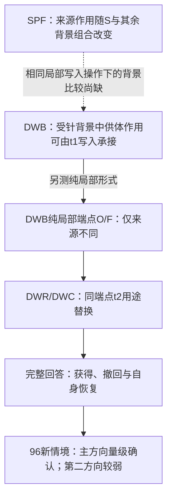

# 122．NWR：原生来源状态经直接读取致错

[返回总时间线](../README.zh-CN.md)

**时间定位**：已提取运行收据的最早时间锚点（可含预检） 2026-11-05T07:44:38.799979+08:00；不能当作全部子运行起止。

**当时的目的与设计**

在既有修复接收背景中，把原生写入项形成的递推状态差用于t2直接读取，加入同范数随机和相关端点差对照。

**实际过程、结果与后来更正**

冻结点估计通过当时强标准，但五个随机方向中一个造成18条损失，为主臂23条的78%；半缺口门槛贴线且区间跨零。完整结果保留，不把“强支持”写成方向特异性已建立。

**来源身份**：`cache-native-write-readout-v1-2026-11-05`；本章主体来源提交 `7d6bdf84ab74062ac9ab55bc8201b5a6586b92c8`。下方原文中的状态是各文件写作时的状态，不能把早期“尚未运行”覆盖后期正式收据，也不能将后期结果倒填进早期设计。


## 原设计、执行过程、结果与更正全文

以下按“设计与题目 → 工程/执行记录 → 结果/更正 → 其他历史说明”组织；同类内没有可靠时间时保留路径顺序，不冒充严格先后。正文未删段；仅为本章节重排标题层级、把相对链接指向固定提交。原始字节另外完整保存。

### 原件 1：NWR-01 合同 r02：原生写入项写出的递推状态经 t2 直接读取是否造成实质选择错误

原路径：`experiments/cache-native-write-readout-v1-2026-11-05/CONTRACT-r02.zh-CN.md`。 [固定提交原文](https://github.com/yuxiexiong/acupuncture/blob/7d6bdf84ab74062ac9ab55bc8201b5a6586b92c8/experiments/cache-native-write-readout-v1-2026-11-05/CONTRACT-r02.zh-CN.md) · [单独阅读副本](../library/dd61e4f1cdf0ce07.md)；SHA-256：`dd61e4f1cdf0ce077c12683ce09e347fe9410ca70960477adf2078086a8a1ddf`。

---

#### NWR-01 合同 r02：原生写入项写出的递推状态经 t2 直接读取是否造成实质选择错误

r02 取代同目录的 r01 草案（保留为历史，未运行）。操作与判读对齐 [Proposal v8 §4（主比较 A）](https://github.com/yuxiexiong/acupuncture/blob/7d6bdf84ab74062ac9ab55bc8201b5a6586b92c8/docs/mechanism-second-half-v1-2026-11-03/PROPOSAL.zh-CN.md)；v8 未量化的几处在 §5 写死，偏离登记在 §9。**授权：2026-11-05 用户"你把你列出来的这一轮内容全部做掉"（清单第一项即本比较，上卡）。** 冻结后不改本文件；偏离记入 `DEVIATIONS.zh-CN.md`。同一助手实现、运行、判读，不是独立验收。

##### 1. 问题
LVK 的 L00（原生）、L10、L11 共享原生预填与各层 S₀，只在 t1 一步不同。SRU 已在 L10↔L11 间显示 S₁ 差经 t2 直接读取 D 双向改变完整回答。本轮问：把**原生写入**写出的 S₁(L00) 作为只读供体，送进已开口接收者 L11 的同一读取用途，是否重新造成错误；这一损失是否超过同一来源的另一用途 E、超过输出空间同幅度的随机补丁；错误是明确的错误编号，还是只是停止或未交付。只承诺"原生来源在指定接收者下的操作充分性"，不承诺 L00 自己的自然 t2 读取、唯一中介或完整原生链。

##### 2. 固定条件
Qwen3.5-4B revision `851bf6e806efd8d0a36b00ddf55e13ccb7b8cd0a`，BF16/eager/batch 1/torch 原核。方向只有 L0/N4146/−1。LVK 新面板 48 条、6 场景，**全部是已见开发数据**。NA 布局、B1 窗口、冻结校准、其他五场景 μ、解析器、停止 ID 全部继承 LVK/SRU，不重估。G={13,14,16,17,18,20,21,22,24,25,26,28,29,30}。

##### 3. 操作
- 每输入重建 C、T；t1（最后提示 token 的前向）重建 L00（无操作）、L10、L11（LVK 影子钩子），取 t1 后各 G 层 S₁ 只读。
- 接收者固定为 L11，保留自己的 t1 输出、全部缓存与自然首 token。只在 t2、14 个 G 层的输出上加补丁，FP32 相加后转 BF16；q/k/v/α/β 为接收者当前值；写回缓存的 S₂ 是接收者原生更新；t3 起无钩子；贪心续写到停止或共 32 token。
- 不强制 L00 开口、不屏蔽 EOS。接收者若在 t1 即停止，不操作并照实保留，不删样本。

| 臂 | 补丁 | 用途 |
|---|---|---|
| C、L00、L10、L11 | 无 | 端点参照，自然轨迹逐位桥接 LVK |
| D00 | α(S₁[L00]−S_r)ᵀq | 主检验 |
| E00 | −αβ(kᵀq)(S₁[L00]−S_r)ᵀk | 同一来源的另一用途 |
| D10 | α(S₁[L10]−S_r)ᵀq | 重放 SRU 撤回格，逐位桥接 SRU |
| R1…R5 | u_j·‖α(S₁[L00]−S_r)ᵀq‖，逐层逐头 | 输出空间同 L2 范数的随机补丁；u_j 为（种子，层）固定的单位方向，种子 202611051…55；范数为 0 处不注入 |

共 12 臂 × 48 = 576 条自然轨迹。每臂另跑一次共同首 token 的 C 路线 t2，只取目标竞争 M 作辅助读数。

##### 4. 读数
- 主终点：自然完整回答 Y（FC-01 分类器原规则：只含目标编号、以停止结束、无未闭合 think）。
- E_num：恰一个不同编号且不是目标、以停止结束、无未闭合 think。细分为首列编号、其他列出编号、未列出编号。
- 其余互斥类别：停止且无编号（含接收者未到 t2）、多个编号、达到 token 上限、其他。分类规则在 `nwr_core.py`，看新输出前冻结。
- 场景等权：先在场景内平均，再对 6 场景平均。
- 自然 t2 输出 token 类别（目标／首列／其他列出／停止／其他）、相对 L11 的逐输入转移表、C 路线 ΔM，只作描述。

##### 5. 冻结判读（看数据前写定；效应门槛，不是显著性检验）
- b = Y(L11) − Y(L00)；l_X = Y(L11) − Y(X)；l_R 为五个随机种子的平均；e_X = E_num(X) − E_num(L11)；e_R 为五个种子的平均。
- **强标准（全部点估计同时满足）**：b ≥ 0.25；l_D ≥ 0.20 且 l_D − 0.5b > 0；l_D − l_E > 0；l_D − l_R > 0；e_D ≥ 0.15 且 e_D − e_R > 0。
- 结果标签，取第一个满足的：
  1. **不可判**：b < 0.25；或接收者 L11 未到 t2 的输入 ≥ 25%；或 D00 达到 token 上限的输入 ≥ 25%。
  2. **强支持**：强标准全部成立。
  3. **弱或异号**：l_D < 0.20 或 l_D − 0.5b ≤ 0。
  4. **用途或幅度不特异**：l_D − l_E ≤ 0 或 l_D − l_R ≤ 0。
  5. **仅停止**：其余情况，即有特异损失但 e_D < 0.15 或 e_D − e_R ≤ 0。
- 6 场景重抽的 95% 百分位区间只作描述，不称确认。五个随机种子是预定的有限控制族，不称总体零分布。
- 不允许的结论：D 是唯一原生通路；原生全效应已解释；L00 自己的 t2 读取已测到；入口形成已识别；"弱"推出 S 无作用。
- 退出：任何标签都结束本轮局部工作。不因阴性追加 t1、全程钩子、其他供体、层或头、V 恢复或新读出。强支持只意味着可以考虑 v8 的 B 阶段，本合同不含 B。

##### 6. 工程闸门（运行中断言，任一失败即停，记为合同执行失败，不是科学阴性）
1. 来源：形成哈希等于 LVK；C/L00/L10/L11 的 t1 bf16 logits、首 token、自然 token 序列与 LVK 逐位一致。
2. 重放：L11 的 C 路线 t2 全词表与 LVK 逐位一致；a=b=0 的复刻顺序钩子与原生 t2 逐位相同（C、N 各一次）；D10 的 C 路线 t2 全词表与自然 token 序列与 SRU 撤回 10 格逐位一致。
3. 公式：D00/E00/D10 局部输出对 FP64 公式相对误差 ≤ 1e−5。
4. 随机：随机补丁与真实 D 补丁的逐层逐头 L2 范数相对误差 ≤ 1e−5；范数为 0 不注入。CPU 测试另验：单位方向取 D 自身时复现 D 格。
5. **t1 结构**：捕获 L00 与"原核直接喂影子 v"（与 L10 逐位相同）在 t1 各 G 层的核输入。首个 G 层 q、k、g、β、S₀ 逐位相同且 v 不同；全部 G 层 S₀ 逐位相同。更高层的 q/k/g/β 是否相同只记录，不设闸。
6. 钩子：t1 只有 LVK 影子与捕获钩子；t2 每个 G 层触发一次；t3 起零钩子；供体 S₁ 只读；源缓存哈希不变；模块函数复原。
7. 预检：新面板 NQ01-ABC-A、NQ02-ABC-B 两条，全臂。失败即停，允许一次有记录的修复重试；正式开始后不改实现、阈值、数据。

##### 7. 预算
| 项 | 正式 48 | 预检 2 |
|---|---:|---:|
| 预填 / 形成 / 形成 token | 48 / 96 / 2556 | 2 / 4 / 108 |
| t1（C、L00、L10、L11） | 192 | 8 |
| 自然轨迹 / C 路线 t2 | 576 / 432 | 24 / 18 |
| 工程参照 | 144 | 6 |
| decode 上限 | 18624 | 776 |
| t1 影子卷积 | 2688 | 112 |
| 设备小时上限 | 1.2 | 0.15（重试另 0.15） |
最多 2 worker，按场景拆分；存储 ≤ 8 GiB；心跳 60 秒；预检外推超限即停。总硬上限 1.5 GPUh。

##### 8. 产物
`runs/preflight-r01/`、`runs/formal-r01/`、`analysis/nwr-readouts-r01.json`、`analysis/enum-offline-r01.json`（已有 LVK/SRU 输出按同一分类规则的零 GPU 重读）、`REPORT.zh-CN.md`。

##### 9. 相对 v8 §4 的偏离与补充
- v8 未量化"接收者不可达""严重截断"：本合同定为 ≥ 25%（§5 第 1 条）。
- v8 未规定标签的判定顺序：本合同定为 §5 的 1–5。
- v8 写"精度容差沿用已验收 SRU 对应计算的定义"：采用 SRU 的 1e−5；随机范数匹配同为 1e−5。
- v8 未列 t1 结构闸门：本合同新增（§6 第 5 条），来源是论文工作稿 v1.1 的 t1 结构句需要逐位核验。
- v8 的随机向量"同层同头同范数"：本合同定为每个（种子，层）一个固定单位方向，跨输入不变，逐头按该分支真实 D 补丁范数缩放。
- C 路线 M 只作辅助，与 v8 一致。除以上各条，无其他偏离。

---

### 原件 2：NWR-01 合同草案 r01：原生写入项写出的递推状态经 t2 直接读取是否足以致错

原路径：`experiments/cache-native-write-readout-v1-2026-11-05/CONTRACT.zh-CN.md`。 [固定提交原文](https://github.com/yuxiexiong/acupuncture/blob/7d6bdf84ab74062ac9ab55bc8201b5a6586b92c8/experiments/cache-native-write-readout-v1-2026-11-05/CONTRACT.zh-CN.md) · [单独阅读副本](../library/b14c03dd9eb1cd5e.md)；SHA-256：`b14c03dd9eb1cd5ec851c48f07f5b20a1db6bcbc0299994a1a4d995ea3b8352f`。

---

#### NWR-01 合同草案 r01：原生写入项写出的递推状态经 t2 直接读取是否足以致错

**状态：草案 r01，未运行，保留为历史；已由 [合同 r02](https://github.com/yuxiexiong/acupuncture/blob/7d6bdf84ab74062ac9ab55bc8201b5a6586b92c8/experiments/cache-native-write-readout-v1-2026-11-05/CONTRACT-r02.zh-CN.md) 取代并执行，结果见 [报告](https://github.com/yuxiexiong/acupuncture/blob/7d6bdf84ab74062ac9ab55bc8201b5a6586b92c8/experiments/cache-native-write-readout-v1-2026-11-05/REPORT.zh-CN.md)。** 冻结以用户"开始"为准；冻结后不改本文件，偏离记入 `DEVIATIONS.zh-CN.md`。设计与自查见 [DESIGN.zh-CN.md](https://github.com/yuxiexiong/acupuncture/blob/7d6bdf84ab74062ac9ab55bc8201b5a6586b92c8/experiments/cache-native-write-readout-v1-2026-11-05/DESIGN.zh-CN.md)。

##### 1. 问题
LVK 的 L00（原生）、L10、L11 共享原生预填与 S₀，只在 t1 写入项不同。SRU 已在 L10↔L11 间证明 S₁ 差经 t2 直接读取 D 双向改变完整回答。本轮问：把原生写入写出的 S₁(L00) 送进已开口接收者 L11（及 L10）的 t2 读取，是否足以撤回目标竞争与完整回答；撤回是否超出同范数随机扰动；撤回表现为退回第一条记录还是推向停止。不承诺识别完整原生机制。

##### 2. 固定条件
全部继承 SRU-01 合同 §2：Qwen3.5-4B revision 851bf6e8…，BF16/eager/batch 1，L0 形成干预、NA 布局、B1 窗口、−1 强度，方向 N4146/N1210/R0/C1343，G 层固定 14 层，LVK 新面板 48 条（已见）。μ、校准、解析器、停止 ID 与 LVK 冻结映射相同。

##### 3. 操作
- 每输入重建 C、T；重建 L00（无 t1 钩子）、L10、L11（LVK 影子钩子）的 t1，取各 G 层 t1 后 S₁ 只读。
- t2 分解与格子沿用 SRU：o₂_ab = o₂ + a·α(S_d−S_r)ᵀq − b·αβ(kᵀq)(S_d−S_r)ᵀk，FP32 相加后转 BF16；S₂ 为接收者原生更新；只在 t2、14 个 G 层；t3 起无钩子。
- 臂（见 DESIGN §2）：接收者 L11：供体 L00 的 10/01/11、同范数随机 ×5 的 10、供体 C 的 10；接收者 L10：供体 L00 的 10/11、随机 ×3 的 10；接收者 L00 仅 C 路线续写：供体 L11/C/随机 ×3 的 10；全部接收者 00 重放。
- 同范数随机：对每层每头，ΔS_rand = ‖S_d−S_r‖_F · G/‖G‖_F，G 为固定种子高斯矩阵（种子 1–5 写入本文件），与真实 ΔS 同形状；只用于 10 格。
- C 路线：t2 输入冻结共同首 token fF，记录 M；L00 接收者的 C 路线续写到停止或 32 token。N 路线：t2 输入接收者自己的 t1 首 token，贪心续写到停止或 32 token。
- 不钳制 q、不写供体 S 进缓存、不移植 KV/卷积，与 SRU 相同。

##### 4. 读数
- M（目标区别 token − 首列；目标首列时减第二列）、M_all；Y_full（原解析器）；"t2 选择正确"（沿用 SRU）。
- 新增 t2 类别：target（目标第二 token）／first（列在第一位记录的第二 token）／stop（停止 ID）／other。按格按方向计数。
- L10/L11 的 6 条非 fF 输入单列，不筛掉（沿用 SRU）。
- 描述：每层 ‖S₁(L00)−S₁(L11)‖_F 与 ‖S₁(L10)−S₁(L11)‖_F 之比；D 校正范数与夹角。比值不是机制份额。

##### 5. 冻结判读（操作性标签，非显著性；看数据前写定）
以接收者 00 格为基线，逐输入相减、场景等权；M 用目标非首列 32 条，Y 用 48 条。
- **方向性**（沿用 SRU）：撤回侧预期为负。M 定向：ΔM ≤ −0.25 且 ≥4/6 场景同号；Y 定向：净变化 ≤ −2/48 且 ≥2 个场景有预期方向变化；两者都满足为"定向支持"。
- **特异性**：随机带 = 随机臂 ΔM 的均值 ± 2·样本标准差（L11 用 5 个种子，L10 用 3 个）；Y 同法。原生供体的 ΔM 须低于带下沿且差距 ≥0.25，ΔY 须低于带下沿且差距 ≥2，才算"特异"。**申报：n=5 的带宽估计本身不稳定；本轮把它当零分布的粗估，不当显著性检验；若随机臂间极差 >1.0（M）或 >6（Y），该格直接记不可判。**
- 四档标签（每方向每接收者取第一个满足的）：**异号**（ΔM ≥ +0.25 或 ΔY ≥ +2）；**不支持**（未达定向支持）；**不可判**（定向支持但不特异，或随机带过宽）；**支持**（定向支持且特异）。
- **P1（推测档）**：接收者 L11、供体 L00、10 格，三个缺口方向 ≥2/3 为支持。
- **P2（推测档）**：同接收者 L11，|ΔY(供体 L00, 10)| ≥ |ΔY(供体 L10, 10)|（SRU 数字：21/15/11）在 ≥2/3 方向成立；前提是 00 重放与 SRU 逐位一致。不成立只说明 v 分量在读取处不叠加，不否定 P1。
- **P3（推测档）**：01 格（只换 E）在三方向 |ΔM| < 0.25。
- **P4（探索，无预测）**：供体 C；接收者 L00 的 C 路线臂。只描述。
- **类别约束**：若支持格的 Y 下降中 stop 类别占多数（>50%），结论写作"原生写入状态经 D 读取足以使 t2 停止"，不写"选择错误"；若 first 占多数，写作"退回第一条记录"。
- 不允许的结论：D 是唯一原生通路；原生全效应已解释；入口形成已识别；"不支持"推出 S 无作用。

##### 6. 工程闸门（任一失败即停，记为合同执行失败）
1. 形成哈希等于 LVK 记录；L00/L10/L11 的 t1 bf16 logits 与首 token 与 LVK 逐位一致；L10/L11 的 00 格 C 路线全词表与 N 路线完整 token 与 SRU 逐位一致。
2. a=b=0 钩子与原生 t2 逐位相同（C、N 各一次）。
3. 10/01/11 局部输出对 FP64 公式相对误差 ≤1e−5；随机臂的 ‖ΔS_rand‖_F 与真实 ‖ΔS‖_F 相对误差 ≤1e−5（逐层逐头）。
4. t2 每次前向 14 个 G 层各触发一次；t3 起零钩子；供体 S₁ 只读；源缓存不变。
5. 预检：新面板 NQ01-ABC-A、NQ02-ABC-B 两条，全方向、全臂；失败即停，允许一次有记录的修复重试。

##### 7. 预算（估算，按 SRU 收据外推）
| 项 | 正式 48 | 预检 2 |
|---|---:|---:|
| 预填 / 形成 | 48 / 240 | 2 / 10 |
| 来源 t1（L00、L10、L11） | 576 | 24 |
| 自然轨迹（L11 9 臂 + L10 5 臂 + 00×2）×4 方向 | 3072 | 128 |
| L00 接收者 C 路线续写（5 臂）×4 | 960 | 40 |
| C 路线 t2（全臂） | 3072 | 128 |
| decode 上限（×31） | ≈125 000 | ≈5 200 |
| 设备小时上限 | 1.4 | 0.15（重试另 0.15） |
SRU 的 1536 条自然轨迹用时 0.31 h；本轮约 2.6 倍。最多 2 worker，按场景拆分；存储 ≤20 GiB；心跳 60 秒；预检外推超限即停。总硬上限 1.8 GPUh。

##### 8. 产物
`runs/preflight-r01/`、`runs/formal-r01/`、`analysis/nwr-readouts-r01.json`、`REPORT.zh-CN.md`。判读实现须先通过 `analysis/rehearse_verdict.py` 的离线预演（见 `analysis/rehearsal_output.txt`），再在预检真实数据上跑一次。

---

### 原件 3：NWR-01 报告 r01：原生写入项写出的递推状态经 t2 直接读取是否造成实质选择错误

原路径：`experiments/cache-native-write-readout-v1-2026-11-05/REPORT.zh-CN.md`。 [固定提交原文](https://github.com/yuxiexiong/acupuncture/blob/7d6bdf84ab74062ac9ab55bc8201b5a6586b92c8/experiments/cache-native-write-readout-v1-2026-11-05/REPORT.zh-CN.md) · [单独阅读副本](../library/57c1038ecb75fa29.md)；SHA-256：`57c1038ecb75fa29da73130e9c64e19f59ac4b95a64cb7a04c8528a56627a109`。

---

#### NWR-01 报告 r01：原生写入项写出的递推状态经 t2 直接读取是否造成实质选择错误

合同 [CONTRACT-r02](https://github.com/yuxiexiong/acupuncture/blob/7d6bdf84ab74062ac9ab55bc8201b5a6586b92c8/experiments/cache-native-write-readout-v1-2026-11-05/CONTRACT-r02.zh-CN.md)（freeze-r01 `fb04254d…0689`）。预检、正式均 verification passed，一次通过，无修复重试。判读 `analysis/nwr-readouts-r01.json`。t2 logits 与逐层补丁统计（392 MB）留服务器 `runs/formal-r01/worker-*/tensors`。同一助手实现、运行、判读与撰写，不是独立验收。授权：2026-11-05 用户"你把你列出来的这一轮内容全部做掉"。

**冻结判读的标签是"强支持"。** 强标准的七条不等式点估计全部成立。下面先说它不能被读成什么。

##### 0. 先说限制

1. **随机对照很分散，有一个种子接近主效应。** 五个同范数随机补丁的正确数是 38、46、21、45、36（基线 L11 为 39）。种子 3 损失 18 条，是主臂损失 23 条的 78%，而且同样全部落到首列错号。平均损失 0.033 让"超过随机"的门槛通过，但准确的说法是：在这个幅度下，五个随机方向里四个不致错、一个致错。主臂的损失大于全部五个种子，n=5 时这只相当于 1/6 的秩。**不能写"方向特异性已确立"。**
2. **"超过修复缺口一半"是贴线通过。** l_D − 0.5b 的点估计是 0.069，6 场景重抽区间为 −0.014 到 0.148，跨 0。
3. **接收者是 L11，不是原生运行自己。** t2 的 q、k、门控都是 L11 的。测到的是"原生写入的状态被一个已修复的读者读到时发生什么"，不是 L00 自己的 t2 读取。L00 在 t1 即停止（47/48），它自己的 t2 在自然路线下不存在。
4. **只有一个方向（N4146）、一块已见面板（48 条、6 场景）。** 这是开发性结果，不是确认。
5. **原生写入多出来的 v 分量在读取处没有可见的额外作用。** 供体换成原生写入（L00）与换成只修 v 的写入（L10）几乎一样：正确数 16 对 18。t2 直接读取处承载的是选择错误，不是停止；主臂 48 条里没有一条停止。
6. 第 3 节的"48/48 输出首列编号"是看到结果后的描述，未预注册。

##### 1. 工程

- 全部闸门通过：
  - 来源：形成哈希等于 LVK；C、L00、L10、L11 的 t1 bf16 logits、首 token、自然 token 序列与 LVK 逐位一致。
  - 重放：L11 的 C 路线 t2 全词表与 LVK 逐位一致；a=b=0 的复刻顺序钩子与原生 t2 逐位相同（C、N 两条路线）；D10 的 C 路线 t2 全词表与自然 token 序列与 SRU 撤回 10 格逐位一致（正确数 18，与 SRU 报告相同）。
  - 公式：D00/E00/D10 局部输出对 FP64 公式最大相对误差 2.6e−8。
  - 随机：随机补丁与真实 D 补丁的逐层逐头 L2 范数最大相对误差 1.2e−7。
  - 有符号零例外 0 次；钩子每个 G 层触发一次，t3 起零钩子，源缓存哈希不变。
- **t1 结构（48/48 条输入）**：L00 与"原核直接喂影子 v"（与 L10 逐位相同）相比，第 13 层的 q、k、g、β、S₀ 逐位相同，只有 v 不同（v 差的相对范数中位数 1.04）。第 14 到 30 层的 13 个 G 层，q、k、g、β 在 48/48 条上都不同，S₀ 在 48/48 条上相同。即：两端点的差异全部产生于 t1 这一步，在首个 G 层只是 v，在更高层是该步派生的全部核输入。
- 计数：自然轨迹 529（上限 576；L00 的 47 条在 t1 停止不续写），decode 2372（上限 18624）。设备时间 230 + 196 = 426 秒，加预检 37 秒，合计约 0.13 GPUh，在 1.5 GPUh 硬上限内。
- L11 的首 token 在 48/48 条上等于共享首 token，接收者全部到达 t2；L10 有 2 条不等。

##### 2. 主结果（N4146；48 条；比率为 6 场景等权）

| 臂 | 正确 | 明确错号（全部为首列编号） | 停止无编号 | 其他 | Y | E_num |
|---|---:|---:|---:|---:|---:|---:|
| C 干净 | 48 | 0 | 0 | 0 | 1.000 | 0.000 |
| L00 原生 | 0 | 0 | 47 | 1 | 0.000 | 0.000 |
| L10 只修 v | 16 | 30 | 1 | 1 | 0.333 | 0.630 |
| L11 修 v 和 k（接收者） | 39 | 9 | 0 | 0 | 0.806 | 0.194 |
| **D00：读原生写入的状态，直接读取** | **16** | **32** | 0 | 0 | 0.333 | 0.667 |
| E00：读原生写入的状态，修正用途 | 46 | 2 | 0 | 0 | 0.963 | 0.037 |
| D10：SRU 撤回格重放 | 18 | 30 | 0 | 0 | 0.370 | 0.630 |
| R1 | 38 | 6 | 4 | 0 | 0.787 | 0.111 |
| R2 | 46 | 2 | 0 | 0 | 0.963 | 0.037 |
| R3 | 21 | 27 | 0 | 0 | 0.426 | 0.574 |
| R4 | 45 | 3 | 0 | 0 | 0.944 | 0.056 |
| R5 | 36 | 12 | 0 | 0 | 0.741 | 0.259 |

| 量 | 点估计 | 门槛 | 6 场景重抽区间（描述） |
|---|---:|---|---|
| b = Y(L11) − Y(L00) | 0.806 | ≥ 0.25 | 0.639 到 0.963 |
| l_D | 0.472 | ≥ 0.20 | 0.306 到 0.630 |
| l_D − 0.5b | 0.069 | > 0 | −0.014 到 0.148 |
| l_D − l_E（l_E = −0.157） | 0.630 | > 0 | 0.593 到 0.667 |
| l_D − l_R（l_R = 0.033；各种子 0.019、−0.157、0.380、−0.139、0.065） | 0.439 | > 0 | 0.326 到 0.544 |
| e_D | 0.472 | ≥ 0.15 | 0.306 到 0.630 |
| e_D − e_R（e_R = 0.013） | 0.459 | > 0 | 0.341 到 0.561 |

- 七条全部成立，接收者未到 t2 的比例 0，D00 达到 token 上限的比例 0。按合同 §5 标签为**强支持**。
- 相对 L11 的逐输入转移：D00 把 23 条从正确变成首列错号，其余 16 条保持正确、9 条保持错号；没有一条改对，没有一条变成停止。E00 把 7 条从错号改对，没有改坏。
- C 路线目标竞争 ΔM（目标非首列 32 条，场景等权）：D00 −2.96，D10 −2.16，E00 +0.70，随机五个种子 −0.29、−0.06、−2.46、+0.51、−0.91。

##### 3. 事后描述（未预注册）

主臂 D00 的 48 条输出**全部是列在第一位的编号**。16 条"正确"恰好是目标本身列在第一位的输入。在目标不在首列的 32 条上：

| 臂 | 输出目标编号 | 输出首列编号 | 其他 |
|---|---:|---:|---:|
| L11 | 23 | 9 | 0 |
| D00 | 0 | 32 | 0 |
| D10 | 2 | 30 | 0 |
| E00 | 30 | 2 | 0 |
| R1 / R2 / R3 / R4 / R5 | 22 / 30 / 5 / 29 / 20 | 6 / 2 / 27 / 3 / 12 | 4 / 0 / 0 / 0 / 0 |

读法：读入原生写入的状态后，模型不再按查询选记录，统一退回第一条。种子 3 的随机补丁也把 27 条推到首列。两者合起来的最朴素解释是：首列编号是这次 t2 读取被扰乱后的默认落点，原生写入的状态在五个比较方向里是把读取推到这个落点最彻底的一个。"原生写入的状态携带了指向首列的特定内容"与"它只是足够大地扰乱了读取"在本轮分不开。

##### 4. 能说什么、不能说什么

能说的（限 N4146、LVK 新面板、接收者 L11）：
- 原生受针运行在 t1 写出的递推状态，只经 t2 一次直接读取，就足以把一个已修复运行的回答从 39/48 拉到 16/48，损失全部是明确的首列错号，不是停止。
- 同一状态经修正用途 E 读入不致错，反而改对 7 条。用途有选择性。
- 同范数随机补丁平均不致错，但五个里有一个致错且错法相同。
- 原生运行与只修 v 的运行在 t1 的全部差异源自首个 G 层的 v；这一句现在有 48/48 的逐位核验。

不能说的：
- 不能说这是 L00 自己的 t2 读取，或原生全部失败已解释。原生运行的主要失败是 t1 停止，本轮不涉及。
- 不能说方向特异性已确立，见 §0 第 1 条。
- 不能说原生写入的 v 分量经 t2 读取起作用：D00 与 D10 无可见差别。
- 不能推到其他方向、其他面板、其他任务或其他模型。
- 不能把 0.472 或 23 条读成"机制解释份额"。

##### 5. 零 GPU 重读：已有 LVK/SRU 输出按同一分类规则

`analysis/enum-offline-r01.json`。三个缺口方向上，原生运行 L00 是 43 到 47 条停止；只修 v 之后的错答 30、17、11 条全部是首列错号；SRU 的直接读取替换几乎只在"正确"与"首列错号"之间搬运，停止最多变化 1 条（N4146 撤回侧 39→18 正确，错号 9→30；获得侧 16→34 正确，错号 30→12）。C1343 修 v 后 48/48 正确，没有选择错误可搬。逐格计数见论文工作稿表 3。

##### 6. 出口

按合同 §5，本轮局部工作到此结束，不追加 t1、全程钩子、其他供体、层或头。强支持只意味着 v8 的 B 阶段（开发外确认）可以被考虑，是否做由整稿判断决定；§0 第 1 条的随机分散是 B 阶段设计必须正面处理的对象。

##### 7. 事后剖析（2026-11-05 追加；零 GPU；描述性，未预注册）

读正式运行已存的逐层逐头补丁统计，脚本与输出在 `analysis/posthoc/`。冻结判读不变。

| 事实 | 数值 |
|---|---|
| 原生 D 补丁跨输入一致性 | 与每个固定随机方向的余弦，约 88%–91% 的层—头满足 均值绝对值 > 3 倍标准误 |
| 补丁中跨输入共享成分的能量占比（由上述余弦粗估，`shared_fraction.py`） | 全部 48 条约 0.57；能量最大的三层约 0.46；同场景 8 条内约 0.62。估计只用 5 个方向，相对误差约一成 |
| 补丁能量分布 | 第 21、25、28 层合计约 75%，第 24 层约 8% |
| 范数：原生补丁 ÷ SRU 撤回补丁 | 中位数 1.88，逐输入 1.79–2.02 |
| C 路线目标竞争平移（目标非首列 32 条均值） | D00 −2.94；D10 −2.16；随机五种子 −0.30、−0.08、−2.43、+0.50、−0.92 |
| 各随机方向平移的跨输入符号一致性 | 种子 3 在 100% 输入上为负；种子 4 在 69% 输入上为正 |
| 种子 3 与原生补丁的能量加权余弦 | +0.022（五种子为 −0.006、−0.000、+0.022、−0.009、+0.005） |

读法：
- **更正（同日，外部核查指出）：** 初稿写"原生补丁是跨输入近似不变的偏移，不是逐输入内容"，过强。数据支持的是：补丁里有一个跨输入共享的成分，粗估占能量一半多；其余随输入变化。"固定偏移"是假说，不是结论。
- **更正（同上）：** 初稿由"原生补丁比 SRU 撤回补丁大近一倍而效果相近"推出"多出来的 v 分量几乎不起作用"，推不出。模型有非线性、饱和与分量交互，两种操作的最终效果不能相减当作剩余部分单独的效果；而且两个端点在更高层的 q、k、门控都不同，这份状态差不是纯粹的 v 写入分量。可说的只有：两份补丁范数差近一倍而效果相近，所以本轮按原生补丁范数匹配的随机对照，其幅度约为 SRU 撤回补丁的 1.9 倍。
- 随机方向的作用是跨输入近似恒定的平移，大小因方向而异；种子 3 的作用不是因为与原生补丁对齐。原生补丁的平移约为五个随机值的 2.5 个标准差，n=5，不构成特异性结论。
- 这些只用于设计开发外确认，不能回头升级本报告的结论。

##### 8. 开发外确认之后的更正（2026-11-06）

[NWC-01](https://github.com/yuxiexiong/acupuncture/blob/7d6bdf84ab74062ac9ab55bc8201b5a6586b92c8/experiments/cache-native-write-confirm-v1-2026-11-05/REPORT.zh-CN.md) 在 72 条新输入上检验了 §7 提出的三个假说，结果对 §7 有三处更正：

- §7 表中"共享成分的能量占比约 0.57"偏低。那个估计量在完全共享的向量上自检只给出约 0.5。NWC-01 直接测量补丁向量的跨输入余弦：同族 0.95 到 0.96，跨族 0.91 到 0.93。补丁在不同输入之间高度相似。
- "多出来的 v 分量几乎无效"这个猜想被否证：端点状态差 L00−L10 单独读入造成大量错答。
- "起作用的分量按自己的范数比随机方向高效"不成立：40 个同范数随机方向里 17 到 22 个达到它一半的单步分差。本报告 §0 第 1 条对方向特异性的保留是对的，实际情况比当时估计的更不利。

本报告 §2 的操作结果（39→16、全部首列错号、修正用途不致错）在新输入上得到确认。


---

### 原件 4：稀疏激活干预后的答案选择：历史来源的背景依赖与写入—读取关系

原路径：`docs/mechanism-paper-skeleton-2026-11-05.zh-CN.md`。 [固定提交原文](https://github.com/yuxiexiong/acupuncture/blob/7d6bdf84ab74062ac9ab55bc8201b5a6586b92c8/docs/mechanism-paper-skeleton-2026-11-05.zh-CN.md) · [单独阅读副本](../library/8066c347a3d3c6b2.md)；SHA-256：`8066c347a3d3c6b25d4bf008929583de416fb7c0ed8f935a1643bbdb9680e96d`。

---

<!--block:B0001-->
#### 稀疏激活干预后的答案选择：历史来源的背景依赖与写入—读取关系

<!--block:B0002-->
2026-11-08 · 中文研究工作稿 v1.8。基于既有结果重组论证，无新模型运行。当前主文按科学问题组织；完整结果、阴性、覆盖和旧图见[补充证据](https://github.com/yuxiexiong/acupuncture/blob/7d6bdf84ab74062ac9ab55bc8201b5a6586b92c8/docs/mechanism-paper-supplement-v1.8-2026-11-08.zh-CN.md)，操作缺口与下一步判断见[证据对照](https://github.com/yuxiexiong/acupuncture/blob/7d6bdf84ab74062ac9ab55bc8201b5a6586b92c8/docs/mechanism-paper-evidence-gaps-2026-11-06.zh-CN.md)。本轮核查身份与范围见[修订记录](https://github.com/yuxiexiong/acupuncture/blob/7d6bdf84ab74062ac9ab55bc8201b5a6586b92c8/docs/paper-revision-v1.8-2026-11-08/REVISION.zh-CN.md)。

<!--block:B0003-->
##### 摘要

<!--block:B0004-->
少数激活坐标的干预能够显著改变语言模型的回答，但错误并不直接说明历史信息已被删除，也不能由缓存恢复的成功确定具体计算原因。我们在Qwen3.5-4B上区分作答交付、答案选择和状态信息可利用性，研究历史来源如何在受针条件下进入写入并影响后续回答。开发材料上的缓存比较显示，供体缓冲的选择效应依赖递推状态与其余接收背景的组合；受针状态单独引发选择翻转的预测不成立。进一步实验将供体来源的作用连接到最后提示步的指定写入：仅在该步使用供体V历史即可转移选择，反向换回自身写入可恢复自身答案。在纯局部写入端点上，直接读取的来源替换能够获得和撤回供体选择。冻结这些操作后，六结构族96个新基础情境确认主方向的获得0.311、撤回0.473及自身恢复0.394；第二方向同向，但获得0.213低于预设量级。随机读取反例和受针状态移植排除了首列错误特异性及统一信息删除解释。结果建立了受针条件下可预测的来源—写入—读取关系，并表明其作用受到背景、方向和用途约束。缓存级背景差异尚未在相同局部写入操作下被直接比较，因此这些证据不等于完整原生失效链，也尚未把缓存级背景差异归因到同一局部写入／读取依赖。

<!--block:B0005-->
##### 1. 问题与核心认识

<!--block:B0006-->
稀疏激活干预为什么会产生大的回答变化？这个问题涉及干预后的历史形成、当步写入、旧状态处理和后续读取。撤针和恢复操作提供诊断窗口，完整回答则决定计算差异是否产生了实际行为后果。我们的多模型单针观察和跨规模能力测评已经显示现象广度；本文的机制分析集中于4B模型中的记录检索，不能用现象覆盖替代同一机制的跨模型证明。

<!--block:B0007-->
我们区分三个问题：模型是否交付有效答案，交付时选了哪条记录，以及受针形成的状态是否仍有可被其他计算背景利用的选择信息。平均缓冲可以恢复开口却不能稳定恢复选择；随机读取扰动可以产生相同的首列错误；受针供体状态在另一接收背景中仍可能转移选择。这些结果共同表明，错误样式、恢复量和状态距离都不足以单独说明信息是否被删除。

<!--block:B0008-->
本文中心认识由两层证据组成。**第一层是历史来源的背景依赖：供体缓冲能否改变选择，取决于接收者递推状态和其余计算背景的组合。第二层是指定条件下的计算连接：供体来源的作用能够经局部写入形成状态差，并通过后续直接读取获得或撤回完整答案中的选择。** 两层证据相容，但使用的操作端点不同；我们分别陈述它们，不将其相接处假定为已识别的自然路径。

<!--block:B0009-->
具体贡献如下：

<!--block:B0010-->
1. **约束干预后的失效解释。** 缓存级比较否证“受针状态来源单独决定供体接管”的预测；随机首列和受针状态转移反例进一步排除由错答图样推断特定内容、以及跨方向统一信息删除的解释。
2. **把来源效应连接到明确的写入与读取操作。** 仅在最后提示步写入供体相关差异即可转移选择，换回自身写入可恢复自身答案；在同一纯局部写入端点间，读取用途替换又能获得和撤回定向选择。完整交付和自身恢复区分了选择变化与一般退化。
3. **确认关系并保留失败边界。** 固定操作在新材料上兑现主方向的双向量级预测；第二方向获得较弱，D/E用途异号，族间效应不同。这些是已测条件关系的范围，不是普遍功能分工或参数无关规律。

<!--block:B0011-->
这一认识的用途是指导机制判断：先区分是否能答、答什么和状态能否被利用，再检验来源进入哪个写入、哪个状态用途影响行为。它不要求发明新的状态更新公式，但要求每个解释对应具体比较。尚缺的关键比较在§6集中列出。

<!--block:B0012-->
##### 2. 计算基础与已有研究

<!--block:B0013-->
对单个递推头，省略层号，在实现规定的归一化下有：

<!--block:B0014-->
\[
S_t=\alpha_t(I-\beta_t k_tk_t^\top)S_{t-1}+\beta_tk_tv_t^\top,
\]
\[
o_t=\underbrace{\alpha_tS_{t-1}^\top q_t}_{D_t}
+\underbrace{-\alpha_t\beta_t(k_t^\top q_t)S_{t-1}^\top k_t}_{E_t}
+\underbrace{\beta_t(k_t^\top q_t)v_t}_{W_t}.
\]

<!--block:B0015-->
本文统一用 **E_t=−α_tβ_t(k_tᵀq_t)S_(t−1)ᵀk_t** 表示含负号的旧预测修正用途。q已经包含内核的维度缩放，α是衰减系数。式子描述局部计算；高层驱动和后续生成随干预响应，不能据此把整模型行为拆成可加的机制份额。

<!--block:B0016-->
| 已有来源 | 已有认识或工具 | 本文须另以数据回答的内容 |
|---|---|---|
| [Gated Delta Networks](https://arxiv.org/html/2412.06464v3)，§3 | 门控递推更新规则 | 指定受针条件下各操作对完整回答的大小、方向与边界 |
| [What Attention Recalls and Recurrence Controls](https://arxiv.org/html/2609.04434v1)，§3–4 | 混合模型缓存拆分、交叉来源交换 | 本文背景依赖及局部计算比较；不能以KV供体跟随本身承担新颖性 |
| [How Linear Attention Remembers](https://arxiv.org/html/2609.33093v1)，§2–4 | 写入、状态及读取的因果干预；存储与访问的区别 | 干预后的具体失效约束及可预测的来源—写入关系，不声称首次写读链 |
| [Who Asks, Who Answers](https://arxiv.org/html/2611.01909v1)，§5.2、§7 | 递推状态携带检索目标、参与构造全注意力查询 | 本文的GDN输出用途不是该文全注意力reader；不由文献层号指定本实验路径 |
| [Representational Analysis of Binding](https://arxiv.org/abs/2409.05448v3)；[Mixing Mechanisms](https://arxiv.org/abs/2510.06182v2) | 次序子空间与多种绑定机制 | 位置预测较强是否等于内部纯位置编码，现有结果不能作此推论 |
| [How to use and interpret activation patching](https://arxiv.org/html/2404.15255v1)，§2–3 | 恢复、污染与背景依赖的解释边界 | 具体模型中的条件关系，而非再将方法论警告当作新发现 |

<!--block:B0017-->
区别于一般供体移植有效性，本文提供的是缓存级背景比较、指定写入的获得与自身恢复、同端点读取及新材料预测的组合证据。不过，**受针背景相对干净背景究竟改变了局部写入／读取的哪项依赖，仍不能仅由这些不同端点的阳性推出。** 这是实质证据缺口，不以“受针”二字替代新颖性论证。文献入口及此前核查范围见[近邻审计](https://github.com/yuxiexiong/acupuncture/blob/7d6bdf84ab74062ac9ab55bc8201b5a6586b92c8/docs/literature/selection-carrier-mainline-audit-2026-11-06.zh-CN.md)；本轮未进行新的穷尽优先权检索。

<!--block:B0018-->
##### 3. 方法：从来源到完整答案

<!--block:B0019-->
###### 3.1 模型、干预与时序

<!--block:B0020-->
主模型为Qwen3.5-4B，revision `851bf6e806efd8d0a36b00ddf55e13ccb7b8cd0a`，BF16、eager、batch 1及冻结的torch参考核。主方向为L0/N4146，第二方向为L0/N1210；早期R0与C1343按各自实验身份进入补充，不能当作DWC额外确认方向。主针与操作层组承接开发历史，并非对模型通道的随机抽样。

<!--block:B0021-->
干预施于L0 MLP的down_proj输入单坐标。名义剂量d=−1，实际激活增量为η=d·s_ref/‖W_down[:,j]‖₂，再按引擎转换为BF16；注入处名义残差增量是ηW_down[:,j]。s_ref沿用旧NQ各族参考文本的残差尺度，DWC不在新材料上重新校准。因而−1不是激活数值减1，少坐标也不意味着小扰动。具体校准与BF16写入验收见[write_audit](https://github.com/yuxiexiong/acupuncture/blob/7d6bdf84ab74062ac9ab55bc8201b5a6586b92c8/experiments/cache-cross-channel-validation-v1-2026-10-31/xchan.py)。

<!--block:B0022-->
NA布局先给记录，再给查询与回答指令。设b为记录边界的最后token，n为完整模板化提示长度，B1在位置[b+1,n−2]形成受针历史；最后提示token n−1不再施针。τ为该token之前的缓存切点，t1处理最后提示token并预测首个生成token，t2处理这个自然生成token。DWC提示长度58–64，B1共26–28个位置；同情境最后四个已缓存token相同。以[冻结分词账本](https://github.com/yuxiexiong/acupuncture/blob/7d6bdf84ab74062ac9ab55bc8201b5a6586b92c8/experiments/cache-write-read-confirm-v1-2026-11-07/data/token-ledger-r01.json)而非文字字符数定义位置。

<!--block:B0023-->
**图1：实验时序与端点。** 图中实线是执行顺序，不代表已经证明的唯一自然中介。

<!--block:B0024-->


<!--block:B0025-->
写入／读取操作在G={13,14,16,17,18,20,21,22,24,25,26,28,29,30}这14个深层GDN层联合实施。G承接既有深层操作范围，不是本轮新筛选的最小路径，也不是14个独立样本。“一步写入”指同一t1时刻的14层联合操作；上层会响应下层变化。

<!--block:B0026-->
###### 3.2 完整用户提示与供体实例

<!--block:B0027-->
下面取固定正式材料的第一个情境、ABC-A接收者及第一个AL供体ABC-B，未按输出筛选。两者记录相同、查询不同。以下展示完整用户消息；实际输入使用冻结的聊天模板，位置以§3.1分词账本为准：

<!--block:B0028-->
**接收者 `DWC-NQ01-S00-B0-ABC-A`：**

<!--block:B0029-->
```text
仓储台账：绿纸盒编号为U63，黑纸盒编号为U52，黑茶杯编号为U41。
绿纸盒的编号是什么？
请根据上面的记录，简短回答，只需给出编号。
```

<!--block:B0030-->
**供体 `DWC-NQ01-S00-B0-ABC-B`：**

<!--block:B0031-->
```text
仓储台账：绿纸盒编号为U63，黑纸盒编号为U52，黑茶杯编号为U41。
黑纸盒的编号是什么？
请根据上面的记录，简短回答，只需给出编号。
```

<!--block:B0032-->
接收者答案为U63，供体目标为第2行U52。供体V历史来自供体的干净运行；接收者仍使用自己的提示，不能将转向叫作自身原有记忆恢复。其他供体还改变记录顺序，主比较包括同排列不同查询AL、同查询异排列KS、目标行相同RS及其他可分预测BD；三路绑定诊断另改变实体—编号绑定。

<!--block:B0033-->
这个固定例子在N4146下原生输出为`<|im_end|>`，O、F、获得D和撤回D均为`U63<|im_end|>`，**没有供体转移**。它用于说明实验输入和操作身份，不承担阳性论据；总体结果保留这类失败。原始逐臂文本及来源hash见[核查记录](https://github.com/yuxiexiong/acupuncture/blob/7d6bdf84ab74062ac9ab55bc8201b5a6586b92c8/docs/paper-revision-v1.8-2026-11-08/source-audit.json)，完整材料见[materials-r01](https://github.com/yuxiexiong/acupuncture/blob/7d6bdf84ab74062ac9ab55bc8201b5a6586b92c8/experiments/cache-write-read-confirm-v1-2026-11-07/data/materials-r01.json)。

<!--block:B0034-->
###### 3.3 两种写入背景必须分开

<!--block:B0035-->
C表示干净历史，T表示原生受针历史。卷积缓冲q/k/V、递推状态S和全注意力KV是不同持久对象；恢复S并不恢复其余两类。

<!--block:B0036-->
**缓存到写入的桥接（DWB）。** 下表共同使用T作为接收底座，G层q/k缓冲来自本输入干净运行；此组不使用写入k去偏移。

<!--block:B0037-->
| 端点 | t1写入的v来源 | t1之后保留的V缓冲 | 比较作用 |
|---|---|---|---|
| OO | 本输入 | 本输入 | 自身来源参照 |
| DD | 供体 | 供体 | 持续供体缓冲参照 |
| DO | 供体 | 本输入 | 仅让供体V历史影响t1写入 |
| OD | 本输入 | 供体 | 保留供体V，但把t1写入换回自身 |

<!--block:B0038-->
局部v由**当前分支输入**与指定来源的干净V历史做影子卷积计算，不是整条干净供体运行的v。DO/DD及OD/OO在t1按构造一致，之后缓冲留存不同；当步一致是工程验收，之后完整回答仍转移或恢复才是科学结果。[DWB合同与实现](https://github.com/yuxiexiong/acupuncture/blob/7d6bdf84ab74062ac9ab55bc8201b5a6586b92c8/experiments/cache-donor-write-bridge-v2-2026-11-07/CONTRACT.zh-CN.md)

<!--block:B0039-->
**纯局部写入与读取端点（DWR/DWC）。** O=L11o与F=L11d都保留T预填，不整体替换缓冲；仅t1写入项βkvᵀ的v分别使用自身／供体干净V历史，并共同使用冻结的写入k去偏移。k修正是在旧k缓冲槽上减去由其他五个开发场景估计的共同偏移，再经当前输入、卷积和归一化得到影子k；并非直接从归一化k减一个常数。旧预测修正项中的k仍来自本分支。影子量不写回卷积缓冲，但写入会改变S₁和下游量。O/F仅在所指定的历史来源上不同，后续状态和输出允许响应；O不是完整干净运行，F也不是整条供体运行。

<!--block:B0040-->
早期LVK/SRU使用的L10/L11仅在是否修正写入k上不同，不等于本节O/F。DWC没有确认所有旧端点，也没有把DWB的OO/DO/OD/DD矩阵完整搬到新材料。[局部写入实现](https://github.com/yuxiexiong/acupuncture/blob/7d6bdf84ab74062ac9ab55bc8201b5a6586b92c8/experiments/cache-local-v-k-v1-2026-11-03/lvk_run.py) · [DWC合同](https://github.com/yuxiexiong/acupuncture/blob/7d6bdf84ab74062ac9ab55bc8201b5a6586b92c8/experiments/cache-write-read-confirm-v1-2026-11-07/CONTRACT.zh-CN.md)

<!--block:B0041-->
###### 3.4 t2读取用途与完整回答

<!--block:B0042-->
在每个指定层，接收分支当前驱动为q、k、α、β；以供体端点S₁替代接收端点S₁所产生的两个输出补丁为：

<!--block:B0043-->
\[
\Delta o_D=\alpha\Delta S^\top q,\qquad
\Delta o_E=-\alpha\beta(k^\top q)\Delta S^\top k.
\]

<!--block:B0044-->
获得在O分支的D或E用途中读取F状态，撤回则反向进行。补丁加入该层输出，不把供体S₁写入持久缓存；该层返回的S₂仍按接收分支当前驱动更新，上层及之后状态会响应补丁。t3起无钩子，因此测得的是指定操作的条件总效果，不能称各层或用途的独立机制份额。[读取实现](https://github.com/yuxiexiong/acupuncture/blob/7d6bdf84ab74062ac9ab55bc8201b5a6586b92c8/experiments/cache-state-read-use-v1-2026-11-03/sru_run.py)

<!--block:B0045-->
首token自然停止时不强制进入t2，记录不可达no-op并保留分母。O/F首token不一致也各自自然继续；DWC N4146一致率1.000，N1210为0.997685，后者不称严格共同前缀实验。所有自然生成沿用32新token上限。完整编号需满足冻结解析器对自然终止、think闭合和唯一列表编号的要求；停止、其他及截断保留，不能以开口率或首步logit代替完整答案。[输出解析](https://github.com/yuxiexiong/acupuncture/blob/7d6bdf84ab74062ac9ab55bc8201b5a6586b92c8/experiments/cache-selection-precedence-v1-2026-11-06/spf_analysis.py)

<!--block:B0046-->
###### 3.5 净转移、获得、撤回与统计单位

<!--block:B0047-->
设r为接收者，A_r为同排列不同查询的AL供体集合，p_d为供体d的目标行，Y_(r,d)^a为臂a的完整输出行。对照集合C_(r,d)包括同场景供体x，其目标行和其查询实体在接收者中的行均不等于p_d。每接收者的净转移为：

<!--block:B0048-->
\[
D_{\mathrm{tr},r}^{a}=\frac1{|A_r|}\sum_{d\in A_r}
\left[\mathbf1\{Y_{r,d}^{a}=p_d\}
-\frac1{|C_{r,d}|}\sum_{x\in C_{r,d}}\mathbf1\{Y_{r,x}^{a}=p_d\}\right].
\]

<!--block:B0049-->
例如某个AL供体目标为第2行，输出命中；三个合格对照供体下的输出依次为第1、2、3行，该供体的贡献为1−1/3=2/3。这是**算术示例，不是本研究新增观测**。若所有供体下固定输出同一行，两项相消为0；停止也不计为任一行命中。D_tr是供体条件对比量，不是准确率、成功概率或机制份额。[统计定义](https://github.com/yuxiexiong/acupuncture/blob/7d6bdf84ab74062ac9ab55bc8201b5a6586b92c8/experiments/cache-selection-precedence-v1-2026-11-06/spf_core.py)

<!--block:B0050-->
对用途u∈{D,E}，G_u=D_tr(O读F)_u−D_tr(O)，W_u=D_tr(F)−D_tr(F读O)_u。自身恢复R_u是在AL/BD选择冲突配对上，撤回臂答自身的比例减去F答自身的比例。G/W与R是不同估计对象；撤回只有同时检查完整交付与自身恢复，才能区别于一般输出退化。

<!--block:B0051-->
开发阶段有48个已见输入、6个场景；每方向348个有序配对不等于348独立样本。DWC固定六族各16个新情境，共96情境、864接收者，每接收者8个主供体；每供体臂每方向6912配对。D_tr先在情境内平均，再六族等权；区间为族内整情境配对bootstrap 20000次，种子2026110703。新估计对象不与旧面板合并，81648条轨迹也不作独立样本数。

<!--block:B0052-->
主确认预先指定N4146，要求F、G_D、W_D的95%区间下界≥M=.25，R_D下界>0，且干净正确率、O/F可达率及完整交付护栏通过。交付率至少.90，读取臂相对其接收端点下降不超过.05。M是关注量级，不是统计零效应界限。N1210单列，不能换赢家。另24情境、每方向1296配对检验位置／实体／编号三种互异且平衡的预测，不参与主成功判定。预检与正式材料分开，不按模型正确率筛题，不在新题重新估计偏移或校准。[DWC分析](https://github.com/yuxiexiong/acupuncture/blob/7d6bdf84ab74062ac9ab55bc8201b5a6586b92c8/experiments/cache-write-read-confirm-v1-2026-11-07/dwc_analysis.py)

<!--block:B0053-->
##### 4. 结果：哪些关系已经成立

<!--block:B0054-->
###### 4.1 现象覆盖与选择失效的区分

<!--block:B0055-->
已有四模型18,272份唯一单针回答，其中7,632份有同文字历史的内部参照轨迹；固定题仅8道，记录数不是独立问题数。另一协议下，冻结的4B→9B/2B双通道迁移在各1,400题上造成明显能力损伤。例如9B MMLU由70.06%降为25.39%，2B由54.06%降为46.00%；随机源也能损伤，生成题部分失分伴随截断。完整八项成绩及区间见[补充S1表A/B](https://github.com/yuxiexiong/acupuncture/blob/7d6bdf84ab74062ac9ab55bc8201b5a6586b92c8/docs/mechanism-paper-supplement-v1.8-2026-11-08.zh-CN.md#s1-完整结果原4)。这些是动机和范围证据，不把中层双针与L0/B1机制协议合成因果链。

<!--block:B0056-->
机制面板中，平均干净缓冲让四个测试方向全部开始作答并交付编号，却只使主方向N4146正确17/48，其中16条目标本在首列；非首列仅1/32正确。恢复交付不等于恢复选择。新输入读取确认中，按补丁范数匹配的随机方向也可产生首列错误：继续生成的20个随机方向里，N4146/N1210/R0分别有8/4/8个达到对应D10完整回答损失的一半。这否定由首列错答推断原生状态特有内容的解释，未证明任何随机方向都有效。[FBR](https://github.com/yuxiexiong/acupuncture/blob/7d6bdf84ab74062ac9ab55bc8201b5a6586b92c8/experiments/cache-template-buffer-repair-v1-2026-11-06/REPORT.zh-CN.md) · [NWC](https://github.com/yuxiexiong/acupuncture/blob/7d6bdf84ab74062ac9ab55bc8201b5a6586b92c8/experiments/cache-native-write-confirm-v1-2026-11-05/REPORT.zh-CN.md)

<!--block:B0057-->
###### 4.2 历史来源的选择作用依赖接收背景

<!--block:B0058-->
**表1：供体干净缓冲进入不同背景，N4146净转移。** 开发面板；区间按6场景重抽。四格均改变缓冲来源；“其余背景”不含表中已指定的S和缓冲。

<!--block:B0059-->
| 递推状态S来源 | 其余背景C | 其余背景T |
|---|---:|---:|
| 本输入干净 | 0.000 | 0.000 |
| 本输入受针 | 0.000 | **0.896 [0.827,0.955]** |

<!--block:B0060-->
受针状态单独放入干净其余背景不能引出供体效应；反之，受针其余背景中换回自身干净S也能压住效应。这个结果否证了状态来源单独决定选择翻转的预测，支持两者组合的条件依赖。它不证明存在两个独立信息源，也不识别唯一“仲裁器”。N1210的状态恢复前提因32/48预算截断未通过，相关压制对比保持不可判，不借主方向结论覆盖。

<!--block:B0061-->
在N4146上，供体V配自身干净q/k同样净转移.896；供体V配受针q/k时净转移仅.003且目标不在首列时全部落首列。供体身份可以由V操作传递，但q/k的背景状态仍重要，“身份不必来自q/k”不等于“q/k无关”。[SPF报告及§9更正](https://github.com/yuxiexiong/acupuncture/blob/7d6bdf84ab74062ac9ab55bc8201b5a6586b92c8/experiments/cache-selection-precedence-v1-2026-11-06/REPORT.zh-CN.md)

<!--block:B0062-->
###### 4.3 来源效应可以由指定写入承接

<!--block:B0063-->
**表2：受针接收背景上的写入桥接，D_tr及95%开发区间。**

<!--block:B0064-->
| 操作 | N4146 | N1210 |
|---|---:|---:|
| 持续供体V：DD | 0.896 [0.827,0.956] | 0.490 [0.370,0.595] |
| 仅t1供体写入：DO | 0.882 [0.820,0.937] | 0.427 [0.278,0.556] |
| 保留供体V、换回自身写入：OD | 0.000 [0.000,0.000] | 0.000 [0.000,0.000] |
| 纯局部端点F：影子v＋写入k修正 | 0.635 [0.431,0.812] | 0.465 [0.346,0.604] |
| 受针供体S进入干净接收者 | 0.094 [0.042,0.144] | 0.799 [0.588,0.960] |

<!--block:B0065-->
两个方向仅t1写入即可达到预设转移量级。反向OD使168个选择冲突配对全部恢复自身答案，全部348配对都交付有效编号；N4146全配对仍有1条首列错答，不能写全部恢复。转移下降因此不是停止或截断造成的。DO/DD的比值不解释为机制份额，也没有检验两者等效。

<!--block:B0066-->
受针供体S在干净接收者中出现跨方向分叉，尤其N1210仍有强选择转移。这排除两个方向统一信息删除的解释；N4146低于门槛不证明信息不存在。表中纯局部F与DD/DO使用不同背景操作，不将数值差解释为某一组件贡献。[DWB报告](https://github.com/yuxiexiong/acupuncture/blob/7d6bdf84ab74062ac9ab55bc8201b5a6586b92c8/experiments/cache-donor-write-bridge-v2-2026-11-07/REPORT.zh-CN.md)

<!--block:B0067-->
###### 4.4 同端点读取关系获得独立材料确认

<!--block:B0068-->
DWR先在已见材料上测到D用途获得.396/.271、撤回.538/.438及自身恢复；获得区间跨过M=.25，开发阶段量级不可判。DWC固定O/F及D/E操作后检验新材料，不能将其正式结局倒写进开发阶段。

<!--block:B0069-->
**表3：独立材料上的写入端点与读取效应。** 95%族内情境重抽区间；F为供体净转移，G/W为配对净转移差，R为冲突配对自身恢复差。

<!--block:B0070-->
| 方向 | 用途 | F | 获得G | 撤回W | 自身恢复R |
|---|---|---:|---:|---:|---:|
| N4146 | D | .588 [.564,.611] | .311 [.291,.331] | .473 [.452,.495] | .394 [.374,.414] |
| N4146 | E | .588 [.564,.611] | −.013 [−.018,−.009] | −.037 [−.047,−.027] | −.022 [−.027,−.017] |
| N1210 | D | .309 [.285,.332] | .213 [.192,.234] | .294 [.270,.318] | .322 [.299,.344] |
| N1210 | E | .309 [.285,.332] | −.004 [−.007,−.001] | −.024 [−.031,−.017] | −.014 [−.019,−.010] |

<!--block:B0071-->
N4146满足F/G_D/W_D下界≥.25、R_D下界>0及全部护栏。N1210关系为正，但G_D上界.234低于M，是强量级预测失败，不能称没有读取作用，也不再称仅跨门槛不可判。D撤回使冲突配对自身答案由820增至2182/3456、由2021增至3133/3456，两方向撤回臂均6912/6912有效编号，排除了仅靠一般退化压低转移的解释。

<!--block:B0072-->
原生N4146却有861/864停止，原生自身正确仅1/864；局部修复后的O为735/864自身正确且全部有效。这明确了因果对象：主结果发生在指定可作答端点，不能宣称完整解释原生停答。N1210的O有1/864停止，gainD、gainE各8/6912停止，均保留分母，护栏通过不等于每条成功。[DWC结果与完整交付表](https://github.com/yuxiexiong/acupuncture/blob/7d6bdf84ab74062ac9ab55bc8201b5a6586b92c8/experiments/cache-write-read-confirm-v1-2026-11-07/REPORT.zh-CN.md)

<!--block:B0073-->
**图2：当前证据连接。** 实线为已测操作关系；虚线明确标识尚未测得的跨接口连接，不能把图读成完整自然路径。

<!--block:B0074-->


<!--block:B0075-->
###### 4.5 用途与适用条件：经验分叉还不是完整计算解释

<!--block:B0076-->
D与E在新材料中呈不同方向。D−E的获得差为.324 [.304,.344]与.217 [.195,.238]，撤回差为.510 [.488,.532]与.318 [.294,.343]。但两补丁本来就投影到不同方向、具有不同缩放与符号。公式不保证完整回答异号；观察到异号也不证明等幅条件下的天然功能分工。当前Git归档中的DWR/DWC正式记录没有保存对应补丁向量、范数和夹角；运行器计算的这些量未进入正式持久记录，不能从t2哈希或答案反推出几何。[字段与来源核查](https://github.com/yuxiexiong/acupuncture/blob/7d6bdf84ab74062ac9ab55bc8201b5a6586b92c8/docs/paper-revision-v1.8-2026-11-08/source-audit.json)

<!--block:B0077-->
族间差异也不能被总体确认遮盖。下表直接摘录已有分析的逐族点估计，不新增拟合、显著性筛选或原因推断：

<!--block:B0078-->
| 结构族 | N4146 F / G_D / W_D / R_D | N1210 F / G_D / W_D / R_D |
|---|---|---|
| NQ01 | 0.247 / 0.117 / 0.171 / 0.151 | 0.257 / 0.208 / 0.253 / 0.335 |
| NQ02 | 0.642 / 0.352 / 0.521 / 0.432 | 0.267 / 0.139 / 0.259 / 0.247 |
| NQ03 | 0.708 / 0.502 / 0.632 / 0.604 | 0.082 / 0.030 / 0.082 / 0.057 |
| NQ04 | 0.775 / 0.372 / 0.616 / 0.443 | 0.409 / 0.301 / 0.390 / 0.422 |
| NQ05 | 0.471 / 0.156 / 0.354 / 0.250 | 0.584 / 0.409 / 0.571 / 0.561 |
| NQ06 | 0.683 / 0.367 / 0.546 / 0.484 | 0.252 / 0.189 / 0.208 / 0.309 |

<!--block:B0079-->
F、G、W、R同时变化，没有由此证明哪项造成另一项；不将G/F归一化改作原主要终点，也不以低F自动解释第二方向失败。CGV中部分结构只改善目标竞争而很少改善完整回答，进一步限制跨结构外推。

<!--block:B0080-->
预指定的24情境绑定诊断中，F的“位置／实体／编号”匹配分别为N4146的.561/.217/.222和N1210的.467/.265/.269；gainD仍更符合位置预测，撤回后位置偏向减弱。平衡设计排除了固定答自身或首行自动造成的占优，但这只区分操作下的行为预测，不定位内部纯位置编码。所有诊断区间、失败和CGV边界见[补充S1](https://github.com/yuxiexiong/acupuncture/blob/7d6bdf84ab74062ac9ab55bc8201b5a6586b92c8/docs/mechanism-paper-supplement-v1.8-2026-11-08.zh-CN.md#s1-完整结果原4)。

<!--block:B0081-->
##### 5. 这些证据如何解释干预后的变化

<!--block:B0082-->
第一，失效不能只用“缓存内容坏了”概括。相同来源替换在不同接收条件下作用不同，而某一方向受针形成的状态仍能转移选择。信息可用性和当前计算条件必须一起考虑。此判断来自受控背景与移植结果，不来自状态范数或错误样式。

<!--block:B0083-->
第二，来源的作用不止表现为整块恢复有效。DWB在明确的受针、干净q/k条件下将持续供体缓冲缩减为t1写入，并用反向自身写入撤回选择；DWR/DWC又在纯局部O/F之间识别后续读取作用。它们给出了可继续检验的计算关系，且主方向已在新材料兑现行为预测。

<!--block:B0084-->
第三，这些证据尚未确定干预改变的具体依赖。SPF的背景交互是缓存级结果，DWB的局部写入因果比较集中于T背景；DWC的O/F还含写入k修正。因而“受针使本来不重要的局部写入变成选择决定因素”目前只是候选解释。缺口在具体跨背景比较，既不是完全没有背景证据，也不是还要重做所有写读实验。

<!--block:B0085-->
对D/E同样应分三层：公式规定补丁怎样计算；实测显示完整回答的方向和大小；解释为什么产生这些方向差异还需要对应几何或其他可区分证据。旧公式和一般移植关系是研究工具，本文已有增量是指定干预条件下的经验约束与预测，不声称新架构原理。

<!--block:B0086-->
##### 6. 真正缺失的比较与结论边界

<!--block:B0087-->
| 要回答的主张 | 现有证据 | 真正还缺什么 |
|---|---|---|
| 历史来源效应有背景依赖 | SPF四格，已测 | 不需要重跑整套四格；尚未把差异定位到同一局部写入操作 |
| 受针背景中一次指定写入能承接来源效应 | DWB DO/OD及自身恢复，已测 | 干净接收背景上的对应局部写入比较未测；SPF整块供体缓冲不代替它 |
| 指定O/F的读取关系可预测新材料 | DWR/DWC，主方向已确认 | 不需要再补同类主方向阳性；同操作跨背景／跨模型关系仍未测 |
| D/E分叉对应怎样的计算原因 | 公式与行为差异已有 | 相同端点、相同轨迹的补丁几何记录在当前归档中缺失；不同旧端点的摘要不能补齐 |
| 上述关系解释原生停止或全部能力损伤 | 修复端点反事实、现象资料已有 | 完整原生机制未识别；不把局部对照包装为一次闭合整个问题 |

<!--block:B0088-->
**结论：若下一阶段要进一步解释“稀疏干预具体改变了哪项计算依赖”，仍需要新的可比对照；论证重组不能补出这些未测运行。** 首先应完成DWB来源→t1写入接口的干净背景对应操作设计，而非直接扩9B。DWB的DO/OD本来不含k去偏移，较适合作为检查操作可比性的起点；这只确定缺口位置，尚未给出冻结矩阵、样本或预算，也未证明该比较必然有阳性。

<!--block:B0089-->
若只陈述当前已证实的背景依赖和构造性关系，现有结果已足以支撑这一有边界的论文；新增对照服务于更强解释，而非使全部旧结果从“无效”变“有效”。CWR9仍是后续范围验证候选，不能替代这个局部解释缺口。详见[逐格证据对照及作者自查](https://github.com/yuxiexiong/acupuncture/blob/7d6bdf84ab74062ac9ab55bc8201b5a6586b92c8/docs/mechanism-paper-evidence-gaps-2026-11-06.zh-CN.md)。

<!--block:B0090-->
##### 7. 局限与总结

<!--block:B0091-->
机制证据集中于4B、两个主要方向、14层联合操作、有限词表的六结构族及32-token自然回答。新材料独立性不等于新任务或跨模型泛化；开发阶段48输入也不等于48独立情境。N1210强量级失败、SPF简单翻转假说失败、NWC随机反例、CGV弱完整回答效应、WIN/KVC不同协议边界均保留，完整结果见补充。

<!--block:B0092-->
稀疏干预后的回答变化呈现出可检验的背景、来源和状态用途依赖。我们已证明指定来源作用可以经局部写入被传递，并在同端点读取中获得或撤回完整答案中的选择；主方向的新材料确认使这项关系超出开发面板。与此同时，历史来源的背景差异与局部写入关系之间仍缺同操作比较。当前工作因此提供了明确的条件性机制片段和失败约束，尚未给出统一的原生失效解释。

<!--block:B0093-->
##### 数据、复现与责任说明

<!--block:B0094-->
原始回答、失败、冻结配置、分析代码和回执保存在各实验目录；[补充S2–S4](https://github.com/yuxiexiong/acupuncture/blob/7d6bdf84ab74062ac9ab55bc8201b5a6586b92c8/docs/mechanism-paper-supplement-v1.8-2026-11-08.zh-CN.md#s2-覆盖账本原6)提供范围与工程入口。DWC原控制器因新增预算脚本进入冻结目录匹配而最终报failed，200个原冻结文件未变；恢复验收和原失败均保留，不能称自动验收一次通过。正式17.460514、含预检18.231091 GPU进程小时是历史实测，本次修订无GPU使用。作者侧自查不等于独立复现。

<!--block:B0095-->
本工作涉及模型行为操控与能力损伤，结果不应被解释为已验证安全收益或“道德神经元”。作者、贡献分工、资助、利益冲突及最终伦理声明待作者确认，不由助手编造。本稿及核查记录由AI辅助整理，实验责任和投稿内容须由作者审定。当前是中文研究工作稿，不标为可直接投稿。

---

### 原件 5：Acupuncture：核心贡献与最小补证 Proposal

原路径：`docs/mechanism-second-half-v1-2026-11-03/PROPOSAL.zh-CN.md`。 [固定提交原文](https://github.com/yuxiexiong/acupuncture/blob/7d6bdf84ab74062ac9ab55bc8201b5a6586b92c8/docs/mechanism-second-half-v1-2026-11-03/PROPOSAL.zh-CN.md) · [单独阅读副本](../library/3200eb8f6cc06d07.md)；SHA-256：`3200eb8f6cc06d07aed70068102c2977cafc2f3c6e93d362f8aff731d0a636b1`。

---

#### Acupuncture：核心贡献与最小补证 Proposal

> **状态更新（2026-11-08，用户确认）：本页保留为历史方案，非当前执行队列。** 当前目标见[核心目标与任务口径](https://github.com/yuxiexiong/acupuncture/blob/7d6bdf84ab74062ac9ab55bc8201b5a6586b92c8/docs/cache-mechanism-current-goal.zh-CN.md)：先解释针怎样改变一项重要历史信号的写入或利用及其答案后果，允许有价值的部分解释。下文“当前／唯一顺序／下一优先”均按原日期阅读；本页不授权新设计或模型运行，已有结果和原方案不改。

v8；2026-11-05。**候选主张及有界补证设计，未实现、未冻结、未运行；当前不授权任何模型/GPU调用。** 本版结合提交前新增的论文v1.1/NWR-01，更正“整段恢复背景”的混称。来源截点 `f3a35280e74c91f31139f9b29b3685af042379e9`；[v7历史快照](https://github.com/yuxiexiong/acupuncture/blob/13f066555e7f27a1bd4e56c9a48a376c9c96aaf7/docs/mechanism-second-half-v1-2026-11-03/PROPOSAL.zh-CN.md)；[路线图](https://github.com/yuxiexiong/acupuncture/blob/7d6bdf84ab74062ac9ab55bc8201b5a6586b92c8/docs/cache-mechanism-broadening-roadmap-2026-11-04.zh-CN.md)；[作者自查](https://github.com/yuxiexiong/acupuncture/blob/7d6bdf84ab74062ac9ab55bc8201b5a6586b92c8/docs/mechanism-second-half-v1-2026-11-03/CORE_CONTRIBUTION_SELF_CHECK.zh-CN.md)。

##### 1. 最值得押的核心贡献

总问题保持：**稀疏激活干预怎样改变写入、历史状态及其后续使用，最终造成显著的完整回答变化。**

最值得押的是以下具体候选 H-WR：

> **在限定的混合模型与编号任务中，稀疏干预形成的原生写入状态，能通过后续特定的直接读取用途，重新带来实质性的回答选择错误；已有局部写入修复及读取撤回，因而能够构成一条有原生来源依据、可在新材料检验的写入—读取失效关系。**

“重新带来错误”须在**接收者开头与其他操作固定**的比较中成立，且超出同尺度随机注入、另一状态用途及单纯停止造成的损失。§4给出可失败判据。**H-WR尚未成立，不是唯一自然中介或对全部原生失败的解释。**

为什么押它：已有LVK→SRU是现成的同端点计算证据；当前最直接的缺口，是同一读取是否也能传递**原生受针写入来源**的错误。只改供体来源，比另开一条t1整组S读取机制更贴近已有资产和文章论证。若失败，保留旧条件链，停止将它升级为原生来源解释。

不押“背景重要”“KV带答案”“特殊神经元”或“停止/内容由独立载体分别承载”。它们要么已有强近邻，要么不被现有证据识别。

###### 1.1 先改正对已有机制的定位

[LVK合同](https://github.com/yuxiexiong/acupuncture/blob/f3a35280e74c91f31139f9b29b3685af042379e9/experiments/cache-local-v-k-v1-2026-11-03/CONTRACT.zh-CN.md)明确：L00/L01/L10/L11的接收底座都是原生T；人工操作仅发生在t1局部更新式的新值写入项，t2起自然运行。v1取自同输入、恢复V历史条件下的当步局部值，**不是干净C的v，也不是预先替换整段接收历史**。SRU再沿用L10/L11端点，在t2换读取用途。

因此“旧链完全建在预先恢复整段V历史之后”不准确。本版统一称为**T底座上的局部写入干预端点**，与QCO/NVW的V历史恢复背景区分。共享预填不意味着各层所有下游驱动必然保持相等；若要引用逐层精确状态差恒等式，需对应数值证据，本版不将它当科学前提。

旧链仍是条件性反事实：L10/L11都含人工局部写入修复。原生L00写出的状态，经相同读取用途是否足以产生实质错误，尚未测量。接收者仍是已开口的L11，不能据此声称测到了原生L00自己的自然t2读取。

##### 2. 相对两篇最近邻多回答哪个重要问题

| 最近邻及作者报告 | 已回答 | 本文的候选增量 |
|---|---|---|
| [What Attention Recalls and Recurrence Controls，2609.04434v1](https://arxiv.org/html/2609.04434v1)，§3–5 | 混合模型中状态分离/交换后的检索、语言及人格功能；功能作用不等于静态内容互斥 | 一次稀疏干预形成的具体异常写入，是否能在开头已经固定的情况下，经某一种历史读取用途造成后续答案选择错误？ |
| [How Linear Attention Remembers，2609.33093v1](https://arxiv.org/html/2609.33093v1)，§2–4 | 正常记忆的写入、留存、查询读取、交叉事实耦合及负载/干扰；混合模型检索更多依靠KV | 已有写读分析能否落实到稀疏干预导致的实际失败，并给出原生来源、用途选择性和开发外行为证据？ |

重要性在于将“这个模型平时靠什么记忆”推进到“稀疏扰动形成的什么历史改变，会经怎样的计算变成错误”。**不是发现D/E公式、发明状态交换，也不是证明两篇论文错误。** 它们不逻辑推出受针后的哪种修复一定有效。

若原生来源状态只会造成延迟停止，或任意同幅度注入也能造成同样错误，贡献应降为有限的状态敏感性。不能因实验名字叫“原生连接”就认为增量落地。

“第二版论文”在此指：具体失效问题＋已有条件写读链＋原生来源的实质选择错误证据＋冻结操作的开发外确认＋明确反例。它是值得评审的有界机制论文形态，**不是CCF A录用保证**。现实部署痛点的发生率、无干净供体修复方法、跨模型普遍性均未建立；若主张这些，就需要额外证据，不能以本最小包代替。

远端另新增[痛点查重审计](https://github.com/yuxiexiong/acupuncture/blob/7a3e57dde1cb4240e075f7c68794e6be3be9c19c/docs/literature/painpoint-recurrent-state-steering-audit-2026-11-05.zh-CN.md)，其自身仍将转向持久性与KV修复失效列为未测。本轮未独立核验该审计全部外部来源；“部分空着”不能充当已证实的重要性或原创性，也不将那条新测量路线暗加到A/B。

##### 3. 已有证据、最强反例与缺失量

| 固定来源 | 已有证据与作用 | 不能推出 |
|---|---|---|
| [LVK合同及报告](https://github.com/yuxiexiong/acupuncture/blob/f3a35280e74c91f31139f9b29b3685af042379e9/experiments/cache-local-v-k-v1-2026-11-03/REPORT.zh-CN.md) | T底座仅t1写入项不同；三方向L10→L11完整答对16/27/37→39/48/47，各48 | 不是未操作原生T的完整机制；局部v不等于干净C内容 |
| [SRU报告](https://github.com/yuxiexiong/acupuncture/blob/f3a35280e74c91f31139f9b29b3685af042379e9/experiments/cache-state-read-use-v1-2026-11-03/REPORT.zh-CN.md)、[合同](https://github.com/yuxiexiong/acupuncture/blob/f3a35280e74c91f31139f9b29b3685af042379e9/experiments/cache-state-read-use-v1-2026-11-03/CONTRACT.zh-CN.md)、[验收](https://github.com/yuxiexiong/acupuncture/blob/f3a35280e74c91f31139f9b29b3685af042379e9/experiments/cache-state-read-use-v1-2026-11-03/runs/formal-r01/verification.json) | 同端点t2直接读取：获得侧16/27/37→34/42/45，撤回39/48/47→18/33/36；已有用途级双向完整回答证据 | 尚未以原生L00写出的状态作供体；不证明L00自己的查询沿同一路径工作 |
| [NVW报告](https://github.com/yuxiexiong/acupuncture/blob/f3a35280e74c91f31139f9b29b3685af042379e9/experiments/cache-native-v-write-interaction-v1-2026-11-03/REPORT.zh-CN.md) | 原生侧仅k操作的完整回答净改善约0、1、0；V恢复后明显增强，随机修正也有背景依赖 | **最强反例：不能把旧k修复直接宣布为原生失败的充分解释** |
| [NCC报告](https://github.com/yuxiexiong/acupuncture/blob/f3a35280e74c91f31139f9b29b3685af042379e9/experiments/cache-native-carrier-comparison-v1-2026-11-03/REPORT.zh-CN.md) | 已见48条：L0/N4146的T/TV/TS/TK=0/16/48/3，T首步停止为47/48；L12各单组均48 | 整组S修复不等于D用途或唯一损伤来源；L12天花板不能给共同机制投票 |
| [既有审计](https://github.com/yuxiexiong/acupuncture/blob/f3a35280e74c91f31139f9b29b3685af042379e9/docs/mechanism-second-half-v1-2026-11-03/CORE_CLAIMS.zh-CN.md)、[更新稿v1.1](https://github.com/yuxiexiong/acupuncture/blob/f3a35280e74c91f31139f9b29b3685af042379e9/docs/mechanism-paper-skeleton-2026-11-05.zh-CN.md) | 原生组合、NVB/SIT/NMT、CGV及WIN失败限制推广；新版稿补入原生首步线 | 不能混淆停止、第一条记录偏好和完整答对；旧六场景不算外部确认 |
| [KVC报告](https://github.com/yuxiexiong/acupuncture/blob/f3a35280e74c91f31139f9b29b3685af042379e9/experiments/kvpre-content-kvc01-v1-2026-11-05/REPORT.zh-CN.md) | 三条件43/42/43个供体答案，各44；干净背景41/44 | KV内容桥接不等于旧链推广，不默认继续拆读头 |

本轮核对报告、合同与验收身份，未独立重判全部原始标签或重现模型数值。当前细读取证据主要是L0三方向：两个原生坐标N4146/N1210和一个随机方向R0。L10/L11不是层号或针数；14个G层是联合操作范围，不是14个独立机制复现。

**旧数据已解决：** 局部写入与t2读取之间已有同端点行为连接；原生仅k不足；首步停止会阻止把L00当自然t2接收者；已有方向/层/任务边界。
**必须新测：** S1(L00)作为供体进入同一t2读用途后的完整输出；其用途/幅度对照及错误类型；冻结关系在未见基础情境上的表现。S1(L00)在生成EOS决策之前已被计算，作供体不需要原生运行实际继续到t2。现有结果表不能推导这些未生成的轨迹。可用旧张量节省来源重建，但须先核可读性和哈希。

##### 4. 最小补证A：沿已有链检验原生写入来源（NWR主比较收敛版）

###### 4.1 与远端NWR-01草案的关系

提交前远端新增[NWR-01设计](https://github.com/yuxiexiong/acupuncture/blob/f3a35280e74c91f31139f9b29b3685af042379e9/experiments/cache-native-write-readout-v1-2026-11-05/DESIGN.zh-CN.md)和[合同草案](https://github.com/yuxiexiong/acupuncture/blob/f3a35280e74c91f31139f9b29b3685af042379e9/experiments/cache-native-write-readout-v1-2026-11-05/CONTRACT.zh-CN.md)，均未冻结/未运行。本版**采用其核心供体思路，收敛为下列最小比较**；不额外并行启动另一张t1机制卡。

删除默认投入的L10次接收者、C供体、L00强制开头获得侧及联合D+E探索臂；保留主接收者、另一用途、随机对照及旧SRU桥接。随机控制改为匹配实际D输出补丁范数；不把3–5个种子的均值±2SD当可靠零分布。更强的全文贡献门槛取代“净变化2/48即可支持”的旧操作标签。旧NWR文件原样保留，若进入实施须先将合同与本版对齐；不能按两份矩阵各跑一遍。

###### 4.2 固定操作

- Qwen3.5-4B revision `851bf6e806efd8d0a36b00ddf55e13ccb7b8cd0a`；BF16/eager/batch1/torch原核。A仅L0/N4146/−1，LVK后称“新面板”的既有48条、6场景；如今全部是已见开发数据。
- 沿用LVK的NA布局、B1窗口[b+1,n−2]、已冻结校准和其他五场景μ，不重估。G={13,14,16,17,18,20,21,22,24,25,26,28,29,30}。重建C、T、L00/L10/L11；每个端点来源逐项桥接旧记录。
- t1为最后提示token的前向，生成首个回答token；L00不操作，L10/L11按旧局部写入操作。取t1后的S1作为只读来源。
- 主接收者固定L11，保留自己的t1输出、所有缓存及自然首token。仅t2的G层输出做
  D替换：o2 += α(S_d−S_r)ᵀq；
  E替换：o2 += −αβ(kᵀq)(S_d−S_r)ᵀk。
  q/k/v/α/β由当前接收者计算，正常响应下层补丁；供体只提供只读S1。持久S2保持接收者正常更新，钩子不直接写入供体状态；t3起无钩子，32-token内自然续写。
- 不强制原生L00开口、不屏蔽EOS、不把反向移植称为原生自然轨迹。接收者未到t2时不操作且照实保留，不能删样本；若导致该面板无法检验则不可判。

###### 4.3 每格只回答必要的问题

| 臂 | 用途 |
|---|---|
| C、L00、L10、L11 | 正常/原生/局部写入端点参照；实际完整回答与首token桥接 |
| L11←L00，D | 主检验：原生写入来源经同一直接读取是否足以重新造成实质错误 |
| L11←L00，E | 同一来源的另一用途，检验D用途选择性 |
| L11←L10，D | 重放旧SRU撤回端点，确认本轮确在比较同一操作，不能只用旧汇总数跨协议相减 |
| L11＋R_j，j=1…5 | 同层同头、与该分支真实D(L00−L11)补丁同L2范数的随机输出向量；固定种子202611051…55，检验幅度本身是否足够致错 |

共12臂×48=576条自然输出轨迹。随机在输出空间匹配，而非只匹配S矩阵Frobenius范数后假定查询投影也相同；零幅度不注入，不挑种子。上层驱动随各自轨迹改变，记录实际范数。五种子平均是预定有限控制族，不称总体随机零分布。

工程闸门：C/L00/L10/L11与LVK、L11←L10 D与SRU逐位桥接；零补丁/自换、D/E原核重构、供体只读、钩子仅t2/14层、未直接改非目标缓存。精度容差沿用已验收SRU对应计算的定义；新随机输出实现必须另验收。任何失败不是科学阴性。

###### 4.4 主读数、贡献尺度与判据

主终点为全部输入的自然完整回答Y；逐输入报改对/改坏/未交付/上限，不以logit或开口代替。M仅辅助，不能替代Y。所有接收者首token在t2操作前已固定，因而比较不会靠替换开头制造主要效应。

新增E_num：**自然输出按冻结解析规则明确给出错误编号**的比例；停止、无编号、含冲突多答案及不可判单列，不算明确错误编号。目标编号、首列编号、其他编号分别记录。格式与异常裁决规则在看新输出前冻结，不能为达到门槛重新改标签。

定义场景等权：
- b=Y(L11)−Y(L00)，局部写入修复参照；
- l_D=Y(L11)−Y(D00)，其中D00=L11←L00 D；
- l_E及l_R同理，l_R为五随机种子平均；
- e_D=E_num(D00)−E_num(L11)，e_R为随机对应增量平均。

**H-WR强版本的实质标准**：b≥0.25；l_D≥0.20且l_D−0.5b>0；l_D−l_E>0、l_D−l_R>0；e_D≥0.15且e_D−e_R>0。这些是本项目为“实质选择错误解释”预定的效应门槛，非会议官方标准，也不是自然机制被解释的百分比。

A为开发决策：以上点估计全部满足才进入B；给6场景配对描述区间与逐场景方向，不将其称独立确认。不存在“只要2/48变错就算核心成立”。

| 结果 | 改变的判断／退出 |
|---|---|
| D实质致错、优于E/随机，并增加明确错误编号 | 候选原生来源→特定读取→选择错误关系值得B确认；仍不解释L00自身的自然t2 |
| D主要只导致停止/未交付，错误编号门槛未过 | 有限的延迟停止效应；不足以支持本版强贡献，停止H-WR强路线 |
| E或随机作用相当 | 用途选择性/定向来源解释未立住；不能只报D阳性 |
| D弱、异号或只有代理分差改变 | 原生写入来源连接不获支持；旧SRU条件端点证据不被抹掉 |
| b不足、接收者不可达、工程失败或严重截断 | 不可判；不加剂量、不强制首token、不换针制造余量 |
| 旧SRU桥接失败 | 停止实施核查，不能将新旧表格拼接 |

**A一轮即结束局部工作。** 不因阴性追加t1、全程钩子、其他供体、层/头、V恢复或新读出机制；成功只进入B，失败/不明回到整稿取舍。

##### 5. 最小补证B：冻结操作，横向做开发外确认

仅在A全部通过后考虑。A/B现在均不运行。

- 固定N4146、N1210为两个主要原生条件；R0为随机施针诊断。各方向与既有校准不重新挑选；不以R0代替任何主要条件失败。
- 预先建立24个新的基础记录—查询情境，每个2个编号映射版本，共48输入。六个既有结构/校准族各4个新情境；每个情境必须有新记录关系与查询内容，不能把同一旧题的2次换名算2个独立情境。**这是已定义任务族内的开发外确认，不是新任务或新架构。**
- 情境在任何模型输出前映射到旧结构/校准族；使用该族冻结的μ和方向尺度，不用新情境答案或模型表现重新估计。清单、来源、划分、映射、哈希及解析器都先冻结。新输入可比性通过CPU token/边界检查；不得按模型是否答对筛题。
- 每方向沿用A的12臂，上限1728条；不筛层/头/方向/剂量，不修改操作或门槛。统计按24个基础情境聚类、两版本配对，六结构族等权并在族内重抽；10000次bootstrap，种子20261105。没有把48输入当48独立场景。
- 两主要方向**分别**满足b≥0.25、l_D≥0.20、e_D≥0.15的点估计门槛；且l_D−0.5b、l_D−l_E、l_D−l_R、e_D−e_R的95%配对区间下界均>0。全部要求联合满足才称确认；不以“任一显著”通过。完整报告各区间，不能把边际区间称为同时置信区间。
- R0按同口径报告：阳性说明该关系不要求单个原生坐标；阴性限制范围，不等于证明随机方向有另一机制。
- 有限面板不保证功效；区间宽就是未确认，不能看完再加题或放宽门槛。两主要方向只过一条，保留局部案例而不声称跨条件确认。
- **B结束即整稿；任何结果均不返回局部续卡。** 尚无跨模型或非编号任务主张，旧CGV/WIN边界不能冒充本次确认。未来若将这些广度写进摘要，就必须另有证据，不能称装饰性补充。

##### 6. 预算、实施前缺件与硬停止

本轮0新模型调用。A正式576条、B正式1728条；各预留64条同长度的来源/数值/重放额度，合计≤2432条输出轨迹、≤77824输出token。来源形成/预填/影子计算另列计数并全部计入设备时间，不能只计算续写。
- 拟硬上限：A 1.5 GPUh，B 3 GPUh，各含形成、重建、预检与工程桥接；每阶段存储8GiB。这是止损上限，不是已测耗时或授权。预检外推超限即停，不删关键对照强行执行。
- 实施前缺件：与本版一致的NWR修订合同/代码、来源manifest、旧状态实际可读性、B情境及校准族映射、解析器错误类别、数值闸门、运行授权。本轮没有实现或验收这些。
- 每阶段工程最多一次有记录修复，新版本保留原失败；正式科学结果不符期待不构成实现修复理由。
- WPC保留未运行储备，当前不与A串行强制排队；KVC读头/更多局部状态分析均取消默认下一步。
- A失败不将预算转给新局部机制；B失败不扩大样本救叙事。若以后改押另一核心，需要一次明确的整篇论文决策，而非自动续卡。

##### 7. 第二版稿件怎样组织，以及它能说多强

1. **现象**：稀疏干预造成实际回答失败；现象覆盖与计算覆盖分开。
2. **已有主干**：T底座上的局部v/k写入及SRU同端点直接读取，保留NVW原生仅k弱效应。
3. **A/B若成功的增量**：原生受针来源状态也经相同D用途产生实质选择错误；接收开头固定、E/随机有区别、未见情境与预定方向确认。旧机制是全文计算主体，不被一条新窄机制替换。
4. **边界**：原生L00自然t2不可达、人工接收者仍可能有补偿/失配；跨层/窗口/任务不同，缓存组合和KVC不能拼成唯一统一机制。
5. **判断**：A/B全过才形成上述有界失效解释。若只剩停止效应或已见单条件阳性，强核心未成立；稿件保留条件链与边界，不宣称“论文已基本能成”。

最乐观也不能说：唯一自然中介、全部原生失败已分解、递推与KV独占不同内容、已经找到入口到写入的全部形成过程、现成实用修复算法或跨模型普遍规律。**这一最小包决定当前核心是否值得成立，不包办所有提高论文上限的证据。**

---

### 原件 6：NWR-01 设计：原生写入项写出的状态，经 t2 直接读取是否足以致错

原路径：`experiments/cache-native-write-readout-v1-2026-11-05/DESIGN.zh-CN.md`。 [固定提交原文](https://github.com/yuxiexiong/acupuncture/blob/7d6bdf84ab74062ac9ab55bc8201b5a6586b92c8/experiments/cache-native-write-readout-v1-2026-11-05/DESIGN.zh-CN.md) · [单独阅读副本](../library/64cb52b43771a718.md)；SHA-256：`64cb52b43771a71840a64122ed08b5a7261749f9a49ae0ebefc8b1d12e43c246`。

---

#### NWR-01 设计：原生写入项写出的状态，经 t2 直接读取是否足以致错

状态：**设计稿 r01，未运行，保留为历史。实际执行的是 [合同 r02](https://github.com/yuxiexiong/acupuncture/blob/7d6bdf84ab74062ac9ab55bc8201b5a6586b92c8/experiments/cache-native-write-readout-v1-2026-11-05/CONTRACT-r02.zh-CN.md)，结果见 [报告](https://github.com/yuxiexiong/acupuncture/blob/7d6bdf84ab74062ac9ab55bc8201b5a6586b92c8/experiments/cache-native-write-readout-v1-2026-11-05/REPORT.zh-CN.md)。** 2026-11-05。**同日晚：远端 [Proposal v8](https://github.com/yuxiexiong/acupuncture/blob/7d6bdf84ab74062ac9ab55bc8201b5a6586b92c8/docs/mechanism-second-half-v1-2026-11-03/PROPOSAL.zh-CN.md)（5bc1e5f）已把本草案收敛为其主比较 A（保留 L11 接收者、L00 供体、D/E 格；删次接收者 L10、干净供体、L00 强制前缀臂；随机对照改为输出空间 D 幅度匹配；判读改为明确错误编号 E_num 与停止分类，不沿用 2/48 标签与 5 种子均值±2SD）。实施前按 v8 修订合同，不双跑两版。本草案保留为历史。**引用规范 `docs/experiment-design-self-check.zh-CN.md` v1。同一助手撰写与自查，不是独立审查。依据：[LVK 合同/报告](https://github.com/yuxiexiong/acupuncture/blob/7d6bdf84ab74062ac9ab55bc8201b5a6586b92c8/experiments/cache-local-v-k-v1-2026-11-03)、[SRU 合同/报告](https://github.com/yuxiexiong/acupuncture/blob/7d6bdf84ab74062ac9ab55bc8201b5a6586b92c8/experiments/cache-state-read-use-v1-2026-11-03)、[论文工作稿 v1.1 §4.2/§8/§12](https://github.com/yuxiexiong/acupuncture/blob/7d6bdf84ab74062ac9ab55bc8201b5a6586b92c8/docs/mechanism-paper-skeleton-2026-11-05.zh-CN.md)。

##### 1. 设计卡

1. **主线与本轮问题。** 主线：针插入后怎样改变写入、旧状态处理和后续读取，最终造成显著回答变化。本轮：SRU 已证明两个**构造**写入端点（L10、L11）之间的 S₁ 差经 t2 直接读取 D 双向改变完整回答；**原生**写入项（v0,k0）写出的 S₁(L00) 经同一读取是否足以致错，从未测过——因为 v 的撤回在 t1 就停止，自然路线下没有 t2。本轮把 S₁(L00) 作为供体送进已开口的接收者 L11/L10 的 t2 读取，直接补这一环。
2. **新增认识。** 若成立：原生受针运行写出的递推状态，仅通过 t2 一次直接读取就足以把一个正确回答改成错误回答；主链的"读取"一半从构造端点迁移到原生写入。若不成立：构造端点之间的读取关系不覆盖原生写入，论文 §4.2 的原生连接只能停在 t1 结构句。两种结果都改变 §8 第一行。
3. **依据与反例。** 依据：LVK 四格共享原生预填与各层 S₀，S₁(L00)−S₁(L1x) 全部产生于 t1 一步：首个 G 层等于写入项之差 β(k0v0ᵀ−k_b v_aᵀ)，更高 G 层含该步经下层输出派生的 q/k/α/β 差（初稿写"按构造等于写入差"过强，已改）；SRU 的 D 替换在 L10/L11 间 3/3 方向双向 direct_dominant。最不利证据：SRU 11 格只搬运 73–86% 的 M 缺口；NMT 显示同范数随机内容在恢复背景上为负、统一缩放只有 0.15–0.38，即幅度不决定一切，但 SIT 显示深层增量范数可差 1.5–3 倍，v0 与 v1 的写入差范数可能远大于 k 差，**范数驱动的非特异撤回是本轮最强替代解释**。未知量：v 分量在 t2 读取处是推向停止还是推向第一条记录（两种都算"致错"但含义不同）。
4. **操作。** 模型、revision、BF16/eager、L0 形成干预、NA 布局、B1 窗口、−1 强度、方向 N4146/N1210/R0（C1343 诊断）、G 层 14 层、μ 与校准全部继承 LVK/SRU。面板：LVK 新面板 48 条（已见，称"既有面板上的机制后续检验"）。每输入重建 C 与 T，重建 L00（原生，无钩子）、L10、L11 的 t1，取各 G 层 t1 后 S₁ 只读。t2 操作沿用 SRU 的 o₂ 分解与格子定义：o₂_ab = o₂ + a·α(S_d−S_r)ᵀq − b·αβ(kᵀq)(S_d−S_r)ᵀk，FP32 相加后转 BF16，返回并写入缓存的 S₂ 为接收者原生更新；只在 t2、14 个 G 层；t3 起无钩子。供体与接收者见 §2 臂表。
5. **估计对象。** 比较同一接收者（L11 或 L10）在 00 格与各供体格之间，t2 目标竞争 M（C 路线）与完整回答 Y_full（N 路线）的差；属于"特定反事实下读取用途的操作总效果"，不是自然中介份额。
6. **判读。** 见合同 §5：方向性（沿用 SRU 阈值）× 特异性（同范数随机带）→ 支持／不可判／不支持／异号四档；部分搬运按比例写；t2 输出类别（目标第二 token／第一条记录第二 token／停止／其他）单独报告，区分"退回第一条"与"推向停止"。不允许的结论：D 是唯一原生通路；原生全效应已解释；入口形成已识别。
7. **范围与成本。** 复用 LVK/SRU 的形成、t1 钩子、t2 钩子与解析器；新增只有供体来源（L00、C、随机）与随机生成器。独立样本：48 条输入 × 6 场景，不是独立情景；已见面板，不称留出。预算见合同 §7，硬上限 1.8 GPUh。
8. **退出。** 支持 ≥2/3 缺口方向 → 写入 §4.2，本轮结束；不可判（随机带同样撤回）→ 不加臂，登记"幅度驱动未排除"，是否做内容匹配对照另立设计；不支持 ≥2/3 → §4.2 只保留构造端点主张，§8 记录"读取关系不覆盖原生写入"，不扩层、不扫头、不换面板救。

##### 2. 臂表

| 接收者（路线） | 供体 S₁ | 格 | 用途 |
|---|---|---|---|
| L11（N＋C） | L00 | 10 / 01 / 11 | 主检验：原生写入状态的 D／E／联合撤回 |
| L11（N＋C） | 同范数随机 ×5 | 10 | 零分布：ΔS 与 S₁(L00)−S₁(L11) 逐层逐头同 Frobenius 范数、方向随机 |
| L11（N＋C） | C（干净运行） | 10 | 探索：整史差（S₀ 也不同），只描述不判读 |
| L10（N＋C） | L00 | 10 / 11 | 次检验：只含 v 分量的原生写入差 |
| L10（N＋C） | 同范数随机 ×3 | 10 | 零分布 |
| L00（仅 C 路线续写） | L11 / C / 随机 ×3 | 10 | 探索：原生接收者在强制共享首 token 下能否被 D 救回；自带 00 基线（SP-01 式 T_shared 口径） |
| 全部接收者 | — | 00 | 重放，须与 LVK/SRU 逐位一致 |

SRU 的 L10↔L11 配对不重跑，其数字作为 P2 的比较基线，前提是 00 重放逐位通过。

##### 3. C01–C14

| ID | 判定 | 理由与位置 |
|---|---|---|
| C01 主线 | 通过 | 问题仍是写入→状态→读取→回答；本轮补的是"原生写入"这一端，不是撤针或停嘴（§1.1） |
| C02 增量 | 通过 | 原生写入状态经一次读取致错与否，现有数据无法回答；两种结果都改变论文 §8（§1.2） |
| C03 资产 | 通过 | 复用 LVK/SRU 全部实现、面板、阈值；理论只用 GDN 更新/读出式作分解工具（§1.4） |
| C04 假设 | 通过 | 最不利：范数驱动非特异撤回；用同范数随机带正面迎接，不可判时不升级（§1.3，合同 §5） |
| C05 操作 | 通过 | 只改 t2 这一次输出对 S₁ 的两种用途；供体 S₁ 来自同输入、同预填、仅 t1 写入项不同的运行；位置、层、时段逐项写明（§1.4） |
| C06 路径 | 通过 | t1 固定为接收者自己的写入；t2 读取被替换；S₂ 及 t3 起全部自然响应；不声称回到原生轨迹（合同 §3） |
| C07 耦合 | 通过 | 不拆 k/β 共享用途；D 与 E 的替换用同一 ΔS，与 SRU 一致；反事实含义是"读到另一份状态"，不是"写入被撤销" |
| C08 归因 | 通过 | 用词限定为"足以致错（充分）"与"读取用途"；不写"原生路径""唯一载体"；跨阶段比较（与 SRU）在同面板、同接收者、00 逐位一致的条件下才做 |
| C09 区分 | 通过 | 三种解释（原生写入差经 D 起作用／幅度驱动非特异／读取关系不覆盖原生写入）分别对应支持／不可判／不支持，不互斥，部分支持允许 |
| C10 指标 | 通过 | M、Y_full、t2 类别分别定义并分别报告；主读数 Y_full 回答本轮承诺 |
| C11 失败 | 通过 | 工程闸门（00 重放逐位、FP64 公式、钩子触发计数）独立于科学判读；阈值是操作标签不是显著性 |
| C12 成本 | 通过 | 旧数据不能回答（S₁(L00) 从未作供体）；每臂有用途；随机带 5/3 个种子是最小零分布，不做全交叉 |
| C13 可信度 | 通过 | 已见面板如实标注；冻结文件、原始输出、失败与缺失单列；工程验收另列（§5） |
| C14 累积 | 通过 | 任一结果都留下稳定结论并改变 §8 第一行；正反结果都不导向更大矩阵（§1.8） |

##### 4. E01–E26 相关项

- E03／E12：同范数随机不是"反射方向"，而是方向随机、逐层逐头范数匹配；n=5 的带宽误差在合同 §5 申报，不把极值当门槛。
- E04：分解式只作操作工具；新增认识是实际行为变化的方向、大小与特异性。
- E07：双向作用仍是特定反事实证据，报告中不写"证明原生路径"。
- E10：t2 类别读数把"推向停止"与"退回第一条"分开，不把 M 动当 Y 动。
- E14：只用"充分／足以"，不写"必要""最初形成""末端承载"。
- E15：供体与接收者同输入、同预填、同 S₀，只在 t1 写入项不同，时段对齐。
- E16：阴性不认定实现有误；工程闸门另列。
- E21：直接近邻（2609.33093、2609.04434、WriteSAE）都是干净模型的写读因果，没有"受针写入的状态经读取致错"；本轮主张限定为具体结果新增。
- E22：48 条不是 48 独立情景；面板已见。
- E23：本设计与自查为同一助手，不称独立审查。
- E26：评分期（t2）背景是接收者自己的；被操作部位只有读取项，不混入形成期操作。
- 其余不适用：本轮不涉及 L12 选点、value 补偿、事实敏感度、撤针持续性。

##### 5. 与最近一版（SRU-01）的差别

保留：面板、t1 钩子、t2 分解与格子、阈值、路线、闸门。改动：供体从构造端点（L10/L11 互为供体）改为原生写入 L00（及探索性 C）；新增同范数随机零分布；新增 t2 类别读数；新增 L00 接收者的 C 路线探索臂。改动解决的问题：SRU 只在构造端点之间证明读取关系（E07/E15 的"跨阶段拼链"风险），本轮把一端换成原生写入。没有换题。

##### 6. 反方检查

- **预期结果全出现，仍可能的替代原因：** (a) 写入差范数大，任何同范数扰动都会撤回 → 由随机带判为不可判，不升级为支持；(b) 撤回是因为 v0 把 t2 推向停止而不是选错 → 类别读数会显示，结论改写为"原生写入状态经 D 读取足以使 t2 停止"，仍是原生连接，但不是"选择错误"的解释；(c) 接收者 L11 的 t2 q/k 与 L00 的不同，读到的是"L11 的查询读 L00 的状态"，不是 L00 自己的读取 → 这是本设计的固有限定，写进不能说；L00 接收者 C 路线臂只作探索。
- **完全相反时是否真正撤回：** 不支持 ≥2/3 → §4.2 原生连接只保留 t1 结构句，§8 第一行改写，不加臂。
- **哪些问题使认识无效：** 00 重放不逐位 → 合同执行失败，零信息量；随机带宽到覆盖所有可能值 → 不可判，设计需改内容匹配对照后另立。
- **修复是否更贵更偏题：** 内容匹配对照（NMT 式）比本轮贵且在本轮不可判之前没有用途，不预加。

**设计结论：通过（逻辑设计）。** 工程验收：未完成（钩子复用待在服务器核对 SRU 代码路径；随机生成器与范数匹配待 CPU 测试；预检两条输入未跑）。授权：未获得；成本见合同 §7。最后复查：修正后仍回答"原生写入状态经 t2 直接读取是否足以致错"，直接推进主线的原生连接。

---


## 时间、运行与停止收据索引

下面是所收集JSON的原有时间字段与状态，不把预计结束时间当实际完成时间。未列时间的文件仍有原件链接。完整JSON全部保存在原文归档，不能以此索引中的标量代替完整嵌套内容。

| 原件 | 原记录状态/阶段 | 原时间字段（原时区） |
|---|---|---|
| [readiness/cpu-receipt-r01.json](https://github.com/yuxiexiong/acupuncture/blob/7d6bdf84ab74062ac9ab55bc8201b5a6586b92c8/experiments/cache-native-write-readout-v1-2026-11-05/readiness/cpu-receipt-r01.json) | {"status": "passed"} | {} |
| [runs/formal-r01/controller.json](https://github.com/yuxiexiong/acupuncture/blob/7d6bdf84ab74062ac9ab55bc8201b5a6586b92c8/experiments/cache-native-write-readout-v1-2026-11-05/runs/formal-r01/controller.json) | {"status": "completed", "stage": "formal"} | {"started_at": "2026-11-04T23:46:24.709604+00:00", "finished_at": "2026-11-04T23:50:22.245658+00:00"} |
| [runs/formal-r01/verification.json](https://github.com/yuxiexiong/acupuncture/blob/7d6bdf84ab74062ac9ab55bc8201b5a6586b92c8/experiments/cache-native-write-readout-v1-2026-11-05/runs/formal-r01/verification.json) | {"status": "passed", "stage": "formal"} | {"verified_at": "2026-11-04T23:50:22.245451+00:00"} |
| [runs/formal-r01/worker-0/receipt.json](https://github.com/yuxiexiong/acupuncture/blob/7d6bdf84ab74062ac9ab55bc8201b5a6586b92c8/experiments/cache-native-write-readout-v1-2026-11-05/runs/formal-r01/worker-0/receipt.json) | {"status": "completed", "stage": "formal"} | {"started_at": "2026-11-04T23:46:28.832280+00:00", "last_record_at": "2026-11-04T23:50:16.307677+00:00", "finished_at": "2026-11-04T23:50:18.732125+00:00"} |
| [runs/formal-r01/worker-1/receipt.json](https://github.com/yuxiexiong/acupuncture/blob/7d6bdf84ab74062ac9ab55bc8201b5a6586b92c8/experiments/cache-native-write-readout-v1-2026-11-05/runs/formal-r01/worker-1/receipt.json) | {"status": "completed", "stage": "formal"} | {"started_at": "2026-11-04T23:46:28.913667+00:00", "last_record_at": "2026-11-04T23:49:42.361994+00:00", "finished_at": "2026-11-04T23:49:44.866734+00:00"} |
| [runs/preflight-r01/controller.json](https://github.com/yuxiexiong/acupuncture/blob/7d6bdf84ab74062ac9ab55bc8201b5a6586b92c8/experiments/cache-native-write-readout-v1-2026-11-05/runs/preflight-r01/controller.json) | {"status": "completed", "stage": "preflight"} | {"started_at": "2026-11-04T23:44:38.799979+00:00", "finished_at": "2026-11-04T23:45:20.833312+00:00"} |
| [runs/preflight-r01/verification.json](https://github.com/yuxiexiong/acupuncture/blob/7d6bdf84ab74062ac9ab55bc8201b5a6586b92c8/experiments/cache-native-write-readout-v1-2026-11-05/runs/preflight-r01/verification.json) | {"status": "passed", "stage": "preflight"} | {"verified_at": "2026-11-04T23:45:20.833164+00:00"} |
| [runs/preflight-r01/worker-0/receipt.json](https://github.com/yuxiexiong/acupuncture/blob/7d6bdf84ab74062ac9ab55bc8201b5a6586b92c8/experiments/cache-native-write-readout-v1-2026-11-05/runs/preflight-r01/worker-0/receipt.json) | {"status": "completed", "stage": "preflight"} | {"started_at": "2026-11-04T23:44:42.919218+00:00", "last_record_at": "2026-11-04T23:45:16.625975+00:00", "finished_at": "2026-11-04T23:45:19.682770+00:00"} |

## 全部原始资产入口

本目录在固定提交下共有109个跟踪文件，包含代码、原回答、失败、收据和压缩证据；文件数不是样本数。[逐文件完整账本](../assets/122-cache-native-write-readout-v1-2026-11-05.tsv) · [原目录](https://github.com/yuxiexiong/acupuncture/tree/7d6bdf84ab74062ac9ab55bc8201b5a6586b92c8/experiments/cache-native-write-readout-v1-2026-11-05)。未复制模型权重、环境或凭据。
