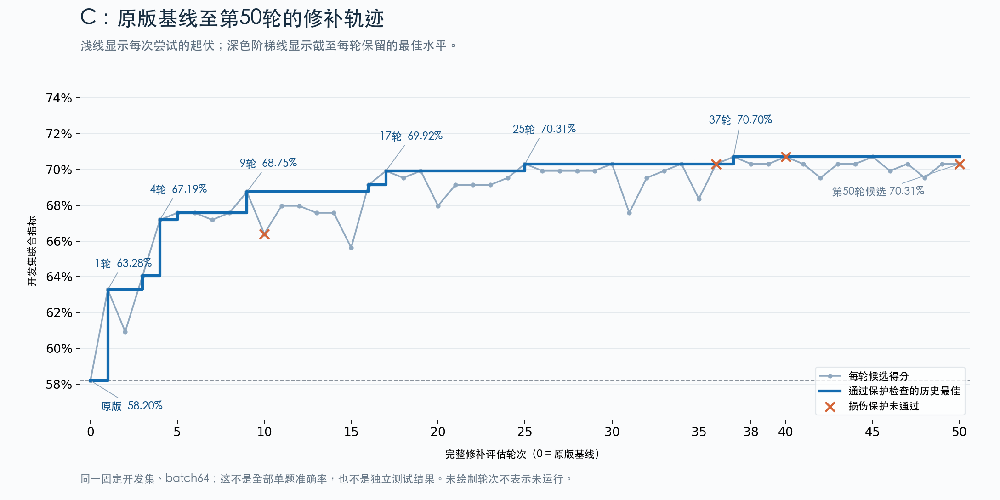
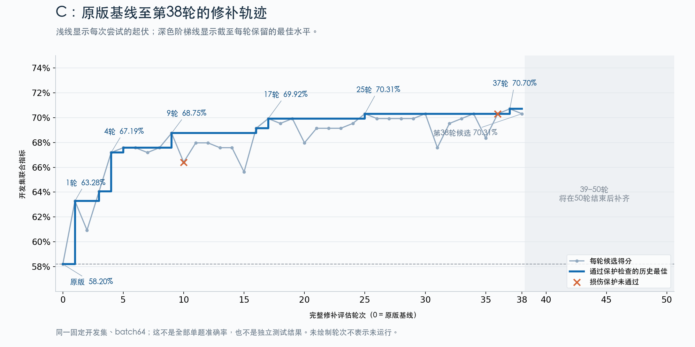

# 141．WSP v8的B/C各50轮

[返回总时间线](../README.zh-CN.md)

**时间定位**：版本/记录日期 2026-11-05；未从所选收据确定完整运行起止，不据目录名补写时刻。

**当时的目的与设计**

在同一开发集续至累计各50个不同非零候选，不重置旧轮次与预算；按联合指标及保护规则冻结。

**实际过程、结果与后来更正**

B47.41%→52.59%，修13错9，全体320→324/464；C58.20%→70.70%，修50错7，全体2266→2309/2560。B选R50，C选R45；B旧单参数补丁同batch结果56.03%更高也保留。两线正常冻结，但没有独立终验。

**来源身份**：`wsp-vlm-open-repair-v8x50-2026-11-05`；本章主体来源提交 `2ed333ea1e2f4ae2358f081ee37dbaf3c26c6274`。下方原文中的状态是各文件写作时的状态，不能把早期“尚未运行”覆盖后期正式收据，也不能将后期结果倒填进早期设计。

## 逐轮候选完整账目

- [Qwen-v8-B逐轮目的、改动和结果](../rounds/Qwen-v8-B.md)
- [Qwen-v8-C逐轮目的、改动和结果](../rounds/Qwen-v8-C.md)

## 原设计、执行过程、结果与更正全文

以下按“设计与题目 → 工程/执行记录 → 结果/更正 → 其他历史说明”组织；同类内没有可靠时间时保留路径顺序，不冒充严格先后。正文未删段；仅为本章节重排标题层级、把相对链接指向固定提交。原始字节另外完整保存。

### 原件 1：B 的 50 轮搜索为什么只提高 5.17 个百分点？

原路径：`experiments/wsp-vlm-open-repair-v8x50-2026-11-05/B-analysis/REPORT.zh-CN.md`。 [固定提交原文](https://github.com/yuxiexiong/acupuncture/blob/2ed333ea1e2f4ae2358f081ee37dbaf3c26c6274/experiments/wsp-vlm-open-repair-v8x50-2026-11-05/B-analysis/REPORT.zh-CN.md) · [单独阅读副本](../library/c988dfdcbdcc230f.md)；SHA-256：`c988dfdcbdcc230f519b85c33b508163ce38526969fa3971429b5fdc462fee2c`。

---

#### B 的 50 轮搜索为什么只提高 5.17 个百分点？

后续复核：[错误覆盖、数字方向与选择规则](https://github.com/yuxiexiong/acupuncture/blob/2ed333ea1e2f4ae2358f081ee37dbaf3c26c6274/experiments/wsp-vlm-open-repair-v8x50-2026-11-05/B-analysis/FAILURE-MODES.zh-CN.md)。新增逐条账表明最终13条修复与9条损伤全部伴随数字下降；87条原错误在50轮中预测数字始终不变；第47→50轮联合分提高但整体少答对9条。原审计与冻结结果保留。

##### Material Passport

- 类型：已完成实验的离线描述性审计；Verification Status: ANALYZED。
- 范围：v8 B 的同 batch64 W0、50 个不同非零候选、完整 D 回执与研究者请求；另复核旧补丁已有 batch64 输出。
- 模型：Qwen3-VL-4B-Instruct；58 个 D 来源组、464 条输入。不同问法/提示不是新增独立样本。
- 本次模型调用：0；未改变标签、评分、补丁、搜索状态或运行预算。
- 这是同一开发集上的搜索结果，不是独立验证；同助手自查不是独立审阅。

##### 结论

目前最有证据的解释是：**AI 的实际搜索停留在模块/层段的统一缩放，内部诊断没有深入到错误相关的神经元或计算环节；这类粗调对部分回答有用，但大部分错误始终没有被触及。** 同时，联合指标选择与整体回答正确率存在取舍。没有证据表明 B 已经达到稀疏权重修补的能力上限。

还必须纠正“最佳”的口径：52.59% 是这次 v8 新产生的 50 个候选中的最佳。旧的单参数补丁在已有同 batch64 输出上重新计算得到 **56.03%**，高于它。旧补丁也满足当前逐格损伤、格式和截断要求，但没有进入 v8 新候选登记，不能把 v8 的自动冻结称作全部历史候选中的最优选择。

##### 1. 先说明到底提升了什么

| 指标 | 同 batch64 原版 | 第 47 轮 | 最终第 50 轮 |
|---|---:|---:|---:|
| 普通提示下，总数与空间条件计数同时答对 | 55/116＝47.41% | 59/116＝50.86% | 61/116＝52.59% |
| 全部 464 条输入正确 | 320＝68.97% | 333＝71.77% | 324＝69.83% |
| 相对原版修对 / 改错 | — | 13 / 0 | 13 / 9 |

主指标先在每个来源组内平均两种问法，再平均 58 组；由于每组两种问法齐全，可等价写为 116 个问法配对。**116 不是独立来源组数。** 最终增加 6 个“总数和条件数均正确”的配对，分布在 5 个来源组，没有损失原本联合正确的配对。主指标增加 5.17 个百分点；全输入正确率只增加 0.86 个百分点。

第 50 轮并非第 47 轮的全面改进。固定选择规则优先联合得分，未把全输入净收益作为优先目标。因此它可以在修好部分配对的同时，把其他尚未联合正确的配对内本来正确的回答改错。这个取舍是原规则的结果，不能事后换评分“救分”；但汇报时必须把两种指标同时呈现。

##### 2. 最明确的搜索瓶颈：诊断浅，修改集中于统一缩放

163 个持久化请求包括：58 次 CPU Python、50 次提交、50 次完整评估、2 次 measure、1 次 status、1 次运行时目录、1 次看图。

- 第一次 measure：16 条输入，读取数字 0–9 的首个答案 token 分数。
- 第二次 measure：2 条输入，捕获视觉 merger 模块的输出形状和最前面的 8 个坐标，并读取数字分数。它服务于轴和形状核对，不是成功/失败对照下的神经元定位。
- 请求记录中没有临时内部 interventions；没有据此验证某个神经元/通道是否能把特定错误改正。
- 50 个候选的清单和修改代码均采用整组参数统一乘系数，包括 query normalization、视觉 merger 的 normalization/bias、语言层的 input/post-attention normalization 和视觉层 normalization。修改位置、幅度和组合由 AI 选择，并非助手预写层位配方。

最终补丁为：语言层 12–23 的 `self_attn.q_norm.weight` 乘 1.075，语言层 12–17 的 `input_layernorm.weight` 乘 0.90，均相对 W0。实际修改 16,896 个 BF16 标量。它是稀疏静态参数补丁，但不是已根据失败因果证据挑出的特定神经元集合。

第 14 轮已达到 50.00%；直到第 45 轮结束，保留的最佳联合得分都没有进一步提高。第 46 轮到 50.86%，第 50 轮到 52.59%。这说明很多新增轮次消耗在相近操作的层段、方向、剂量和组合试探上；不能把 50 个不同权重状态等同于 50 种独立的机制发现。

**解释边界：**统一缩放本身是合理候选，且确有收益；这些日志不能证明换成神经元定向编辑一定更好。它们只能说明，本轮没有充分检验后一条路径。工具允许任意合法参数位置的非梯度编辑、内部捕获与临时干预；没有强制只改 normalization。尚未实现任意梯度诊断及专用注意力概率提取器，是工具边界，但不足以解释为什么已有临时干预完全未用。

##### 3. 数据里的错误不是一种统一方向，粗调会互相牵制

| 题型（含两种提示与两种问法） | 原版正确 / 少数 / 多数 | 最终正确 / 少数 / 多数 |
|---|---:|---:|
| 总数，232 条 | 190 / 34 / 8 | 187 / 43 / 2 |
| 空间条件子集，232 条 | 130 / 38 / 64 | 137 / 38 / 57 |

这里“少数/多数”指预测小于/大于标签。总数题原先主要少数；条件题则两个方向都错、且多数更多。最终候选改善部分子集题，同时增加总数的少数错误。结果与“同一种全局调节对不同错误产生相反作用”相容，**但还不能确定它们分别来自漏看物体、参考对象绑定、方向判断或输出数字偏好**。

原版有 144 条错误，其中 **106 条（73.6%）在本次全部 50 个候选中一次也没修对**。这不是不可修证明，只说明现有修改族对大部分错误缺乏覆盖。反过来，修过的错误集合也不能被当作一个实际存在的万能组合补丁。

描述性分层还发现：allo 输入正确数 271/384→282/384；ego 输入 49/80→42/80。两个 strata 分别为 distance 161/232→167/232、position 159/232→157/232。这些是开发集的事后切片，且同组输入相关，不能据此宣称某类空间机制已被定位。

##### 4. 损伤保护确实有影响，但不是最终分数低的主要直接原因

50 轮中，1、2、4、7、24 轮未通过逐格损伤保护。被拒候选最高为第 1 轮的 51.72%，低于最终 52.59%。所以，在已经产生的 50 个候选中，取消保护也拿不到更高的主指标。

早期保护失败可能影响了 AI 后续搜索方向，这种间接影响没有反事实运行可以量化。不能把“没有高分候选被挡住”扩展成“保护对搜索过程完全无影响”。

##### 5. 历史补丁没有纳入竞争，也是流程上的缺口

旧补丁 `c-626e811e…` 的已有 batch64 原版预测与本轮 W0 的 464 条解析答案全部一致。按冻结评分重算：

- 旧补丁联合得分 65/116＝56.03%，比原版高 8.62 个百分点；全输入 331/464＝71.34%。
- 当前逐格损伤、格式和截断检查均通过。这里只是对已有输出的离线重算，没有重新加载补丁或推理。
- 研究者第 6–7 次对话明确检查了旧补丁，认为它的改善/损伤都朝答案零移动，因而没有把它当作已证明的空间推理修复，转向其他修改。

怀疑它利用答案偏好是合理的，**但“机制证据弱”和“没有当前指标收益”是两件事**。旧补丁应该作为历史性能参照保留；本轮探索其他思路并未超过它。这也说明，“只有 5.17 个百分点”不能当作该任务上全部 WSP 尝试的收益上限。旧补丁是否能在答案分布变化、自然新图或未见来源组上保留收益，现有证据不能回答。

##### 6. 对推进方式的含义

当前值得改变的是诊断深度和搜索覆盖，而非立即增加同类缩放轮数。下一步若获新的实验授权，应让研究者利用这些始终失败的案例和第 47/50 轮的互有得失提出可检验诊断；开放选择捕获位置、临时干预及后续静态补丁，不能由助手预先规定“某两层就是答案”。这是方向建议，不是本报告启动的新实验或已完成的因果定位。

现有产出对 WSP→VLM 研究的增量是：获得可追溯的 50 轮自主修改轨迹、明确的未触及失败集合，以及联合得分/单题损伤的取舍。它尚不能证明空间能力机制被修复，也不能据开发集最佳声称泛化有效。此报告不属于 cache 写入—读取机制线，不借用那条线的证据或预算。

##### 自查与复核

`analyze.py` 对 51 份完整评估（W0+50）逐一重算主指标及汇总并与原回执核对；完整输入均为 464 条。提取时检查原评估文件 SHA256。保留全部候选和失败，未挑选成功结果替代完整轨迹。

统计谬误自查 11/11：①已展示分层而不掩盖方向差异；②不由聚合结果推断单题机制；③D 的筛选限制外推；④没有事后协变量因果调整；⑤报告分母和错误基率；⑥同条件 W0 对照但不把搜索后的涨分当独立验证；⑦保留全部 50 候选；⑧承认多次选择最佳的偏差；⑨保留搜索自由度与所有动作；⑩参数干预对输出的变化不等同内部原因已识别；⑪未由相关性倒推某神经元负责失败。没有进行事后显著性检验，未把 464 条相关输入当 464 个独立来源组。

文件：`evidence.json.gz` 为带来源 SHA256 的评分/候选/请求快照；`old-batch64-predictions.json` 保存旧工程输出中评分所需字段及原文件 SHA256；`analysis.json` 为完整派生统计。`extract.py` 仅远端读回执；`analyze.py` 仅本地 CPU 计算。

---

### 原件 2：WSP-VLM B/C：各 50 轮开发搜索结束

原路径：`experiments/wsp-vlm-open-repair-v8x50-2026-11-05/FINAL.zh-CN.md`。 [固定提交原文](https://github.com/yuxiexiong/acupuncture/blob/2ed333ea1e2f4ae2358f081ee37dbaf3c26c6274/experiments/wsp-vlm-open-repair-v8x50-2026-11-05/FINAL.zh-CN.md) · [单独阅读副本](../library/54b1e118df87a0e0.md)；SHA-256：`54b1e118df87a0e097c41e14be8cbd4e758c56edb0ca5068b72d6085b3feee06`。

---

#### WSP-VLM B/C：各 50 轮开发搜索结束

2026-11-05 北京时间，B 于 17:00:16 完成，C 于 18:02:17 完成。两条线各有 50 个不同非零补丁和完整 D 评估，均正常冻结；18:02 的远端核查显示两张 H20 使用率均为 0%，显存各剩 3 MiB 占用，C broker 已退出。没有追加轮次或独立测试。

##### 结果与口径

| 线 | D 来源组／输入数 | 同 batch64 W0 联合指标 | 本轮冻结补丁 | 提升 | 全输入修对／改错 |
|---|---:|---:|---:|---:|---:|
| B：总数与空间条件计数 | 58／464 | 47.41% | 52.59% | +5.17 个百分点 | 13／9 |
| C：反事实图上的通常大小与图中大小 | 64／2560 | 58.20% | 70.70% | +12.50 个百分点 | 50／7 |

联合指标使用普通提示，先平均同来源组内的问法/排列，再等权平均来源组。它不是全部单题准确率。B 全输入正确率 320/464→324/464（68.97%→69.83%）；C 为 2266/2560→2309/2560（88.52%→90.20%）。同源问法/排列不是独立样本。所有结果为反复查看的 D 上的搜索表现，旧 H 已见，不作为新终验。

B 冻结第50轮 `c-81dd85b39a266ffe7352e0792bf026051cb849eb066dc6276365d0bdd2b9c4d4`，16,896 个修改标量。这里的“最佳”仅指本次50个新候选。旧单参数补丁已有同 batch64 输出按同评分重算为56.03%，通过当前保护；本轮未超过它。B 的诊断深度、统一缩放局限和第47/50轮的损伤取舍见 [专项分析](https://github.com/yuxiexiong/acupuncture/blob/2ed333ea1e2f4ae2358f081ee37dbaf3c26c6274/experiments/wsp-vlm-open-repair-v8x50-2026-11-05/B-analysis/REPORT.zh-CN.md)，不把5.17个百分点当作方法上限。

C 冻结第45轮 `c-556e560bdc90cca68fd2622fa57651d2e7fc071f2dd83d39ea866c91f3b393f0`，35,792 个修改标量。第37轮首次达到70.703125%；第45轮同分且修改标量更少，按预设规则替换。第50轮为70.3125%，且 `B0:T1:1:original_usual` 损伤保护失败，保留第45轮。10、36、40、50轮未通过损伤保护；失败仍保留并计入完整轮数。

##### C 的完整轨迹

浅线是每轮候选；深线是通过保护的保留最佳。第25轮70.31%，第37轮70.70%，之后没有更高的合格得分。图并未把最后一次尝试当最终部署补丁。PNG、SVG、输入JSON及绘图脚本均保留；横轴仍为0–50，与此前38轮图一致。

##### 验证和保留范围

`summarize_closeout.py` 只在 CPU 上重评保存的完整自然回答，核对两条线共102份完整评估（各W0+50）。全部输入数、逐条评分、汇总和联合指标与原回执一致；候选签名各50个唯一值。没有模型加载或新增推理。图已目视检查。

`closeout-evidence.json.gz` 保存每条线的最终状态、50个round回执、51份完整评分及每条原始回答全文、候选manifest、全部研究者请求、配置、身份、真实续接与冻结回执和来源文件SHA256。为避免重复体积，预测条目仅保留评分所需字段和完整回答文本；原始token、其他运行元数据、所有候选张量及完整动作产物仍原样留在远端 `external/wsp-vlm-open-repair-v8-2026-11-05/{B,C}`，未删除，也未把整张模型权重上传Git。

归档通过 `export_closeout.py` 只读提取，逐一核对缓存评估SHA256；`closeout-summary.json` 保留所有逐格正确数、修对/改错ID和最终资源计数。B共23,682个输入前向；C共130,562个，包含W0、完整评估和诊断。历史30→50续接未重放基线，B启动失败仍保留在 `failed-B-start-01`。

结束时 `/workspace` 剩余约86.48 GiB、`/tmp` 48.16 GiB；本地最近核查约698 GiB。GPU实验已结束，ETA为零；完成GitHub归档核对后撤销30分钟监控。

##### 研究边界与尚未完成的工作

这次完成的是 WSP→VLM 开放修改闭环的开发搜索：AI选择诊断、修改位置与非梯度计算，观察者记录完整反馈。它提供收益轨迹、失败候选、有限损伤和持久错误的证据；尚未建立被修复的唯一机制，也未证明跨来源组泛化。B专项审计提示搜索策略仍需改进；C的涨分同样不能自动解释为一般视觉能力增强。

没有开展独立终验、跨分布评估、与同预算其他方法比较或最终补丁重载后的新增验证。这些是后续可能需要的测量，不是本次自动扩展的授权范围。当前交付不是新的实验方案，也不是独立同行审查；统计解释保留开发选择偏差，不用重复问法扩大独立样本数，不省略失败，不把得分变化等同因果机制。与cache写入—读取研究线的预算和结论保持分离。

---

### 原件 3：WSP B 首轮提升受限：错误覆盖、数字方向与选择规则复核

原路径：`experiments/wsp-vlm-open-repair-v8x50-2026-11-05/B-analysis/FAILURE-MODES.zh-CN.md`。 [固定提交原文](https://github.com/yuxiexiong/acupuncture/blob/2ed333ea1e2f4ae2358f081ee37dbaf3c26c6274/experiments/wsp-vlm-open-repair-v8x50-2026-11-05/B-analysis/FAILURE-MODES.zh-CN.md) · [单独阅读副本](../library/0d4f068b60151016.md)；SHA-256：`0d4f068b60151016657786fb390353173b2082700b1232db3125700eada0afad`。

---

#### WSP B 首轮提升受限：错误覆盖、数字方向与选择规则复核

##### Material Passport

- 日期：2026-11-05；模式：academic-research-suite / validate；Verification Status: ANALYZED。
- 范围：Qwen3-VL-4B-Instruct，v8/v8x50 B，58 个开发来源组、464 条输入、W0＋50 个候选；同 batch64 比较。
- 复用：[上一份审计](https://github.com/yuxiexiong/acupuncture/blob/2ed333ea1e2f4ae2358f081ee37dbaf3c26c6274/experiments/wsp-vlm-open-repair-v8x50-2026-11-05/B-analysis/REPORT.zh-CN.md)、[冻结协议](https://github.com/yuxiexiong/acupuncture/blob/2ed333ea1e2f4ae2358f081ee37dbaf3c26c6274/experiments/wsp-vlm-open-repair-v8-2026-11-05/PLAN.zh-CN.md)、[最终回执](https://github.com/yuxiexiong/acupuncture/blob/2ed333ea1e2f4ae2358f081ee37dbaf3c26c6274/experiments/wsp-vlm-open-repair-v8x50-2026-11-05/receipt-B.json)、[冻结候选](https://github.com/yuxiexiong/acupuncture/blob/2ed333ea1e2f4ae2358f081ee37dbaf3c26c6274/experiments/wsp-vlm-open-repair-v8x50-2026-11-05/B-frozen-candidate.json)。
- 新增工作只有已有输出的 CPU 复算及日志阅读；0 新模型调用、0 新 GPU 运行。未改实验、评分、标签或自动冻结选择；没有重载补丁或独立确认。
- 派生数字：[failure-modes.json](https://github.com/yuxiexiong/acupuncture/blob/2ed333ea1e2f4ae2358f081ee37dbaf3c26c6274/experiments/wsp-vlm-open-repair-v8x50-2026-11-05/B-analysis/failure-modes.json)；复算：[audit_failure_modes.py](https://github.com/yuxiexiong/acupuncture/blob/2ed333ea1e2f4ae2358f081ee37dbaf3c26c6274/experiments/wsp-vlm-open-repair-v8x50-2026-11-05/B-analysis/audit_failure_modes.py)；带来源 SHA256 的原研究者提示与回复节选：[trace-excerpts.json](https://github.com/yuxiexiong/acupuncture/blob/2ed333ea1e2f4ae2358f081ee37dbaf3c26c6274/experiments/wsp-vlm-open-repair-v8x50-2026-11-05/B-analysis/trace-excerpts.json)。

##### 结论：优先怀疑搜索覆盖不足，并伴随数字向下偏移与指标取舍

本轮没有证据说明 B 已达到 WSP 的能力上限。更有根据的判断是：**研究者长期停留在粗粒度的参数统一缩放，大部分错误没有被修到；最终组合又呈现明显的数字向下偏移，修好一些多数错误，同时制造少数错误。联合指标允许部分单题损伤不反映在主分数上。** 这是对已观察搜索路径的诊断，尚未证明“内部诊断更深就一定能提高多少”。

| 固定指标 | W0 | 第47轮 | 最终第50轮 |
|---|---:|---:|---:|
| 普通提示全数/子集联合正确 | 55/116（47.41%） | 59/116（50.86%） | 61/116（52.59%） |
| 全部输入正确 | 320/464（68.97%） | 333/464（71.77%） | 324/464（69.83%） |
| 相对W0修对/改错 | — | 13/0 | 13/9 |

116 是每个来源组两种问法形成的配对数，独立来源单位仍为58组。最终主分数增加5.17pp；全输入只增加0.86pp。它是开发集搜索后的最佳值，不能解释成新数据上的效果估计。

##### 1. 最终补丁的具体行为：修对和改错都朝更小的数字移动

第50轮相对W0改变30条解析答案：28条数字下降、2条上升。分解如下：

| 回答变化 | 数字下降 | 数字上升 |
|---|---:|---:|
| 错变对 | 13 | 0 |
| 对变错 | 9 | 0 |
| 错变另一个错 | 6 | 2 |

例如，`B-326194` 的总数标签为3，四种提示/问法均从4改为3，产生4条修复；`B-188190` 总数标签为6，四种输入均从6改为5，产生4条损伤。前者不是四张独立图片的成功，后者也不能被联合分数掩盖。

原版总数错误本就以少数为主（34条少数、8条多数）；子集错误则多数更多（64条多数、38条少数）。一个偏向较小数字的变化能帮到后一部分，却容易伤到前者。最终全数正确190→187，子集130→137，符合这一行为取舍。

**仍不能把它直接命名为“输出层数字偏置”。** 补丁改的是中层 query normalization 和 attention input normalization，可能通过不同内部计算产生同向数字变化。现有日志没有把“回答偏好改变”和“视觉/空间证据改变后恰好输出更小数字”分开。也不能说整个50轮都只会压小数字：第47轮13条修复中有3条向上，且没有改错。

值得警惕的闭环缺口是：研究者第7次对话已因旧补丁的收益/损伤都向零移动而怀疑答案偏好；但最终新补丁的全部正确性翻转同样向下。旧补丁并未证明空间修复，新补丁也尚未排除此解释。不能仅因修改位置从输出相关参数转到中层，就把它升级为更强的空间机制证据。

##### 2. 搜索的主要限制不是“最后几个候选选错”，而是大部分错误从未覆盖

原版144条错误可以分为：

| 50轮中的表现 | 条数 | 占原版错误 |
|---|---:|---:|
| 至少一次被修对 | 38 | 26.4% |
| 答案有变化，但一直错误 | 19 | 13.2% |
| 预测数字从未变化，始终错误 | 87 | 60.4% |

合计106/144（73.6%）从未被修对。“预测没变”只指最终解析数字，不代表内部状态或概率没变。

联合任务也如此：原版失败的61个普通提示配对中，有48个在所有50候选中始终没有联合正确。即使事后允许对每个配对挑一个曾经答对的候选，把W0也纳入选择，已观察答案的并集也只有68/116（58.62%）。**这是候选库的覆盖统计，不是一个可部署的补丁，更不是未来WSP方法的能力上限。** 它说明只从这批既有候选里挑选，仍无法覆盖大量原失败。

具体例子：`B-662:total:T0:B0` 标签3，W0答2，50候选全答2；已有诊断中2相对3的首token logit优势为13.75。研究者确实注意到这个高置信错误，却随后转入全层q_norm缩放，未继续保存能解释这例错误的内部对照。另一个例子 `B-425919:total:T0:B0` 标签5，50轮中48轮答4、2轮答3，调整有时只是离正确答案更远。

##### 3. 为什么搜索会收窄：工具开放，实际策略长期沿用统一缩放

请求与代码共同显示：50次提交、50次完整评估，只有2次内部测量；第一次看16条输入的数字logit，第二次看2条输入的merger形状与最前8个坐标。没有临时内部干预请求，也没有保存成功/失败对照下的具体通道证据。全部50个候选均为整组参数乘系数，区别主要是模块、层段、方向、剂量和组合。

最终候选：语言层12–23的`self_attn.q_norm.weight ×1.075`，层12–17的`input_layernorm.weight ×0.90`，实际变化16,896个BF16标量。少量参数能够产生广泛行为影响，但这种操作没有区分“当前输入需要往哪一个方向修”。

从日志能排除或限定几种解释：

- **不是服务只允许改normalization。** 实际提示开放任意合法参数、内部capture和临时add/replace/scale；没有强制统一缩放、无标签方法或禁止逐坐标计算。非梯度限制与缺少任意梯度诊断是实际边界，但它们不等于只能缩放。
- **不是明显触及标量或样本硬上限。** 最终16,896标量远低于100万上限；记录的23,682个前向样本低于69,600额度，恰为51×464完整评价＋18条测量。这个计数不是完整GPU时间或账单；不能由剩余额度推断更多诊断一定有效。
- **不是大量无效权重或重复输出刷轮次。** 50个候选产生50种不同的解析答案向量；只有第36轮与W0的解析答案完全相同。存在真实响应，但覆盖窄。
- **有一处提示质量问题。** 实际首轮提示仍包含旧“7200秒/100 turns”，末尾又明确“无总墙钟限制/2000动作”，冻结配置也是`wall_seconds=null`。记录表明研究者继续完成50轮，不能把低收益直接归咎于两小时时限；这种相互矛盾的说明仍应在今后运行前清理。

更合理但尚未因果验证的解释是：早期统一缩放获得小收益后，研究者不断围绕这一容易实施、容易解释的操作做层段和剂量比较；“完成若干不同补丁”没有保证每轮增加新的诊断信息。第14轮已到50.00%，第15–45轮没有超过该合格最佳值。这里能确认策略收窄及平台，不能从单条轨迹确定研究者为什么偏好它，也不能断言换研究者或强制测量就会成功。

##### 4. 联合指标为什么能上涨，但回答净收益很小

联合正确要求同一个配对中的总数、子集都对。这是合理目标，但当子集已经错时，再把总数从对改错，该配对的主指标仍是0。

最终普通提示中新增的4条总数损伤，恰好都发生在原本联合就错误的配对：`B-101422`和`B-188190`各两种问法。因此这些损伤没有扣掉任何已有联合正确配对。逐格保护允许58条中的至多2条净损失（2/58＝3.448%，未超过3.5%）；它限制每格净正确率损失，不是逐题零损伤保证，也不是广泛能力保护。

最直接的取舍发生在第47→50轮：3条新变对，12条从对变错，整体净少9条正确；但联合正确从59增到61。因此选第50轮符合冻结规则，却不能描述为对第47轮的全面改善。这不是评分实现bug，也不应事后换主终点；应同时保留第47轮“13修复、0损伤”与第50轮更高联合分的结果。

按提示和问法拆开，最终普通提示总数T0/T1均为47→47，子集T0为31→31、T1为32→35；规则提示总数T0/T1为48→46、48→47，子集为32→34、35→37。收益没有均匀覆盖两种问法与两种任务。

保护规则本身没有挡住一个已生成的更高分候选：5个保护失败候选中最高联合分为60/116，仍低于最终61/116。它可能间接影响研究者选择，但“放宽保护就能把这批候选提到更高分”不受现有证据支持。

##### 5. 当前能作出的判断与不能作出的判断

优先级最高的是**改善错误诊断与搜索覆盖**，其次是完整呈现候选间的收益/损伤取舍；目前没有依据优先增加相同缩放的轮数或放宽保护。这里只给推进判断，不新增实验合同或运行授权，也不预先替研究者指定两层或某类神经元。

已有旧补丁同batch64重算为65/116（56.03%），高于本轮61/116，并通过当前保护。因此52.59%只是本轮新候选最优，不能称所有历史尝试的最好成绩。该旧补丁也有答案向零偏移的解释问题，不能用它的高分补足机制证据。

可以说：本轮在开发面板上找到有限收益；大部分原错误未修；最终正确性变化全部向较小数字移动；规则选择了更高联合分、较低单题净收益的候选。

不能说：已找到空间推理故障的唯一来源；已证明只是输出偏置；已证明神经元定向编辑一定更强；B不可修；50轮等于充分搜索；本轮分数是独立泛化结果。对模型错误究竟来自物体识别、参照绑定、方向关系、集合筛选还是计数，现有内部测量仍不足。

##### 6. 复核与自查

分析卡：主线仍为AI反馈驱动的静态稀疏修补；本轮问题是已有低增益能否被错误覆盖、数字变化和选择规则解释；相对上一审计新增完整方向账、87条不变错误、配对覆盖与第47→50轮损伤账。固定原输入/标签/批量/评分，不操作模型；估计对象仅为保存输出的转移与候选库覆盖。正反证同列；缺少内部因果对照不以推断补齐。退出于此离线诊断，不自动开新搜索。

| 检查 | 判定及依据 |
|---|---|
| C01 | 通过：服务B修补主线，不换成cache或单纯logit目标。 |
| C02 | 通过：新增方向、覆盖和联合指标遮蔽损伤的具体证据。 |
| C03 | 通过：复用51份评分、原始研究者请求、协议及已有审计。 |
| C04 | 通过：列出第47轮向上修复和旧候选更高分等不利证据。 |
| C05 | 通过：仅重算保存输出，无新权重或激活操作。 |
| C06 | 通过：同batch64比较；不能以旧逐题基线制造涨分。 |
| C07 | 通过：显式讨论总数/子集及问法之间的耦合取舍。 |
| C08 | 通过：数字下降不命名唯一内部机制；未测路径保持未知。 |
| C09 | 通过：区分搜索覆盖、选择规则、硬额度和损伤保护解释。 |
| C10 | 通过：联合与单题同时报告，logit仅作案例背景。 |
| C11 | 通过：真实低收益与工具边界分开，不因阴性认定bug。 |
| C12 | 通过：0新模型/GPU，仅CPU及文档。 |
| C13 | 通过：58来源组、事后分析和开发选择明确；保存源hash与完整派生ID。 |
| C14 | 通过：结论支持改进诊断优先级，也允许停止；未自动加轮。 |

相关历史错误：E02不指定天然层位；E03少参数不等于小行为影响；E10完整答案不被logit替代；E11输出未变不等于内部无信息；E12保护净差不等于无损伤；E16保留坏候选；E20不强行互斥病因；E22不把464输入当独立样本；E23同助手复核不称独立审查；E24不要求完整机制才承认有限收益；E25不追加全套模型实验。E01在C01处理；E21未提出新颖性主张；其余缓存状态/路径专用错误因本轮未操作缓存或拼接路径而不适用。

反方检查：①“向下移动只是正确的空间修复”——可能，故仅报告方向及其损伤，不定位为输出偏置；②“更深诊断无用”——可能，本报告没有比较另一种搜索策略，只指出当前未覆盖；③“并集就是58.62%的上限”——不成立，明确它只属于已产生候选且使用答案事后挑选；④“保护一放宽就成功”——既有候选最高分反证该直接解释；⑤“主指标有损伤就无效”——不成立，联合指标有用途，问题是汇报与取舍边界。

统计谬误11/11复查：报告分层方向；不从组均值推断单题机制；承认开发选择偏差；无事后协变量调整；完整基率与分母；同批量W0对照；不丢失败候选；不作最佳值显著性宣称；保存事后分析身份；输出干预效应不升级为内部归因；不反推自然神经元功能。无新增p值或确认性区间。

逻辑自查通过，同一助手自查。工程核验：旧`analyze.py`复算一致；新脚本逐候选校验输入唯一性、标签、解析正确性、组数、完整性、联合分与正确率，并核对主要转移账。本次验证的是保存数据的算术一致性，不是模型重放成功。源快照完整性以`failure-modes.json`中SHA256及既有来源清单为据。

---

### 原件 4：B/C 各50轮：满足条件后的自动续接

原路径：`experiments/wsp-vlm-open-repair-v8x50-2026-11-05/README.md`。 [固定提交原文](https://github.com/yuxiexiong/acupuncture/blob/2ed333ea1e2f4ae2358f081ee37dbaf3c26c6274/experiments/wsp-vlm-open-repair-v8x50-2026-11-05/README.md) · [单独阅读副本](../library/d76c7415eac85a0d.md)；SHA-256：`d76c7415eac85a0d130828a220d1bbe6cd804dadc03a87c9e6e236e5fc12033c`。

---

#### B/C 各50轮：满足条件后的自动续接

2026-11-05用户授权：若按当前速度各30轮ETA在本次请求后三小时内，可扩为各50轮。约14:59核算最近5个完整轮间隔，B均值168.56秒（12轮已完成）、C284.23秒（9轮已完成）；30轮预计15:49/16:38，均早于本次请求的17:23门槛。因此满足授权条件。50轮点估计B16:45、C18:13；非保证时间。原始计算见authorization.json。

已安排自动续接：现有v8进程正常完成30轮并退出后，本目录continue50.py各自接续相同远端run、研究者thread、候选、逐题反馈、累计成本及轮数，从31继续到50。尚未到达真实30轮边界，当前阶段内存目标仍30，续接后才变50；不能把排队称为已完成真实续接。

不热改运行进程，不中断动作，不重放旧候选/原版，不重新选择数据。原30轮state/config/identity/frozen-candidate存入checkpoint-round30；旧identity和科学评估protocol不改，追加round-limit-amendment.json明确覆盖轮数上限。原样本额度为150次全D，足够覆盖50轮主体；其他辅助上限沿用，触限报告，不自动无限扩展。Python内核重启会丢临时变量，已提示研究者从保存的work/artifacts恢复；原研究者对话保留。

##### 设计卡与自查

主问题、模型、任务和终点见v8/PLAN.zh-CN.md；本增量是沿原AI反馈链增加20个独特完整候选，检验后续搜索是否继续带来开发收益或趋于平台。比较仍为相同batch64、数据、评分的W0与候选，逐格损伤保护、标量上限不变。负结果/保护失败仍计轮，不能把50次搜索当50独立样本或泛化证据。结束条件为50轮冻结，真实工程阻塞或原阶段提前退出必须如实报告。旧H不作新终验。

C01通过：问题仍是开放稀疏权重修补。C02通过：增量为更长自选假设反馈链及收益轨迹，不另换题。C03通过：复用全部原结果和候选，缓存避免重放。C04通过：允许平台、负收益和损伤。C05通过：仍是静态权重，未改变算子含义。C06通过：仅在无未完成动作且旧broker退出后续接。C07通过：标量/范数预算不变。C08通过：只称开发搜索，不作机制归因。C09通过：不给研究者选层/神经元配方。C10通过：完整自然答案评分不变。C11通过：恢复故障单独记录，不算负实验。C12通过：有条件用户授权已按实测轮速满足，ETA含AI和工具等待。C13通过：保存30轮快照并追加合同修订，旧证据不覆盖。C14通过：到50停止，保留早停状态及独立确认缺口。

历史错误检查：防E02固定层配方、E10分数混同、E16无效结果消失、E22开发集冒充独立确认、E23自查冒充独立审查；相关条目其余沿v8自查。相对v8只增加轮数和安全续接入口；不改标签、评分、模型、批量和选择规则。

反方检查：仅改配置不能改运行中内存，因此在30轮完整边界实际重新构造观察者并设置50；停后盲目重放可能重复计数，因此核对未完成动作、进程退出、相同候选hash及原cache；恢复可能丢研究者上下文，因此恢复同thread/累计usage/下一turn编号，并说明Python变量重建。磁盘当前约176GiB，继续监控20GiB预留；不得删除raw救空间。

31项CPU测试通过（原30项回归及实际计数30→50、重复不计且不重算、只在50冻结）；不加载模型。真实续接验收待到30轮边界后的broker-50-ready回执。逻辑自查通过，不是独立审查。

##### 16:00 续接故障修复与真实验收

B在30轮正常冻结；第一次续接远端在导入run_rounds时失败，该模块仅部署于本机，故未加载模型、未重放候选。失败源代码、远端栈、本机错误及原启动回执保留failed-B-start-01。修复为仅在本机run函数导入调度器；31项CPU回归通过，并在真实远端执行--help验证模块初始化。核对失败PID退出、无未完成动作、state仍完整30轮后才重试。

B实际broker-50-ready回执确认resumed_at=30、round_target=50、baseline_replayed=false；原30轮快照已保存，新的观察者PID1779702、本机续接PID7671。研究者恢复同thread，当前研究循环已恢复。C尚未到30轮，待原等待器调用已修复的远端入口。B原来的waiting标记不代表新状态，以当前continuation-B和B-broker-50-ready为准。

---

### 原件 5：C修补进展曲线

原路径：`experiments/wsp-vlm-open-repair-v8x50-2026-11-05/figures/README.md`。 [固定提交原文](https://github.com/yuxiexiong/acupuncture/blob/2ed333ea1e2f4ae2358f081ee37dbaf3c26c6274/experiments/wsp-vlm-open-repair-v8x50-2026-11-05/figures/README.md) · [单独阅读副本](../library/2e3582ca55a43ea7.md)；SHA-256：`2e3582ca55a43ea7a910ddda45df5b5c2ade8bf150ee9551f41b34f310eef1c8`。

---

#### C修补进展曲线

浅色线为各轮完整开发评估得分；深色阶梯为通过保护规则的历史最佳；橙色叉为损伤保护失败。源数据来自远端v8/C完整回执，第0轮为相同batch64的W0，未重新运行模型。38轮后区域留白以便50轮结束后更新，留白不表示这些轮次未运行。

基线58.203125%，第9轮最佳68.75%，第17轮69.921875%，第25轮70.3125%，第37轮70.703125%，第38轮候选70.3125%。这是开发集联合指标，不是全部单题准确率或独立终验。

[逐轮源数据](https://github.com/yuxiexiong/acupuncture/blob/2ed333ea1e2f4ae2358f081ee37dbaf3c26c6274/experiments/wsp-vlm-open-repair-v8x50-2026-11-05/figures/c-through38.json) · [SVG](https://github.com/yuxiexiong/acupuncture/blob/2ed333ea1e2f4ae2358f081ee37dbaf3c26c6274/experiments/wsp-vlm-open-repair-v8x50-2026-11-05/figures/c-through38.svg) · [绘图脚本](https://github.com/yuxiexiong/acupuncture/blob/2ed333ea1e2f4ae2358f081ee37dbaf3c26c6274/experiments/wsp-vlm-open-repair-v8x50-2026-11-05/figures/plot_c_progress.py)。用户已要求50轮结束后按同样样式补全到50轮，已写入监控任务。

---

## 时间、运行与停止收据索引

下面是所收集JSON的原有时间字段与状态，不把预计结束时间当实际完成时间。未列时间的文件仍有原件链接。完整JSON全部保存在原文归档，不能以此索引中的标量代替完整嵌套内容。

| 原件 | 原记录状态/阶段 | 原时间字段（原时区） |
|---|---|---|
| [closeout-summary.json](https://github.com/yuxiexiong/acupuncture/blob/2ed333ea1e2f4ae2358f081ee37dbaf3c26c6274/experiments/wsp-vlm-open-repair-v8x50-2026-11-05/closeout-summary.json) | {"model_calls": 0} | {} |
| [failed-B-start-01/failure-B-controller.json](https://github.com/yuxiexiong/acupuncture/blob/2ed333ea1e2f4ae2358f081ee37dbaf3c26c6274/experiments/wsp-vlm-open-repair-v8x50-2026-11-05/failed-B-start-01/failure-B-controller.json) | {} | {"time_unix": "2026-11-05T07:48:38.582613+00:00"} |
| [failed-B-start-01/launch-B.json](https://github.com/yuxiexiong/acupuncture/blob/2ed333ea1e2f4ae2358f081ee37dbaf3c26c6274/experiments/wsp-vlm-open-repair-v8x50-2026-11-05/failed-B-start-01/launch-B.json) | {} | {"time_unix": "2026-11-05T07:48:28.760521+00:00"} |
| [failed-B-start-01/remote/launch-B.json](https://github.com/yuxiexiong/acupuncture/blob/2ed333ea1e2f4ae2358f081ee37dbaf3c26c6274/experiments/wsp-vlm-open-repair-v8x50-2026-11-05/failed-B-start-01/remote/launch-B.json) | {} | {"time_unix": "2026-11-05T07:48:28.760521+00:00"} |
| [launch-B.json](https://github.com/yuxiexiong/acupuncture/blob/2ed333ea1e2f4ae2358f081ee37dbaf3c26c6274/experiments/wsp-vlm-open-repair-v8x50-2026-11-05/launch-B.json) | {} | {"time_unix": "2026-11-05T07:59:56.637587+00:00"} |
| [receipt-B.json](https://github.com/yuxiexiong/acupuncture/blob/2ed333ea1e2f4ae2358f081ee37dbaf3c26c6274/experiments/wsp-vlm-open-repair-v8x50-2026-11-05/receipt-B.json) | {"status": "stopped_or_frozen"} | {} |
| [repair-r2-receipt.json](https://github.com/yuxiexiong/acupuncture/blob/2ed333ea1e2f4ae2358f081ee37dbaf3c26c6274/experiments/wsp-vlm-open-repair-v8x50-2026-11-05/repair-r2-receipt.json) | {} | {"time_unix": "2026-11-05T08:02:18.183960+00:00"} |
| [researcher-launch-config-audit.json](https://github.com/yuxiexiong/acupuncture/blob/2ed333ea1e2f4ae2358f081ee37dbaf3c26c6274/experiments/wsp-vlm-open-repair-v8x50-2026-11-05/researcher-launch-config-audit.json) | {"scope": "Saved local launch configuration, not independent server identity attestation; no new model calls"} | {} |

## 全部原始资产入口

本目录在固定提交下共有52个跟踪文件，包含代码、原回答、失败、收据和压缩证据；文件数不是样本数。[逐文件完整账本](../assets/141-wsp-vlm-open-repair-v8x50-2026-11-05.tsv) · [原目录](https://github.com/yuxiexiong/acupuncture/tree/2ed333ea1e2f4ae2358f081ee37dbaf3c26c6274/experiments/wsp-vlm-open-repair-v8x50-2026-11-05)。未复制模型权重、环境或凭据。
