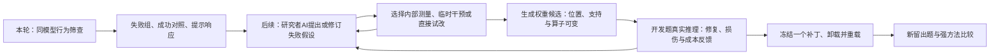

# 143．VLM筛查数据v1

[返回总时间线](../README.zh-CN.md)

**时间定位**：版本/记录日期 2026-11-05；未从所选收据确定完整运行起止，不据目录名补写时刻。

**当时的目的与设计**

准备B空间条件计数与C视觉/常识大小冲突，按来源分组、查标签与近重复。

**实际过程、结果与后来更正**

B原164图发现至少5组不符，原160组门槛无法达到；C727行归并后704组，隔离后318候选，244审核166通过，取160组D64/H96。没有模型推理。

**来源身份**：`wsp-vlm-screen-data-v1-2026-11-05`；本章主体来源提交 `2ed333ea1e2f4ae2358f081ee37dbaf3c26c6274`。下方原文中的状态是各文件写作时的状态，不能把早期“尚未运行”覆盖后期正式收据，也不能将后期结果倒填进早期设计。


## 原设计、执行过程、结果与更正全文

以下按“设计与题目 → 工程/执行记录 → 结果/更正 → 其他历史说明”组织；同类内没有可靠时间时保留路径顺序，不冒充严格先后。正文未删段；仅为本章节重排标题层级、把相对链接指向固定提交。原始字节另外完整保存。

### 原件 1：WSP 三候选行为筛查：资产检查、准备清单与工作量

原路径：`docs/wsp-vlm-screen-readiness-2026-11-05.zh-CN.md`。 [固定提交原文](https://github.com/yuxiexiong/acupuncture/blob/2ed333ea1e2f4ae2358f081ee37dbaf3c26c6274/docs/wsp-vlm-screen-readiness-2026-11-05.zh-CN.md) · [单独阅读副本](../library/80be6530ce26cf9a.md)；SHA-256：`80be6530ce26cf9af2651ac75e1467e89229e720e472d9aa6667132cdab89bef`。

---

#### WSP 三候选行为筛查：资产检查、准备清单与工作量

日期：2026-11-05。依据：[筛查方案 WSP-VL-SCREEN-01](https://github.com/yuxiexiong/acupuncture/blob/2ed333ea1e2f4ae2358f081ee37dbaf3c26c6274/docs/wsp-vlm-behavior-screen-v1-2026-11-05.zh-CN.md)，交付提交 `787cc8d230257f8173a44bf7262eed42b6e478f7`。

**结论：已有方案、硬件、通用Python环境和可复用的WSP工程部件；目标模型、三套合格题单、VLM运行器与专用评分管线尚未就位，不能直接启动筛查。** 最先应检查的是公开数据能否提供足量的独立合格组，然后才准备模型和完整运行代码。

本次只读检查本地仓库/HF缓存、现有H20服务器的目录/包元数据/资源状态，以及公开模型和数据页面。没有下载权重或完整数据，没有构造实验图像、加载模型、执行前向、生成、探针训练或权重修改。下列工时是基于缺项的工程估计，不是已完成工作或新的运行授权。本文件是资产盘点，不修改既定任务、阈值和预算，不替代方案自查。

##### 1. 检查范围与实际证据

###### 1.1 本地与服务器

- 本地检查：项目 `experiments/`、`external/`及 `~/.cache/huggingface`；检索目标模型、SPHERE、Visual CounterFact、VLMCountBench相关名字与代码引用。仅找到方案/自查等文档，未找到本筛查专用代码、冻结题单、数据或目标模型缓存。
- 服务器检查：已有 `gqa-h20`；`/workspace/acupuncture`、`/workspace/models`以及常见HF缓存位置，目录检索限制深度并跳过 `.git`、包目录、缓存blobs等。目标名称未匹配到实际资产；不能扩大为“整个服务器所有目录都不存在”。
- 服务器现有模型包含Qwen3.5的旧资产、Qwen3-4B和其他语言模型；**不是Qwen3-VL-4B-Instruct**。旧WSP目录可见 `raw-Qwen3.5-0.8B`、`text-Qwen3.5-0.8B`、`text-Qwen3.5-4B-r2` 等；文本导出不具备此次所需完整视觉输入链。
- 2026-11-05约03:37北京时间的只读资源快照：两张NVIDIA H20，每张97,871MiB，总显存使用各3MiB、利用率0%；`/workspace`磁盘2.5T、剩余约219G。**只说明当时状态，不预留设备、不保证后续仍空闲。**

初次SSH受本地沙箱网络限制；经过只读权限复核后检查成功。未读取凭据内容、未改服务器文件、未启动或停止任何任务。

###### 1.2 现有环境

通过 `/workspace/acupuncture/.venv-wsp/bin/python` 的 `importlib.metadata`读取安装信息，未import torch/模型或调用CUDA：

| 包 | 安装元数据版本 |
|---|---|
| torch | 2.14.0 |
| transformers | 5.20.2 |
| vllm | 0.33.0 |
| datasets | 5.1.0 |
| huggingface-hub | 2.4.0 |
| Pillow | 13.0.0 |
| pyarrow | 26.0.0 |
| numpy / scipy | 2.3.5 / 1.17.1 |

`transformers/models/qwen3_vl`源码目录存在。这是“依赖已安装、有实现”，不是import兼容性、完整模型加载、视觉预处理、BF16输出或吞吐验收。优先复用/锁定现有环境，若需改包应隔离环境，不能顺手升级破坏旧实验。

##### 2. 模型与数据准备清单

| 项目 | 已有 | 尚缺／验收完成的定义 |
|---|---|---|
| 目标模型 | [固定revision文件树](https://huggingface.co/Qwen/Qwen3-VL-4B-Instruct/tree/ebb281ec70b05090aa6165b016eac8ec08e71b17)可读；模型ID、revision已写入方案 | 检查到的本地/服务器目录未见权重；需准备完整两分片、index、tokenizer、chat template、processor与配置，逐文件hash及revision manifest。不能复用旧文本导出来代替 |
| 模型体量 | 官方文件树列总约8.89GB，权重分片约4.97＋3.91GB | 本次未下载；下载时长/链路稳定性未知；完成下载不等于推理验收 |
| A受控计数 | 生成规则、160组数量分层、问题模板已在方案中 | 无生成器、图片、结构标签；需产出160布局/320图、四条件题单、分配比例/舍入规则、重叠/出界检查与全部布局审核 |
| B空间条件计数 | [SPHERE数据卡](https://huggingface.co/datasets/wei2912/SPHERE-VLM)明确配对来源；[文件树](https://huggingface.co/datasets/wei2912/SPHERE-VLM/tree/main)约104MB | 无本地副本、配对清单、去重与审核；需位置80组＋距离80组，且跨组不重复源图片；320原问题另需320条等义改写 |
| B版本 | 页面链接解析出候选commit `25f0922a5290505fee8252e2dbb7771ff2d8afe9` | 固定commit正文读取失败，页面有缓存日期；因此仅记录候选标识，不将其冒充已下载校验的冻结版本 |
| C视觉常识冲突 | [固定提交页面](https://huggingface.co/datasets/mgolov/Visual-Counterfact/commit/f8cd0b2335356b0f01a164df0cac7403f56a6c83)本次可读；[size文件](https://huggingface.co/datasets/mgolov/Visual-Counterfact/tree/main/data)约98.8MB | 无本地副本、160个合格来源组、别名/标签映射；需320图的关系审核，原图/反事实×通常/图中＋无图的五条件答案表 |
| D/H与请求集 | D64/H96、来源分组、模板/顺序、提示、预算已定义 | 三候选实际来源组和排除表未冻结；尚无10,240条科学请求JSONL与图片hash，也无D后锁模式、H一次揭示的实施控制 |

**B的数量风险优先级最高。** 空间条件题列位置169、距离158，但配套全部计数题合计仅列201，当前默认查看的距离配对计数子集为100条。因此327不能当成327个独立可用题对。必须先确认：同图/同类匹配数量、位置与距离图像交集、歧义排除后每层能否各保留80个独立来源组。我们尚未下载全量逐条计算，所以不能断言足量，也不能断言一定不足。

C的727行同样不是727个已验收独立组。应先按整图近重复和无序对象对分组；共享抠图/对象还要标注。若B或C不够160组合格样本，按原方案标数据不足，不拆来源组凑数、不顺手改采样规则。

公开资源尺寸按网页显示，可能有缓存或打包差异，不能替代下载后的实际字节数与hash。准备B全库＋C仅size约203MB，此外是A生成图和派生题单；不必为本轮下载CF color或额外大基准。

##### 3. 代码：能复用哪些，不能直接用哪些

| 现有文件／能力 | 检查结果 | 对筛查的处理 |
|---|---|---|
| [旧forward_service.py](https://github.com/yuxiexiong/acupuncture/blob/2ed333ea1e2f4ae2358f081ee37dbaf3c26c6274/experiments/wsp-process-reproduction-v1-2026-11-03/engineering-r2/forward_service.py) | profiles固定旧Qwen3.5文本导出；AutoTokenizer/AutoModelForCausalLM；vLLM请求只有prompt_token_ids，未提供图像输入；采样参数也与本方案不同 | 不能直接运行VLM。可参考JSONL输出、完成标志与计时方式；新增薄的图像/无图运行入口，正确使用processor与锁定模型实现 |
| [WCP model_interface.py](https://github.com/yuxiexiong/acupuncture/blob/2ed333ea1e2f4ae2358f081ee37dbaf3c26c6274/experiments/wsp-coding-painpoint-v1-2026-11-03/model_interface.py) | 文本编程适配及限制8/32列的增益操作，复用旧FS | 不能直接用于本轮；不为筛查搬入列修改、沙箱执行生成代码等无关逻辑 |
| [broker.py](https://github.com/yuxiexiong/acupuncture/blob/2ed333ea1e2f4ae2358f081ee37dbaf3c26c6274/experiments/wsp-process-reproduction-v1-2026-11-03/engineering-r2/broker.py)、[controller.py](https://github.com/yuxiexiong/acupuncture/blob/2ed333ea1e2f4ae2358f081ee37dbaf3c26c6274/experiments/wsp-process-reproduction-v1-2026-11-03/engineering-r2/controller.py) | 有请求校验、持久账本、超时、磁盘门与AI反馈历史实现；绑定旧profile/协议 | 复用计账/归档思路或少量函数；行为筛查是固定请求批次，不必先修好整套自主AI服务 |
| [旧结果审计](https://github.com/yuxiexiong/acupuncture/blob/2ed333ea1e2f4ae2358f081ee37dbaf3c26c6274/experiments/wsp-process-reproduction-v1-2026-11-03/fleet-v1/runs/user-stop-r1/audit_saved_results.py) | 有配对修复/损伤统计、双侧精确McNemar；模块顶层读取旧结果 | 不能直接import作新库；提取核对需要的计算，改为本方案单侧主检验并测试方向/零不一致 |
| [统计分析代码](https://github.com/yuxiexiong/acupuncture/blob/2ed333ea1e2f4ae2358f081ee37dbaf3c26c6274/experiments/cache-complement-analysis-v1-2026-10-31/source/analyze_stage2.py) | 有Holm与配对bootstrap；绑定旧任务/seed/数据结构 | 算法可复用，需接本轮来源组、固定三候选家族与10,000次重采样；不照搬旧门槛 |
| 筛查专用评分器 | 未发现实现 | 新增唯一整数、物体名/别名解析，截断/拒答/歧义、基础设施失败分类；每任务至少5类人工fixture |
| 筛查专用统计与结果卡 | 未发现实现 | 配对b/c/Δ、Wilson下界、Holm、区间、联合正确、模板/顺序一致性、提示修对/改错、模式计数及三档判读；不能只输出总分 |

本轮最小代码交付可以是：一个数据准备入口、一个冻结请求清单、一个VLM批量运行入口、一个评分/汇总入口及CPU测试。它们是待办形态，不是本次已创建的文件；没有必要搭建新平台或复活旧任务队列。

##### 4. 具体工作量与依赖

以下为一名熟悉项目的人在AI辅助下的**投入工时估计**；人工核对占用独立列在说明里，不把AI生成草稿等同人工审核。区间不包含下载/排队等待、GPU实际运行，也不包含发现数据不够后另立新方案的工作。

| 顺序 | 待办 | 完成标准 | 预计投入 |
|---:|---|---|---:|
| 1 | B/C元数据、来源组与数量可行性 | 冻结版本候选；配对/去重计数；先判断B每层80、C160是否可能；不足有停止记录 | 2–3小时 |
| 2 | A生成器、结构标签与图像审核 | 160组/320图、无重叠出界、分层满足、全部标签/布局审核；含约1–2小时视觉审核 | 3–6小时 |
| 3 | B适配、逐对审核、同义改写 | 160组/160图，320原题＋320改写语义一致；含约4–6小时配对/图片/语言审核 | 6–10小时 |
| 4 | C适配、标签与别名审核 | 160组/320图，五条件答案表及顺序映射；含约3–5小时视觉/常识审核 | 5–8小时 |
| 5 | 模型完整性与环境锁定 | 两分片/所有配置hash；包锁和CPU输入处理检查；不加载模型 | 1–2小时，另加下载等待 |
| 6 | VLM批量入口与计账适配 | 图像/无图请求、greedy/128token、raw token/文本/结束原因、图像token元数据、时间与失败账本；CPU mock验证，不调用模型 | 4–6小时 |
| 7 | 数据冻结、访问阶段与评分器 | 10,240请求数正确；D/H不串组，模板顺序可追踪；评分fixture全过；不含模型生成 | 3–5小时 |
| 8 | 统计与三候选结果卡 | 单侧方向/零不一致/Holm/组bootstrap/Wilson及判据fixture；预算可从账本复算 | 2–3小时 |
| 9 | 全链路CPU dry-run与交付 | 假输出贯穿三候选全部格；缺失/中断/重复不会冒充正确结果；来源、hash、未验收项齐全 | 2–3小时 |
|  | **合计，到“可安排模型冒烟验收”的状态** | **其中逐图/语言审核约8–13小时，其余代码与资产处理约20–33小时** | **28–46人时，约4–6个8小时工作日** |

这些任务可以部分交错，但不能用“并行”消除人工核对工时；只有第1项通过后，才值得投入B/C的逐题审核与全套适配。A可独立准备；模型下载也可与数据工作并行。若资产接口顺利、规则清晰可能靠近下界；歧义率高、版本兼容或网络问题会超过上界，需要重新报告，不能承诺固定完工时间。

**与原方案“两工作日准备预算”的关系：** 原方案该条是数据/来源/评分准备的停止线，不是已测工期。本次盘点显示仅数据相关第1–4项就约16–27人时，低端刚好触及两天，包含全部代码的准备更长。当前不暗改停止线；执行准备时如达到原预算仍未完成，应报告剩余量后再决定，不能把28–46人时伪装成原预算内已保证完成。

另有一项必须留到允许模型运行后：**64条工程fixture的加载、正确图像处理、输出格式与吞吐验收**。它虽不是正式科学样本，仍会执行模型，不在本次授权范围。对接/检查约0.5–1小时人工投入，真实GPU耗时未知；仍计入方案12GPUh停止线。无此结果，不能承诺10,240条筛查会在12GPUh内完成。

##### 5. WSP修补相关：不是当前筛查的前置阻塞

已有AI—工具—目标模型反馈、编辑快照和计账的旧工程。历史状态文件[autonomous-process-r1/status.json](https://github.com/yuxiexiong/acupuncture/blob/2ed333ea1e2f4ae2358f081ee37dbaf3c26c6274/experiments/wsp-process-reproduction-v1-2026-11-03/autonomous-process-r1/status.json)仍将新服务器自主数学链标为PLANNED_PAUSED，包含服务连通、开放接口与集成未完成等项；本次未调用研究AI重新验证它们，不能说已修好，也不重启旧数学/编程任务。

**行为筛查可以由固定运行器完成，不需要等完整研究AI闭环、定位工具、probe或权重编辑器准备好。** 筛查后若选出一个任务，后续WSP还需：

1. 将具体失败与成功对照组织成开发反馈包，另建未使用的补丁终验集。
2. 为Qwen3-VL适配内部测量与有限临时干预接口；据实际结果找作用位置，不预设两层。
3. 适配稀疏编辑、支持/范数审计、保存重载与非编辑权重校验；不能直接照搬WCP的固定列增益空间。
4. 接研究者AI自适应请求、反馈、回退和预算，并补自由度/成本匹配的脚本比较。

以上目前没有目标VLM专用实现或验收。具体工时取决于入选问题与诊断接口，本清单不捏造一个“再两小时即可修复”的承诺，也不把后续全套WSP建设计入当前筛查28–46人时。

##### 6. 准备完成的出口

- **现在已有：** 明确方案与自查、可用的公开来源入口、当时空闲的硬件和足够磁盘、通用环境，以及可参考的旧工程/统计部件。
- **当前最关键缺项：** B/C独立样本数量与标签验收、A生成器与图像、完整目标模型、VLM批量入口、冻结请求、评分/统计管线。
- **CPU准备完成也仍欠一关：** 64条模型工程验收与吞吐。它须等待模型运行授权，不能以“只冒烟”绕过。
- **本次实际完成：** 只读盘点与本清单；0模型加载、0生成、0权重修改、0新GPU实验。

原方案阈值、三候选范围和WSP核心目标均未改变。本清单说明把该方案做到可验收还差什么，而不是宣称“模型与数据大致有了，可以开跑”。

---

### 原件 2：WSP-VL-SCREEN-01：三个候选的行为筛查与稀疏修复衔接

原路径：`docs/wsp-vlm-behavior-screen-v1-2026-11-05.zh-CN.md`。 [固定提交原文](https://github.com/yuxiexiong/acupuncture/blob/2ed333ea1e2f4ae2358f081ee37dbaf3c26c6274/docs/wsp-vlm-behavior-screen-v1-2026-11-05.zh-CN.md) · [单独阅读副本](../library/53af1ac668720420.md)；SHA-256：`53af1ac6687204205a2b6fd2f37fecdce9e50fb939b8f54a9db3952eb70700ac`。

---

#### WSP-VL-SCREEN-01：三个候选的行为筛查与稀疏修复衔接

> **当前版本关系：** 实际推进B146组、C160组，数据与工程以v2/v3/v5及[B/C时间表](https://github.com/yuxiexiong/acupuncture/blob/2ed333ea1e2f4ae2358f081ee37dbaf3c26c6274/docs/wsp-vlm-bc-timeline-v1-2026-11-05.zh-CN.md)为准；本文原160组门槛及三候选总量为历史设计。诊断自由度与迭代修补以[总方案v2](https://github.com/yuxiexiong/acupuncture/blob/2ed333ea1e2f4ae2358f081ee37dbaf3c26c6274/docs/wsp-vlm-ai-repair-plan-v2-2026-11-05.zh-CN.md)为准：允许新失败分类、诊断与试改交替，不固定层或算子。以下主比较及统计定义保留，已有自查属于其对应版本；本次修订另见[v2自查](https://github.com/yuxiexiong/acupuncture/blob/2ed333ea1e2f4ae2358f081ee37dbaf3c26c6274/docs/wsp-vlm-ai-repair-self-check-v2-2026-11-05.zh-CN.md)。

日期：2026-11-05。版本：v1。**仅方案；没有运行模型、生成实验数据、提取激活或修改权重。** 本版取代旧 WSP-VE-01 的下一步安排；旧方案的“设计通过”结论不再作为实施依据，历史文件保留。

配套：[设计者自查](https://github.com/yuxiexiong/acupuncture/blob/2ed333ea1e2f4ae2358f081ee37dbaf3c26c6274/docs/wsp-vlm-behavior-screen-self-check-v1-2026-11-05.zh-CN.md)。

##### Material Passport

- 工作流：academic-research-suite / experiment-agent / plan；简体中文。
- 材料：公开原始论文、作者网页、模型配置、数据卡，以及项目既有 WSP 工程记录；本项目目标模型行为证据为零。
- 身份：作者报告、设计推断、未来操作分别标明；Verification Status：实验 UNVERIFIED。
- 本次授权：方案、自查、GitHub 文档交付。无模型/GPU运行授权。

##### 1. 主线与这一步的用途

**总目标：让研究者 AI 根据真实反馈，发现并修改训练后 VLM 中少量权重，修复一类可重复的任务失败；冻结补丁后由模型独立完成任务。** 行为筛查服务于这个目标，不另立一个只报告 VLM 低分的基准项目。

本轮只解决：在同一个目标模型上，三个候选是否确有明显、可重复、有可判答案与对照的失败，哪些值得投入下一轮 WSP 诊断。筛查产物是失败原文、成功对照、条件变化、提示响应和候选优先级；**它不证明存在稀疏解，也不寻找最终补丁。** 定位、临时激活干预、权重试改均在后续独立阶段。

三个候选收敛如下；这是可被否定的工作假设，不是已观察结果。

| 候选 | 具体失败假设 | 本轮对照 | 对 WSP 的意义与未知 |
|---|---|---|---|
| A：混合类别计数 | 总数与布局相同时，几何形状从单类变成两类后，总数回答变差 | 同位置、同总数的单类／混合图；混合图的分类型计数 | 可把“漏掉一类”“每类会数但合计错”分开交给 AI；是否能靠稀疏修改修复未知 |
| B：空间条件下的对象筛选 | 同图能数出全部对象，加上位置或距离条件后，不能正确数出目标子集 | SPHERE 对应的全部计数／位置或距离条件计数 | 可以查条件是否被忽略、参照物是否混用；不是预先认定存在空间神经元 |
| C：视觉与常识冲突 | 无图或正常图能答通常大小，反事实图使“通常”回答偏向当前像素 | 无图常识＋原图／反事实图，各问图中与通常 | 可能需要按问句调整证据使用；修复必须保留图像题，不能统一忽略图像 |

B 是将此前笼统的“空间关系组合”收敛为**有现成对应题的空间条件计数**，不冒称测试了所有空间组合或多跳关系。A 的混合类别总数与 B 的空间子集筛选不同；结果可能相关，不要求三个候选机制互斥。

##### 2. 模型、推理与唯一两类提示

目标仅 `Qwen/Qwen3-VL-4B-Instruct`，固定 revision `ebb281ec70b05090aa6165b016eac8ec08e71b17`。使用 BF16 原权重、官方 processor/chat template、单图或 C 的无图输入、独立新会话、greedy（do_sample=false）、max_new_tokens=128。无思考版、无量化、无工具调用、无跨题历史；不因失败换模型。

主处理器像素面积预算拟为 65,536–1,048,576，保持纵横比，不裁剪；这是本研究的预算设置，不冒称模型原始默认值。工程验收须核对锁定软件中参数的实际含义及处理后尺寸，并记录 image_grid_thw、视觉 token 数、软件与处理器哈希。模型卡与[固定处理器配置](https://huggingface.co/Qwen/Qwen3-VL-4B-Instruct/blob/ebb281ec70b05090aa6165b016eac8ec08e71b17/preprocessor_config.json)公开可读，完整权重和运行环境尚未验收。

每题均有普通提示 B0 与规则提示 B1；共用图片、问题、输出预算与评分器。B1 是预先指定的一种有力规则提示，不代表穷尽提示优化，也不宣称最优提示。

| 任务 | B1 固定前缀，英文原文 |
|---|---|
| A | `Count each visible shape once. For a total, include every shape type; for a named type, include only that type. Do not estimate from occupied area. Return only the requested integer.` |
| B | `Identify the reference object and apply every spatial condition in the question before counting. Count only matching objects. If no spatial condition is given, count all instances of the named category. Return only the requested integer.` |
| C | `Follow the scope of the question. For size in the image, use visible size even if unusual. For typical real-world size, use general knowledge even if the image differs. Return only the object's name.` |

普通提示也要求相同的简短答案格式。不向模型提供正确答案、人工选出的证据区域、场景图或“此图为反事实”的标签。不以强制正确前缀续写代替自然回答。

每题两个事前冻结的同义问法 T0/T1；C 再做 X/Y 与 Y/X 两种名称顺序。它们是相关的稳健性测量，不能扩充独立样本数。截断、拒答、无法唯一解析均计错并单列；不调用另一个模型事后裁决。若某任务整臂截断或格式失败超过 5%，先判测量协议存在问题，不据此判该能力失败，不自动增加 token 上限重跑。

##### 3. 数据、样本与对照构造

###### 3.1 共用的两批身份

每个候选原拟取 **D64 个开发组＋H96 个独立筛查确认组**（实际B58/88、C64/96见时间表）。D用于检查预设模式，也允许AI阅读全部成功/失败反馈、提出新分类与解释；H在D描述及计数规则登记后一次打开，不修改提示或选样再测H。登记限制的是本轮复核口径，不永久冻结AI的机制解释。模型、指标、模板与统计规则在D运行前冻结。

seed=20261105；按来源组及下述分层抽取，不看模型输出。每组保留所有条件。A 的一个独立布局为一组；B 按 source_dataset＋source_img_id 合并，每图只取一个对应题对；C 按同源整图／近重复整图及无序物体对合并，再每组抽一行。共享单个对象或抠图素材单独标记，不以“物体全未见”宣传。H 与 D 不共享这些来源组；同组模板、图像版本、顺序永不跨集合。

完整验收后若不足 160 个合格来源组，该候选为“数据不足”，不把同源题拆开凑数、不改成随机行切分；其他候选仍可完成。不得把数据不足记作 WSP 阴性。H 之后只能称本项目筛查留出；未来 WSP 的终验必须另外留出新数据，不能把已读 H 重新包装为盲测。

###### 3.2 A：VLMCountBench 启发的受控计数面板

[VLMCountBench 原论文](https://arxiv.org/html/2510.04401v1)提供单类与混合几何形状的动机。本次未核实到可直接复用且满足以下配对条件的完整官方生成器／数据清单，所以**明确自建小型诊断面板，不称官方基准复现或使用官方样本**；当前不生成。

160 个独立布局，D/H 各自均衡总数 N∈{6,10,14,18}，每个数分别16/24组。两类组合 circle/square、circle/triangle、square/triangle 尽可能均衡；分配比例接近1:1或1:2，顺序均衡，类别数均非零。分配规则与整数舍入在生成器验收前冻结，不能看模型结果改图。

每个布局渲染两张 1024×1024 PNG：

- H图：N个同类图形；同类类型在两个混合类别间均衡选择。
- M图：同样N个中心位置，按固定分配替换部分形状为另一类。所有对象同色、相近尺寸、无遮挡、最小边缘间隙≥24px；不改变背景、中心、总数或画布面积。形状轮廓变化不可避免，不声称像素复杂度完全相同；保存面积与轮廓统计。

每组四个独立请求条件：H图总数、M图总数、M图类别a数、M图类别b数。总数题 T0=`How many shapes are in the image? Return only an integer.`，T1=`What is the total number of visible shapes? Return only an integer.`；类别题相应将 shapes 替换为 circles/squares/triangles，T1用 `How many [plural] can you see? Return only an integer.`。

**主配对差 ΔA=单类总数正确率−混合总数正确率。** 次要：分类型均正确但总数错误、总数等于其中一类、其他漏计／多计。每类会数但总数错只说明跨问法输出不一致，不证明模型在总数运行中先得到了正确分量。

生成器应给出独立于渲染的结构标签；实施时逐图检查无重叠/出界，人工审核全部布局及标签。未通过者在目标输出产生前记录排除、按固定备用种子补足。不用图片模型来生成或打标签。结论限此简单合成分布；不能由阴性宣布真实场景计数可靠。

###### 3.3 B：SPHERE 的真实图片配对

使用 [wei2912/SPHERE-VLM 数据卡](https://huggingface.co/datasets/wei2912/SPHERE-VLM)中的：

- `position_and_counting` 及 `counting_only-paired-position_and_counting`；
- `distance_and_counting` 及 `counting_only-paired-distance_and_counting`。

数据卡明确说明存在对应关系；位置／距离条件子集分别列169/158题，但这**不是已经验收的独立图像对数**。不把独立的 position_only、distance_only 分数与多技能分数直接相减作配对效果。

用来源图ID与作者标注关系匹配，逐对核验同图同对象类别且一个问全部、一个问空间限定子集。存在多种匹配时由标注关系与问题语义审核决定，不凭行号强配。D 拟位置32＋距离32，H各48；一张图只归一层。一个分层不足时不悄悄挪用另一层配额。

每组两个条件：全部计数、空间条件计数。T0采用原问题，T1在模型运行前人工编写并检查等义改写；两问答案均为非负整数，排除标签不明确或空间条件歧义的图。对题对的像素、对象类别固定；空间限定会改变目标集合及答案数，**所以测的是加入空间条件后的任务表现差，不是纯粹“组合操作”的因果效应**。同时报告总数、子集数、差值、ego/allo与位置/距离分层；若差异仅由某一数值区间或某一来源层贡献，结论必须带该条件。

**主差 ΔB=全部计数正确率−空间条件计数正确率。** 重要错误模式是：全部计数正确、子集错误且仍输出全部数。其他空间子集错答保留为未分类，不凭最终答案断言“没看参照物”或已知精确内部原因。只有真实标签中全数与子集数不同的行能支持“忽略条件”这个子分类；全部行仍进入总体终点。

HF当前精确revision与对应题清单尚未锁定，是实施前明确待办；必须在任何模型调用前记录revision、标注/图像hash、许可与排除表。公开数据约104MB是数据卡体量，不是本机下载验收。

###### 3.4 C：Visual CounterFact 的常识侧失效

使用 [mgolov/Visual-Counterfact](https://huggingface.co/datasets/mgolov/Visual-Counterfact) 的 size 子集；拟沿用先前登记 revision `f8cd0b2335356b0f01a164df0cac7403f56a6c83`，运行前须重新确认可访问与hash。本次主页可读，固定提交页读取失败，不能标成完整版本验收。

每组五个条件：无图通常、原图通常、反事实图通常、原图视觉、反事实图视觉。前两类通常答案应相同，视觉答案按图改变。两名称顺序和两个模板全部测量。T0通常题=`In the real world, which is typically larger, X or Y?`；T1=`Which normally has a greater real-world size, X or Y?`。T0视觉题=`Which object appears larger in this image, X or Y?`；T1=`Looking only at the pictured sizes, which is bigger, X or Y?`。统一附 `Return only the object's name.`。

逐对审核实际图像关系、对象名称/别名和“通常”标签；字段 correct_answer 不能未经验证直接当所有问法的答案。正常图常识吻合、反事实图视觉关系反转且标签明确，才纳入；排除不根据模型对错。数据通过链式对象构造，不能保证对象或素材完全不重合，须如实报告。

**主差 ΔC=原图通常正确率−反事实图通常正确率。** 无图通常用于确认文本常识参照；图像题正确率与五条件联合正确率必须报告。重点交接例是“无图与原图通常均正确，反事实图视觉正确，但反事实图通常错成视觉答案”。这正对齐 [PvP](https://arxiv.org/html/2505.17127v2) 的主要负面结果；不再把文献中较高的视觉题准确率当主要失败，也不把旧Qwen2结果外推成本模型实测。

##### 4. 判断标准：决定是否值得诊断，不判断 WSP 已经有效

###### 4.1 冻结统计单位与计算

唯一预注册主统计为 H 上 B0/T0 的三个 Δ。C 主统计用按pair_id哈希事先分配的一种名称顺序，不能看结果择顺序；D采用相同规则。每个来源组一个二元配对：控制答对x、挑战答对y。

令 b=控制对/挑战错，c=控制错/挑战对，n=96；Δ=(b−c)/n。单侧精确 McNemar 检验在 b+c 不一致组内计算 Binomial(b+c,0.5) 右尾；三个候选作 Holm 校正，family α=.05。缺失或未运行候选在这个固定三项家族中取p=1，不因删候选放宽门槛。95%配对区间通过来源组bootstrap 10,000次（seed=20261105）给出，作为精度描述。

普通 bootstrap 是估计区间，**不是自动得到零假设分布**；主零假设参照来自上述条件精确检验。greedy重复不是独立样本，不靠重复同题凑功效。B的数据选择与问题差异限制了因果解释，显著性只支持该抽样协议下的表现差。

对所有模板/顺序另报同样的Δ和逐题一致性；预先要求 B0 下其他每个变体的Δ也>0作为稳健性条件，不为每个变体额外挑显著结果。B1在相同样本上报告修对/改错、Δ、挑战准确率及联合正确率；这些是比较与诊断结果，不作为第四个可挑选的主检验。

###### 4.2 三档出口

| 出口 | 事前规则 | 能说什么／下一步 |
|---|---|---|
| 优先进入WSP诊断 | D的主差>0；H的Δ≥15个百分点且Holm校正p<.05；H挑战错≥20%；控制准确率≥70%；其余B0变体Δ均>0；数据/评分验收通过 | 有足够大的稳定、条件性失败值得诊断；不能说稀疏可修。C另要求H无图通常≥70%，否则只能说常识基础也不稳 |
| 暂不优先 | 主挑战准确率的单侧95% Wilson下界≥90%，或Δ的95%区间上界<15个百分点 | 在当前分布和预算下缺口小于本轮寻求的明显失效；不否定其他场景或WSP |
| 未决／非特异失败 | 其余情况，包括差异方向不稳、区间宽、控制也很差、只在一种措辞失败、统计显著但效果小、数据不足或预算未完成 | 保留证据与具体原因；不强行三选一，不自动追加样本或扩大搜索 |

15pp、20%、70%为本轮资源分配阈值，不是 WSP 的数学必要条件，也不是论文贡献门槛；不得事后降低。优先条件先于“暂不优先”判断，工程失败永远不记科学阴性。

在D中记录具体失败描述，预设错误类型不是AI诊断的白名单；新模式须保存定义、例子、反例与分母，在任何H输出前登记。既有8个D组／12个H组标准只表示线索强弱，不满足时如实登记不足，不删除未分类错误或阻断可完成的主终点评价。H报告登记模式复现数及分母；新模式作为探索性复核，不自动继承主终点的显著性。登记不意味着病因已确定；后续AI仍可修订解释。12例不是额外显著性证明。

**强提示有效不会淘汰候选。** 分开记录：①提示可修，可作为拟合线索和强比较对象；②提示部分可修；③该提示无益或有害。提示无益只说明存在残余缺口，不说明WSP更有希望；提示能修也不自动证明把它编译进权重有贡献。

如多个候选优先入选，先按H主Δ的95%区间下界排序，再以有明确模式的确认组数、较低后续开发成本破同分；这是工作优先级，不能解释为不同任务可修性的统计排名。首轮WSP只择一个，不同时启动三个编辑搜索。若全未入选，交付负面或未决结论，本轮结束。

###### 4.3 精度与功效边界

H96在最坏二元准确率附近，单个比例95%误差约±10个百分点；不足以证明2个百分点非劣或“零损伤”。以独立同分布配对为设计假设，q为不一致概率，δ为真实主差，对最保守的三项首门α=.05/3做精确枚举：

| δ | q | 仅检验门的通过概率 |
|---:|---:|---:|
| 0 | .40 | .0107 |
| .10 | .40 | .2264 |
| .15 | .40 | .5217 |
| .20 | .40 | .8173 |
| .25 | .40 | .9666 |
| .20 | .60 | .6260 |

这是本次CPU数学枚举，不是模型实验；实际Holm门可能较宽，加入效果/稳健性条件后的完整入选率也可能更低。用于说明本轮主要发现约20pp的明显缺口，15pp临界结果可能未决。B异质分层、C共享对象会使简单独立假设近似化，因此不承诺表中实际功效。无需用低成本筛查同时完成正式论文统计保证。

##### 5. WSP 在修复链条的什么位置、怎样出现



**WSP 的核心出现在 C→D→E→F 的研究闭环，而最终部署产物是 E 的静态补丁。** 本轮 A→B 给它一个可检验、能反馈的修复目标。研究者AI不是只执行人类预先确定的层号与公式：它可根据失败原文、正常对照、内部测量和试改结果，修订失败解释、选点、支持集合和编辑算子。人类冻结任务、评价、权限和资源边界，不向AI泄露终验答案来帮它选补丁。

###### 5.1 三候选分别如何交给研究者AI

| 观察到的行为入口（未来才可能出现） | AI应区分的解释 | 可提出的定位与修补方向；均为假设 |
|---|---|---|
| A：混合总数错误，但各类计数均对；或总数反复等于其中一类 | 类别选择干扰、跨类别合并失败、数值输出偏好；也可能视觉编码不足 | 比较同布局单类/混合与不同问题的内部响应；试调实际影响类别选择或输出合并的少数通道/头。要求不同N、类别与新布局收益，不接受固定+1或偏好某数字就称会计数 |
| B：全数正确，空间子集错成全数 | 空间条件未有效参与、参照对象选择错、局部对象识别不足 | 比较同图两问，诊断语言条件与视觉对象交互；对确有行为影响的注意力或MLP支持试改。必须保留不带空间条件的计数，不把一直输出更小数当修复 |
| C：图像题能看对，“通常”却被反事实像素带偏 | 问句范围处理、视觉/常识取舍、一般知识本身不稳 | 按问法比较正确与失败运行，试改有作用的通道、头或连接；补丁需同时支持“图中随图变、通常保留常识”，不能将视觉通路一律压低 |

这些行为差分是寻找线索的入口，不把最大的激活差异自动称作原因。后续可用临时激活缩放、抑制或有明确来源的替换测试局部作用；供体若带正确标签/答案信息，必须承认它是有监督诊断，不能据此声称原版已完整保存答案。读出/探针可辅助定位，**阳性不是稀疏可修证明，阴性也不是信息不存在或必须淘汰的证据**。本轮不提取这些量。

###### 5.2 用什么编辑方法：开放诊断，明确交付形式

最终形式为 W′=W+ΔW，只有有限支持 S 上的权重改变；普通推理不调用研究者、不使用逐题答案门、不保留诊断hook。这里“少量”必须按真正变化的权重标量与总参数占比计量，同时报告矩阵/层/头/列数和扰动范数；少量坐标不等于小扰动。

后续编辑器可选择以下起点，而非本轮写死唯一配方：

1. **缩放或抑制诊断发现的贡献。** 例如对已测出有害贡献的列/头块做缩放或投影；原作者数学修复提供这类实践线索，但不搬其层号和神经元。
2. **把可重复的修正信号拟合到少量权重。** 若规则提示或局部干预能改善开发题，可用带保护约束的最小二乘/ridge拟合ΔW；标签与提示均属于监督来源。拟合要覆盖实际生效的图像、文本与生成位置，不能只约束最后一个提示token却忽略其他位置损伤。
3. **反馈驱动的有限局部搜索。** 若没有好的教师提示，AI可以根据逐题修对/改错提出支持、符号、方向与强度的修订，真实运行后保留或回退。若后来需要梯度优化，必须明确记录为混合方法并与同预算稀疏微调比较，不以WSP名义隐去训练。

这三类仅为示例，不是算子白名单或新算法声明。正式合同冻结受计账工具能力、总资源与临时/最终修改标量上限；AI可在合同内提出新的非梯度编辑计算。**不固定某两层、不预设MLP-only，也不要求先证明完整病因才试改。** 从视觉编码、跨模态融合到文本解码都可成为诊断和修改对象；定位、试改与反馈交替，支持分配可修订。具体范围及比较规则见总方案v2，工具尚未支持的范围如实列工程缺口。

若后续需要数值预算，一个可审查的起点是按实际改动标量设置上限并绘制效果—稀疏度曲线，而不是限制层数代替成本；具体上限、候选数与AI调用预算在后续合同冻结，本轮没有暗含一次权重搜索额度。不先识别完整机制，也不能因为暂时定位失败就宣布WSP不可能。

###### 5.3 什么才算修好了、有什么贡献

行为筛查阳性只支持“这类失败值得研究”。后续必须区分三层成果：

- **稀疏修复成立：** 一份冻结且重载验证的补丁在新留出输入上提高挑战与联合正确率，保留控制任务；同时报告修对与改错，而不是只看开发分数、答案logit或已有失败题。
- **方法相对价值成立：** 同数据与设置下比较普通/规则提示、补丁＋规则提示、适用的直接近邻编辑/激活方法及LoRA等适配。收益、损伤、泛化或包括搜索在内的成本至少有实质优势；仅“少了一段提示”不足以支撑本项目期望的贡献。提示编译可能超过或落后提示，不设数学上限。
- **研究者AI有增量：** 另需同算子空间、同目标模型调用/计算预算的脚本搜索，以及AI只看总分的消融；多次独立发现过程全报。若这项不成立，仍可能有稀疏补丁结果，但不能宣传AI研究闭环优越。

相应近邻应按入选任务补齐原文与实现：C重点PvP及提示编译/静态编辑；A/B重点已有计数/空间适配与视觉证据增强；不将未读完的Steer2Edit、TACT等名称当已完成比较，也不声称“首次”。本轮没有正式修复效应量阈值，因为尚无本模型基线与剩余空间；后续须据独立数据和本轮基线预注册效果、保留界限及功效，不能沿用旧方案固定+8/+5pp而不核天花板。

##### 6. 执行顺序、预算与退出

未来获得运行授权后的顺序：先P0数据与评分器验收、固定环境和来源；再64条工程请求；冻结D/H清单与所有文本；运行三个D并登记错误模式；一次运行H；出三候选结果卡与至多一个WSP诊断推荐。**本次只写方案与做CPU设计核算，不执行这些步骤。**

| 项目 | 计算 | 上限 |
|---|---|---:|
| A | 160组×4条件×2模板×2提示 | 2,560回答 |
| B | 160组×2条件×2模板×2提示 | 1,280回答 |
| C | 160组×5条件×2模板×2顺序×2提示 | 6,400回答 |
| 正式行为筛查合计 | D为4,096；H为6,144 | 10,240回答 |
| 工程验收/速度测量 | 独立fixture，不进入科学样本 | 64回答 |
| 一次故障恢复预留 | 仅基础设施中断且有完整失败记录；不因错答重试 | 256回答 |
| 全阶段硬上限 | 所有成功/失败/重复均计 | **10,560回答；1,351,680生成token上限** |

无图通常题因与原图题相似也按独立请求计，避免预算低估；完全相同请求如缓存复用需记录来源，不能当新增独立观察。输入token/视觉token总量需在P0实际清单上测算，不由输出上限代替。

拟用已有一张支持BF16的≥48GB GPU，batch初值1，固定后不得在D/H中随题改变；最多**12 GPU小时**，包括模型加载、工程失败、所有三候选和恢复，不是已测ETA或承诺12小时必能完成。前64条测量按任务长度分层计时，外推完整10,240条＋20%余量；预测超限或设备不满足时，在D开始前报告资源不可行，修订预算后再走自查，不临时删保护格。达到上限保留已完成证据，未完成候选标不可判。多卡设备时间按卡数求和，不称双卡墙钟为GPU小时。

人工/CPU准备预算：最多2个工作日完成来源与全部配对标签/模板审核；未完成则报告数据准备不足。模型缓存之外新增数据与结果磁盘上限2GB，全部模型/环境缓存增量拟预留20GB（实际文件manifest验收，超限停）；不提交模型权重和第三方完整图像库到Git，提交来源hash、合法生成的A图与生成器、题单、原始回答与评分。没有实测本地或服务器空闲资源，不承诺马上可运行。

研究者AI编辑调用、probe训练、激活保存、临时内部干预、权重试改、LoRA与最终论文终验：**本轮预算均为0**。这些不是被否定，而是需要拿到筛查结果后形成一个有对象的WSP修复合同。

##### 7. 实施验收与本次已有／未有的资产

| 已有或核对到 | 尚未完成，必须在对应运行前补齐 |
|---|---|
| Qwen官方模型页与固定processor配置；本地旧WSP的控制器、反馈、快照与计账代码 | 目标权重完整hash、VLM输入/生成后端、环境锁定、显存和吞吐验收；旧纯文本后端不算已支持VLM |
| SPHERE配对数据卡、字段与公开仓库；Visual CounterFact主页 | 实际配对、独立来源组数量、SPHERE revision、CF固定版本访问；全部标签与模板审核 |
| VLMCountBench论文提供混合计数动机 | A的生成器、160组实际图像与验收；不是现成官方数据 |
| 本方案阈值与预算的CPU核算 | 评分器手写正确/错误/截断/歧义样例验收、全部请求计数与hash、D/H访问隔离 |

评分器验收必须区分基础设施失败与答错；整数只接受一个明确非负整数，名称使用事前别名表，解释中出现多个候选不择优。最少各任务各5种手写输出fixture；数据标签由结构/原标注与人工审核核验，不用待测模型裁判自身。P0人工检查处理器缩放后的图，若计数对象或关系在该分辨率已难以辨认，先记为输入协议问题；不能据其低分认定模型有后端可修缺口。此审核须在任何目标输出产生前完成，不按答错选择提高分辨率。

未来结果卡固定输出：来源/有效组数、各格准确率、联合正确率、b/c/Δ/区间/Holm p、模板和顺序敏感性、B1修对与改错、错误模式计数、所有排除/失败、真实设备与AI成本。正式排序之前先展示三候选完整结果，不只报告胜者。

##### 8. 来源与证据边界

1. [WSP作者方法与案例](https://rikiyat.github.io/blog/weight-space-programming/)：反馈诊断和权重修改的实践依据，不是VLM任务成功证明。
2. [本项目WSP外部扩展档案](https://github.com/yuxiexiong/acupuncture/blob/2ed333ea1e2f4ae2358f081ee37dbaf3c26c6274/docs/literature/weight-space-programming-updates-2026-11-05.zh-CN.md)：Jev提示编译、事实翻转负例与解码设置复核；这些作者报告未由我们运行验证器。本版不以未经核验的FLUX/小车分享作为成功率依据。
3. [VLMCountBench](https://arxiv.org/html/2510.04401v1)：混合类别计数动机；A为独立设计的诊断面板。
4. [SPHERE项目](https://sphere-vlm.github.io/)／[数据卡](https://huggingface.co/datasets/wei2912/SPHERE-VLM)：层级任务及公开对应计数题；同图配对仍不等于纯机制隔离。
5. [PvP v2](https://arxiv.org/html/2505.17127v2)／[数据](https://huggingface.co/datasets/mgolov/Visual-Counterfact)：常识侧受反事实图干扰的来源依据，不迁移旧模型数值作我们的基线。
6. [目标模型](https://huggingface.co/Qwen/Qwen3-VL-4B-Instruct)／§2固定处理器：模型与输入实现依据。
7. [旧WSP工程现状](https://github.com/yuxiexiong/acupuncture/blob/2ed333ea1e2f4ae2358f081ee37dbaf3c26c6274/experiments/wsp-process-reproduction-v1-2026-11-03/ENGINEERING-MANUAL.zh-CN.md)：可复用控制逻辑及暂停边界；不重启旧数学或编程实验。

本轮没有做穷尽查重，未声称方法新颖性已通过。设计交付的实质是把WSP主线落实为“有对象的筛查→可反馈的诊断→待验证的稀疏修复”，并明确每一步尚缺什么证据。

---

### 原件 3：B/C 数据下载、配对与标签审核

原路径：`experiments/wsp-vlm-screen-data-v1-2026-11-05/README.zh-CN.md`。 [固定提交原文](https://github.com/yuxiexiong/acupuncture/blob/2ed333ea1e2f4ae2358f081ee37dbaf3c26c6274/experiments/wsp-vlm-screen-data-v1-2026-11-05/README.zh-CN.md) · [单独阅读副本](../library/fb266949216a4cf0.md)；SHA-256：`fb266949216a4cf07327ceedbe81a6c9c54b72cdccfb816da283ea75f2b20ac2`。

---

#### B/C 数据下载、配对与标签审核

2026-11-05。对应 [WSP-VL-SCREEN-01 v1](https://github.com/yuxiexiong/acupuncture/blob/2ed333ea1e2f4ae2358f081ee37dbaf3c26c6274/docs/wsp-vlm-behavior-screen-v1-2026-11-05.zh-CN.md) 与 [准备检查](https://github.com/yuxiexiong/acupuncture/blob/2ed333ea1e2f4ae2358f081ee37dbaf3c26c6274/docs/wsp-vlm-screen-readiness-2026-11-05.zh-CN.md)。身份：**实际数据准备及 CPU 校验记录；无目标模型加载、推理、激活提取或权重修改。**

##### 结论

| 候选 | 实际来源规模 | 去重及标签审核后的结论 | 本轮处置 |
|---|---|---|---|
| B：SPHERE 空间条件计数 | 位置169题/101张图；距离158题/100张图；两层共享37张，合计164张 | 已发现5个整来源组不能按原标签/配对纳入；即使剩余全通过也至多159组，低于160 | 数据不足，停止准备 B 正式题单和改写；不拆图、不借用另一层配额 |
| C：Visual CounterFact size | 727行，合并无序物体对与精确整图重复后704组 | 隔离近重复待定组后318组；按固定顺序逐图审核244组，166组通过本助手审核 | 取前160组，D64/H96；6组已审核备用，其他未审核组不算通过 |

“独立”在此仅指方案定义的来源组不交叉，不是统计独立性的证明。**C 的审核由当前助手看图完成，不是独立人工复核。** 本轮已满足继续准备 C 数据和离线代码的数量条件；未宣称完整 P0、模型后端或执行验收通过。

##### 1. 下载与可复核来源

- B：[固定版本](https://huggingface.co/datasets/wei2912/SPHERE-VLM/tree/25f0922a5290505fee8252e2dbb7771ff2d8afe9)，下载两个空间条件文件和各自全数对照，共四个 parquet；另保存数据卡与上游转换脚本（未执行）。
- C：[固定版本](https://huggingface.co/datasets/mgolov/Visual-Counterfact/tree/f8cd0b2335356b0f01a164df0cac7403f56a6c83)，下载完整 size parquet，98,834,637 字节、727行；未下载 color。
- 官方 API 返回的 revision 与锁定 SHA 一致。每文件 URL、字节数、SHA256 见 [下载清单](https://github.com/yuxiexiong/acupuncture/blob/2ed333ea1e2f4ae2358f081ee37dbaf3c26c6274/experiments/wsp-vlm-screen-data-v1-2026-11-05/audit/download_manifest.json)；实际读取前复核了文件哈希。两个数据卡均未声明明确 license 字段；这里只交付来源与自制审核元数据，不在 Git 重分发上游图片。
- 批量原件、导出的图片与请求文件位于仓库本地 `external/wsp-vlm-screen-data-v1-2026-11-05/`，已有专用 Git 忽略文件。审核图片阶段占用约399 MiB，含后续请求文件仍低于方案2 GB上限。目标模型文件未下载。
- H20 上尝试的数据连接未完成正式数据同步；不能把本地已备齐写成 H20 已就位。本轮有效数据下载在本地完成。

##### 2. B：为什么不能凑够160组

全部327个空间问题都按 `source_dataset:source_img_id` 找到了全数对照；作者 question_id 的整数部分一致，配对图像字节完全一致，答案均为整数。多问法仍只算一张图。164个来源图的 RGB 像素哈希各不相同，pHash 汉明距离≤4没有候选；这不保证不存在其他近重复。

接着检查题意与原图。已浏览前128个来源图的审核页，对关键疑点放大原图；没有把其余所有图认证为合格。以下5组已足以证明数量上限不足，因此没有继续做全库合格认证。原问题、标签、来源与图像哈希保留在 [整组排除表](https://github.com/yuxiexiong/acupuncture/blob/2ed333ea1e2f4ae2358f081ee37dbaf3c26c6274/experiments/wsp-vlm-screen-data-v1-2026-11-05/audit/B_exclusions.json)，全库配对在 [来源清单](https://github.com/yuxiexiong/acupuncture/blob/2ed333ea1e2f4ae2358f081ee37dbaf3c26c6274/experiments/wsp-vlm-screen-data-v1-2026-11-05/audit/B_source_groups.json)。

| COCO test2017 ID | 原有层 | 排除理由 |
|---|---|---|
| 1671 | position | 控制题问“穿红衣者”=2，挑战问“两位红衣者之间的人”=1。挑战集合并非控制集合的空间子集，违反同类对象配对 |
| 95896 | distance | 白衣者处于近处，但上游标 farther=0、closer=4；与可见场景不吻合，观察点也未显式指定 |
| 102689 | distance | 可见2号飞机遮挡3号，不能接受把3号视为最近、closer=0的原标签；不自行补写深度真值 |
| 400946 | position | 可辨认6只猫（含左侧暗部猫及中间后方黑猫），上游全数标签为5；所有配对共享该错误控制 |
| 443487 | position | 棕马朝左，不能无歧义地认可“其他3匹都在其后、前方0匹”的自我中心标签 |

这5组分别只属于一层；扣除后位置至多98、距离至多98、共享仍37，联合至多 **98+98−37=159**。方案要求位置80、距离80且不共享图片，因此无论如何分配均不够。**缺口至少1个合格独立组；159是乐观上限，绝不是已审核通过159组。** 其余未完成审核的图还可能使缺口增大。例如54524的遮挡与冲浪板计数仍未认证，本次未再将它计入确定排除数。

补齐需要新的合格来源图及同类全数/空间子集题对，或另立有修订记录的标签纠错版本后重审；简单增加同图问句、模板或换一份行切分不能解决。此次不改原标签，也不降低D64/H96要求。B的数据不足不构成VLM弱点阴性或WSP失败；未来三候选Holm检验仍保留B的 p=1 占位。

##### 3. C：分组、隔离、审核与冻结

1. 无序名称对经小写/空白规范化；同对、任一整图RGB像素哈希相同的行并组。727行变704组。
2. 对不同组的原图/反事实图比较64位pHash，汉明距离≤4得到431个图像对候选，涉及396行、386个来源组。**这些是待判近重复，不能说386组都是真重复。** 很多可能只是共享较大的单个物体素材。
3. 为在当前准备预算内获得干净可审核题单，这386组全部暂不纳入，未强行合并共享物体链。剩余318组；本次不再从隔离组挑题回补。这是保守的数据筛选实现，可能偏向特定构图，不能宣称代表官方全分布。
4. 按 SHA256(`20261105:C:<组内最小行号>`) 排序；每组只审核最小行号代表。审核前即固定顺序，不接触任何目标模型输出。审核244组，排除78组，通过166组。对象、常识关系、原图一致性和反事实翻转同时检查；模糊项排除，不更改上游标签。筛除包括名称错配、截断主体、抠图残缺、无边界材料、单体/集合关系不明、烟雾造成大小歧义等。图中出现多个实例时，只有单体与集合解释均不改变两幅图关系且名称清晰才可能保留；并非一律把整堆当单体。
5. 跨页发现同素材问题后回查前面通过项并改为排除，全部发生在冻结与模型运行之前。最终逐组决定见 [审核台账](https://github.com/yuxiexiong/acupuncture/blob/2ed333ea1e2f4ae2358f081ee37dbaf3c26c6274/experiments/wsp-vlm-screen-data-v1-2026-11-05/audit/C_visual_review.json)；最后一轮一致性更正另留 [记录](https://github.com/yuxiexiong/acupuncture/blob/2ed333ea1e2f4ae2358f081ee37dbaf3c26c6274/experiments/wsp-vlm-screen-data-v1-2026-11-05/audit/C_review_consistency_corrections.json)。这不是第二位审核者。
6. 前160个通过组入选，前64为D、后96为H（排序已打乱来源顺序）；最后选中的是审核池rank234。其余6个通过组仅备用，不能事后按模型表现换题。D/H不共享无序对、精确整图，也没有上述pHash近重复候选。每组全条件、模板及名称顺序保持在同一集合。

[704组顺序](https://github.com/yuxiexiong/acupuncture/blob/2ed333ea1e2f4ae2358f081ee37dbaf3c26c6274/experiments/wsp-vlm-screen-data-v1-2026-11-05/audit/C_group_order.json)、[318组审核池](https://github.com/yuxiexiong/acupuncture/blob/2ed333ea1e2f4ae2358f081ee37dbaf3c26c6274/experiments/wsp-vlm-screen-data-v1-2026-11-05/audit/C_review_pool.json)、[近重复候选](https://github.com/yuxiexiong/acupuncture/blob/2ed333ea1e2f4ae2358f081ee37dbaf3c26c6274/experiments/wsp-vlm-screen-data-v1-2026-11-05/audit/C_near_candidates.json)、[全行元数据与哈希](https://github.com/yuxiexiong/acupuncture/blob/2ed333ea1e2f4ae2358f081ee37dbaf3c26c6274/experiments/wsp-vlm-screen-data-v1-2026-11-05/audit/C_rows.json)、[冻结160组清单](https://github.com/yuxiexiong/acupuncture/blob/2ed333ea1e2f4ae2358f081ee37dbaf3c26c6274/experiments/wsp-vlm-screen-data-v1-2026-11-05/audit/C_selected_groups.jsonl)全部交付。

**残余依赖：D/H共享45个对象名称，H中55/96组至少有一个名称在D出现。** 原数据共享抠图素材也未被全部消除；单对象素材重复不按方案自动合并为一个巨组。H只能称来源对留出，不能称对象全未见、素材全未见或未来WSP终验盲测。pHash筛查不是完整重复检测证明；若后续复核发现漏检，先修订清单并更新哈希，不能在运行后偷偷换样。

##### 4. 已准备的 C 数据与代码

- `fetch_data.py`：固定revision下载，仅数据依赖。
- `audit_data.py`：配对、图像哈希、分组、近重复候选和审核图页；所有图像操作仅为核验显示。
- `prepare_c.py`：取审核通过组、冻结D/H，验证320张所选图片的像素哈希，输出 **6400条输入**及独立gold文件：D2560、H3840。5条件×2模板×2名称顺序×2提示臂，每组40条仍只算1组。主名称顺序由组ID哈希固定。
- 标签映射：三种“通常”及原图视觉的答案均为审核后的通常较大物；**反事实视觉答案改为另一物体**。图片/问题发给模型，gold、condition和元数据不得拼进模型提示；未来runner只能发送输入记录的text/image，request_id只作日志键。
- 完整名称匹配评分函数：大小写/空白/句末句点规范化；不做子串猜测或事后扩充别名，不能唯一解析计错。预测缺条、重复ID、未知ID均报错；截断计错。
- `test_prepare_c.py`：4项CPU测试通过，覆盖计数与独立组、条件标签/输入隔离、名称顺序与严格解析、完整虚构输出及缺条/重复/未知ID/截断。虚构答案仅用于软件测试，不能当模型正确率。

输出SHA与共享名称统计见 [准备回执](https://github.com/yuxiexiong/acupuncture/blob/2ed333ea1e2f4ae2358f081ee37dbaf3c26c6274/experiments/wsp-vlm-screen-data-v1-2026-11-05/audit/C_receipt.json)；CPU校验状态见 [验收记录](https://github.com/yuxiexiong/acupuncture/blob/2ed333ea1e2f4ae2358f081ee37dbaf3c26c6274/experiments/wsp-vlm-screen-data-v1-2026-11-05/audit/cpu_acceptance.json)。`inputs.jsonl`/`gold.jsonl`为约3.6 MB的确定性派生文件，保存在本地external；Git保存生成器、冻结160组清单与输出哈希，可重建核对。

运行数据准备（均不加载模型；应从仓库根目录调用）：

```sh
python3 experiments/wsp-vlm-screen-data-v1-2026-11-05/fetch_data.py external/wsp-vlm-screen-data-v1-2026-11-05
python3 experiments/wsp-vlm-screen-data-v1-2026-11-05/audit_data.py external/wsp-vlm-screen-data-v1-2026-11-05 experiments/wsp-vlm-screen-data-v1-2026-11-05/audit
python3 experiments/wsp-vlm-screen-data-v1-2026-11-05/prepare_c.py --out external/wsp-vlm-screen-data-v1-2026-11-05/prepared_C
python3 -m unittest discover -s experiments/wsp-vlm-screen-data-v1-2026-11-05 -p test_prepare_c.py -v
```

实测环境：Python3.9.6、Pillow11.0.0、NumPy2.0.2、SciPy1.13.1、PyArrow19.0.1；PyArrow仅装入临时目录，本次运行通过PYTHONPATH引用。重建需这些数据依赖，不需torch/transformers。旧审核图页使用Menlo字体；脚本现用Pillow默认字体以便跨平台，字体不参与图片哈希/选样/标签。

##### 5. 尚未就位、工作量与 WSP 边界

| 剩余项 | 状态及预计人工/工程时间（估计，不是实测） |
|---|---|
| B补足 | 至少缺1个合格来源组，实际缺口待其余图审核；来源未确认，不能给可信完工保证。完成其余审核/整理约2–4小时，新增或纠错另计 |
| C第二人复核 | 尚无独立人类审核；如要求独立复核，应复核160组与排除争议，约2–4小时。本助手审核不能冒充它 |
| C统计汇总及候选出口 | 已有逐条评分函数；尚未接成五条件联合率、分模板/顺序差值、bootstrap、固定三项Holm和三档出口的完整报告器，约3–5小时CPU工程 |
| VLM输入后端/环境 | 尚未接通并验收官方processor、图像token、纯无图与单图调用、日志与预算停止；约3–5小时静态适配，真实冒烟另需授权 |
| H20同步/验收 | 本地assets已下载，服务器数据包尚未同步核验；约0.5–1小时加传输时间 |
| A与WSP编辑器 | 本次未准备A；本轮也没有编写或运行WSP搜索器 |

**这批代码处于WSP链条的“形成可靠失败/成功对照”之前。** 只有未来行为筛查确认目标模型确有可重复失败，才把这些组交给研究者AI提出假设、定位实际有作用的模块、生成稀疏权重补丁并按修对/改错反馈迭代。当前未发现任何“应修改的两层”，也未证明少量权重能修好。

##### 6. 本次实施自查（同一助手，不是独立审查）

设计卡：主线仍是反馈驱动的稀疏权重修复；本次新增认识仅为B/C实际数据可用性。操作仅下载、CPU哈希/分组、看图审核、生成提示与gold；不触碰模型。估计对象为合格来源组数量，不是行为差或机制。达到160才继续该分支准备；不足则记录上限停止。复用固定方案，样本规模、任务、提示、未来统计阈值与模型均未改变。新增的是近重复待定组保守隔离与具体数据冻结，范围限制已在§3披露。

| 项 | 判定与理由 |
|---|---|
| C01 | 通过：数据为WSP研究入口服务，没有改成数据集发布课题 |
| C02 | 通过：B原有164个来源组，经审核已不足160组，C得到160组实际可审清单 |
| C03 | 通过：固定HF revision、文件/像素hash及排除证据可回溯 |
| C04 | 通过：数量充足不代表模型必错，更不代表稀疏可修 |
| C05 | 通过：仅数据处理；没有针、层、激活或目标模型运行 |
| C06 | 通过：未改原图片/标签；提示渲染单列，gold隔离 |
| C07 | 不适用：无模型状态拼接；数据各条件同组处理 |
| C08 | 通过：不使用模型内部因果归因词解释标签审核 |
| C09 | 通过：B不足即可停止；C足够仅进入准备，不宣布优胜候选 |
| C10 | 通过：组数与请求数分别记账，6400不是6400独立样本 |
| C11 | 通过：数据不足、CPU实现通过、模型实测缺失分别报告 |
| C12 | 通过：只用CPU和助手看图；批量文件小于2GB，无GPU |
| C13 | 通过（范围限定）：审核身份、隔离偏差、共享对象与哈希公开；独立人工复核和完整P0仍待完成 |
| C14 | 通过：B停止、C可继续准备；不因B失败换题/降低160门槛 |

相关历史错误：E02不先定层；E10不把软件测试当正确率；E16不因数量不足救假设；E22不把同图多题/多模板计成独立样本；E23明确助手审核身份；E25不为B凑数扩下载全任务。其余缓存/供体类错误无对应操作。

最强反方：①pHash近似和共享素材可能仍使独立性被高估——只报告协议来源组，保留全部候选和共享统计，不声称IID；②助手可能误判图像——保留逐条依据和可重建原图，模糊项隔离，独立人类复核未冒称完成；③C的保守筛选可能使任务变简单——仍测试原定义，但结论必须限于这份清晰标签面板，不外推官方全量；④B的159不是完成审核数——已改为上限与至少1缺口。结论：本轮数据准备逻辑通过；完整筛查工程与模型运行均未验收/未获本轮授权。

---


## 时间、运行与停止收据索引

下面是所收集JSON的原有时间字段与状态，不把预计结束时间当实际完成时间。未列时间的文件仍有原件链接。完整JSON全部保存在原文归档，不能以此索引中的标量代替完整嵌套内容。

| 原件 | 原记录状态/阶段 | 原时间字段（原时区） |
|---|---|---|
| [audit/C_receipt.json](https://github.com/yuxiexiong/acupuncture/blob/2ed333ea1e2f4ae2358f081ee37dbaf3c26c6274/experiments/wsp-vlm-screen-data-v1-2026-11-05/audit/C_receipt.json) | {"status": "CPU data preparation only; no inference", "model_calls": 0} | {} |

## 全部原始资产入口

本目录在固定提交下共有19个跟踪文件，包含代码、原回答、失败、收据和压缩证据；文件数不是样本数。[逐文件完整账本](../assets/143-wsp-vlm-screen-data-v1-2026-11-05.tsv) · [原目录](https://github.com/yuxiexiong/acupuncture/tree/2ed333ea1e2f4ae2358f081ee37dbaf3c26c6274/experiments/wsp-vlm-screen-data-v1-2026-11-05)。未复制模型权重、环境或凭据。
