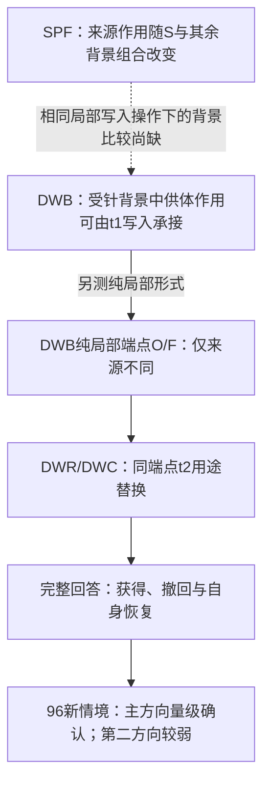

# 146．NWC：开发外确认与特异性预测

[返回总时间线](../README.zh-CN.md)

**时间定位**：已提取运行收据的最早时间锚点（可含预检） 2026-11-06T08:26:07.337252+08:00；不能当作全部子运行起止。

**当时的目的与设计**

在新材料上确认NWR中心关系，并预登记随机、端点差、首列等补充预测。

**实际过程、结果与后来更正**

实际11月6日完成。中心P12在两原生方向及R0成立；P3、P4M、P4Y三个方向均失败。40随机里17/18/22达到主单步分差一半，续写的20里8/4/8达到回答损失一半。全部坏消息和修订记录保留。

**来源身份**：`cache-native-write-confirm-v1-2026-11-05`；本章主体来源提交 `7d6bdf84ab74062ac9ab55bc8201b5a6586b92c8`。下方原文中的状态是各文件写作时的状态，不能把早期“尚未运行”覆盖后期正式收据，也不能将后期结果倒填进早期设计。


## 原设计、执行过程、结果与更正全文

以下按“设计与题目 → 工程/执行记录 → 结果/更正 → 其他历史说明”组织；同类内没有可靠时间时保留路径顺序，不冒充严格先后。正文未删段；仅为本章节重排标题层级、把相对链接指向固定提交。原始字节另外完整保存。

### 原件 1：NWC-01 合同 r03：原生来源状态经 t2 直接读取致错的开发外确认，及四条补充预测

原路径：`experiments/cache-native-write-confirm-v1-2026-11-05/CONTRACT.zh-CN.md`。 [固定提交原文](https://github.com/yuxiexiong/acupuncture/blob/7d6bdf84ab74062ac9ab55bc8201b5a6586b92c8/experiments/cache-native-write-confirm-v1-2026-11-05/CONTRACT.zh-CN.md) · [单独阅读副本](../library/b12f706411a33271.md)；SHA-256：`b12f706411a3327198478999b4e5746abb5962748a46e0c64cfb415b913816e0`。

---

#### NWC-01 合同 r03：原生来源状态经 t2 直接读取致错的开发外确认，及四条补充预测

**状态：r03，已冻结（`freeze-r02.json`），已获运行授权。** 授权：2026-11-05 用户"重新冻结然后开跑吧"。r02（`freeze-r01.json`，提交 e8ad1fb）冻结后、任何模型输出之前，发现中心预测的随机对照复用了开发面板的五个已见方向，经用户同意改为 r03 并重新冻结，改动只有 §3 的 R 臂、§5 的 P12 一行、§7 预算与 §9 一条；r02 的冻结文件保留为历史。面板文本与分词验收、运行器、CPU 测试、就绪检查均为零 GPU。r01（提交 994cc55）有四处判据与结论不对应，已按外部核查修改，对照见 [DESIGN §0](https://github.com/yuxiexiong/acupuncture/blob/7d6bdf84ab74062ac9ab55bc8201b5a6586b92c8/experiments/cache-native-write-confirm-v1-2026-11-05/DESIGN.zh-CN.md)。冻结后不改本文件；偏离记入 `DEVIATIONS.zh-CN.md`。同一助手撰写、实现。

##### 1. 问题
在前两块面板都没出现过的输入上、三个干预方向上：把原生运行在 t1 写出的递推状态送进已修复接收者 L11 的 t2 直接读取，目标不在首列的输入是否改答成明确错号，这一损失是否超过修正用途与随机补丁（P12）。另检验四条补充预测（P3–P6），每条只对它实际测量的量下结论。

##### 2. 固定条件
Qwen3.5-4B revision `851bf6e806efd8d0a36b00ddf55e13ccb7b8cd0a`，BF16/eager/batch 1/torch 原核。方向 N4146、N1210（主要），R0（随机施针，诊断）。L0 形成干预、NA 布局、B1 窗口、−1 强度、冻结校准与 μ、G={13,14,16,17,18,20,21,22,24,25,26,28,29,30}、解析器与停止 ID 全部继承 NWR-01。面板见 DESIGN §2：6 族 × 4 基础情境 × 3 版本 = 72 条；层 N 为目标非首列的 48 条，层 F 为目标在首列的 24 条。文本由 `make_panel.py` 按固定规则生成（`data/nwc-inputs-r01.json`，SHA256 `cd6c6b3a…becf`）：实体名在前两块面板中未出现；编号为族字母加两位不同数字，排除族内旧编号，由固定种子抽取；每个基础情境两套编号，版本 a（问第二位）与 c（问首位）用第一套，版本 b（问第三位）用第二套。分词验收 `data/nwc-tokens-r01.json` 72/72 一次通过，没有改写任何一条。

##### 3. 操作
每输入重建 C、三个方向的 T；每方向在 t1 重建 L00、L10、L11，取 t1 后各 G 层 S₁ 只读。接收者 L11，只在 t2、14 个 G 层的输出上加补丁，FP32 相加后转 BF16；q/k/v/α/β 取接收者当前值；S₂ 为接收者原生更新；t3 起无钩子。

| 臂 | 补丁（S_r 为接收者当前状态） | 路线 | 层 |
|---|---|---|---|
| C、L00、L10、L11 | 无 | 自然 | N、F |
| D00 | α(S₁[L00]−S_r)ᵀq | 自然＋M | N、F |
| E00 | −αβ(kᵀq)(S₁[L00]−S_r)ᵀk | 自然＋M | N、F |
| D10 | α(S₁[L10]−S_r)ᵀq | 自然＋M | N、F |
| R1…R10 | u_j·‖D00 补丁‖，逐层逐头；**新抽种子 202611061…70**，与 NWR-01 的五个种子无交集 | 自然＋M | N、F |
| DV | α(S₁[L00]−S₁[L10])ᵀq：端点状态差 L00−L10 | 自然＋M | N |
| DX | α(S₁ᵒ[L00]−S₁ᵒ[L11])ᵀq，o 为同族下一个基础情境（循环）、同版本的输入；o 的 S₁ 由它自己的形成与 t1 端点重算 | 自然＋M | N |
| D00½、DX½、D10½ | 相应补丁乘 0.5 | 自然＋M | N |
| Q1…Q40 @k | u_j·‖D10 补丁‖；种子 202611101…140 | 只跑 M | N |
| Q1…Q20 @k | 同上前 20 个方向 | 自然 | N |
| Q1…Q40 @n | 同一批方向·‖D00 补丁‖ | 只跑 M | N |

随机方向为（种子，层）固定的单位向量，跨输入不变；范数为 0 处不注入。NWR-01 的五个随机方向（种子 202611051…55）在开发面板上已被看过，其中一个已知会大量致错；它们只在两条旧输入的逐位桥接预检里出现，不进入任何门槛。不强制 L00 开口，不屏蔽 EOS；接收者在 t1 停止的输入照实保留。另存 D00 补丁向量（C 路线，逐层逐头）用于跨输入余弦。

**DV 的身份。** L00 与 L10 只在首个 G 层的 v 上不同，更高层的 q、k、门控都随之改变。所以 DV 是"由换 v 引发的全部 t1 状态差"，不是单一的 v 写入分量；DV 与 D10 的补丁相加等于 D00 的补丁，但三者的行为效应不保证可加。

##### 4. 读数
- Y：自然完整回答正确（FC-01 分类器原规则）。E_num：恰一个不同编号且非目标、以停止结束、无未闭合 think。其余类别同 NWR-01。
- M：共同首 token 下 t2 的目标减首列分差（层 F 为目标减第二列）；ΔM 为相对 L11 的差。
- 比率按族等权。范数比 ‖DV‖/‖D10‖ 取逐输入总范数之比的中位数。
- 只作描述：自然 t2 输出类别、逐输入转移表、D10½、@n 随机族、D10 在随机族里的秩与标准分、D00 补丁的跨输入余弦（同族内、跨族、能量加权）、a/b/c 合并口径的各量。

##### 5. 冻结判读（看任何新输出前写定；实现在 `nwc_core.py`；每个标签已在合成数据上出现过，见 `analysis/rehearsal_output.txt`）
统计单位为 24 个基础情境。区间为族内对基础情境有放回重抽、三个版本一起走，10000 次，种子 20261105，取 95% 百分位下界。每个方向分别判读。除 P6 外全部在层 N 上计算。

| 预测 | 成立的条件 | 不可判 | 成立时允许写的句子 | 不允许写的句子 |
|---|---|---|---|---|
| **P12** | 点估计 b ≥ 0.25、l_D ≥ 0.20、e_D ≥ 0.15；l_D−0.5b、l_D−l_E、l_D−l_R、e_D−e_R 的下界都 > 0 | b < 0.25，或接收者未到 t2 的输入 ≥ 25% | 在目标不在首列的新输入上，原生来源的状态经直接读取使已修复接收者改答成明确错号；损失大于同一状态的修正用途，也大于十个新抽的同范数随机补丁的平均 | 原面板整体分布上成立；随机方向里没有一个能致错；原生运行自己的读取；方向特异 |
| **P3** | (l_D10 − l_DV) 的下界 > 0，且 \|ΔM(DV)\| ≤ 0.5·\|ΔM(D10)\| | 范数比中位数 < 1，或 l_D10 < 0.20，或接收者不可达 | 范数更大的那份端点状态差（L00−L10）单独读入时，回答损失更小、单步分差不到另一份的一半 | v 写入分量无效；原生补丁的效应可按分量相加；幅度与效应无关 |
| **P4M** | 40 个方向里，族等权平均 ΔM ≤ 0.5·ΔM(D10) 的不超过 2 个 | ΔM(D10) > −0.5 | 抽到的 40 个同范数随机方向里至多 c 个达到 D10 单步分差的一半，总体比例的 95% 上界为 x | 比任意同范数扰动高效；完整回答上更高效；没有方向能达到 |
| **P4Y** | 20 个续写方向里，l ≥ 0.5·l_D10 的不超过 1 个 | l_D10 < 0.20，或接收者不可达 | 抽到的 20 个同范数随机方向里至多 c 个造成 D10 一半以上的回答损失，总体比例的 95% 上界为 x | 同上 |
| **P5** | ρ = ΔM(DX)/ΔM(D00) 在 0.75 到 1.25 之间，且 \|l_DX½ − l_D00½\| ≤ 0.15 | ΔM(D00) > −0.5，或接收者不可达 | 把另一条同族输入的写入端点差移植过来，单步分差与半幅度下的回答损失与本输入的相近 | 固定偏移；与输入内容无关；向量跨输入不变 |
| **P6** | 层 F 上 Y(L11) − Y(D00) ≤ 0.10 | 层 F 上 Y(L11) < 0.75，或接收者不可达 | 目标本身在首列时，读入原生来源状态不把回答改坏 | 任何读取扰动都落到首列；一般性损伤已排除到其他操作 |

计数的总体上界（两侧 95% Clopper–Pearson）：0/40 为 8.8%，2/40 为 16.9%，3/40 为 20.4%；0/20 为 16.8%，1/20 为 24.9%。P4 的门槛是有限样本的操作门槛，不是总体比例已定。

- **总读法。** P12 在 N4146 与 N1210 都成立：中心句在既有结构族内、目标不在首列的新输入上得到确认。只过一个方向：保留该方向的结论，不写跨方向确认。两个都不成立：保留开发案例，撤回确认。R0 按同口径报告，不替代任何主要方向。P3–P6 各自只决定自己那一句；不成立或不可判的那句不写，不连带否定 P12。
- **P12 的随机对照是十个新抽方向、按 D00 补丁范数、跑完整回答。** 十个里单独达到 l_D 一半的个数及其总体比例上界（0/10 为 30.8%）只作描述。P4 的随机族不并入 P12，也不用来放宽或收紧 P12。
- **看数据前登记的预期（推测档，来自 NWR-01 开发数据）。** N4146 上 P12 成立。N1210、R0 上原生供体从未测过，无把握。P3 的方向多半成立，但 DV 的范数与效应没有直接数据。P4M 在门槛边缘，线性外推下达标方向比例估计在 4% 到 11% 之间，即 40 个里 2 到 4 个。P5 没有把握：补丁里跨输入共享的能量粗估只有一半多。P6 多半成立：开发面板上 16 条首列输入读入后 16 条仍对。
- 退出：本轮结束即整稿。任何结果都不追加方向、层、头、面板或样本。

##### 6. 工程闸门（任一失败即停，记为合同执行失败）
1. 面板：冻结的输入文件与分词账本哈希；CPU 验收通过；运行中 token 等于账本。
2. 内部一致：a=b=0 的复刻顺序钩子与原生 t2 逐位相同（两条路线）；L10 等于"原核直接喂影子 v"；各构造补丁的局部输出对 FP64 公式相对误差 ≤ 1e−5；随机补丁范数相对误差 ≤ 1e−5；半幅度补丁等于全幅度的一半（相对误差 ≤ 1e−5）。
3. 构造供体恒等式：DV 补丁加 D10 补丁等于 D00 补丁（CPU 测试与每次运行都验，float32 求和，相对误差 ≤ 1e−4）；o 取本输入时 DX 的状态差与 D00 的逐位相同（预检的层 N 输入上验）。CPU 测试另验：D、E、随机三类补丁与已冻结的 SRU-01、NWR-01 读取函数逐位相同。
4. t1 结构：首个 G 层 q、k、g、β、S₀ 逐位相同且 v 不同；全部 G 层 S₀ 逐位相同。
5. 钩子：t1 只有影子与捕获钩子；t2 每个 G 层触发一次；t3 起零钩子；供体只读；源缓存哈希不变。
6. 旧面板桥接预检：NWR-01 面板的两条输入（NQ01-ABC-A、NQ02-ABC-B）用本运行器跑 N4146 的 12 臂，自然 token 序列、C 路线 t2 哈希与 M 等于 NWR-01 记录。
7. 新面板预检：两条新输入（NWC-NQ01-S1-a 属层 N，NWC-NQ01-S1-c 属层 F）、三方向、全臂。失败即停，允许一次有记录的修复重试；正式开始后不改实现、阈值、数据。预检的两条新输入计入正式面板，其输出在预检时即被看到，如实登记。

##### 7. 预算（按 NWR-01 实测外推）
| 项 | 层 N：48 条 × 3 方向 | 层 F：24 条 × 3 方向 |
|---|---:|---:|
| 自然轨迹 | 6048（每格 42） | 1224（每格 17） |
| 共同首 token 单步 M | 14256（每格 99） | 1008（每格 14） |
设备小时估算 1.6（NWR-01 实测每次前向约 0.14 秒、每条自然轨迹约 3 步），正式上限 2.2，预检另 0.3，总硬上限 2.5，低于 v8 给 B 的 3 GPUh。最多 2 worker；存储 ≤ 16 GiB，随机族只存 M 不存全词表。

##### 8. 产物
`data/`（面板与账本）、`runs/preflight-r01/`、`runs/formal-r01/`、`analysis/nwc-readouts-r01.json`、`REPORT.zh-CN.md`。

##### 9. 相对 v8 §5 的偏离（全部在看到新输出之前登记）
- 门槛只在目标非首列的层 N 上计算；这一选择受开发结果启发。同时报告 a/b/c 合并口径与 NWR-01 面板按同一子集重算的数。
- 在 v8 的 12 臂之外新增 DV、DX、半幅度臂、两族随机方向与层 F，新增 P3–P6。P12 的门槛与重抽方案同 v8，重抽时三个版本一起走。
- 新增旧面板桥接预检。
- 面板从 48 条增至 72 条。
- **r03：** v8 的 l_D−l_R 用五个随机种子的平均。本合同改为十个新抽种子，原因是开发用过的五个方向在新面板上不构成开发外对照。门槛形式不变。

---

### 原件 2：NWC-01 偏离与修复记录

原路径：`experiments/cache-native-write-confirm-v1-2026-11-05/DEVIATIONS.zh-CN.md`。 [固定提交原文](https://github.com/yuxiexiong/acupuncture/blob/7d6bdf84ab74062ac9ab55bc8201b5a6586b92c8/experiments/cache-native-write-confirm-v1-2026-11-05/DEVIATIONS.zh-CN.md) · [单独阅读副本](../library/ea9c2f5566f3b4b5.md)；SHA-256：`ea9c2f5566f3b4b5e6b597893ede656449e36da0973fc2296513bb4a67304a61`。

---

#### NWC-01 偏离与修复记录

##### D1（2026-11-06）：预检 r01 失败——恒等式闸门写错，按合同 §6 第 7 条做一次有记录的修复

**发生了什么。** 预检 `runs/preflight-r01` 在第三个单元（新输入 NWC-NQ01-S1-a，层 N）的工程闸门上停止：`DV + D10 != D00 patch`，相对误差 0.054。此前两个旧输入单元全部闸门通过，其中 12 臂与 NWR-01 记录逐位一致。失败单元没有写出记录或张量。**没有任何新面板输出产生或被看到。** 失败的运行目录原样保留。按 6.7 分类：合同执行失败，信息量为零，不是科学阴性。

**根因。** 合同 §3 写"DV 与 D10 的补丁相加等于 D00 的补丁"，§6 第 3 条据此设闸。这句话只在第一个递推层成立。补丁在 14 个递推层里逐层施加，更高层的 q 由接收者当前计算得到，会响应本臂在下层已经打的补丁；三个臂的下层补丁不同，所以更高层各自的 q 不同，补丁不再相加相等。相加相等的是**状态差**（在所有层），不是各臂实际注入的补丁。CPU 测试只覆盖单层核，所以没有暴露。这与 r01 设计被指出的问题同源：更高层的量会随下层操作改变。实现本身没有错：补丁算术对 FP64 的误差 1.2e−7，旧输入逐位桥接通过。

**修复（代码 `nwc_run.py`，计划号 `…r03-fix1`；重新冻结为 `freeze-r03.json`）。**
1. §6 第 3 条的恒等式闸门改为两条：状态差 (L00−L10)+(L10−L11) 等于 (L00−L11)，在全部 14 层验，相对误差 ≤ 1e−4；补丁 DV＋D10 等于 D00 只在第一个递推层验，相对误差 ≤ 1e−4。其余 13 层的补丁相加误差逐层记录，不设闸。
2. 半幅度闸门同理：半幅度补丁范数等于全幅度的一半，只在第一个递推层验（≤ 1e−5）；其余层记录。
3. 两条旧输入（桥接单元）也跑构造供体的五个臂（DV、DX、三个半幅度臂），DX 的"另一输入"取它自己。目的只有一个：让上述闸门先在已见过的输入上演示通过，再碰新输入。这些臂在旧输入上的输出不进入任何判读。
4. 预检重跑写入 `runs/preflight-r02`。

**对合同文本的更正（冻结的合同不改，以本条为准）。** §3"DV 与 D10 的补丁相加等于 D00 的补丁"应读作："DV 与 D10 的状态差相加等于 D00 的状态差；三者实际注入的补丁只在第一个递推层相加相等，更高层各臂的 q 随本臂的下层补丁而变"。这不改变任何臂的操作定义。

**影响哪些结论。** 不改变 §5 的任何预测、门槛或允许写的句子。它加强了 P3 那一行已有的限制："原生补丁的效应可按分量相加"不允许写，现在连补丁本身也不可加。范数比 ‖DV‖/‖D10‖（P3 的不可判条件）按各臂实际注入的补丁计算，定义不变，但读者应知道它是在各自上游条件下的范数。

**修复额度。** 合同允许的一次修复已用掉。预检 r02 若再失败，停止并上报，不再修。

---

### 原件 3：NWC-01 报告 r01：原生来源状态经 t2 直接读取致错的开发外确认，及四条补充预测

原路径：`experiments/cache-native-write-confirm-v1-2026-11-05/REPORT.zh-CN.md`。 [固定提交原文](https://github.com/yuxiexiong/acupuncture/blob/7d6bdf84ab74062ac9ab55bc8201b5a6586b92c8/experiments/cache-native-write-confirm-v1-2026-11-05/REPORT.zh-CN.md) · [单独阅读副本](../library/751c17724863db7b.md)；SHA-256：`751c17724863db7b85ce459bcd2a75fb8c3adffe646d914f0e614399f124955d`。

---

#### NWC-01 报告 r01：原生来源状态经 t2 直接读取致错的开发外确认，及四条补充预测

合同 [r03](https://github.com/yuxiexiong/acupuncture/blob/7d6bdf84ab74062ac9ab55bc8201b5a6586b92c8/experiments/cache-native-write-confirm-v1-2026-11-05/CONTRACT.zh-CN.md)，偏离与修复见 [DEVIATIONS D1](https://github.com/yuxiexiong/acupuncture/blob/7d6bdf84ab74062ac9ab55bc8201b5a6586b92c8/experiments/cache-native-write-confirm-v1-2026-11-05/DEVIATIONS.zh-CN.md)；冻结 `freeze-r03.json`（`35c8565c…ed55`）。正式运行 verification passed。判读 `analysis/nwc-readouts-r01.json`。张量（2.1 GB）留服务器。授权：2026-11-05 用户"重新冻结然后开跑吧"。同一助手实现、运行、判读与撰写，不是独立验收。

**按冻结判读：中心预测 P12 在 N4146、N1210 两个主要方向都成立（R0 也成立）；三条特异性预测 P3、P4M、P4Y 在三个方向上全部不成立；P5、P6 在三个方向上成立。**

##### 0. 先说限制与坏消息

1. **特异性没有站住，而且差得很远。** 按起作用那份补丁的范数抽的 40 个随机方向里，17、18、22 个达到了它一半的单步分差（门槛是不超过 2 个）。其中续写的 20 个里，8、4、8 个造成一半以上的回答损失（门槛是不超过 1 个）。按原生补丁范数新抽的 10 个随机方向里，5、0、3 个单独达到主效应的一半。所以"原生来源的状态是一个特殊方向"不成立。它在 N4146、N1210 上是所测扰动里最强的；在 R0 上有一个同范数随机方向比它更强（正确数 15 对 17）。它与随机扰动是程度之差，不是性质之差。
2. **"范数更大的那份端点差较不起作用"不成立。** 端点状态差 L00−L10 单独读入，N4146 上正确数从 41 掉到 11，单步分差是另一份的 67% 到 83%。事后剖析里"多出来的 v 分量几乎无效"这个猜想被否证。
3. **我在看数据前登记的预期错了两条。** P3 我写"多半成立"，实际不成立。P4M 我写"门槛边缘，40 个里 2 到 4 个"，实际 17 到 22 个。线性外推用的是开发面板五个种子，严重低估了随机方向的作用。
4. **确认的范围窄。** 只在目标不在首列的输入上、既有六个结构族内、同一个模型、接收者为已修复的 L11。不是原面板的整体分布，不是新任务，不是原生运行自己的读取。
5. **预检第一次失败，用掉了一次修复。** 失败在一个写错的工程闸门上，没有产生任何新面板输出；见 DEVIATIONS D1。按失败类型：合同执行失败，信息量为零。P3、P4M、P4Y 的不成立是科学失败：实验正确执行，预测被否证。
6. **主效应在三个方向上大小不同。** N4146 上读入后 48 条全错；N1210、R0 上还剩 11、17 条正确。R0 的"超过修复缺口一半"下界只有 0.031。
7. 事后剖析里"共享成分约占能量 0.57"的估计偏低。本轮直接测量：原生补丁向量在不同输入之间的余弦，同族 0.95 到 0.96，跨族 0.91 到 0.93。

##### 1. 工程

- 预检 r02 与正式运行全部闸门通过：
  - 旧面板桥接（预检）：两条 NWR-01 输入用本运行器跑 N4146 的 12 臂，自然 token 序列、C 路线 t2 哈希与 M 与 NWR-01 记录逐位一致。
  - 钩子：a=b=0 的复刻顺序钩子与原生 t2 逐位相同（两条路线）；接收者状态逐位等于 S₁[L11]；t3 起零钩子。
  - 算术：补丁对 FP64 与随机补丁范数的最大相对误差 1.2e−7。
  - 恒等式（修复后的定义）：状态差在全部 14 层相加相等；补丁在第一个递推层相加相等（误差 ≤ 1.3e−7）；半幅度补丁范数在第一个递推层恰为一半。更高层的补丁相加误差为 2% 到 45%，只记录。
  - t1 结构：72 条 × 3 方向，首个递推层 q、k、门控、S₀ 逐位相同只有 v 不同；有符号零例外 0 次。
- 计数：自然轨迹 6948，单步 M 前向 15264，decode 共 37916。设备时间 2019 + 1900 = 3919 秒，约 1.09 GPUh；两次预检 70 + 138 秒。合计约 1.15 GPUh，硬上限 2.5。
- 接收者 L11 在全部输入、全部方向上到达 t2。

##### 2. 层 N（目标不在首列，48 条）：各臂的回答

每格为 正确／明确错号／停止。错号除 R0 的 1 到 2 条外全部是首列编号。

| 臂 | N4146 | N1210 | R0 |
|---|---|---|---|
| 干净 C | 48／0／0 | 48／0／0 | 48／0／0 |
| 原生 L00 | 0／0／48 | 0／0／48 | 0／0／48 |
| 只修 v（L10） | 1／47／0 | 26／22／0 | 30／18／0 |
| 接收者 L11 | 41／7／0 | 47／1／0 | 46／2／0 |
| **D00：读原生来源状态，直接读取** | **0／48／0** | **11／37／0** | **17／31／0** |
| E00：同一状态，修正用途 | 46／2／0 | 47／1／0 | 48／0／0 |
| D10：读只修 v 的状态 | 5／43／0 | 28／20／0 | 32／16／0 |
| DV：端点状态差 L00−L10 | 11／36／1 | 35／13／0 | 36／12／0 |
| DX：移植另一输入的写入差 | 1／47／0 | 14／34／0 | 20／28／0 |
| D00 半幅度 | 7／41／0 | 31／17／0 | 33／15／0 |
| DX 半幅度 | 9／39／0 | 33／15／0 | 34／14／0 |
| D10 半幅度 | 20／28／0 | 42／6／0 | 42／6／0 |
| 10 个新随机方向，原生补丁范数（各自正确数） | 43、13、20、7、31、20、30、31、16、33 | 48、31、37、32、48、41、44、37、38、45 | 45、27、33、15、48、37、40、41、28、44 |
| 20 个随机方向，D10 补丁范数（各自正确数） | 20、27、27、27、21、25、39、22、15、38、10、12、29、6、35、20、45、41、45、43 | 36、36、44、38、41、40、48、44、40、39、15、42、44、31、44、38、47、48、45、47 | 37、33、42、37、39、44、47、40、43、40、31、34、44、21、39、46、48、48、48、48 |

##### 3. 冻结判读

| 量 | N4146 | N1210 | R0 |
|---|---:|---:|---:|
| b | 0.854 | 0.979 | 0.958 |
| l_D（下界） | 0.854（0.792） | 0.750（0.646） | 0.604（0.500） |
| e_D（下界） | 0.854（0.792） | 0.750（0.646） | 0.604（0.500） |
| l_D − 0.5b 的下界 | 0.396 | 0.156 | 0.031 |
| l_E | −0.104 | 0.000 | −0.042 |
| l_D − l_E 的下界 | 0.896 | 0.646 | 0.542 |
| l_R（10 个新方向平均） | 0.346 | 0.144 | 0.213 |
| l_D − l_R 的下界 | 0.450 | 0.508 | 0.317 |
| e_D − e_R 的下界 | 0.450 | 0.508 | 0.317 |
| **P12** | **成立** | **成立** | **成立** |
| l_D10 − l_DV 的下界 | 0.083 | 0.042 | 0.000 |
| ΔM(DV) ÷ ΔM(D10) | −1.755 ÷ −2.164 = 0.81 | −1.094 ÷ −1.643 = 0.67 | −1.333 ÷ −1.604 = 0.83 |
| 范数比 ‖DV‖/‖D10‖ | 1.43 | 1.26 | 1.19 |
| **P3** | **不成立** | **不成立** | **不成立** |
| 40 个方向里达到 ΔM(D10) 一半的个数（总体上界） | 17（59%） | 18（62%） | 22（71%） |
| **P4M** | **不成立** | **不成立** | **不成立** |
| 20 个续写方向里达到 l_D10 一半的个数（总体上界） | 8（64%） | 4（44%） | 8（64%） |
| **P4Y** | **不成立** | **不成立** | **不成立** |
| ρ = ΔM(DX) ÷ ΔM(D00) | 0.956 | 0.950 | 0.946 |
| 半幅度回答损失：DX 对 D00 | 0.667 对 0.708 | 0.292 对 0.333 | 0.250 对 0.271 |
| **P5** | **成立** | **成立** | **成立** |
| 层 F：L11 → D00 的正确数（24 条） | 24 → 24 | 24 → 24 | 24 → 24 |
| **P6** | **成立** | **成立** | **成立** |

总读法：P12 在两个主要方向都成立，中心句在既有结构族内、目标不在首列的新输入上得到确认。

描述（不进门槛）：
- 10 个新随机方向里单独达到 l_D 一半的个数：5、0、3。
- D10 在 40 个同范数随机方向里的位置：按单步分差从最负数起第 3、6、6 位，标准分 −1.55、−1.25、−0.93。
- 层 F 上全部 10 个随机补丁也几乎不致错：24 条里正确 24 条，只有 R0 的一个方向是 23。
- 原生补丁向量的跨输入余弦：同一基础情境 0.96、0.96、0.97；同族不同情境 0.95、0.95、0.96；跨族 0.91、0.91、0.93。
- 开发面板同构成（三分之一首列）的合并口径：l_D 0.569、0.500、0.403；l_R 0.231、0.096、0.143。

##### 4. 能说什么、不能说什么

能说的（按合同 §5 各行允许的句子）：
- 在目标不在首列的新输入上，原生来源的状态经直接读取使已修复接收者改答成明确错号；损失大于同一状态的修正用途，也大于十个新抽的同范数随机补丁的平均。两个主要方向与随机施针方向都如此。
- 把另一条同族输入的写入端点差移植过来，单步分差与半幅度下的回答损失与本输入的相近。
- 目标本身在首列时，读入原生来源状态不把回答改坏。

必须同时写出的事实（预测不成立的三条）：
- 同范数的随机方向里，接近一半能达到起作用那份补丁一半的单步分差；续写的 20 个里有 4 到 8 个造成一半以上的回答损失。
- 端点状态差 L00−L10 单独读入也造成大量错答。
- 所有这些扰动造成的错答几乎全是首列编号（随机臂的错号里首列占 626/628、213/213、262/265），也几乎不伤目标在首列的输入。构造供体臂共只有 1 条停止；随机臂偶有停止，三个方向各 30 个随机臂的 1440 条输出里是 21、19、9 条。

由此得到的读法（解释，不是冻结判读的一部分）：t2 的直接读取是"按查询选记录"发生的地方。往这个读取的输出里加一个足够大的扰动，回答就退回列在第一位的记录；原生来源的状态是所测扰动里最强的之一，但不是唯一有效的。修正用途不承载这一选择。"原生状态携带指向首列的特定内容"没有得到支持，"读取被扰乱后落到首列这个默认答案"与全部数据相容。

不能说的：
- 不能说原生来源状态的方向是特殊的，或比同样大小的扰动高效。
- 不能说这是原生运行自己的 t2 读取，或原生首步停止已解释。
- 不能推到目标在首列的输入之外的"整体分布"、其他任务、其他模板、其他模型。
- 不能把移植成立写成"向量固定"的证明；向量相似度是另行直接测量的描述量。

##### 5. 出口

按合同 §5，本轮结束即整稿，不追加方向、层、头、面板或样本。

---

### 原件 4：稀疏激活干预后的答案选择：历史来源的背景依赖与写入—读取关系

原路径：`docs/mechanism-paper-skeleton-2026-11-05.zh-CN.md`。 [固定提交原文](https://github.com/yuxiexiong/acupuncture/blob/7d6bdf84ab74062ac9ab55bc8201b5a6586b92c8/docs/mechanism-paper-skeleton-2026-11-05.zh-CN.md) · [单独阅读副本](../library/8066c347a3d3c6b2.md)；SHA-256：`8066c347a3d3c6b25d4bf008929583de416fb7c0ed8f935a1643bbdb9680e96d`。

---

<!--block:B0001-->
#### 稀疏激活干预后的答案选择：历史来源的背景依赖与写入—读取关系

<!--block:B0002-->
2026-11-08 · 中文研究工作稿 v1.8。基于既有结果重组论证，无新模型运行。当前主文按科学问题组织；完整结果、阴性、覆盖和旧图见[补充证据](https://github.com/yuxiexiong/acupuncture/blob/7d6bdf84ab74062ac9ab55bc8201b5a6586b92c8/docs/mechanism-paper-supplement-v1.8-2026-11-08.zh-CN.md)，操作缺口与下一步判断见[证据对照](https://github.com/yuxiexiong/acupuncture/blob/7d6bdf84ab74062ac9ab55bc8201b5a6586b92c8/docs/mechanism-paper-evidence-gaps-2026-11-06.zh-CN.md)。本轮核查身份与范围见[修订记录](https://github.com/yuxiexiong/acupuncture/blob/7d6bdf84ab74062ac9ab55bc8201b5a6586b92c8/docs/paper-revision-v1.8-2026-11-08/REVISION.zh-CN.md)。

<!--block:B0003-->
##### 摘要

<!--block:B0004-->
少数激活坐标的干预能够显著改变语言模型的回答，但错误并不直接说明历史信息已被删除，也不能由缓存恢复的成功确定具体计算原因。我们在Qwen3.5-4B上区分作答交付、答案选择和状态信息可利用性，研究历史来源如何在受针条件下进入写入并影响后续回答。开发材料上的缓存比较显示，供体缓冲的选择效应依赖递推状态与其余接收背景的组合；受针状态单独引发选择翻转的预测不成立。进一步实验将供体来源的作用连接到最后提示步的指定写入：仅在该步使用供体V历史即可转移选择，反向换回自身写入可恢复自身答案。在纯局部写入端点上，直接读取的来源替换能够获得和撤回供体选择。冻结这些操作后，六结构族96个新基础情境确认主方向的获得0.311、撤回0.473及自身恢复0.394；第二方向同向，但获得0.213低于预设量级。随机读取反例和受针状态移植排除了首列错误特异性及统一信息删除解释。结果建立了受针条件下可预测的来源—写入—读取关系，并表明其作用受到背景、方向和用途约束。缓存级背景差异尚未在相同局部写入操作下被直接比较，因此这些证据不等于完整原生失效链，也尚未把缓存级背景差异归因到同一局部写入／读取依赖。

<!--block:B0005-->
##### 1. 问题与核心认识

<!--block:B0006-->
稀疏激活干预为什么会产生大的回答变化？这个问题涉及干预后的历史形成、当步写入、旧状态处理和后续读取。撤针和恢复操作提供诊断窗口，完整回答则决定计算差异是否产生了实际行为后果。我们的多模型单针观察和跨规模能力测评已经显示现象广度；本文的机制分析集中于4B模型中的记录检索，不能用现象覆盖替代同一机制的跨模型证明。

<!--block:B0007-->
我们区分三个问题：模型是否交付有效答案，交付时选了哪条记录，以及受针形成的状态是否仍有可被其他计算背景利用的选择信息。平均缓冲可以恢复开口却不能稳定恢复选择；随机读取扰动可以产生相同的首列错误；受针供体状态在另一接收背景中仍可能转移选择。这些结果共同表明，错误样式、恢复量和状态距离都不足以单独说明信息是否被删除。

<!--block:B0008-->
本文中心认识由两层证据组成。**第一层是历史来源的背景依赖：供体缓冲能否改变选择，取决于接收者递推状态和其余计算背景的组合。第二层是指定条件下的计算连接：供体来源的作用能够经局部写入形成状态差，并通过后续直接读取获得或撤回完整答案中的选择。** 两层证据相容，但使用的操作端点不同；我们分别陈述它们，不将其相接处假定为已识别的自然路径。

<!--block:B0009-->
具体贡献如下：

<!--block:B0010-->
1. **约束干预后的失效解释。** 缓存级比较否证“受针状态来源单独决定供体接管”的预测；随机首列和受针状态转移反例进一步排除由错答图样推断特定内容、以及跨方向统一信息删除的解释。
2. **把来源效应连接到明确的写入与读取操作。** 仅在最后提示步写入供体相关差异即可转移选择，换回自身写入可恢复自身答案；在同一纯局部写入端点间，读取用途替换又能获得和撤回定向选择。完整交付和自身恢复区分了选择变化与一般退化。
3. **确认关系并保留失败边界。** 固定操作在新材料上兑现主方向的双向量级预测；第二方向获得较弱，D/E用途异号，族间效应不同。这些是已测条件关系的范围，不是普遍功能分工或参数无关规律。

<!--block:B0011-->
这一认识的用途是指导机制判断：先区分是否能答、答什么和状态能否被利用，再检验来源进入哪个写入、哪个状态用途影响行为。它不要求发明新的状态更新公式，但要求每个解释对应具体比较。尚缺的关键比较在§6集中列出。

<!--block:B0012-->
##### 2. 计算基础与已有研究

<!--block:B0013-->
对单个递推头，省略层号，在实现规定的归一化下有：

<!--block:B0014-->
\[
S_t=\alpha_t(I-\beta_t k_tk_t^\top)S_{t-1}+\beta_tk_tv_t^\top,
\]
\[
o_t=\underbrace{\alpha_tS_{t-1}^\top q_t}_{D_t}
+\underbrace{-\alpha_t\beta_t(k_t^\top q_t)S_{t-1}^\top k_t}_{E_t}
+\underbrace{\beta_t(k_t^\top q_t)v_t}_{W_t}.
\]

<!--block:B0015-->
本文统一用 **E_t=−α_tβ_t(k_tᵀq_t)S_(t−1)ᵀk_t** 表示含负号的旧预测修正用途。q已经包含内核的维度缩放，α是衰减系数。式子描述局部计算；高层驱动和后续生成随干预响应，不能据此把整模型行为拆成可加的机制份额。

<!--block:B0016-->
| 已有来源 | 已有认识或工具 | 本文须另以数据回答的内容 |
|---|---|---|
| [Gated Delta Networks](https://arxiv.org/html/2412.06464v3)，§3 | 门控递推更新规则 | 指定受针条件下各操作对完整回答的大小、方向与边界 |
| [What Attention Recalls and Recurrence Controls](https://arxiv.org/html/2609.04434v1)，§3–4 | 混合模型缓存拆分、交叉来源交换 | 本文背景依赖及局部计算比较；不能以KV供体跟随本身承担新颖性 |
| [How Linear Attention Remembers](https://arxiv.org/html/2609.33093v1)，§2–4 | 写入、状态及读取的因果干预；存储与访问的区别 | 干预后的具体失效约束及可预测的来源—写入关系，不声称首次写读链 |
| [Who Asks, Who Answers](https://arxiv.org/html/2611.01909v1)，§5.2、§7 | 递推状态携带检索目标、参与构造全注意力查询 | 本文的GDN输出用途不是该文全注意力reader；不由文献层号指定本实验路径 |
| [Representational Analysis of Binding](https://arxiv.org/abs/2409.05448v3)；[Mixing Mechanisms](https://arxiv.org/abs/2510.06182v2) | 次序子空间与多种绑定机制 | 位置预测较强是否等于内部纯位置编码，现有结果不能作此推论 |
| [How to use and interpret activation patching](https://arxiv.org/html/2404.15255v1)，§2–3 | 恢复、污染与背景依赖的解释边界 | 具体模型中的条件关系，而非再将方法论警告当作新发现 |

<!--block:B0017-->
区别于一般供体移植有效性，本文提供的是缓存级背景比较、指定写入的获得与自身恢复、同端点读取及新材料预测的组合证据。不过，**受针背景相对干净背景究竟改变了局部写入／读取的哪项依赖，仍不能仅由这些不同端点的阳性推出。** 这是实质证据缺口，不以“受针”二字替代新颖性论证。文献入口及此前核查范围见[近邻审计](https://github.com/yuxiexiong/acupuncture/blob/7d6bdf84ab74062ac9ab55bc8201b5a6586b92c8/docs/literature/selection-carrier-mainline-audit-2026-11-06.zh-CN.md)；本轮未进行新的穷尽优先权检索。

<!--block:B0018-->
##### 3. 方法：从来源到完整答案

<!--block:B0019-->
###### 3.1 模型、干预与时序

<!--block:B0020-->
主模型为Qwen3.5-4B，revision `851bf6e806efd8d0a36b00ddf55e13ccb7b8cd0a`，BF16、eager、batch 1及冻结的torch参考核。主方向为L0/N4146，第二方向为L0/N1210；早期R0与C1343按各自实验身份进入补充，不能当作DWC额外确认方向。主针与操作层组承接开发历史，并非对模型通道的随机抽样。

<!--block:B0021-->
干预施于L0 MLP的down_proj输入单坐标。名义剂量d=−1，实际激活增量为η=d·s_ref/‖W_down[:,j]‖₂，再按引擎转换为BF16；注入处名义残差增量是ηW_down[:,j]。s_ref沿用旧NQ各族参考文本的残差尺度，DWC不在新材料上重新校准。因而−1不是激活数值减1，少坐标也不意味着小扰动。具体校准与BF16写入验收见[write_audit](https://github.com/yuxiexiong/acupuncture/blob/7d6bdf84ab74062ac9ab55bc8201b5a6586b92c8/experiments/cache-cross-channel-validation-v1-2026-10-31/xchan.py)。

<!--block:B0022-->
NA布局先给记录，再给查询与回答指令。设b为记录边界的最后token，n为完整模板化提示长度，B1在位置[b+1,n−2]形成受针历史；最后提示token n−1不再施针。τ为该token之前的缓存切点，t1处理最后提示token并预测首个生成token，t2处理这个自然生成token。DWC提示长度58–64，B1共26–28个位置；同情境最后四个已缓存token相同。以[冻结分词账本](https://github.com/yuxiexiong/acupuncture/blob/7d6bdf84ab74062ac9ab55bc8201b5a6586b92c8/experiments/cache-write-read-confirm-v1-2026-11-07/data/token-ledger-r01.json)而非文字字符数定义位置。

<!--block:B0023-->
**图1：实验时序与端点。** 图中实线是执行顺序，不代表已经证明的唯一自然中介。

<!--block:B0024-->


<!--block:B0025-->
写入／读取操作在G={13,14,16,17,18,20,21,22,24,25,26,28,29,30}这14个深层GDN层联合实施。G承接既有深层操作范围，不是本轮新筛选的最小路径，也不是14个独立样本。“一步写入”指同一t1时刻的14层联合操作；上层会响应下层变化。

<!--block:B0026-->
###### 3.2 完整用户提示与供体实例

<!--block:B0027-->
下面取固定正式材料的第一个情境、ABC-A接收者及第一个AL供体ABC-B，未按输出筛选。两者记录相同、查询不同。以下展示完整用户消息；实际输入使用冻结的聊天模板，位置以§3.1分词账本为准：

<!--block:B0028-->
**接收者 `DWC-NQ01-S00-B0-ABC-A`：**

<!--block:B0029-->
```text
仓储台账：绿纸盒编号为U63，黑纸盒编号为U52，黑茶杯编号为U41。
绿纸盒的编号是什么？
请根据上面的记录，简短回答，只需给出编号。
```

<!--block:B0030-->
**供体 `DWC-NQ01-S00-B0-ABC-B`：**

<!--block:B0031-->
```text
仓储台账：绿纸盒编号为U63，黑纸盒编号为U52，黑茶杯编号为U41。
黑纸盒的编号是什么？
请根据上面的记录，简短回答，只需给出编号。
```

<!--block:B0032-->
接收者答案为U63，供体目标为第2行U52。供体V历史来自供体的干净运行；接收者仍使用自己的提示，不能将转向叫作自身原有记忆恢复。其他供体还改变记录顺序，主比较包括同排列不同查询AL、同查询异排列KS、目标行相同RS及其他可分预测BD；三路绑定诊断另改变实体—编号绑定。

<!--block:B0033-->
这个固定例子在N4146下原生输出为`<|im_end|>`，O、F、获得D和撤回D均为`U63<|im_end|>`，**没有供体转移**。它用于说明实验输入和操作身份，不承担阳性论据；总体结果保留这类失败。原始逐臂文本及来源hash见[核查记录](https://github.com/yuxiexiong/acupuncture/blob/7d6bdf84ab74062ac9ab55bc8201b5a6586b92c8/docs/paper-revision-v1.8-2026-11-08/source-audit.json)，完整材料见[materials-r01](https://github.com/yuxiexiong/acupuncture/blob/7d6bdf84ab74062ac9ab55bc8201b5a6586b92c8/experiments/cache-write-read-confirm-v1-2026-11-07/data/materials-r01.json)。

<!--block:B0034-->
###### 3.3 两种写入背景必须分开

<!--block:B0035-->
C表示干净历史，T表示原生受针历史。卷积缓冲q/k/V、递推状态S和全注意力KV是不同持久对象；恢复S并不恢复其余两类。

<!--block:B0036-->
**缓存到写入的桥接（DWB）。** 下表共同使用T作为接收底座，G层q/k缓冲来自本输入干净运行；此组不使用写入k去偏移。

<!--block:B0037-->
| 端点 | t1写入的v来源 | t1之后保留的V缓冲 | 比较作用 |
|---|---|---|---|
| OO | 本输入 | 本输入 | 自身来源参照 |
| DD | 供体 | 供体 | 持续供体缓冲参照 |
| DO | 供体 | 本输入 | 仅让供体V历史影响t1写入 |
| OD | 本输入 | 供体 | 保留供体V，但把t1写入换回自身 |

<!--block:B0038-->
局部v由**当前分支输入**与指定来源的干净V历史做影子卷积计算，不是整条干净供体运行的v。DO/DD及OD/OO在t1按构造一致，之后缓冲留存不同；当步一致是工程验收，之后完整回答仍转移或恢复才是科学结果。[DWB合同与实现](https://github.com/yuxiexiong/acupuncture/blob/7d6bdf84ab74062ac9ab55bc8201b5a6586b92c8/experiments/cache-donor-write-bridge-v2-2026-11-07/CONTRACT.zh-CN.md)

<!--block:B0039-->
**纯局部写入与读取端点（DWR/DWC）。** O=L11o与F=L11d都保留T预填，不整体替换缓冲；仅t1写入项βkvᵀ的v分别使用自身／供体干净V历史，并共同使用冻结的写入k去偏移。k修正是在旧k缓冲槽上减去由其他五个开发场景估计的共同偏移，再经当前输入、卷积和归一化得到影子k；并非直接从归一化k减一个常数。旧预测修正项中的k仍来自本分支。影子量不写回卷积缓冲，但写入会改变S₁和下游量。O/F仅在所指定的历史来源上不同，后续状态和输出允许响应；O不是完整干净运行，F也不是整条供体运行。

<!--block:B0040-->
早期LVK/SRU使用的L10/L11仅在是否修正写入k上不同，不等于本节O/F。DWC没有确认所有旧端点，也没有把DWB的OO/DO/OD/DD矩阵完整搬到新材料。[局部写入实现](https://github.com/yuxiexiong/acupuncture/blob/7d6bdf84ab74062ac9ab55bc8201b5a6586b92c8/experiments/cache-local-v-k-v1-2026-11-03/lvk_run.py) · [DWC合同](https://github.com/yuxiexiong/acupuncture/blob/7d6bdf84ab74062ac9ab55bc8201b5a6586b92c8/experiments/cache-write-read-confirm-v1-2026-11-07/CONTRACT.zh-CN.md)

<!--block:B0041-->
###### 3.4 t2读取用途与完整回答

<!--block:B0042-->
在每个指定层，接收分支当前驱动为q、k、α、β；以供体端点S₁替代接收端点S₁所产生的两个输出补丁为：

<!--block:B0043-->
\[
\Delta o_D=\alpha\Delta S^\top q,\qquad
\Delta o_E=-\alpha\beta(k^\top q)\Delta S^\top k.
\]

<!--block:B0044-->
获得在O分支的D或E用途中读取F状态，撤回则反向进行。补丁加入该层输出，不把供体S₁写入持久缓存；该层返回的S₂仍按接收分支当前驱动更新，上层及之后状态会响应补丁。t3起无钩子，因此测得的是指定操作的条件总效果，不能称各层或用途的独立机制份额。[读取实现](https://github.com/yuxiexiong/acupuncture/blob/7d6bdf84ab74062ac9ab55bc8201b5a6586b92c8/experiments/cache-state-read-use-v1-2026-11-03/sru_run.py)

<!--block:B0045-->
首token自然停止时不强制进入t2，记录不可达no-op并保留分母。O/F首token不一致也各自自然继续；DWC N4146一致率1.000，N1210为0.997685，后者不称严格共同前缀实验。所有自然生成沿用32新token上限。完整编号需满足冻结解析器对自然终止、think闭合和唯一列表编号的要求；停止、其他及截断保留，不能以开口率或首步logit代替完整答案。[输出解析](https://github.com/yuxiexiong/acupuncture/blob/7d6bdf84ab74062ac9ab55bc8201b5a6586b92c8/experiments/cache-selection-precedence-v1-2026-11-06/spf_analysis.py)

<!--block:B0046-->
###### 3.5 净转移、获得、撤回与统计单位

<!--block:B0047-->
设r为接收者，A_r为同排列不同查询的AL供体集合，p_d为供体d的目标行，Y_(r,d)^a为臂a的完整输出行。对照集合C_(r,d)包括同场景供体x，其目标行和其查询实体在接收者中的行均不等于p_d。每接收者的净转移为：

<!--block:B0048-->
\[
D_{\mathrm{tr},r}^{a}=\frac1{|A_r|}\sum_{d\in A_r}
\left[\mathbf1\{Y_{r,d}^{a}=p_d\}
-\frac1{|C_{r,d}|}\sum_{x\in C_{r,d}}\mathbf1\{Y_{r,x}^{a}=p_d\}\right].
\]

<!--block:B0049-->
例如某个AL供体目标为第2行，输出命中；三个合格对照供体下的输出依次为第1、2、3行，该供体的贡献为1−1/3=2/3。这是**算术示例，不是本研究新增观测**。若所有供体下固定输出同一行，两项相消为0；停止也不计为任一行命中。D_tr是供体条件对比量，不是准确率、成功概率或机制份额。[统计定义](https://github.com/yuxiexiong/acupuncture/blob/7d6bdf84ab74062ac9ab55bc8201b5a6586b92c8/experiments/cache-selection-precedence-v1-2026-11-06/spf_core.py)

<!--block:B0050-->
对用途u∈{D,E}，G_u=D_tr(O读F)_u−D_tr(O)，W_u=D_tr(F)−D_tr(F读O)_u。自身恢复R_u是在AL/BD选择冲突配对上，撤回臂答自身的比例减去F答自身的比例。G/W与R是不同估计对象；撤回只有同时检查完整交付与自身恢复，才能区别于一般输出退化。

<!--block:B0051-->
开发阶段有48个已见输入、6个场景；每方向348个有序配对不等于348独立样本。DWC固定六族各16个新情境，共96情境、864接收者，每接收者8个主供体；每供体臂每方向6912配对。D_tr先在情境内平均，再六族等权；区间为族内整情境配对bootstrap 20000次，种子2026110703。新估计对象不与旧面板合并，81648条轨迹也不作独立样本数。

<!--block:B0052-->
主确认预先指定N4146，要求F、G_D、W_D的95%区间下界≥M=.25，R_D下界>0，且干净正确率、O/F可达率及完整交付护栏通过。交付率至少.90，读取臂相对其接收端点下降不超过.05。M是关注量级，不是统计零效应界限。N1210单列，不能换赢家。另24情境、每方向1296配对检验位置／实体／编号三种互异且平衡的预测，不参与主成功判定。预检与正式材料分开，不按模型正确率筛题，不在新题重新估计偏移或校准。[DWC分析](https://github.com/yuxiexiong/acupuncture/blob/7d6bdf84ab74062ac9ab55bc8201b5a6586b92c8/experiments/cache-write-read-confirm-v1-2026-11-07/dwc_analysis.py)

<!--block:B0053-->
##### 4. 结果：哪些关系已经成立

<!--block:B0054-->
###### 4.1 现象覆盖与选择失效的区分

<!--block:B0055-->
已有四模型18,272份唯一单针回答，其中7,632份有同文字历史的内部参照轨迹；固定题仅8道，记录数不是独立问题数。另一协议下，冻结的4B→9B/2B双通道迁移在各1,400题上造成明显能力损伤。例如9B MMLU由70.06%降为25.39%，2B由54.06%降为46.00%；随机源也能损伤，生成题部分失分伴随截断。完整八项成绩及区间见[补充S1表A/B](https://github.com/yuxiexiong/acupuncture/blob/7d6bdf84ab74062ac9ab55bc8201b5a6586b92c8/docs/mechanism-paper-supplement-v1.8-2026-11-08.zh-CN.md#s1-完整结果原4)。这些是动机和范围证据，不把中层双针与L0/B1机制协议合成因果链。

<!--block:B0056-->
机制面板中，平均干净缓冲让四个测试方向全部开始作答并交付编号，却只使主方向N4146正确17/48，其中16条目标本在首列；非首列仅1/32正确。恢复交付不等于恢复选择。新输入读取确认中，按补丁范数匹配的随机方向也可产生首列错误：继续生成的20个随机方向里，N4146/N1210/R0分别有8/4/8个达到对应D10完整回答损失的一半。这否定由首列错答推断原生状态特有内容的解释，未证明任何随机方向都有效。[FBR](https://github.com/yuxiexiong/acupuncture/blob/7d6bdf84ab74062ac9ab55bc8201b5a6586b92c8/experiments/cache-template-buffer-repair-v1-2026-11-06/REPORT.zh-CN.md) · [NWC](https://github.com/yuxiexiong/acupuncture/blob/7d6bdf84ab74062ac9ab55bc8201b5a6586b92c8/experiments/cache-native-write-confirm-v1-2026-11-05/REPORT.zh-CN.md)

<!--block:B0057-->
###### 4.2 历史来源的选择作用依赖接收背景

<!--block:B0058-->
**表1：供体干净缓冲进入不同背景，N4146净转移。** 开发面板；区间按6场景重抽。四格均改变缓冲来源；“其余背景”不含表中已指定的S和缓冲。

<!--block:B0059-->
| 递推状态S来源 | 其余背景C | 其余背景T |
|---|---:|---:|
| 本输入干净 | 0.000 | 0.000 |
| 本输入受针 | 0.000 | **0.896 [0.827,0.955]** |

<!--block:B0060-->
受针状态单独放入干净其余背景不能引出供体效应；反之，受针其余背景中换回自身干净S也能压住效应。这个结果否证了状态来源单独决定选择翻转的预测，支持两者组合的条件依赖。它不证明存在两个独立信息源，也不识别唯一“仲裁器”。N1210的状态恢复前提因32/48预算截断未通过，相关压制对比保持不可判，不借主方向结论覆盖。

<!--block:B0061-->
在N4146上，供体V配自身干净q/k同样净转移.896；供体V配受针q/k时净转移仅.003且目标不在首列时全部落首列。供体身份可以由V操作传递，但q/k的背景状态仍重要，“身份不必来自q/k”不等于“q/k无关”。[SPF报告及§9更正](https://github.com/yuxiexiong/acupuncture/blob/7d6bdf84ab74062ac9ab55bc8201b5a6586b92c8/experiments/cache-selection-precedence-v1-2026-11-06/REPORT.zh-CN.md)

<!--block:B0062-->
###### 4.3 来源效应可以由指定写入承接

<!--block:B0063-->
**表2：受针接收背景上的写入桥接，D_tr及95%开发区间。**

<!--block:B0064-->
| 操作 | N4146 | N1210 |
|---|---:|---:|
| 持续供体V：DD | 0.896 [0.827,0.956] | 0.490 [0.370,0.595] |
| 仅t1供体写入：DO | 0.882 [0.820,0.937] | 0.427 [0.278,0.556] |
| 保留供体V、换回自身写入：OD | 0.000 [0.000,0.000] | 0.000 [0.000,0.000] |
| 纯局部端点F：影子v＋写入k修正 | 0.635 [0.431,0.812] | 0.465 [0.346,0.604] |
| 受针供体S进入干净接收者 | 0.094 [0.042,0.144] | 0.799 [0.588,0.960] |

<!--block:B0065-->
两个方向仅t1写入即可达到预设转移量级。反向OD使168个选择冲突配对全部恢复自身答案，全部348配对都交付有效编号；N4146全配对仍有1条首列错答，不能写全部恢复。转移下降因此不是停止或截断造成的。DO/DD的比值不解释为机制份额，也没有检验两者等效。

<!--block:B0066-->
受针供体S在干净接收者中出现跨方向分叉，尤其N1210仍有强选择转移。这排除两个方向统一信息删除的解释；N4146低于门槛不证明信息不存在。表中纯局部F与DD/DO使用不同背景操作，不将数值差解释为某一组件贡献。[DWB报告](https://github.com/yuxiexiong/acupuncture/blob/7d6bdf84ab74062ac9ab55bc8201b5a6586b92c8/experiments/cache-donor-write-bridge-v2-2026-11-07/REPORT.zh-CN.md)

<!--block:B0067-->
###### 4.4 同端点读取关系获得独立材料确认

<!--block:B0068-->
DWR先在已见材料上测到D用途获得.396/.271、撤回.538/.438及自身恢复；获得区间跨过M=.25，开发阶段量级不可判。DWC固定O/F及D/E操作后检验新材料，不能将其正式结局倒写进开发阶段。

<!--block:B0069-->
**表3：独立材料上的写入端点与读取效应。** 95%族内情境重抽区间；F为供体净转移，G/W为配对净转移差，R为冲突配对自身恢复差。

<!--block:B0070-->
| 方向 | 用途 | F | 获得G | 撤回W | 自身恢复R |
|---|---|---:|---:|---:|---:|
| N4146 | D | .588 [.564,.611] | .311 [.291,.331] | .473 [.452,.495] | .394 [.374,.414] |
| N4146 | E | .588 [.564,.611] | −.013 [−.018,−.009] | −.037 [−.047,−.027] | −.022 [−.027,−.017] |
| N1210 | D | .309 [.285,.332] | .213 [.192,.234] | .294 [.270,.318] | .322 [.299,.344] |
| N1210 | E | .309 [.285,.332] | −.004 [−.007,−.001] | −.024 [−.031,−.017] | −.014 [−.019,−.010] |

<!--block:B0071-->
N4146满足F/G_D/W_D下界≥.25、R_D下界>0及全部护栏。N1210关系为正，但G_D上界.234低于M，是强量级预测失败，不能称没有读取作用，也不再称仅跨门槛不可判。D撤回使冲突配对自身答案由820增至2182/3456、由2021增至3133/3456，两方向撤回臂均6912/6912有效编号，排除了仅靠一般退化压低转移的解释。

<!--block:B0072-->
原生N4146却有861/864停止，原生自身正确仅1/864；局部修复后的O为735/864自身正确且全部有效。这明确了因果对象：主结果发生在指定可作答端点，不能宣称完整解释原生停答。N1210的O有1/864停止，gainD、gainE各8/6912停止，均保留分母，护栏通过不等于每条成功。[DWC结果与完整交付表](https://github.com/yuxiexiong/acupuncture/blob/7d6bdf84ab74062ac9ab55bc8201b5a6586b92c8/experiments/cache-write-read-confirm-v1-2026-11-07/REPORT.zh-CN.md)

<!--block:B0073-->
**图2：当前证据连接。** 实线为已测操作关系；虚线明确标识尚未测得的跨接口连接，不能把图读成完整自然路径。

<!--block:B0074-->


<!--block:B0075-->
###### 4.5 用途与适用条件：经验分叉还不是完整计算解释

<!--block:B0076-->
D与E在新材料中呈不同方向。D−E的获得差为.324 [.304,.344]与.217 [.195,.238]，撤回差为.510 [.488,.532]与.318 [.294,.343]。但两补丁本来就投影到不同方向、具有不同缩放与符号。公式不保证完整回答异号；观察到异号也不证明等幅条件下的天然功能分工。当前Git归档中的DWR/DWC正式记录没有保存对应补丁向量、范数和夹角；运行器计算的这些量未进入正式持久记录，不能从t2哈希或答案反推出几何。[字段与来源核查](https://github.com/yuxiexiong/acupuncture/blob/7d6bdf84ab74062ac9ab55bc8201b5a6586b92c8/docs/paper-revision-v1.8-2026-11-08/source-audit.json)

<!--block:B0077-->
族间差异也不能被总体确认遮盖。下表直接摘录已有分析的逐族点估计，不新增拟合、显著性筛选或原因推断：

<!--block:B0078-->
| 结构族 | N4146 F / G_D / W_D / R_D | N1210 F / G_D / W_D / R_D |
|---|---|---|
| NQ01 | 0.247 / 0.117 / 0.171 / 0.151 | 0.257 / 0.208 / 0.253 / 0.335 |
| NQ02 | 0.642 / 0.352 / 0.521 / 0.432 | 0.267 / 0.139 / 0.259 / 0.247 |
| NQ03 | 0.708 / 0.502 / 0.632 / 0.604 | 0.082 / 0.030 / 0.082 / 0.057 |
| NQ04 | 0.775 / 0.372 / 0.616 / 0.443 | 0.409 / 0.301 / 0.390 / 0.422 |
| NQ05 | 0.471 / 0.156 / 0.354 / 0.250 | 0.584 / 0.409 / 0.571 / 0.561 |
| NQ06 | 0.683 / 0.367 / 0.546 / 0.484 | 0.252 / 0.189 / 0.208 / 0.309 |

<!--block:B0079-->
F、G、W、R同时变化，没有由此证明哪项造成另一项；不将G/F归一化改作原主要终点，也不以低F自动解释第二方向失败。CGV中部分结构只改善目标竞争而很少改善完整回答，进一步限制跨结构外推。

<!--block:B0080-->
预指定的24情境绑定诊断中，F的“位置／实体／编号”匹配分别为N4146的.561/.217/.222和N1210的.467/.265/.269；gainD仍更符合位置预测，撤回后位置偏向减弱。平衡设计排除了固定答自身或首行自动造成的占优，但这只区分操作下的行为预测，不定位内部纯位置编码。所有诊断区间、失败和CGV边界见[补充S1](https://github.com/yuxiexiong/acupuncture/blob/7d6bdf84ab74062ac9ab55bc8201b5a6586b92c8/docs/mechanism-paper-supplement-v1.8-2026-11-08.zh-CN.md#s1-完整结果原4)。

<!--block:B0081-->
##### 5. 这些证据如何解释干预后的变化

<!--block:B0082-->
第一，失效不能只用“缓存内容坏了”概括。相同来源替换在不同接收条件下作用不同，而某一方向受针形成的状态仍能转移选择。信息可用性和当前计算条件必须一起考虑。此判断来自受控背景与移植结果，不来自状态范数或错误样式。

<!--block:B0083-->
第二，来源的作用不止表现为整块恢复有效。DWB在明确的受针、干净q/k条件下将持续供体缓冲缩减为t1写入，并用反向自身写入撤回选择；DWR/DWC又在纯局部O/F之间识别后续读取作用。它们给出了可继续检验的计算关系，且主方向已在新材料兑现行为预测。

<!--block:B0084-->
第三，这些证据尚未确定干预改变的具体依赖。SPF的背景交互是缓存级结果，DWB的局部写入因果比较集中于T背景；DWC的O/F还含写入k修正。因而“受针使本来不重要的局部写入变成选择决定因素”目前只是候选解释。缺口在具体跨背景比较，既不是完全没有背景证据，也不是还要重做所有写读实验。

<!--block:B0085-->
对D/E同样应分三层：公式规定补丁怎样计算；实测显示完整回答的方向和大小；解释为什么产生这些方向差异还需要对应几何或其他可区分证据。旧公式和一般移植关系是研究工具，本文已有增量是指定干预条件下的经验约束与预测，不声称新架构原理。

<!--block:B0086-->
##### 6. 真正缺失的比较与结论边界

<!--block:B0087-->
| 要回答的主张 | 现有证据 | 真正还缺什么 |
|---|---|---|
| 历史来源效应有背景依赖 | SPF四格，已测 | 不需要重跑整套四格；尚未把差异定位到同一局部写入操作 |
| 受针背景中一次指定写入能承接来源效应 | DWB DO/OD及自身恢复，已测 | 干净接收背景上的对应局部写入比较未测；SPF整块供体缓冲不代替它 |
| 指定O/F的读取关系可预测新材料 | DWR/DWC，主方向已确认 | 不需要再补同类主方向阳性；同操作跨背景／跨模型关系仍未测 |
| D/E分叉对应怎样的计算原因 | 公式与行为差异已有 | 相同端点、相同轨迹的补丁几何记录在当前归档中缺失；不同旧端点的摘要不能补齐 |
| 上述关系解释原生停止或全部能力损伤 | 修复端点反事实、现象资料已有 | 完整原生机制未识别；不把局部对照包装为一次闭合整个问题 |

<!--block:B0088-->
**结论：若下一阶段要进一步解释“稀疏干预具体改变了哪项计算依赖”，仍需要新的可比对照；论证重组不能补出这些未测运行。** 首先应完成DWB来源→t1写入接口的干净背景对应操作设计，而非直接扩9B。DWB的DO/OD本来不含k去偏移，较适合作为检查操作可比性的起点；这只确定缺口位置，尚未给出冻结矩阵、样本或预算，也未证明该比较必然有阳性。

<!--block:B0089-->
若只陈述当前已证实的背景依赖和构造性关系，现有结果已足以支撑这一有边界的论文；新增对照服务于更强解释，而非使全部旧结果从“无效”变“有效”。CWR9仍是后续范围验证候选，不能替代这个局部解释缺口。详见[逐格证据对照及作者自查](https://github.com/yuxiexiong/acupuncture/blob/7d6bdf84ab74062ac9ab55bc8201b5a6586b92c8/docs/mechanism-paper-evidence-gaps-2026-11-06.zh-CN.md)。

<!--block:B0090-->
##### 7. 局限与总结

<!--block:B0091-->
机制证据集中于4B、两个主要方向、14层联合操作、有限词表的六结构族及32-token自然回答。新材料独立性不等于新任务或跨模型泛化；开发阶段48输入也不等于48独立情境。N1210强量级失败、SPF简单翻转假说失败、NWC随机反例、CGV弱完整回答效应、WIN/KVC不同协议边界均保留，完整结果见补充。

<!--block:B0092-->
稀疏干预后的回答变化呈现出可检验的背景、来源和状态用途依赖。我们已证明指定来源作用可以经局部写入被传递，并在同端点读取中获得或撤回完整答案中的选择；主方向的新材料确认使这项关系超出开发面板。与此同时，历史来源的背景差异与局部写入关系之间仍缺同操作比较。当前工作因此提供了明确的条件性机制片段和失败约束，尚未给出统一的原生失效解释。

<!--block:B0093-->
##### 数据、复现与责任说明

<!--block:B0094-->
原始回答、失败、冻结配置、分析代码和回执保存在各实验目录；[补充S2–S4](https://github.com/yuxiexiong/acupuncture/blob/7d6bdf84ab74062ac9ab55bc8201b5a6586b92c8/docs/mechanism-paper-supplement-v1.8-2026-11-08.zh-CN.md#s2-覆盖账本原6)提供范围与工程入口。DWC原控制器因新增预算脚本进入冻结目录匹配而最终报failed，200个原冻结文件未变；恢复验收和原失败均保留，不能称自动验收一次通过。正式17.460514、含预检18.231091 GPU进程小时是历史实测，本次修订无GPU使用。作者侧自查不等于独立复现。

<!--block:B0095-->
本工作涉及模型行为操控与能力损伤，结果不应被解释为已验证安全收益或“道德神经元”。作者、贡献分工、资助、利益冲突及最终伦理声明待作者确认，不由助手编造。本稿及核查记录由AI辅助整理，实验责任和投稿内容须由作者审定。当前是中文研究工作稿，不标为可直接投稿。

---

### 原件 5：Acupuncture：核心贡献与最小补证 Proposal

原路径：`docs/mechanism-second-half-v1-2026-11-03/PROPOSAL.zh-CN.md`。 [固定提交原文](https://github.com/yuxiexiong/acupuncture/blob/7d6bdf84ab74062ac9ab55bc8201b5a6586b92c8/docs/mechanism-second-half-v1-2026-11-03/PROPOSAL.zh-CN.md) · [单独阅读副本](../library/3200eb8f6cc06d07.md)；SHA-256：`3200eb8f6cc06d07aed70068102c2977cafc2f3c6e93d362f8aff731d0a636b1`。

---

#### Acupuncture：核心贡献与最小补证 Proposal

> **状态更新（2026-11-08，用户确认）：本页保留为历史方案，非当前执行队列。** 当前目标见[核心目标与任务口径](https://github.com/yuxiexiong/acupuncture/blob/7d6bdf84ab74062ac9ab55bc8201b5a6586b92c8/docs/cache-mechanism-current-goal.zh-CN.md)：先解释针怎样改变一项重要历史信号的写入或利用及其答案后果，允许有价值的部分解释。下文“当前／唯一顺序／下一优先”均按原日期阅读；本页不授权新设计或模型运行，已有结果和原方案不改。

v8；2026-11-05。**候选主张及有界补证设计，未实现、未冻结、未运行；当前不授权任何模型/GPU调用。** 本版结合提交前新增的论文v1.1/NWR-01，更正“整段恢复背景”的混称。来源截点 `f3a35280e74c91f31139f9b29b3685af042379e9`；[v7历史快照](https://github.com/yuxiexiong/acupuncture/blob/13f066555e7f27a1bd4e56c9a48a376c9c96aaf7/docs/mechanism-second-half-v1-2026-11-03/PROPOSAL.zh-CN.md)；[路线图](https://github.com/yuxiexiong/acupuncture/blob/7d6bdf84ab74062ac9ab55bc8201b5a6586b92c8/docs/cache-mechanism-broadening-roadmap-2026-11-04.zh-CN.md)；[作者自查](https://github.com/yuxiexiong/acupuncture/blob/7d6bdf84ab74062ac9ab55bc8201b5a6586b92c8/docs/mechanism-second-half-v1-2026-11-03/CORE_CONTRIBUTION_SELF_CHECK.zh-CN.md)。

##### 1. 最值得押的核心贡献

总问题保持：**稀疏激活干预怎样改变写入、历史状态及其后续使用，最终造成显著的完整回答变化。**

最值得押的是以下具体候选 H-WR：

> **在限定的混合模型与编号任务中，稀疏干预形成的原生写入状态，能通过后续特定的直接读取用途，重新带来实质性的回答选择错误；已有局部写入修复及读取撤回，因而能够构成一条有原生来源依据、可在新材料检验的写入—读取失效关系。**

“重新带来错误”须在**接收者开头与其他操作固定**的比较中成立，且超出同尺度随机注入、另一状态用途及单纯停止造成的损失。§4给出可失败判据。**H-WR尚未成立，不是唯一自然中介或对全部原生失败的解释。**

为什么押它：已有LVK→SRU是现成的同端点计算证据；当前最直接的缺口，是同一读取是否也能传递**原生受针写入来源**的错误。只改供体来源，比另开一条t1整组S读取机制更贴近已有资产和文章论证。若失败，保留旧条件链，停止将它升级为原生来源解释。

不押“背景重要”“KV带答案”“特殊神经元”或“停止/内容由独立载体分别承载”。它们要么已有强近邻，要么不被现有证据识别。

###### 1.1 先改正对已有机制的定位

[LVK合同](https://github.com/yuxiexiong/acupuncture/blob/f3a35280e74c91f31139f9b29b3685af042379e9/experiments/cache-local-v-k-v1-2026-11-03/CONTRACT.zh-CN.md)明确：L00/L01/L10/L11的接收底座都是原生T；人工操作仅发生在t1局部更新式的新值写入项，t2起自然运行。v1取自同输入、恢复V历史条件下的当步局部值，**不是干净C的v，也不是预先替换整段接收历史**。SRU再沿用L10/L11端点，在t2换读取用途。

因此“旧链完全建在预先恢复整段V历史之后”不准确。本版统一称为**T底座上的局部写入干预端点**，与QCO/NVW的V历史恢复背景区分。共享预填不意味着各层所有下游驱动必然保持相等；若要引用逐层精确状态差恒等式，需对应数值证据，本版不将它当科学前提。

旧链仍是条件性反事实：L10/L11都含人工局部写入修复。原生L00写出的状态，经相同读取用途是否足以产生实质错误，尚未测量。接收者仍是已开口的L11，不能据此声称测到了原生L00自己的自然t2读取。

##### 2. 相对两篇最近邻多回答哪个重要问题

| 最近邻及作者报告 | 已回答 | 本文的候选增量 |
|---|---|---|
| [What Attention Recalls and Recurrence Controls，2609.04434v1](https://arxiv.org/html/2609.04434v1)，§3–5 | 混合模型中状态分离/交换后的检索、语言及人格功能；功能作用不等于静态内容互斥 | 一次稀疏干预形成的具体异常写入，是否能在开头已经固定的情况下，经某一种历史读取用途造成后续答案选择错误？ |
| [How Linear Attention Remembers，2609.33093v1](https://arxiv.org/html/2609.33093v1)，§2–4 | 正常记忆的写入、留存、查询读取、交叉事实耦合及负载/干扰；混合模型检索更多依靠KV | 已有写读分析能否落实到稀疏干预导致的实际失败，并给出原生来源、用途选择性和开发外行为证据？ |

重要性在于将“这个模型平时靠什么记忆”推进到“稀疏扰动形成的什么历史改变，会经怎样的计算变成错误”。**不是发现D/E公式、发明状态交换，也不是证明两篇论文错误。** 它们不逻辑推出受针后的哪种修复一定有效。

若原生来源状态只会造成延迟停止，或任意同幅度注入也能造成同样错误，贡献应降为有限的状态敏感性。不能因实验名字叫“原生连接”就认为增量落地。

“第二版论文”在此指：具体失效问题＋已有条件写读链＋原生来源的实质选择错误证据＋冻结操作的开发外确认＋明确反例。它是值得评审的有界机制论文形态，**不是CCF A录用保证**。现实部署痛点的发生率、无干净供体修复方法、跨模型普遍性均未建立；若主张这些，就需要额外证据，不能以本最小包代替。

远端另新增[痛点查重审计](https://github.com/yuxiexiong/acupuncture/blob/7a3e57dde1cb4240e075f7c68794e6be3be9c19c/docs/literature/painpoint-recurrent-state-steering-audit-2026-11-05.zh-CN.md)，其自身仍将转向持久性与KV修复失效列为未测。本轮未独立核验该审计全部外部来源；“部分空着”不能充当已证实的重要性或原创性，也不将那条新测量路线暗加到A/B。

##### 3. 已有证据、最强反例与缺失量

| 固定来源 | 已有证据与作用 | 不能推出 |
|---|---|---|
| [LVK合同及报告](https://github.com/yuxiexiong/acupuncture/blob/f3a35280e74c91f31139f9b29b3685af042379e9/experiments/cache-local-v-k-v1-2026-11-03/REPORT.zh-CN.md) | T底座仅t1写入项不同；三方向L10→L11完整答对16/27/37→39/48/47，各48 | 不是未操作原生T的完整机制；局部v不等于干净C内容 |
| [SRU报告](https://github.com/yuxiexiong/acupuncture/blob/f3a35280e74c91f31139f9b29b3685af042379e9/experiments/cache-state-read-use-v1-2026-11-03/REPORT.zh-CN.md)、[合同](https://github.com/yuxiexiong/acupuncture/blob/f3a35280e74c91f31139f9b29b3685af042379e9/experiments/cache-state-read-use-v1-2026-11-03/CONTRACT.zh-CN.md)、[验收](https://github.com/yuxiexiong/acupuncture/blob/f3a35280e74c91f31139f9b29b3685af042379e9/experiments/cache-state-read-use-v1-2026-11-03/runs/formal-r01/verification.json) | 同端点t2直接读取：获得侧16/27/37→34/42/45，撤回39/48/47→18/33/36；已有用途级双向完整回答证据 | 尚未以原生L00写出的状态作供体；不证明L00自己的查询沿同一路径工作 |
| [NVW报告](https://github.com/yuxiexiong/acupuncture/blob/f3a35280e74c91f31139f9b29b3685af042379e9/experiments/cache-native-v-write-interaction-v1-2026-11-03/REPORT.zh-CN.md) | 原生侧仅k操作的完整回答净改善约0、1、0；V恢复后明显增强，随机修正也有背景依赖 | **最强反例：不能把旧k修复直接宣布为原生失败的充分解释** |
| [NCC报告](https://github.com/yuxiexiong/acupuncture/blob/f3a35280e74c91f31139f9b29b3685af042379e9/experiments/cache-native-carrier-comparison-v1-2026-11-03/REPORT.zh-CN.md) | 已见48条：L0/N4146的T/TV/TS/TK=0/16/48/3，T首步停止为47/48；L12各单组均48 | 整组S修复不等于D用途或唯一损伤来源；L12天花板不能给共同机制投票 |
| [既有审计](https://github.com/yuxiexiong/acupuncture/blob/f3a35280e74c91f31139f9b29b3685af042379e9/docs/mechanism-second-half-v1-2026-11-03/CORE_CLAIMS.zh-CN.md)、[更新稿v1.1](https://github.com/yuxiexiong/acupuncture/blob/f3a35280e74c91f31139f9b29b3685af042379e9/docs/mechanism-paper-skeleton-2026-11-05.zh-CN.md) | 原生组合、NVB/SIT/NMT、CGV及WIN失败限制推广；新版稿补入原生首步线 | 不能混淆停止、第一条记录偏好和完整答对；旧六场景不算外部确认 |
| [KVC报告](https://github.com/yuxiexiong/acupuncture/blob/f3a35280e74c91f31139f9b29b3685af042379e9/experiments/kvpre-content-kvc01-v1-2026-11-05/REPORT.zh-CN.md) | 三条件43/42/43个供体答案，各44；干净背景41/44 | KV内容桥接不等于旧链推广，不默认继续拆读头 |

本轮核对报告、合同与验收身份，未独立重判全部原始标签或重现模型数值。当前细读取证据主要是L0三方向：两个原生坐标N4146/N1210和一个随机方向R0。L10/L11不是层号或针数；14个G层是联合操作范围，不是14个独立机制复现。

**旧数据已解决：** 局部写入与t2读取之间已有同端点行为连接；原生仅k不足；首步停止会阻止把L00当自然t2接收者；已有方向/层/任务边界。
**必须新测：** S1(L00)作为供体进入同一t2读用途后的完整输出；其用途/幅度对照及错误类型；冻结关系在未见基础情境上的表现。S1(L00)在生成EOS决策之前已被计算，作供体不需要原生运行实际继续到t2。现有结果表不能推导这些未生成的轨迹。可用旧张量节省来源重建，但须先核可读性和哈希。

##### 4. 最小补证A：沿已有链检验原生写入来源（NWR主比较收敛版）

###### 4.1 与远端NWR-01草案的关系

提交前远端新增[NWR-01设计](https://github.com/yuxiexiong/acupuncture/blob/f3a35280e74c91f31139f9b29b3685af042379e9/experiments/cache-native-write-readout-v1-2026-11-05/DESIGN.zh-CN.md)和[合同草案](https://github.com/yuxiexiong/acupuncture/blob/f3a35280e74c91f31139f9b29b3685af042379e9/experiments/cache-native-write-readout-v1-2026-11-05/CONTRACT.zh-CN.md)，均未冻结/未运行。本版**采用其核心供体思路，收敛为下列最小比较**；不额外并行启动另一张t1机制卡。

删除默认投入的L10次接收者、C供体、L00强制开头获得侧及联合D+E探索臂；保留主接收者、另一用途、随机对照及旧SRU桥接。随机控制改为匹配实际D输出补丁范数；不把3–5个种子的均值±2SD当可靠零分布。更强的全文贡献门槛取代“净变化2/48即可支持”的旧操作标签。旧NWR文件原样保留，若进入实施须先将合同与本版对齐；不能按两份矩阵各跑一遍。

###### 4.2 固定操作

- Qwen3.5-4B revision `851bf6e806efd8d0a36b00ddf55e13ccb7b8cd0a`；BF16/eager/batch1/torch原核。A仅L0/N4146/−1，LVK后称“新面板”的既有48条、6场景；如今全部是已见开发数据。
- 沿用LVK的NA布局、B1窗口[b+1,n−2]、已冻结校准和其他五场景μ，不重估。G={13,14,16,17,18,20,21,22,24,25,26,28,29,30}。重建C、T、L00/L10/L11；每个端点来源逐项桥接旧记录。
- t1为最后提示token的前向，生成首个回答token；L00不操作，L10/L11按旧局部写入操作。取t1后的S1作为只读来源。
- 主接收者固定L11，保留自己的t1输出、所有缓存及自然首token。仅t2的G层输出做
  D替换：o2 += α(S_d−S_r)ᵀq；
  E替换：o2 += −αβ(kᵀq)(S_d−S_r)ᵀk。
  q/k/v/α/β由当前接收者计算，正常响应下层补丁；供体只提供只读S1。持久S2保持接收者正常更新，钩子不直接写入供体状态；t3起无钩子，32-token内自然续写。
- 不强制原生L00开口、不屏蔽EOS、不把反向移植称为原生自然轨迹。接收者未到t2时不操作且照实保留，不能删样本；若导致该面板无法检验则不可判。

###### 4.3 每格只回答必要的问题

| 臂 | 用途 |
|---|---|
| C、L00、L10、L11 | 正常/原生/局部写入端点参照；实际完整回答与首token桥接 |
| L11←L00，D | 主检验：原生写入来源经同一直接读取是否足以重新造成实质错误 |
| L11←L00，E | 同一来源的另一用途，检验D用途选择性 |
| L11←L10，D | 重放旧SRU撤回端点，确认本轮确在比较同一操作，不能只用旧汇总数跨协议相减 |
| L11＋R_j，j=1…5 | 同层同头、与该分支真实D(L00−L11)补丁同L2范数的随机输出向量；固定种子202611051…55，检验幅度本身是否足够致错 |

共12臂×48=576条自然输出轨迹。随机在输出空间匹配，而非只匹配S矩阵Frobenius范数后假定查询投影也相同；零幅度不注入，不挑种子。上层驱动随各自轨迹改变，记录实际范数。五种子平均是预定有限控制族，不称总体随机零分布。

工程闸门：C/L00/L10/L11与LVK、L11←L10 D与SRU逐位桥接；零补丁/自换、D/E原核重构、供体只读、钩子仅t2/14层、未直接改非目标缓存。精度容差沿用已验收SRU对应计算的定义；新随机输出实现必须另验收。任何失败不是科学阴性。

###### 4.4 主读数、贡献尺度与判据

主终点为全部输入的自然完整回答Y；逐输入报改对/改坏/未交付/上限，不以logit或开口代替。M仅辅助，不能替代Y。所有接收者首token在t2操作前已固定，因而比较不会靠替换开头制造主要效应。

新增E_num：**自然输出按冻结解析规则明确给出错误编号**的比例；停止、无编号、含冲突多答案及不可判单列，不算明确错误编号。目标编号、首列编号、其他编号分别记录。格式与异常裁决规则在看新输出前冻结，不能为达到门槛重新改标签。

定义场景等权：
- b=Y(L11)−Y(L00)，局部写入修复参照；
- l_D=Y(L11)−Y(D00)，其中D00=L11←L00 D；
- l_E及l_R同理，l_R为五随机种子平均；
- e_D=E_num(D00)−E_num(L11)，e_R为随机对应增量平均。

**H-WR强版本的实质标准**：b≥0.25；l_D≥0.20且l_D−0.5b>0；l_D−l_E>0、l_D−l_R>0；e_D≥0.15且e_D−e_R>0。这些是本项目为“实质选择错误解释”预定的效应门槛，非会议官方标准，也不是自然机制被解释的百分比。

A为开发决策：以上点估计全部满足才进入B；给6场景配对描述区间与逐场景方向，不将其称独立确认。不存在“只要2/48变错就算核心成立”。

| 结果 | 改变的判断／退出 |
|---|---|
| D实质致错、优于E/随机，并增加明确错误编号 | 候选原生来源→特定读取→选择错误关系值得B确认；仍不解释L00自身的自然t2 |
| D主要只导致停止/未交付，错误编号门槛未过 | 有限的延迟停止效应；不足以支持本版强贡献，停止H-WR强路线 |
| E或随机作用相当 | 用途选择性/定向来源解释未立住；不能只报D阳性 |
| D弱、异号或只有代理分差改变 | 原生写入来源连接不获支持；旧SRU条件端点证据不被抹掉 |
| b不足、接收者不可达、工程失败或严重截断 | 不可判；不加剂量、不强制首token、不换针制造余量 |
| 旧SRU桥接失败 | 停止实施核查，不能将新旧表格拼接 |

**A一轮即结束局部工作。** 不因阴性追加t1、全程钩子、其他供体、层/头、V恢复或新读出机制；成功只进入B，失败/不明回到整稿取舍。

##### 5. 最小补证B：冻结操作，横向做开发外确认

仅在A全部通过后考虑。A/B现在均不运行。

- 固定N4146、N1210为两个主要原生条件；R0为随机施针诊断。各方向与既有校准不重新挑选；不以R0代替任何主要条件失败。
- 预先建立24个新的基础记录—查询情境，每个2个编号映射版本，共48输入。六个既有结构/校准族各4个新情境；每个情境必须有新记录关系与查询内容，不能把同一旧题的2次换名算2个独立情境。**这是已定义任务族内的开发外确认，不是新任务或新架构。**
- 情境在任何模型输出前映射到旧结构/校准族；使用该族冻结的μ和方向尺度，不用新情境答案或模型表现重新估计。清单、来源、划分、映射、哈希及解析器都先冻结。新输入可比性通过CPU token/边界检查；不得按模型是否答对筛题。
- 每方向沿用A的12臂，上限1728条；不筛层/头/方向/剂量，不修改操作或门槛。统计按24个基础情境聚类、两版本配对，六结构族等权并在族内重抽；10000次bootstrap，种子20261105。没有把48输入当48独立场景。
- 两主要方向**分别**满足b≥0.25、l_D≥0.20、e_D≥0.15的点估计门槛；且l_D−0.5b、l_D−l_E、l_D−l_R、e_D−e_R的95%配对区间下界均>0。全部要求联合满足才称确认；不以“任一显著”通过。完整报告各区间，不能把边际区间称为同时置信区间。
- R0按同口径报告：阳性说明该关系不要求单个原生坐标；阴性限制范围，不等于证明随机方向有另一机制。
- 有限面板不保证功效；区间宽就是未确认，不能看完再加题或放宽门槛。两主要方向只过一条，保留局部案例而不声称跨条件确认。
- **B结束即整稿；任何结果均不返回局部续卡。** 尚无跨模型或非编号任务主张，旧CGV/WIN边界不能冒充本次确认。未来若将这些广度写进摘要，就必须另有证据，不能称装饰性补充。

##### 6. 预算、实施前缺件与硬停止

本轮0新模型调用。A正式576条、B正式1728条；各预留64条同长度的来源/数值/重放额度，合计≤2432条输出轨迹、≤77824输出token。来源形成/预填/影子计算另列计数并全部计入设备时间，不能只计算续写。
- 拟硬上限：A 1.5 GPUh，B 3 GPUh，各含形成、重建、预检与工程桥接；每阶段存储8GiB。这是止损上限，不是已测耗时或授权。预检外推超限即停，不删关键对照强行执行。
- 实施前缺件：与本版一致的NWR修订合同/代码、来源manifest、旧状态实际可读性、B情境及校准族映射、解析器错误类别、数值闸门、运行授权。本轮没有实现或验收这些。
- 每阶段工程最多一次有记录修复，新版本保留原失败；正式科学结果不符期待不构成实现修复理由。
- WPC保留未运行储备，当前不与A串行强制排队；KVC读头/更多局部状态分析均取消默认下一步。
- A失败不将预算转给新局部机制；B失败不扩大样本救叙事。若以后改押另一核心，需要一次明确的整篇论文决策，而非自动续卡。

##### 7. 第二版稿件怎样组织，以及它能说多强

1. **现象**：稀疏干预造成实际回答失败；现象覆盖与计算覆盖分开。
2. **已有主干**：T底座上的局部v/k写入及SRU同端点直接读取，保留NVW原生仅k弱效应。
3. **A/B若成功的增量**：原生受针来源状态也经相同D用途产生实质选择错误；接收开头固定、E/随机有区别、未见情境与预定方向确认。旧机制是全文计算主体，不被一条新窄机制替换。
4. **边界**：原生L00自然t2不可达、人工接收者仍可能有补偿/失配；跨层/窗口/任务不同，缓存组合和KVC不能拼成唯一统一机制。
5. **判断**：A/B全过才形成上述有界失效解释。若只剩停止效应或已见单条件阳性，强核心未成立；稿件保留条件链与边界，不宣称“论文已基本能成”。

最乐观也不能说：唯一自然中介、全部原生失败已分解、递推与KV独占不同内容、已经找到入口到写入的全部形成过程、现成实用修复算法或跨模型普遍规律。**这一最小包决定当前核心是否值得成立，不包办所有提高论文上限的证据。**

---

### 原件 6：NWC-01 设计 r02：开发外确认——原生来源状态经 t2 直接读取致错，及四条补充预测

原路径：`experiments/cache-native-write-confirm-v1-2026-11-05/DESIGN.zh-CN.md`。 [固定提交原文](https://github.com/yuxiexiong/acupuncture/blob/7d6bdf84ab74062ac9ab55bc8201b5a6586b92c8/experiments/cache-native-write-confirm-v1-2026-11-05/DESIGN.zh-CN.md) · [单独阅读副本](../library/be2b899f4bfc0358.md)；SHA-256：`be2b899f4bfc03582303d8978b586e3577f8f02486f9f3fe5d845775404f4461`。

---

#### NWC-01 设计 r02：开发外确认——原生来源状态经 t2 直接读取致错，及四条补充预测

状态：**设计 r02，合同为 r03 并已冻结（freeze-r02），已获运行授权。** 2026-11-05。r03 相对 r02 只改一处：中心预测的随机对照由开发面板用过的五个方向换成十个新抽方向，见合同状态行与 §9。引用规范 `docs/experiment-design-self-check.zh-CN.md` v1。同一助手撰写与自查，不是独立审查。依据：[NWR-01 报告与事后剖析](https://github.com/yuxiexiong/acupuncture/blob/7d6bdf84ab74062ac9ab55bc8201b5a6586b92c8/experiments/cache-native-write-readout-v1-2026-11-05/REPORT.zh-CN.md)、[Proposal v8 §5](https://github.com/yuxiexiong/acupuncture/blob/7d6bdf84ab74062ac9ab55bc8201b5a6586b92c8/docs/mechanism-second-half-v1-2026-11-03/PROPOSAL.zh-CN.md)、[工作稿 v1.2.1 §13–§14](https://github.com/yuxiexiong/acupuncture/blob/7d6bdf84ab74062ac9ab55bc8201b5a6586b92c8/docs/mechanism-paper-skeleton-2026-11-05.zh-CN.md)。合同草案见 [CONTRACT.zh-CN.md](https://github.com/yuxiexiong/acupuncture/blob/7d6bdf84ab74062ac9ab55bc8201b5a6586b92c8/experiments/cache-native-write-confirm-v1-2026-11-05/CONTRACT.zh-CN.md)。

##### 0. r01 的自查结论撤回，以及 r02 改了什么

r01 把 C08、C09、C10 标为通过，**不成立**。外部核查指出四处"判据支持不了它准备写出的结论"，逐条核对后全部接受：

| r01 的问题 | r02 的处理 |
|---|---|
| P5 只检验效应能否移植，却准备写"固定偏移、不是逐输入内容"；且只设下限，不能叫"效果相当" | 改名"可移植性"；改成双侧；用不受回答饱和影响的单步分差比，加半幅度下的回答损失；允许的句子只到"移植后效应相近"。另加一项直接测量：补丁向量的跨输入余弦，只描述。"固定偏移"留作假说 |
| 由"D00 与 D10 效果相近"推出"多出来的 v 分量无效"；并把 DV 当成纯粹的 v 写入分量 | 这是猜想，由 DV 臂检验。DV 改称"端点状态差 L00−L10"，即由换 v 引发的全部 t1 状态差及其在更高层的派生后果。允许的句子不出现"v 分量" |
| P4 测的是单步分差，却准备写"比同样大小的任意扰动高效"；5% 被当成总体比例；中心结论的完整回答随机对照仍只有 5 个方向 | 拆成 P4M（40 方向，单步分差）与 P4Y（其中 20 个方向做完整回答）；门槛写成计数；每个计数附总体比例的 95% 上界；允许的句子只引用抽到的方向数与上界。P12 的随机对照仍是 v8 的 5 个方向，合同里明说 |
| 说目标在首列的输入"不携带信息"；确认对象从原面板整体变成了目标非首列子集 | 承认确认对象是目标非首列子集，并登记这一选择受开发结果启发。另加一层 24 条目标在首列的输入，不进任何门槛，单独立 P6：读入原生来源状态后这类输入不被改坏。它检验的正是"退回首列"与"一般损伤"的区别 |

事后剖析里的两条读法也已在 NWR-01 报告 §7 与工作稿 §14 更正：补丁里跨输入共享的成分粗估占能量一半多，不是"几乎固定向量"。

##### 1. 设计卡

1. **主线与本轮问题。** 主线不变。本轮问：NWR-01 的操作关系在没看过的输入和另外两个方向上是否复现；并检验四条补充预测，每条只对它实际测量的东西下结论。
2. **新增认识。** (a) 复现与否，其中 N1210、R0 上原生供体从未测过；(b) 端点状态差 L00−L10 单独经直接读取的效应，是否小于 L10−L11 那一份；(c) 同范数随机方向里有多少能达到 D10 一半的单步分差、一半的回答损失；(d) 写入端点差移植到另一条输入后效应是否相近；(e) 目标在首列的输入是否被改坏。
3. **依据与反例。** 依据：NWR-01 冻结判读强支持。最不利证据：五个随机补丁里一个重现 78% 主效应；l_D−0.5b 在开发面板上区间跨 0；补丁里只有约一半多的能量跨输入共享；按开发数据线性外推，P4M 处在门槛边缘。未知量：DV 的范数与效应、DX 的效应、P6 在新面板上的基线。
4. **操作。** 合同 §3。全部继承 NWR-01 的模型、干预、钩子；接收者固定 L11；只改 t2 这一次输出。
5. **估计对象。** 同一接收者在无补丁与各补丁之间，Y、E_num、单步 M 的差。属于指定接收者下读取用途的操作总效果。
6. **判读。** 六组预测各三档，合同 §5 逐条写明"成立时允许写的句子"与"不允许写的句子"。P12 两个主要方向都成立才称开发外确认；P3–P6 不参与确认判定。
7. **范围与成本。** 统计单位是 24 个基础情境。估算 1.4 GPUh，硬上限 2.5。
8. **退出。** 本轮结束即整稿。P12 不成立：保留开发案例，撤回跨条件确认。只有 P3–P6 不成立：撤回相应那一句解释，不连带否定已成立的操作效果。任何结果都不追加方向、层、头、面板或样本。

##### 2. 面板

- 六个结构族沿用既有模板与编号字母。每族 4 个新基础情境，每个情境是一组前两块面板都没用过的三个实体名；编号数字在族内不与旧面板重复。
- 每个基础情境 3 个版本：a 目标在第二位，b 目标在第三位，c 目标在首列；a 与 c 共用一套编号，b 用另一套。**层 N（a、b，48 条）承担全部门槛；层 F（c，24 条）只用于 P6。**
- **确认对象是目标不在首列的输入**，不是原面板的整体分布。这一选择受开发结果启发：目标在首列时"退回首列"与"答对"重合，开发面板上这 16 条压低了可观测损失。它让效应更容易被辨认，不让机制更可靠。另按 a、b、c 合并报告一份与开发面板同构成（三分之一首列）的数，只作对照。
- 校准与 μ 按族取冻结值。情境清单、族映射、版本、哈希、解析器在任何模型输出前冻结。CPU 验收规则同 LVK 新面板；失败的情境整组替换，不按模型表现筛。
- 身份：既有六个结构族内的新实体与新编号。不是新任务、新模板、新模型。

##### 3. C01–C14（r02）

| ID | 判定 | 理由 |
|---|---|---|
| C01 主线 | 通过 | 不引入新机制对象 |
| C02 增量 | 通过 | 五个开发面板答不了的问题（§1.2） |
| C03 资产 | 通过 | 运行器、钩子、分类器、校准复用；事后剖析只用于提假说 |
| C04 假设 | 通过 | 每条预测列了最不利读法；P4M 明说可能在边缘失败 |
| C05 操作 | 通过 | 每个供体写明由哪些 S₁ 相加减构成、作用在哪一步哪一用途 |
| C06 路径 | 通过 | t1 为接收者自己的；t2 读取被改；其后自然响应 |
| C07 耦合 | 通过 | 构造供体是状态的线性组合，是反事实；r02 明说 DV 含更高层的派生差异，不是单一写入变量 |
| C08 归因 | **r01 不通过，r02 修正后通过** | 每条预测的允许句子只描述所测量：可移植、效应较小、抽到的方向里至多几个、不被改坏。不写固定向量、v 分量无效、任意扰动、内容承载 |
| C09 区分 | **r01 不通过，r02 修正后通过** | P5 成立与"共享结构""共同内容成分"都相容，不再用它区分"偏移对内容"；P6 区分"退回首列"与"一般损伤"；P3 的单步分差条件不受回答饱和影响 |
| C10 指标 | **r01 不通过，r02 修正后通过** | P4M 只对单步分差下结论，P4Y 只对完整回答下结论；计数附区间；P12 的随机对照仍是 5 个方向，明说 |
| C11 失败 | 通过 | 工程闸门独立；预检含旧面板逐位桥接 |
| C12 成本 | 通过 | 随机族 40 个只跑单步，20 个续写；层 F 不跑随机族 |
| C13 可信度 | 通过 | 面板身份与设计调整来源如实登记；判读每个标签在合成数据上演示过 |
| C14 累积 | 通过 | 任何结果都结束本线进入整稿 |

##### 4. E01–E26 相关项

- E03/E12：随机族按 D10 补丁范数匹配，另保留 NWR-01 的五个原生范数种子；门槛写成计数，不把少数种子的极值或点比例当总体。
- E04/E09：两个操作的效果不相减当作第三个操作的效果；补丁范数与效果同时大不等于范数致错。r01 在这两条上都犯了，r02 改为由 DV 臂直接测。
- E07/E14：构造供体的阳性不拼成自然中介；用词限于充分、较小、相近。
- E10：停止、错号、正确分开；层 F 上"正确"即首列编号，单独报告。
- E15：跨输入供体只移植写入端点差，不移植整份历史。
- E20：固定偏移与逐输入内容不是互斥候选，补丁可以同时含共享成分与随输入变化的成分；r02 不再把 P5 写成二者的裁决。
- E21：近邻无受干预状态的读取用途比较；主张限于具体结果。
- E22：24 个基础情境为单位，三版本一起重抽，六族等权。
- E23：自查不是独立审查；r01 的自查没有发现上述四处，由外部核查发现。
- E26：被改的只有读取项。

##### 5. 与最近一版的差别

相对 r01：见 §0。相对 NWR-01：新面板、三个方向、两层输入、新增供体 DV、DX 与半幅度臂、两族随机方向、聚类重抽、逐位桥接只留在预检。相对 v8 §5：保留 12 臂、门槛与重抽方案；新增 P3–P6 及其臂；门槛只在目标非首列层上计算。

##### 6. 反方检查

- **P12 全成立仍是"原生来源＋修复接收者"。** 本轮不改变这一点。
- **P3 成立不等于 v 分量无效。** 它只说这份端点差单独读入时损失更小、单步分差不到一半；DV 含更高层派生差异，与 D10 也不保证可加。
- **P4 的随机族回答"同样大小的任意抽到的方向"，不回答最坏方向。** 0/40 的总体上界也有约 9%。
- **P5 成立的三种相容解释：** 共享偏移、共享结构、输出饱和。半幅度臂只减轻第三种；前两种本轮分不开，靠跨输入余弦的直接测量给出描述。
- **P6 成立只排除"读入即一般性损坏"。** 它不排除"任何读取扰动都落到首列"；这一点由 P4 的计数给出范围。
- **层 N 的选择是否偏向有利：** 是按测量性质选的，但受开发结果启发，登记在案；合并口径同时报告。
- **完全相反时是否撤回：** 逐条按 §1.8。

**设计结论：r01 的"通过"撤回；r02 在上述修正后判为通过（逻辑设计），且此判断仍只是同一助手的自查。** 工程验收：零 GPU 部分已完成（面板分词验收 72/72、CPU 测试 5 项、就绪检查、冻结）；预检与正式未做。授权：未获得上卡授权。

---


## 时间、运行与停止收据索引

下面是所收集JSON的原有时间字段与状态，不把预计结束时间当实际完成时间。未列时间的文件仍有原件链接。完整JSON全部保存在原文归档，不能以此索引中的标量代替完整嵌套内容。

| 原件 | 原记录状态/阶段 | 原时间字段（原时区） |
|---|---|---|
| [readiness/cpu-receipt-r01.json](https://github.com/yuxiexiong/acupuncture/blob/7d6bdf84ab74062ac9ab55bc8201b5a6586b92c8/experiments/cache-native-write-confirm-v1-2026-11-05/readiness/cpu-receipt-r01.json) | {"status": "passed"} | {} |
| [readiness/cpu-receipt-r02.json](https://github.com/yuxiexiong/acupuncture/blob/7d6bdf84ab74062ac9ab55bc8201b5a6586b92c8/experiments/cache-native-write-confirm-v1-2026-11-05/readiness/cpu-receipt-r02.json) | {"status": "passed"} | {} |
| [readiness/cpu-receipt-r03.json](https://github.com/yuxiexiong/acupuncture/blob/7d6bdf84ab74062ac9ab55bc8201b5a6586b92c8/experiments/cache-native-write-confirm-v1-2026-11-05/readiness/cpu-receipt-r03.json) | {"status": "passed"} | {} |
| [runs/formal-r01/controller.json](https://github.com/yuxiexiong/acupuncture/blob/7d6bdf84ab74062ac9ab55bc8201b5a6586b92c8/experiments/cache-native-write-confirm-v1-2026-11-05/runs/formal-r01/controller.json) | {"status": "completed", "stage": "formal"} | {"started_at": "2026-11-06T00:37:17.894030+00:00", "finished_at": "2026-11-06T01:11:05.594061+00:00"} |
| [runs/formal-r01/verification.json](https://github.com/yuxiexiong/acupuncture/blob/7d6bdf84ab74062ac9ab55bc8201b5a6586b92c8/experiments/cache-native-write-confirm-v1-2026-11-05/runs/formal-r01/verification.json) | {"status": "passed", "stage": "formal"} | {"verified_at": "2026-11-06T01:11:05.593823+00:00"} |
| [runs/formal-r01/worker-0/receipt.json](https://github.com/yuxiexiong/acupuncture/blob/7d6bdf84ab74062ac9ab55bc8201b5a6586b92c8/experiments/cache-native-write-confirm-v1-2026-11-05/runs/formal-r01/worker-0/receipt.json) | {"status": "completed", "stage": "formal"} | {"started_at": "2026-11-06T00:37:22.019610+00:00", "last_record_at": "2026-11-06T01:10:57.626041+00:00", "finished_at": "2026-11-06T01:11:00.535096+00:00"} |
| [runs/formal-r01/worker-1/receipt.json](https://github.com/yuxiexiong/acupuncture/blob/7d6bdf84ab74062ac9ab55bc8201b5a6586b92c8/experiments/cache-native-write-confirm-v1-2026-11-05/runs/formal-r01/worker-1/receipt.json) | {"status": "completed", "stage": "formal"} | {"started_at": "2026-11-06T00:37:22.144438+00:00", "last_record_at": "2026-11-06T01:08:58.762552+00:00", "finished_at": "2026-11-06T01:09:01.728187+00:00"} |
| [runs/preflight-r01/controller.json](https://github.com/yuxiexiong/acupuncture/blob/7d6bdf84ab74062ac9ab55bc8201b5a6586b92c8/experiments/cache-native-write-confirm-v1-2026-11-05/runs/preflight-r01/controller.json) | {"status": "failed", "stage": "preflight"} | {"started_at": "2026-11-06T00:26:07.337252+00:00", "finished_at": "2026-11-06T00:27:25.373312+00:00"} |
| [runs/preflight-r01/worker-0/receipt.json](https://github.com/yuxiexiong/acupuncture/blob/7d6bdf84ab74062ac9ab55bc8201b5a6586b92c8/experiments/cache-native-write-confirm-v1-2026-11-05/runs/preflight-r01/worker-0/receipt.json) | {"status": "failed", "stage": "preflight"} | {"started_at": "2026-11-06T00:26:11.497025+00:00", "last_record_at": "2026-11-06T00:26:41.709902+00:00", "finished_at": "2026-11-06T00:27:21.476541+00:00"} |
| [runs/preflight-r02/controller.json](https://github.com/yuxiexiong/acupuncture/blob/7d6bdf84ab74062ac9ab55bc8201b5a6586b92c8/experiments/cache-native-write-confirm-v1-2026-11-05/runs/preflight-r02/controller.json) | {"status": "completed", "stage": "preflight"} | {"started_at": "2026-11-06T00:33:59.293265+00:00", "finished_at": "2026-11-06T00:36:23.411575+00:00"} |
| [runs/preflight-r02/verification.json](https://github.com/yuxiexiong/acupuncture/blob/7d6bdf84ab74062ac9ab55bc8201b5a6586b92c8/experiments/cache-native-write-confirm-v1-2026-11-05/runs/preflight-r02/verification.json) | {"status": "passed", "stage": "preflight"} | {"verified_at": "2026-11-06T00:36:23.411392+00:00"} |
| [runs/preflight-r02/worker-0/receipt.json](https://github.com/yuxiexiong/acupuncture/blob/7d6bdf84ab74062ac9ab55bc8201b5a6586b92c8/experiments/cache-native-write-confirm-v1-2026-11-05/runs/preflight-r02/worker-0/receipt.json) | {"status": "completed", "stage": "preflight"} | {"started_at": "2026-11-06T00:34:03.489400+00:00", "last_record_at": "2026-11-06T00:36:18.750095+00:00", "finished_at": "2026-11-06T00:36:21.442292+00:00"} |

## 全部原始资产入口

本目录在固定提交下共有154个跟踪文件，包含代码、原回答、失败、收据和压缩证据；文件数不是样本数。[逐文件完整账本](../assets/146-cache-native-write-confirm-v1-2026-11-05.tsv) · [原目录](https://github.com/yuxiexiong/acupuncture/tree/7d6bdf84ab74062ac9ab55bc8201b5a6586b92c8/experiments/cache-native-write-confirm-v1-2026-11-05)。未复制模型权重、环境或凭据。
