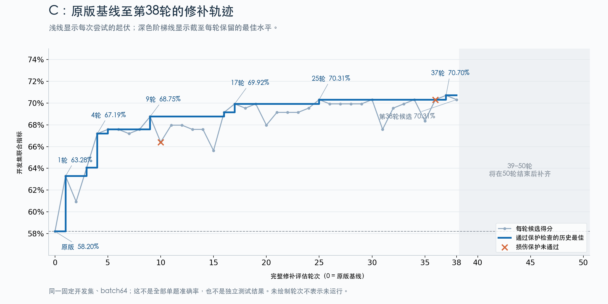

# C修补进展曲线

历史原件；不是本次提出的假设、论证或运行要求。

原路径：`experiments/wsp-vlm-open-repair-v8x50-2026-11-05/figures/README.md`。来源：[固定提交原件](https://github.com/yuxiexiong/acupuncture/blob/2ed333ea1e2f4ae2358f081ee37dbaf3c26c6274/experiments/wsp-vlm-open-repair-v8x50-2026-11-05/figures/README.md)；SHA-256：`2e3582ca55a43ea7a910ddda45df5b5c2ade8bf150ee9551f41b34f310eef1c8`。精确字节见原文归档。

---

# C修补进展曲线

浅色线为各轮完整开发评估得分；深色阶梯为通过保护规则的历史最佳；橙色叉为损伤保护失败。源数据来自远端v8/C完整回执，第0轮为相同batch64的W0，未重新运行模型。38轮后区域留白以便50轮结束后更新，留白不表示这些轮次未运行。

基线58.203125%，第9轮最佳68.75%，第17轮69.921875%，第25轮70.3125%，第37轮70.703125%，第38轮候选70.3125%。这是开发集联合指标，不是全部单题准确率或独立终验。

[逐轮源数据](https://github.com/yuxiexiong/acupuncture/blob/2ed333ea1e2f4ae2358f081ee37dbaf3c26c6274/experiments/wsp-vlm-open-repair-v8x50-2026-11-05/figures/c-through38.json) · [SVG](https://github.com/yuxiexiong/acupuncture/blob/2ed333ea1e2f4ae2358f081ee37dbaf3c26c6274/experiments/wsp-vlm-open-repair-v8x50-2026-11-05/figures/c-through38.svg) · [绘图脚本](https://github.com/yuxiexiong/acupuncture/blob/2ed333ea1e2f4ae2358f081ee37dbaf3c26c6274/experiments/wsp-vlm-open-repair-v8x50-2026-11-05/figures/plot_c_progress.py)。用户已要求50轮结束后按同样样式补全到50轮，已写入监控任务。
