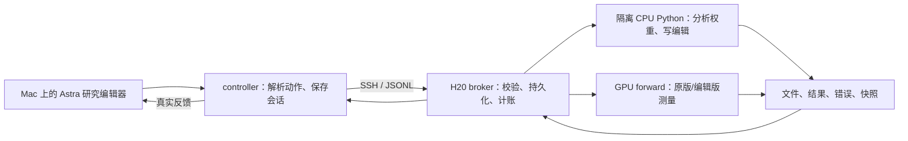

# WSP 工程说明书：模块、能力、验收与运行历史

历史原件；不是本次提出的假设、论证或运行要求。

原路径：`experiments/wsp-process-reproduction-v1-2026-11-03/ENGINEERING-MANUAL.zh-CN.md`。来源：[固定提交原件](https://github.com/yuxiexiong/acupuncture/blob/2ed333ea1e2f4ae2358f081ee37dbaf3c26c6274/experiments/wsp-process-reproduction-v1-2026-11-03/ENGINEERING-MANUAL.zh-CN.md)；SHA-256：`4fb354c0a8a3a4ce79ba2f0637b6309e7457f8e332936877a931e486c677cca5`。精确字节见原文归档。

---

# WSP 工程说明书：模块、能力、验收与运行历史

**版本：2026-11-05，工程现状盘点 v1。** 用户本次所说的“WPS”在本项目中指 WSP（Weight Space Programming）。本文整理已有工程与记录，不是启动合同，也没有新增实验授权。

**当前结论：已经有能运行的旧自主研究链路、模型与数据资产、经过有限验收的测量工具，以及接入作者原评分/构建代码的适配层；尚未完成用户最新要求的“服务器独立运行、AI根据新结果自主研究”的新整套系统。没有完成作者效果的成功复现。**

数学包括验收保持暂停；编程已撤出当前任务范围和启动队列，历史代码与数据保留。2026-11-05 02:02 北京时间只读检查本机和 H20 的相关命令行，未发现 WSP/WCP 控制器、桥接或等待器匹配进程；这是一次定点检查，不是持续监控或服务器所有任务都空闲的证明。没有启动模型、调用研究 AI、恢复任务或清理文件。

## 阅读方式与证据等级

- 想看现在有什么：第 1–4 节。
- 想看测过什么、哪些通过：第 5 节；每项附收据或历史报告。
- 想看实验结果及过去的问题：第 6–8 节。
- 想看资源为什么消耗大、还缺什么：第 9–10 节。
- 想接手或查原件：第 11–12 节。

本文把以下四件事分开：**代码存在 → 特定检查通过 → 整条链路通过 → 科学结果成立**。后一步不能由前一步自动推出。历史测试仅对其记录的输入、版本、阈值和范围负责；“未运行”“因资源门禁未派发”“运行失败”“用户中止”和“完成但没有改善”分别记载。

本文的“当前”以[最新自主方案状态](https://github.com/yuxiexiong/acupuncture/blob/2ed333ea1e2f4ae2358f081ee37dbaf3c26c6274/experiments/wsp-process-reproduction-v1-2026-11-03/autonomous-process-r1/status.json)和[暂停记录](https://github.com/yuxiexiong/acupuncture/blob/2ed333ea1e2f4ae2358f081ee37dbaf3c26c6274/experiments/wsp-process-reproduction-v1-2026-11-03/author-code-reuse-r1/PAUSED_BY_USER.json)为准。旧 README 中的“将继续”“已启动”“等待空卡”“正式搜索未启动”，以及旧 state 中的 `running`、`finished_with_skips`，必须按其日期及后续停止记录理解，不能单独用来重启任务。

## 1. 工程经历了哪些版本

|版本/目录|实际用途与完成情况|现在如何使用|
|---|---|---|
|本目录根部与 `receipts/r2`、`receipts/r3`|模型下载、文本导出、tokenizer、编译环境、隔离内核、快照与初始生成检查|复用资产和证据；不再从头准备|
|服务器 `external/wsp/fa01-*`|FA-01 前向数值验收，两模型各 8 项通过|旧后端的有限数值依据；本次复制了原始 JSON 收据|
|`engineering-r2/`|修正文件/张量接口，接入 Mac Astra、SSH broker、服务器 CPU/GPU；实际完成过自主运行|可复用控制逻辑和测量后端，但不能称作者完整私有实现|
|`fleet-v1/`|四任务车队、自动切换、恢复和资源账本；包含正式运行及大量故障现场|历史工具；旧车队和等待器均不属于当前执行安排|
|`author-code-reuse-r1/`|停止旧搜索后，提取作者原代码、接原评分/构建器、准备固定成功路径；只完成部分工程验收|通用接口可继续复用；固定科学动作派发器不进入新自主方案|
|`server-codex-login-r1/`|服务器登录已部署；官方服务连接测试失败|登录不等于可独立调用 Astra，网络仍是未解决项|
|`autonomous-process-r1/`|最新目标：全新 AI 会话、作者公开协议、根据本轮反馈自主诊断与选针|目前只有方案、自查和暂停状态，没有新执行入口或正式结果|
|相邻 `wsp-coding-painpoint-v1-2026-11-03/`|WCP 编程数据、评分、隔离、编译干预、阶段调度和部分正式诊断|撤出当前范围；第 7 节仅作历史资产说明|

这不是“从头到尾全部自己写了一个模型”，也不是“已把作者全部源码原样运行”。**模型和公开数据真实复用；公开辅助代码部分直接复用、部分后来修正为直接调用；作者未公开的数学服务与调度由我们重建；旧科学分析由研究 AI 在运行中编写。**

## 2. 一次自主研究实际怎样运作

历史已跑通的链路为：

|环节|谁负责|需要什么|产物|
|---|---|---|---|
|提出痛点、选对照、构造指标、排序、选针与决定下一步|研究 AI（Astra）|可用的模型服务、正确初始指令、本轮结果|新 Python 代码、forward 请求、笔记与最终选择|
|执行分析、读写允许的权重|CPU 持久内核|CPU/RAM、只读模型和 practice、独立可写 `/work`|分析数组、图表/统计、编辑矩阵|
|检查编辑合法性与冻结快照|broker/快照代码|张量身份、形状、数值与冻结规则|不可变快照、有效改动记录|
|将编辑装成可推理模型|checkpoint builder|原始模型、快照、磁盘|派生 checkpoint、构建哈希；不做训练|
|自由生成|GPU 服务/vLLM|空闲 H20、模型、题目、采样参数|原始 token、文本、长度、结束原因、分数|
|给定文本的内部测量（TF）|GPU 服务/HF hooks|输入 token、请求的层和读数|hidden、MLP、attention、下一 token log-prob 等|
|研究反馈与回滚/保留|Astra 与 controller|本轮返回值、剩余科学调用数|新候选或撤回；失败也进入轨迹|
|最终独立数学评测|观察者评测程序；不让研究 AI 依据终验改针|冻结提交、隔离测试题、单列预算|原版/编辑版配对成绩；当前新方案尚未接完|

“Codex 编辑器”不是编译器。Codex CLI 是调用研究 AI 的客户端；真正把权重文件组合成 checkpoint 的是 Python 构建程序。**固定路线重放可以不用研究 AI，但用户要复现的自主决策过程必须有研究 AI。** 当前计划把 controller 和 Codex 客户端都放到 H20；这项迁移还没有完整实现、验收。`tmux` 只能防终端断开，不能解决 H20 到 Astra 的网络问题。

一个 pass 指一次成功的 forward 服务调用，不是一道题、一个样本或一次 Python 分析。一次 both 请求可包含两臂各数百个回答；另一次 TF 可能只测短文本。因此“50 pass”不对应固定的 token 数或固定时长。失败动作不计成功 pass，但仍可能消耗 GPU、CPU 和 AI 用量。

## 3. 模块清单：已有代码究竟做什么

以下路径均相对本说明书所在目录；实际部署副本和验收源码哈希以各收据为准。

|模块与入口|职责/输入输出|来源与当前边界|
|---|---|---|
|`prepare_assets.py`、`export_text.py`|下载固定 revision、记录哈希；从 raw 模型导出文本部分|我们的资产工程；已核过文本张量身份，不是重新训练模型|
|`tokenizer_probe.py`、`freeze_prompts.py`|核对模板、分词；冻结模型对应提示|我们的校验/配置；0.8B 对齐作者 Qwen2 文本 profile，不能与当前库 raw 默认类混称|
|`sandbox_kernel.py`、`sandbox_probe.py`|持久 Python、允许的文件/包、模型读取与编辑 API|数学私有内核未公开，属于重建；bwrap 隔离已测试|
|`snapshot_edits.py`、`test_snapshot_edits.py`|查未知/冻结张量、形状、NaN/Inf、纯整张量缩放、路径与快照|重建 validator；精确容差不是作者私有源码证明|
|`engineering-r2/forward_service.py`|请求校验、TF、vLLM 生成、生成激活、数学评分、配对统计和返回格式|测量后端重建；公开接口对齐和有限数值检查已做，作者内部 seed/采集方法未知|
|同目录 `broker.py`|单运行锁、action ID 与请求哈希、CPU 限时、快照、空卡检查、预算和持久响应|工程调度；完成响应可核对取回，不盲重放未知动作|
|同目录 `controller.py`|Astra 回合、动作解析、消息记录、通知、解释门、交接、最终提交|旧 Mac/SSH 自主入口；接入新 adapter 并迁往服务器仍待实现|
|同目录 `server_env.sh`|固定 WSP 环境和 CUDA 链接路径|独立环境，不靠升级其他任务的驱动/环境解决依赖|
|同目录 `acceptance.py`、`checkpoint_acceptance.py`、`scheduler_acceptance.py` 及测试文件|接口、构建、超时/续接等工程检查|保留历史结果；存在测试脚本不等于当前所有分支已执行|
|`fleet-v1/fleet.py`、`resume_after_fleet.py` 及各 run 恢复器|旧四任务编排、收据收集、等待与恢复|当前不用；历史“故障跳过”政策被用户“可修则修”纠正，之后又全部暂停|
|`author-code-reuse-r1/prepare.py`|校验公开来源、提取原动作；不执行它们|30 文件、80 Python 段、69 forward 请求的身份已核对|
|同目录 `build_with_author.py`|绑定本地路径后调用作者原 `build_ckpt.py` 与 `profiles.py`|直接复用构建逻辑；不自己另写 BF16 替换公式|
|同目录 `adapter/forward_service.py`|包裹已验收后端，原样导入 `mathqa`，调用原 builder，检查有效张量|薄适配已写；`mcqa.loop_signals` 缺失入口调用时明确报错，不伪造实现|
|同目录 `adapter/broker.py`、`sandbox_kernel.py`|独立部署、source_pass 身份、暂停门；复用既有隔离内核|不是新版自主控制器已经接通的证明|
|同目录 `adapter/author_actions.py`|按原记录/批准的成功路径派发科学动作|历史重放工具，**不用于最新自主目标**|
|同目录 `adapter/*check*.py`、`acceptance.py`、`finish_acceptance.py`|来源、函数、请求、短 TF/生成及参考数值验收|部分通过；等待器已退出，暂停门保持关闭|
|`autonomous-process-r1/`|新目标、复用边界、知识隔离、验收/搜索/终验工作包|文档方案；没有可宣称已验收的完整新系统|

### 工具接口的重要约定

- TF 的 log-prob 数组为 `[B,T-1]`，位置 t 表示预测输入 t+1；hidden/MLP 输出存储为 float16。模块层号与仅有完整注意力层的 attention tuple 需要显式映射。
- generation 的公开 JSONL 是每题一行、内含 samples；观察者另留完整原始 token IDs。生成后内部读数通过 HF 重读实际生成 token 采集，不是另生成一次回答。
- 最终 hidden 采用现后端的 post-final-norm 约定。中间层、padding、MLP 输出及 token 对齐有检查；作者私有服务未公开，不能因此宣称所有读数逐位相同。
- 多个样本先在每道题内汇总，再做配对统计；一题生成五次不算五道独立题。
- CPU 内核重启会丢内存变量，已写文件仍可保留；控制器应报告重启，不能假装会话内存无损。
- checkpoint 缓存与“原版回答缓存”是两回事。前者是可重建的模型派生文件；后者会改变原版每次重新采样的反馈，本轮没有接入。

具体接口及版本边界见[engineering-r2 报告](https://github.com/yuxiexiong/acupuncture/blob/2ed333ea1e2f4ae2358f081ee37dbaf3c26c6274/experiments/wsp-process-reproduction-v1-2026-11-03/engineering-r2/README.zh-CN.md)与[原码适配验收报告](https://github.com/yuxiexiong/acupuncture/blob/2ed333ea1e2f4ae2358f081ee37dbaf3c26c6274/experiments/wsp-process-reproduction-v1-2026-11-03/author-code-reuse-r1/INTERFACE-REPORT.zh-CN.md)。

## 4. 现有模型、数据和公开代码资产

|资产|已记录身份/内容|限制|
|---|---|---|
|Qwen3.5-0.8B raw|revision `2fc06364715b967f1860aea9cf38778875588b17`|保留源权重，不直接接续旧编辑|
|Qwen3.5-4B raw|revision `851bf6e806efd8d0a36b00ddf55e13ccb7b8cd0a`|历史扩展，不在当前新启动范围|
|文本导出|0.8B 320、4B 426 个文本张量；已有逐字节身份检查|去除 vision/MTP 等非文本资产，不等于更换文本权重|
|0.8B tokenizer|作者冻结的 Qwen2 文本配置/模板|不等于当前 transformers 自动选用的 raw Qwen3_5 默认行为|
|4B tokenizer|修正后的 `text-Qwen3.5-4B-r2`；backend/模板与 raw 对齐|早期错误导出保留历史，不能拿旧目录运行|
|练习题池|GSM8K train 7,469；MATH train 7,275；AIME 714|练习/研究反馈集，不能当独立测试集|
|作者公开源|固定 `4d09ba6d6a7e891dd8063974dfe81b3d78e3494f`；提示、profile、评分、构建、评测、通知与过程日志|原文件/源码哈希可核；数学完整 harness、forward 服务、部分依赖未公开|
|作者科学代码提取|80 段 Python 原字符串、69 条 forward 请求，原始成功/失败身份|是作者过去的一条研究轨迹，不是新 AI 的初始工具清单；不向新 AI 注入|
|WSP 环境|历史验收 torch 2.14.0+cu130、vLLM 0.33.0、transformers 5.20.2；专用 `.venv-wsp`|已有冻结文件；不是作者完整环境锁文件，也非本次重新核验全部安装|
|旧结果/编辑/快照|原请求、回答、数组、账本、失败、构建记录与停止收据保留|不删除、不混入新运行、不以旧 baseline 替代新终验|

资产证据：[下载与来源收据](https://github.com/yuxiexiong/acupuncture/blob/2ed333ea1e2f4ae2358f081ee37dbaf3c26c6274/experiments/wsp-process-reproduction-v1-2026-11-03/receipts/r2/asset_receipt.json)、[0.8B 导出](https://github.com/yuxiexiong/acupuncture/blob/2ed333ea1e2f4ae2358f081ee37dbaf3c26c6274/experiments/wsp-process-reproduction-v1-2026-11-03/receipts/r2/text-Qwen3.5-0.8B/text_export_receipt.json)、[4B 修正导出](https://github.com/yuxiexiong/acupuncture/blob/2ed333ea1e2f4ae2358f081ee37dbaf3c26c6274/experiments/wsp-process-reproduction-v1-2026-11-03/receipts/r2/text-Qwen3.5-4B-r2/text_export_receipt.json)、[tokenizer 审计](https://github.com/yuxiexiong/acupuncture/blob/2ed333ea1e2f4ae2358f081ee37dbaf3c26c6274/experiments/wsp-process-reproduction-v1-2026-11-03/fleet-v1/runs/diagnostic-r1/tokenizer.json)、[作者来源清单](https://github.com/yuxiexiong/acupuncture/blob/2ed333ea1e2f4ae2358f081ee37dbaf3c26c6274/experiments/wsp-process-reproduction-v1-2026-11-03/author-code-reuse-r1/sources.json)。没有加载作者最终 `edit.npz` 补丁。

## 5. 已跑的检查：哪些通过，哪些还没有

### 5.1 模型与前向数值

|检查|实际结果|能支持的结论与不能支持的结论|
|---|---|---|
|初始环境/隔离/快照|修复安装及 CUDA 编译问题后通过；两个模型短生成 smoke 通过|能加载并短生成；不是长回答吞吐或能力提升验收|
|FA-01 F1|空编辑构建与原权重一致，fixture 有效改动与 manifest 一致，两模型通过|构建身份；不是作者最终针有效|
|FA-01 F2/F3|原版/编辑版跨 vLLM–HF log-prob 检查通过；错误模型配对的负对照未通过|有限输入、预定容差内一致；不是逐位确定性|
|FA-01 F4/F5|hidden/log-prob/MLP 索引与 embedding 对齐、hook 中性检查通过|限定测量位置的实现检查|
|FA-01 F6|FP32 padding 差上界：0.8B 0.00004363、4B 0.00060177，均通过|不表示 BF16 任意批量排列都逐 token 相同|
|FA-01 F7|同权重 A/A 配对检查通过；0.8B 64/64 文本一致，4B 62/64 一致|**通过标准不要求所有生成逐字相同**；4B 有非零采样差异|
|FA-01 F8|激活一致性通过；0.8B worst_rel≈3.59e-9，4B≈0.014622，门限0.02|4B 接近门限，不能外推全场景严格等价|
|engineering-r2：0.8B|2短TF＋1短both/生成激活通过，194.704设备秒|当时版本的接口与合成编辑装载通过|
|engineering-r2：4B|同项通过，238.708设备秒|不能替代新版适配层剩余检查|

FA-01 本次从服务器原样复制：[0.8B 收据](https://github.com/yuxiexiong/acupuncture/blob/2ed333ea1e2f4ae2358f081ee37dbaf3c26c6274/experiments/wsp-process-reproduction-v1-2026-11-03/manual-audit-r1/fa01-0p8b-r2-receipt.json)、[4B 收据](https://github.com/yuxiexiong/acupuncture/blob/2ed333ea1e2f4ae2358f081ee37dbaf3c26c6274/experiments/wsp-process-reproduction-v1-2026-11-03/manual-audit-r1/fa01-4b-r1-receipt.json)、[来源与哈希](https://github.com/yuxiexiong/acupuncture/blob/2ed333ea1e2f4ae2358f081ee37dbaf3c26c6274/experiments/wsp-process-reproduction-v1-2026-11-03/manual-audit-r1/remote-receipt-copies.json)。两模型各 8/8 是这些检查项，不是 8 个科学实验成功。收据中的 407.45/615.20 秒是各验收脚本墙钟，不应直接累加为 GPU 小时。

FA-01 还记录 BF16 批量差的实测最大值约 0.333/0.904；这和经检查的 FP32 padding 指标不是同一个量。不能只引用“8/8”隐藏这些数值差。

初始失败和 smoke 证据在 [r2](https://github.com/yuxiexiong/acupuncture/blob/2ed333ea1e2f4ae2358f081ee37dbaf3c26c6274/experiments/wsp-process-reproduction-v1-2026-11-03/receipts/r2) / [r3](https://github.com/yuxiexiong/acupuncture/blob/2ed333ea1e2f4ae2358f081ee37dbaf3c26c6274/experiments/wsp-process-reproduction-v1-2026-11-03/receipts/r3)；r2 接口原件见 [0.8B](https://github.com/yuxiexiong/acupuncture/blob/2ed333ea1e2f4ae2358f081ee37dbaf3c26c6274/experiments/wsp-process-reproduction-v1-2026-11-03/engineering-r2/receipts/engineering-r2-0p8b-r1-receipt.json)、[4B](https://github.com/yuxiexiong/acupuncture/blob/2ed333ea1e2f4ae2358f081ee37dbaf3c26c6274/experiments/wsp-process-reproduction-v1-2026-11-03/engineering-r2/receipts/engineering-r2-4b-r1-receipt.json)。

### 5.2 编辑器、恢复、队列与环境

|检查|实际结果|范围/限制|
|---|---|---|
|Astra 工具闭环|4 回合，CPU 持久变量、tokenizer、1短TF与结束通过；6.773设备秒|真实 Mac 路径，不是服务器直接调用|
|Astra 会话续接|两回合 marker 记忆通过；无原生工具事件|不是任意故障都可无损自动恢复|
|CPU 超时与 kernel 恢复|外部超时终止自身内核、重启通知、空编辑最终提交检查通过|重启后变量确实丢失，须保留这一事实|
|checkpoint 再构建|两模型保存快照 CPU 重建，SHA256 与已验收副本一致|可删除授权范围内的派生副本，不可删原始快照|
|CPU 回归|历史 FA-01 三个测试函数＋r2 八项 unittest 通过|只对该版/范围负责，本次未重跑|
|旧四任务连续切换|6 项合成检查通过，包含正常/阴性/故障切换与恢复；另有服务器成功/失败收集检查|模拟50-pass与D/S/V/T/M不算真实研究；原跳过规则已被用户纠正|
|SSH/编辑器有界恢复|同会话原样重试、保存响应取回、未接受动作判定均有测试/实际证据|先核对现场；不是所有失败可无限重试|
|缓存清理后环境|import、张量可读、tokenizer、隔离内核、CPU回归及极小CUDA算术通过|0次模型forward；没有重跑数值验收|
|服务器 Codex 登录|CLI能识别ChatGPT登录|仅登录缓存识别通过|
|服务器直接 Astra|45秒最小请求超时，未得到最终回答|**未通过**；DNS/TCP/TLS观测不足以确定单一根因|

证据：[编辑器集成](https://github.com/yuxiexiong/acupuncture/blob/2ed333ea1e2f4ae2358f081ee37dbaf3c26c6274/experiments/wsp-process-reproduction-v1-2026-11-03/engineering-r2/receipts/editor-integrated/receipt.json)、[会话续接](https://github.com/yuxiexiong/acupuncture/blob/2ed333ea1e2f4ae2358f081ee37dbaf3c26c6274/experiments/wsp-process-reproduction-v1-2026-11-03/engineering-r2/receipts/editor-resume/receipt.json)、[调度收据](https://github.com/yuxiexiong/acupuncture/blob/2ed333ea1e2f4ae2358f081ee37dbaf3c26c6274/experiments/wsp-process-reproduction-v1-2026-11-03/engineering-r2/receipts/engineering-r2-scheduler-r1-receipt.json)、[checkpoint](https://github.com/yuxiexiong/acupuncture/blob/2ed333ea1e2f4ae2358f081ee37dbaf3c26c6274/experiments/wsp-process-reproduction-v1-2026-11-03/engineering-r2/receipts/checkpoint-rebuild.json)、[连续队列](https://github.com/yuxiexiong/acupuncture/blob/2ed333ea1e2f4ae2358f081ee37dbaf3c26c6274/experiments/wsp-process-reproduction-v1-2026-11-03/fleet-v1/receipts/continuous.json)、[诊断恢复](https://github.com/yuxiexiong/acupuncture/blob/2ed333ea1e2f4ae2358f081ee37dbaf3c26c6274/experiments/wsp-process-reproduction-v1-2026-11-03/fleet-v1/runs/diagnostic-r1/README.zh-CN.md)、[清理后环境](https://github.com/yuxiexiong/acupuncture/blob/2ed333ea1e2f4ae2358f081ee37dbaf3c26c6274/experiments/wsp-process-reproduction-v1-2026-11-03/engineering-r2/cleanup-r1/environment-receipt.json)、[服务器登录报告](https://github.com/yuxiexiong/acupuncture/blob/2ed333ea1e2f4ae2358f081ee37dbaf3c26c6274/experiments/wsp-process-reproduction-v1-2026-11-03/server-codex-login-r1/README.zh-CN.md)。

### 5.3 最新原码适配层

|检查|实际结果|剩余边界|
|---|---|---|
|公开来源与提取身份|30文件、80代码段、69请求通过|源码存在/语法可解析不等于已运行|
|作者50成功请求静态兼容|34生成＋16TF的schema/题号/限制通过；16TF公开长度吻合|没有执行这50请求；不是新自主请求所有分支均覆盖|
|原数学评分器|5个答案抽取/评分例通过；按题配对统计夹具通过|未公开mcqa循环检测不支持；有限例不是所有答案格式证明|
|原构建器|合成CPU BF16/非目标张量检查通过|已直接调用原builder，不是假装整段原harness都有|
|原干预函数|clear_edits、方向投影、subset编辑在小矩阵夹具通过|只是函数检查，没有找到真实模型的新针；新AI不会预装这些科学答案|
|历史成功路径派发|CPU/mock通过：75Python、50forward、24历史失败跳过；去除两条历史正确数断言的执行要求|历史路径方案已被最新自主目标取代，正式重放从未启动|
|真实模型短TF|原版与单坐标工程编辑各1次成功；16.899456设备秒；未改张量身份通过|不是有效科学干预；不能把这2次计入新搜索|
|短双臂生成|两次均在GPU_BUSY门禁前退出，未派发|**未完成**；等待器超时退出后保持暂停|
|独立标准HF参考核对|未执行|**未完成**；不得把旧FA-01当新版全部验收|
|服务器新自主闭环/关Mac续跑|尚未实现完整接线、未验收|**未完成**|
|独立数学终验接线|公开evaluate/merge已保存；缺失包路径、数据冻结和小型验收尚待处理|**未完成**；没有新benchmark成绩|

证据：[接口报告](https://github.com/yuxiexiong/acupuncture/blob/2ed333ea1e2f4ae2358f081ee37dbaf3c26c6274/experiments/wsp-process-reproduction-v1-2026-11-03/author-code-reuse-r1/INTERFACE-REPORT.zh-CN.md)、[全部短检查收据](https://github.com/yuxiexiong/acupuncture/blob/2ed333ea1e2f4ae2358f081ee37dbaf3c26c6274/experiments/wsp-process-reproduction-v1-2026-11-03/author-code-reuse-r1/receipts)、[成功路径核对](https://github.com/yuxiexiong/acupuncture/blob/2ed333ea1e2f4ae2358f081ee37dbaf3c26c6274/experiments/wsp-process-reproduction-v1-2026-11-03/author-code-reuse-r1/SUCCESS-PATH.md)、[当前状态](https://github.com/yuxiexiong/acupuncture/blob/2ed333ea1e2f4ae2358f081ee37dbaf3c26c6274/experiments/wsp-process-reproduction-v1-2026-11-03/author-code-reuse-r1/status.json)。早期“等待GPU”“待用户答复”的历史文本已被暂停状态和最新目标覆盖。

## 6. 已经跑过哪些正式研究，结果是什么

|研究|最后有效状态|观测结果|可以/不可以下的结论|
|---|---|---|---|
|旧0.8B数学自主搜索|用户停止，28/50成功；turn075验证中断|开发候选21→43/256，+8.59个百分点，报告SE2.94个百分点；独立验证无完整结果|有开发集正向线索；**未确认成功，也不是完成50pass后阴性**|
|旧4B数学自主搜索|完成50/50；129个编辑器回合|固定候选后新练习题2048道：1956→1953；净−0.1465个百分点，SE0.3937；31救回、34损坏|本轮没有可靠净改善；并非证明所有WSP无效或两模型完全等价|
|0.8B编程|诊断未完成，之后暂停并撤出范围|首32题×2=64回答完成；下一批超时，无完整输出|不是负向/完成；已有结果不能当完整D集|
|4B编程|D生成完成，后续诊断/定位中断，之后撤出范围|128题×2=256回答；编辑器传输有一次恢复记录|没有有效针或终验结论|
|固定作者科学路线重放|正式0次|只有提取与工程验收|不能说已复现作者107→656或最终论文效果|
|最新自主方案|正式0次|文档、自查与暂停状态|尚无新轨迹、新最终针或独立终验结果|

### 数学结果的关键限制

旧0.8B还测过明显有害或无可靠收益的候选：六倍增益24→0/240；后续某单列方向修正21→22/256；一次头消融21→13/256。降低“重复词”概率或内部重复投影，不自动改善数学。最终开发集21→43的线索不能抹去这些失败，也不能替代被中止的验证。

旧4B的2048题来自未与先前生成重合的练习题，候选固定后汇总检查；95%区间约[−0.9182,+0.6253]个百分点。最后清空7个修改张量、核验恢复原值。**这不是作者独立MATH-500/GSM8K test终验**，没有额外隐藏数学终验。

旧0.8B累计已结算38,734.997369设备秒；中断动作另列保守上界1,883.889019秒，合计核算上界40,618.886388秒≈11.283GPUh。未改写旧账；上界包括到首次空闲观测的延迟，不是精确CUDA内核时。旧4B记录60,757.141设备秒≈16.877GPUh。两者不可再加上各自子报告中的同一批耗时造成重复计费。

证据：[0.8B停止收据](https://github.com/yuxiexiong/acupuncture/blob/2ed333ea1e2f4ae2358f081ee37dbaf3c26c6274/experiments/wsp-process-reproduction-v1-2026-11-03/author-code-reuse-r1/stop-receipt.json)、[4B原最终报告](https://github.com/yuxiexiong/acupuncture/blob/2ed333ea1e2f4ae2358f081ee37dbaf3c26c6274/experiments/wsp-process-reproduction-v1-2026-11-03/fleet-v1/runs/user-stop-r1/math-4b/final_report.md)、[保存数据复核](https://github.com/yuxiexiong/acupuncture/blob/2ed333ea1e2f4ae2358f081ee37dbaf3c26c6274/experiments/wsp-process-reproduction-v1-2026-11-03/fleet-v1/runs/user-stop-r1/saved-data-audit.json)、[代码比较报告](https://github.com/yuxiexiong/acupuncture/blob/2ed333ea1e2f4ae2358f081ee37dbaf3c26c6274/experiments/wsp-process-reproduction-v1-2026-11-03/fleet-v1/runs/code-comparison-r1/README.zh-CN.md)。比较报告只供观察者，不进入新编辑器上下文。

## 7. 编程工程历史资产（已撤出当前范围）

这些资产仍在相邻目录保存，记录它们不代表把编程任务重新放回队列。

|模块|已经完成|限制/运行状态|
|---|---|---|
|数据冻结|MBPP train601–974；参考373/374通过，927排除；88相似候选隔离、另31规范问题排除；剩254中固定D128、V64、S32⊂D；T为HumanEval+164，M为固定GSM8K64|审查非独立复核，不能证明全部参考正确/没有预训练污染|
|评分与执行|14项CPU检查通过：正确/错误、语法/运行/超时/内存、抽取、EvalPlus、权限、按题pass@1、不完整/故障/重复样本拒绝|生成代码在独立bwrap沙箱，非权重分析kernel；不是Linux漏洞安全证明|
|隔离|无网络/GPU/模型/凭据/宿主资料；UID/GID65534；cgroup4GB/1核/16进程，60秒supervisor，最多4worker|验收范围内通过；资源限额不等于任意恶意程序都不可能逃逸|
|编译权重干预|两模型零增益生成一致；±0.5目标列BF16保存重载、非目标张量身份、流式激活均值通过|仅合成短样例；每模型32回答≤128token，不是编程能力提升|
|运行时针/编译针比较|0.8B最大log-prob差0.0755806；4B0.1193173，超过原0.05|**等价检查失败**；用户批准采用编译针，未提高阈值，不能再称两种针等价|
|阶段调度与信息权限|D→S→V→T/M、冻结与一次开封、阶段账本/恢复已实现；11项合成流程/故障检查通过|属于WCP单独设计，不是作者数学流程原样复用|
|真实AI桥接|两独立Mac Astra会话通过，共77.06秒；无原生工具；服务器后台合成流程断开SSH后完成|Mac桥接仍依赖Mac；不等于服务器直接Astra成功|
|正式运行故障与预算|0.8B第二批787.916882设备秒失败补计；用户批准A30→90GPU分钟、总4→5GPUh；版本化恢复复制首批哈希一致|恢复等待器随后被用户停止，不能称新增三批已跑；4B诊断传输恢复后仍被暂停|

两模型初始工程累计428.33设备秒，含64条合成生成及724个TF输入token；调度收尾零新增GPU生成。0.8B预算恢复起点累计1,800.105613设备秒，已含工程/首批/失败，不再和上述数重复相加。故障中未落盘的token只按预留上界记账，不伪称实测；失败CPU耗时未完整记录。

详见[WCP工程报告](https://github.com/yuxiexiong/acupuncture/blob/2ed333ea1e2f4ae2358f081ee37dbaf3c26c6274/experiments/wsp-coding-painpoint-v1-2026-11-03/REPORT.zh-CN.md)、[阶段调度历史说明](https://github.com/yuxiexiong/acupuncture/blob/2ed333ea1e2f4ae2358f081ee37dbaf3c26c6274/experiments/wsp-coding-painpoint-v1-2026-11-03/orchestration/STARTUP.zh-CN.md)、[调度验收收据](https://github.com/yuxiexiong/acupuncture/blob/2ed333ea1e2f4ae2358f081ee37dbaf3c26c6274/experiments/wsp-coding-painpoint-v1-2026-11-03/orchestration/receipts/acceptance.json)、[0.8B预算恢复](https://github.com/yuxiexiong/acupuncture/blob/2ed333ea1e2f4ae2358f081ee37dbaf3c26c6274/experiments/wsp-process-reproduction-v1-2026-11-03/fleet-v1/runs/coding-budget-r1/README.zh-CN.md)。这些旧启动命令现在不应执行。

## 8. 问题账：发生了什么、解决到哪一步

|问题|已知事实与处理|状态/残留风险|
|---|---|---|
|下载与安装多次中断|保留下载中断、metadata403、wheel安装日志，最终固定源文件与环境|资产准备完成；历史失败不删除|
|GPU启动慢/首次FlashInfer编译失败|CUDA_HOME、compiler/runtime版本与链接问题；固定CUDA13.0.88后编译检查通过|工程问题修复；冷启动、编译不应被混入稳态生成吞吐|
|4B文本导出tokenizer类错误|重做r2导出并检查backend/模板|已修复指定资产；旧导出不作为当前输入|
|Mistral regex warning|缺版本字段引发误判；4B192输入/输出、0.8B128输入/输出与各自正确参考一致|未随意修改tokenizer；0.8B参考是作者profile而非raw默认类|
|接口格式与层索引不齐|TF命名/dtype、log-prob位置、生成JSONL、attention映射、tokenizer API修正|r2限定验收通过；不等于作者私有测量实现完全相同|
|注意力验收阈值/测试自身错误|BF16行和实测0.002197>原0.002；用dtype推导界限重查保存数组；另修正文件数量算术和extract元组误读|改的是相应验收解释/夹具，失败保留；不能笼统说从未改过任何阈值。FA-01 F2/F3/F6/F8未因此放宽|
|短GPU_BUSY|释放过渡期或其他任务占用，门禁阻止派发；部分旧检查稍后成功|新版两个生成尝试仍未完成；不得把等卡当正在计算|
|SSH reset/超时|旧r1中断；后续核对锁、worker、动作目录、账本、响应身份后恢复|传输恢复有实际证据；不是永不丢连接，未知动作不得重放|
|turn048 CPU未被接受|无动作目录/输出，账本未变化且无worker，保存失败响应后让AI续接|未执行其代码，不伪造成功|
|turn063 GPU已算完但控制器断线|校验request/response身份后取回已保存结果|无GPU重算；错误现场保留|
|编辑器Invalid prompt / usage policy|正常研究任务一次被拒；同会话、字节相同提示的一次原样重试成功|具体触发段/服务内部原因未知；不是证明已找出并修复政策规则，不绕过检查|
|编程诊断桥接中断|4B diagnosis-008有保存失败及transport-recovery；编辑器重试成功，GPU未重放|随后用户停止；不能把恢复成功等同编程任务完成|
|最初工程故障直接跳过|旧fleet曾标skipped_engineering，后按用户指示改为先核对修复/续接|跳过不是完成或科学阴性；旧规则不得作为新默认|
|预算与ETA不合理|初始容量/预算粗大；后又低估0.8B长回答及编程D；曾把最重批次情景当主ETA|口径已纠正，旧数字保留；新自主预算尚未冻结|
|重复原版生成|11请求审计约1.147GPUh；其中9次token一致约0.659GPUh，但其他重跑有差异|同seed不保证全文相同；缓存等价未通过，用户选本轮不接缓存|
|编辑器配置开跑前未完全对齐|context/instructions/解释门等后来补齐|不能把中途修正的旧28pass轨迹追称从零严格一致|
|公开代码复用描述过强|旧builder自写、评分导入曾AST适配、私有服务独立重建|新adapter已改原builder/原mathqa；未公开部分仍必须披露|
|将自主科学路线差异等同工程错误|旧AI的对照、无符号排序、整列编辑等与作者轨迹不同，多个候选有害|差异是待分析原因，未做单因素证明；自主AI走不同路线本身不等于违规|
|从“复用方法”滑向“固定答案路线”|提取并准备作者成功路径，虽不加载最终补丁，也使用了作者选择知识|最新目标已纠正；固定派发器不进入新AI运行|
|作者日志失败段与历史成绩断言|5失败Python、19失败forward；某失败段若重跑成功会额外改11层；末尾断言107/656|历史成功路径审计已完成但方案不再默认；新自主运行不得套旧跳过表或强求历史成绩|
|runtime针与编译针BF16不等价|WCP两模型检查超阈值，保留失败|用户选择编译针口径；不能宣称运行时机制结论自动迁移|
|服务器Codex能登录但不能调用|缓存部署与权限正确；连接超时/拒绝/TLS失败，最小请求退出124|尚未解决；不是简单多给sudo权限就能证明可用|
|清理磁盘风险|只删除用户批准的5处缓存；先保全86文件/10构建记录，核对161,321保留文件无缺失/变化|释放约44.11GB；没有授权删除原始数据，当前空间须另查|
|旧文档/状态容易误读|多次恢复产生r1/r2/author-aligned/budget/no-cache路径；旧标题还写“未启动”|本文给版本入口，历史原件不改写；不能拿旧state自动继续|

主要问题证据：[r2失败表](https://github.com/yuxiexiong/acupuncture/blob/2ed333ea1e2f4ae2358f081ee37dbaf3c26c6274/experiments/wsp-process-reproduction-v1-2026-11-03/engineering-r2/receipts/failed-checks.json)、[tokenizer/拒绝诊断](https://github.com/yuxiexiong/acupuncture/blob/2ed333ea1e2f4ae2358f081ee37dbaf3c26c6274/experiments/wsp-process-reproduction-v1-2026-11-03/fleet-v1/runs/diagnostic-r1/README.zh-CN.md)、[turn048恢复](https://github.com/yuxiexiong/acupuncture/blob/2ed333ea1e2f4ae2358f081ee37dbaf3c26c6274/experiments/wsp-process-reproduction-v1-2026-11-03/fleet-v1/runs/transport-r3/README.zh-CN.md)、[turn063恢复](https://github.com/yuxiexiong/acupuncture/blob/2ed333ea1e2f4ae2358f081ee37dbaf3c26c6274/experiments/wsp-process-reproduction-v1-2026-11-03/fleet-v1/runs/no-cache-resume-r1/README.zh-CN.md)、[缓存反例](https://github.com/yuxiexiong/acupuncture/blob/2ed333ea1e2f4ae2358f081ee37dbaf3c26c6274/experiments/wsp-process-reproduction-v1-2026-11-03/fleet-v1/runs/original-cache-r1/README.zh-CN.md)、[历史成本审计](https://github.com/yuxiexiong/acupuncture/blob/2ed333ea1e2f4ae2358f081ee37dbaf3c26c6274/experiments/wsp-process-reproduction-v1-2026-11-03/fleet-v1/runs/cost-audit-r1/README.zh-CN.md)、[缓存清理](https://github.com/yuxiexiong/acupuncture/blob/2ed333ea1e2f4ae2358f081ee37dbaf3c26c6274/experiments/wsp-process-reproduction-v1-2026-11-03/engineering-r2/cleanup-r1/README.zh-CN.md)。

## 9. 成本、时间、磁盘分别代表什么

**GPU小时不是墙钟小时，不是费用金额，也不是剩余完成时间。** 两张卡分别跑原版/编辑版31–34分钟，账面可约1.02–1.14GPUh；CPU分析、Astra思考、网络重试、等卡可能使墙钟继续增加而GPU账不增长。占卡/加载开销与纯解码也应分列。

历史0.8B第一批128回答约3.85M输出token，116/128碰到32k上限；长批量约4,000–4,350token/s。FA-01的256×4096短输出测得约14,045token/s，不能外推成32k长回答速度。大量长回答与多次大批候选比较是实际耗时的重要来源；编辑器等待和故障也是独立来源，不能把慢全部归因于算法或全部归因于网络。

作者日志的50次成功包含34生成/16TF，生成服务计时约9.099墙钟小时，整个搜索约20.3墙钟小时（其中约4.7小时连接等待）；**作者GPU小时和现金费用未知**。这些是作者日志审计，不是本机结果，更不能拿作者墙钟直接和我们双卡GPUh比较。

旧48GPUh是当时续完旧50pass的规划上限；固定路线16–23GPUh、9–12墙钟小时是另一种已知请求负载的粗估；它们都不是最新自主方案已批准额度或可靠ETA。新AI下一批大小与长短未知，当前没有诚实可保证的整轮ETA。

模型原件、环境、checkpoint缓存、快照、TF数组、生成文本分别占空间。全矩阵编辑即使“只改一列”也可能按完整矩阵保存；长TF读数可很大。旧方案把数百GB直接当启动必要条件过度保守，后来已撤回；但新自由请求也不能机械承诺固定路线20GB足够。需要按实际接口上限与每次请求预检，保留原始证据，不靠删除旧实验凑额度。

当前本文没有重新扫描磁盘或测GPU吞吐；历史270GB等空闲数字均是当时观测，不是现在容量承诺。各阶段计费收据存在重叠，本文没有给一个未经逐动作去重的“全项目总费用”。Astra账号计费与单位卡价也未由这些日志确定。

## 10. 现在能实现什么，预期实现什么，还缺什么

|能力|现状|还缺的必要证据/工作|
|---|---|---|
|加载固定文本模型、做生成与内部测量|旧版本已实际运行并有限验收|新版自由接口覆盖、短双臂生成及独立HF核对|
|AI看新结果，写分析/改权重/继续试验|旧Mac自主链已实现；曾跑28/50与50/50|与新原评分/构建器接线，重新冻结协议；不能从旧成功倒推新集成成功|
|不加载作者最终补丁|现有流程已遵守|新运行还须隔离作者科学代码、旧候选和观察者分析|
|复用作者公开方法与工具|prompt、数据、profile、公开辅助代码已备；原评分/builder部分已接|公开通知/工具语义最终核对；未公开服务保持显式重建边界|
|Mac关机后完整自主运行|未实现/未验收|先解决H20到Astra连接，再把controller本地化并做合成断线验收|
|新AI独立发现有效针|目前无已确认结果|完整的新自主轨迹、最终冻结，以及未给AI的独立测试|
|复现作者改善幅度|不能保证，也未证明|相同公开设置提高可比性，但随机轨迹、服务快照/私有实现未知；结果必须实测|
|说明“为什么起效”|已有内部读数和失败对照资产|内部指标变化不等于完整因果机制；不能承诺自动找到唯一痛点|
|自动跑4B/编程|旧工程存在，但当前不在授权执行安排|需要用户另行决定；本说明书不排入队列|

最新方案的必要收尾分为已有的三个工作包，不在本说明书另造实验：

1. **工程验收**：官方模型连通、服务器本地闭环、隔离、缺失数值分支、断线对账；只补未覆盖项。
2. **新0.8B自主搜索**：新会话、新目录、新账本、原始模型；50成功forward/最多300Python；AI依本轮结果选择路线，不能把旧28pass拼入，也不强制34生成/16TF。
3. **冻结后独立数学终验**：MATH-500与GSM8K test的原版/编辑版配对；评测接线、题库身份和预算单列，结果不反过来选针。

以上均处于计划/暂停。预算、启动清单和授权尚不能被旧文件替代。完整边界见[最新自主方案](https://github.com/yuxiexiong/acupuncture/blob/2ed333ea1e2f4ae2358f081ee37dbaf3c26c6274/experiments/wsp-process-reproduction-v1-2026-11-03/autonomous-process-r1/PLAN.zh-CN.md)及[自查](https://github.com/yuxiexiong/acupuncture/blob/2ed333ea1e2f4ae2358f081ee37dbaf3c26c6274/experiments/wsp-process-reproduction-v1-2026-11-03/autonomous-process-r1/SELF-CHECK.zh-CN.md)；逻辑自查不是独立审稿，也不是工程通过或运行授权。

必须保留的未知：作者private seed映射、完整运行库/硬件、内部激活采集及validator精确容差、Astra后端模型快照。没有这些信息时可以复现公开协议并披露差异，不能承诺与作者每条token/每个候选/最终分数逐位一致。

## 11. 数据在哪里，接手时看什么

|位置|内容|使用规则|
|---|---|---|
|本仓库 `experiments/wsp-process-reproduction-v1-2026-11-03/`|工程代码、版本报告、短收据、失败与验收合同|本说明书为导航；具体历史结果追溯对应receipt/hash|
|本机 `external/wsp-fleet-v1/math-0p8b/experiment`|旧0.8B长期续写的编辑器轨迹与响应|不因为旧目录名而从头重跑，不给新AI读取|
|本机 `external/wsp-fleet-v2/`|旧fleet/各次恢复state、launcher/process日志、4B轨迹|多个历史state不是多个仍在运行的实验；暂停记录优先|
|本机 `external/wsp-author-code-reuse-r1/`|作者公开原件、提取代码和请求|观察者资料；不向新AI挂载；不上传曾被拒绝的原作者压缩包或拆包绕过|
|H20 `/workspace/acupuncture/external/wsp/`|模型、FA-01、工程验收、旧数学run、快照、checkpoint、成本账|原数据不删；派生缓存只有明确授权后可处理|
|H20 `.../wsp/fleet-v1/math-0p8b`、`math-4b`|旧数学实际执行现场|响应/锁/账本/进程共同判断动作状态，不能只信本机state|
|H20 `/workspace/acupuncture/external/wcp01/`|编程数据、沙箱、阶段账本、旧run及CLI历史目录|撤出范围但保留，不恢复旧等待器|
|服务器私有 Codex 配置与连接诊断目录|登录缓存、连接测试日志|凭据不显示、不进Git、不挂载给研究内核；连接状态见单独报告|

Git保存工程源码、报告、清单/哈希和适量原始证据；不保存raw模型、环境、凭据或所有大型张量。某些大数组仅在服务器，源码与哈希可追溯不等于Git里已备份全部字节。不能在没有备份/重建核验时删除服务器原件。

查某次动作时，依次对照：**启动合同与代码hash → 原始AI请求 → action ID/request hash → 编辑快照 → worker结果/响应 → 账本 → 控制器收到的反馈**。进程退出而无结果是未完成；有保存响应但Mac断线是可能可恢复；同题的新对照请求不是同一个action；这些情况不能混在一起自动重放。

## 12. 本说明书自查与交付范围

- 本次是既有工程盘点，没有提出新的科学实验设计、改变科学条件或运行验收；不把先前逻辑自查重新标成整套工程通过。
- 只读核对代码入口、当前暂停状态、历史报告/JSON收据与限定进程；两份FA-01收据从服务器原样复制并计算SHA256。
- 重点检查了四处易误报：旧28/50不是完成；开发正向不是终验阳性；服务器登录不是模型可调用；固定路径函数通过不是自主系统整体验收。
- 保留测试失败、阈值解释修正、未知原因和数值偏差；没有只列通过项。
- 记录新旧路线的区别，撤回“自主算法路线不同就必然没有复现协议”的过强说法；同时不掩盖真实工程偏差和中途配置修正。
- 本文引用的旧报告可能含历史启动命令和过时状态；它们仅供追溯，当前暂停与最新用户指令覆盖它们。
- 本次只交付说明书、导航和小型审计证据，不修改controller/broker/model配置、不启动或终止其他项目、不删除数据。机器可读盘点见[审计索引](https://github.com/yuxiexiong/acupuncture/blob/2ed333ea1e2f4ae2358f081ee37dbaf3c26c6274/experiments/wsp-process-reproduction-v1-2026-11-03/manual-audit-r1/inventory.json)。

可合理期待的是：补齐缺口后，得到一条在作者公开条件下、由新AI依据新反馈产生的可审计研究轨迹，并知道最终针是否带来独立数学收益。**不能预先期待“必然找到同一根针”或“必然复现相同提升”；目前尚无这项保证或结果。**
