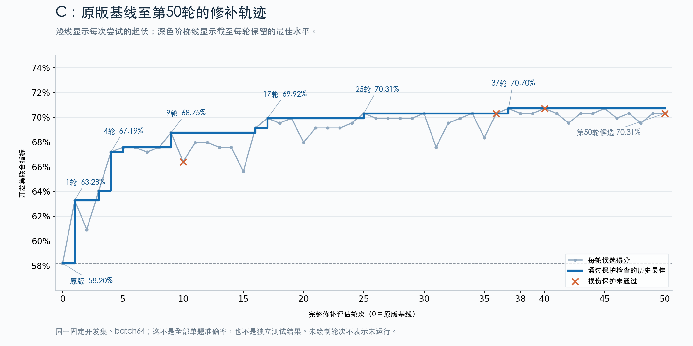

# WSP-VLM B/C：各 50 轮开发搜索结束

历史原件；不是本次提出的假设、论证或运行要求。

原路径：`experiments/wsp-vlm-open-repair-v8x50-2026-11-05/FINAL.zh-CN.md`。来源：[固定提交原件](https://github.com/yuxiexiong/acupuncture/blob/2ed333ea1e2f4ae2358f081ee37dbaf3c26c6274/experiments/wsp-vlm-open-repair-v8x50-2026-11-05/FINAL.zh-CN.md)；SHA-256：`54b1e118df87a0e097c41e14be8cbd4e758c56edb0ca5068b72d6085b3feee06`。精确字节见原文归档。

---

# WSP-VLM B/C：各 50 轮开发搜索结束

2026-11-05 北京时间，B 于 17:00:16 完成，C 于 18:02:17 完成。两条线各有 50 个不同非零补丁和完整 D 评估，均正常冻结；18:02 的远端核查显示两张 H20 使用率均为 0%，显存各剩 3 MiB 占用，C broker 已退出。没有追加轮次或独立测试。

## 结果与口径

| 线 | D 来源组／输入数 | 同 batch64 W0 联合指标 | 本轮冻结补丁 | 提升 | 全输入修对／改错 |
|---|---:|---:|---:|---:|---:|
| B：总数与空间条件计数 | 58／464 | 47.41% | 52.59% | +5.17 个百分点 | 13／9 |
| C：反事实图上的通常大小与图中大小 | 64／2560 | 58.20% | 70.70% | +12.50 个百分点 | 50／7 |

联合指标使用普通提示，先平均同来源组内的问法/排列，再等权平均来源组。它不是全部单题准确率。B 全输入正确率 320/464→324/464（68.97%→69.83%）；C 为 2266/2560→2309/2560（88.52%→90.20%）。同源问法/排列不是独立样本。所有结果为反复查看的 D 上的搜索表现，旧 H 已见，不作为新终验。

B 冻结第50轮 `c-81dd85b39a266ffe7352e0792bf026051cb849eb066dc6276365d0bdd2b9c4d4`，16,896 个修改标量。这里的“最佳”仅指本次50个新候选。旧单参数补丁已有同 batch64 输出按同评分重算为56.03%，通过当前保护；本轮未超过它。B 的诊断深度、统一缩放局限和第47/50轮的损伤取舍见 [专项分析](https://github.com/yuxiexiong/acupuncture/blob/2ed333ea1e2f4ae2358f081ee37dbaf3c26c6274/experiments/wsp-vlm-open-repair-v8x50-2026-11-05/B-analysis/REPORT.zh-CN.md)，不把5.17个百分点当作方法上限。

C 冻结第45轮 `c-556e560bdc90cca68fd2622fa57651d2e7fc071f2dd83d39ea866c91f3b393f0`，35,792 个修改标量。第37轮首次达到70.703125%；第45轮同分且修改标量更少，按预设规则替换。第50轮为70.3125%，且 `B0:T1:1:original_usual` 损伤保护失败，保留第45轮。10、36、40、50轮未通过损伤保护；失败仍保留并计入完整轮数。

## C 的完整轨迹

浅线是每轮候选；深线是通过保护的保留最佳。第25轮70.31%，第37轮70.70%，之后没有更高的合格得分。图并未把最后一次尝试当最终部署补丁。PNG、SVG、输入JSON及绘图脚本均保留；横轴仍为0–50，与此前38轮图一致。

## 验证和保留范围

`summarize_closeout.py` 只在 CPU 上重评保存的完整自然回答，核对两条线共102份完整评估（各W0+50）。全部输入数、逐条评分、汇总和联合指标与原回执一致；候选签名各50个唯一值。没有模型加载或新增推理。图已目视检查。

`closeout-evidence.json.gz` 保存每条线的最终状态、50个round回执、51份完整评分及每条原始回答全文、候选manifest、全部研究者请求、配置、身份、真实续接与冻结回执和来源文件SHA256。为避免重复体积，预测条目仅保留评分所需字段和完整回答文本；原始token、其他运行元数据、所有候选张量及完整动作产物仍原样留在远端 `external/wsp-vlm-open-repair-v8-2026-11-05/{B,C}`，未删除，也未把整张模型权重上传Git。

归档通过 `export_closeout.py` 只读提取，逐一核对缓存评估SHA256；`closeout-summary.json` 保留所有逐格正确数、修对/改错ID和最终资源计数。B共23,682个输入前向；C共130,562个，包含W0、完整评估和诊断。历史30→50续接未重放基线，B启动失败仍保留在 `failed-B-start-01`。

结束时 `/workspace` 剩余约86.48 GiB、`/tmp` 48.16 GiB；本地最近核查约698 GiB。GPU实验已结束，ETA为零；完成GitHub归档核对后撤销30分钟监控。

## 研究边界与尚未完成的工作

这次完成的是 WSP→VLM 开放修改闭环的开发搜索：AI选择诊断、修改位置与非梯度计算，观察者记录完整反馈。它提供收益轨迹、失败候选、有限损伤和持久错误的证据；尚未建立被修复的唯一机制，也未证明跨来源组泛化。B专项审计提示搜索策略仍需改进；C的涨分同样不能自动解释为一般视觉能力增强。

没有开展独立终验、跨分布评估、与同预算其他方法比较或最终补丁重载后的新增验证。这些是后续可能需要的测量，不是本次自动扩展的授权范围。当前交付不是新的实验方案，也不是独立同行审查；统计解释保留开发选择偏差，不用重复问法扩大独立样本数，不省略失败，不把得分变化等同因果机制。与cache写入—读取研究线的预算和结论保持分离。
