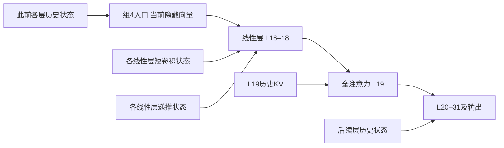

# 缓存机制：三种解释的计算路径、现有排除范围与下一轮最小对照

历史原件；不是本次提出的假设、论证或运行要求。

原路径：`docs/cache-mechanism-path-audit-2026-10-31.zh-CN.md`。来源：[固定提交原件](https://github.com/yuxiexiong/acupuncture/blob/7d6bdf84ab74062ac9ab55bc8201b5a6586b92c8/docs/cache-mechanism-path-audit-2026-10-31.zh-CN.md)；SHA-256：`d40fe4b72a15cd70016eb19490e31bb5f17b77f61ea9d695f1146b155e964e44`。精确字节见原文归档。

---

# 缓存机制：三种解释的计算路径、现有排除范围与下一轮最小对照

> 后续状态更新（2026-10-31）：用户要求先完成架构/理论先验审计，避免围绕定位反复试验。本文第7节八组合已暂停作为默认下一轮，未执行；现行判断及后续计划规则见[先验知识审计与主线纠偏](https://github.com/yuxiexiong/acupuncture/blob/7d6bdf84ab74062ac9ab55bc8201b5a6586b92c8/docs/cache-mechanism-known-basics-audit-2026-10-31.zh-CN.md)。以下保留当时的计算路径、已完成CPU分析及候选方案，历史数值不变。

## Material Passport

2026-10-31；path-audit-r02；academic-research-suite / experiment-agent / plan。完成架构源码与近邻相关段落核查，以及旧导出数据的 CPU 补充复算；新增模型前向、生成、候选评分和 GPU 使用均为 0。下一轮仅为建议，未实现 GPU 实验或启动队列。

**结论：当前能排除的是若干强版本解释，不能在“内容改变、读取改变、组合不一致”中三选一。下一轮优先把旧四格的“其余状态”拆成组4之前与之后，在同一个提示末 token 上补齐四个缺失组合。目标是定位背景依赖来自哪段计算，而不是继续让模型开口或扩展层扫描。**

本记录改变的是后续实验优先级：上一份结果报告中的 EOS 屏蔽建议降为辅助诊断；历史结果和原建议保留，不改写成当时已经做出的决定。

## 1. 本次依据和证据身份

- 项目入口、研究状态、阶段二合同、冻结实现、II-B 收据及元数据；现存合同有历史草案文字，实际执行状态以 completed 收据和导出核验为准。
- [上一轮四格结果](https://github.com/yuxiexiong/acupuncture/blob/7d6bdf84ab74062ac9ab55bc8201b5a6586b92c8/experiments/cache-complement-analysis-v1-2026-10-31/RESULTS.zh-CN.md)：12个旧情景、24输入、96记录。G=组4，O=其余状态；本轮不把它解释成三种缓存类型的四格。
- [本轮组件表](https://github.com/yuxiexiong/acupuncture/blob/7d6bdf84ab74062ac9ab55bc8201b5a6586b92c8/experiments/cache-complement-analysis-v1-2026-10-31/path-audit-r02/components.csv)及[复算证据](https://github.com/yuxiexiong/acupuncture/blob/7d6bdf84ab74062ac9ab55bc8201b5a6586b92c8/experiments/cache-complement-analysis-v1-2026-10-31/path-audit-r02/evidence.json)：同一 L0/C4146/−1 条件，22臂×24输入=528条旧记录，包含上述96条，不另加独立样本量；1056条旧候选序列评分。336项组内子集逐情景效应与旧分析逐值相同，最大绝对差0。导出文件哈希、记录与收据哈希引用、528条文本标签哈希及候选求和均核对。
- 模型为 Qwen3.5-4B，revision `851bf6e806efd8d0a36b00ddf55e13ccb7b8cd0a`；历史回执为 transformers 5.20.2、BF16、eager。核对的是对应版本的上游源码，不等于重新校验服务器安装文件或独立模型复现。
- 行为数值沿用旧模型辅助标签；本轮额外回读“只污染KV”与“污染整组”不同的4对原文，不冒充528条新独立语义审核。

## 2. 实际计算路径：存储、读取和更新相互耦合

所有层号沿用零起始编号。模型为重复的三层线性注意力＋一层全注意力。当前追踪组是 L16–18 线性层及 L19 全注意力；选择它是复用历史候选，不能认定这一组或 L12 有天然特殊性。

提示前 n−1 个 token 构建 C/T 状态；最后一个提示 token 起不再插针。历史 hook 位于 MLP down_proj 前，而注意力及其缓存更新先发生，所以同一次前向里，注入不会反向改写本层已经更新的缓存；能影响后续层。冻结代码亦检查插针层及以前的缓存 T=C。

图省略逐层残差、归一化、MLP及当前 token 的新写入。关键路径：

1. **短卷积状态 → 当前 q/k/v。** 最近投影输入与当前投影共同经过卷积。它不是独立给答案投票的第三份记忆。固定本层输入时，卷积状态不直接决定本层的 α/β/z；这些门来自输入投影，但卷积输出能影响下游层的门。
2. **旧递推状态＋当前 q/k/v/门 → 更新后状态与读出。** 当前步先更新再读取，不能只拿旧状态乘查询就当完整机制。
3. **线性层输出 → L19 当前查询、新 K/V、输出门；历史 KV → 注意力读取。** 因而替换递推/卷积后，即便历史 KV 不动，如何使用它也会变。
4. **组4输出 → 后续层对其历史的使用 → logits。** 后续层状态可能放大、削弱或改变同一组输出的作用。首步之后还会引入生成 token 不同导致的反馈，本轮建议先避开这个混淆。

实现依据：[固定版本 GatedDeltaNet / Attention / DecoderLayer](https://github.com/huggingface/transformers/blob/v5.20.2/src/transformers/models/qwen3_5/modeling_qwen3_5.py)。这说明存在耦合路径，不说明已测得交互由哪条路径主导。

### 一个可核验的局部关系

按实现采用 key×value 的矩阵方向，令 S 为更新前递推状态，q/k 为实际规范化、缩放后的向量，省略层/头下标：

\[
S^+=\alpha(I-\beta kk^\top)S+\beta kv^\top,\qquad o=(S^+)^\top q.
\]

重排可得：

\[
o=S^\top w+n,\quad
w=\alpha[q-\beta k(k^\top q)],\quad
n=\beta v(k^\top q).
\]

因此只有在 q/k/v/α/β 固定时，才有 \(\Delta o=(\Delta S)^\top w\)。相同文字并不保证这些读取/更新条件相同。若同时改变 S 和 w，以 C 为参照的完整差为：

\[
\Delta o=(\Delta S)^\top w_C+S_C^\top\Delta w+(\Delta S)^\top\Delta w+\Delta n.
\]

这是依据更新规则作的局部代数分解：实数算术下到 head 原始读出处成立，实际浮点实现需数值核验；尚未包含 gated RMSNorm、输出投影、MLP、后续层及最终评分。换一个参照，交叉项的分配方式会变，不能称独占贡献百分比。原始规则来源：[Gated DeltaNet](https://arxiv.org/abs/2412.06464)。

## 3. 三种解释的可检验版本

| 解释 | 对应计算路径 | 目前可排除/削弱的强版本 | 仍分不开的部分 |
| --- | --- | --- | --- |
| H1：历史内容改变 | 进入当前步前的 S、卷积缓冲、历史 K/V 不同，改变后续可读取的信号 | “组4损坏必然造成任务失败”被 TC 的24/24无核心矛盾标签反驳；“只有组4损坏”与只恢复组4仍大量失败不符 | 状态数值有因果作用，不等于某条事实被删除；可能信息分散在其他层、可被补偿，或只是读取条件改变 |
| H2：读取/更新条件改变 | 上游状态改变 h；h与卷积共同改变 q/k/v，h改变门；后续层改变组输出到 logits 的映射 | “三种缓存各自提供固定、可相加的作用”与当前D/S四格结果不符；但仅排除这些读数尺度下的固定加和 | 尚不知主要来自进入组4的输入、组内更新读取、组后处理，还是终点 max/log-softmax 运算 |
| H3：混合状态不一致 | 历史 S 与卷积、线性层与KV、组入口与组缓存、组输出与后续缓存来自不同轨迹 | “所有异常都是拼接才产生”被未拼接TT首步EOS反驳；“任何C/T拼接都必然失效”被TC反驳 | CT可能有特定方向的组合失配；自然C/T供体、相同token与管理字段合法仍不保证联合状态自然可达 |

H1/H2/H3不互斥。这里的 H1 只有收紧为“在相同使用条件下，历史状态差异仍造成有任务意义的差异”才是可检验主张；单凭张量不同无法叫作内容损伤。H3也不能成为事后万能解释：必须进一步指定哪个接口不一致、怎样匹配及预期改变什么。

## 4. 旧组件结果增加了什么约束

以下均为同一24输入；“核心匹配且无矛盾”沿用旧标签，不能等同全文可靠。D为首步停止优势，低为不倾向停止；S为旧双事实候选敏感度。

| 历史操作 | 首步EOS | 核心匹配且无矛盾 | 平均D | 平均S |
| --- | ---: | ---: | ---: | ---: |
| 全T | 24/24 | 0/24 | 1.4583 | 0.0833 |
| 全T中只清理组4递推 | 0/24 | 0/24 | −0.9714 | 0.2356 |
| 全T中清理组4递推＋卷积 | 0/24 | 0/24 | −1.0729 | 0.3405 |
| 全T中清理组4三类状态（CT） | 0/24 | 7/24 | −1.7500 | 0.7609 |
| 全C中只污染组4 KV | 0/24 | 20/24 | −17.4518 | 11.8069 |
| 全C中污染组4三类状态（TC） | 0/24 | 24/24 | −13.2682 | 7.1792 |
| 全C | 0/24 | 24/24 | −18.8802 | 14.8190 |

完整22臂见组件表，不只保留这些选例。新增认识是把旧组件数值与三种解释对齐，不是声称首次发现组件效应。

- **解除停止与任务交付可以分离。** 局部只清理递推已经24条都开口，却没有一条通过旧无矛盾核心判据；无需新跑 EOS 屏蔽来证明这两项并非同一指标。但TT若屏蔽EOS会怎样仍未知。
- **更多受干预组件不必使回答更差。** 只污染KV的4条失败标签全是“已有正确核心但前后矛盾”，不是4条完全没有正确答案；回读发现先报13后算14、先报4点后改5点等。整组污染对应4条不再有这些矛盾。支持非单调组合效应；也与内部匹配被部分恢复相容，不能单独认证协作机制。
- **读数和回答并不单调对应。** TC的S比“只污染KV”更低，旧无矛盾核心表现却更好。不把更大S等同更好作答。
- **整组内部同源也未解决组间匹配问题。** CT的G三类均取C，O均取T；因此“只是G内部递推和卷积被拆散”不能独自解释CT。组入口、出口仍可能不匹配。
- **不扩张排除范围。** TC正确不能证明信息都在O，CT错误不能证明G没存信息；两者还涉及改变计算条件、冗余和后续非线性。

全局类型替换也已存在：L0条件只清理全局KV后21/24仍首步EOS，清理全局递推或全局卷积均使24/24不再首步EOS。它们是跨所有对应层的操作，不能与组4操作的幅度相减来分配贡献。L12/C3621的递推双向S效应作为另一个历史线索保留，不和L0的停止机制混为一体。

## 5. Related work怎样约束我们

| 原始工作 | 本轮实际采用的认识 | 不能据此跳过的证据 |
| --- | --- | --- |
| [What Attention Recalls and Recurrence Controls](https://arxiv.org/html/2609.04434)，方法、附录B及限制 | 已有缓存类型保留/交换和功能比较；该文将短卷积与递推作为一个通道，并明确联合状态不一致的限制 | 功能影响不等于静态信息存储位置；自然供体交换降低某些退化风险，不能证明我们CT无失配；不再重复“KV负责事实、递推负责行为”的小型演示 |
| [WriteSAE v4](https://arxiv.org/html/2605.12770v4)，附录A及6.2 | 借用写入—传播—读取—下游映射的分析结构 | 其简化logit预测包含一阶近似及经验下游项，文中Qwen3.5-4B L12 H8有负R²结果；不能把0.8B的高拟合度直接搬到我们的4B大状态替换，不训练SAE作为本轮前置条件 |
| [Gated DeltaNet](https://arxiv.org/abs/2412.06464) | 使用实际更新规则，区分状态、门控与当前写入 | 结构允许交互不等于已经解释本项目交互的方向、幅度、发生位置和行为后果 |

三者都是作者报告与方法来源，不是本项目独立复现。当前建议的状态交换方法本身已有先例；潜在认识增量是把我们已有的背景依赖定位到具体前后计算路径。是否构成论文贡献仍要看后续结果及可验证关系。

## 6. 现有资料为什么还不能给出运算归因

旧四格把组4之前、之后的历史状态一起换了。已有导出保存回答、D和候选logprob，没有所需入口/出口隐藏向量、当前 q/k/v、门、完整首步 logits。冻结stage2实现写出的 `caches/*.json` 是哈希/差分清单，不能当作可直接重放的状态张量。

所以本轮能完成公式推导、来源审计、组件复算，不能伪装成已经做过固定查询读出或张量传播验证。新实验若获授权，必须计入C/T前缀重建成本；不能把旧记录存在当作缓存张量可免费复用。

## 7. 下一轮选择：把O拆成前后两段，只比较一个token

**问题：同一组4状态的效果随背景改变，主要是上游改变了进入组4的计算，还是下游改变了对组4输出的处理？**

划分三个区域，区域内三类历史状态始终一起取同一供体：

- U：L0–15的历史状态；决定当前token进入L16之前的隐藏向量。
- G：L16–19的历史状态；保持本轮组4定义。
- B：L20–31的历史状态；决定组4输出之后的后续计算背景。用B避免和停止读数D重名。

同一提示末token、相同位置/管理字段、撤针、相同权重和数值路径下，理论计算可以写成：

\[
z(g,u,b)=H_b\bigl(F_g(h_u)\bigr).
\]

F包含组4完整残差/MLP计算，H包含后续层、最终归一化及输出头。这是同一步前向的因果结构分解，不是线性或小扰动近似；若扩到自由生成，额外token反馈使这一单步表达不再足够。

### 最少补什么

旧四格已有 U=B 的四个组合。要不预设三阶交互为0而分开两种背景，补 U≠B 的四个组合，构成2×2×2；不是新的缓存类型全扫描。

| U | G | B | 身份 |
| --- | --- | --- | --- |
| T | T | T | 旧TT参考 |
| T | C | T | 旧CT参考 |
| C | T | C | 旧TC参考 |
| C | C | C | 旧CC参考 |
| C | T | T | 新：只改变组前背景，G仍T |
| C | C | T | 新：只改变组前背景，G为C |
| T | T | C | 新：只改变组后背景，G仍T |
| T | C | C | 新：只改变组后背景，G为C |

可复用旧 `compose_swaps` 的逐层来源操作实现，无需先设计新型query hook。L16只是G的入口边界，不赋予特殊功能。三个区域大小不等，不比较单位层效率。

### 固定范围与成本口径

- 沿用24输入/12情景、L0/C4146/−1、原校准、模型revision、模板、BF16/eager、batch=1及位置规则；不加模型、层组、剂量、题目或seed重复。
- **只处理最后一个提示token，记录首个预测分布；不采样并继续生成。** 同一token不代表同一hidden，后者正是要测的变量。
- 正式上限：48次前缀构建（每输入C/T各一）＋192次单token前向（24×8）；其中96次是旧四格重放以补内部读数，96次是新组合。不把参考重放写成零成本。
- 工程恒等/同源替换检查另限8次单token前向，尽量复用上述缓存；失败即停，不自动扩预算。当前未测墙钟，不虚构GPU小时估计；不是当前运行授权。
- 每臂深拷贝；保存来源、token/位置、管理字段和hook状态。新增张量仅围绕组4入口、L16–18更新/读出及L19出口；不转存全模型逐token注意力矩阵。

### 测什么，不把EOS作为唯一终点

1. 组4入口 h16、出口 h20；L16–18 的更新前状态、q/k/v/α/β/z及原始读出；L19当前查询及注意力输出。借此核验局部公式和信号在何处发生差异，不靠范数大就判重要。
2. 全词表首步原始logits、最终归一化前后向量；保留原D作历史对账。
3. 固定token对的logit差 M：每输入用**既有TT首步EOS token**与**既有CC首步非EOS token**，在所有新条件固定同一对，不重新取max。M用来检查旧D交互是否只由竞争token切换产生。它仍是首步竞争读数，不是事实利用能力。
4. 本轮不重新评分多token候选S，不声称解释了原S或完整回答；如果只定位首步路径，下一轮才沿该路径在固定候选前缀下检查内容相关位置。

### 直接判别量

对同一个读数Y（先对原始logit向量作逐坐标配对，再对固定M和原−D分别报告），定义组4恢复效应：

\[
E(u,b)=Y(C,u,b)-Y(T,u,b).
\]

固定后段时的上游依赖：\(J_U(b)=E(C,b)-E(T,b)\)。固定前段时的下游依赖：\(J_B(u)=E(u,C)-E(u,T)\)。旧交互满足：

\[
I_{old}=E(C,C)-E(T,T)=J_U(T)+J_B(C)=J_B(T)+J_U(C).
\]

若两条拆分路径分配不同，应报告三阶交互，不把它强行分成唯一的“上游占比/下游占比”。这一步新增的是把旧O捆绑操作拆开；不是再给旧均值换一个名字。

组内向量交互 \(\delta h_{20}(C)-\delta h_{20}(T)\) 能排除“全部交互只出现在最终评分函数”的强版本，但不能由此认定它解释了最终行为；必须结合最终logit效应。无可辨差异只在数值分辨率与固定题集内成立，不用未显著当等效。

### 结果怎样决定下一轮

| 可能结果 | 能新增什么认识 | 唯一优先后续方向（仍需另审设计） |
| --- | --- | --- |
| 固定B仍有清楚的J_U，组4出口效应也随U变；局部公式定位到读取/更新项 | 背景依赖至少部分在组4读取更新阶段形成；不是只由组后状态造成 | 在已指向的运算做固定读取条件对照，区分状态信号与q/k/门；不再扫组 |
| 组4出口效应对U差别很小，但固定U的J_B明显 | 同一组信号的后续处理依赖B；组4不是孤立控制点 | 追踪L20之后如何使用组4输出，而非继续拆组4缓存类型 |
| J_U和J_B均有作用或明显三阶交互 | 前后耦合；单一“存坏了/读歪了”不足 | 选择与固定token logit效应直接相连的一条路径做针对性干预；不能只挑最大范数 |
| 原D仍有交互，但固定M与原始logit向量交互仅在数值误差内 | 旧D交互可能主要来自max竞争者切换 | 先修正测量解释；若要追事实机制，应转到预定候选分歧位置，不扩当前首步实验 |
| 原四格无法重放、同源替换改变结果，或同U/G下h20随B变化 | 实现/缓存管理或路径核验不通过 | 停止科学归因，修正并另版验收；不靠加样本掩盖 |

12基础情景始终是配对单位，逐题与三任务族完整报告；不增加独立性计数，不用事后选阈值决定方向。工程数值容差须在执行版中依据同源重放固定；小样本不设“显著就立住”的成功门槛。

## 8. 这轮即使成功，也还不能排除什么

**此最小对照能定位背景依赖的前后路径，不能一次证明内容存储位置或排除全部组合不一致。** 新组合同样是反事实拼接；如果效应跟随某个接口，真实使用依赖与该接口的失配仍可能并存。后续必须针对被定位接口定义匹配/不匹配，而不是泛称“不自然”。

不采用“全组同源优于单组件混合”作为失配的独占判据，因为真实多组件互补也能产生相同结果。不采用WriteSAE的经验标量替代4B实测，不新增SAE训练。不把上游与下游定位成功写成缓存机制全解。

本轮交付是三种解释的可检验边界、完整旧组件复算与一个具有明确分支的最小后续设计。没有启动任何GPU工作。
