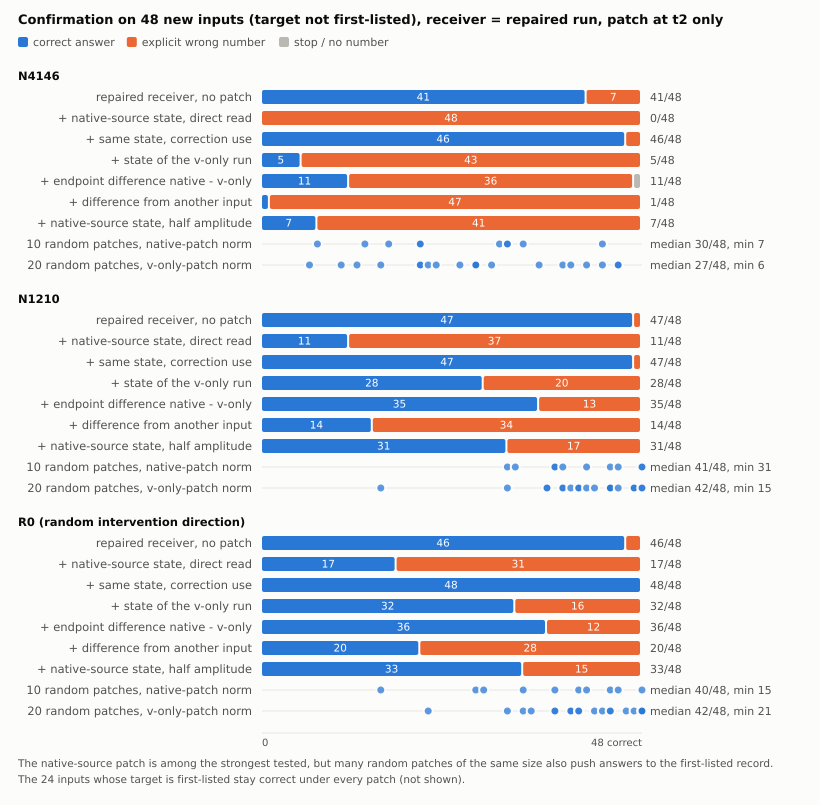

# 论文历史修订记录：v1.1 至 v1.3 增补

2026-11-07 从工作稿迁出，以下旧 §12–§15 原文保留。**这是历史记录，包含已撤回的解释和已过时的状态，不是现行正文或执行队列。** 当前结论见[论文 v1.4](mechanism-paper-skeleton-2026-11-05.zh-CN.md)。例如旧 §15 的“任意同范数扰动都脆弱”“修正用途不承载选择”均不能作为现行结论。迁出是为了保留溯源同时避免当前正文自相矛盾。

## 12. v1.1 更正记录（2026-11-05 第二轮）

- **背景措辞错误（影响§1、§2、§3、§4.2、§5、§8、§10）。** v1把LVK→SRU主链写成"恢复背景""人工混合背景"。按[LVK合同](../experiments/cache-local-v-k-v1-2026-11-03/CONTRACT.zh-CN.md)§3与[SRU合同](../experiments/cache-state-read-use-v1-2026-11-03/CONTRACT.zh-CN.md)§3：四格全部在原生受针背景T上，L00即原生运行，只在t1写入项换v/k，t2起自由；SRU接收者为L10/L11。所以主链站在原生运行上，人工部分只有t1写入项与t2一次读取替换。v1据此判断的"局部解释与原始现象之间缺决定性连接"相应收窄为"原生写入项写出的状态未在读取端测试"。
- **原生首步线补入§4.1与§6。** FC/SP/FX/NFC此前在v1与骨干中出现次数为零。它们固定了原生失败的两种形态，并提供t1结构句所需的参照。
- **t1结构句新增。** 依据LVK报告§0第1条与§1全层桥接；推导档，不是新测量。
- **同日第二处更正。** v1.1初稿把"端点间S₁差按构造恰等于写入项差"写成各层成立；只在首个G层成立，更高G层的t1量随下层输出改变。已改为"全部产生于t1一步"。指出者为[Proposal v8自查](mechanism-second-half-v1-2026-11-03/CORE_CONTRIBUTION_SELF_CHECK.zh-CN.md)§4第5条。v8同时把NWR-01草案收敛为其主比较A，实施前按v8修订合同，不双跑两版。
- **未改动的内容。** 所有数字沿用各报告；没有新增运行；§8"还缺什么"按v1.1重写，不改各卡原始口径。本更正由同一助手完成，不是独立审查。

## 13. v1.2 更正记录与本轮整篇判断（2026-11-05 第三轮）

**本轮做了什么。** 主比较A按[合同r02](../experiments/cache-native-write-readout-v1-2026-11-05/CONTRACT-r02.zh-CN.md)运行（预检与正式一次通过，约0.13 GPUh）；已有LVK/SRU输出按同一冻结规则重读错答类型；t1结构句逐位核验；面板身份写死；痛点段落写进引言；六张图生成并检查；§8改成讨论骨架。同一助手完成，不是独立审查。

表3 已前移至 §4.2，计数保持不变。

**整篇判断（坏消息先说）。**

1. **独立兑现仍是零。** 全部数字来自已见开发面板；新结果只有一个方向。v8的B阶段未运行。
2. **新结果的方向特异性不紧。** 五个随机同范数补丁里有一个重现78%的主效应且错法相同。"首列编号是读取被扰乱后的默认落点"与"原生写入的状态携带指向首列的内容"在本轮分不开。
3. **痛点仍是推测档。** 从单坐标稀疏干预到转向向量是类比；转向型持久性与KV级修复失效没有自己的证据。
4. **原生运行最主要的失败（首步停止）只通过t1结构句与主链相连。** 针为什么改变t1的v和k没有解释。

**站住的部分。** 一条写入端作用于原生运行、读取端为"原生来源＋局部修复接收者"的写入—读取关系：在这组操作里换t1的v使首步开口、再换k提高选对比例（有强交互，不是独立分工）；状态经t2直接读取而不是修正用途起作用；原生运行写出的状态被已修复接收者读入后重现同一种错误；错答类型有逐条分类；失败边界有六组反例。按"谁会因此改做法"衡量：做混合模型机制分析的人得到两条可直接使用的诊断，即首步开口不等于答对、应分别检验直接读取与修正两种用途；做转向的人目前只得到类比。

**按本轮开始时约定的终点规则归类：结论可信、认识具体、范围有限。** 它不是已知知识的实例化（近邻没有做过受干预状态的写入与读取定位），所以不是停止加细节另行立项的情形；它也没有开发外证据，所以不能写普遍性。

**下一步只有两项候选，均未授权，由用户定。** (a) v8的B阶段：冻结操作，在24个新基础情境上做开发外确认；须把随机控制族从5个方向扩大（建议不少于20个），否则第2条的问题会原样带进确认。(b) 痛点证据：用2603.16335公开的转向方向做一组转向型对照，测递推状态中的持久性，并演示KV级修复是否失效。建议先(a)后(b)：(a)决定现有中心句能否离开开发面板，(b)决定引言能把痛点写到哪一档。本轮不追加任何局部机制实验。

## 14. v1.2.1 更正与事后剖析（2026-11-05 第四轮）

**三处收紧（外部核查指出，接受）。** "两端都落在原生运行上"改为"写入端作用于原生运行、读取端为原生来源＋局部修复接收者"；"v决定开口、k决定选谁"改为本组操作的概括，注明强交互；"读取替换不制造停止"改为"几乎不制造，最多1条"（表3：N4146获得侧停止1→2，R0撤回侧0→1）。

**事后剖析（零GPU，读NWR-01已存的逐层逐头补丁统计；描述性，未预注册；[脚本与输出](../experiments/cache-native-write-readout-v1-2026-11-05/analysis/posthoc/)）。**

- 原生补丁含有一个跨输入共享的成分：它与每个固定随机方向的夹角在48条输入上高度一致（约九成的层—头，均值绝对值超过3倍标准误）；由这些夹角粗估，共享成分约占补丁能量的一半多（全部48条约0.57，同场景内约0.62）。能量的75%在第21、25、28层。**更正：初稿写成"几乎是固定向量、不是逐输入内容"，过强；"固定偏移"是假说。**
- 原生补丁的L2范数是SRU撤回补丁的1.88倍（逐输入1.79到2.02），两者效果却几乎相同（目标竞争平移−2.94对−2.16；正确数16对18）。**更正：初稿由此推出"多出来的v分量几乎不起作用"，推不出**（非线性、饱和、分量交互；且两端点在更高层的q、k、门控都不同，这份状态差不是纯粹的v写入分量）。可说的只有：按原生补丁范数匹配的随机对照，幅度约为SRU撤回补丁的1.9倍。
- 每个随机方向对目标竞争是跨输入近似恒定的平移：−0.30、−0.08、−2.43、+0.50、−0.92。种子3与原生补丁的能量加权余弦只有+0.022，投影解释不了它。原生补丁的−2.94约为这五个值的2.5个标准差。
- 这三条不改变冻结判读。它们提出了三个要在新数据上检验的假说，不是结论。开发外确认 [NWC-01](../experiments/cache-native-write-confirm-v1-2026-11-05/REPORT.zh-CN.md) 已运行，三个假说的检验结果见 §15。

## 15. 结果增补：开发外确认 NWC-01（2026-11-06，v1.3 正文截点之后）

本节由运行 NWC-01 的会话追加。**§1–§11 的 v1.3 正文截点是 `9bf6cf638`，不含 NWC 正式结果；本节不改动那部分文字，只列出结果以及正文里因此需要更新的句子。** 同一助手实现、运行、判读，不是独立验收。来源：[NWC-01 报告](../experiments/cache-native-write-confirm-v1-2026-11-05/REPORT.zh-CN.md)、[合同 r03](../experiments/cache-native-write-confirm-v1-2026-11-05/CONTRACT.zh-CN.md)、[偏离 D1](../experiments/cache-native-write-confirm-v1-2026-11-05/DEVIATIONS.zh-CN.md)、[图 7](figures/mechanism-paper-2026-11-05/fig7-confirmation.svg)。

**坏消息先说。**

1. **§8 所说"能否支持超出一般扰动的解释"：答案是不能。** 三条相关预测在三个方向上全部不成立。按起作用那份补丁的范数抽 40 个随机方向，17、18、22 个达到它一半的单步分差；其中续写的 20 个里 8、4、8 个造成一半以上的回答损失；按原生补丁范数新抽的 10 个随机方向里 5、0、3 个单独达到主效应的一半。随机补丁造成的错答同样几乎全是首列编号。
2. **端点状态差 L00−L10 单独读入也造成大量错答**（N4146 上 41→11）。事后剖析里"多出来的 v 分量几乎无效"被否证。
3. **确认范围窄：** 既有六个结构族内的新实体与新编号、目标不在首列的输入、同一模型、接收者为已修复的 L11。
4. 预检第一次在一个写错的工程闸门上失败，没有产生新面板输出，按合同修复一次；见偏离 D1。

**§8 所说"这段关系能否离开开发面板"：在上述范围内，能。** 72 条新输入，六组预测与各自允许写的句子在任何输出之前冻结。

| 目标不在首列的 48 条：正确数 | N4146 | N1210 | R0 |
|---|---:|---:|---:|
| 接收者 L11 | 41 | 47 | 46 |
| 读原生来源状态，直接读取 | 0 | 11 | 17 |
| 同一状态，修正用途 | 46 | 47 | 48 |
| 十个新抽同范数随机补丁（平均） | 24.4 | 40.1 | 35.8 |
| 移植另一条输入的写入差 | 1 | 14 | 20 |

- 中心预测在 N4146、N1210 两个主要方向与随机施针方向 R0 都成立。错答除个别外全是首列编号，没有停止。
- 目标在首列的 24 条，读入后三个方向都是 24 条仍对。
- 移植另一条同族输入的写入端点差，单步分差是本输入的 0.95 倍，半幅度下回答损失相近。原生补丁向量的跨输入余弦：同族 0.95 到 0.96，跨族 0.91 到 0.93。

**由此，正文里以下句子需要更新（未改动，留给整稿）：**

- §1 摘要与 §10："在其中一个条件上"应扩为两个主要方向加一个随机施针方向，并写明是新输入上的确认；"一个同范数随机方向产生接近主臂的同类错误"应换成上面第 1 条的计数。
- §4.2 关于 NWR 随机对照的段落：五个开发种子的结论由 NWC 的 10＋40 个新方向取代。
- §6 覆盖账本：NWR 行"不是开发外确认"之后应加 NWC 一行。
- §8 第二行与"当前最优先的证据缺口"一段：开发外可靠性已有答案；"一般扰动的竞争解释"不是被保留，而是得到支持。
- §14：三个事后假说里，"固定偏移"得到移植与余弦两项支持；"v 分量无效"与"单位范数效率"被否证。

**对中心句的影响。** 可写的是：t2 的直接读取承载按查询选记录；往它的输出里加足够大的扰动，回答就退回列在第一位的记录；原生来源的状态是所测扰动里最强的之一；修正用途不承载这一选择；目标本身在首列时不受影响。不可写的是：原生状态携带指向首列的特定内容，或其方向特殊。

**按"谁会因此改做法"。** 新增一条可直接使用的结论：在这类模型上做状态移植或补丁，必须配同范数随机对照。这一读取对同样大小的任意扰动都脆弱，没有对照的"移植致错"不能读成内容传递。这条结论首先约束的是本项目自己此前的读法。

**本线的局部与确认工作按合同到此结束，进入整稿。** 后续候选均未授权：按上列各点整稿；痛点的转向型证据；若要扩大确认范围，需单独决定。

<!-- 历史原文结束。现行正文与状态见文件顶部链接。 -->
