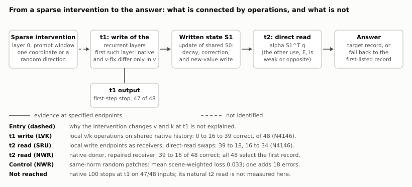
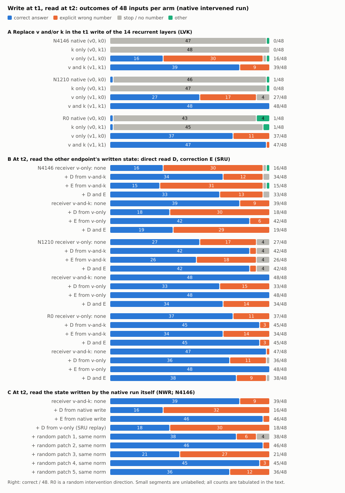

# Acupuncture 论文工作稿：稀疏激活干预后的写入、状态与回答

2026-11-05 · evidence-first manuscript v1.2.1。证据截点：远端 main `02c6beff778446d0a75caf760b2e92443c06bcd8`；v1.1 为同日第二轮更正（背景措辞、原生首步线入稿、原生连接缺口的准确表述，见 §12），v1.1未新增数据。**v1.2（同日第三轮，见§12–§13）纳入主比较A（NWR-01，已运行）的结果、已有输出的错答类型重读、六张图、面板身份声明、痛点段落与整篇判断。**本稿是用户要求的第一步：把现有实验写进可展开的论文骨架，补齐理论、证据联系、资产位置与尚缺的论证。**不是新实验提案，也不是已经具备优质论文录用保证的声明。** 不运行模型，不新增数据，不把待测预测填进结果。

阅读顺序：本稿（文章论证与正文）→ [理论—证据骨干](cache-mechanism-theory-evidence-spine-2026-11-03.zh-CN.md)（公式及连接）→ [结果归档](RESEARCH_ARCHIVE_2026-11-04.zh-CN.md)（数字与更正）→ [全目录资产表](RESEARCH_ASSET_CATALOG_2026-11-04.zh-CN.md)（124个目录的材料入口）。旧[核心主张审计](mechanism-second-half-v1-2026-11-03/CORE_CLAIMS.zh-CN.md)仍有效：H1是研究方向，没有因开始写作而变成已证实的通用规律。

## 1. 文章定位与摘要初稿

**工作标题：稀疏激活干预后的状态与回答：条件性写入—读取链及其适用边界。**

英文工作标题：*From Sparse Activation Interventions to Answers: A Conditional Write–Read Pathway and Its Boundaries*。

本文围绕一个具体问题展开：暂时改变少数激活坐标之后，模型如何通过历史形成、递推写入和后续读取改变回答？我们的现成贡献主体是一个有计算干预和完整回答证据的局部链条，以及对它适用范围的系统约束。文章不能以“发现背景依赖”或“KV储存事实”作为新颖性中心，也不承诺统一所有针、任务和模型。

**摘要初稿（全部为已有证据，不预填未来成功）：**

少数激活坐标的暂时干预可以显著改变后续生成，但识别一个能恢复回答的状态并不足以解释其计算路径。我们在Qwen3.5-4B上结合形成窗口干预、缓存交换和更新／读取用途替换，研究稀疏干预后的状态如何影响答案。在共享首token的编号任务上，原生受针运行48条中47条在首步停止；它与"只在t1写入项换v"的运行之间的全部差异产生于t1这一步，在首个递推层只是v（48/48逐位核验）。只换该步v即开口，但开口后的30条错答全部是列在第一位的编号；再把写入项的k去偏移，正确数升到39。写入—读取链解释的正是这一选择错误：两个写入端点的状态差经t2直接读取双向改变完整回答（三个方向16、27、37升到34、42、45，反向39、48、47降到18、33、36，各48条），搬运的几乎全是"正确"与"首列错号"（停止最多增加1条）。把原生运行自己在t1写出的状态送进已修复运行的同一读取，正确数从39降到16，48条输出全部是首列编号；同一状态经另一读取用途不致错；五个同范数随机补丁平均不致错，但其中一个造成18条同类错误，所以方向特异性只得到部分支持。原生背景检验同时限制了这条解释：恢复递推状态可以充分恢复某些回答，但受损递推状态单独移入干净背景并不致错；写入作用的增强依赖状态来源与接收背景，跨层和新结构上的分差变化未稳定转化为完整回答。窗口实验显示恢复关系随形成历史变化，部分停止预测未兑现。在递推已恢复的事实任务中，只替换记录句事实段KV，使三个干预条件分别有43、42、43个回答跟随供体事实（各44个接收者）；这提供了恢复与答案选择的桥接，没有证明与写入—读取链共用读取路径。**全部数字来自已见开发面板，原生写入的读取结果只有一个方向；本文的主张限定在这些面板上。** 尚未建立的是：入口形成解释、原生运行自己的t2读取、开发外确认。

这份摘要的中心是具体计算链与实测边界。若后续写作发现这一组合不足以区别直接近邻，应如实保留贡献缺口；不能换一个宽泛题目掩盖它。

## 2. 引言的论证顺序与可用正文

**第一段：问题。** 稀疏激活干预的影响可以跨越注入时刻，进入模型的历史状态，并改变后续答案。研究这种影响，不能只记录输出变化或寻找最强恢复位置：需要区分干预改变了怎样的写入、这些变化怎样留在历史中、后续计算怎样使用它们，以及哪些变化真正到达完整回答。我们的总问题保持为这条因果过程，不把首步停止或某一缓存类型替代为研究目标。
**第一段之后：谁在痛（推测档，查重见§9）。** 在含递推层的混合模型上做激活转向的人，目前把副作用当成幅度问题或KV污染问题处理。先例支持这不是孤例：2603.16335在Qwen3.5-35B上观察到prefill期转向有效、decode期为零，并归因递推状态承诺，但没有碰状态；HiSPA表明递推状态可被输入持久污染且无人会修；2609.04434表明persona类行为落在递推通道；2609.33093与2609.32102自己写明持久性与修复未做。必须面对的基线有两条：Mamba系状态误差会自然衰减（2605.07755，未测DeltaNet），以及只在注意力层转向可以绕开（HELIX）。会因此改做法的人：混合模型上的转向使用者、推理引擎的缓存分键设计、检测型防御想走到修复的作者。**本文的证据来自单坐标与随机方向的稀疏干预，到转向向量的迁移是类比档；引言只能写到"为这类损伤提供了一条到写入与读取操作的定位"，不能写成已解决转向副作用。**

**第二段：为什么现有解释不够。** 混合注意力模型同时使用短卷积、递推矩阵与全注意力KV。状态交换、写入编辑和读取分析已有直接先行研究，因此这些操作本身以及“状态会影响未来”不是新发现。对于稀疏干预造成的具体错误，恢复成功、反向污染成功、供体答案转移及原生路径解释仍是不同证据问题。本研究以这些问题间的连接和不一致为组织轴，而不按实验运行日期叙述。

**第三段：实证答案。** 我们先建立一段可被计算操作改变的写入—读取链，再检验其在原生背景、层位、任务结构及形成窗口变化下保留到什么程度。链条在原生受针运行上（仅t1写入项替换）确实改变完整回答；后续实验没有把它变成普遍机制，反而给出了来源、组合和协议相关的明确限制。KVC的事实定向结果为恢复操作增加内容选择证据，但还没有补上旧链到新条件的计算连接。

**第四段：本稿可写的贡献陈述。**

1. 在明确端点与背景中，把k相关历史操作推进到t1新值写入和t2直接读取，并用双向自然回答变化确认其行为作用。
2. 用原生／恢复背景、恢复／污染方向和已测状态组合，检验该解释的边界；保留预测失败、效应不对称和内部竞争与完整回答脱节。
3. 通过形成窗口比较及事实身份交换，把条件性恢复关系与答案选择连接；同时明确其尚未证明统一读取、独立内容载体或跨任务因果规律。

上述是文章的经验内容，不是三项均已通过新颖性评审的声明。第1项是计算主体，第2项使解释受约束，第3项是桥接证据；不能把第3项的饱和阳性替代第1项的推广。

## 3. 理论与方法：正文要先固定的对象

理论正文保留三式，其详细推导和适用假设见[骨干§3](cache-mechanism-theory-evidence-spine-2026-11-03.zh-CN.md#3-理论证据链逐环的等式假设与推论)：

- 注入处：Δh = η W_down e_j。坐标少不等于扰动小；随机方向是另一类干预条件。
- 状态更新：S_t = α_t(I − β_t k_t k_tᵀ)S_(t−1) + β_t k_t v_tᵀ。固定局部驱动的分解不能被当成整模型独立机制份额。
- 更新后读取：o_t = α_t S_(t−1)ᵀq_t − α_tβ_t(k_tᵀq_t)S_(t−1)ᵀk_t + β_t(k_tᵀq_t)v_t。KUC检验t1更新式中的k用途，SRU检验t2读出式中的S用途；两者不是同一操作。

这些属于架构定义和条件推导。公式不能演绎出我们的正确数、方向特异性或跨条件适用性。参考架构来源为[Gated Delta Networks](https://arxiv.org/html/2412.06464v3)，实际实现身份见[基础审计](cache-mechanism-known-basics-audit-2026-10-31.zh-CN.md#7-核查来源范围与边界)。

| 方法维度 | 论文必须写清的内容 |
|---|---|
| 模型与注入 | 主机制模型Qwen3.5-4B，revision `851bf6e806efd8d0a36b00ddf55e13ccb7b8cd0a`；down_proj输入单坐标或固定随机输出方向；符号、校准、幅度、位置数依合同，不混用同名dose |
| 三种历史 | 卷积q/k/V缓冲、GDN递推S、注意力KV；恢复S不等于恢复全部递推历史或KV，具体集合逐卡注明 |
| 时序 | τ为最后提示token之前的缓存切点；t1/t2为后续计算步。自由生成与共同强制前缀是不同路线 |
| 背景 | C干净、T原生受针、V恢复历史、L10/L11（T上仅t1写入项替换v/k，t2起自由）分别标注。QCO/QKF/KUC/NVW的操作在V恢复历史背景；LVK/SRU的接收者是T，不是恢复背景。恢复历史才构造新的计算背景，单步写入项替换不构造新历史 |
| 终点 | 实际首步停止、首步分差、固定前缀目标竞争M、完整回答Y、供体事实跟随分别报告 |
| 正确性 | 编号用冻结解析规则；事实用既有盲读与裁决，说明模型辅助来源、截断处理及敏感性；正确结论不等于全文自然停止 |
| 统计单位 | 48输入不等于48独立情景；KVC为22对／44接收者。按原合同保留分层与配对，不把层、头、针、重复旧题合并成独立样本。主结果的统计单位是6个场景；48条输入只是场景内的重复 |
| 数据身份 | 已见开发面板、预留操作条件、外部未见确认分开。WIN-02的新窗口操作不等于新任务面板；旧题上的冻结预测不能升级为独立确认。**面板身份声明：LVK、SRU、NWR的48条"新面板"在这三轮里依次被看过，全部是已见开发数据；本文所有主张限定在已见面板上，不写普遍性** |
| 工程与科学 | 零操作、逐位桥接、替换范围、FP64检查只验证操作；不能据此宣布机制、等效性或原生中介成立 |
| 资源口径 | 不把重复桥接、重放、CPU派生和新自然回答相加为独立样本；GPUh只按各收据原口径列附录，不在本稿估算总数 |

WIN“关系M”是额外KV恢复比较的名称，不是目标竞争logit指标M；正文使用全称避免混淆。

本稿不将所有报告的“通过”视为同一种判定。工程passed、冻结科学预测兑现、方向性阈值、等效性、完整答案正确是五个不同层次。

## 4. 结果正文：按论证组织，而非逐卡汇报

### 4.1 状态恢复与回答恢复不是同一个诊断

早期行为调查建立了稀疏干预的大幅输出效应与层、符号、剂量的差异，但这些观察尚不识别计算机制。阶段二及其后续缓存比较进一步表明，首步形式与完整回答必须分别测量。**原生首步线（FC/SP/FX/NFC，此前未入稿）。** 在编号面板上，原生受针运行48/48不交付：N4146、N1210、C1343首token即停止，R0多数先输出问题行片段再停止；只屏蔽一次停止大多仍不交付。唯一首字母面板上强制正确首字母47/48接出正确编号，但去掉首字母捷径的共享首token面板上只有4–5/12，且47/48输出的是记录里列在第一位的编号。只恢复深层卷积历史在两块面板上都恢复交付（48/48；3/4方向12/12，R0为10/12）。C对T的首步分差在NFC链上分成两块相当的部分（深层S/KV与入口的复合约55–63%，固定45头V卷积历史约33–43%），但固定45头的V单独7/48、其余头0/48、随机45头0/48，只有全部头的V才48/48。这组结果把原生失败形态固定为两件事：回答起点被压到停止或问题行开头；起点被给定后退回第一条记录。它们是4.2链条要解释的对象，不是另一条机制。

**t1结构句（NWR-01逐位核验，N4146，48/48）。** 在共享首token面板上，原生运行L00与只在t1写入项换v的L10，共享全部预填与各层S₀；在t1这一步，首个G层的递推核计算里只有v不同（q、k、α、β相同），更高G层的q/k/v/α/β差异全部由下层该步输出派生；L10的t1 logits与整体恢复V历史的运行逐位相同。因此原生首步停止与开口的差异全部经该步的v进入（首层直接，高层经派生），不经历史状态。L00三方向Y为0/48、0/48、0/48（新面板0、1、1），L10为16、28、37（新面板16、27、37）。这把首步停止与4.2使用的同一写入变量接上；NWR-01捕获了两次运行在t1各递推层的核输入：第13层q、k、门控、S₀在48/48条上逐位相同而v不同（v差的相对范数中位数1.04）；第14–30层的13个递推层q、k、门控在48/48条上都不同，S₀在48/48条上相同。它不说明针为什么改变了v，也不说明v之后的卷积旧槽在t2、t3的延续作用。

在编号面板的L0条件中，恢复V历史后正确数为16/48，而恢复深层S为48/48；前者大多已能以编号开头，后者常重新以think或引导语开头再完成正确回答。恢复效果不能从开头是否“正常”推断。

反向移植增加了关键限制：同题受损S、V或KV分别放入干净接收者，两针均仍为48/48正确；全部受损深层在L0只剩2/48。补测两两组合后，L0的S+V、S+KV、V+KV分别为45、32、48/48；L12两两组合均为48/48，但V+S+KV为30/48。所测分组内的最小致错组合随条件变化，不能据此宣布S是唯一损伤载体或已经发现冗余结构。L12全部深层恢复／污染的端点等同性来自注入时序，作为工程桥接，不作为机制发现。

证据：[NCC](../experiments/cache-native-carrier-comparison-v1-2026-11-03/REPORT.zh-CN.md)、[NSR](../experiments/cache-native-s-reverse-v1-2026-11-03/REPORT.zh-CN.md)、[NQK](../experiments/cache-native-qk-history-v1-2026-11-03/REPORT.zh-CN.md)、[NPC](../experiments/cache-native-pair-combination-v1-2026-11-03/REPORT.zh-CN.md)。本节提出解释必须满足的约束；它不直接证明下一节的局部链就是这些原生效应的唯一原因。

### 4.2 局部v条件下的k写入作用可以通过后续直接读取影响答案

在恢复V历史的指定背景中，去掉共同q/k偏移显著改善编号回答；分开操作后，k分量承担较大的修复作用。KUC进一步将k在状态更新中的两种用途分开：新值写入项的操作能改变完整回答，旧预测修正项单独作用较弱。NVW显示这一写入作用在未恢复背景中不足以普遍救回完整答案，因而需要把v条件纳入解释。

LVK在当步局部计算中检验该条件（接收者是原生T；四格只在t1的写入项换v、k，t2起全部自由）：三个方向的局部v端点正确数为16、27、37/48，加入写入k操作后成为39、48、47/48。SRU直接沿用这两组端点，在t2替换状态的读取用途；只换直接读取，获得侧正确数成为34、42、45/48，撤回侧从39、48、47下降到18、33、36/48。旧预测修正用途单独替换较弱，且部分方向反向。这使论证从“状态交换有效”前进到“同一写入端点的状态差可以通过特定读取用途改变完整回答”。

该连接最强的部分是LVK→SRU的同端点桥接。两个端点共享原生预填与各层S₀，只在t1这一步不同，所以SRU替换的状态差全部产生于t1：首个G层恰为写入项之差，更高层含该步经下层输出派生的q/k/α/β变化；不可能来自历史。（v1.1初稿曾写"各层恰等于写入项差"，过强，同日由Proposal v8反方检查第5条指出后改正。）它仍是计算反事实：人工部分是t1写入项的v（取自V恢复历史条件下的当步值）与k（去共同偏移），以及t2的一次读取替换；没有删除整条自然中介路径，也没有证明全部原生干预效应沿此传播。C1343、随机编辑对照和未恢复的行为残余都限制其范围。
**错答是什么（已有LVK/SRU输出的零GPU重读，表3）。** 按NWR-01冻结的分类规则，原生运行在三个缺口方向上是43到47条停止；只修t1的v之后，错答30、17、11条全部是首列编号，没有别的错法；SRU的直接读取替换几乎只在"正确"与"首列错号"之间搬运，停止最多变化1条（N4146撤回侧正确39→18、错号9→30；获得侧正确16→34、错号30→12）。所以"开口后退回第一条记录"不是印象，是逐条分类。

**原生写入的状态经同一读取（NWR-01，N4146，已运行，[报告](../experiments/cache-native-write-readout-v1-2026-11-05/REPORT.zh-CN.md)）。** 把L00在t1写出的S₁作为只读供体，送进接收者L11的t2直接读取：正确数39→16，损失的23条全部变成首列错号，没有停止；48条输出全部是首列编号。同一状态经修正用途读入，正确数39→46。SRU撤回格重放为18，与SRU逐位一致。五个输出空间同范数的随机补丁正确数为38、46、21、45、36。按冻结判读七条不等式全部成立，标签为强支持（b=0.806，l_D=0.472，l_E=−0.157，l_R=0.033，e_D=0.472，e_R=0.013）。三条必须同时写出的限制：随机种子3损失18条且错法相同，方向特异性只得到部分支持；l_D−0.5b的场景重抽区间为−0.014到0.148，贴线；接收者是L11，测到的不是原生运行自己的t2读取。供体换成原生写入与换成只修v的写入几乎一样（16对18），即t2直接读取处承载的是选择错误，原生写入多出的v分量在此处没有可见作用。

证据：[QCO](../experiments/cache-common-offset-v1-2026-11-02/REPORT.zh-CN.md)、[QKF](../experiments/cache-qk-component-factor-v1-2026-11-02/REPORT.zh-CN.md)、[KUC](../experiments/cache-k-update-causal-v1-2026-11-03/REPORT.zh-CN.md)、[NVW](../experiments/cache-native-v-write-interaction-v1-2026-11-03/REPORT.zh-CN.md)、[LVK](../experiments/cache-local-v-k-v1-2026-11-03/REPORT.zh-CN.md)、[SRU](../experiments/cache-state-read-use-v1-2026-11-03/REPORT.zh-CN.md)。QKD/QSR及KRD/KHC作为计算诊断与载体背景证据进入附录，不能把其不同端点的效应比例相乘。

### 4.3 写入链的背景与幅度边界

NVB将输出用途和留存状态用途分开，发现保留原生输出时，留存v操作只带回联合恢复目标竞争增强的约0.11–0.34；主预测未兑现。恢复输出后，同一留存操作明显增强。NBR的更正后投影诊断支持状态来源变化具有作用，但梯度线性化点敏感，不能把投影大小解释为回答贡献。

SIT随后直接跨背景移植留存增量。固定k操作，在恢复接收背景换回原生来源增量，正确数分别减少18、12、5条。NMT保留原生方向、按逐层逐头幅度配置匹配，能复现较多k条件效应来源差；统一缩放仅为0.15–0.38，五次随机内容对照的相应比例为负，且单格M仍失配。因此不能简化为“只要增量够大就行”。这几轮是同一面板上的递进约束，不是四次独立重复，也未普遍修复原生停止。

CGV给出进一步边界：L12局部v恢复即可使31/48成为48/48，指定k修正不再带来正向增益；读取端点没有足够缺口，不能称读取失效。三种新结构仍是编号任务，目标竞争改善只带来很少完整回答变化。正文必须展示这项不利结果，以限定4.2的外推。

证据：[NVB](../experiments/cache-native-bridge-v1-2026-11-03/REPORT.zh-CN.md)、[NBR](../experiments/cache-native-bridge-record-v1-2026-11-03/REPORT.zh-CN.md)、[SIT](../experiments/cache-state-increment-transfer-v1-2026-11-03/REPORT.zh-CN.md)、[NMT](../experiments/cache-increment-norm-match-v2-2026-11-03/REPORT.zh-CN.md)、[CGV](../experiments/cache-chain-generalization-v1-2026-11-03/REPORT.zh-CN.md)。CGV报告中“V承担损伤、k无关”的过强表述按[归档更正](RESEARCH_ARCHIVE_2026-11-04.zh-CN.md#6-更正和证据等级)收窄为操作结果。

### 4.4 形成窗口改变恢复响应，但没有形成统一的状态分工

R1把事实任务与编号任务并排后，暴露了恢复范围、形成窗口、校准、生成上限等差异。WIN-01在各任务内部改变形成窗口：L0事实全前缀受针后只恢复全部递推为10/48，记录句后受针则为47/48；全前缀下恢复递推并补模板＋记录句位置KV为47/48。这支持形成历史改变恢复关系，但窗口同时改变位置和次数，不能唯一解释为“记录内容损伤”。

WIN-02把关系带到新增针条件。额外KV恢复关系M在四个正向可检验格得到支持，救回分别为事实L2的11/11、L3的13/13、R0的27/28，以及编号R0的38/38；其余四格为天花板。事实L2/R0各有一个原本答对的输入被改坏，未触发合同“改坏反例”阈值不等于零损害。原生事实针上的“前段受针时KV恢复更优”未获支持。R0全前缀几乎不首步停止，却与N4146一样全部答错，因而联合停止预测只部分兑现。相似恢复响应与相同错误形态、相同计算机制必须分开。

旧数据离线审计进一步表明：事实W_post的S_deep为16/48，R_all为47/48；编号两臂均48/48。然而事实S_deep有32条达到128-token上限且未交付，编号四个相关臂全部在17 token内结束，实际名义幅度和施针次数也不同。这是有限预算下的恢复分叉，不能写成任务决定的内容载体分离。WPC-01仍是未运行设计，不在结果中出现新协议下的任何数字。

证据：[R1](../experiments/cache-mechanism-alignment-r1-v1-2026-11-04/REPORT.zh-CN.md)、[WIN-01及统一裁决](../experiments/window-recovery-win01-v1-2026-11-04/REPORT.zh-CN.md)、[WIN-02及P5更正](../experiments/window-prediction-win02-v1-2026-11-04/REPORT.zh-CN.md)、[384旧输出审计](../experiments/window-protocol-audit-v1-2026-11-05/audit.json)。本节称为恢复关系的横向检验，不称旧SRU链跨任务成立。

### 4.5 额外KV恢复具有事实方向性，尚未接通共同读取

KVC-01固定全前缀受针后、递推来自接收者干净版本的背景，只改变补入KV的事实身份。两版本模板相同，工程核对显示两臂实际只在记录句事实词起至记录句末的KV不同。L3、N4146、R0分别有43、42、43/44回答跟随供体事实，而同版本对照有42–44/44回答接收者事实；干净背景只换同段也有41/44跟随供体。

这一操作说明额外KV恢复有答案方向上的选择性，不只是非定向地提高答对率。但它可以同时恢复一般作答条件；没有证明递推不含事实，或该KV段是唯一载体。三针响应近饱和，不能据此推断同一内部计算；恢复背景与干净背景的等效性也未得到判定。KVC接通的是WIN的恢复操作与供体事实选择，未检验原来的v/k—写入—直接读取链。

证据：[KVC-01合同、结果及限制](../experiments/kvpre-content-kvc01-v1-2026-11-05/REPORT.zh-CN.md)。此节是桥接与边界，不把继续定位KV层／头写成完成论文的必经路线。

## 5. 全部证据怎样连接

| 接口 | 已建立的联系 | 尚不能写的箭头 | 论文安排 |
|---|---|---|---|
| 稀疏入口→历史形成 | 同时序／窗口的操作与缓存、回答改变；q/k共同偏移可操作 | 入口到共同偏移的完整形成计算已识别 | 方法与4.1；形成分析附录 |
| QCO/QKF→KUC/LVK | 对k从历史缓冲操作推进到写入用途；背景有桥接和变更 | 所有操作等价于同一自然中介 | 4.2；骨干逐接口表 |
| LVK→SRU | 同面板、同L10/L11端点；接收者为原生T，端点仅t1一步不同，状态差全部产生于t1（首层即写入差，高层含派生）；写入后的状态差被直接用于读取替换 | 原生全效应均由D介导；方向特异性已确立 | 4.2核心图 |
| LVK/SRU→NWR | 同面板、同接收者L11、同读取钩子；供体换成原生写入的S₁(L00)；D10格与SRU逐位桥接；39→16且全部为首列错号，E用途不致错 | 这是L00自己的t2读取；方向特异（五个随机方向里一个同样致错）；可推到其他方向 | 4.2，图2C |
| LVK→NVB→SIT→NMT | 输出／留存分离、来源移植、幅度配置逐项限制解释 | 幅度单独决定全部回答；多轮同题等于独立验证 | 4.3及附录 |
| 旧链→NCC/NSR/NQK/NPC | 原生C/T及参照有桥接，检验恢复／污染与组合 | 原生恢复已经复现SRU读取计算 | 4.1；作为约束与竞争解释 |
| 阶段二/NCC→R1→WIN | 同源基线和协议审计；WIN任务内窗口比较新增证据 | R1跨协议差异就是任务因果效应 | 4.4 |
| WIN-01→WIN-02 | 新操作条件检验保持、分叉、无信息 | 8个独立实验或全链共型 | 4.4，失败预测同图 |
| WIN→KVC | M_same桥接旧额外KV恢复；改供体身份增加内容选择证据 | KVC是原写入链推广或与B共用读取 | 4.5 |
| WIN→WPC旧数据审计 | 标签、停止、长度、幅度、次数的已有记录核对 | 新共同协议测量已完成 | 4.4限制；未运行设计留研究记录 |
| 观察广度→机制广度 | 可提出边界和反例 | 把XCHAN针数、阶段二层数直接算给SRU | 方法覆盖表与讨论 |

**旧机制在论文里的角色：** 它是最具体的计算因果主体，也是比较新条件的参照；原生恢复与WIN/KVC检验它尚未覆盖的关系。它既没有被扔掉，也不能凭后续缓存阳性自动升级为统一机制。

## 6. 覆盖账本：到底是几根针、几层、几种任务

| 证据层次 | 实际覆盖 | 不得借用的覆盖 |
|---|---|---|
| 行为与阶段二缓存观察 | 有多规模行为资产；4B阶段二L0–L31每层一个固定通道、正负条件 | 每层一个点不代表层平均；多模型行为不算跨模型机制 |
| 原生首步线 | FC/FX在唯一首字母P面板12×4方向；SP在共享首token面板12×4；NFC为48条N参照上的链式分账 | FC的强制首字母47/48不迁移到共享首token面板；12条面板不等于SRU的48条面板 |
| XCHAN粗关系 | L0的10原生通道＋4随机方向 | 不是14方向都做过SRU |
| 细写入／读取行为 | 主要L0/N4146、N1210、R0；C1343诊断 | 三方向中的R0不是原生单神经元；14个G操作层不等于14根针 |
| CGV边界 | L12/C3621及三种新结构27条；结构仍输出编号 | 不算独立非编号任务或第二模型 |
| NCC–NPC | L0/N4146、L12/C3621；48条已见编号输入 | 不提供全层原生机制 |
| NWR | L0/N4146一个方向；LVK新面板48条、6场景，已见；接收者L11 | 不覆盖N1210、R0；不是开发外确认 |
| WIN合计 | L0/N4146、L1/N2765、L2/C5251、L3/C7666、L5/C2467、L0随机R0；事实／编号两面板 | 6干预条件、5个施针层位，不等于6针共享同一机制；两任务协议未全对齐 |
| KVC | L0/N4146、L0/R0、L3/C7666；2施针层位，22对／44事实接收者 | 不是新增3个独立方向，也不覆盖编号任务 |
| WPC | 已有384输出离线审计；共同协议设计未运行 | 不能计为新模型实验、横向确认或新增成功样本 |

这张表回答“宽到哪里”；骨干的连接表回答“深到哪里”。二者不能靠累加目录数互相替代。

## 7. 图表与资产落位

六张图已生成（SVG，[数据来源与脚本](figures/mechanism-paper-2026-11-05/SOURCES.md)），每张转成PNG检查过版面；图内文字为英文。图4的数值抄自各报告正文，其余从分析JSON读取。下表保留为内容合同。

图文件：[图1 总图](figures/mechanism-paper-2026-11-05/fig1-chain-overview.svg) · [图2 写入与读取](figures/mechanism-paper-2026-11-05/fig2-write-read.svg) · [图3 原生恢复与污染](figures/mechanism-paper-2026-11-05/fig3-native-recovery-pollution.svg) · [图4 边界](figures/mechanism-paper-2026-11-05/fig4-boundaries.svg) · [图5 窗口与额外KV](figures/mechanism-paper-2026-11-05/fig5-window-kv.svg) · [图6 供体事实转移](figures/mechanism-paper-2026-11-05/fig6-kv-donor-transfer.svg)。

| 图表 | 要让读者看见的结论 | 已有数据入口／显示要求 |
|---|---|---|
| [图1](figures/mechanism-paper-2026-11-05/fig1-chain-overview.svg) 理论与证据总图 | 已接通的局部链与未闭合的原生／KV接口 | 骨干§1、§3、§5；公式箭头、操作证据、未识别连接不同线型 |
| 图2 同端点写入—读取 | LVK四格与SRU获得／撤回对M、Y的作用 | LVK/SRU报告及各analysis；分方向画，C1343单列；不把效应比例写成解释率 |
| 图3 原生失败形态、恢复与污染组合 | 原生失败两形态（停止／问题行；退回第一条记录）与t1结构句；恢复充分、反向单组无害、组合致错并存 | FC/SP/FX/LVK的L00与L10；NCC/NSR/NQK/NPC；按同输入连线，L12结构桥接标注；不单凭热图命名载体 |
| 图4 链条适用边界 | 背景／增量／幅度与跨层、新结构反例 | NVB/SIT/NMT/CGV；M与Y分轴，NBR投影放附录；不在同轴池化不同分母 |
| 图5 窗口与额外KV | WIN的保持、分叉、天花板和P5失败同时可见 | WIN-01/02 analysis及统一判读；救回与改坏分列，显示每格分母 |
| 图6 供体事实转移 | KVC恢复背景与干净背景的R/D/O分布 | KVC analysis；22对保留配对身份；“未检出差异”不画等号 |
| 表1 实验对象与覆盖 | 六类证据的模型／针／层／任务／背景／独立性 | §3、§6；链接各合同与receipt |
| 表2 主张—证据—反例 | 什么已支持，什么被限制，什么还缺 | §8；让边界与主结论一起出现 |
| 表3 错答类型 | 原生停止、开口后首列错号、读取替换几乎只在正确与首列错号间搬运 | 本节末；来源`enum-offline-r01.json`与`nwr-readouts-r01.json` |
| 附表A 全资产与来源 | 所有已完成、失败、设计、审计和工程目录可追溯 | 全目录资产表；原冻结文件与更正并存 |
| 附表B 评估与可比性 | 标签版本、终止／截断、校准、窗口、面板复用 | WIN偏离、R1 PROTOCOL_DIFFS、WPC旧审计；不事后改成统一标签结果 |
| 附表C 失败路线 | 固定45头、首字母捷径、QSR无候选、DIV-01够数失败 | 旧资产盘点与各报告；失败不计为机制被证明无效 |

**资产分工。** 单针／双针／能力／剂量与阶段二提供现象和选择来源；形成期、V、q/k、目标竞争、写入与读取系列提供机制证据；NVB–NMT、CGV、NCC–NPC、R1/WIN/KVC提供限制和接口；两个旧数据审计提供可复用性与协议证据。公开配方、跨模型预检、WSP/WCP及VLM数据准备仍在项目总目录中，属于旁线或工程资产，不能补作这篇机制论文的跨模型或方法收益实验。历史设计目录只提供研究溯源，不占结果席位。

## 8. 已有论证、最强反例与优质论文缺口

| 可写结论 | 最强支持 | 最强反例／替代解释 | 还缺什么，影响哪种论文承诺 |
|---|---|---|---|
| 原生运行上，t1写入的状态经t2直接读取决定"按查询选记录"还是"退回第一条" | LVK→SRU同端点双向操作；NWR：原生写入的状态经同一读取39→16、48/48首列；E用途不致错；错答类型逐条分类 | 一个随机同范数补丁同样致错18条；接收者是已修复运行；NWR只有一个方向；联合读取只搬运73–86%；C1343无选择错误可搬 | 开发外确认（v8的B阶段，随机控制族须扩大）；入口形成；原生运行自己的t2读取在自然路线不可达 |
| 局部链有背景及跨条件边界 | NVW/NVB/SIT/NMT、CGV | 饱和、输出阈值、校准和尺度可改变表观关系 | 尚无开发外可检验的条件规则，影响能否超越案例集合 |
| 窗口改变恢复关系，M在部分新增条件保持 | WIN-01/02 | P4未获支持、P5部分失败、编号原生针天花板、次数与协议混淆 | 同协议稳健性未确证，影响跨任务／形成机制归因 |
| 事实段KV在指定恢复背景定向影响答案 | KVC三条件及B_pre | 先行工作强预期；饱和；未测共同读取 | 原链与KVC的共同计算未证，不能靠再定位读头自动提高贡献 |
| 恢复／污染响应不对称且组合有关 | NCC–NPC | patching一般原理已知；组合种类和背景有限 | 具体稀疏干预为什么产生该组合响应尚未解释；普遍不对称本身不是新颖性 |
| 项目有较宽观察资产 | 全层／多方向调查 | 目的性选点、面板复用、任务与模型不对齐 | 独立确认缺失；不能把现象数量当机制可靠度 |

**现在离“优质论文”差的不是一个可诚实计算的百分比。** 已有材料足以写出一篇结果完整、反例明确的机制研究工作稿。仍然可能决定论文是否成立的，是三件分开的事：痛点，即现有理解在哪个有实际后果的判断上会出错（当前推测档，见§9末）；新增解释，即局部解释与原生回答的联系以及相对直接近邻具体多知道什么（v1.1后收窄为一次未做的读取检验与入口形成）；独立兑现，即未参与形成解释的材料能否支持其范围。更多模型、任务只有在承诺相应广度时才是必要证据；更多层头定位并非自动的质量门槛。写作可以揭露这些缺口，不能填造它们。

用用户此前关心的HanLab式问题导向审视，本稿采用四个工作问题：解释了什么有实际意义的现象；比直接近邻多知道什么；能否在明确新条件下被反驳；计算读数是否对应真实完整回答。这是本项目的评估框架，**不是对任何实验室审稿偏好的事实断言**。目前“计算与回答相接”最强，“增量与可迁移边界”最弱。

## 9. 相关工作与新颖性边界

本轮重新打开核对了下面四篇原文的相关部分；完整历史文献范围见[核心主张审计§4](mechanism-second-half-v1-2026-11-03/CORE_CLAIMS.zh-CN.md#4-原始文献核查及其对主张的约束)。作者结果不当作我们的复现，没有做新一轮穷尽检索。

| 原始来源 | 对本稿的约束 |
|---|---|
| [Gated Delta Networks，2412.06464v3](https://arxiv.org/html/2412.06464v3)，§3 | 更新规则与混合结构是理论工具，不能称为我们新发现 |
| [What Attention Recalls and Recurrence Controls，2609.04434v1](https://arxiv.org/html/2609.04434v1)，§3–4 | 已在Qwen3.5等混合模型做缓存拆分与交叉来源交换，供体取值跟随KV是强先验；KVC的定性阳性不能单独撑主贡献 |
| [How Linear Attention Remembers，2609.33093v1](https://arxiv.org/html/2609.33093v1)，§2–4 | 已研究写入、状态与读取的因果联系及混合架构检索载体；我们不能以“有一条写入—读取链”这句话独占新颖性 |
| [How to use and interpret activation patching，2404.15255v1](https://arxiv.org/html/2404.15255v1)，§2–3 | 恢复与污染的不对称及解释限制已知；本稿需要具体训练模型与干预条件下的经验约束，而非重新发现方法论警告 |

**痛点候选的查重（2026-11-05，[七步记录与三列表](literature/painpoint-recurrent-state-steering-audit-2026-11-05.zh-CN.md)）：** 候选"转向／稀疏干预把损伤写进混合模型递推状态 S，KV 级修复不适用"。先例支持：2603.16335 在 Qwen3.5-35B-A3B 上观察 prefill 期转向有效、decode 期为零并归因递推状态承诺（时序对比，未干预或测量状态；代码公开可复用）；2609.04434 persona 经递推通道；HiSPA 2601.01972 状态可被持久污染且无人修；2609.33093 与 2609.32102 自己点名"持久性／修复未做"。必打基线：2605.07755 证 Mamba 系状态误差自然衰减（未测 DeltaNet，本项目 CFM-S1 有对表数据未对表）；HELIX 2602.17691 只改注意力层绕开。谁改做法：混合模型上做转向的人、推理引擎的缓存分键（vLLM PR #56524、atlas PR#1132 明问）、检测型防御的修复目标。痛点升到可写还缺本项目自己的转向型持久性与 KV 修复失效演示，均不在现有资产内；仍为推测档。禁的只有"首次发现递推状态可被污染"一句。

稿件讨论可写：这些工作为我们的操作与解释提供基础。本研究的经验对象是稀疏激活干预所形成的状态变化，以及它们在指定写入／读取操作下对完整答案的影响。现有结果建立了局部计算联系并展示其边界，但仍不足以宣称一般性的状态功能分工、全新记忆原理或优于先行工作的通用预测能力。

## 10. 讨论与结论初稿

我们的结果揭示了一个具体的计算作用：稀疏干预之后，原生运行在t1写进递推状态的内容，经t2的直接读取，决定模型是按查询选出记录还是退回第一条记录。在这组操作里，换该步的v使首步开口，再换k提高按查询选对的比例；这是对这组操作的概括，不是两个变量各司其职的独立分工（只修k在原生v下几乎无效，二者有强交互）。读取端在所测操作里由直接读取这一用途承载这一选择，修正用途不承载。写入一端的操作直接作用于原生运行；读取一端的证据是"原生来源＋局部修复接收者"：原生运行写出的状态被已修复的接收者读入时重现同一种错误，不是原生运行自己的读取。原生恢复、反向污染和跨条件实验同时表明，不能把它外推为稀疏干预的唯一自然机制：原生运行的主要失败是首步停止，它与这条链只通过"同一步的v"相连；形成窗口会改变恢复关系，缓存的来源身份可以定向改变答案，这些结果与这条链之间尚有未被同一计算检验连接的接口。

因此，本文保留三层区分：架构规定可发生的计算，受控替换识别特定条件下的因果作用，跨条件证据限制其解释范围。讨论按§8的表逐行展开：每一行先写可说的结论，再写最强反例，最后写缺什么。三个最需要读者记住的反例是：一个随机同范数补丁重现了78%的主效应；恢复与污染不互为镜像；另一层的针（L12）只需局部v、k修正无增益。当前证据没有给出入口形成解释、统一原生机制或开发外确认；本文不以继续拆解局部部件来替代这些缺口。

## 11. 本次交付审计与版本边界

- 已把旧骨干截止SRU之后的NVB/NBR/SIT/NMT、CGV、NCC/NSR/NQK/NPC，以及R1、WIN-01、WIN-02、KVC-01和WPC旧数据审计接入论证。
- 资产表对照当前实验根目录：旧116目录＋新增8目录＝124目录；目录身份包含设计、工程、离线审计，绝不等于124次独立实验。旧文件数／哈希清单保持其历史快照身份。
- 本轮读报告及更正；WIN三卡另读合同、决策和formal-r01三份verification、六份worker receipt（passed/completed）。WPC数值复用已交付离线审计，未再次盲读标签、运行模型或核验服务器张量。
- 作者自查：没有把公式当发现，没有把M／停止／Y混为一谈，没有把修复当唯一原生路径，没有把目录／针数相加为独立证据，没有把未运行WPC填进结果。对CGV、NBR、NCC、WIN与KVC均采用更正后的最窄有效表述。
- 这是作者资料与论证自查，不是独立同行评审。图表定义已写，正式绘图、全文英文定稿和投稿格式排版尚未制作；这一轮交付的是第一步完整证据骨架与正文工作稿。
- 当前任务以本稿为写作入口。WPC、KV读取细拆和其他历史方案保留未运行身份，不自动恢复执行；本轮没有新实验设计或模型/GPU调用。

## 12. v1.1 更正记录（2026-11-05 第二轮）

- **背景措辞错误（影响§1、§2、§3、§4.2、§5、§8、§10）。** v1把LVK→SRU主链写成"恢复背景""人工混合背景"。按[LVK合同](../experiments/cache-local-v-k-v1-2026-11-03/CONTRACT.zh-CN.md)§3与[SRU合同](../experiments/cache-state-read-use-v1-2026-11-03/CONTRACT.zh-CN.md)§3：四格全部在原生受针背景T上，L00即原生运行，只在t1写入项换v/k，t2起自由；SRU接收者为L10/L11。所以主链站在原生运行上，人工部分只有t1写入项与t2一次读取替换。v1据此判断的"局部解释与原始现象之间缺决定性连接"相应收窄为"原生写入项写出的状态未在读取端测试"。
- **原生首步线补入§4.1与§6。** FC/SP/FX/NFC此前在v1与骨干中出现次数为零。它们固定了原生失败的两种形态，并提供t1结构句所需的参照。
- **t1结构句新增。** 依据LVK报告§0第1条与§1全层桥接；推导档，不是新测量。
- **同日第二处更正。** v1.1初稿把"端点间S₁差按构造恰等于写入项差"写成各层成立；只在首个G层成立，更高G层的t1量随下层输出改变。已改为"全部产生于t1一步"。指出者为[Proposal v8自查](mechanism-second-half-v1-2026-11-03/CORE_CONTRIBUTION_SELF_CHECK.zh-CN.md)§4第5条。v8同时把NWR-01草案收敛为其主比较A，实施前按v8修订合同，不双跑两版。
- **未改动的内容。** 所有数字沿用各报告；没有新增运行；§8"还缺什么"按v1.1重写，不改各卡原始口径。本更正由同一助手完成，不是独立审查。

## 13. v1.2 更正记录与本轮整篇判断（2026-11-05 第三轮）

**本轮做了什么。** 主比较A按[合同r02](../experiments/cache-native-write-readout-v1-2026-11-05/CONTRACT-r02.zh-CN.md)运行（预检与正式一次通过，约0.13 GPUh）；已有LVK/SRU输出按同一冻结规则重读错答类型；t1结构句逐位核验；面板身份写死；痛点段落写进引言；六张图生成并检查；§8改成讨论骨架。同一助手完成，不是独立审查。

**表3 错答类型（各48条；正确／首列错号／停止无编号／其他）。**

| 运行 | N4146 | N1210 | R0 |
|---|---|---|---|
| 原生 L00 | 0／0／47／1 | 1／0／46／1 | 1／0／43／4 |
| 只修k（L01） | 0／0／48／0 | 0／0／47／1 | 1／0／45／2 |
| 只修v（L10） | 16／30／1／1 | 27／17／4／0 | 37／11／0／0 |
| 修v和k（L11） | 39／9／0／0 | 48／0／0／0 | 47／1／0／0 |
| L10读L11的状态，直接读取 | 34／12／2／0 | 42／2／4／0 | 45／3／0／0 |
| L11读L10的状态，直接读取 | 18／30／0／0 | 33／15／0／0 | 36／11／1／0 |
| L11读原生写入的状态，直接读取 | 16／32／0／0 | 未测 | 未测 |
| L11读原生写入的状态，修正用途 | 46／2／0／0 | 未测 | 未测 |
| L11加同范数随机补丁（五个种子的正确数） | 38、46、21、45、36 | 未测 | 未测 |

**整篇判断（坏消息先说）。**

1. **独立兑现仍是零。** 全部数字来自已见开发面板；新结果只有一个方向。v8的B阶段未运行。
2. **新结果的方向特异性不紧。** 五个随机同范数补丁里有一个重现78%的主效应且错法相同。"首列编号是读取被扰乱后的默认落点"与"原生写入的状态携带指向首列的内容"在本轮分不开。
3. **痛点仍是推测档。** 从单坐标稀疏干预到转向向量是类比；转向型持久性与KV级修复失效没有自己的证据。
4. **原生运行最主要的失败（首步停止）只通过t1结构句与主链相连。** 针为什么改变t1的v和k没有解释。

**站住的部分。** 一条写入端作用于原生运行、读取端为"原生来源＋局部修复接收者"的写入—读取关系：在这组操作里换t1的v使首步开口、再换k提高选对比例（有强交互，不是独立分工）；状态经t2直接读取而不是修正用途起作用；原生运行写出的状态被已修复接收者读入后重现同一种错误；错答类型有逐条分类；失败边界有六组反例。按"谁会因此改做法"衡量：做混合模型机制分析的人得到两条可直接使用的诊断，即首步开口不等于答对、应分别检验直接读取与修正两种用途；做转向的人目前只得到类比。

**按本轮开始时约定的终点规则归类：结论可信、认识具体、范围有限。** 它不是已知知识的实例化（近邻没有做过受干预状态的写入与读取定位），所以不是停止加细节另行立项的情形；它也没有开发外证据，所以不能写普遍性。

**下一步只有两项候选，均未授权，由用户定。** (a) v8的B阶段：冻结操作，在24个新基础情境上做开发外确认；须把随机控制族从5个方向扩大（建议不少于20个），否则第2条的问题会原样带进确认。(b) 痛点证据：用2603.16335公开的转向方向做一组转向型对照，测递推状态中的持久性，并演示KV级修复是否失效。建议先(a)后(b)：(a)决定现有中心句能否离开开发面板，(b)决定引言能把痛点写到哪一档。本轮不追加任何局部机制实验。

## 14. v1.2.1 更正与事后剖析（2026-11-05 第四轮）

**三处收紧（外部核查指出，接受）。** "两端都落在原生运行上"改为"写入端作用于原生运行、读取端为原生来源＋局部修复接收者"；"v决定开口、k决定选谁"改为本组操作的概括，注明强交互；"读取替换不制造停止"改为"几乎不制造，最多1条"（表3：N4146获得侧停止1→2，R0撤回侧0→1）。

**事后剖析（零GPU，读NWR-01已存的逐层逐头补丁统计；描述性，未预注册；[脚本与输出](../experiments/cache-native-write-readout-v1-2026-11-05/analysis/posthoc/)）。**

- 原生补丁含有一个跨输入共享的成分：它与每个固定随机方向的夹角在48条输入上高度一致（约九成的层—头，均值绝对值超过3倍标准误）；由这些夹角粗估，共享成分约占补丁能量的一半多（全部48条约0.57，同场景内约0.62）。能量的75%在第21、25、28层。**更正：初稿写成"几乎是固定向量、不是逐输入内容"，过强；"固定偏移"是假说。**
- 原生补丁的L2范数是SRU撤回补丁的1.88倍（逐输入1.79到2.02），两者效果却几乎相同（目标竞争平移−2.94对−2.16；正确数16对18）。**更正：初稿由此推出"多出来的v分量几乎不起作用"，推不出**（非线性、饱和、分量交互；且两端点在更高层的q、k、门控都不同，这份状态差不是纯粹的v写入分量）。可说的只有：按原生补丁范数匹配的随机对照，幅度约为SRU撤回补丁的1.9倍。
- 每个随机方向对目标竞争是跨输入近似恒定的平移：−0.30、−0.08、−2.43、+0.50、−0.92。种子3与原生补丁的能量加权余弦只有+0.022，投影解释不了它。原生补丁的−2.94约为这五个值的2.5个标准差。
- 这三条不改变冻结判读。它们提出了三个要在新数据上检验的假说，不是结论。开发外确认的设计见[NWC-01](../experiments/cache-native-write-confirm-v1-2026-11-05/DESIGN.zh-CN.md)（未运行）。
