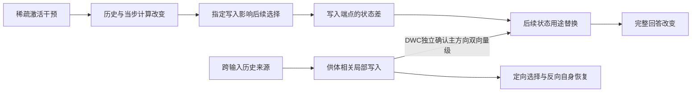

# Acupuncture 论文工作稿：稀疏激活干预后的写入、状态与回答

2026-11-07 · evidence-first manuscript v1.6。纳入DWC-01独立材料正式确认：96新情境、81648轨迹，主方向完成来源—写入—直接读取的双向量级确认，第二方向获得低于预设关注量级。原开发实验与反例保留，不混合新旧面板统计。DWC原控制器自动验收失败及CPU恢复复核分别披露；旧稿保存在Git。历史附节见[修订记录](mechanism-paper-revision-history-through-v1.3-2026-11-07.zh-CN.md)。

配套材料：[理论—证据骨干](cache-mechanism-theory-evidence-spine-2026-11-03.zh-CN.md) · [结果归档](RESEARCH_ARCHIVE_2026-11-04.zh-CN.md) · [历史资产目录](RESEARCH_ASSET_CATALOG_2026-11-04.zh-CN.md) · [本版修订核对与证据缺口](mechanism-paper-evidence-gaps-2026-11-06.zh-CN.md)。资产目录的 124 个目录是其归档时快照，不是独立实验数或本版新增结果。

## 1. 标题与摘要

**工作标题：稀疏干预如何改变答案选择：混合语言模型中的历史信号、写入与读取。**

英文工作标题：*How Sparse Interventions Change Answer Selection: History, Writing, and Reading in Hybrid Language Models*。

本文解释少数激活坐标的干预如何造成后续回答的大幅变化。我们将历史信号的可用性、当步写入及后续状态读取连接到完整回答，并区分一般作答退化与可定向改变的记录选择。供体移植是检验这些关系的工具，研究对象始终是干预后的计算与行为。

**摘要**

稀疏激活干预可以使混合语言模型停止作答或选错记录，但错误是否意味着历史信息丢失，以及影响怎样通过写入和读取传递，需要直接检验。我们在Qwen3.5-4B中以完整回答为终点，结合局部写入、状态用途替换与跨输入供体操作研究这一过程。开发实验把历史来源接到指定写入，并以同端点读取替换获得和撤回定向选择；随机对照与状态移植则约束首列错误的特异性和统一信息删除解释。随后冻结操作，在六结构族的96个新基础情境、864个接收者上检验来源—写入—读取预测。主方向的局部供体写入净转移为0.588，直接读取获得与撤回分别为0.311和0.473，区间均达到预设量级；撤回同时使选择冲突配对的自身正确比例提高0.394。第二方向同向复现，但获得为0.213，其区间上界低于预设0.25门槛，未获得同样的强量级确认。两方向旧预测修正用途呈异号作用；绑定重排诊断中，定向回答更符合位置预测，尚不等于纯位置编码。结果将稀疏干预后的回答变化推进为可在独立材料上检验的历史来源、写入与状态使用关系，并显示其方向与用途边界。跨模型适用性、入口形成过程和真实转向收益仍待检验。

## 2. 引言

少数激活坐标的暂时修改可以使模型的后续回答发生大幅变化。解释这种变化，需要追踪干预怎样改变历史信号、当前计算怎样处理旧状态并写入新状态、后续输出怎样使用这些变化，以及最终回答发生了什么。撤回干预、首步停止和缓存恢复为这条过程提供诊断条件；论文的目标是解释整段作用过程。

本文首先区分三个容易混淆的问题：模型能否开始作答、回答选择哪条记录，以及历史状态是否仍可被后续计算利用。在我们的实验中，恢复首步输出后仍会出现首列错号；相同的错答图样可由多种随机读取扰动产生；受针形成的状态在另一个计算背景中仍可能定向改变选择。因此，错误答案或一次恢复不能单独回答信息是否被删除，更不能指认其传递路径。分开这些问题，才能把稀疏干预的行为效应变成可检验的计算解释。

混合模型同时使用短卷积历史、递推状态和全注意力 KV。已有研究已说明递推计算可以构造检索查询、状态移植可以转移检索目标，实体绑定也可能依赖多种机制（§9）。本文进一步研究：**当稀疏干预改变这些计算条件时，哪些写入与状态使用操作能够恢复或重新指定完整答案，哪些简单的失效解释会被反例否定？** 我们不以“缓存能够影响答案”本身作为贡献，而检验影响的来源、具体操作与行为方向。

证据沿两条相互约束的路线累积。第一条从局部写入出发，沿用同一对端点检验直接读取与旧预测修正的作用，再在新输入上检验原生来源状态和随机对照。第二条从供体相关的答案选择出发，将缓冲交换缩减到最后提示步的指定写入，并以反向替换检查转移能否被撤回。DWR在第二条路线的同一写入端点上测到读取的正向获得、撤回与自身恢复。DWC随后固定这些操作，在独立材料上确认主方向的双向量级，第二方向则给出获得低于预设量级的边界。论证因此同时包含开发中的计算连接、前瞻预测及未兑现的强度预测。

**本文有三项相互支撑的贡献。**

1. **把稀疏干预的回答效应落实到写入与状态使用。** 局部 v/k 操作及同端点的后续读取替换可双向改变完整答案；原生来源状态的读取作用在新输入上得到确认。论文由此超越整块缓存恢复的有效性，给出可复核的计算联系。
2. **建立从历史来源到指定写入再到答案选择的构造性证据。** 两个受针方向上，一次指定时刻的供体写入足以定向改变回答；反向换回自身写入后，选择冲突配对恢复自身答案。纯局部形式进一步接到后续直接读取；冻结操作在96个新情境中确认主方向的获得、撤回量级及自身恢复，第二方向保留同向关系和获得较弱的边界。证据由开发构造推进到独立材料预测，超出一般恢复或强制开口。
3. **用反例区分选择失效、信息可用性与背景条件。** 随机读取扰动可以重现首列错误；通用平均缓冲不能稳定恢复主方向的正确选择；受针状态可利用性的跨方向分叉否定统一删除解释。独立材料上的D/E用途分叉及绑定重排诊断进一步区分操作与行为预测。它们共同约束干预后的计算解释，而不是相互独立的失败清单。

这组结果支持一个围绕写入和状态使用的解释：干预后的答案变化不能只按缓存类别或是否答对来归因，必须检验历史来源如何进入具体写入、以及形成的状态怎样影响后续选择。其价值在于把“模型被扰乱了”推进到具有方向、操作对象和反例的机制认识。当前还没有测量实际转向收益或建立跨模型通用规律；研究目标与下一步证据应继续围绕这条解释扩展。

## 3. 理论与方法

我们使用以下三式描述注入、递推更新和输出读取，其详细推导和适用假设见[骨干§3](cache-mechanism-theory-evidence-spine-2026-11-03.zh-CN.md#3-理论证据链逐环的等式假设与推论)：

- 注入处：Δh = η W_down e_j。坐标少不等于扰动小；随机方向是另一类干预条件。
- 状态更新：S_t = α_t(I − β_t k_t k_tᵀ)S_(t−1) + β_t k_t v_tᵀ。固定局部驱动的分解不能被当成整模型独立机制份额。
- 更新后读取：o_t = α_t S_(t−1)ᵀq_t − α_tβ_t(k_tᵀq_t)S_(t−1)ᵀk_t + β_t(k_tᵀq_t)v_t。KUC检验t1更新式中的k用途，SRU检验t2读出式中的S用途；两者不是同一操作。

这些属于架构定义和条件推导。公式不能演绎出我们的正确数、方向特异性或跨条件适用性。参考架构来源为[Gated Delta Networks](https://arxiv.org/html/2412.06464v3)，实际实现身份见[基础审计](cache-mechanism-known-basics-audit-2026-10-31.zh-CN.md#7-核查来源范围与边界)。

| 方法维度 | 本文采用的定义与范围 |
|---|---|
| 模型与注入 | 主机制模型Qwen3.5-4B，revision `851bf6e806efd8d0a36b00ddf55e13ccb7b8cd0a`；down_proj输入单坐标或固定随机输出方向；符号、校准、幅度、位置数依合同，不混用同名dose |
| 三种历史 | 卷积q/k/V缓冲、GDN递推S、注意力KV；恢复S不等于恢复全部递推历史或KV，具体集合逐卡注明 |
| 时序 | τ为最后提示token之前的缓存切点；t1/t2为后续计算步。自由生成与共同强制前缀是不同路线 |
| 背景 | C干净、T原生受针、V恢复历史、L10/L11（T上仅t1写入项替换v/k，t2起自由）分别标注。KUC采用V恢复背景，NVW显式比较有／无V恢复；LVK四格共享T预填，SRU接收者为L10/L11。局部写入不替换预填历史，但会改变S₁及其他下游量，不能称后续读取背景未变 |
| 终点 | 实际首步停止、首步分差、固定前缀目标竞争M、完整回答Y、供体事实跟随分别报告 |
| 正确性 | 编号用冻结解析规则；事实用既有盲读与裁决，说明模型辅助来源、截断处理及敏感性；正确结论不等于全文自然停止 |
| 统计单位 | 48输入不等于48独立情景；KVC为22对／44接收者。按原合同保留分层与配对，不把层、头、针、重复旧题合并成独立样本。开发面板以6个场景聚类；48条输入与每方向348个有序配对不能当作独立场景。NWC按其24个基础情境重抽；DWC主比较按96新情境、六族内配对重抽，诊断按24情境重抽 |
| 数据身份 | 已见开发面板、预留操作条件、外部未见确认分开。WIN-02的新窗口操作不等于新任务面板；旧题上的冻结预测不能升级为独立确认。**面板身份声明：LVK/SRU/NWR及FBR/SPF/DWB/DWR的48输入均为已见开发数据；NWC的72新输入来自同六结构族的24基础情境，确认原生来源读取关系，不覆盖整条双向写入链或新供体写入链。DWC另以96新基础情境、864接收者确认供体写入读取链，诊断增加432干净供体；六结构族与有限词表仍固定。LVK当时的新文本复现与后续已见检验分别标明** |
| 工程与科学 | 零操作、逐位桥接、替换范围、FP64检查只验证操作；不能据此宣布机制、等效性或原生中介成立 |
| 资源口径 | 不把重复桥接、重放、CPU派生和新自然回答相加为独立样本；GPUh只按各收据原口径列附录，不在本稿估算总数 |

WIN“关系M”是额外 KV 恢复比较的名称，不是目标竞争 logit 指标 M。主链的 Y 是自然完整回答正确数；编号解析同时要求自然停止并处理未闭合 think、截断和多编号。M 使用固定共同首 token 的评分路线，不能替代 Y。NWR 的 Y 比率和效应按六场景等权计算，因此 39/48 的原始计数不等于报告中的 0.806；二者分别保留原口径。

**写入与读取操作。** t1 是最后提示 token 的前向，t2 是处理首个生成 token 的下一步。L00/L01/L10/L11 分别表示不改、只改写入项 k、只改局部 v、同时改 v 与写入项 k；L 是实验端点标签，不是模型层号。v₁ 来自同输入的 V 历史恢复影子计算，不是完整干净运行的 v。k₁ 由已冻结的其他五场景共同偏移估计构造。四格在 14 个递推层 G={13,14,16,17,18,20,21,22,24,25,26,28,29,30} 上联合操作，不能把这些层当作 14 个独立干预方向。

在 t2，直接读取为 D(S₁)=αS₁ᵀq，旧预测修正为 E(S₁)=−αβ(kᵀq)S₁ᵀk。SRU/NWR/DWR/DWC 只改变指定输出用途所读取的状态，不把供体 S₁ 写入持久缓存；各层的 q/k/v/门控来自本分支当前计算，高层会响应较低层的补丁，随后自然更新与生成也会响应。故这些操作的行为效果是条件总效果，不能按各层或两个状态差的线性相加来拆分完整回答。自然首 token 未到共同编号开头的输入照常保留；SRU 的 L10 中有 6 条此类输入，不能一概把它们的 t2 称为记录选择步。

**供体写入与净转移。** DWB 在同场景不同输入间交换选择来源。OO/DD/DO/OD 的第一字母表示 t1 指定写入使用本输入（O）还是供体（D）V 历史计算影子 v，第二字母表示随后保留的 V 缓冲来源；四格均使用本输入干净 q/k。L11o/L11d 则共享原生受针预填和写入 k 去偏移，只改变影子 v 使用的 V 历史来源，不整体恢复缓冲。一次写入指 t1 的14个指定 GDN 层联合操作，随后卸载钩子；上层量与后续缓存正常响应。供体历史由供体干净运行取得，因而这是来源替换，不称接收者原有信息自行恢复。

净转移 D_tr 沿用 SPF/DWB 冻结统计：在同排列、不同查询的 AL 供体上，比较输出命中该供体目标行的频率与对照供体条件下输出该行的频率，按接收者及场景汇总。对照集合限同场景其他供体，且该供体的目标行与其查询实体在接收者中的行都不等于待比较行。固定答自身、首列或停止等与供体无关的输出贡献为零。D_tr 是对比量，不是准确率、成功概率或机制份额。另报告全部348配对和168个AL/BD选择冲突配对的有效编号及自身答案；位置、实体、答案编号尚未完整解耦。六场景重抽区间属于开发性不确定性；原始代码与定义见[DWB报告和统计源码](../experiments/cache-donor-write-bridge-v2-2026-11-07/dwb_core.py)。

**同一供体写入端点的读取连接。** DWR以O=L11o(r)与F=L11d(r,d)为端点，两者只在t1局部写入所用V历史的来源上不同，均保留原生受针预填和写入k去偏移。F仍是接收者r的运行，并非整条供体运行。在处理自然首token的t2，O仅在D、E或联合DE输出用途中读取F的S₁，F则反向读取O的S₁；替代状态不写入当前层持久缓存。两端点的首token相同，完整生成上限仍为32 token。高层驱动及后续自然轨迹可以响应补丁，因而比较的是指定用途替换的条件行为效果。

获得量G为O读取F后的D_tr减去O；撤回量W为F减去F读取O后的D_tr。另以168个AL/BD冲突配对的逐对自身恢复差R，区分撤回选择与一般退化。G/W按接收者配对，R按冲突配对加权，均以6场景为重抽单位。预设关注量M=0.25；每臂全部348配对的有效完整回答比例须至少0.90且相对接收端点下降不超过0.05。只有G/W达到预设量级、R区间下界为正且交付通过，才称该用途支持同端点双向连接。该判据不把M解释为机制份额，也不把已见面板当作独立确认。参见[DWR合同](../experiments/cache-donor-write-readout-v1-2026-11-07/CONTRACT.zh-CN.md)。

**独立材料确认。** DWC沿用DWR的O/F端点、D/E输出用途和32-token自然生成，在六固定结构族各16个新基础情境中冻结9个布局/查询输入及每输入8个供体；共864接收者、每方向每供体臂6912配对。预检材料与正式材料分开，不用模型正确率筛选；旧向量与校准不在新题重估。新估计对象按六族、族内情境和每情境9输入等权，不能与旧48输入分布合并估计。族内整情境配对bootstrap 20000次，种子2026110703。主确认要求F、G_D、W_D区间下界≥M=.25、R_D下界>0、干净正确及端点可达/交付护栏通过；N4146事先指定为主方向，N1210单列，不能换赢家。另在24预定情境增加实体—编号重绑定供体，每个接收者的六个供体使位置、实体、编号三预测互异且平衡；每方向1296诊断配对不并入主D_tr。全部匹配率及成对差报告，诊断不识别内部唯一编码。协议见[DWC合同](../experiments/cache-write-read-confirm-v1-2026-11-07/CONTRACT.zh-CN.md)。

本稿不将所有报告的“通过”视为同一种判定。工程passed、冻结科学预测兑现、方向性阈值、等效性、完整答案正确是五个不同层次。

## 4. 结果

### 4.1 状态恢复与回答恢复不是同一个诊断

早期调查观察到输出随干预层位、方向和剂量改变。后续编号实验进一步分离了首步可达性与记录选择。[FC](../experiments/cache-first-token-continuation-v1-2026-11-02/REPORT.zh-CN.md) 的唯一首字母面板在强制正确首字母后有 47/48 正确编号；去掉该捷径后，[SP](../experiments/cache-shared-prefix-continuation-v1-2026-11-02/REPORT.zh-CN.md) 的共享首 token 条件仅有 4–5/12 正确，合计 47/48 输出首列编号。[FX](../experiments/cache-fixed-v-delivery-v1-2026-11-02/REPORT.zh-CN.md) 在旧唯一首字母面板上，固定 45 头 V 历史恢复有 7/48 编号交付、严格只给编号为 0/48；其余头和随机 45 头均为 0/48 交付，全部头 V 为 48/48 且严格正确。另一个首步读数分析 [NFC](../experiments/cache-native-first-token-competition-v1-2026-11-02/REPORT.zh-CN.md) 的固定顺序分账为深层 S/KV 与入口复合约 55–63%、固定 45 头 V 历史约 33–43%；这些是读数比例，不能解释为完整回答的机制份额。起点被给定或得到改善之后仍可能退回首列，因而首步交付与后续选择需要分别检验。不同面板不合并为独立重复。

**t1 的结构桥接。** NWR 在 N4146 的 48 条输入上核验：L00 与 L10 共享预填及各层 S₀；首个被操作的递推层（第 13 层）的 q、k、门控与 S₀ 逐位相同，只有 v 不同，v 差的相对范数中位数为 1.04。更高的 13 个被操作递推层中 q、k、门控随该步下层输出改变，S₀ 仍相同。LVK 另核验 L10 与整体恢复 V 历史的参照在 t1 logits 上逐位一致，t1 后卷积 V 旧槽仍有差别。

因此，L00 与 L10 的差异由 t1 局部 v 操作及其当步下游后果引入，而非两者预填 S₀ 不同。该桥接是结构约束与实现验收，不能据此声称历史状态不参与原生失败，也不能把恢复首步本身算作新的记忆机制。旧面板上 L00 的三个条件正确数为 0、0、0/48，L10 为 16、28、37/48；后继新文本面板分别为 0、1、1/48 与 16、27、37/48。后续完整回答并非由 t1 等价性保证，保留恢复 V 历史仍可改变答案。

在编号面板的L0条件中，恢复V历史后正确数为16/48，而恢复深层S为48/48；前者大多已能以编号开头，后者常重新以think或引导语开头再完成正确回答。恢复效果不能从开头是否“正常”推断。

反向移植增加了关键限制：同题受损S、V或KV分别放入干净接收者，两针均仍为48/48正确；全部受损深层在L0只剩2/48。补测两两组合后，L0的S+V、S+KV、V+KV分别为45、32、48/48；L12两两组合均为48/48，但V+S+KV为30/48。所测分组内的最小致错组合随条件变化，不能据此宣布S是唯一损伤载体或已经发现冗余结构。L12全部深层恢复／污染的端点等同性来自注入时序，作为工程桥接，不作为机制发现。

证据：[NCC](../experiments/cache-native-carrier-comparison-v1-2026-11-03/REPORT.zh-CN.md)、[NSR](../experiments/cache-native-s-reverse-v1-2026-11-03/REPORT.zh-CN.md)、[NQK](../experiments/cache-native-qk-history-v1-2026-11-03/REPORT.zh-CN.md)、[NPC](../experiments/cache-native-pair-combination-v1-2026-11-03/REPORT.zh-CN.md)。本节提出解释必须满足的约束；它不直接证明下一节的局部链就是这些原生效应的唯一原因。

### 4.2 局部v条件下的k写入作用可以通过后续直接读取影响答案

在恢复V历史的指定背景中，去掉共同q/k偏移改善编号回答；分开操作后，k分量承担较大的修复作用。KUC进一步将k在状态更新中的两种用途分开：新值写入项的操作能改变完整回答，旧预测修正项单独作用较弱。NVW显示这一写入作用在未恢复背景中不足以普遍救回完整答案，因而需要把v条件纳入解释。

LVK在当步局部计算中检验该条件（接收者是原生T；四格只在t1的写入项换v、k，t2起全部自由）：N4146、N1210、R0三个条件的局部v端点正确数为16、27、37/48，加入写入k操作后成为39、48、47/48。SRU直接沿用这两组端点，在t2替换状态的读取用途；只换直接读取，获得侧正确数成为34、42、45/48，撤回侧从39、48、47下降到18、33、36/48。旧预测修正用途单独替换较弱，且部分方向反向。这使论证从“状态交换有效”前进到“同一写入端点的状态差可以通过特定读取用途改变完整回答”。

LVK 与 SRU 的同端点桥接使写入和读取比较能够衔接。L10/L11 共享原生预填和各层 S₀，S₁ 差异产生于 t1。首个被操作递推层的差异等于写入项差；更高层还包含下层输出引发的 q/k/v/门控变化。该表述不等于每层只变了一个写入向量，也不排除 t1 形成的 KV、卷积缓冲等差异参与后续回答。SRU 联合替换 D/E 所产生的 M 变化为端点 M 缺口的 73–86%，完整回答也未全部达到供体水平；该比值不是机制解释率。

按 NWR 冻结分类器对已有 LVK/SRU 输出作事后重读（表3），只修 v 后的明确错号分别为 30、17、11 条，全部指向首列；仍有停止或其他类别，不能把全部失败都归为首列选择。直接读取替换主要在正确与首列错号之间改变回答，停止最多增加 1 条。旧预测修正 E 在 SRU 的 M 上较弱且常反向，完整回答也有变化，因此不能说 E 没有作用。

**原生状态来源的读取检验。** NWR-01 将 L00 在 t1 写出的 S₁ 作为只读供体，送入 L11 的 t2 直接读取，正确数由 39/48 降至 16/48。逐输入转移显示，新增 23 个错误全部为首列错号，没有新增停止；48 条输出全部为首列编号。同一来源用于旧预测修正 E 时正确数为 46/48，改对 7 条、没有改坏。D10 的 SRU 撤回重放为 18/48，与旧运行逐位一致。[合同](../experiments/cache-native-write-readout-v1-2026-11-05/CONTRACT-r02.zh-CN.md)、[报告](../experiments/cache-native-write-readout-v1-2026-11-05/REPORT.zh-CN.md)和[正式验收](../experiments/cache-native-write-readout-v1-2026-11-05/runs/formal-r01/verification.json)分别记录操作、结果与实现边界。

五个逐层逐头同 L2 范数的随机补丁正确数为 38、46、21、45、36/48，平均场景等权正确率损失 l_R=0.033；它们不是都不致错。种子3造成 18 个新增错误，约为主臂 23 个新增错误的 78%，且同样偏向首列。NWR 的冻结效应门槛七条点估计均满足，原报告标签为“强支持”（b=0.806，l_D=0.472，l_E=−0.157，l_R=0.033，e_D=0.472，e_R=0.013）；这是开发性效应判据，不是统计确认。六场景重抽的 l_D−0.5b 区间为 −0.014 至 0.148，跨零；五个随机方向也不足以确立方向特异性。

在 NWR 的开发证据截点，这些结果支持：原生来源状态经指定修复接收者的直接读取，足以重新引起选择错误；后继 NWC 结果见 §4.6。NWR 单独不能区分“状态包含指向首列的特定内容”和“读取受扰后退回首列默认答案”。接收者是 L11；L00 本身有 47/48 在 t1 停止，未观察到其自然 t2 读取。D00 与 D10 的正确数为 16 与 18/48，效果相近不能推出额外 v 分量无作用或两操作等效；高层状态差也不是纯 v 分量。48/48 首列图样及后续补丁几何分析均属事后描述。

**表3 错答类型（各48条；正确／首列错号／停止无编号／其他）。**

| 运行 | N4146 | N1210 | R0 |
|---|---|---|---|
| 原生 L00 | 0／0／47／1 | 1／0／46／1 | 1／0／43／4 |
| 只修k（L01） | 0／0／48／0 | 0／0／47／1 | 1／0／45／2 |
| 只修v（L10） | 16／30／1／1 | 27／17／4／0 | 37／11／0／0 |
| 修v和k（L11） | 39／9／0／0 | 48／0／0／0 | 47／1／0／0 |
| L10读L11的状态，直接读取 | 34／12／2／0 | 42／2／4／0 | 45／3／0／0 |
| L11读L10的状态，直接读取 | 18／30／0／0 | 33／15／0／0 | 36／11／1／0 |
| L11读原生写入的状态，直接读取 | 16／32／0／0 | 未测 | 未测 |
| L11读原生写入的状态，修正用途 | 46／2／0／0 | 未测 | 未测 |
| L11加同范数随机补丁（五个种子的正确数） | 38、46、21、45、36 | 未测 | 未测 |

证据：[QCO](../experiments/cache-common-offset-v1-2026-11-02/REPORT.zh-CN.md)、[QKF](../experiments/cache-qk-component-factor-v1-2026-11-02/REPORT.zh-CN.md)、[KUC](../experiments/cache-k-update-causal-v1-2026-11-03/REPORT.zh-CN.md)、[NVW](../experiments/cache-native-v-write-interaction-v1-2026-11-03/REPORT.zh-CN.md)、[LVK](../experiments/cache-local-v-k-v1-2026-11-03/REPORT.zh-CN.md)、[SRU](../experiments/cache-state-read-use-v1-2026-11-03/REPORT.zh-CN.md)。QKD/QSR及KRD/KHC作为计算诊断与载体背景证据进入附录，不能把其不同端点的效应比例相乘。

### 4.3 写入链的背景与幅度边界

NVB将输出用途和留存状态用途分开，发现保留原生输出时，留存v操作只带回联合恢复目标竞争增强的约0.11–0.34；主预测未兑现。恢复输出后，同一留存操作明显增强。NBR的更正后投影诊断支持状态来源变化具有作用，但梯度线性化点敏感，不能把投影大小解释为回答贡献。

SIT随后直接跨背景移植留存增量。固定k操作，在恢复接收背景换回原生来源增量，正确数分别减少18、12、5条。NMT保留原生方向、按逐层逐头幅度配置匹配，能复现较多k条件效应来源差；统一缩放仅为0.15–0.38，五次随机内容对照的相应比例为负，且单格M仍失配。因此不能简化为“只要增量够大就行”。这几轮是同一面板上的递进约束，不是四次独立重复，也未普遍修复原生停止。

CGV给出进一步边界：L12局部v恢复即可使31/48成为48/48，指定k修正不再带来正向增益；读取端点没有足够缺口，不能称读取失效。三种新结构仍是编号任务，目标竞争改善只带来很少完整回答变化。正文必须展示这项不利结果，以限定4.2的外推。

证据：[NVB](../experiments/cache-native-bridge-v1-2026-11-03/REPORT.zh-CN.md)、[NBR](../experiments/cache-native-bridge-record-v1-2026-11-03/REPORT.zh-CN.md)、[SIT](../experiments/cache-state-increment-transfer-v1-2026-11-03/REPORT.zh-CN.md)、[NMT](../experiments/cache-increment-norm-match-v2-2026-11-03/REPORT.zh-CN.md)、[CGV](../experiments/cache-chain-generalization-v1-2026-11-03/REPORT.zh-CN.md)。CGV报告中“V承担损伤、k无关”的过强表述按[归档更正](RESEARCH_ARCHIVE_2026-11-04.zh-CN.md#6-更正和证据等级)收窄为操作结果。

### 4.4 形成窗口改变恢复响应，但没有形成统一的状态分工

R1把事实任务与编号任务并排后，暴露了恢复范围、形成窗口、校准、生成上限等差异。WIN-01在各任务内部改变形成窗口：L0事实全前缀受针后只恢复全部递推为10/48，记录句后受针则为47/48；全前缀下恢复递推并补模板＋记录句位置KV为47/48。这支持形成历史改变恢复关系，但窗口同时改变位置和次数，不能唯一解释为“记录内容损伤”。

WIN-02把关系带到新增针条件。额外KV恢复关系M在四个正向可检验格得到支持，救回分别为事实L2的11/11、L3的13/13、R0的27/28，以及编号R0的38/38；其余四格为天花板。事实L2/R0各有一个原本答对的输入被改坏，未触发合同“改坏反例”阈值不等于零损害。原生事实针上的“前段受针时KV恢复更优”未获支持。R0全前缀几乎不首步停止，却与N4146一样全部答错，因而联合停止预测只部分兑现。相似恢复响应与相同错误形态、相同计算机制必须分开。

旧数据离线审计进一步表明：事实W_post的S_deep为16/48，R_all为47/48；编号两臂均48/48。然而事实S_deep有32条达到128-token上限且未交付，编号四个相关臂全部在17 token内结束，实际名义幅度和施针次数也不同。这是有限预算下的恢复分叉，不能写成任务决定的内容载体分离。WPC-01仍是未运行设计，不在结果中出现新协议下的任何数字。

证据：[R1](../experiments/cache-mechanism-alignment-r1-v1-2026-11-04/REPORT.zh-CN.md)、[WIN-01及统一裁决](../experiments/window-recovery-win01-v1-2026-11-04/REPORT.zh-CN.md)、[WIN-02及P5更正](../experiments/window-prediction-win02-v1-2026-11-04/REPORT.zh-CN.md)、[384旧输出审计](../experiments/window-protocol-audit-v1-2026-11-05/audit.json)。本节称为恢复关系的横向检验，不称旧SRU链跨任务成立。

### 4.5 额外KV恢复具有事实方向性，尚未接通共同读取

KVC-01固定全前缀受针后、递推来自接收者干净版本的背景，只改变补入KV的事实身份。两版本模板相同，工程核对显示两臂实际只在记录句事实词起至记录句末的KV不同。L3、N4146、R0分别有43、42、43/44回答跟随供体事实，而同版本对照有42–44/44回答接收者事实；干净背景只换同段也有41/44跟随供体。

这一操作说明额外KV恢复有答案方向上的选择性，不只是非定向地提高答对率。但它可以同时恢复一般作答条件；没有证明递推不含事实，或该KV段是唯一载体。三针响应近饱和，不能据此推断同一内部计算；恢复背景与干净背景的等效性也未得到判定。KVC接通的是WIN的恢复操作与供体事实选择，未检验原来的v/k—写入—直接读取链。

证据：[KVC-01合同、结果及限制](../experiments/kvpre-content-kvc01-v1-2026-11-05/REPORT.zh-CN.md)。此节是桥接与边界，不把继续定位KV层／头写成完成论文的必经路线。

### 4.6 新输入确认保留读取关系，同时否定首列错答的方向特异性解释

NWC-01 冻结操作后生成72条新输入：同六结构族的24个基础情境，48条目标不在首列、24条目标在首列。在非首列输入上，N4146/N1210/R0 的 L11 正确数分别为41、47、46/48；只将原生 L00 来源状态送入 t2 直接读取 D00 后变为0、11、17/48，48条均交付编号。相同来源用于修正用途 E00 时为46、47、48/48。按24基础情境重抽的冻结 P1/P2 判据均成立，支持原生来源读取作用超出最初开发输入。

这个确认同时改变了机制解释。按D10补丁范数匹配的40个随机方向，在单步指标上达到D10效应一半的分别有17、18、22个；其中20个继续生成的方向，有8、4、8个达到D10完整回答损失的一半。随机错号中首列分别占626/628、213/213、262/265，目标本在首列的24条在 D00 下仍全部正确。因此，**“首列错号”不是原生来源特有内容的标志，一般读取扰动后的默认选择得到实质支持**。这不等于任意随机方向都有效，也不证明原生状态没有任务信息。P3/P4的特异性预测未通过，不能只报告主效应阳性。

NWC 的冻结确认重点是原生来源撤回关系。它没有在新输入上完成 L10 读取 L11 的获得侧，不覆盖后来的跨输入供体写入链；该链的独立确认由§4.10的DWC另行测量，不能倒算为NWC的结果。证据：[NWC正式报告](../experiments/cache-native-write-confirm-v1-2026-11-05/REPORT.zh-CN.md)、[冻结合同](../experiments/cache-native-write-confirm-v1-2026-11-05/CONTRACT.zh-CN.md)。

### 4.7 通用缓冲恢复与定向选择分离，状态可用性取决于接收条件

FBR-01 以本输入干净缓冲为48/48的恢复上限，用其他场景的平均干净缓冲替换后，N4146/N1210/R0/C1343 的正确数分别为17、35、41、48/48。前两个主方向没有达到预设44/48门槛，按合同未进入阶段B。四个条件均已开始作答并交付列表编号；N4146的17条正确中16条目标本在首列，非首列仅1/32正确。因此，恢复作答条件不能替代恢复选择。平均失败本身不能证明缓冲编码了某种选择内容，C1343成功也不能证明缓冲外信息完整。证据：[FBR报告及更正](../experiments/cache-template-buffer-repair-v1-2026-11-06/REPORT.zh-CN.md)。

SPF-01 随后直接改变供体身份。在 N4146 受针背景换入供体干净缓冲，净转移为0.896（95%场景重抽区间[0.827,0.955]）；换成本输入干净递推状态后，转移为0且348/348回答自身。反过来，仅将本输入受针状态放入其余部分干净的运行，供体缓冲仍不能改变选择（转移0，444/444回答自身）。这否定了“只要递推状态来自受针运行，缓冲便接管选择”的预登记预测；数据没有由此识别出两个独立信息源。

供体 V 加本输入干净 q/k 的转移同样为0.896；只换供体 q/k 为0。供体 V 配原生受针 q/k 则没有稳定定向效应，开口后主要落首列。故供体身份可经 V 操作传递，但干净 q/k 是此比较的重要条件，不能写 q/k 无关。第二方向 N1210 的对应 V 臂转移为0.490；恢复自身递推状态的臂有32/48预算截断，使该方向的状态压制比较不可判。

干净供体递推状态的指定层组移植也能转移选择，但这是对已有状态干预关系的补充：仅16–18层移植足以产生强转移，不能写选择只储存在这三层。位置和实体的读法仍混合，不能提前把 V 称为“位置编码”。证据：[SPF报告，尤其§9更正](../experiments/cache-selection-precedence-v1-2026-11-06/REPORT.zh-CN.md)。

### 4.8 指定写入能够定向传递供体选择，反向替换恢复自身答案

DWB-01 将上一节的缓冲效应接到 t1 写入。它保留相同48个已见输入、每方向348个同场景有序配对，在两个方向分别检验充分性、反向替换与不整体恢复缓冲的局部形式。

**表4 供体写入的完整回答净转移 D_tr（95%六场景重抽区间）。**

| 操作 | N4146 | N1210 |
|---|---:|---:|
| 持续供体 V 参照 DD | 0.896 [0.827, 0.956] | 0.490 [0.370, 0.595] |
| 仅 t1 供体写入 DO | 0.882 [0.820, 0.937] | 0.427 [0.278, 0.556] |
| 保留供体 V，t1 换回自身 OD | 0.000 [0.000, 0.000] | 0.000 [0.000, 0.000] |
| 原生预填上的纯局部供体写入 L11d | 0.635 [0.431, 0.812] | 0.465 [0.346, 0.604] |
| 受针供体递推状态进入干净接收者 CSTd | 0.094 [0.042, 0.144] | 0.799 [0.588, 0.960] |

两个方向的 DO 均达到冻结量级门槛，说明不持续保留供体 V 也能传递选择。OD 则使168个选择冲突配对全部恢复本输入答案；所有臂在全部348配对上均交付有效编号，转移下降不是停止或截断制造的假象。OD全配对中N4146仍有1条首列错答（347/348答自身），N1210为348/348；样本中的零净转移不称总体严格零效应。DO/DD在t1的结构恒等属于验收，之后完整回答仍跟随供体才是科学结果。

L11d 使用既有 LVK 局部写入操作，不整体恢复缓冲，也在两个方向产生转移。这项结果把“缓冲来源可以改变选择”推进到**指定写入操作足以传递选择，而且反向替换可以恢复自身选择**。反向效应的必要性只针对DD的既定条件，不宣称原生回答唯一经此写入。跨14层联合操作也不称单层单神经元完成了整项计算。

状态移植给出另一项实质约束：受针供体状态进入干净接收者后，N1210仍强烈转移供体选择，N4146则低于本轮量级门槛且多数回答自身。因此不能将两种干预统一解释为“历史选择信息已删除”；N4146阴性同样不能证明其状态没有信息。这保留了状态可用性与接收条件相互作用的解释空间，尚未将其命名为已识别的仲裁机制。

证据：[DWB报告](../experiments/cache-donor-write-bridge-v2-2026-11-07/REPORT.zh-CN.md)、[合同r02](../experiments/cache-donor-write-bridge-v2-2026-11-07/CONTRACT.zh-CN.md)、[正式判读](../experiments/cache-donor-write-bridge-v2-2026-11-07/analysis/dwb-readouts-formal-r02.json)、[正式验收](../experiments/cache-donor-write-bridge-v2-2026-11-07/runs/formal-r02/verification.json)。L11o/L11d的状态差在下一节直接用于t2用途替换；其行为结论来自DWR的新测量，不能用旧SRU阳性代替。OO/DO未在本卡重复做读取矩阵。

### 4.9 同一供体写入差异的直接读取可撤回选择，获得量级尚未确认

DWR-01沿用DWB的L11o/L11d端点，在两方向、相同348个配对上，分别检验t2的D、E及联合DE用途。所有旧端点均逐token及t2摘要重现；工程恒等只保证端点一致，以下完整回答来自新读取反事实。

**表5 同端点读取的完整回答效应（95%六场景重抽区间）。** G/W是净供体转移的配对差，R是168个AL/BD冲突配对的自身恢复比例差，三者不是同一个估计对象。

| 方向 | 用途 | 获得G | 撤回W | 自身恢复R | 冻结量级结局 |
|---|---|---:|---:|---:|---|
| N4146 | D | 0.396 [0.196, 0.573] | 0.538 [0.319, 0.732] | 0.482 [0.244, 0.655] | 撤回成立，获得量级不可判 |
| N4146 | E | -0.010 [-0.031, 0.000] | -0.052 [-0.085, -0.016] | -0.024 [-0.042, -0.006] | 撤回异号 |
| N4146 | DE | 0.382 [0.186, 0.552] | 0.552 [0.337, 0.740] | 0.452 [0.215, 0.632] | 撤回成立，获得量级不可判 |
| N1210 | D | 0.271 [0.200, 0.340] | 0.438 [0.321, 0.587] | 0.476 [0.369, 0.560] | 撤回成立，获得量级不可判 |
| N1210 | E | 0.000 [0.000, 0.000] | -0.035 [-0.111, 0.010] | -0.006 [-0.018, 0.000] | 低于关注量级 |
| N1210 | DE | 0.302 [0.214, 0.379] | 0.427 [0.301, 0.594] | 0.435 [0.351, 0.494] | 撤回成立，获得量级不可判 |

直接读取的撤回在两方向均达到预设量级，并伴随自身恢复：N4146的净转移从0.635降至0.097，冲突配对自身答案从39/168增至120/168；N1210从0.465降至0.028，自身答案从79/168增至159/168。所有读取臂均为348/348有效完整编号，无停止或截断，故撤回结果不能解释成一般交付退化。联合DE同样支持撤回及自身恢复。

获得侧并非没有效应。直接读取的G为0.396与0.271，两个区间均为正，但下界0.196与0.200低于M=.25；联合DE的获得区间也跨过M。因此，冻结判据没有给出完整双向连接通过，获得量级应标为不可判，不能改写为零效应，也不能用正区间替代预设门槛。

用途比较提供进一步约束。D相对E的获得配对差分别为0.406 [0.225, 0.573]与0.271 [0.200, 0.340]；撤回配对差为0.590 [0.363, 0.787]与0.472 [0.352, 0.619]。E未给出同样的定向获得，N4146的E撤回反而增加供体净转移。这支持所测端点上直接读取比旧预测修正具有更强的选择作用，不将两种用途视为等价，也不把D命名为自然唯一通路。

本卡把此前未测的接口推进为**同一供体写入差异具有直接读取的选择作用，撤回达到预设量级并恢复自身答案，获得为正而量级未确认**。它既不是完整双向门槛兑现，也不是读取连接全无效；这是原研究问题上的累积证据。证据：[DWR报告](../experiments/cache-donor-write-readout-v1-2026-11-07/REPORT.zh-CN.md)、[冻结判读](../experiments/cache-donor-write-readout-v1-2026-11-07/analysis/dwr-readouts-formal-r02.json)、[正式验收](../experiments/cache-donor-write-readout-v1-2026-11-07/runs/formal-r02/verification.json)。

### 4.10 独立材料确认主方向的双向量级，并揭示第二方向的强度边界

DWC-01把§4.9的既定关系带到96新基础情境。两方向、全部材料与臂在模型运行前冻结；正式81648轨迹全部保留。主矩阵占73440条，绑定诊断占8208条；预检结果不进入科学统计。

**表6 独立材料上的写入端点及读取效应（95%族内场景重抽区间）。** F为净供体转移，G/W为配对转移差，R为3456个选择冲突配对的自身正确比例差。主比较独立单位为96基础情境。

| 方向 | 用途 | 写入端点F | 获得G | 撤回W | 自身恢复R | 冻结结局 |
|---|---|---:|---:|---:|---:|---|
| N4146 | D | 0.588 [0.564, 0.611] | 0.311 [0.291, 0.331] | 0.473 [0.452, 0.495] | 0.394 [0.374, 0.414] | 独立材料量级确认 |
| N4146 | E | 0.588 [0.564, 0.611] | -0.013 [-0.018, -0.009] | -0.037 [-0.047, -0.027] | -0.022 [-0.027, -0.017] | 异号证据 |
| N1210 | D | 0.309 [0.285, 0.332] | 0.213 [0.192, 0.234] | 0.294 [0.270, 0.318] | 0.322 [0.299, 0.344] | 关系为正；获得上界低于M |
| N1210 | E | 0.309 [0.285, 0.332] | -0.004 [-0.007, -0.001] | -0.024 [-0.031, -0.017] | -0.014 [-0.019, -0.010] | 异号证据 |

主方向N4146的F、G_D、W_D下界均超过M=.25，R_D下界为正，且所有交付/可达护栏通过，满足预登记独立材料量级确认。D撤回使冲突配对自身答案从820/3456增至2182/3456；因此转移下降伴随自身选择恢复，不是让模型普遍停止。第二方向N1210同向复现，D撤回使自身答案从2021/3456增至3133/3456；但G_D的上界0.234低于M，这次是**获得量级预测失败**，比DWR的跨门槛不可判更明确。其正效应仍成立，不能写成没有读取作用；也不能宣称两方向共同完成强量级确认。

主确认针对固定六族等权平均，不表示每族达到同样量级：N4146的逐族G_D点估计为0.117–0.502，N1210为0.030–0.409；完整分组值见报告，不作事后逐族筛选。

两方向E的G/W/R区间均为负，D−E的获得配对差分别为0.324 [0.304,0.344]和0.217 [0.195,0.238]，撤回配对差为0.510 [0.488,0.532]和0.318 [0.294,0.342]。这在独立材料中保留了用途分叉，不将旧预测修正称为无作用，也不把D视作自然唯一通路。

交付边界没有被隐藏：干净运行864/864正确；原生受针正确仅1/864与33/864。N4146全部主读取臂交付有效完整编号；N1210的O有1/864停止、gainD和gainE各8/6912停止，均保留分母，护栏仍通过。O/F首token一致率分别为1.000与0.997685；后者不是严格共同前缀实验。各臂完整分类与原生截断见[DWC报告§3](../experiments/cache-write-read-confirm-v1-2026-11-07/REPORT.zh-CN.md#3-完整回答与交付分账)。

**预指定绑定诊断。** 24情境的432额外供体均在干净运行正确；每方向1296配对使位置/实体/编号预测分开。F的三路匹配在N4146为0.561/0.217/0.222，在N1210为0.467/0.265/0.269；gainD为0.473/0.258/0.269及0.433/0.282/0.285。位置减实体及位置减编号的配对区间均为正；撤回后位置匹配降至0.410及0.346。固定自身或首行输出不会在平衡设计中自动偏向位置预测。这补上了原来绑定未分离的一部分行为歧义，支持“这些操作下位置预测更强”，不等于证明V纯粹编码位置，也不从三个匹配率推出三个独立机制。全部臂、全部三路差与区间见报告§4，诊断不参与主成功判定。

本卡使主线从开发性连接推进到**冻结写入与读取操作对新材料定向回答的预测得到确认，并呈现方向和用途边界**。它确认的是DWB/DWR供体端点，不能替代旧LVK/SRU全部端点、跨任务或跨模型检验。证据：[DWC报告](../experiments/cache-write-read-confirm-v1-2026-11-07/REPORT.zh-CN.md)、[冻结分析](../experiments/cache-write-read-confirm-v1-2026-11-07/analysis/dwc-readouts-formal-r01.json)、[正式恢复验收](../experiments/cache-write-read-confirm-v1-2026-11-07/runs/formal-r01/verification.json)。

## 5. 从分散恢复结果到累积的机制解释

这些实验共同解释干预后的三个行为变化：能否开口、选哪条记录、已有选择能否在指定条件下被利用。写入操作与状态用途替换提供计算干预，随机对照和供体身份改变则区分一般退化与定向选择。证据的连接如下。

| 计算联系 | 已有证据 | 对机制解释的推进 | 尚待连接 |
|---|---|---|---|
| 稀疏入口→历史与当步驱动 | 形成窗口、q/k共同偏移、原生恢复/污染比较 | 历史条件和更新驱动必须纳入解释 | 入口到v/k变化的具体形成计算 |
| 局部写入→状态用途→完整答案 | LVK→SRU同端点双向替换 | 具体写入形成的差异可通过后续状态使用影响选择 | 整条关系的新材料确认 |
| 原生来源状态→读取错误 | NWR→NWC，新输入与多随机对照 | 读取关系可复现；首列错号不具有方向特异性 | 原生停答自然轨迹不能由修复接收者替代 |
| 历史来源→指定写入→后续读取→定向选择 | FBR/SPF→DWB→DWR→DWC；同一L11o/L11d端点 | 96新情境中主方向完成双向量级确认；第二方向获得为正而低于M；D/E用途分叉 | 可比模型/任务推广与方向强度差异；不再把主方向独立确认列为未测 |
| 状态可用性与背景 | SPF四格、DWB受针供体状态移植、NCC–NPC | 简单的统一信息删除解释不成立 | 具体背景条件怎样改变信号使用，未识别唯一仲裁 |
| 形成范围与事实选择 | WIN→KVC | 解释须容纳窗口及KV事实来源的响应 | 尚不能称已接入上述相同读取计算 |

图中上链的早期读取端点为LVK的同输入L10/L11；DWR另在DWB的L11o/L11d端点上直接测了来源读取，DWC在新材料上确认主方向双向量级，第二方向获得低于M。箭头表示所测操作关系，不表示两方向强度相同或全部原生效应已被唯一归因。核心解释累积为**历史来源经指定写入形成可被后续直接读取利用的选择差异，这一关系可预测新材料上的定向回答与自身恢复**；下一步的重点是可比模型/任务的解释范围。

## 6. 覆盖账本：到底是几根针、几层、几种任务

| 证据层次 | 实际覆盖 | 不得借用的覆盖 |
|---|---|---|
| 行为与阶段二缓存观察 | 有多规模行为资产；4B阶段二L0–L31每层一个固定通道、正负条件 | 每层一个点不代表层平均；多模型行为不算跨模型机制 |
| 原生首步线 | FC/FX在唯一首字母P面板12×4方向；SP在共享首token面板12×4；NFC为48条N参照上的链式分账 | FC的强制首字母47/48不迁移到共享首token面板；12条面板不等于SRU的48条面板 |
| XCHAN粗关系 | L0的10原生通道＋4随机方向 | 不是14方向都做过SRU |
| 细写入／读取行为 | 主要L0/N4146、N1210、R0；C1343诊断 | 三方向中的R0不是原生单神经元；14个G操作层不等于14根针 |
| CGV边界 | L12/C3621及三种新结构27条；结构仍输出编号 | 不算独立非编号任务或第二模型 |
| NCC–NPC | L0/N4146、L12/C3621；48条已见编号输入 | 不提供全层原生机制 |
| NWR | L0/N4146一个方向；48条、6场景，已见；接收者L11 | 单独不是开发外确认 |
| NWC | 两主要方向加R0；72新输入、24基础情境、同六结构族 | 只确认指定读取关系，不代表供体链或跨任务确认 |
| FBR/SPF/DWB/DWR | FBR四方向，其余两方向；48已见输入；DWB/DWR每方向348配对，DWR正式5112轨迹 | 配对、操作臂与轨迹数不增加独立场景数；未做跨模型机制确认 |
| DWC独立确认 | 两预定方向；96新情境、864接收者；诊断24情境＋432额外供体；81648轨迹 | 同六结构族和有限词表；主方向量级确认不等于第二方向同样通过或跨模型成立 |
| WIN合计 | L0/N4146、L1/N2765、L2/C5251、L3/C7666、L5/C2467、L0随机R0；事实／编号两面板 | 6干预条件、5个施针层位，不等于6针共享同一机制；两任务协议未全对齐 |
| KVC | L0/N4146、L0/R0、L3/C7666；2施针层位，22对／44事实接收者 | 不是新增3个独立方向，也不覆盖编号任务 |
| WPC | 已有384输出离线审计；共同协议设计未运行 | 不能计为新模型实验、横向确认或新增成功样本 |

这张表回答“宽到哪里”；骨干的连接表回答“深到哪里”。二者不能靠累加目录数互相替代。

## 7. 图表与资产落位

既有六张 SVG 图及其数据来源见[图源说明](figures/mechanism-paper-2026-11-05/SOURCES.md)。图1、图2保留v1.3时的开发链历史示意，当前证据组织以§5总图和表4–6为准；图4数值仍来自报告正文，其余数据图来自分析 JSON。图1不是覆盖NWC/SPF/DWB的新版总图，不表示未修复原生运行已经走完全部箭头；图2的 B/C 面板接收者为局部写入端点。

图文件：[图1 总图](figures/mechanism-paper-2026-11-05/fig1-chain-overview.svg) · [图2 写入与读取](figures/mechanism-paper-2026-11-05/fig2-write-read.svg) · [图3 原生恢复与污染](figures/mechanism-paper-2026-11-05/fig3-native-recovery-pollution.svg) · [图4 边界](figures/mechanism-paper-2026-11-05/fig4-boundaries.svg) · [图5 窗口与额外KV](figures/mechanism-paper-2026-11-05/fig5-window-kv.svg) · [图6 供体事实转移](figures/mechanism-paper-2026-11-05/fig6-kv-donor-transfer.svg)。

| 已有图表／材料 | 当前展示的内容 | 来源与阅读边界 |
|---|---|---|
| 图1 既有开发链示意 | v1.3操作连接、指定接收背景及未识别入口；现行总图见§5 | 骨干§1、§3、§5与正文§4.2；实线不是完整原生自然路径 |
| 图2 写入与读取 | LVK四格、SRU获得／撤回、NWR及随机对照的完整回答分类 | LVK/SRU/NWR分析JSON；按方向与操作分列，M不在此图中，C1343诊断不计入三方向主结果 |
| 图3 原生恢复与污染 | 原生运行恢复各组状态，与干净运行接受受损状态的正确数 | NCC/NPC分析JSON汇集NCC、NSR、NQK、NPC；图中为汇总计数，不是逐输入配对轨迹 |
| 图4 链条边界 | 背景依赖、幅度配置、来源替换的答案损失、跨层饱和 | NVB/NMT/SIT/CGV报告；各面板独立分母，分数比例不是回答解释率 |
| 图5 窗口与额外KV | WIN-01窗口内恢复、WIN-02可检验救回、改坏与天花板 | WIN-01/02分析JSON；P4/P5的失败与限制另见§4.4，图本身不展示停止预测 |
| 图6 供体事实转移 | 恢复背景与干净背景的接收者／供体事实跟随数 | KVC分析JSON；44接收者来自22对，近饱和不证明背景等效 |
| 表4 供体写入 | DO/OD、纯局部写入、受针状态移植及区间 | DWB正式判读；完整回答和冲突配对护栏见§4.8 |
| 表5 同端点读取 | 两方向D/E/DE的G、W、R及场景区间 | DWR正式判读；正向获得与量级未确认同时报告，见§4.9 |
| 表6 独立材料确认 | 两方向F、D/E的G/W/R、完整交付及三路诊断 | DWC正式分析；96主情境与24诊断情境分列，见§4.10 |
| 方法与覆盖表 | 模型、端点、任务、面板身份和统计口径 | §3、§6及各原合同／收据 |
| 主张—证据表 | 已支持主张、替代解释与缺口 | §8及配套缺口说明 |
| 表3 错答类型 | 原生停止、首列错号、读取替换后的完整回答分类 | §4.2；来源`enum-offline-r01.json`与`nwr-readouts-r01.json` |
| 补充材料入口 | 全资产、标签与协议差异、失败路线 | 资产目录、WIN偏离、R1协议比较、WPC旧数据审计及各报告；当前以链接归档提供，尚未排成会议附录 |

**资产分工。** 单针／双针／能力／剂量与阶段二提供现象和选择来源；形成期、V、q/k、目标竞争、写入与读取系列提供机制证据；NVB–NMT、CGV、NCC–NPC、R1/WIN/KVC提供限制和接口；NWC提供新输入确认及特异性反例，FBR/SPF/DWB/DWR提供缓冲来源、写入、同端点读取与定向选择证据，DWC提供独立材料确认及方向/用途/行为诊断边界；两个旧数据审计提供可复用性与协议证据。公开配方、跨模型预检、WSP/WCP及VLM数据准备仍在项目总目录中，属于旁线或工程资产，不能补作这篇机制论文的跨模型或方法收益实验。历史设计目录只提供研究溯源，不占结果席位。

## 8. 当前贡献与真正缺口

| 已建立的认识 | 对主线的意义 | 剩余缺口 |
|---|---|---|
| 旧LVK/SRU写入端点的状态差经t2用途替换双向改变回答 | 从恢复效果推进到具体计算关系 | DWC未复测这一对旧端点，不能替代其获得侧确认 |
| 原生来源读取关系在新输入上成立，随机对照也重现首列错误 | 保留因果作用，撤回以错法识别特定内容的解释 | 不再把首列特异性当待补赢卖点 |
| 供体历史经指定写入和直接读取传递选择；DWC主方向量级确认 | **G0/G1在指定供体端点、主方向上补齐，机制预测走出开发面板** | N1210获得低于M；跨模型/任务尚未测，不为救门槛扩大已见样本 |
| 三路绑定诊断更符合位置预测，D/E用途呈分叉 | 部分补上G2行为歧义，限定解释对象 | 不能称纯位置编码或自然唯一用途；未排除全部供体相关替代解释 |
| 受针状态在不同方向和背景中可利用或低于转移门槛 | 排除统一信息删除，要求解释计算条件 | G3入口形成与完整原生停答解释仍缺 |
| 窗口、新结构、事实KV结果存在边界和分叉 | 为解释广度提供现有约束 | G4可比模型/任务关系、G5真实转向收益仍缺 |

**下一优先级转向可比模型/任务上的预测检验。** 已有96新情境为主方向提供了预登记的强量级确认，再堆相同结构的已见题不应成为默认主线。第二方向获得上界低于M是范围边界，不以降低门槛、换层或事后增样改写结果；如要解释差异，应先明确可区分的预测。跨模型证据应检验同一关系，不只复现输出损伤；入口形成与实际转向价值则需各自对应测量。本轮没有启动这些新实验。

主问题的宽度保持不变：解释稀疏干预如何经历史、写入和状态使用造成回答变化。当前贡献已从开发材料上的可操控性，推进到有独立材料支持的机制预测；原有负结果继续约束它。详见[缺口与修订核对](mechanism-paper-evidence-gaps-2026-11-06.zh-CN.md)。

## 9. 相关工作与新颖性边界

下列原始来源界定本文采用的计算与干预工具，以及经验增量所在。完整历史核查见[核心主张审计§4](mechanism-second-half-v1-2026-11-03/CORE_CLAIMS.zh-CN.md#4-原始文献核查及其对主张的约束)。本文不把作者报告当作我们的复现，也不以定向核查宣称穷尽优先权。

| 原始来源 | 对本稿的约束 |
|---|---|
| [Gated Delta Networks，2412.06464v3](https://arxiv.org/html/2412.06464v3)，§3 | 更新规则与混合结构是理论工具，不能称为我们新发现 |
| [What Attention Recalls and Recurrence Controls，2609.04434v1](https://arxiv.org/html/2609.04434v1)，§3–4 | 已在Qwen3.5等混合模型做缓存拆分与交叉来源交换，供体取值跟随KV是强先验；KVC的定性阳性不能单独撑主贡献 |
| [How Linear Attention Remembers，2609.33093v1](https://arxiv.org/html/2609.33093v1)，§2–4 | 已研究写入、状态与读取的因果联系及混合架构检索载体；我们不能以“有一条写入—读取链”这句话独占新颖性 |
| [Who Asks, Who Answers，2611.01909v1](https://arxiv.org/html/2611.01909v1)，§5.2、§7 | 已有递推状态决定检索目标、构造全注意力查询的证据；4B表3是Address块输出移植，不等于我们已复现同一4B状态路径 |
| [Representational Analysis of Binding in Language Models，2409.05448v3](https://arxiv.org/abs/2409.05448v3) | 已提出次序子空间及其对绑定的因果作用；供体跟随不能直接命名为新的位置编码 |
| [Mixing Mechanisms，2510.06182v2](https://arxiv.org/abs/2510.06182v2) | 位置、词汇、反身检索机制可以混用；混合结果不自动使本研究失败，也不意味着已经完成三者解耦 |
| [How to use and interpret activation patching，2404.15255v1](https://arxiv.org/html/2404.15255v1)，§2–3 | 恢复与污染的不对称及解释限制已知；本稿需要具体训练模型与干预条件下的经验约束，而非重新发现方法论警告 |

对实际激活转向、状态持久性及缓存修复的应用关联，已有[候选痛点文献记录](literature/painpoint-recurrent-state-steering-audit-2026-11-05.zh-CN.md)。这些来源提供研究动机，不能替代本项目自己的转向型持续效应或修复收益测量。现有数据不支持“从业者普遍只按幅度或 KV 处理副作用”“无人会修”或“KV 级修复必然不适用”等概括；本稿不再用这些句子支撑问题重要性。

本文相对这些工作的增量，是解释**稀疏干预之后**的选择失效及其可操控性：历史来源对答案的影响可以接到指定写入，反向写入可恢复自身选择；状态用途替换提供后续行为作用，而随机反例和受针状态移植限制了内容与信息删除解释。我们不把正常检索中的状态定向、已有更新公式或patching方法本身据为新颖性。DWR建立同端点来源读取联系，DWC将其推进为主方向在独立材料上的双向量级确认，同时保留第二方向的强度边界及D/E异号差异。不能用“首次发现写入—读取”代替这些具体增量及近邻比较。

v1.4修订时直接核对了2611.01909v1的§5.2/§7，以及两篇绑定论文的版本页面与摘要。本稿的GDN直接读取与2611.01909中的全注意力reader不是同一个操作；不能由文献层号直接指定本实验的因果路径。已有更广检索见[近邻审计](literature/selection-carrier-mainline-audit-2026-11-06.zh-CN.md)；本版核对不是新的穷尽优先权检索。

## 10. 讨论与结论

本文围绕一个问题累积证据：稀疏激活干预如何经历史、写入与状态使用造成大幅答案变化。局部写入及同端点读取替换建立了具体的计算联系；供体实验进一步表明，受针运行中的答案选择可以经指定写入被定向改变，并在反向替换后恢复自身答案。后者使论证从“修复后更多答对”前进到可构造、可撤回的选择作用。

负面结果帮助区分了原本混在一起的解释。随机读取扰动也会导致首列错号，因此这类错误不能证明原生状态携带特有的首列内容。平均缓冲可以恢复开口却未稳定恢复主方向的选择，说明交付能力与选择必须分别测量。受针供体状态在另一方向和接收背景中仍能传递选择，说明错误回答不能统一归于信息删除。这些结果要求解释干预后信号怎样被写入和利用，而不仅按某类缓存“好”或“坏”归因。

目前支持的计算解释是：受针条件下，历史来源可以经指定写入形成影响选择的状态差异，后续直接读取的来源替换能够获得或撤回这种选择。DWC在独立新材料上确认主方向的双向关注量级及自身恢复；第二方向关系同向但获得较弱。用途比较和绑定重排诊断进一步说明，完整答案对状态的使用方式及供体关联行为可以分别检验。指定14层联合操作、32-token预算、六固定结构族及单模型限定了当前证据范围；它们不改变研究要解释稀疏干预大幅行为影响的目标。

我们的核心结论是：**稀疏干预后的答案变化可被接到可预测、可定向改变的历史来源—写入—读取关系；独立材料确认与方向边界共同界定这一机制解释。** 下一阶段应检验该关系能否预测可比模型和任务的行为，并继续以反例约束入口形成与信息使用解释，而非把论文缩成单个恢复操作。

## 11. 修订核对与交付边界

- v1.6同步摘要、引言贡献、方法、§4.10表6、机制连接图、覆盖、缺口、近邻增量与结论；旧实验数字和负结果保留。DWR§4.9的量级未确认是开发阶段结果，DWC独立结局单列，不倒改旧判据。
- DWC完成96情境、81648轨迹，1392个原始记录hash及200个冻结文件通过；18144次零用途检查、60480次读取钩子交付通过，最大写入/读取误差2.5250e-7/4.0044e-8。
- 原控制器最终验收因预算审计脚本新增到冻结目录通配范围而失败；原冻结文件无修改。工具原字节移至审计子目录后，原验收函数CPU复核通过。原失败回执、恢复验收及预算补充记录全部保留；不得称自动验收一次通过。
- 两worker均零退出，正式17.460514 GPU进程小时；含预检合计18.231091，在用户授权的48正式/51全包延期上限内。没有重启本轮或中断其他任务。
- [交付复核](../experiments/cache-write-read-confirm-v1-2026-11-07/analysis/delivery-audit.json)从本地归档重算冻结分析，逐字段完全一致。该自查由同一助手完成，不是独立评审；主方向成功、第二方向获得量级失败、E异号及停止/截断全部保留。
- 本稿为AI辅助中文研究工作稿；英文会议版、全部新图正式排版和作者最终审定尚未完成，不标为可直接投稿。作者、资助、利益冲突及适用伦理声明仍待作者确认。
- 原合同、方案、设计自查保持冻结前历史文本，最新状态以[DWC报告](../experiments/cache-write-read-confirm-v1-2026-11-07/REPORT.zh-CN.md)及补充授权为准。本卡结束，未启动新模型、任务或额外局部扫描。
