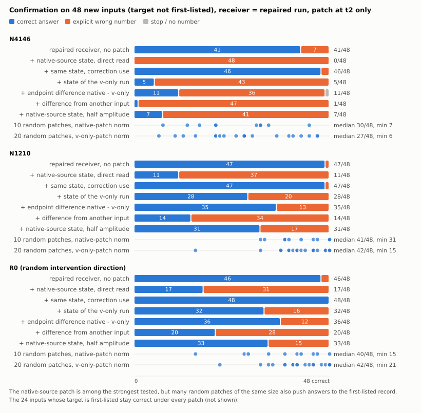

# Acupuncture 论文工作稿：稀疏激活干预后的写入、状态与回答

2026-11-06 · evidence-first manuscript v1.3。证据与状态核对截点：`9bf6cf638`（包含 NWR 正式结果、NWC 预检失败与修复记录）。本版将已接受的更正落实到摘要、方法、结果、结论和图示，明确现有贡献及证据缺口；没有新增模型运行、重新评分或改动原始实验。正文为 §1–§10，§11 记录本版审计，§12–§14 保留历史修订记录，不能作为当前实验队列。

配套材料：[理论—证据骨干](cache-mechanism-theory-evidence-spine-2026-11-03.zh-CN.md) · [结果归档](RESEARCH_ARCHIVE_2026-11-04.zh-CN.md) · [历史资产目录](RESEARCH_ASSET_CATALOG_2026-11-04.zh-CN.md) · [本版修订核对与证据缺口](mechanism-paper-evidence-gaps-2026-11-06.zh-CN.md)。资产目录的 124 个目录是其归档时快照，不是独立实验数或本版新增结果。

## 1. 标题与摘要

**工作标题：稀疏激活干预后的状态与回答：条件性写入—读取链及其适用边界。**

英文工作标题：*From Sparse Activation Interventions to Answers: A Conditional Write–Read Pathway and Its Boundaries*。

本文研究稀疏激活干预如何通过历史状态、当步写入和后续读取改变完整回答。核心实证贡献是在 Qwen3.5-4B 的指定编号任务与干预条件下，建立一段具有同端点、双向行为证据的条件性写入—读取关系，并将其读取检验扩展到原生受针状态来源。跨背景、层位和任务结构的结果限定这段关系的适用范围。

**摘要**

稀疏激活干预可以大幅改变模型的后续回答，但状态恢复成功并不足以识别其计算路径。我们在 Qwen3.5-4B 上结合局部写入操作、读取用途替换和自然完整回答，分析干预后的状态如何影响答案选择。在共享首 token 的编号任务上，局部替换当步 v 后，三个干预条件的正确数为 16、27、37/48；同时对写入项 k 去共同偏移，正确数升至 39、48、47/48。沿用这两个写入端点，仅替换下一步直接读取所用的状态，获得侧正确数升至 34、42、45/48，撤回侧降至 18、33、36/48。事后错误分类显示，变化主要发生在正确答案与首列错号之间。在其中一个条件上，把原生受针运行写出的状态送入局部修复接收者的直接读取，正确数由 39/48 降至 16/48，新增 23 个错误全部为首列错号；同一来源用于旧预测修正时正确数为 46/48。该结果支持原生来源状态在指定接收背景中的操作充分性，但一个同范数随机补丁也造成 18 个新增错误，尚不足以确立方向特异性。恢复与污染的非对称响应、跨层和新结构反例，以及窗口和事实 KV 交换结果进一步限制了外推。本文将特定写入变化与后续读取、完整答案连接起来；主链建立于已见开发面板，尚无开发外确认，也未识别原生运行的完整失效路径。

**主张范围。** 本文报告的是上述操作条件下的因果作用。它不等同于解释全部原生失败、识别状态中的首列语义内容，或证明一套跨模型通用修复方法。

## 2. 引言

少数激活坐标的暂时修改可以改变后续生成。要理解这种影响，需要区分四个环节：干预如何改变历史状态，当步计算如何处理旧状态并写入新状态，后续输出如何读取这些变化，以及读取差异是否改变完整回答。撤回干预、首步停止和缓存恢复为这些环节提供诊断条件。本文保持对整段作用过程的关注，不将其中一种失败形态作为全部研究目标。

这一问题具有直接的测量后果。在本文的编号任务中，局部修复后模型可以开始作答，却仍选错记录；目标竞争分数可以改变，完整回答却没有增加；在受针背景中足以恢复答案的状态，单独放入干净背景又可能不足以致错。因此，单独观察首步输出、候选分数或一次恢复，无法判断是哪段计算支持了正确回答。本文以这些可核查的差异为问题依据。对通用激活转向、部署缓存管理或防御修复的价值，仍需相应应用证据。

混合模型同时使用短卷积历史、递推状态和全注意力 KV。已有工作通过缓存拆分与交叉来源交换研究行为分工，也通过受控干预追踪写入、保留和读取（§9）。本文沿用这些计算定义和干预工具，研究稀疏激活干预后的具体选择错误。需要识别的增量是：哪些局部写入操作产生可影响答案的状态差，这些差异经哪种读取用途影响回答，以及这种关系在哪些背景下失效。

我们的证据主体由三步组成。首先，在相同受针预填状态上操作 t1 的写入项，比较局部 v 条件如何调节 k 操作的完整回答效果。其次，沿用同一对写入端点，在 t2 分别替换直接读取和旧预测修正对状态的使用，检验答案能否双向改变。最后，将供体扩展为原生受针运行写出的状态，检验它在局部修复接收者中是否重新引起选择错误。这三步分别识别写入条件、读取用途与原生状态来源；最后一步的接收者仍经过局部修复。

**本文的贡献与证据分工如下。**

1. **条件性写入—读取联系。** 在指定三个干预条件和同六场景面板上，局部 v 与写入项 k 的操作改变完整回答；由这两个端点形成的状态差，经一次直接读取替换可双向改变答案。这是全文的计算主体。
2. **原生来源与错误类型的连接。** 在 N4146 条件下，原生受针运行写出的状态经局部修复接收者的直接读取，使原本正确的回答变成首列错号。同一来源的另一用途与随机补丁提供比较；用途差异有支持，方向特异性仍未确立。
3. **解释范围的实测约束。** 恢复／污染、背景／幅度和跨层／新结构比较保留了反例。形成窗口与事实 KV 交换提供补充行为证据，但尚未证明它们与主链共享同一读取计算。

这组结果把研究对象从“替换某类缓存是否有效”推进到指定写入端点及读取用途对完整回答的作用。其意义在于区分回答起点、记录选择与状态使用，减少由恢复阳性直接推断完整原生机制的歧义。它不以更好的控制算法为成立前提；其开发外可靠性与更广泛用途仍是待解决的问题。

## 3. 理论与方法

我们使用以下三式描述注入、递推更新和输出读取，其详细推导和适用假设见[骨干§3](cache-mechanism-theory-evidence-spine-2026-11-03.zh-CN.md#3-理论证据链逐环的等式假设与推论)：

- 注入处：Δh = η W_down e_j。坐标少不等于扰动小；随机方向是另一类干预条件。
- 状态更新：S_t = α_t(I − β_t k_t k_tᵀ)S_(t−1) + β_t k_t v_tᵀ。固定局部驱动的分解不能被当成整模型独立机制份额。
- 更新后读取：o_t = α_t S_(t−1)ᵀq_t − α_tβ_t(k_tᵀq_t)S_(t−1)ᵀk_t + β_t(k_tᵀq_t)v_t。KUC检验t1更新式中的k用途，SRU检验t2读出式中的S用途；两者不是同一操作。

这些属于架构定义和条件推导。公式不能演绎出我们的正确数、方向特异性或跨条件适用性。参考架构来源为[Gated Delta Networks](https://arxiv.org/html/2412.06464v3)，实际实现身份见[基础审计](cache-mechanism-known-basics-audit-2026-10-31.zh-CN.md#7-核查来源范围与边界)。

| 方法维度 | 本文采用的定义与范围 |
|---|---|
| 模型与注入 | 主机制模型Qwen3.5-4B，revision `851bf6e806efd8d0a36b00ddf55e13ccb7b8cd0a`；down_proj输入单坐标或固定随机输出方向；符号、校准、幅度、位置数依合同，不混用同名dose |
| 三种历史 | 卷积q/k/V缓冲、GDN递推S、注意力KV；恢复S不等于恢复全部递推历史或KV，具体集合逐卡注明 |
| 时序 | τ为最后提示token之前的缓存切点；t1/t2为后续计算步。自由生成与共同强制前缀是不同路线 |
| 背景 | C干净、T原生受针、V恢复历史、L10/L11（T上仅t1写入项替换v/k，t2起自由）分别标注。KUC采用V恢复背景，NVW显式比较有／无V恢复；LVK四格共享T预填，SRU接收者为L10/L11。局部写入不替换预填历史，但会改变S₁及其他下游量，不能称后续读取背景未变 |
| 终点 | 实际首步停止、首步分差、固定前缀目标竞争M、完整回答Y、供体事实跟随分别报告 |
| 正确性 | 编号用冻结解析规则；事实用既有盲读与裁决，说明模型辅助来源、截断处理及敏感性；正确结论不等于全文自然停止 |
| 统计单位 | 48输入不等于48独立情景；KVC为22对／44接收者。按原合同保留分层与配对，不把层、头、针、重复旧题合并成独立样本。主结果的统计单位是6个场景；48条输入只是场景内的重复 |
| 数据身份 | 已见开发面板、预留操作条件、外部未见确认分开。WIN-02的新窗口操作不等于新任务面板；旧题上的冻结预测不能升级为独立确认。**面板身份声明：LVK、SRU、NWR的48条"新面板"在这三轮里依次被看过，全部是已见开发数据；主链未获开发外确认；LVK当时的同场景新文本复现与后续已见面板检验分别标明** |
| 工程与科学 | 零操作、逐位桥接、替换范围、FP64检查只验证操作；不能据此宣布机制、等效性或原生中介成立 |
| 资源口径 | 不把重复桥接、重放、CPU派生和新自然回答相加为独立样本；GPUh只按各收据原口径列附录，不在本稿估算总数 |

WIN“关系M”是额外 KV 恢复比较的名称，不是目标竞争 logit 指标 M。主链的 Y 是自然完整回答正确数；编号解析同时要求自然停止并处理未闭合 think、截断和多编号。M 使用固定共同首 token 的评分路线，不能替代 Y。NWR 的 Y 比率和效应按六场景等权计算，因此 39/48 的原始计数不等于报告中的 0.806；二者分别保留原口径。

**写入与读取操作。** t1 是最后提示 token 的前向，t2 是处理首个生成 token 的下一步。L00/L01/L10/L11 分别表示不改、只改写入项 k、只改局部 v、同时改 v 与写入项 k；L 是实验端点标签，不是模型层号。v₁ 来自同输入的 V 历史恢复影子计算，不是完整干净运行的 v。k₁ 由已冻结的其他五场景共同偏移估计构造。四格在 14 个递推层 G={13,14,16,17,18,20,21,22,24,25,26,28,29,30} 上联合操作，不能把这些层当作 14 个独立干预方向。

在 t2，直接读取为 D(S₁)=αS₁ᵀq，旧预测修正为 E(S₁)=−αβ(kᵀq)S₁ᵀk。SRU/NWR 只改变指定输出用途所读取的状态，不把供体 S₁ 写入持久缓存；各层的 q/k/v/门控来自本分支当前计算，高层会响应较低层的补丁，随后自然更新与生成也会响应。故这些操作的行为效果是条件总效果，不能按各层或两个状态差的线性相加来拆分完整回答。自然首 token 未到共同编号开头的输入照常保留；SRU 的 L10 中有 6 条此类输入，不能一概把它们的 t2 称为记录选择步。

本稿不将所有报告的“通过”视为同一种判定。工程passed、冻结科学预测兑现、方向性阈值、等效性、完整答案正确是五个不同层次。

## 4. 结果

### 4.1 状态恢复与回答恢复不是同一个诊断

早期调查观察到输出随干预层位、方向和剂量改变。后续编号实验进一步分离了首步可达性与记录选择。[FC](../experiments/cache-first-token-continuation-v1-2026-11-02/REPORT.zh-CN.md) 的唯一首字母面板在强制正确首字母后有 47/48 正确编号；去掉该捷径后，[SP](../experiments/cache-shared-prefix-continuation-v1-2026-11-02/REPORT.zh-CN.md) 的共享首 token 条件仅有 4–5/12 正确，合计 47/48 输出首列编号。[FX](../experiments/cache-fixed-v-delivery-v1-2026-11-02/REPORT.zh-CN.md) 在旧唯一首字母面板上，固定 45 头 V 历史恢复有 7/48 编号交付、严格只给编号为 0/48；其余头和随机 45 头均为 0/48 交付，全部头 V 为 48/48 且严格正确。另一个首步读数分析 [NFC](../experiments/cache-native-first-token-competition-v1-2026-11-02/REPORT.zh-CN.md) 的固定顺序分账为深层 S/KV 与入口复合约 55–63%、固定 45 头 V 历史约 33–43%；这些是读数比例，不能解释为完整回答的机制份额。起点被给定或得到改善之后仍可能退回首列，因而首步交付与后续选择需要分别检验。不同面板不合并为独立重复。

**t1 的结构桥接。** NWR 在 N4146 的 48 条输入上核验：L00 与 L10 共享预填及各层 S₀；首个被操作的递推层（第 13 层）的 q、k、门控与 S₀ 逐位相同，只有 v 不同，v 差的相对范数中位数为 1.04。更高的 13 个被操作递推层中 q、k、门控随该步下层输出改变，S₀ 仍相同。LVK 另核验 L10 与整体恢复 V 历史的参照在 t1 logits 上逐位一致，t1 后卷积 V 旧槽仍有差别。

因此，L00 与 L10 的差异由 t1 局部 v 操作及其当步下游后果引入，而非两者预填 S₀ 不同。该桥接是结构约束与实现验收，不能据此声称历史状态不参与原生失败，也不能把恢复首步本身算作新的记忆机制。旧面板上 L00 的三个条件正确数为 0、0、0/48，L10 为 16、28、37/48；后继新文本面板分别为 0、1、1/48 与 16、27、37/48。后续完整回答并非由 t1 等价性保证，保留恢复 V 历史仍可改变答案。

在编号面板的L0条件中，恢复V历史后正确数为16/48，而恢复深层S为48/48；前者大多已能以编号开头，后者常重新以think或引导语开头再完成正确回答。恢复效果不能从开头是否“正常”推断。

反向移植增加了关键限制：同题受损S、V或KV分别放入干净接收者，两针均仍为48/48正确；全部受损深层在L0只剩2/48。补测两两组合后，L0的S+V、S+KV、V+KV分别为45、32、48/48；L12两两组合均为48/48，但V+S+KV为30/48。所测分组内的最小致错组合随条件变化，不能据此宣布S是唯一损伤载体或已经发现冗余结构。L12全部深层恢复／污染的端点等同性来自注入时序，作为工程桥接，不作为机制发现。

证据：[NCC](../experiments/cache-native-carrier-comparison-v1-2026-11-03/REPORT.zh-CN.md)、[NSR](../experiments/cache-native-s-reverse-v1-2026-11-03/REPORT.zh-CN.md)、[NQK](../experiments/cache-native-qk-history-v1-2026-11-03/REPORT.zh-CN.md)、[NPC](../experiments/cache-native-pair-combination-v1-2026-11-03/REPORT.zh-CN.md)。本节提出解释必须满足的约束；它不直接证明下一节的局部链就是这些原生效应的唯一原因。

### 4.2 局部v条件下的k写入作用可以通过后续直接读取影响答案

在恢复V历史的指定背景中，去掉共同q/k偏移改善编号回答；分开操作后，k分量承担较大的修复作用。KUC进一步将k在状态更新中的两种用途分开：新值写入项的操作能改变完整回答，旧预测修正项单独作用较弱。NVW显示这一写入作用在未恢复背景中不足以普遍救回完整答案，因而需要把v条件纳入解释。

LVK在当步局部计算中检验该条件（接收者是原生T；四格只在t1的写入项换v、k，t2起全部自由）：N4146、N1210、R0三个条件的局部v端点正确数为16、27、37/48，加入写入k操作后成为39、48、47/48。SRU直接沿用这两组端点，在t2替换状态的读取用途；只换直接读取，获得侧正确数成为34、42、45/48，撤回侧从39、48、47下降到18、33、36/48。旧预测修正用途单独替换较弱，且部分方向反向。这使论证从“状态交换有效”前进到“同一写入端点的状态差可以通过特定读取用途改变完整回答”。

LVK 与 SRU 的同端点桥接使写入和读取比较能够衔接。L10/L11 共享原生预填和各层 S₀，S₁ 差异产生于 t1。首个被操作递推层的差异等于写入项差；更高层还包含下层输出引发的 q/k/v/门控变化。该表述不等于每层只变了一个写入向量，也不排除 t1 形成的 KV、卷积缓冲等差异参与后续回答。SRU 联合替换 D/E 所产生的 M 变化为端点 M 缺口的 73–86%，完整回答也未全部达到供体水平；该比值不是机制解释率。

按 NWR 冻结分类器对已有 LVK/SRU 输出作事后重读（表3），只修 v 后的明确错号分别为 30、17、11 条，全部指向首列；仍有停止或其他类别，不能把全部失败都归为首列选择。直接读取替换主要在正确与首列错号之间改变回答，停止最多增加 1 条。旧预测修正 E 在 SRU 的 M 上较弱且常反向，完整回答也有变化，因此不能说 E 没有作用。

**原生状态来源的读取检验。** NWR-01 将 L00 在 t1 写出的 S₁ 作为只读供体，送入 L11 的 t2 直接读取，正确数由 39/48 降至 16/48。逐输入转移显示，新增 23 个错误全部为首列错号，没有新增停止；48 条输出全部为首列编号。同一来源用于旧预测修正 E 时正确数为 46/48，改对 7 条、没有改坏。D10 的 SRU 撤回重放为 18/48，与旧运行逐位一致。[合同](../experiments/cache-native-write-readout-v1-2026-11-05/CONTRACT-r02.zh-CN.md)、[报告](../experiments/cache-native-write-readout-v1-2026-11-05/REPORT.zh-CN.md)和[正式验收](../experiments/cache-native-write-readout-v1-2026-11-05/runs/formal-r01/verification.json)分别记录操作、结果与实现边界。

五个逐层逐头同 L2 范数的随机补丁正确数为 38、46、21、45、36/48，平均场景等权正确率损失 l_R=0.033；它们不是都不致错。种子3造成 18 个新增错误，约为主臂 23 个新增错误的 78%，且同样偏向首列。NWR 的冻结效应门槛七条点估计均满足，原报告标签为“强支持”（b=0.806，l_D=0.472，l_E=−0.157，l_R=0.033，e_D=0.472，e_R=0.013）；这是开发性效应判据，不是统计确认。六场景重抽的 l_D−0.5b 区间为 −0.014 至 0.148，跨零；五个随机方向也不足以确立方向特异性。

这些结果支持：原生来源状态经指定修复接收者的直接读取，足以重新引起选择错误。它们不能区分“状态包含指向首列的特定内容”和“读取受扰后退回首列默认答案”。接收者是 L11；L00 本身有 47/48 在 t1 停止，未观察到其自然 t2 读取。D00 与 D10 的正确数为 16 与 18/48，效果相近不能推出额外 v 分量无作用或两操作等效；高层状态差也不是纯 v 分量。48/48 首列图样及后续补丁几何分析均属事后描述。

**表3 错答类型（各48条；正确／首列错号／停止无编号／其他）。**

| 运行 | N4146 | N1210 | R0 |
|---|---|---|---|
| 原生 L00 | 0／0／47／1 | 1／0／46／1 | 1／0／43／4 |
| 只修k（L01） | 0／0／48／0 | 0／0／47／1 | 1／0／45／2 |
| 只修v（L10） | 16／30／1／1 | 27／17／4／0 | 37／11／0／0 |
| 修v和k（L11） | 39／9／0／0 | 48／0／0／0 | 47／1／0／0 |
| L10读L11的状态，直接读取 | 34／12／2／0 | 42／2／4／0 | 45／3／0／0 |
| L11读L10的状态，直接读取 | 18／30／0／0 | 33／15／0／0 | 36／11／1／0 |
| L11读原生写入的状态，直接读取 | 16／32／0／0 | 未测 | 未测 |
| L11读原生写入的状态，修正用途 | 46／2／0／0 | 未测 | 未测 |
| L11加同范数随机补丁（五个种子的正确数） | 38、46、21、45、36 | 未测 | 未测 |

证据：[QCO](../experiments/cache-common-offset-v1-2026-11-02/REPORT.zh-CN.md)、[QKF](../experiments/cache-qk-component-factor-v1-2026-11-02/REPORT.zh-CN.md)、[KUC](../experiments/cache-k-update-causal-v1-2026-11-03/REPORT.zh-CN.md)、[NVW](../experiments/cache-native-v-write-interaction-v1-2026-11-03/REPORT.zh-CN.md)、[LVK](../experiments/cache-local-v-k-v1-2026-11-03/REPORT.zh-CN.md)、[SRU](../experiments/cache-state-read-use-v1-2026-11-03/REPORT.zh-CN.md)。QKD/QSR及KRD/KHC作为计算诊断与载体背景证据进入附录，不能把其不同端点的效应比例相乘。

### 4.3 写入链的背景与幅度边界

NVB将输出用途和留存状态用途分开，发现保留原生输出时，留存v操作只带回联合恢复目标竞争增强的约0.11–0.34；主预测未兑现。恢复输出后，同一留存操作明显增强。NBR的更正后投影诊断支持状态来源变化具有作用，但梯度线性化点敏感，不能把投影大小解释为回答贡献。

SIT随后直接跨背景移植留存增量。固定k操作，在恢复接收背景换回原生来源增量，正确数分别减少18、12、5条。NMT保留原生方向、按逐层逐头幅度配置匹配，能复现较多k条件效应来源差；统一缩放仅为0.15–0.38，五次随机内容对照的相应比例为负，且单格M仍失配。因此不能简化为“只要增量够大就行”。这几轮是同一面板上的递进约束，不是四次独立重复，也未普遍修复原生停止。

CGV给出进一步边界：L12局部v恢复即可使31/48成为48/48，指定k修正不再带来正向增益；读取端点没有足够缺口，不能称读取失效。三种新结构仍是编号任务，目标竞争改善只带来很少完整回答变化。正文必须展示这项不利结果，以限定4.2的外推。

证据：[NVB](../experiments/cache-native-bridge-v1-2026-11-03/REPORT.zh-CN.md)、[NBR](../experiments/cache-native-bridge-record-v1-2026-11-03/REPORT.zh-CN.md)、[SIT](../experiments/cache-state-increment-transfer-v1-2026-11-03/REPORT.zh-CN.md)、[NMT](../experiments/cache-increment-norm-match-v2-2026-11-03/REPORT.zh-CN.md)、[CGV](../experiments/cache-chain-generalization-v1-2026-11-03/REPORT.zh-CN.md)。CGV报告中“V承担损伤、k无关”的过强表述按[归档更正](RESEARCH_ARCHIVE_2026-11-04.zh-CN.md#6-更正和证据等级)收窄为操作结果。

### 4.4 形成窗口改变恢复响应，但没有形成统一的状态分工

R1把事实任务与编号任务并排后，暴露了恢复范围、形成窗口、校准、生成上限等差异。WIN-01在各任务内部改变形成窗口：L0事实全前缀受针后只恢复全部递推为10/48，记录句后受针则为47/48；全前缀下恢复递推并补模板＋记录句位置KV为47/48。这支持形成历史改变恢复关系，但窗口同时改变位置和次数，不能唯一解释为“记录内容损伤”。

WIN-02把关系带到新增针条件。额外KV恢复关系M在四个正向可检验格得到支持，救回分别为事实L2的11/11、L3的13/13、R0的27/28，以及编号R0的38/38；其余四格为天花板。事实L2/R0各有一个原本答对的输入被改坏，未触发合同“改坏反例”阈值不等于零损害。原生事实针上的“前段受针时KV恢复更优”未获支持。R0全前缀几乎不首步停止，却与N4146一样全部答错，因而联合停止预测只部分兑现。相似恢复响应与相同错误形态、相同计算机制必须分开。

旧数据离线审计进一步表明：事实W_post的S_deep为16/48，R_all为47/48；编号两臂均48/48。然而事实S_deep有32条达到128-token上限且未交付，编号四个相关臂全部在17 token内结束，实际名义幅度和施针次数也不同。这是有限预算下的恢复分叉，不能写成任务决定的内容载体分离。WPC-01仍是未运行设计，不在结果中出现新协议下的任何数字。

证据：[R1](../experiments/cache-mechanism-alignment-r1-v1-2026-11-04/REPORT.zh-CN.md)、[WIN-01及统一裁决](../experiments/window-recovery-win01-v1-2026-11-04/REPORT.zh-CN.md)、[WIN-02及P5更正](../experiments/window-prediction-win02-v1-2026-11-04/REPORT.zh-CN.md)、[384旧输出审计](../experiments/window-protocol-audit-v1-2026-11-05/audit.json)。本节称为恢复关系的横向检验，不称旧SRU链跨任务成立。

### 4.5 额外KV恢复具有事实方向性，尚未接通共同读取

KVC-01固定全前缀受针后、递推来自接收者干净版本的背景，只改变补入KV的事实身份。两版本模板相同，工程核对显示两臂实际只在记录句事实词起至记录句末的KV不同。L3、N4146、R0分别有43、42、43/44回答跟随供体事实，而同版本对照有42–44/44回答接收者事实；干净背景只换同段也有41/44跟随供体。

这一操作说明额外KV恢复有答案方向上的选择性，不只是非定向地提高答对率。但它可以同时恢复一般作答条件；没有证明递推不含事实，或该KV段是唯一载体。三针响应近饱和，不能据此推断同一内部计算；恢复背景与干净背景的等效性也未得到判定。KVC接通的是WIN的恢复操作与供体事实选择，未检验原来的v/k—写入—直接读取链。

证据：[KVC-01合同、结果及限制](../experiments/kvpre-content-kvc01-v1-2026-11-05/REPORT.zh-CN.md)。此节是桥接与边界，不把继续定位KV层／头写成完成论文的必经路线。

## 5. 全部证据怎样连接

| 接口 | 已建立的联系 | 尚不能写的箭头 | 论文安排 |
|---|---|---|---|
| 稀疏入口→历史形成 | 同时序／窗口的操作与缓存、回答改变；q/k共同偏移可操作 | 入口到共同偏移的完整形成计算已识别 | 方法与4.1；形成分析附录 |
| QCO/QKF→KUC/LVK | 对k从历史缓冲操作推进到写入用途；背景有桥接和变更 | 所有操作等价于同一自然中介 | 4.2；骨干逐接口表 |
| LVK→SRU | 同面板、同L10/L11端点；共享原生T预填，接收者为L10/L11，端点差异源于t1，状态差全部产生于t1（首层即写入差，高层含派生）；写入后的状态差被直接用于读取替换 | 原生全效应均由D介导；方向特异性已确立 | 4.2核心图 |
| LVK/SRU→NWR | 同面板、同接收者L11、同读取钩子；供体换成原生写入的S₁(L00)；D10格与SRU逐位桥接；39→16且全部为首列错号，E用途不致错 | 这是L00自己的t2读取；方向特异（五个随机方向里一个同样致错）；可推到其他方向 | 4.2，图2C |
| LVK→NVB→SIT→NMT | 输出／留存分离、来源移植、幅度配置逐项限制解释 | 幅度单独决定全部回答；多轮同题等于独立验证 | 4.3及附录 |
| 旧链→NCC/NSR/NQK/NPC | 原生C/T及参照有桥接，检验恢复／污染与组合 | 原生恢复已经复现SRU读取计算 | 4.1；作为约束与竞争解释 |
| 阶段二/NCC→R1→WIN | 同源基线和协议审计；WIN任务内窗口比较新增证据 | R1跨协议差异就是任务因果效应 | 4.4 |
| WIN-01→WIN-02 | 新操作条件检验保持、分叉、无信息 | 8个独立实验或全链共型 | 4.4，失败预测同图 |
| WIN→KVC | M_same桥接旧额外KV恢复；改供体身份增加内容选择证据 | KVC是原写入链推广或与B共用读取 | 4.5 |
| WIN→WPC旧数据审计 | 标签、停止、长度、幅度、次数的已有记录核对 | 新共同协议测量已完成 | 4.4限制；未运行设计留研究记录 |
| 观察广度→机制广度 | 可提出边界和反例 | 把XCHAN针数、阶段二层数直接算给SRU | 方法覆盖表与讨论 |

LVK→SRU 与 NWR 提供全文的计算主体。NCC–NPC 限定从恢复作用推断原生机制的范围；WIN/KVC 说明其他形成条件与答案内容仍需解释。后两组证据与主链存在共同问题和参照，但没有同一读取计算的桥接，不能串接成已完成的统一机制。

## 6. 覆盖账本：到底是几根针、几层、几种任务

| 证据层次 | 实际覆盖 | 不得借用的覆盖 |
|---|---|---|
| 行为与阶段二缓存观察 | 有多规模行为资产；4B阶段二L0–L31每层一个固定通道、正负条件 | 每层一个点不代表层平均；多模型行为不算跨模型机制 |
| 原生首步线 | FC/FX在唯一首字母P面板12×4方向；SP在共享首token面板12×4；NFC为48条N参照上的链式分账 | FC的强制首字母47/48不迁移到共享首token面板；12条面板不等于SRU的48条面板 |
| XCHAN粗关系 | L0的10原生通道＋4随机方向 | 不是14方向都做过SRU |
| 细写入／读取行为 | 主要L0/N4146、N1210、R0；C1343诊断 | 三方向中的R0不是原生单神经元；14个G操作层不等于14根针 |
| CGV边界 | L12/C3621及三种新结构27条；结构仍输出编号 | 不算独立非编号任务或第二模型 |
| NCC–NPC | L0/N4146、L12/C3621；48条已见编号输入 | 不提供全层原生机制 |
| NWR | L0/N4146一个方向；LVK新面板48条、6场景，已见；接收者L11 | 不覆盖N1210、R0；不是开发外确认 |
| WIN合计 | L0/N4146、L1/N2765、L2/C5251、L3/C7666、L5/C2467、L0随机R0；事实／编号两面板 | 6干预条件、5个施针层位，不等于6针共享同一机制；两任务协议未全对齐 |
| KVC | L0/N4146、L0/R0、L3/C7666；2施针层位，22对／44事实接收者 | 不是新增3个独立方向，也不覆盖编号任务 |
| WPC | 已有384输出离线审计；共同协议设计未运行 | 不能计为新模型实验、横向确认或新增成功样本 |

这张表回答“宽到哪里”；骨干的连接表回答“深到哪里”。二者不能靠累加目录数互相替代。

## 7. 图表与资产落位

六张 SVG 图及其数据来源见[图源说明](figures/mechanism-paper-2026-11-05/SOURCES.md)。本版同步图1、图2的背景与读取措辞，沿用已有计数；图4数值仍来自报告正文，其余数据图来自分析 JSON。图1展示操作关系，不表示未修复原生运行已经走完全部箭头；图2的 B/C 面板接收者为局部写入端点。

图文件：[图1 总图](figures/mechanism-paper-2026-11-05/fig1-chain-overview.svg) · [图2 写入与读取](figures/mechanism-paper-2026-11-05/fig2-write-read.svg) · [图3 原生恢复与污染](figures/mechanism-paper-2026-11-05/fig3-native-recovery-pollution.svg) · [图4 边界](figures/mechanism-paper-2026-11-05/fig4-boundaries.svg) · [图5 窗口与额外KV](figures/mechanism-paper-2026-11-05/fig5-window-kv.svg) · [图6 供体事实转移](figures/mechanism-paper-2026-11-05/fig6-kv-donor-transfer.svg)。

| 已有图表／材料 | 当前展示的内容 | 来源与阅读边界 |
|---|---|---|
| 图1 理论与证据总图 | 操作连接、指定接收背景及未识别入口 | 骨干§1、§3、§5与正文§4.2；实线不是完整原生自然路径 |
| 图2 写入与读取 | LVK四格、SRU获得／撤回、NWR及随机对照的完整回答分类 | LVK/SRU/NWR分析JSON；按方向与操作分列，M不在此图中，C1343诊断不计入三方向主结果 |
| 图3 原生恢复与污染 | 原生运行恢复各组状态，与干净运行接受受损状态的正确数 | NCC/NPC分析JSON汇集NCC、NSR、NQK、NPC；图中为汇总计数，不是逐输入配对轨迹 |
| 图4 链条边界 | 背景依赖、幅度配置、来源替换的答案损失、跨层饱和 | NVB/NMT/SIT/CGV报告；各面板独立分母，分数比例不是回答解释率 |
| 图5 窗口与额外KV | WIN-01窗口内恢复、WIN-02可检验救回、改坏与天花板 | WIN-01/02分析JSON；P4/P5的失败与限制另见§4.4，图本身不展示停止预测 |
| 图6 供体事实转移 | 恢复背景与干净背景的接收者／供体事实跟随数 | KVC分析JSON；44接收者来自22对，近饱和不证明背景等效 |
| 方法与覆盖表 | 模型、端点、任务、面板身份和统计口径 | §3、§6及各原合同／收据 |
| 主张—证据表 | 已支持主张、替代解释与缺口 | §8及配套缺口说明 |
| 表3 错答类型 | 原生停止、首列错号、读取替换后的完整回答分类 | §4.2；来源`enum-offline-r01.json`与`nwr-readouts-r01.json` |
| 补充材料入口 | 全资产、标签与协议差异、失败路线 | 资产目录、WIN偏离、R1协议比较、WPC旧数据审计及各报告；当前以链接归档提供，尚未排成会议附录 |

**资产分工。** 单针／双针／能力／剂量与阶段二提供现象和选择来源；形成期、V、q/k、目标竞争、写入与读取系列提供机制证据；NVB–NMT、CGV、NCC–NPC、R1/WIN/KVC提供限制和接口；两个旧数据审计提供可复用性与协议证据。公开配方、跨模型预检、WSP/WCP及VLM数据准备仍在项目总目录中，属于旁线或工程资产，不能补作这篇机制论文的跨模型或方法收益实验。历史设计目录只提供研究溯源，不占结果席位。

## 8. 主张、替代解释与证据缺口

| 本文支持的主张 | 直接证据 | 必须保留的替代解释或边界 | 尚缺证据及其影响 |
|---|---|---|---|
| 指定局部写入端点的状态差，经 t2 直接读取可双向改变完整回答 | LVK→SRU 同端点桥接与三个条件的 Y 变化 | 接收者经过局部写入操作；联合 D/E 未搬运全部 M 缺口；E 并非零效应 | 冻结关系的开发外确认缺失，限制可复用性；不要求先解释所有剩余效应才能保留本结论 |
| 原生受针来源状态在局部修复接收者中经 D 可重新引起首列错号 | NWR 的 39→16/48；新增 23 条首列错号；E 为 46/48 | 单一方向、已见六场景；随机种子3也新增18错；读取受扰后的默认落点仍可解释图样 | 方向／来源的特异性和开发外稳定性未确立；不能声称已识别首列内容或原生自然中介 |
| 写入操作的效应随背景、来源与幅度配置而变 | NVW/NVB/SIT/NMT、CGV | 饱和、阈值和校准影响可见效应；L12 局部 v 已到48/48，k 无增益 | 缺少事前可用的条件规则，限制从案例总结到预测的提升 |
| 形成窗口改变恢复响应，额外 KV 恢复在部分新增条件有效 | WIN-01/02 | P4未获支持／不可判，P5未完整兑现；跨任务协议未全对齐 | 若要宣称任务决定机制分叉，需排除协议差异；当前只作任务内条件结果 |
| 固定恢复背景中，事实段 KV 来源可定向改变答案 | KVC 的供体事实跟随结果及干净参照 | 先行工作已有类似方向；饱和；未检验主链相同读取用途 | 与主链的共同计算尚未建立，仅在争取统一解释时需要，不自动进入补测队列 |
| 恢复充分性与反向污染充分性不同，组合响应随条件而变 | NCC–NPC | patching的一般限制已有研究；所测组合有限 | 不能据此命名唯一载体或新通用原理；更多组合不是当前核心结论的必要补齐 |

**当前最优先的证据缺口是冻结核心关系的开发外可靠性，并同时保留一般扰动的竞争解释。** NWR 已完成原生来源的操作检验，不再列为“尚未进行的读取实验”；但主链反复使用同六场景，且有限随机对照有强反例。截至本版核对截点，NWC 只有预检失败与修复记录，没有正式确认结果。修复工程闸门不增加科学证据，也不等于该设计的全部机制解释已经成立。具体身份、影响及补证落点见[缺口表 G1–G5](mechanism-paper-evidence-gaps-2026-11-06.zh-CN.md#2-真正缺的证据与补证落点)。

**更宽主张的缺口另行保留。** 从注入入口到 v/k 变化的形成计算、对原生主要停止失败的解释、跨任务／模型规则和实际转向收益都尚未完成。它们影响论文可能达到的解释范围与用途，但并非全部都是当前条件性主张的前置要求。扩大样本能提高已定义关系的可靠性，不能自动解决机制特异性；扩大模型只能在同一关系得到可比测量时支持机制广度。本文不以继续局部定位来替代这些不同的证据问题。

## 9. 相关工作与新颖性边界

下列原始来源界定本文采用的计算与干预工具，以及经验增量所在。完整历史核查见[核心主张审计§4](mechanism-second-half-v1-2026-11-03/CORE_CLAIMS.zh-CN.md#4-原始文献核查及其对主张的约束)。本文不把作者报告当作我们的复现，也不以定向核查宣称穷尽优先权。

| 原始来源 | 对本稿的约束 |
|---|---|
| [Gated Delta Networks，2412.06464v3](https://arxiv.org/html/2412.06464v3)，§3 | 更新规则与混合结构是理论工具，不能称为我们新发现 |
| [What Attention Recalls and Recurrence Controls，2609.04434v1](https://arxiv.org/html/2609.04434v1)，§3–4 | 已在Qwen3.5等混合模型做缓存拆分与交叉来源交换，供体取值跟随KV是强先验；KVC的定性阳性不能单独撑主贡献 |
| [How Linear Attention Remembers，2609.33093v1](https://arxiv.org/html/2609.33093v1)，§2–4 | 已研究写入、状态与读取的因果联系及混合架构检索载体；我们不能以“有一条写入—读取链”这句话独占新颖性 |
| [How to use and interpret activation patching，2404.15255v1](https://arxiv.org/html/2404.15255v1)，§2–3 | 恢复与污染的不对称及解释限制已知；本稿需要具体训练模型与干预条件下的经验约束，而非重新发现方法论警告 |

对实际激活转向、状态持久性及缓存修复的应用关联，已有[候选痛点文献记录](literature/painpoint-recurrent-state-steering-audit-2026-11-05.zh-CN.md)。这些来源提供研究动机，不能替代本项目自己的转向型持续效应或修复收益测量。现有数据不支持“从业者普遍只按幅度或 KV 处理副作用”“无人会修”或“KV 级修复必然不适用”等概括；本稿不再用这些句子支撑问题重要性。

本文相对这些工作的经验增量，是把稀疏干预后的特定错误与局部写入条件、两种状态读取用途和完整回答连接，并用原生来源供体及反例限定解释。它没有提出新的更新公式，也没有推翻混合模型上的既有检索分工：递推状态的操作能改变答案选择，不足以证明目标事实独占地存于递推状态。该增量能否成为跨条件可复用的认识，仍取决于 §8 所列证据，而非“首次发现写入—读取”这一宽泛说法。

## 10. 讨论与结论

本文建立了一个具体的条件性联系：在指定受针预填状态上，t1 写入项的局部 v 与 k 操作改变后续完整回答；由这些端点形成的状态差，经 t2 一次直接读取替换可双向改变编号选择。NWR 将这一读取检验扩展到原生受针状态来源，在局部修复接收者中重现首列错号。这比只知道某类状态替换有效更具体，但原生来源与原生自然路径仍需区分。

现有证据支持的解释精度是“这些写入条件与读取用途在这些接收背景中足以影响选择”。它不识别状态中的首列语义内容，不说明直接读取是唯一通路，也不把 v 与 k 命名为独立的开口／选择开关。仅 k 操作在原生 v 条件下几乎不改善回答，说明其效应依赖局部计算背景；E 的较弱或反向结果同样属于该背景下的作用，不能外推为 E 无用。

最有约束力的反例同时限定了论文结论：NWR 的一个同范数随机方向产生接近主臂的同类错误；受针状态在干净背景中的单独污染与恢复并不镜像；L12 条件只修局部 v 已到正确率天花板。WIN 的未兑现预测及 CGV 中内部竞争与完整回答的脱节，进一步说明不能按恢复率、停止形态或单一分数替代计算解释。

因此，本研究的当前贡献是有完整答案证据的局部写入—读取机制片段及其经验边界。它为分析稀疏干预提供了可复核的操作连接，并明确了哪些测量尚不能相互替代。下一层证据应首先决定这段关系能否离开开发面板，以及能否支持超出一般扰动的解释；入口形成、跨模型与应用收益则分别约束更宽的科学主张。没有一项尚未测量的成功被计入本文结论。

## 11. 本次交付审计与版本边界

- 本版以 `9bf6cf638` 为修订基线，核对 LVK、SRU、NWR 的合同、报告与正式 verification；保留既有数据、阈值、失败记录和统计口径，未重新生成回答或改标签。补充结果沿用所链接报告，不声称独立复现全部原始张量。
- 摘要、引言、方法、§4.1–§4.2、主张表及结论已经统一：写入比较共享原生预填；读取接收者为局部写入端点；原生来源不等于原生自然 t2。E 并非零作用；D00/D10 效果相近不能推出 v 分量无效；随机平均效应小不能抹掉强反例。
- 图1、图2同步上述解释边界，六张图的既有计数保留；本版没有新增科学图或分析。全文英文定稿与指定会议排版仍未完成，不将此中文证据稿标成已可投稿。
- [修订核对与缺口表](mechanism-paper-evidence-gaps-2026-11-06.zh-CN.md)记录本次修改、来源和反方自查。本轮是同一助手完成的作者自查，不是独立同行评审。缺口诊断不包含新的实验矩阵、阈值或预算，不构成设计通过或运行授权。
- 研究使用冻结模型与既有任务材料。本稿由 AI 辅助整理及修订；数据、脚本、合同和已归档输出在本仓库，大型张量按各报告所列位置与哈希保存，不能声称全部大文件已随 Git 发布。作者名单与贡献、资助、利益冲突及适用伦理声明未由作者确认，投稿前据实填写，不推定“无”。
- **以下 §12–§14 保留历史修订记录，表3已移至§4.2。** 其中“本轮”“下一步”“未运行”和早期优先权判断只代表当时状态；现行论证、实验状态与缺口以 §1–§11 及本版缺口表为准。历史正文中的错误措辞已在现行正文修正。

## 12. v1.1 更正记录（2026-11-05 第二轮）

- **背景措辞错误（影响§1、§2、§3、§4.2、§5、§8、§10）。** v1把LVK→SRU主链写成"恢复背景""人工混合背景"。按[LVK合同](../experiments/cache-local-v-k-v1-2026-11-03/CONTRACT.zh-CN.md)§3与[SRU合同](../experiments/cache-state-read-use-v1-2026-11-03/CONTRACT.zh-CN.md)§3：四格全部在原生受针背景T上，L00即原生运行，只在t1写入项换v/k，t2起自由；SRU接收者为L10/L11。所以主链站在原生运行上，人工部分只有t1写入项与t2一次读取替换。v1据此判断的"局部解释与原始现象之间缺决定性连接"相应收窄为"原生写入项写出的状态未在读取端测试"。
- **原生首步线补入§4.1与§6。** FC/SP/FX/NFC此前在v1与骨干中出现次数为零。它们固定了原生失败的两种形态，并提供t1结构句所需的参照。
- **t1结构句新增。** 依据LVK报告§0第1条与§1全层桥接；推导档，不是新测量。
- **同日第二处更正。** v1.1初稿把"端点间S₁差按构造恰等于写入项差"写成各层成立；只在首个G层成立，更高G层的t1量随下层输出改变。已改为"全部产生于t1一步"。指出者为[Proposal v8自查](mechanism-second-half-v1-2026-11-03/CORE_CONTRIBUTION_SELF_CHECK.zh-CN.md)§4第5条。v8同时把NWR-01草案收敛为其主比较A，实施前按v8修订合同，不双跑两版。
- **未改动的内容。** 所有数字沿用各报告；没有新增运行；§8"还缺什么"按v1.1重写，不改各卡原始口径。本更正由同一助手完成，不是独立审查。

## 13. v1.2 更正记录与本轮整篇判断（2026-11-05 第三轮）

**本轮做了什么。** 主比较A按[合同r02](../experiments/cache-native-write-readout-v1-2026-11-05/CONTRACT-r02.zh-CN.md)运行（预检与正式一次通过，约0.13 GPUh）；已有LVK/SRU输出按同一冻结规则重读错答类型；t1结构句逐位核验；面板身份写死；痛点段落写进引言；六张图生成并检查；§8改成讨论骨架。同一助手完成，不是独立审查。

表3 已前移至 §4.2，计数保持不变。

**整篇判断（坏消息先说）。**

1. **独立兑现仍是零。** 全部数字来自已见开发面板；新结果只有一个方向。v8的B阶段未运行。
2. **新结果的方向特异性不紧。** 五个随机同范数补丁里有一个重现78%的主效应且错法相同。"首列编号是读取被扰乱后的默认落点"与"原生写入的状态携带指向首列的内容"在本轮分不开。
3. **痛点仍是推测档。** 从单坐标稀疏干预到转向向量是类比；转向型持久性与KV级修复失效没有自己的证据。
4. **原生运行最主要的失败（首步停止）只通过t1结构句与主链相连。** 针为什么改变t1的v和k没有解释。

**站住的部分。** 一条写入端作用于原生运行、读取端为"原生来源＋局部修复接收者"的写入—读取关系：在这组操作里换t1的v使首步开口、再换k提高选对比例（有强交互，不是独立分工）；状态经t2直接读取而不是修正用途起作用；原生运行写出的状态被已修复接收者读入后重现同一种错误；错答类型有逐条分类；失败边界有六组反例。按"谁会因此改做法"衡量：做混合模型机制分析的人得到两条可直接使用的诊断，即首步开口不等于答对、应分别检验直接读取与修正两种用途；做转向的人目前只得到类比。

**按本轮开始时约定的终点规则归类：结论可信、认识具体、范围有限。** 它不是已知知识的实例化（近邻没有做过受干预状态的写入与读取定位），所以不是停止加细节另行立项的情形；它也没有开发外证据，所以不能写普遍性。

**下一步只有两项候选，均未授权，由用户定。** (a) v8的B阶段：冻结操作，在24个新基础情境上做开发外确认；须把随机控制族从5个方向扩大（建议不少于20个），否则第2条的问题会原样带进确认。(b) 痛点证据：用2603.16335公开的转向方向做一组转向型对照，测递推状态中的持久性，并演示KV级修复是否失效。建议先(a)后(b)：(a)决定现有中心句能否离开开发面板，(b)决定引言能把痛点写到哪一档。本轮不追加任何局部机制实验。

## 14. v1.2.1 更正与事后剖析（2026-11-05 第四轮）

**三处收紧（外部核查指出，接受）。** "两端都落在原生运行上"改为"写入端作用于原生运行、读取端为原生来源＋局部修复接收者"；"v决定开口、k决定选谁"改为本组操作的概括，注明强交互；"读取替换不制造停止"改为"几乎不制造，最多1条"（表3：N4146获得侧停止1→2，R0撤回侧0→1）。

**事后剖析（零GPU，读NWR-01已存的逐层逐头补丁统计；描述性，未预注册；[脚本与输出](../experiments/cache-native-write-readout-v1-2026-11-05/analysis/posthoc/)）。**

- 原生补丁含有一个跨输入共享的成分：它与每个固定随机方向的夹角在48条输入上高度一致（约九成的层—头，均值绝对值超过3倍标准误）；由这些夹角粗估，共享成分约占补丁能量的一半多（全部48条约0.57，同场景内约0.62）。能量的75%在第21、25、28层。**更正：初稿写成"几乎是固定向量、不是逐输入内容"，过强；"固定偏移"是假说。**
- 原生补丁的L2范数是SRU撤回补丁的1.88倍（逐输入1.79到2.02），两者效果却几乎相同（目标竞争平移−2.94对−2.16；正确数16对18）。**更正：初稿由此推出"多出来的v分量几乎不起作用"，推不出**（非线性、饱和、分量交互；且两端点在更高层的q、k、门控都不同，这份状态差不是纯粹的v写入分量）。可说的只有：按原生补丁范数匹配的随机对照，幅度约为SRU撤回补丁的1.9倍。
- 每个随机方向对目标竞争是跨输入近似恒定的平移：−0.30、−0.08、−2.43、+0.50、−0.92。种子3与原生补丁的能量加权余弦只有+0.022，投影解释不了它。原生补丁的−2.94约为这五个值的2.5个标准差。
- 这三条不改变冻结判读。它们提出了三个要在新数据上检验的假说，不是结论。开发外确认 [NWC-01](../experiments/cache-native-write-confirm-v1-2026-11-05/REPORT.zh-CN.md) 已运行，三个假说的检验结果见 §15。

## 15. 结果增补：开发外确认 NWC-01（2026-11-06，v1.3 正文截点之后）

本节由运行 NWC-01 的会话追加。**§1–§11 的 v1.3 正文截点是 `9bf6cf638`，不含 NWC 正式结果；本节不改动那部分文字，只列出结果以及正文里因此需要更新的句子。** 同一助手实现、运行、判读，不是独立验收。来源：[NWC-01 报告](../experiments/cache-native-write-confirm-v1-2026-11-05/REPORT.zh-CN.md)、[合同 r03](../experiments/cache-native-write-confirm-v1-2026-11-05/CONTRACT.zh-CN.md)、[偏离 D1](../experiments/cache-native-write-confirm-v1-2026-11-05/DEVIATIONS.zh-CN.md)、[图 7](figures/mechanism-paper-2026-11-05/fig7-confirmation.svg)。

**坏消息先说。**

1. **§8 所说"能否支持超出一般扰动的解释"：答案是不能。** 三条相关预测在三个方向上全部不成立。按起作用那份补丁的范数抽 40 个随机方向，17、18、22 个达到它一半的单步分差；其中续写的 20 个里 8、4、8 个造成一半以上的回答损失；按原生补丁范数新抽的 10 个随机方向里 5、0、3 个单独达到主效应的一半。随机补丁造成的错答同样几乎全是首列编号。
2. **端点状态差 L00−L10 单独读入也造成大量错答**（N4146 上 41→11）。事后剖析里"多出来的 v 分量几乎无效"被否证。
3. **确认范围窄：** 既有六个结构族内的新实体与新编号、目标不在首列的输入、同一模型、接收者为已修复的 L11。
4. 预检第一次在一个写错的工程闸门上失败，没有产生新面板输出，按合同修复一次；见偏离 D1。

**§8 所说"这段关系能否离开开发面板"：在上述范围内，能。** 72 条新输入，六组预测与各自允许写的句子在任何输出之前冻结。

| 目标不在首列的 48 条：正确数 | N4146 | N1210 | R0 |
|---|---:|---:|---:|
| 接收者 L11 | 41 | 47 | 46 |
| 读原生来源状态，直接读取 | 0 | 11 | 17 |
| 同一状态，修正用途 | 46 | 47 | 48 |
| 十个新抽同范数随机补丁（平均） | 24.4 | 40.1 | 35.8 |
| 移植另一条输入的写入差 | 1 | 14 | 20 |

- 中心预测在 N4146、N1210 两个主要方向与随机施针方向 R0 都成立。错答除个别外全是首列编号，没有停止。
- 目标在首列的 24 条，读入后三个方向都是 24 条仍对。
- 移植另一条同族输入的写入端点差，单步分差是本输入的 0.95 倍，半幅度下回答损失相近。原生补丁向量的跨输入余弦：同族 0.95 到 0.96，跨族 0.91 到 0.93。

**由此，正文里以下句子需要更新（未改动，留给整稿）：**

- §1 摘要与 §10："在其中一个条件上"应扩为两个主要方向加一个随机施针方向，并写明是新输入上的确认；"一个同范数随机方向产生接近主臂的同类错误"应换成上面第 1 条的计数。
- §4.2 关于 NWR 随机对照的段落：五个开发种子的结论由 NWC 的 10＋40 个新方向取代。
- §6 覆盖账本：NWR 行"不是开发外确认"之后应加 NWC 一行。
- §8 第二行与"当前最优先的证据缺口"一段：开发外可靠性已有答案；"一般扰动的竞争解释"不是被保留，而是得到支持。
- §14：三个事后假说里，"固定偏移"得到移植与余弦两项支持；"v 分量无效"与"单位范数效率"被否证。

**对中心句的影响。** 可写的是：t2 的直接读取承载按查询选记录；往它的输出里加足够大的扰动，回答就退回列在第一位的记录；原生来源的状态是所测扰动里最强的之一；修正用途不承载这一选择；目标本身在首列时不受影响。不可写的是：原生状态携带指向首列的特定内容，或其方向特殊。

**按"谁会因此改做法"。** 新增一条可直接使用的结论：在这类模型上做状态移植或补丁，必须配同范数随机对照。这一读取对同样大小的任意扰动都脆弱，没有对照的"移植致错"不能读成内容传递。这条结论首先约束的是本项目自己此前的读法。

**本线的局部与确认工作按合同到此结束，进入整稿。** 后续候选均未授权：按上列各点整稿；痛点的转向型证据；若要扩大确认范围，需单独决定。

