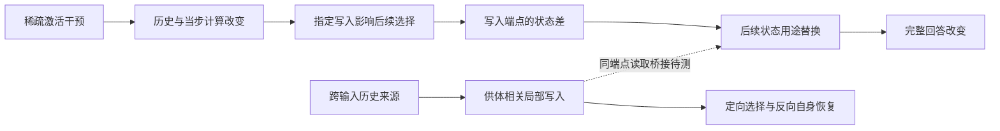

# Acupuncture 论文工作稿：稀疏激活干预后的写入、状态与回答

2026-11-07 · evidence-first manuscript v1.4。证据截点：`c783cbdf92209712fb6ebb8a87620c708a8dd6ae`，纳入 NWC、FBR、SPF 与 DWB r02 正式结果。正文 §1–§10 围绕同一机制问题整合已有证据，§11 记录修订审计；旧 §12–§15 移至[历史修订记录](mechanism-paper-revision-history-through-v1.3-2026-11-07.zh-CN.md)，原文保留。本轮仅文稿与下一阶段计划交付，无新模型运行。

配套材料：[理论—证据骨干](cache-mechanism-theory-evidence-spine-2026-11-03.zh-CN.md) · [结果归档](RESEARCH_ARCHIVE_2026-11-04.zh-CN.md) · [历史资产目录](RESEARCH_ASSET_CATALOG_2026-11-04.zh-CN.md) · [本版修订核对与证据缺口](mechanism-paper-evidence-gaps-2026-11-06.zh-CN.md)。资产目录的 124 个目录是其归档时快照，不是独立实验数或本版新增结果。

## 1. 标题与摘要

**工作标题：稀疏干预如何改变答案选择：混合语言模型中的历史信号、写入与读取。**

英文工作标题：*How Sparse Interventions Change Answer Selection: History, Writing, and Reading in Hybrid Language Models*。

本文解释少数激活坐标的干预如何造成后续回答的大幅变化。我们将历史信号的可用性、当步写入及后续状态读取连接到完整回答，并区分一般作答退化与可定向改变的记录选择。供体移植是检验这些关系的工具，研究对象始终是干预后的计算与行为。

**摘要**

稀疏激活干预可以使混合语言模型停止作答或选错记录，但这些行为是否意味着历史选择信息已经丢失，以及影响如何通过写入和读取传递，仍需直接检验。我们在 Qwen3.5-4B 中以完整回答为终点，结合局部写入、状态用途替换和跨输入供体干预，研究这一过程。在三个干预条件中，局部 v 操作后再改变写入项 k，将正确数从 16、27、37/48 提高到 39、48、47/48；沿用这些端点，一次后续直接读取替换能够双向改变答案。对 72 条新输入的确认支持原生来源状态的读取作用，同时随机对照也频繁产生首列错号，否定了以这一错答图样证明方向特异性的解释。进一步地，在两个受针条件下恢复本输入q/k后，仅让供体历史影响最后提示步的指定写入，而不持续保留供体 V 缓冲，仍得到 0.882 和 0.427 的完整回答净供体转移；保留供体缓冲而换回本输入写入后，两个条件的选择冲突配对均恢复自身答案。不整体恢复缓冲的纯局部写入也产生定向转移。受针来源状态在干净接收者中的可用性却随方向分叉，排除了统一的信息删除解释。结果表明，干预后的答案选择可以通过历史信号的写入及其后续使用加以解释和操控，开口、选择和信息可用性必须分别检验。供体写入到指定读取用途的同端点连接与独立新材料确认仍待完成；这些缺口决定解释的进一步整合与推广，而不取消已经建立的计算关系。

## 2. 引言

少数激活坐标的暂时修改可以使模型的后续回答发生大幅变化。解释这种变化，需要追踪干预怎样改变历史信号、当前计算怎样处理旧状态并写入新状态、后续输出怎样使用这些变化，以及最终回答发生了什么。撤回干预、首步停止和缓存恢复为这条过程提供诊断条件；论文的目标是解释整段作用过程。

本文首先区分三个容易混淆的问题：模型能否开始作答、回答选择哪条记录，以及历史状态是否仍可被后续计算利用。在我们的实验中，恢复首步输出后仍会出现首列错号；相同的错答图样可由多种随机读取扰动产生；受针形成的状态在另一个计算背景中仍可能定向改变选择。因此，错误答案或一次恢复不能单独回答信息是否被删除，更不能指认其传递路径。分开这些问题，才能把稀疏干预的行为效应变成可检验的计算解释。

混合模型同时使用短卷积历史、递推状态和全注意力 KV。已有研究已说明递推计算可以构造检索查询、状态移植可以转移检索目标，实体绑定也可能依赖多种机制（§9）。本文进一步研究：**当稀疏干预改变这些计算条件时，哪些写入与状态使用操作能够恢复或重新指定完整答案，哪些简单的失效解释会被反例否定？** 我们不以“缓存能够影响答案”本身作为贡献，而检验影响的来源、具体操作与行为方向。

证据沿两条相互约束的路线累积。第一条从局部写入出发，沿用同一对端点检验直接读取与旧预测修正的作用，再在新输入上检验原生来源状态和随机对照。第二条从供体相关的答案选择出发，将缓冲交换缩减到最后提示步的指定写入，并以反向替换检查转移能否被撤回。两条路线分别给出写入—读取关系与历史—写入—选择关系；它们共享计算对象与操作接口，但新供体差异的读取桥接尚未完成。这个明确的接口是下一步补证的位置。

**本文有三项相互支撑的贡献。**

1. **把稀疏干预的回答效应落实到写入与状态使用。** 局部 v/k 操作及同端点的后续读取替换可双向改变完整答案；原生来源状态的读取作用在新输入上得到确认。论文由此超越整块缓存恢复的有效性，给出可复核的计算联系。
2. **建立从历史来源到指定写入再到答案选择的构造性证据。** 两个受针方向上，一次指定时刻的供体写入足以定向改变回答；反向换回自身写入后，选择冲突配对恢复自身答案。纯局部形式进一步将这项结果接到既有写入端点，表明观察到的不只是一般恢复或强制开口。
3. **用反例区分选择失效、信息可用性与背景条件。** 随机读取扰动可以重现首列错误；通用平均缓冲不能稳定恢复主方向的正确选择；受针状态可利用性的跨方向分叉否定统一删除解释。它们共同约束干预后的计算解释，而不是相互独立的失败清单。

这组结果支持一个围绕写入和状态使用的解释：干预后的答案变化不能只按缓存类别或是否答对来归因，必须检验历史来源如何进入具体写入、以及形成的状态怎样影响后续选择。其价值在于把“模型被扰乱了”推进到具有方向、操作对象和反例的机制认识。当前还没有测量实际转向收益或建立跨模型通用规律；研究目标与下一步证据应继续围绕这条解释扩展。

## 3. 理论与方法

我们使用以下三式描述注入、递推更新和输出读取，其详细推导和适用假设见[骨干§3](cache-mechanism-theory-evidence-spine-2026-11-03.zh-CN.md#3-理论证据链逐环的等式假设与推论)：

- 注入处：Δh = η W_down e_j。坐标少不等于扰动小；随机方向是另一类干预条件。
- 状态更新：S_t = α_t(I − β_t k_t k_tᵀ)S_(t−1) + β_t k_t v_tᵀ。固定局部驱动的分解不能被当成整模型独立机制份额。
- 更新后读取：o_t = α_t S_(t−1)ᵀq_t − α_tβ_t(k_tᵀq_t)S_(t−1)ᵀk_t + β_t(k_tᵀq_t)v_t。KUC检验t1更新式中的k用途，SRU检验t2读出式中的S用途；两者不是同一操作。

这些属于架构定义和条件推导。公式不能演绎出我们的正确数、方向特异性或跨条件适用性。参考架构来源为[Gated Delta Networks](https://arxiv.org/html/2412.06464v3)，实际实现身份见[基础审计](cache-mechanism-known-basics-audit-2026-10-31.zh-CN.md#7-核查来源范围与边界)。

| 方法维度 | 本文采用的定义与范围 |
|---|---|
| 模型与注入 | 主机制模型Qwen3.5-4B，revision `851bf6e806efd8d0a36b00ddf55e13ccb7b8cd0a`；down_proj输入单坐标或固定随机输出方向；符号、校准、幅度、位置数依合同，不混用同名dose |
| 三种历史 | 卷积q/k/V缓冲、GDN递推S、注意力KV；恢复S不等于恢复全部递推历史或KV，具体集合逐卡注明 |
| 时序 | τ为最后提示token之前的缓存切点；t1/t2为后续计算步。自由生成与共同强制前缀是不同路线 |
| 背景 | C干净、T原生受针、V恢复历史、L10/L11（T上仅t1写入项替换v/k，t2起自由）分别标注。KUC采用V恢复背景，NVW显式比较有／无V恢复；LVK四格共享T预填，SRU接收者为L10/L11。局部写入不替换预填历史，但会改变S₁及其他下游量，不能称后续读取背景未变 |
| 终点 | 实际首步停止、首步分差、固定前缀目标竞争M、完整回答Y、供体事实跟随分别报告 |
| 正确性 | 编号用冻结解析规则；事实用既有盲读与裁决，说明模型辅助来源、截断处理及敏感性；正确结论不等于全文自然停止 |
| 统计单位 | 48输入不等于48独立情景；KVC为22对／44接收者。按原合同保留分层与配对，不把层、头、针、重复旧题合并成独立样本。开发面板以6个场景聚类；48条输入与每方向348个有序配对不能当作独立场景。NWC按其24个基础情境重抽 |
| 数据身份 | 已见开发面板、预留操作条件、外部未见确认分开。WIN-02的新窗口操作不等于新任务面板；旧题上的冻结预测不能升级为独立确认。**面板身份声明：LVK/SRU/NWR及FBR/SPF/DWB的48输入均为已见开发数据；NWC的72新输入来自同六结构族的24基础情境，确认原生来源读取关系，不覆盖整条双向写入链或新供体写入链。LVK当时的新文本复现与后续已见检验分别标明** |
| 工程与科学 | 零操作、逐位桥接、替换范围、FP64检查只验证操作；不能据此宣布机制、等效性或原生中介成立 |
| 资源口径 | 不把重复桥接、重放、CPU派生和新自然回答相加为独立样本；GPUh只按各收据原口径列附录，不在本稿估算总数 |

WIN“关系M”是额外 KV 恢复比较的名称，不是目标竞争 logit 指标 M。主链的 Y 是自然完整回答正确数；编号解析同时要求自然停止并处理未闭合 think、截断和多编号。M 使用固定共同首 token 的评分路线，不能替代 Y。NWR 的 Y 比率和效应按六场景等权计算，因此 39/48 的原始计数不等于报告中的 0.806；二者分别保留原口径。

**写入与读取操作。** t1 是最后提示 token 的前向，t2 是处理首个生成 token 的下一步。L00/L01/L10/L11 分别表示不改、只改写入项 k、只改局部 v、同时改 v 与写入项 k；L 是实验端点标签，不是模型层号。v₁ 来自同输入的 V 历史恢复影子计算，不是完整干净运行的 v。k₁ 由已冻结的其他五场景共同偏移估计构造。四格在 14 个递推层 G={13,14,16,17,18,20,21,22,24,25,26,28,29,30} 上联合操作，不能把这些层当作 14 个独立干预方向。

在 t2，直接读取为 D(S₁)=αS₁ᵀq，旧预测修正为 E(S₁)=−αβ(kᵀq)S₁ᵀk。SRU/NWR 只改变指定输出用途所读取的状态，不把供体 S₁ 写入持久缓存；各层的 q/k/v/门控来自本分支当前计算，高层会响应较低层的补丁，随后自然更新与生成也会响应。故这些操作的行为效果是条件总效果，不能按各层或两个状态差的线性相加来拆分完整回答。自然首 token 未到共同编号开头的输入照常保留；SRU 的 L10 中有 6 条此类输入，不能一概把它们的 t2 称为记录选择步。

**供体写入与净转移。** DWB 在同场景不同输入间交换选择来源。OO/DD/DO/OD 的第一字母表示 t1 指定写入使用本输入（O）还是供体（D）V 历史计算影子 v，第二字母表示随后保留的 V 缓冲来源；四格均使用本输入干净 q/k。L11o/L11d 则共享原生受针预填和写入 k 去偏移，只改变影子 v 使用的 V 历史来源，不整体恢复缓冲。一次写入指 t1 的14个指定 GDN 层联合操作，随后卸载钩子；上层量与后续缓存正常响应。供体历史由供体干净运行取得，因而这是来源替换，不称接收者原有信息自行恢复。

净转移 D_tr 沿用 SPF/DWB 冻结统计：在同排列、不同查询的 AL 供体上，比较输出命中该供体目标行的频率与对照供体条件下输出该行的频率，按接收者及场景汇总。对照集合限同场景其他供体，且该供体的目标行与其查询实体在接收者中的行都不等于待比较行。固定答自身、首列或停止等与供体无关的输出贡献为零。D_tr 是对比量，不是准确率、成功概率或机制份额。另报告全部348配对和168个AL/BD选择冲突配对的有效编号及自身答案；位置、实体、答案编号尚未完整解耦。六场景重抽区间属于开发性不确定性；原始代码与定义见[DWB报告和统计源码](../experiments/cache-donor-write-bridge-v2-2026-11-07/dwb_core.py)。

本稿不将所有报告的“通过”视为同一种判定。工程passed、冻结科学预测兑现、方向性阈值、等效性、完整答案正确是五个不同层次。

## 4. 结果

### 4.1 状态恢复与回答恢复不是同一个诊断

早期调查观察到输出随干预层位、方向和剂量改变。后续编号实验进一步分离了首步可达性与记录选择。[FC](../experiments/cache-first-token-continuation-v1-2026-11-02/REPORT.zh-CN.md) 的唯一首字母面板在强制正确首字母后有 47/48 正确编号；去掉该捷径后，[SP](../experiments/cache-shared-prefix-continuation-v1-2026-11-02/REPORT.zh-CN.md) 的共享首 token 条件仅有 4–5/12 正确，合计 47/48 输出首列编号。[FX](../experiments/cache-fixed-v-delivery-v1-2026-11-02/REPORT.zh-CN.md) 在旧唯一首字母面板上，固定 45 头 V 历史恢复有 7/48 编号交付、严格只给编号为 0/48；其余头和随机 45 头均为 0/48 交付，全部头 V 为 48/48 且严格正确。另一个首步读数分析 [NFC](../experiments/cache-native-first-token-competition-v1-2026-11-02/REPORT.zh-CN.md) 的固定顺序分账为深层 S/KV 与入口复合约 55–63%、固定 45 头 V 历史约 33–43%；这些是读数比例，不能解释为完整回答的机制份额。起点被给定或得到改善之后仍可能退回首列，因而首步交付与后续选择需要分别检验。不同面板不合并为独立重复。

**t1 的结构桥接。** NWR 在 N4146 的 48 条输入上核验：L00 与 L10 共享预填及各层 S₀；首个被操作的递推层（第 13 层）的 q、k、门控与 S₀ 逐位相同，只有 v 不同，v 差的相对范数中位数为 1.04。更高的 13 个被操作递推层中 q、k、门控随该步下层输出改变，S₀ 仍相同。LVK 另核验 L10 与整体恢复 V 历史的参照在 t1 logits 上逐位一致，t1 后卷积 V 旧槽仍有差别。

因此，L00 与 L10 的差异由 t1 局部 v 操作及其当步下游后果引入，而非两者预填 S₀ 不同。该桥接是结构约束与实现验收，不能据此声称历史状态不参与原生失败，也不能把恢复首步本身算作新的记忆机制。旧面板上 L00 的三个条件正确数为 0、0、0/48，L10 为 16、28、37/48；后继新文本面板分别为 0、1、1/48 与 16、27、37/48。后续完整回答并非由 t1 等价性保证，保留恢复 V 历史仍可改变答案。

在编号面板的L0条件中，恢复V历史后正确数为16/48，而恢复深层S为48/48；前者大多已能以编号开头，后者常重新以think或引导语开头再完成正确回答。恢复效果不能从开头是否“正常”推断。

反向移植增加了关键限制：同题受损S、V或KV分别放入干净接收者，两针均仍为48/48正确；全部受损深层在L0只剩2/48。补测两两组合后，L0的S+V、S+KV、V+KV分别为45、32、48/48；L12两两组合均为48/48，但V+S+KV为30/48。所测分组内的最小致错组合随条件变化，不能据此宣布S是唯一损伤载体或已经发现冗余结构。L12全部深层恢复／污染的端点等同性来自注入时序，作为工程桥接，不作为机制发现。

证据：[NCC](../experiments/cache-native-carrier-comparison-v1-2026-11-03/REPORT.zh-CN.md)、[NSR](../experiments/cache-native-s-reverse-v1-2026-11-03/REPORT.zh-CN.md)、[NQK](../experiments/cache-native-qk-history-v1-2026-11-03/REPORT.zh-CN.md)、[NPC](../experiments/cache-native-pair-combination-v1-2026-11-03/REPORT.zh-CN.md)。本节提出解释必须满足的约束；它不直接证明下一节的局部链就是这些原生效应的唯一原因。

### 4.2 局部v条件下的k写入作用可以通过后续直接读取影响答案

在恢复V历史的指定背景中，去掉共同q/k偏移改善编号回答；分开操作后，k分量承担较大的修复作用。KUC进一步将k在状态更新中的两种用途分开：新值写入项的操作能改变完整回答，旧预测修正项单独作用较弱。NVW显示这一写入作用在未恢复背景中不足以普遍救回完整答案，因而需要把v条件纳入解释。

LVK在当步局部计算中检验该条件（接收者是原生T；四格只在t1的写入项换v、k，t2起全部自由）：N4146、N1210、R0三个条件的局部v端点正确数为16、27、37/48，加入写入k操作后成为39、48、47/48。SRU直接沿用这两组端点，在t2替换状态的读取用途；只换直接读取，获得侧正确数成为34、42、45/48，撤回侧从39、48、47下降到18、33、36/48。旧预测修正用途单独替换较弱，且部分方向反向。这使论证从“状态交换有效”前进到“同一写入端点的状态差可以通过特定读取用途改变完整回答”。

LVK 与 SRU 的同端点桥接使写入和读取比较能够衔接。L10/L11 共享原生预填和各层 S₀，S₁ 差异产生于 t1。首个被操作递推层的差异等于写入项差；更高层还包含下层输出引发的 q/k/v/门控变化。该表述不等于每层只变了一个写入向量，也不排除 t1 形成的 KV、卷积缓冲等差异参与后续回答。SRU 联合替换 D/E 所产生的 M 变化为端点 M 缺口的 73–86%，完整回答也未全部达到供体水平；该比值不是机制解释率。

按 NWR 冻结分类器对已有 LVK/SRU 输出作事后重读（表3），只修 v 后的明确错号分别为 30、17、11 条，全部指向首列；仍有停止或其他类别，不能把全部失败都归为首列选择。直接读取替换主要在正确与首列错号之间改变回答，停止最多增加 1 条。旧预测修正 E 在 SRU 的 M 上较弱且常反向，完整回答也有变化，因此不能说 E 没有作用。

**原生状态来源的读取检验。** NWR-01 将 L00 在 t1 写出的 S₁ 作为只读供体，送入 L11 的 t2 直接读取，正确数由 39/48 降至 16/48。逐输入转移显示，新增 23 个错误全部为首列错号，没有新增停止；48 条输出全部为首列编号。同一来源用于旧预测修正 E 时正确数为 46/48，改对 7 条、没有改坏。D10 的 SRU 撤回重放为 18/48，与旧运行逐位一致。[合同](../experiments/cache-native-write-readout-v1-2026-11-05/CONTRACT-r02.zh-CN.md)、[报告](../experiments/cache-native-write-readout-v1-2026-11-05/REPORT.zh-CN.md)和[正式验收](../experiments/cache-native-write-readout-v1-2026-11-05/runs/formal-r01/verification.json)分别记录操作、结果与实现边界。

五个逐层逐头同 L2 范数的随机补丁正确数为 38、46、21、45、36/48，平均场景等权正确率损失 l_R=0.033；它们不是都不致错。种子3造成 18 个新增错误，约为主臂 23 个新增错误的 78%，且同样偏向首列。NWR 的冻结效应门槛七条点估计均满足，原报告标签为“强支持”（b=0.806，l_D=0.472，l_E=−0.157，l_R=0.033，e_D=0.472，e_R=0.013）；这是开发性效应判据，不是统计确认。六场景重抽的 l_D−0.5b 区间为 −0.014 至 0.148，跨零；五个随机方向也不足以确立方向特异性。

在 NWR 的开发证据截点，这些结果支持：原生来源状态经指定修复接收者的直接读取，足以重新引起选择错误；后继 NWC 结果见 §4.6。NWR 单独不能区分“状态包含指向首列的特定内容”和“读取受扰后退回首列默认答案”。接收者是 L11；L00 本身有 47/48 在 t1 停止，未观察到其自然 t2 读取。D00 与 D10 的正确数为 16 与 18/48，效果相近不能推出额外 v 分量无作用或两操作等效；高层状态差也不是纯 v 分量。48/48 首列图样及后续补丁几何分析均属事后描述。

**表3 错答类型（各48条；正确／首列错号／停止无编号／其他）。**

| 运行 | N4146 | N1210 | R0 |
|---|---|---|---|
| 原生 L00 | 0／0／47／1 | 1／0／46／1 | 1／0／43／4 |
| 只修k（L01） | 0／0／48／0 | 0／0／47／1 | 1／0／45／2 |
| 只修v（L10） | 16／30／1／1 | 27／17／4／0 | 37／11／0／0 |
| 修v和k（L11） | 39／9／0／0 | 48／0／0／0 | 47／1／0／0 |
| L10读L11的状态，直接读取 | 34／12／2／0 | 42／2／4／0 | 45／3／0／0 |
| L11读L10的状态，直接读取 | 18／30／0／0 | 33／15／0／0 | 36／11／1／0 |
| L11读原生写入的状态，直接读取 | 16／32／0／0 | 未测 | 未测 |
| L11读原生写入的状态，修正用途 | 46／2／0／0 | 未测 | 未测 |
| L11加同范数随机补丁（五个种子的正确数） | 38、46、21、45、36 | 未测 | 未测 |

证据：[QCO](../experiments/cache-common-offset-v1-2026-11-02/REPORT.zh-CN.md)、[QKF](../experiments/cache-qk-component-factor-v1-2026-11-02/REPORT.zh-CN.md)、[KUC](../experiments/cache-k-update-causal-v1-2026-11-03/REPORT.zh-CN.md)、[NVW](../experiments/cache-native-v-write-interaction-v1-2026-11-03/REPORT.zh-CN.md)、[LVK](../experiments/cache-local-v-k-v1-2026-11-03/REPORT.zh-CN.md)、[SRU](../experiments/cache-state-read-use-v1-2026-11-03/REPORT.zh-CN.md)。QKD/QSR及KRD/KHC作为计算诊断与载体背景证据进入附录，不能把其不同端点的效应比例相乘。

### 4.3 写入链的背景与幅度边界

NVB将输出用途和留存状态用途分开，发现保留原生输出时，留存v操作只带回联合恢复目标竞争增强的约0.11–0.34；主预测未兑现。恢复输出后，同一留存操作明显增强。NBR的更正后投影诊断支持状态来源变化具有作用，但梯度线性化点敏感，不能把投影大小解释为回答贡献。

SIT随后直接跨背景移植留存增量。固定k操作，在恢复接收背景换回原生来源增量，正确数分别减少18、12、5条。NMT保留原生方向、按逐层逐头幅度配置匹配，能复现较多k条件效应来源差；统一缩放仅为0.15–0.38，五次随机内容对照的相应比例为负，且单格M仍失配。因此不能简化为“只要增量够大就行”。这几轮是同一面板上的递进约束，不是四次独立重复，也未普遍修复原生停止。

CGV给出进一步边界：L12局部v恢复即可使31/48成为48/48，指定k修正不再带来正向增益；读取端点没有足够缺口，不能称读取失效。三种新结构仍是编号任务，目标竞争改善只带来很少完整回答变化。正文必须展示这项不利结果，以限定4.2的外推。

证据：[NVB](../experiments/cache-native-bridge-v1-2026-11-03/REPORT.zh-CN.md)、[NBR](../experiments/cache-native-bridge-record-v1-2026-11-03/REPORT.zh-CN.md)、[SIT](../experiments/cache-state-increment-transfer-v1-2026-11-03/REPORT.zh-CN.md)、[NMT](../experiments/cache-increment-norm-match-v2-2026-11-03/REPORT.zh-CN.md)、[CGV](../experiments/cache-chain-generalization-v1-2026-11-03/REPORT.zh-CN.md)。CGV报告中“V承担损伤、k无关”的过强表述按[归档更正](RESEARCH_ARCHIVE_2026-11-04.zh-CN.md#6-更正和证据等级)收窄为操作结果。

### 4.4 形成窗口改变恢复响应，但没有形成统一的状态分工

R1把事实任务与编号任务并排后，暴露了恢复范围、形成窗口、校准、生成上限等差异。WIN-01在各任务内部改变形成窗口：L0事实全前缀受针后只恢复全部递推为10/48，记录句后受针则为47/48；全前缀下恢复递推并补模板＋记录句位置KV为47/48。这支持形成历史改变恢复关系，但窗口同时改变位置和次数，不能唯一解释为“记录内容损伤”。

WIN-02把关系带到新增针条件。额外KV恢复关系M在四个正向可检验格得到支持，救回分别为事实L2的11/11、L3的13/13、R0的27/28，以及编号R0的38/38；其余四格为天花板。事实L2/R0各有一个原本答对的输入被改坏，未触发合同“改坏反例”阈值不等于零损害。原生事实针上的“前段受针时KV恢复更优”未获支持。R0全前缀几乎不首步停止，却与N4146一样全部答错，因而联合停止预测只部分兑现。相似恢复响应与相同错误形态、相同计算机制必须分开。

旧数据离线审计进一步表明：事实W_post的S_deep为16/48，R_all为47/48；编号两臂均48/48。然而事实S_deep有32条达到128-token上限且未交付，编号四个相关臂全部在17 token内结束，实际名义幅度和施针次数也不同。这是有限预算下的恢复分叉，不能写成任务决定的内容载体分离。WPC-01仍是未运行设计，不在结果中出现新协议下的任何数字。

证据：[R1](../experiments/cache-mechanism-alignment-r1-v1-2026-11-04/REPORT.zh-CN.md)、[WIN-01及统一裁决](../experiments/window-recovery-win01-v1-2026-11-04/REPORT.zh-CN.md)、[WIN-02及P5更正](../experiments/window-prediction-win02-v1-2026-11-04/REPORT.zh-CN.md)、[384旧输出审计](../experiments/window-protocol-audit-v1-2026-11-05/audit.json)。本节称为恢复关系的横向检验，不称旧SRU链跨任务成立。

### 4.5 额外KV恢复具有事实方向性，尚未接通共同读取

KVC-01固定全前缀受针后、递推来自接收者干净版本的背景，只改变补入KV的事实身份。两版本模板相同，工程核对显示两臂实际只在记录句事实词起至记录句末的KV不同。L3、N4146、R0分别有43、42、43/44回答跟随供体事实，而同版本对照有42–44/44回答接收者事实；干净背景只换同段也有41/44跟随供体。

这一操作说明额外KV恢复有答案方向上的选择性，不只是非定向地提高答对率。但它可以同时恢复一般作答条件；没有证明递推不含事实，或该KV段是唯一载体。三针响应近饱和，不能据此推断同一内部计算；恢复背景与干净背景的等效性也未得到判定。KVC接通的是WIN的恢复操作与供体事实选择，未检验原来的v/k—写入—直接读取链。

证据：[KVC-01合同、结果及限制](../experiments/kvpre-content-kvc01-v1-2026-11-05/REPORT.zh-CN.md)。此节是桥接与边界，不把继续定位KV层／头写成完成论文的必经路线。

### 4.6 新输入确认保留读取关系，同时否定首列错答的方向特异性解释

NWC-01 冻结操作后生成72条新输入：同六结构族的24个基础情境，48条目标不在首列、24条目标在首列。在非首列输入上，N4146/N1210/R0 的 L11 正确数分别为41、47、46/48；只将原生 L00 来源状态送入 t2 直接读取 D00 后变为0、11、17/48，48条均交付编号。相同来源用于修正用途 E00 时为46、47、48/48。按24基础情境重抽的冻结 P1/P2 判据均成立，支持原生来源读取作用超出最初开发输入。

这个确认同时改变了机制解释。按D10补丁范数匹配的40个随机方向，在单步指标上达到D10效应一半的分别有17、18、22个；其中20个继续生成的方向，有8、4、8个达到D10完整回答损失的一半。随机错号中首列分别占626/628、213/213、262/265，目标本在首列的24条在 D00 下仍全部正确。因此，**“首列错号”不是原生来源特有内容的标志，一般读取扰动后的默认选择得到实质支持**。这不等于任意随机方向都有效，也不证明原生状态没有任务信息。P3/P4的特异性预测未通过，不能只报告主效应阳性。

NWC 的冻结确认重点是原生来源撤回关系。它没有在新输入上完成 L10 读取 L11 的获得侧，更没有确认后来的跨输入供体写入链；两项仍需分别补证。证据：[NWC正式报告](../experiments/cache-native-write-confirm-v1-2026-11-05/REPORT.zh-CN.md)、[冻结合同](../experiments/cache-native-write-confirm-v1-2026-11-05/CONTRACT.zh-CN.md)。

### 4.7 通用缓冲恢复与定向选择分离，状态可用性取决于接收条件

FBR-01 以本输入干净缓冲为48/48的恢复上限，用其他场景的平均干净缓冲替换后，N4146/N1210/R0/C1343 的正确数分别为17、35、41、48/48。前两个主方向没有达到预设44/48门槛，按合同未进入阶段B。四个条件均已开始作答并交付列表编号；N4146的17条正确中16条目标本在首列，非首列仅1/32正确。因此，恢复作答条件不能替代恢复选择。平均失败本身不能证明缓冲编码了某种选择内容，C1343成功也不能证明缓冲外信息完整。证据：[FBR报告及更正](../experiments/cache-template-buffer-repair-v1-2026-11-06/REPORT.zh-CN.md)。

SPF-01 随后直接改变供体身份。在 N4146 受针背景换入供体干净缓冲，净转移为0.896（95%场景重抽区间[0.827,0.955]）；换成本输入干净递推状态后，转移为0且348/348回答自身。反过来，仅将本输入受针状态放入其余部分干净的运行，供体缓冲仍不能改变选择（转移0，444/444回答自身）。这否定了“只要递推状态来自受针运行，缓冲便接管选择”的预登记预测；数据没有由此识别出两个独立信息源。

供体 V 加本输入干净 q/k 的转移同样为0.896；只换供体 q/k 为0。供体 V 配原生受针 q/k 则没有稳定定向效应，开口后主要落首列。故供体身份可经 V 操作传递，但干净 q/k 是此比较的重要条件，不能写 q/k 无关。第二方向 N1210 的对应 V 臂转移为0.490；恢复自身递推状态的臂有32/48预算截断，使该方向的状态压制比较不可判。

干净供体递推状态的指定层组移植也能转移选择，但这是对已有状态干预关系的补充：仅16–18层移植足以产生强转移，不能写选择只储存在这三层。位置和实体的读法仍混合，不能提前把 V 称为“位置编码”。证据：[SPF报告，尤其§9更正](../experiments/cache-selection-precedence-v1-2026-11-06/REPORT.zh-CN.md)。

### 4.8 指定写入能够定向传递供体选择，反向替换恢复自身答案

DWB-01 将上一节的缓冲效应接到 t1 写入。它保留相同48个已见输入、每方向348个同场景有序配对，在两个方向分别检验充分性、反向替换与不整体恢复缓冲的局部形式。

**表4 供体写入的完整回答净转移 D_tr（95%六场景重抽区间）。**

| 操作 | N4146 | N1210 |
|---|---:|---:|
| 持续供体 V 参照 DD | 0.896 [0.827, 0.956] | 0.490 [0.370, 0.595] |
| 仅 t1 供体写入 DO | 0.882 [0.820, 0.937] | 0.427 [0.278, 0.556] |
| 保留供体 V，t1 换回自身 OD | 0.000 [0.000, 0.000] | 0.000 [0.000, 0.000] |
| 原生预填上的纯局部供体写入 L11d | 0.635 [0.431, 0.812] | 0.465 [0.346, 0.604] |
| 受针供体递推状态进入干净接收者 CSTd | 0.094 [0.042, 0.144] | 0.799 [0.588, 0.960] |

两个方向的 DO 均达到冻结量级门槛，说明不持续保留供体 V 也能传递选择。OD 则使168个选择冲突配对全部恢复本输入答案；所有臂在全部348配对上均交付有效编号，转移下降不是停止或截断制造的假象。OD全配对中N4146仍有1条首列错答（347/348答自身），N1210为348/348；样本中的零净转移不称总体严格零效应。DO/DD在t1的结构恒等属于验收，之后完整回答仍跟随供体才是科学结果。

L11d 使用既有 LVK 局部写入操作，不整体恢复缓冲，也在两个方向产生转移。这项结果把“缓冲来源可以改变选择”推进到**指定写入操作足以传递选择，而且反向替换可以恢复自身选择**。反向效应的必要性只针对DD的既定条件，不宣称原生回答唯一经此写入。跨14层联合操作也不称单层单神经元完成了整项计算。

状态移植给出另一项实质约束：受针供体状态进入干净接收者后，N1210仍强烈转移供体选择，N4146则低于本轮量级门槛且多数回答自身。因此不能将两种干预统一解释为“历史选择信息已删除”；N4146阴性同样不能证明其状态没有信息。这保留了状态可用性与接收条件相互作用的解释空间，尚未将其命名为已识别的仲裁机制。

证据：[DWB报告](../experiments/cache-donor-write-bridge-v2-2026-11-07/REPORT.zh-CN.md)、[合同r02](../experiments/cache-donor-write-bridge-v2-2026-11-07/CONTRACT.zh-CN.md)、[正式判读](../experiments/cache-donor-write-bridge-v2-2026-11-07/analysis/dwb-readouts-formal-r02.json)、[正式验收](../experiments/cache-donor-write-bridge-v2-2026-11-07/runs/formal-r02/verification.json)。本次尚未将 L11o/L11d 或 OO/DO 的状态差直接用于 t2 读取替换，不能把旧 SRU 阳性自动算作新供体链的读取证据。

## 5. 从分散恢复结果到累积的机制解释

这些实验共同解释干预后的三个行为变化：能否开口、选哪条记录、已有选择能否在指定条件下被利用。写入操作与状态用途替换提供计算干预，随机对照和供体身份改变则区分一般退化与定向选择。证据的连接如下。

| 计算联系 | 已有证据 | 对机制解释的推进 | 尚待连接 |
|---|---|---|---|
| 稀疏入口→历史与当步驱动 | 形成窗口、q/k共同偏移、原生恢复/污染比较 | 历史条件和更新驱动必须纳入解释 | 入口到v/k变化的具体形成计算 |
| 局部写入→状态用途→完整答案 | LVK→SRU同端点双向替换 | 具体写入形成的差异可通过后续状态使用影响选择 | 整条关系的新材料确认 |
| 原生来源状态→读取错误 | NWR→NWC，新输入与多随机对照 | 读取关系可复现；首列错号不具有方向特异性 | 原生停答自然轨迹不能由修复接收者替代 |
| 历史来源→指定写入→定向选择 | FBR/SPF→DWB；DO/OD与L11d | 缓冲相关选择经指定写入传递，反向替换恢复自身答案 | 同一供体写入差异到t2读取的直接桥接 |
| 状态可用性与背景 | SPF四格、DWB受针供体状态移植、NCC–NPC | 简单的统一信息删除解释不成立 | 具体背景条件怎样改变信号使用，未识别唯一仲裁 |
| 形成范围与事实选择 | WIN→KVC | 解释须容纳窗口及KV事实来源的响应 | 尚不能称已接入上述相同读取计算 |

图中上链的实证读取端点为LVK的同输入L10/L11；下链的供体写入端点来自DWB。箭头表示这些操作下建立的关系，不表示全部原生效应已被唯一归因。核心解释正在从恢复作用发展到**历史来源经指定写入影响选择、并由状态使用决定行为效果**；两条链的待接接口明确，下一轮不需要重做宽泛缓存扫描。

## 6. 覆盖账本：到底是几根针、几层、几种任务

| 证据层次 | 实际覆盖 | 不得借用的覆盖 |
|---|---|---|
| 行为与阶段二缓存观察 | 有多规模行为资产；4B阶段二L0–L31每层一个固定通道、正负条件 | 每层一个点不代表层平均；多模型行为不算跨模型机制 |
| 原生首步线 | FC/FX在唯一首字母P面板12×4方向；SP在共享首token面板12×4；NFC为48条N参照上的链式分账 | FC的强制首字母47/48不迁移到共享首token面板；12条面板不等于SRU的48条面板 |
| XCHAN粗关系 | L0的10原生通道＋4随机方向 | 不是14方向都做过SRU |
| 细写入／读取行为 | 主要L0/N4146、N1210、R0；C1343诊断 | 三方向中的R0不是原生单神经元；14个G操作层不等于14根针 |
| CGV边界 | L12/C3621及三种新结构27条；结构仍输出编号 | 不算独立非编号任务或第二模型 |
| NCC–NPC | L0/N4146、L12/C3621；48条已见编号输入 | 不提供全层原生机制 |
| NWR | L0/N4146一个方向；48条、6场景，已见；接收者L11 | 单独不是开发外确认 |
| NWC | 两主要方向加R0；72新输入、24基础情境、同六结构族 | 只确认指定读取关系，不代表供体链或跨任务确认 |
| FBR/SPF/DWB | FBR四方向、SPF/DWB两方向；48已见输入；DWB每方向348配对 | 配对、操作臂与轨迹数不增加独立场景数；未做跨模型机制确认 |
| WIN合计 | L0/N4146、L1/N2765、L2/C5251、L3/C7666、L5/C2467、L0随机R0；事实／编号两面板 | 6干预条件、5个施针层位，不等于6针共享同一机制；两任务协议未全对齐 |
| KVC | L0/N4146、L0/R0、L3/C7666；2施针层位，22对／44事实接收者 | 不是新增3个独立方向，也不覆盖编号任务 |
| WPC | 已有384输出离线审计；共同协议设计未运行 | 不能计为新模型实验、横向确认或新增成功样本 |

这张表回答“宽到哪里”；骨干的连接表回答“深到哪里”。二者不能靠累加目录数互相替代。

## 7. 图表与资产落位

既有六张 SVG 图及其数据来源见[图源说明](figures/mechanism-paper-2026-11-05/SOURCES.md)。图1、图2保留v1.3时的开发链历史示意，当前证据组织以§5总图和表4为准；图4数值仍来自报告正文，其余数据图来自分析 JSON。图1不是覆盖NWC/SPF/DWB的新版总图，不表示未修复原生运行已经走完全部箭头；图2的 B/C 面板接收者为局部写入端点。

图文件：[图1 总图](figures/mechanism-paper-2026-11-05/fig1-chain-overview.svg) · [图2 写入与读取](figures/mechanism-paper-2026-11-05/fig2-write-read.svg) · [图3 原生恢复与污染](figures/mechanism-paper-2026-11-05/fig3-native-recovery-pollution.svg) · [图4 边界](figures/mechanism-paper-2026-11-05/fig4-boundaries.svg) · [图5 窗口与额外KV](figures/mechanism-paper-2026-11-05/fig5-window-kv.svg) · [图6 供体事实转移](figures/mechanism-paper-2026-11-05/fig6-kv-donor-transfer.svg)。

| 已有图表／材料 | 当前展示的内容 | 来源与阅读边界 |
|---|---|---|
| 图1 既有开发链示意 | v1.3操作连接、指定接收背景及未识别入口；现行总图见§5 | 骨干§1、§3、§5与正文§4.2；实线不是完整原生自然路径 |
| 图2 写入与读取 | LVK四格、SRU获得／撤回、NWR及随机对照的完整回答分类 | LVK/SRU/NWR分析JSON；按方向与操作分列，M不在此图中，C1343诊断不计入三方向主结果 |
| 图3 原生恢复与污染 | 原生运行恢复各组状态，与干净运行接受受损状态的正确数 | NCC/NPC分析JSON汇集NCC、NSR、NQK、NPC；图中为汇总计数，不是逐输入配对轨迹 |
| 图4 链条边界 | 背景依赖、幅度配置、来源替换的答案损失、跨层饱和 | NVB/NMT/SIT/CGV报告；各面板独立分母，分数比例不是回答解释率 |
| 图5 窗口与额外KV | WIN-01窗口内恢复、WIN-02可检验救回、改坏与天花板 | WIN-01/02分析JSON；P4/P5的失败与限制另见§4.4，图本身不展示停止预测 |
| 图6 供体事实转移 | 恢复背景与干净背景的接收者／供体事实跟随数 | KVC分析JSON；44接收者来自22对，近饱和不证明背景等效 |
| 表4 供体写入 | DO/OD、纯局部写入、受针状态移植及区间 | DWB正式判读；完整回答和冲突配对护栏见§4.8 |
| 方法与覆盖表 | 模型、端点、任务、面板身份和统计口径 | §3、§6及各原合同／收据 |
| 主张—证据表 | 已支持主张、替代解释与缺口 | §8及配套缺口说明 |
| 表3 错答类型 | 原生停止、首列错号、读取替换后的完整回答分类 | §4.2；来源`enum-offline-r01.json`与`nwr-readouts-r01.json` |
| 补充材料入口 | 全资产、标签与协议差异、失败路线 | 资产目录、WIN偏离、R1协议比较、WPC旧数据审计及各报告；当前以链接归档提供，尚未排成会议附录 |

**资产分工。** 单针／双针／能力／剂量与阶段二提供现象和选择来源；形成期、V、q/k、目标竞争、写入与读取系列提供机制证据；NVB–NMT、CGV、NCC–NPC、R1/WIN/KVC提供限制和接口；NWC提供新输入确认及特异性反例，FBR/SPF/DWB提供缓冲来源、写入与定向选择证据；两个旧数据审计提供可复用性与协议证据。公开配方、跨模型预检、WSP/WCP及VLM数据准备仍在项目总目录中，属于旁线或工程资产，不能补作这篇机制论文的跨模型或方法收益实验。历史设计目录只提供研究溯源，不占结果席位。

## 8. 当前贡献与真正缺口

| 已建立的认识 | 对主线的意义 | 下一项缺口 |
|---|---|---|
| 既有写入端点的状态差经t2用途替换双向改变回答 | 把恢复作用推进到计算关系 | 获得侧及完整链仍缺独立材料确认 |
| 原生来源读取关系在新输入上成立，随机对照也重现首列错误 | 保留因果作用，撤回以错法识别特定内容的解释 | 首列图样不再作为待“补赢”的特异性卖点 |
| 供体相关选择经指定写入传递，反向替换恢复自身答案 | 给出可构造、可撤回的方向性行为证据 | **同一供体写入差异经哪种t2状态用途影响选择** |
| 受针状态在不同方向下仍可利用或低于转移门槛 | 排除统一信息删除，要求解释计算背景 | 具体条件规则尚未确定；不自动逐块搜“第二来源” |
| 窗口、跨层、新结构与事实KV结果存在边界和分叉 | 检验核心解释能解释哪些行为 | 新材料确认后，用可比关系检验模型/任务广度 |

**下一优先补证是整合已经有效的两条因果关系。** DWB已建立历史—写入—选择，SRU已建立另一对写入端点—读取—回答；尚未测的是同一供体写入差异的读取连接。它若成立，将使论文从相互支持的两段关系升级为同端点的内容来源传递证据；若不成立，仍保留DWB构造性结果，但必须撤回“一次t2状态用途足以承接此转移”的解释，不自动扫层直到找到阳性。

其后需要的是冻结有效关系的新材料确认，并区分位置、实体与答案编号。NWC已有新输入证据必须计入，不能把全部可靠性写成零；DWB仍是开发性结果，也不能借NWC声称已确认。进一步的跨模型/任务证据决定影响范围，入口形成与真实转向收益决定更宽解释及应用价值。它们保持在论文发展路径上，不全塞入下一张实验卡。

这些缺口不要求每轮独自完成完整原生机制，也不把已有结果降格为“仅输出变化”。当前的实质进展是指定写入能够定向传递并撤回选择，以及既有写入状态具有可检验的读取作用。详见[缺口与修订核对](mechanism-paper-evidence-gaps-2026-11-06.zh-CN.md)。

## 9. 相关工作与新颖性边界

下列原始来源界定本文采用的计算与干预工具，以及经验增量所在。完整历史核查见[核心主张审计§4](mechanism-second-half-v1-2026-11-03/CORE_CLAIMS.zh-CN.md#4-原始文献核查及其对主张的约束)。本文不把作者报告当作我们的复现，也不以定向核查宣称穷尽优先权。

| 原始来源 | 对本稿的约束 |
|---|---|
| [Gated Delta Networks，2412.06464v3](https://arxiv.org/html/2412.06464v3)，§3 | 更新规则与混合结构是理论工具，不能称为我们新发现 |
| [What Attention Recalls and Recurrence Controls，2609.04434v1](https://arxiv.org/html/2609.04434v1)，§3–4 | 已在Qwen3.5等混合模型做缓存拆分与交叉来源交换，供体取值跟随KV是强先验；KVC的定性阳性不能单独撑主贡献 |
| [How Linear Attention Remembers，2609.33093v1](https://arxiv.org/html/2609.33093v1)，§2–4 | 已研究写入、状态与读取的因果联系及混合架构检索载体；我们不能以“有一条写入—读取链”这句话独占新颖性 |
| [Who Asks, Who Answers，2611.01909v1](https://arxiv.org/html/2611.01909v1)，§5.2、§7 | 已有递推状态决定检索目标、构造全注意力查询的证据；4B表3是Address块输出移植，不等于我们已复现同一4B状态路径 |
| [Representational Analysis of Binding in Language Models，2409.05448v3](https://arxiv.org/abs/2409.05448v3) | 已提出次序子空间及其对绑定的因果作用；供体跟随不能直接命名为新的位置编码 |
| [Mixing Mechanisms，2510.06182v2](https://arxiv.org/abs/2510.06182v2) | 位置、词汇、反身检索机制可以混用；混合结果不自动使本研究失败，也不意味着已经完成三者解耦 |
| [How to use and interpret activation patching，2404.15255v1](https://arxiv.org/html/2404.15255v1)，§2–3 | 恢复与污染的不对称及解释限制已知；本稿需要具体训练模型与干预条件下的经验约束，而非重新发现方法论警告 |

对实际激活转向、状态持久性及缓存修复的应用关联，已有[候选痛点文献记录](literature/painpoint-recurrent-state-steering-audit-2026-11-05.zh-CN.md)。这些来源提供研究动机，不能替代本项目自己的转向型持续效应或修复收益测量。现有数据不支持“从业者普遍只按幅度或 KV 处理副作用”“无人会修”或“KV 级修复必然不适用”等概括；本稿不再用这些句子支撑问题重要性。

本文相对这些工作的增量，是解释**稀疏干预之后**的选择失效及其可操控性：历史来源对答案的影响可以接到指定写入，反向写入可恢复自身选择；状态用途替换提供后续行为作用，而随机反例和受针状态移植限制了内容与信息删除解释。我们不把正常检索中的状态定向、已有更新公式或patching方法本身据为新颖性。这个贡献仍需通过同端点读取桥接和新材料检验进一步整合与推广，不能用“首次发现写入—读取”代替比较。

本版直接核对了2611.01909v1的§5.2/§7，以及两篇绑定论文的版本页面与摘要。本稿的GDN直接读取与2611.01909中的全注意力reader不是同一个操作；不能由文献层号直接指定本实验的因果路径。已有更广检索见[近邻审计](literature/selection-carrier-mainline-audit-2026-11-06.zh-CN.md)；本版核对不是新的穷尽优先权检索。

## 10. 讨论与结论

本文围绕一个问题累积证据：稀疏激活干预如何经历史、写入与状态使用造成大幅答案变化。局部写入及同端点读取替换建立了具体的计算联系；供体实验进一步表明，受针运行中的答案选择可以经指定写入被定向改变，并在反向替换后恢复自身答案。后者使论证从“修复后更多答对”前进到可构造、可撤回的选择作用。

负面结果帮助区分了原本混在一起的解释。随机读取扰动也会导致首列错号，因此这类错误不能证明原生状态携带特有的首列内容。平均缓冲可以恢复开口却未稳定恢复主方向的选择，说明交付能力与选择必须分别测量。受针供体状态在另一方向和接收背景中仍能传递选择，说明错误回答不能统一归于信息删除。这些结果要求解释干预后信号怎样被写入和利用，而不仅按某类缓存“好”或“坏”归因。

目前支持的是一组能累积成机制解释的因果关系。旧写入端点的读取作用与新供体写入作用均已测得；二者之间的同端点读取连接仍待直接检验。主线不会因为尚有接口而缩成若干孤立现象，也不会因两端阳性就宣称全链完成。指定14层联合操作、六场景开发面板、32-token作答预算及任务结构限定了当前测量；NWC的新输入确认补上其中一段可靠性，不能替代整个机制的推广。

我们的核心结论是：**稀疏干预后的答案选择可以通过具体的历史来源、写入操作与状态用途来理解和改变；开口恢复、定向选择与信息可用性具有不同的实验证据。** 下一阶段应把已有关系接到同一组供体端点上，随后在新材料和可比模型条件中检验它的预测力。这样的推进扩展解释能力，同时保留会推翻解释的反例。

## 11. 修订核对与交付边界

- 本版以证据提交`c783cbdf92209712fb6ebb8a87620c708a8dd6ae`为截点，直接修改摘要、引言、方法、结果§4.6–§4.8、证据连接、覆盖表、缺口、近邻与结论；不是仅在文末追加结果。
- LVK/SRU/NWR原计数、旧图与失败记录保留；NWC/FBR/SPF/DWB从正式报告、冻结判读与验收索引纳入。SPF采用后续更正口径，不沿用“两个信息源”“只储于16–18层”“q/k无关”等解释。
- NWC特异性反例与DWB定向供体证据分别呈现；不以新结果抹去随机对照，也不把随机退化推广为所有供体效应都无特异性。DWB的净转移、原始计数和区间不混用。
- 旧§12–§15原文迁至[历史修订记录](mechanism-paper-revision-history-through-v1.3-2026-11-07.zh-CN.md)，不是删除阴性结果；现行稿中的已过时状态被实际替换。
- 本稿为AI辅助修订的中文研究工作稿；同一助手的核对不称独立评审。当前有正文与可查证据，尚未完成会议英文排版、全部新图的正式排版及作者最终审定，不能标为可直接投稿。
- 数据与脚本按原实验目录保存，大型张量依各报告位置与哈希保留，不声称全部大文件随Git发布。作者、贡献、资助、利益冲突与适用伦理声明由作者确认后填写。
- 下一阶段的[实验计划](cache-donor-write-readout-plan-v1-2026-11-07.zh-CN.md)与[设计自查](cache-donor-write-readout-self-check-v1-2026-11-07.zh-CN.md)是独立交付；计划不占本稿结果席位，本轮没有新模型/GPU实验。
