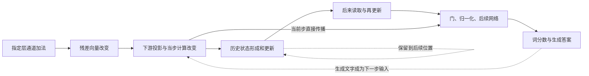

# A030：从扎针到回答，机制链已经解释到哪里

2026-11-16。来源基线：`fe02199bf4385f6cb1ffee8e098674b686a9d8b1`。本轮任务是总问题的完成度与缺口梳理，不是选下一方向。只有既有证据复读和独立上下文Advisor解释审查；没有新统计、评分、实验设计、模型或GPU运行。

## 1. 先把总问题与当前进度说准确

Acupuncture的机制总问题是：**训练好的模型中，少数通道的激活修改，怎样沿实际计算过程造成显著的回答变化；哪些变化决定其方向、强弱和持续方式？** 历史状态形成、更新和读取是已有证据最集中的部分，不应把总问题缩成撤针恢复、EOS或H/C门交换。项目另有稳定控制的实践目标，但本稿不把“还没做出控制方法”算成机制链缺失的一环。

**当前已经超出“找到异常、观察内部变化”的阶段，得到几段有真实行为后果的条件性因果通道和部分计算解释；尚未形成解释同一原生针效应的、衔接一致的完整计算论证。** 这里的完整不是每个神经元都解释清楚，而是能说明某个明确原现象中，针改变了什么关键计算、这些变化如何共同导致答案，并说明解释的边界。

不能用“已经做到第六步、只差最后一步”描述进度。我们在早段、中段、末段都有成果，也有断口；有些实验从自然受针状态出发，有些从修复后的混合状态出发，端点从内部量到完整编号答案不等。把它们按论文标题顺次排列，会产生一条实际上不存在的完整自然链。

上一轮A029把总目标及恢复需求现象合称“已选定下一阶段问题”，经用户纠正，已在聊天承认问题选择尚未完成。本稿只回答已经知道什么、还有什么不知道，不重复选题判断。

## 2. 模型实际经历的过程与我们的证据位置

下面是模型计算顺序，不代表每个箭头已经被我们的实验识别：

“一根针”通常指一个固定通道上的修改规则，不一定只发生一次：已有许多运行在多个提示或生成位置重复注入。注入还可以直接改变当前token的下游输出；历史路径并不是所有针效应必经的唯一通道。

| 链上问题 | 当前状态 | 已经解决到什么层次 | 主要缺口 |
|---|---|---|---|
| 针究竟改了什么 | 实现与线性关系明确 | 指定MLP坐标加法，经下投影成为残差方向写入；校准剂量可核 | 不是已经识别该通道的语义功能；部分旧记录缺逐token实际加法差 |
| 当步如何影响下游 | 路径明确，有限过程证据 | 固定输入下的方向性边界明确；同起点比较看到真实新写入和旧状态处理同时变化 | 哪些变化决定后续行为，不能仅由范数/分账回答 |
| 怎样形成和保留内部历史 | 有过程证据、条件干预和恢复关系 | 撤针后仍有新差异；恢复需求随条件变化；V相关替换确能控制某些停止结果 | 具体信息怎样改变、各状态的作用为何在条件间分叉，尚未统一解释 |
| 历史中的什么影响答案 | 有来源定向的条件因果证据 | 特定历史来源能经指定写入与随后用途改变完整选择 | 信息丢失、错绑定、读取改变与补偿未全面分开；未识别通用语义表征 |
| 同一写入为何用途不同 | 现象与部分用途解释明确 | WSB/RCS/A020识别背景配合、分子用途及连续响应差 | 同一写入在两背景为何得到不同任务作用，计算原因未收敛 |
| 局部变化怎样变为任务响应 | 有条件门作用与有限一阶解释 | NGU改变部分用途差；TGA解释指定换门操作的局部响应差 | 不能用该局部差的拟合替代原用途差或全部针效应 |
| 最终完整回答与持续行为 | 部分结构化任务有因果桥 | FX完整恢复、DWC等完整来源选择，早期有停答/重建结果 | 尚未解释广泛自由回答中的主题侵入、循环、关系错误及跨模型规律 |

以下逐段说明。C表示干净，T表示原生受针；近期H是恢复指定卷积历史、其余仍受针的混合状态，不是T。不同早期报告的H还曾表示固定头名单，不能把同字母视作同一对象。

## 3. 针到内部历史：已有的解释远不止“缓存变了”

### 3.1 入口操作已经清楚，但“一根小针被异常放大”不是已证实前提

当前主要针在MLP的down-projection之前给一个激活坐标加常数。实数线性关系是：

\[
\Delta r=\delta W_{\mathrm{down}}[:,j].
\]

这解释了一个坐标如何成为多维残差变化，不是新发现或已定位语义神经元。旧S2两锚点的代码、权重和校准复核显示，dose=−1时，常数乘权重列的向量范数约等于该层干净参考残差尺度，且连续作用于数十个位置。因此是坐标稀疏，不是已证明幅度微小。

已解决：注入位置、方向、尺度定义及第一条传播边。未解决：哪些方向为什么对某任务更敏感、是否涉及可解释功能。旧S2未保存逐位置加法前后激活，校准量不能冒充每一步BF16实际增量。[原核验§2](../../experiments/cache-intervention-chain-analysis-v1-2026-10-31/REPORT.zh-CN.md)

### 3.2 初始传播与“新写入—旧状态处理”已有实际约束

固定输入token序列时，本层注意力/缓存先于MLP，因此该针不能逆向改变本层当步缓存，也没有从更深层绕回本层未来输入的路径。第一受影响层在下游；自由生成文字分叉后，新的输入可再改变其他层，这个固定输入限制不再直接适用。

在S2的同起点比较里，同一个旧状态遇到针后驱动，会同时改变新写入和对旧状态的处理。它们在所测L16–18的首步部分反向，净状态差小于单独加性写入差；不是“两项必然同向放大”。先前早段受针的历史，还会改变后来同一针设置的局部响应。

这些是过程层面的实测认识：**针不是只把一份坏内容原样存进去；它还改变了模型处理已有状态的方式。** 但局部抵消不等于保护了答案，量的分账不等于独立因果贡献。[S2/S3对齐审计§3–4](../../experiments/cache-intervention-chain-analysis-v1-2026-10-31/REPORT.zh-CN.md)

### 3.3 撤针后仍有差异，已经排除一个简单维持故事

早期N5063确认中，k=4的18/20、k=16的9/9适用例，仅以相同可见文字重建干净状态才恢复，简单撤针不足。这支持内部形成历史的作用，不能只归为持续注入或文字本身；其他点又存在撤针即恢复、重建仍异常及反向结果。[早期原报告与更正](../../experiments/early-input-control-v1-2026-10-29/REPORT.zh-CN.md)

随后原生链审计进一步看到：撤针、且短卷积原槽位已经移出后，第一受影响层可以有相同卷积缓存但不同递推状态；更深L16–18仍有当前卷积前投影和value差异。这排除了“所有后续差异只是旧卷积槽尚未清掉、当前驱动已完全相同”的解释。已有历史会继续改变更深层输入和新写入，不能统称为静态残留。[原生链审计§2–4](../../experiments/cache-native-chain-audit-v1-2026-10-31/REPORT.zh-CN.md)

仍不知道：哪条具体的上游状态—下游驱动关系决定某一完整答案。固定驱动下旧状态差的局部收缩是公式性质，不代表整个网络或自由生成响应收缩；也不能从递推结构凭空认定存在自激放大。

## 4. 内部变化到行为：已经接通的三类桥

### 4.1 自然施针到V相关变化再到首步停止：S2/S3已有对齐通道

这段不能漏掉。在同输入、同早段前史的晚段比较中，L0条件的首步EOS从0/12变成12/12。S3把下游相关线性层的晚段卷积前V投影换回“早段仍受针、晚段不受针”的参照值，首步EOS变为0/12；只保留这组晚段V变化，首步EOS仍12/12，停止分数变化也大幅保留。

所以已经有**晚段施针—V相关计算变化—实际首步停止**的条件性因果通道，不应说完全没有针到行为的桥。V这里是计算变量，不等于已知自然语言内容；也不是后来的单份写入增量。

尚未接通的是更具体的中介解释：S2详细观察L16–18，S3替换覆盖下游全部相关线性层；未把某层某项自然写入变化对应到这些行为变化，替换后补偿/其他变量响应也未排除。S3晚段参照不是全干净00，不能因未恢复到00的事实读数，就宣布V只负责停止、另一个机制负责事实。

此外，S3主要测首步与强制候选，没有自由完整回答采集。其“停止分数偏移仍保留52–62%”条件，实际EOS已经0/12；这不是一半回答仍停。[S3合同](../../experiments/cache-formation-mechanism-s3-route-intervention-v3-2026-10-31/CONTRACT.zh-CN.md)／[结果及勘误](../../experiments/cache-formation-mechanism-s3-route-intervention-v3-2026-10-31/REPORT.zh-CN.md)

### 4.2 从自然受针历史恢复完整回答：FX/WIN不是只有内部指标

FX从T出发，保持递推、KV及其他未选状态为T，仅恢复全部指定深层卷积V，在旧P面板四方向合计48/48得到严格完整正确编号回答。固定45头子集严格正确0/48，其余头或随机子集也不能单独获得同样恢复。

这已给出**指定历史状态操作足以恢复完整回答**的实证。不能由此推出V唯一、全部头必要、各子集内部协同，也没有识别最初损伤的唯一原因。FX与S3的V不是同一操作：一个恢复边界缓存，一个在形成过程中替换投影。[FX合同](../../experiments/cache-fixed-v-delivery-v1-2026-11-02/CONTRACT.zh-CN.md)／[结果](../../experiments/cache-fixed-v-delivery-v1-2026-11-02/REPORT.zh-CN.md)

WIN把条件差异进一步显化：同一L0针，全前缀受针时只恢复递推，事实/编号正确10/48、6/48；只在记录之后受针时，同样恢复为47/48、48/48。全前缀条件再补前段KV，也到47/48、48/48。WIN-02在预留条件检验补KV关系，四个可正向检验格分别救回11/11、13/13、27/28、38/38。

因此已知恢复需求确实依赖形成条件，且一项有限关系有预留条件支持。面板已见、一半有效格来自同一随机方向、其他格天花板、部分预测失败，窗口还改变累计注入位置数，不能称“记录内容归KV、后段归递推”的固定分工。[WIN-01](../../experiments/window-recovery-win01-v1-2026-11-04/REPORT.zh-CN.md)／[WIN-02及更正](../../experiments/window-prediction-win02-v1-2026-11-04/REPORT.zh-CN.md)

### 4.3 历史来源到一次指定写入、再到读取和完整选择：DWB/DWR/DWC

这组实验比“恢复后答对”更具体：换入另一输入的历史来源，观察答案是否有来源定向地改变；限制来源只影响指定t1写入，t2起回到本分支计算；再在同一类写入端点间操纵随后直接读取的用途。正向获得、反向撤回和恢复自身答案共同支持这段关系。

DWC在96个新情境、六材料家族确认主方向：获得净来源作用.311、撤回.473、自身恢复.394；第二方向获得.213，未达预定.25关注量级，不是效应为零。它提供了有范围的新材料确认，不只是旧题反复拆解。

**已经解决：特定历史来源确实可以经指定写入与后续用途影响完整选择。** 没解决：这是否就是未修复原生T停答/错答的原因；所有供体作用是否由同一语义表示承担；每个操作的效果是否构成可相加的自然份额。“一次写入”在部分操作中是同一时刻14层联合，不是只改一个神经元或单层。

[DWB](../../experiments/cache-donor-write-bridge-v2-2026-11-07/REPORT.zh-CN.md)／[DWR](../../experiments/cache-donor-write-readout-v1-2026-11-07/REPORT.zh-CN.md)／[DWC](../../experiments/cache-write-read-confirm-v1-2026-11-07/REPORT.zh-CN.md)。DWC的直接读取D不等于RCS分子用途，确认身份不能转借。

## 5. 最近这段真正解决了什么：用途、门与后续响应

### 5.1 同样的写入，不是自带固定的答案效力

WSB把两份实际保存的写入增量分别放入C/H。无额外写入时两个背景原题都答对；只有H接收ΔH时来源作用强，C接收ΔH或H接收ΔC都弱。因此不能把强效归于增量单独携带某种固定效力，也不能说H对所有写入都强。H已经修过指定卷积历史，不能视作未修复T。

RCS在ΔH分支分开新增读数的分子用途与归一化分母用途。H仅分子时净来源分数.892、仅分母.024、两者都在.882、都关.017。分子获得/撤回有强行为证据；分母预定重要正向量级没有得到支持，但不等于证明精确零或近零等效。**这是计算用途辨别，不是已经证明“传递语义内容”对“无内容调节”的二分。**

同一分子用途的连续任务作用C/H为.481/5.911 logits，差5.430；完整注入总位移也不同，反对“其实位移一样、只有起始答案余量不同”的窄解释。较小余量仍可能参与。这部分已经把用途作用与跨背景差对齐，不能降为单纯范数观察。[WSB](../../experiments/cache-write-signal-background-v1-2026-11-11/REPORT.zh-CN.md)／[RCS](../../experiments/cache-readout-content-scale-v1-2026-11-15/REPORT.zh-CN.md)／[连续用途对齐](../../experiments/cache-readout-content-scale-v1-2026-11-15/analysis/background-response-r01/REPORT.zh-CN.md)

### 5.2 门是部分操作原因，但不是可移植的强开关

NGU只交换新增分子用途的参考门场。H换C门，任务响应下降1.404 logits，完整净来源分数.882→.590；C换H门仅增加.238，完整净来源分数仍0。按同一参照计算，分子用途背景差从5.430缩到4.026。

因此已经识别门用途对这项差异的实际条件作用，不能说完全没有计算解释。尚不能把差额折为自然机制百分比；也没有证明一个门开关决定全部H/C差异。[NGU](../../experiments/cache-numerator-gate-use-v1-2026-11-16/REPORT.zh-CN.md)

### 5.3 一阶解释已成立于指定局部操作，但“为何H更强”仍未完成

已有记录区分了净读取幅度、向量与门的适配；不能仅用“H读得更多”概括。TGA对已存换门补丁的任务梯度预测，在C/H两边达到冻结校准要求；平均换门不对称实测1.166、预测1.131。这解释的是**指定局部操作的平均响应差**，不是原用途差5.430，更不是全部针效应。

A024进一步表明，H的任务梯度不是C的统一倍数，非比例变化对指定方向给出更大投影；后续响应也不能只归为更少抵消。这是真实的局部认识。仍未确定是哪些下游计算改变了这种方向性响应，以及这些改变如何承接原用途差；NQ03/04误差保留为近似边界，不是新机制线索已获确认。[TGA](../../experiments/cache-task-gradient-v1-2026-11-16/REPORT.zh-CN.md)／[A024](../../experiments/cache-task-gradient-v1-2026-11-16/analysis/downstream-response-r01/REPORT.zh-CN.md)

## 6. 已知的失败同样规定了我们到哪里

| 已有结果 | 具体限制的说法 | 没有否定什么 |
|---|---|---|
| 早层事实候选敏感度确认约.12/.11；自由答案与固定候选有时不一致 | 不能说模型信息完整，只是不肯输出；不能用两候选偏好代替完整回答 | 没有证明整个模型永久失去知识 |
| LOCAL/B1第13层局部交互删除，对原生评分后半段停止作用很小 | 找到局部交互不等于找到大停止效应的中介 | 不否定该层其他时刻的形成作用或全部同类计算 |
| B2固定45头改变Q停止侧作用；后续计算候选未通过，FX固定名单不能严格恢复答案 | 有一个条件关系不等于其运算原因已解释；停止指标选头不能直接外推完整任务 | B2阳性条件关系与FX全部V恢复仍成立 |
| NWC同范数随机也可强烈致错 | 致错不是指定方向携带特殊内容的证据 | 不抹去DWB/DWC来源定向结果 |
| NGC指定增益策略四方向均无新完整正确恢复 | 内部增益规律准确，不保证能修回原生答案 | 不否定所有门、增益或其他时段机制 |
| DWC第二方向量级不足；RCS分母强预期未获支持；NGU反向弱 | 不能把局部阳性写成双向/跨针统一规律 | 不否定相应主方向的实测条件作用 |

这些失败不能通过换终点消掉，也不应被扩大为“整个机制研究失败”。具体来源：[早层知识读数](../../experiments/early-stop-knowledge-readout-v1-2026-10-29/RESULTS.zh-CN.md)、[LOCAL更正审计](../cache-local-readout-result-review-2026-11-01.zh-CN.md)、[B1](../../experiments/cache-vq-write-interaction-causal-v1-2026-11-01/REPORT.zh-CN.md)、[B2](../../experiments/cache-b2-v-subset-q-dependence-v1-2026-11-01/REPORT.zh-CN.md)、[B2后续](../../experiments/cache-b2-computation-followup-v1-2026-11-01/REPORT.zh-CN.md)、[NWC](../../experiments/cache-native-write-confirm-v1-2026-11-05/REPORT.zh-CN.md)、[NGC](../../experiments/cache-native-gain-v1-2026-11-08/REPORT.zh-CN.md)。

## 7. 从头到尾仍缺什么

**第一处：从针造成的自然变化，识别任务相关的具体改变。** 已知实际状态、投影、写入与处理都变了；也知道一些V相关操作能控制停止或恢复答案。尚不能稳定判断：某一原始错误是相关信号被破坏、错误记录被绑定、读取条件变了，还是多种计算配合改变。不能用V这个变量名代替其信息含义，也不能用“背景依赖”代替原因。

**第二处：把已有条件通道接回同一个原始现象。** S2/S3已有对齐的针到停止通道，FX有T到完整恢复，DWB/DWC有供体写读到完整选择；这些都不是零进展。但尚未把同一原生针的形成变化、持续处理、实际读取和最终完整错误，以一致条件和端点接成计算解释。N5063、WIN、DWC、H/C不可直接拼成同一自然链。不是要求每一层都测完，而是关键连接不能靠跨条件叙述补齐。

**第三处：解释已经测到的强弱与分叉。** 对局部H/C，已有分子和门用途证据，却没有解释同ΔH为何在H产生更大任务响应；对更早的形成条件，已知恢复需求不同，却未解释为什么如此。两者是不同尺度、不同条件的未完成解释，不能把第二项小分叉自动升级为总课题，也不能认定它们是一个未测系数。

**第四处：从有边界的案例走向有说明力的适用范围。** 已有DWC新材料确认、WIN预留条件及跨方向恢复；这并非完全没有验证。但近期用途链主要依赖同模型、已见结构面板和混合背景。循环、跨题主题侵入、自然语言关系错误、跨模型机制和自由生成持续性，尚没有相应的完整因果解释。范围扩展是主张边界，不意味着一项有价值的部分机制必须覆盖所有现象。

不能据此报“完成60%”。更准确的位置是：**操作与架构路径明确；状态形成有过程证据；若干状态/写入/读取用途到行为的桥已建成；部分用途及局部响应已被解释；关键自然路径的衔接、强弱来源和范围仍未完成。** A026所说的同ΔH用途差计算原因是这张全图中的一个局部缺口，不是全课题只剩的唯一缺口。

## 8. 证据核验与Advisor处理

本轮复用171目录账和C01–C19证据卡，直接回读S3合同/原报告、S2–S3对齐审计、原生链审计、E2、更新—读取审计、LOCAL更正、B1/B2及后续、FX合同、DWB原报告；近期DWC/WSB/RCS/NGU/TGA/A024及WIN和早期确认沿用本连续讨论已核的原报告/协议/回执。没有重算原始张量或全部回答，不把原工程验收冒称本轮重跑。

作者初稿“首尾有证据、中间未贯通”过于粗略。同一独立Advisor要求明确保留：S2同起点过程关系、S2/S3同前史的V到实际停止桥、FX从T出发的完整恢复桥、B2条件阳性及其解释失败。已采纳，正文不再把中间仅称为观察/分账。另采纳固定token与自由生成的边界、S3参照不是00、DWC与RCS不同操作、晚段V与事实使用不能强行二分。同人复核后在图中补上当前步直接传播边，避免图示暗示所有效应必经历史。审查记录：[A030](reviews/2026-11-16-30-review.md)。这是独立上下文AI审查，不是独立复现或人类专家认证。

本稿不提出新问题候选、实验矩阵、样本量或预算；没有重新启动任何旧计划，也不宣称新设计C01–C14验收通过。
