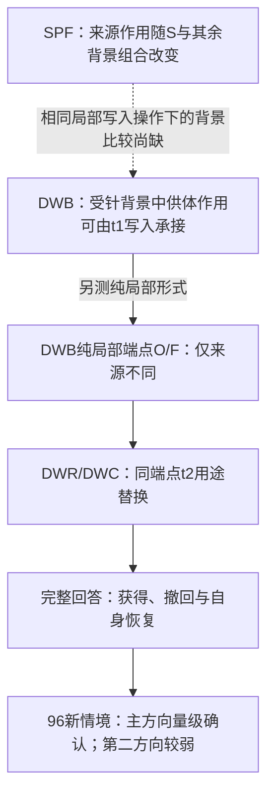

# 稀疏激活干预后的答案选择：历史来源的背景依赖与写入—读取关系

中文研究稿。完整结果、覆盖与图件见补充材料〔未随稿提供的内部链接〕。

## 摘要

少数激活坐标的干预能够显著改变语言模型的回答，但错误并不直接说明历史信息已被删除，也不能由缓存恢复的成功确定具体计算原因。我们在Qwen3.5-4B上区分作答交付、答案选择和状态信息可利用性，研究历史来源如何在受针条件下进入写入并影响后续回答。开发材料上的缓存比较显示，供体缓冲的选择效应依赖递推状态与其余接收背景的组合；受针状态单独引发选择翻转的预测不成立。进一步实验将供体来源的作用连接到最后提示步的指定写入：仅在该步使用供体V历史即可转移选择，反向换回自身写入可恢复自身答案。在纯局部写入端点上，直接读取的来源替换能够获得和撤回供体选择。冻结这些操作后，六结构族96个新基础情境确认主方向的获得0.311、撤回0.473及自身恢复0.394；第二方向同向，但获得0.213低于预设量级。随机读取反例和受针状态移植排除了首列错误特异性及统一信息删除解释。结果建立了受针条件下可预测的来源—写入—读取关系，并表明其作用受到背景、方向和用途约束。缓存级背景差异尚未在相同局部写入操作下被直接比较，因此这些证据不等于完整原生失效链，也尚未把缓存级背景差异归因到同一局部写入／读取依赖。

## 1. 问题与核心认识

稀疏激活干预为什么会产生大的回答变化？这个问题涉及干预后的历史形成、当步写入、旧状态处理和后续读取。撤针和恢复操作提供诊断窗口，完整回答则决定计算差异是否产生了实际行为后果。我们的多模型单针观察和跨规模能力测评已经显示现象广度；本文的机制分析集中于4B模型中的记录检索，不能用现象覆盖替代同一机制的跨模型证明。

我们区分三个问题：模型是否交付有效答案，交付时选了哪条记录，以及受针形成的状态是否仍有可被其他计算背景利用的选择信息。平均缓冲可以恢复开口却不能稳定恢复选择；随机读取扰动可以产生相同的首列错误；受针供体状态在另一接收背景中仍可能转移选择。这些结果共同表明，错误样式、恢复量和状态距离都不足以单独说明信息是否被删除。

本文中心认识由两层证据组成。**第一层是历史来源的背景依赖：供体缓冲能否改变选择，取决于接收者递推状态和其余计算背景的组合。第二层是指定条件下的计算连接：供体来源的作用能够经局部写入形成状态差，并通过后续直接读取获得或撤回完整答案中的选择。** 两层证据相容，但使用的操作端点不同；我们分别陈述它们，不将其相接处假定为已识别的自然路径。

具体贡献如下：

1. **约束干预后的失效解释。** 缓存级比较否证“受针状态来源单独决定供体接管”的预测；随机首列和受针状态转移反例进一步排除由错答图样推断特定内容、以及跨方向统一信息删除的解释。
2. **把来源效应连接到明确的写入与读取操作。** 仅在最后提示步写入供体相关差异即可转移选择，换回自身写入可恢复自身答案；在同一纯局部写入端点间，读取用途替换又能获得和撤回定向选择。完整交付和自身恢复区分了选择变化与一般退化。
3. **确认关系并保留失败边界。** 固定操作在新材料上兑现主方向的双向量级预测；第二方向获得较弱，D/E用途异号，族间效应不同。这些是已测条件关系的范围，不是普遍功能分工或参数无关规律。

这一认识的用途是指导机制判断：先区分是否能答、答什么和状态能否被利用，再检验来源进入哪个写入、哪个状态用途影响行为。它不要求发明新的状态更新公式，但要求每个解释对应具体比较。尚缺的关键比较在§6集中列出。

## 2. 计算基础与已有研究

对单个递推头，省略层号，在实现规定的归一化下有：

\[
S_t=\alpha_t(I-\beta_t k_tk_t^\top)S_{t-1}+\beta_tk_tv_t^\top,
\]
\[
o_t=\underbrace{\alpha_tS_{t-1}^\top q_t}_{D_t}
+\underbrace{-\alpha_t\beta_t(k_t^\top q_t)S_{t-1}^\top k_t}_{E_t}
+\underbrace{\beta_t(k_t^\top q_t)v_t}_{W_t}.
\]

本文统一用 **E_t=−α_tβ_t(k_tᵀq_t)S_(t−1)ᵀk_t** 表示含负号的旧预测修正用途。q已经包含内核的维度缩放，α是衰减系数。式子描述局部计算；高层驱动和后续生成随干预响应，不能据此把整模型行为拆成可加的机制份额。

| 已有来源 | 已有认识或工具 | 本文须另以数据回答的内容 |
|---|---|---|
| [Gated Delta Networks](https://arxiv.org/html/2412.06464v3)，§3 | 门控递推更新规则 | 指定受针条件下各操作对完整回答的大小、方向与边界 |
| [What Attention Recalls and Recurrence Controls](https://arxiv.org/html/2609.04434v1)，§3–4 | 混合模型缓存拆分、交叉来源交换 | 本文背景依赖及局部计算比较；不能以KV供体跟随本身承担新颖性 |
| [How Linear Attention Remembers](https://arxiv.org/html/2609.33093v1)，§2–4 | 写入、状态及读取的因果干预；存储与访问的区别 | 干预后的具体失效约束及可预测的来源—写入关系，不声称首次写读链 |
| [Who Asks, Who Answers](https://arxiv.org/html/2611.01909v1)，§5.2、§7 | 递推状态携带检索目标、参与构造全注意力查询 | 本文的GDN输出用途不是该文全注意力reader；不由文献层号指定本实验路径 |
| [Representational Analysis of Binding](https://arxiv.org/abs/2409.05448v3)；[Mixing Mechanisms](https://arxiv.org/abs/2510.06182v2) | 次序子空间与多种绑定机制 | 位置预测较强是否等于内部纯位置编码，现有结果不能作此推论 |
| [How to use and interpret activation patching](https://arxiv.org/html/2404.15255v1)，§2–3 | 恢复、污染与背景依赖的解释边界 | 具体模型中的条件关系，而非再将方法论警告当作新发现 |

区别于一般供体移植有效性，本文提供的是缓存级背景比较、指定写入的获得与自身恢复、同端点读取及新材料预测的组合证据。不过，**受针背景相对干净背景究竟改变了局部写入／读取的哪项依赖，仍不能仅由这些不同端点的阳性推出。** 这是实质证据缺口，不以“受针”二字替代新颖性论证。文献入口及此前核查范围见近邻审计〔未随稿提供的内部链接〕；本轮未进行新的穷尽优先权检索。

## 3. 方法：从来源到完整答案

### 3.1 模型、干预与时序

主模型为Qwen3.5-4B，revision `851bf6e806efd8d0a36b00ddf55e13ccb7b8cd0a`，BF16、eager、batch 1及冻结的torch参考核。主方向为L0/N4146，第二方向为L0/N1210；早期R0与C1343按各自实验身份进入补充，不能当作DWC额外确认方向。主针与操作层组承接开发历史，并非对模型通道的随机抽样。

干预施于L0 MLP的down_proj输入单坐标。名义剂量d=−1，实际激活增量为η=d·s_ref/‖W_down[:,j]‖₂，再按引擎转换为BF16；注入处名义残差增量是ηW_down[:,j]。s_ref沿用旧NQ各族参考文本的残差尺度，DWC不在新材料上重新校准。因而−1不是激活数值减1，少坐标也不意味着小扰动。具体校准与BF16写入验收见[write_audit](attachments/experiments/cache-cross-channel-validation-v1-2026-10-31/xchan.py)。

NA布局先给记录，再给查询与回答指令。设b为记录边界的最后token，n为完整模板化提示长度，B1在位置[b+1,n−2]形成受针历史；最后提示token n−1不再施针。τ为该token之前的缓存切点，t1处理最后提示token并预测首个生成token，t2处理这个自然生成token。DWC提示长度58–64，B1共26–28个位置；同情境最后四个已缓存token相同。以[冻结分词账本](attachments/experiments/cache-write-read-confirm-v1-2026-11-07/data/token-ledger-r01.json)而非文字字符数定义位置。

**图1：实验时序与端点。** 图中实线是执行顺序，不代表已经证明的唯一自然中介。


写入／读取操作在G={13,14,16,17,18,20,21,22,24,25,26,28,29,30}这14个深层GDN层联合实施。G承接既有深层操作范围，不是本轮新筛选的最小路径，也不是14个独立样本。“一步写入”指同一t1时刻的14层联合操作；上层会响应下层变化。

### 3.2 完整用户提示与供体实例

下面取固定正式材料的第一个情境、ABC-A接收者及第一个AL供体ABC-B，未按输出筛选。两者记录相同、查询不同。以下展示完整用户消息；实际输入使用冻结的聊天模板，位置以§3.1分词账本为准：

**接收者 `DWC-NQ01-S00-B0-ABC-A`：**

```text
仓储台账：绿纸盒编号为U63，黑纸盒编号为U52，黑茶杯编号为U41。
绿纸盒的编号是什么？
请根据上面的记录，简短回答，只需给出编号。
```

**供体 `DWC-NQ01-S00-B0-ABC-B`：**

```text
仓储台账：绿纸盒编号为U63，黑纸盒编号为U52，黑茶杯编号为U41。
黑纸盒的编号是什么？
请根据上面的记录，简短回答，只需给出编号。
```

接收者答案为U63，供体目标为第2行U52。供体V历史来自供体的干净运行；接收者仍使用自己的提示，不能将转向叫作自身原有记忆恢复。其他供体还改变记录顺序，主比较包括同排列不同查询AL、同查询异排列KS、目标行相同RS及其他可分预测BD；三路绑定诊断另改变实体—编号绑定。

这个固定例子在N4146下原生输出为`<|im_end|>`，O、F、获得D和撤回D均为`U63<|im_end|>`，**没有供体转移**。它用于说明实验输入和操作身份，不承担阳性论据；总体结果保留这类失败。原始逐臂文本及来源hash见[核查记录](attachments/docs/paper-revision-v1.8-2026-11-08/source-audit.json)，完整材料见[materials-r01](attachments/experiments/cache-write-read-confirm-v1-2026-11-07/data/materials-r01.json)。

### 3.3 两种写入背景必须分开

C表示干净历史，T表示原生受针历史。卷积缓冲q/k/V、递推状态S和全注意力KV是不同持久对象；恢复S并不恢复其余两类。

**缓存到写入的桥接（DWB）。** 下表共同使用T作为接收底座，G层q/k缓冲来自本输入干净运行；此组不使用写入k去偏移。

| 端点 | t1写入的v来源 | t1之后保留的V缓冲 | 比较作用 |
|---|---|---|---|
| OO | 本输入 | 本输入 | 自身来源参照 |
| DD | 供体 | 供体 | 持续供体缓冲参照 |
| DO | 供体 | 本输入 | 仅让供体V历史影响t1写入 |
| OD | 本输入 | 供体 | 保留供体V，但把t1写入换回自身 |

局部v由**当前分支输入**与指定来源的干净V历史做影子卷积计算，不是整条干净供体运行的v。DO/DD及OD/OO在t1按构造一致，之后缓冲留存不同；当步一致是工程验收，之后完整回答仍转移或恢复才是科学结果。DWB合同与实现〔未随稿提供的内部链接〕

**纯局部写入与读取端点（DWR/DWC）。** O=L11o与F=L11d都保留T预填，不整体替换缓冲；仅t1写入项βkvᵀ的v分别使用自身／供体干净V历史，并共同使用冻结的写入k去偏移。k修正是在旧k缓冲槽上减去由其他五个开发场景估计的共同偏移，再经当前输入、卷积和归一化得到影子k；并非直接从归一化k减一个常数。旧预测修正项中的k仍来自本分支。影子量不写回卷积缓冲，但写入会改变S₁和下游量。O/F仅在所指定的历史来源上不同，后续状态和输出允许响应；O不是完整干净运行，F也不是整条供体运行。

早期LVK/SRU使用的L10/L11仅在是否修正写入k上不同，不等于本节O/F。DWC没有确认所有旧端点，也没有把DWB的OO/DO/OD/DD矩阵完整搬到新材料。[局部写入实现](attachments/experiments/cache-local-v-k-v1-2026-11-03/lvk_run.py) · DWC合同〔未随稿提供的内部链接〕

### 3.4 t2读取用途与完整回答

在每个指定层，接收分支当前驱动为q、k、α、β；以供体端点S₁替代接收端点S₁所产生的两个输出补丁为：

\[
\Delta o_D=\alpha\Delta S^\top q,\qquad
\Delta o_E=-\alpha\beta(k^\top q)\Delta S^\top k.
\]

获得在O分支的D或E用途中读取F状态，撤回则反向进行。补丁加入该层输出，不把供体S₁写入持久缓存；该层返回的S₂仍按接收分支当前驱动更新，上层及之后状态会响应补丁。t3起无钩子，因此测得的是指定操作的条件总效果，不能称各层或用途的独立机制份额。[读取实现](attachments/experiments/cache-state-read-use-v1-2026-11-03/sru_run.py)

首token自然停止时不强制进入t2，记录不可达no-op并保留分母。O/F首token不一致也各自自然继续；DWC N4146一致率1.000，N1210为0.997685，后者不称严格共同前缀实验。所有自然生成沿用32新token上限。完整编号需满足冻结解析器对自然终止、think闭合和唯一列表编号的要求；停止、其他及截断保留，不能以开口率或首步logit代替完整答案。[输出解析](attachments/experiments/cache-selection-precedence-v1-2026-11-06/spf_analysis.py)

### 3.5 净转移、获得、撤回与统计单位

设r为接收者，A_r为同排列不同查询的AL供体集合，p_d为供体d的目标行，Y_(r,d)^a为臂a的完整输出行。对照集合C_(r,d)包括同场景供体x，其目标行和其查询实体在接收者中的行均不等于p_d。每接收者的净转移为：

\[
D_{\mathrm{tr},r}^{a}=\frac1{|A_r|}\sum_{d\in A_r}
\left[\mathbf1\{Y_{r,d}^{a}=p_d\}
-\frac1{|C_{r,d}|}\sum_{x\in C_{r,d}}\mathbf1\{Y_{r,x}^{a}=p_d\}\right].
\]

例如某个AL供体目标为第2行，输出命中；三个合格对照供体下的输出依次为第1、2、3行，该供体的贡献为1−1/3=2/3。这是**算术示例，不是本研究新增观测**。若所有供体下固定输出同一行，两项相消为0；停止也不计为任一行命中。D_tr是供体条件对比量，不是准确率、成功概率或机制份额。[统计定义](attachments/experiments/cache-selection-precedence-v1-2026-11-06/spf_core.py)

对用途u∈{D,E}，G_u=D_tr(O读F)_u−D_tr(O)，W_u=D_tr(F)−D_tr(F读O)_u。自身恢复R_u是在AL/BD选择冲突配对上，撤回臂答自身的比例减去F答自身的比例。G/W与R是不同估计对象；撤回只有同时检查完整交付与自身恢复，才能区别于一般输出退化。

开发阶段有48个已见输入、6个场景；每方向348个有序配对不等于348独立样本。DWC固定六族各16个新情境，共96情境、864接收者，每接收者8个主供体；每供体臂每方向6912配对。D_tr先在情境内平均，再六族等权；区间为族内整情境配对bootstrap 20000次，种子2026110703。新估计对象不与旧面板合并，81648条轨迹也不作独立样本数。

主确认预先指定N4146，要求F、G_D、W_D的95%区间下界≥M=.25，R_D下界>0，且干净正确率、O/F可达率及完整交付护栏通过。交付率至少.90，读取臂相对其接收端点下降不超过.05。M是关注量级，不是统计零效应界限。N1210单列，不能换赢家。另24情境、每方向1296配对检验位置／实体／编号三种互异且平衡的预测，不参与主成功判定。预检与正式材料分开，不按模型正确率筛题，不在新题重新估计偏移或校准。[DWC分析](attachments/experiments/cache-write-read-confirm-v1-2026-11-07/dwc_analysis.py)

## 4. 结果：哪些关系已经成立

### 4.1 现象覆盖与选择失效的区分

已有四模型18,272份唯一单针回答，其中7,632份有同文字历史的内部参照轨迹；固定题仅8道，记录数不是独立问题数。另一协议下，冻结的4B→9B/2B双通道迁移在各1,400题上造成明显能力损伤。例如9B MMLU由70.06%降为25.39%，2B由54.06%降为46.00%；随机源也能损伤，生成题部分失分伴随截断。完整八项成绩及区间见[补充S1表A/B](supplement.zh-CN.md#s1-完整结果原4)。这些是动机和范围证据，不把中层双针与L0/B1机制协议合成因果链。

机制面板中，平均干净缓冲让四个测试方向全部开始作答并交付编号，却只使主方向N4146正确17/48，其中16条目标本在首列；非首列仅1/32正确。恢复交付不等于恢复选择。新输入读取确认中，按补丁范数匹配的随机方向也可产生首列错误：继续生成的20个随机方向里，N4146/N1210/R0分别有8/4/8个达到对应D10完整回答损失的一半。这否定由首列错答推断原生状态特有内容的解释，未证明任何随机方向都有效。FBR〔未随稿提供的内部链接〕 · NWC〔未随稿提供的内部链接〕

### 4.2 历史来源的选择作用依赖接收背景

**表1：供体干净缓冲进入不同背景，N4146净转移。** 开发面板；区间按6场景重抽。四格均改变缓冲来源；“其余背景”不含表中已指定的S和缓冲。

| 递推状态S来源 | 其余背景C | 其余背景T |
|---|---:|---:|
| 本输入干净 | 0.000 | 0.000 |
| 本输入受针 | 0.000 | **0.896 [0.827,0.955]** |

受针状态单独放入干净其余背景不能引出供体效应；反之，受针其余背景中换回自身干净S也能压住效应。这个结果否证了状态来源单独决定选择翻转的预测，支持两者组合的条件依赖。它不证明存在两个独立信息源，也不识别唯一“仲裁器”。N1210的状态恢复前提因32/48预算截断未通过，相关压制对比保持不可判，不借主方向结论覆盖。

在N4146上，供体V配自身干净q/k同样净转移.896；供体V配受针q/k时净转移仅.003且目标不在首列时全部落首列。供体身份可以由V操作传递，但q/k的背景状态仍重要，“身份不必来自q/k”不等于“q/k无关”。SPF报告及§9更正〔未随稿提供的内部链接〕

### 4.3 来源效应可以由指定写入承接

**表2：受针接收背景上的写入桥接，D_tr及95%开发区间。**

| 操作 | N4146 | N1210 |
|---|---:|---:|
| 持续供体V：DD | 0.896 [0.827,0.956] | 0.490 [0.370,0.595] |
| 仅t1供体写入：DO | 0.882 [0.820,0.937] | 0.427 [0.278,0.556] |
| 保留供体V、换回自身写入：OD | 0.000 [0.000,0.000] | 0.000 [0.000,0.000] |
| 纯局部端点F：影子v＋写入k修正 | 0.635 [0.431,0.812] | 0.465 [0.346,0.604] |
| 受针供体S进入干净接收者 | 0.094 [0.042,0.144] | 0.799 [0.588,0.960] |

两个方向仅t1写入即可达到预设转移量级。反向OD使168个选择冲突配对全部恢复自身答案，全部348配对都交付有效编号；N4146全配对仍有1条首列错答，不能写全部恢复。转移下降因此不是停止或截断造成的。DO/DD的比值不解释为机制份额，也没有检验两者等效。

受针供体S在干净接收者中出现跨方向分叉，尤其N1210仍有强选择转移。这排除两个方向统一信息删除的解释；N4146低于门槛不证明信息不存在。表中纯局部F与DD/DO使用不同背景操作，不将数值差解释为某一组件贡献。DWB报告〔未随稿提供的内部链接〕

### 4.4 同端点读取关系获得独立材料确认

DWR先在已见材料上测到D用途获得.396/.271、撤回.538/.438及自身恢复；获得区间跨过M=.25，开发阶段量级不可判。DWC固定O/F及D/E操作后检验新材料，不能将其正式结局倒写进开发阶段。

**表3：独立材料上的写入端点与读取效应。** 95%族内情境重抽区间；F为供体净转移，G/W为配对净转移差，R为冲突配对自身恢复差。

| 方向 | 用途 | F | 获得G | 撤回W | 自身恢复R |
|---|---|---:|---:|---:|---:|
| N4146 | D | .588 [.564,.611] | .311 [.291,.331] | .473 [.452,.495] | .394 [.374,.414] |
| N4146 | E | .588 [.564,.611] | −.013 [−.018,−.009] | −.037 [−.047,−.027] | −.022 [−.027,−.017] |
| N1210 | D | .309 [.285,.332] | .213 [.192,.234] | .294 [.270,.318] | .322 [.299,.344] |
| N1210 | E | .309 [.285,.332] | −.004 [−.007,−.001] | −.024 [−.031,−.017] | −.014 [−.019,−.010] |

N4146满足F/G_D/W_D下界≥.25、R_D下界>0及全部护栏。N1210关系为正，但G_D上界.234低于M，是强量级预测失败，不能称没有读取作用，也不再称仅跨门槛不可判。D撤回使冲突配对自身答案由820增至2182/3456、由2021增至3133/3456，两方向撤回臂均6912/6912有效编号，排除了仅靠一般退化压低转移的解释。

原生N4146却有861/864停止，原生自身正确仅1/864；局部修复后的O为735/864自身正确且全部有效。这明确了因果对象：主结果发生在指定可作答端点，不能宣称完整解释原生停答。N1210的O有1/864停止，gainD、gainE各8/6912停止，均保留分母，护栏通过不等于每条成功。DWC结果与完整交付表〔未随稿提供的内部链接〕

**图2：当前证据连接。** 实线为已测操作关系；虚线明确标识尚未测得的跨接口连接，不能把图读成完整自然路径。



### 4.5 用途与适用条件：经验分叉还不是完整计算解释

D与E在新材料中呈不同方向。D−E的获得差为.324 [.304,.344]与.217 [.195,.238]，撤回差为.510 [.488,.532]与.318 [.294,.343]。但两补丁本来就投影到不同方向、具有不同缩放与符号。公式不保证完整回答异号；观察到异号也不证明等幅条件下的天然功能分工。当前Git归档中的DWR/DWC正式记录没有保存对应补丁向量、范数和夹角；运行器计算的这些量未进入正式持久记录，不能从t2哈希或答案反推出几何。[字段与来源核查](attachments/docs/paper-revision-v1.8-2026-11-08/source-audit.json)

族间差异也不能被总体确认遮盖。下表直接摘录已有分析的逐族点估计，不新增拟合、显著性筛选或原因推断：

| 结构族 | N4146 F / G_D / W_D / R_D | N1210 F / G_D / W_D / R_D |
|---|---|---|
| NQ01 | 0.247 / 0.117 / 0.171 / 0.151 | 0.257 / 0.208 / 0.253 / 0.335 |
| NQ02 | 0.642 / 0.352 / 0.521 / 0.432 | 0.267 / 0.139 / 0.259 / 0.247 |
| NQ03 | 0.708 / 0.502 / 0.632 / 0.604 | 0.082 / 0.030 / 0.082 / 0.057 |
| NQ04 | 0.775 / 0.372 / 0.616 / 0.443 | 0.409 / 0.301 / 0.390 / 0.422 |
| NQ05 | 0.471 / 0.156 / 0.354 / 0.250 | 0.584 / 0.409 / 0.571 / 0.561 |
| NQ06 | 0.683 / 0.367 / 0.546 / 0.484 | 0.252 / 0.189 / 0.208 / 0.309 |

F、G、W、R同时变化，没有由此证明哪项造成另一项；不将G/F归一化改作原主要终点，也不以低F自动解释第二方向失败。CGV中部分结构只改善目标竞争而很少改善完整回答，进一步限制跨结构外推。

预指定的24情境绑定诊断中，F的“位置／实体／编号”匹配分别为N4146的.561/.217/.222和N1210的.467/.265/.269；gainD仍更符合位置预测，撤回后位置偏向减弱。平衡设计排除了固定答自身或首行自动造成的占优，但这只区分操作下的行为预测，不定位内部纯位置编码。所有诊断区间、失败和CGV边界见[补充S1](supplement.zh-CN.md#s1-完整结果原4)。

## 5. 这些证据如何解释干预后的变化

第一，失效不能只用“缓存内容坏了”概括。相同来源替换在不同接收条件下作用不同，而某一方向受针形成的状态仍能转移选择。信息可用性和当前计算条件必须一起考虑。此判断来自受控背景与移植结果，不来自状态范数或错误样式。

第二，来源的作用不止表现为整块恢复有效。DWB在明确的受针、干净q/k条件下将持续供体缓冲缩减为t1写入，并用反向自身写入撤回选择；DWR/DWC又在纯局部O/F之间识别后续读取作用。它们给出了可继续检验的计算关系，且主方向已在新材料兑现行为预测。

第三，这些证据尚未确定干预改变的具体依赖。SPF的背景交互是缓存级结果，DWB的局部写入因果比较集中于T背景；DWC的O/F还含写入k修正。因而“受针使本来不重要的局部写入变成选择决定因素”目前只是候选解释。缺口在具体跨背景比较，既不是完全没有背景证据，也不是还要重做所有写读实验。

对D/E同样应分三层：公式规定补丁怎样计算；实测显示完整回答的方向和大小；解释为什么产生这些方向差异还需要对应几何或其他可区分证据。旧公式和一般移植关系是研究工具，本文已有增量是指定干预条件下的经验约束与预测，不声称新架构原理。

## 6. 真正缺失的比较与结论边界

| 要回答的主张 | 现有证据 | 真正还缺什么 |
|---|---|---|
| 历史来源效应有背景依赖 | SPF四格，已测 | 不需要重跑整套四格；尚未把差异定位到同一局部写入操作 |
| 受针背景中一次指定写入能承接来源效应 | DWB DO/OD及自身恢复，已测 | 干净接收背景上的对应局部写入比较未测；SPF整块供体缓冲不代替它 |
| 指定O/F的读取关系可预测新材料 | DWR/DWC，主方向已确认 | 不需要再补同类主方向阳性；同操作跨背景／跨模型关系仍未测 |
| D/E分叉对应怎样的计算原因 | 公式与行为差异已有 | 相同端点、相同轨迹的补丁几何记录在当前归档中缺失；不同旧端点的摘要不能补齐 |
| 上述关系解释原生停止或全部能力损伤 | 修复端点反事实、现象资料已有 | 完整原生机制未识别；不把局部对照包装为一次闭合整个问题 |

**结论：若下一阶段要进一步解释“稀疏干预具体改变了哪项计算依赖”，仍需要新的可比对照；论证重组不能补出这些未测运行。** 首先应完成DWB来源→t1写入接口的干净背景对应操作设计，而非直接扩9B。DWB的DO/OD本来不含k去偏移，较适合作为检查操作可比性的起点；这只确定缺口位置，尚未给出冻结矩阵、样本或预算，也未证明该比较必然有阳性。

若只陈述当前已证实的背景依赖和构造性关系，现有结果已足以支撑这一有边界的论文；新增对照服务于更强解释，而非使全部旧结果从“无效”变“有效”。CWR9仍是后续范围验证候选，不能替代这个局部解释缺口。详见逐格证据对照及作者自查〔未随稿提供的内部链接〕。

## 7. 局限与总结

机制证据集中于4B、两个主要方向、14层联合操作、有限词表的六结构族及32-token自然回答。新材料独立性不等于新任务或跨模型泛化；开发阶段48输入也不等于48独立情境。N1210强量级失败、SPF简单翻转假说失败、NWC随机反例、CGV弱完整回答效应、WIN/KVC不同协议边界均保留，完整结果见补充。

稀疏干预后的回答变化呈现出可检验的背景、来源和状态用途依赖。我们已证明指定来源作用可以经局部写入被传递，并在同端点读取中获得或撤回完整答案中的选择；主方向的新材料确认使这项关系超出开发面板。与此同时，历史来源的背景差异与局部写入关系之间仍缺同操作比较。当前工作因此提供了明确的条件性机制片段和失败约束，尚未给出统一的原生失效解释。

## 数据、复现与责任说明

原始回答、失败、冻结配置、分析代码和回执保存在各实验目录；[补充S2–S4](supplement.zh-CN.md#s2-覆盖账本原6)提供范围与工程入口。DWC原控制器因新增预算脚本进入冻结目录匹配而最终报failed，200个原冻结文件未变；恢复验收和原失败均保留，不能称自动验收一次通过。正式17.460514、含预检18.231091 GPU进程小时是历史实测，作者侧自查不等于独立复现。

本工作涉及模型行为操控与能力损伤，结果不应被解释为已验证安全收益或“道德神经元”。作者、贡献分工、资助、利益冲突及最终伦理声明待作者确认，不由助手编造。本稿及核查记录由AI辅助整理，实验责任和投稿内容须由作者审定。当前是中文研究工作稿，不标为可直接投稿。
