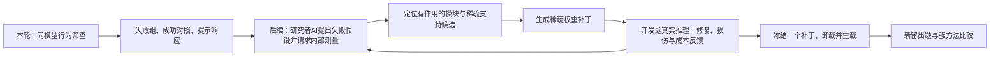

# WSP-VL-SCREEN-01：三个候选的行为筛查与稀疏修复衔接

日期：2026-11-05。版本：v1。**仅方案；没有运行模型、生成实验数据、提取激活或修改权重。** 本版取代旧 WSP-VE-01 的下一步安排；旧方案的“设计通过”结论不再作为实施依据，历史文件保留。

配套：[设计者自查](wsp-vlm-behavior-screen-self-check-v1-2026-11-05.zh-CN.md)。

## Material Passport

- 工作流：academic-research-suite / experiment-agent / plan；简体中文。
- 材料：公开原始论文、作者网页、模型配置、数据卡，以及项目既有 WSP 工程记录；本项目目标模型行为证据为零。
- 身份：作者报告、设计推断、未来操作分别标明；Verification Status：实验 UNVERIFIED。
- 本次授权：方案、自查、GitHub 文档交付。无模型/GPU运行授权。

## 1. 主线与这一步的用途

**总目标：让研究者 AI 根据真实反馈，发现并修改训练后 VLM 中少量权重，修复一类可重复的任务失败；冻结补丁后由模型独立完成任务。** 行为筛查服务于这个目标，不另立一个只报告 VLM 低分的基准项目。

本轮只解决：在同一个目标模型上，三个候选是否确有明显、可重复、有可判答案与对照的失败，哪些值得投入下一轮 WSP 诊断。筛查产物是失败原文、成功对照、条件变化、提示响应和候选优先级；**它不证明存在稀疏解，也不寻找最终补丁。** 定位、临时激活干预、权重试改均在后续独立阶段。

三个候选收敛如下；这是可被否定的工作假设，不是已观察结果。

| 候选 | 具体失败假设 | 本轮对照 | 对 WSP 的意义与未知 |
|---|---|---|---|
| A：混合类别计数 | 总数与布局相同时，几何形状从单类变成两类后，总数回答变差 | 同位置、同总数的单类／混合图；混合图的分类型计数 | 可把“漏掉一类”“每类会数但合计错”分开交给 AI；是否能靠稀疏修改修复未知 |
| B：空间条件下的对象筛选 | 同图能数出全部对象，加上位置或距离条件后，不能正确数出目标子集 | SPHERE 对应的全部计数／位置或距离条件计数 | 可以查条件是否被忽略、参照物是否混用；不是预先认定存在空间神经元 |
| C：视觉与常识冲突 | 无图或正常图能答通常大小，反事实图使“通常”回答偏向当前像素 | 无图常识＋原图／反事实图，各问图中与通常 | 可能需要按问句调整证据使用；修复必须保留图像题，不能统一忽略图像 |

B 是将此前笼统的“空间关系组合”收敛为**有现成对应题的空间条件计数**，不冒称测试了所有空间组合或多跳关系。A 的混合类别总数与 B 的空间子集筛选不同；结果可能相关，不要求三个候选机制互斥。

## 2. 模型、推理与唯一两类提示

目标仅 `Qwen/Qwen3-VL-4B-Instruct`，固定 revision `ebb281ec70b05090aa6165b016eac8ec08e71b17`。使用 BF16 原权重、官方 processor/chat template、单图或 C 的无图输入、独立新会话、greedy（do_sample=false）、max_new_tokens=128。无思考版、无量化、无工具调用、无跨题历史；不因失败换模型。

主处理器像素面积预算拟为 65,536–1,048,576，保持纵横比，不裁剪；这是本研究的预算设置，不冒称模型原始默认值。工程验收须核对锁定软件中参数的实际含义及处理后尺寸，并记录 image_grid_thw、视觉 token 数、软件与处理器哈希。模型卡与[固定处理器配置](https://huggingface.co/Qwen/Qwen3-VL-4B-Instruct/blob/ebb281ec70b05090aa6165b016eac8ec08e71b17/preprocessor_config.json)公开可读，完整权重和运行环境尚未验收。

每题均有普通提示 B0 与规则提示 B1；共用图片、问题、输出预算与评分器。B1 是预先指定的一种有力规则提示，不代表穷尽提示优化，也不宣称最优提示。

| 任务 | B1 固定前缀，英文原文 |
|---|---|
| A | `Count each visible shape once. For a total, include every shape type; for a named type, include only that type. Do not estimate from occupied area. Return only the requested integer.` |
| B | `Identify the reference object and apply every spatial condition in the question before counting. Count only matching objects. If no spatial condition is given, count all instances of the named category. Return only the requested integer.` |
| C | `Follow the scope of the question. For size in the image, use visible size even if unusual. For typical real-world size, use general knowledge even if the image differs. Return only the object's name.` |

普通提示也要求相同的简短答案格式。不向模型提供正确答案、人工选出的证据区域、场景图或“此图为反事实”的标签。不以强制正确前缀续写代替自然回答。

每题两个事前冻结的同义问法 T0/T1；C 再做 X/Y 与 Y/X 两种名称顺序。它们是相关的稳健性测量，不能扩充独立样本数。截断、拒答、无法唯一解析均计错并单列；不调用另一个模型事后裁决。若某任务整臂截断或格式失败超过 5%，先判测量协议存在问题，不据此判该能力失败，不自动增加 token 上限重跑。

## 3. 数据、样本与对照构造

### 3.1 共用的两批身份

每个候选拟取 **D64 个开发组＋H96 个独立筛查确认组**。D 用于检查已写明的错误模式与选择一项后续诊断假设；H 在 D 的解释登记后一次打开，用于复核，不修改提示或选样再测 H。三候选的模型、指标、模板与统计规则在 D 运行前冻结。

seed=20261105；按来源组及下述分层抽取，不看模型输出。每组保留所有条件。A 的一个独立布局为一组；B 按 source_dataset＋source_img_id 合并，每图只取一个对应题对；C 按同源整图／近重复整图及无序物体对合并，再每组抽一行。共享单个对象或抠图素材单独标记，不以“物体全未见”宣传。H 与 D 不共享这些来源组；同组模板、图像版本、顺序永不跨集合。

完整验收后若不足 160 个合格来源组，该候选为“数据不足”，不把同源题拆开凑数、不改成随机行切分；其他候选仍可完成。不得把数据不足记作 WSP 阴性。H 之后只能称本项目筛查留出；未来 WSP 的终验必须另外留出新数据，不能把已读 H 重新包装为盲测。

### 3.2 A：VLMCountBench 启发的受控计数面板

[VLMCountBench 原论文](https://arxiv.org/html/2510.04401v1)提供单类与混合几何形状的动机。本次未核实到可直接复用且满足以下配对条件的完整官方生成器／数据清单，所以**明确自建小型诊断面板，不称官方基准复现或使用官方样本**；当前不生成。

160 个独立布局，D/H 各自均衡总数 N∈{6,10,14,18}，每个数分别16/24组。两类组合 circle/square、circle/triangle、square/triangle 尽可能均衡；分配比例接近1:1或1:2，顺序均衡，类别数均非零。分配规则与整数舍入在生成器验收前冻结，不能看模型结果改图。

每个布局渲染两张 1024×1024 PNG：

- H图：N个同类图形；同类类型在两个混合类别间均衡选择。
- M图：同样N个中心位置，按固定分配替换部分形状为另一类。所有对象同色、相近尺寸、无遮挡、最小边缘间隙≥24px；不改变背景、中心、总数或画布面积。形状轮廓变化不可避免，不声称像素复杂度完全相同；保存面积与轮廓统计。

每组四个独立请求条件：H图总数、M图总数、M图类别a数、M图类别b数。总数题 T0=`How many shapes are in the image? Return only an integer.`，T1=`What is the total number of visible shapes? Return only an integer.`；类别题相应将 shapes 替换为 circles/squares/triangles，T1用 `How many [plural] can you see? Return only an integer.`。

**主配对差 ΔA=单类总数正确率−混合总数正确率。** 次要：分类型均正确但总数错误、总数等于其中一类、其他漏计／多计。每类会数但总数错只说明跨问法输出不一致，不证明模型在总数运行中先得到了正确分量。

生成器应给出独立于渲染的结构标签；实施时逐图检查无重叠/出界，人工审核全部布局及标签。未通过者在目标输出产生前记录排除、按固定备用种子补足。不用图片模型来生成或打标签。结论限此简单合成分布；不能由阴性宣布真实场景计数可靠。

### 3.3 B：SPHERE 的真实图片配对

使用 [wei2912/SPHERE-VLM 数据卡](https://huggingface.co/datasets/wei2912/SPHERE-VLM)中的：

- `position_and_counting` 及 `counting_only-paired-position_and_counting`；
- `distance_and_counting` 及 `counting_only-paired-distance_and_counting`。

数据卡明确说明存在对应关系；位置／距离条件子集分别列169/158题，但这**不是已经验收的独立图像对数**。不把独立的 position_only、distance_only 分数与多技能分数直接相减作配对效果。

用来源图ID与作者标注关系匹配，逐对核验同图同对象类别且一个问全部、一个问空间限定子集。存在多种匹配时由标注关系与问题语义审核决定，不凭行号强配。D 拟位置32＋距离32，H各48；一张图只归一层。一个分层不足时不悄悄挪用另一层配额。

每组两个条件：全部计数、空间条件计数。T0采用原问题，T1在模型运行前人工编写并检查等义改写；两问答案均为非负整数，排除标签不明确或空间条件歧义的图。对题对的像素、对象类别固定；空间限定会改变目标集合及答案数，**所以测的是加入空间条件后的任务表现差，不是纯粹“组合操作”的因果效应**。同时报告总数、子集数、差值、ego/allo与位置/距离分层；若差异仅由某一数值区间或某一来源层贡献，结论必须带该条件。

**主差 ΔB=全部计数正确率−空间条件计数正确率。** 重要错误模式是：全部计数正确、子集错误且仍输出全部数。其他空间子集错答保留为未分类，不凭最终答案断言“没看参照物”或已知精确内部原因。只有真实标签中全数与子集数不同的行能支持“忽略条件”这个子分类；全部行仍进入总体终点。

HF当前精确revision与对应题清单尚未锁定，是实施前明确待办；必须在任何模型调用前记录revision、标注/图像hash、许可与排除表。公开数据约104MB是数据卡体量，不是本机下载验收。

### 3.4 C：Visual CounterFact 的常识侧失效

使用 [mgolov/Visual-Counterfact](https://huggingface.co/datasets/mgolov/Visual-Counterfact) 的 size 子集；拟沿用先前登记 revision `f8cd0b2335356b0f01a164df0cac7403f56a6c83`，运行前须重新确认可访问与hash。本次主页可读，固定提交页读取失败，不能标成完整版本验收。

每组五个条件：无图通常、原图通常、反事实图通常、原图视觉、反事实图视觉。前两类通常答案应相同，视觉答案按图改变。两名称顺序和两个模板全部测量。T0通常题=`In the real world, which is typically larger, X or Y?`；T1=`Which normally has a greater real-world size, X or Y?`。T0视觉题=`Which object appears larger in this image, X or Y?`；T1=`Looking only at the pictured sizes, which is bigger, X or Y?`。统一附 `Return only the object's name.`。

逐对审核实际图像关系、对象名称/别名和“通常”标签；字段 correct_answer 不能未经验证直接当所有问法的答案。正常图常识吻合、反事实图视觉关系反转且标签明确，才纳入；排除不根据模型对错。数据通过链式对象构造，不能保证对象或素材完全不重合，须如实报告。

**主差 ΔC=原图通常正确率−反事实图通常正确率。** 无图通常用于确认文本常识参照；图像题正确率与五条件联合正确率必须报告。重点交接例是“无图与原图通常均正确，反事实图视觉正确，但反事实图通常错成视觉答案”。这正对齐 [PvP](https://arxiv.org/html/2505.17127v2) 的主要负面结果；不再把文献中较高的视觉题准确率当主要失败，也不把旧Qwen2结果外推成本模型实测。

## 4. 判断标准：决定是否值得诊断，不判断 WSP 已经有效

### 4.1 冻结统计单位与计算

唯一预注册主统计为 H 上 B0/T0 的三个 Δ。C 主统计用按pair_id哈希事先分配的一种名称顺序，不能看结果择顺序；D采用相同规则。每个来源组一个二元配对：控制答对x、挑战答对y。

令 b=控制对/挑战错，c=控制错/挑战对，n=96；Δ=(b−c)/n。单侧精确 McNemar 检验在 b+c 不一致组内计算 Binomial(b+c,0.5) 右尾；三个候选作 Holm 校正，family α=.05。缺失或未运行候选在这个固定三项家族中取p=1，不因删候选放宽门槛。95%配对区间通过来源组bootstrap 10,000次（seed=20261105）给出，作为精度描述。

普通 bootstrap 是估计区间，**不是自动得到零假设分布**；主零假设参照来自上述条件精确检验。greedy重复不是独立样本，不靠重复同题凑功效。B的数据选择与问题差异限制了因果解释，显著性只支持该抽样协议下的表现差。

对所有模板/顺序另报同样的Δ和逐题一致性；预先要求 B0 下其他每个变体的Δ也>0作为稳健性条件，不为每个变体额外挑显著结果。B1在相同样本上报告修对/改错、Δ、挑战准确率及联合正确率；这些是比较与诊断结果，不作为第四个可挑选的主检验。

### 4.2 三档出口

| 出口 | 事前规则 | 能说什么／下一步 |
|---|---|---|
| 优先进入WSP诊断 | D的主差>0；H的Δ≥15个百分点且Holm校正p<.05；H挑战错≥20%；控制准确率≥70%；其余B0变体Δ均>0；数据/评分验收通过 | 有足够大的稳定、条件性失败值得诊断；不能说稀疏可修。C另要求H无图通常≥70%，否则只能说常识基础也不稳 |
| 暂不优先 | 主挑战准确率的单侧95% Wilson下界≥90%，或Δ的95%区间上界<15个百分点 | 在当前分布和预算下缺口小于本轮寻求的明显失效；不否定其他场景或WSP |
| 未决／非特异失败 | 其余情况，包括差异方向不稳、区间宽、控制也很差、只在一种措辞失败、统计显著但效果小、数据不足或预算未完成 | 保留证据与具体原因；不强行三选一，不自动追加样本或扩大搜索 |

15pp、20%、70%为本轮资源分配阈值，不是 WSP 的数学必要条件，也不是论文贡献门槛；不得事后降低。优先条件先于“暂不优先”判断，工程失败永远不记科学阴性。

在每个优先候选的D中，从§3预登记错误类型选择至少8个来源组能支持的一种诊断描述，在打开H前固定描述与规则；H报告该模式的复现数及分母。若H不足12个符合模式的组，候选保留为“行为缺口已确认、具体诊断线索弱”，不删去未分类错误，也不把单一方向偏差强制设为所有WSP任务的必要条件。12例是形成后续开发包的工作量标准，不是额外显著性证明。

**强提示有效不会淘汰候选。** 分开记录：①提示可修，可作为拟合线索和强比较对象；②提示部分可修；③该提示无益或有害。提示无益只说明存在残余缺口，不说明WSP更有希望；提示能修也不自动证明把它编译进权重有贡献。

如多个候选优先入选，先按H主Δ的95%区间下界排序，再以有明确模式的确认组数、较低后续开发成本破同分；这是工作优先级，不能解释为不同任务可修性的统计排名。首轮WSP只择一个，不同时启动三个编辑搜索。若全未入选，交付负面或未决结论，本轮结束。

### 4.3 精度与功效边界

H96在最坏二元准确率附近，单个比例95%误差约±10个百分点；不足以证明2个百分点非劣或“零损伤”。以独立同分布配对为设计假设，q为不一致概率，δ为真实主差，对最保守的三项首门α=.05/3做精确枚举：

| δ | q | 仅检验门的通过概率 |
|---:|---:|---:|
| 0 | .40 | .0107 |
| .10 | .40 | .2264 |
| .15 | .40 | .5217 |
| .20 | .40 | .8173 |
| .25 | .40 | .9666 |
| .20 | .60 | .6260 |

这是本次CPU数学枚举，不是模型实验；实际Holm门可能较宽，加入效果/稳健性条件后的完整入选率也可能更低。用于说明本轮主要发现约20pp的明显缺口，15pp临界结果可能未决。B异质分层、C共享对象会使简单独立假设近似化，因此不承诺表中实际功效。无需用低成本筛查同时完成正式论文统计保证。

## 5. WSP 在修复链条的什么位置、怎样出现

**WSP 的核心出现在 C→D→E→F 的研究闭环，而最终部署产物是 E 的静态补丁。** 本轮 A→B 给它一个可检验、能反馈的修复目标。研究者AI不是只执行人类预先确定的层号与公式：它可根据失败原文、正常对照、内部测量和试改结果，修订失败解释、选点、支持集合和编辑算子。人类冻结任务、评价、权限和资源边界，不向AI泄露终验答案来帮它选补丁。

### 5.1 三候选分别如何交给研究者AI

| 观察到的行为入口（未来才可能出现） | AI应区分的解释 | 可提出的定位与修补方向；均为假设 |
|---|---|---|
| A：混合总数错误，但各类计数均对；或总数反复等于其中一类 | 类别选择干扰、跨类别合并失败、数值输出偏好；也可能视觉编码不足 | 比较同布局单类/混合与不同问题的内部响应；试调实际影响类别选择或输出合并的少数通道/头。要求不同N、类别与新布局收益，不接受固定+1或偏好某数字就称会计数 |
| B：全数正确，空间子集错成全数 | 空间条件未有效参与、参照对象选择错、局部对象识别不足 | 比较同图两问，诊断语言条件与视觉对象交互；对确有行为影响的注意力或MLP支持试改。必须保留不带空间条件的计数，不把一直输出更小数当修复 |
| C：图像题能看对，“通常”却被反事实像素带偏 | 问句范围处理、视觉/常识取舍、一般知识本身不稳 | 按问法比较正确与失败运行，试改有作用的通道、头或连接；补丁需同时支持“图中随图变、通常保留常识”，不能将视觉通路一律压低 |

这些行为差分是寻找线索的入口，不把最大的激活差异自动称作原因。后续可用临时激活缩放、抑制或有明确来源的替换测试局部作用；供体若带正确标签/答案信息，必须承认它是有监督诊断，不能据此声称原版已完整保存答案。读出/探针可辅助定位，**阳性不是稀疏可修证明，阴性也不是信息不存在或必须淘汰的证据**。本轮不提取这些量。

### 5.2 用什么编辑方法：开放诊断，明确交付形式

最终形式为 W′=W+ΔW，只有有限支持 S 上的权重改变；普通推理不调用研究者、不使用逐题答案门、不保留诊断hook。这里“少量”必须按真正变化的权重标量与总参数占比计量，同时报告矩阵/层/头/列数和扰动范数；少量坐标不等于小扰动。

后续编辑器可选择以下起点，而非本轮写死唯一配方：

1. **缩放或抑制诊断发现的贡献。** 例如对已测出有害贡献的列/头块做缩放或投影；原作者数学修复提供这类实践线索，但不搬其层号和神经元。
2. **把可重复的修正信号拟合到少量权重。** 若规则提示或局部干预能改善开发题，可用带保护约束的最小二乘/ridge拟合ΔW；标签与提示均属于监督来源。拟合要覆盖实际生效的图像、文本与生成位置，不能只约束最后一个提示token却忽略其他位置损伤。
3. **反馈驱动的有限局部搜索。** 若没有好的教师提示，AI可以根据逐题修对/改错提出支持、符号、方向与强度的修订，真实运行后保留或回退。若后来需要梯度优化，必须明确记录为混合方法并与同预算稀疏微调比较，不以WSP名义隐去训练。

这三类是可执行算子家族的候选，不是我们宣称的新算法。正式补丁合同在筛查结果后选定有限工具集及成本，允许研究者在该空间内自适应研究；不能无限调用模型。**当前既不固定某两层，也不预设MLP-only，更不预设找到两层就足够。** 从视觉编码、跨模态融合到文本解码都可成为诊断对象；依据定位证据再分配稀疏支持预算。诊断扫描可以广，最终稀疏支持必须有限，两者不是一回事。

若后续需要数值预算，一个可审查的起点是按实际改动标量设置上限并绘制效果—稀疏度曲线，而不是限制层数代替成本；具体上限、候选数与AI调用预算在后续合同冻结，本轮没有暗含一次权重搜索额度。不先识别完整机制，也不能因为暂时定位失败就宣布WSP不可能。

### 5.3 什么才算修好了、有什么贡献

行为筛查阳性只支持“这类失败值得研究”。后续必须区分三层成果：

- **稀疏修复成立：** 一份冻结且重载验证的补丁在新留出输入上提高挑战与联合正确率，保留控制任务；同时报告修对与改错，而不是只看开发分数、答案logit或已有失败题。
- **方法相对价值成立：** 同数据与设置下比较普通/规则提示、补丁＋规则提示、适用的直接近邻编辑/激活方法及LoRA等适配。收益、损伤、泛化或包括搜索在内的成本至少有实质优势；仅“少了一段提示”不足以支撑本项目期望的贡献。提示编译可能超过或落后提示，不设数学上限。
- **研究者AI有增量：** 另需同算子空间、同目标模型调用/计算预算的脚本搜索，以及AI只看总分的消融；多次独立发现过程全报。若这项不成立，仍可能有稀疏补丁结果，但不能宣传AI研究闭环优越。

相应近邻应按入选任务补齐原文与实现：C重点PvP及提示编译/静态编辑；A/B重点已有计数/空间适配与视觉证据增强；不将未读完的Steer2Edit、TACT等名称当已完成比较，也不声称“首次”。本轮没有正式修复效应量阈值，因为尚无本模型基线与剩余空间；后续须据独立数据和本轮基线预注册效果、保留界限及功效，不能沿用旧方案固定+8/+5pp而不核天花板。

## 6. 执行顺序、预算与退出

未来获得运行授权后的顺序：先P0数据与评分器验收、固定环境和来源；再64条工程请求；冻结D/H清单与所有文本；运行三个D并登记错误模式；一次运行H；出三候选结果卡与至多一个WSP诊断推荐。**本次只写方案与做CPU设计核算，不执行这些步骤。**

| 项目 | 计算 | 上限 |
|---|---|---:|
| A | 160组×4条件×2模板×2提示 | 2,560回答 |
| B | 160组×2条件×2模板×2提示 | 1,280回答 |
| C | 160组×5条件×2模板×2顺序×2提示 | 6,400回答 |
| 正式行为筛查合计 | D为4,096；H为6,144 | 10,240回答 |
| 工程验收/速度测量 | 独立fixture，不进入科学样本 | 64回答 |
| 一次故障恢复预留 | 仅基础设施中断且有完整失败记录；不因错答重试 | 256回答 |
| 全阶段硬上限 | 所有成功/失败/重复均计 | **10,560回答；1,351,680生成token上限** |

无图通常题因与原图题相似也按独立请求计，避免预算低估；完全相同请求如缓存复用需记录来源，不能当新增独立观察。输入token/视觉token总量需在P0实际清单上测算，不由输出上限代替。

拟用已有一张支持BF16的≥48GB GPU，batch初值1，固定后不得在D/H中随题改变；最多**12 GPU小时**，包括模型加载、工程失败、所有三候选和恢复，不是已测ETA或承诺12小时必能完成。前64条测量按任务长度分层计时，外推完整10,240条＋20%余量；预测超限或设备不满足时，在D开始前报告资源不可行，修订预算后再走自查，不临时删保护格。达到上限保留已完成证据，未完成候选标不可判。多卡设备时间按卡数求和，不称双卡墙钟为GPU小时。

人工/CPU准备预算：最多2个工作日完成来源与全部配对标签/模板审核；未完成则报告数据准备不足。模型缓存之外新增数据与结果磁盘上限2GB，全部模型/环境缓存增量拟预留20GB（实际文件manifest验收，超限停）；不提交模型权重和第三方完整图像库到Git，提交来源hash、合法生成的A图与生成器、题单、原始回答与评分。没有实测本地或服务器空闲资源，不承诺马上可运行。

研究者AI编辑调用、probe训练、激活保存、临时内部干预、权重试改、LoRA与最终论文终验：**本轮预算均为0**。这些不是被否定，而是需要拿到筛查结果后形成一个有对象的WSP修复合同。

## 7. 实施验收与本次已有／未有的资产

| 已有或核对到 | 尚未完成，必须在对应运行前补齐 |
|---|---|
| Qwen官方模型页与固定processor配置；本地旧WSP的控制器、反馈、快照与计账代码 | 目标权重完整hash、VLM输入/生成后端、环境锁定、显存和吞吐验收；旧纯文本后端不算已支持VLM |
| SPHERE配对数据卡、字段与公开仓库；Visual CounterFact主页 | 实际配对、独立来源组数量、SPHERE revision、CF固定版本访问；全部标签与模板审核 |
| VLMCountBench论文提供混合计数动机 | A的生成器、160组实际图像与验收；不是现成官方数据 |
| 本方案阈值与预算的CPU核算 | 评分器手写正确/错误/截断/歧义样例验收、全部请求计数与hash、D/H访问隔离 |

评分器验收必须区分基础设施失败与答错；整数只接受一个明确非负整数，名称使用事前别名表，解释中出现多个候选不择优。最少各任务各5种手写输出fixture；数据标签由结构/原标注与人工审核核验，不用待测模型裁判自身。P0人工检查处理器缩放后的图，若计数对象或关系在该分辨率已难以辨认，先记为输入协议问题；不能据其低分认定模型有后端可修缺口。此审核须在任何目标输出产生前完成，不按答错选择提高分辨率。

未来结果卡固定输出：来源/有效组数、各格准确率、联合正确率、b/c/Δ/区间/Holm p、模板和顺序敏感性、B1修对与改错、错误模式计数、所有排除/失败、真实设备与AI成本。正式排序之前先展示三候选完整结果，不只报告胜者。

## 8. 来源与证据边界

1. [WSP作者方法与案例](https://rikiyat.github.io/blog/weight-space-programming/)：反馈诊断和权重修改的实践依据，不是VLM任务成功证明。
2. [本项目WSP外部扩展档案](literature/weight-space-programming-updates-2026-11-05.zh-CN.md)：Jev提示编译、事实翻转负例与解码设置复核；这些作者报告未由我们运行验证器。本版不以未经核验的FLUX/小车分享作为成功率依据。
3. [VLMCountBench](https://arxiv.org/html/2510.04401v1)：混合类别计数动机；A为独立设计的诊断面板。
4. [SPHERE项目](https://sphere-vlm.github.io/)／[数据卡](https://huggingface.co/datasets/wei2912/SPHERE-VLM)：层级任务及公开对应计数题；同图配对仍不等于纯机制隔离。
5. [PvP v2](https://arxiv.org/html/2505.17127v2)／[数据](https://huggingface.co/datasets/mgolov/Visual-Counterfact)：常识侧受反事实图干扰的来源依据，不迁移旧模型数值作我们的基线。
6. [目标模型](https://huggingface.co/Qwen/Qwen3-VL-4B-Instruct)／§2固定处理器：模型与输入实现依据。
7. [旧WSP工程现状](../experiments/wsp-process-reproduction-v1-2026-11-03/ENGINEERING-MANUAL.zh-CN.md)：可复用控制逻辑及暂停边界；不重启旧数学或编程实验。

本轮没有做穷尽查重，未声称方法新颖性已通过。设计交付的实质是把WSP主线落实为“有对象的筛查→可反馈的诊断→待验证的稀疏修复”，并明确每一步尚缺什么证据。
