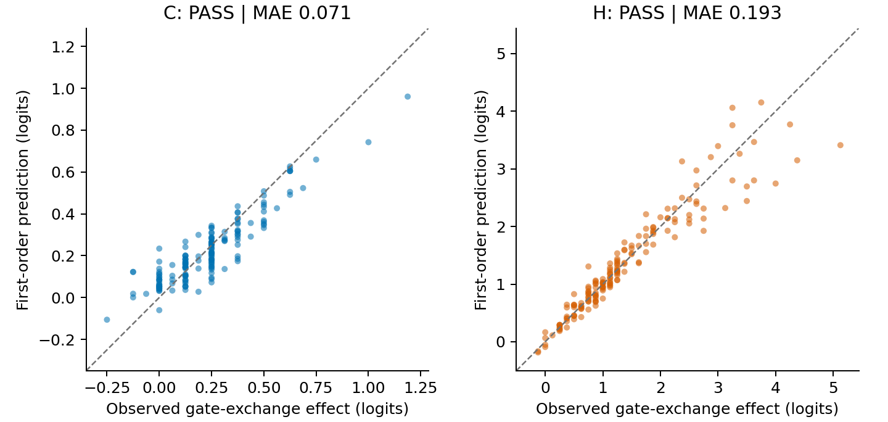

# A023 / TGA-01：任务梯度能否解释换门不对称

2026-11-16。**实现、CPU测试、GPU工程及正式测量全部完成；C/H两边都通过预定一阶预测标准。本轮收束，不追加实验。** 独立上下文Advisor已审实现与结果，纠正已采纳；不是独立复现或真实专家认证。

本轮新增认识：在已存实际门输出补丁P条件下，原生任务梯度的一阶内积能较准确地近似本面板的有限换门效果；指定方向的局部改变量差与后续D−Y任务映射差都有具体证据。没有把这些关系称为可加的自然机制份额。

## 1. 一阶预测成立到什么程度

固定原48接收者、168 AL/BD冲突对、六已见场景、G14全部层；原模型、稀疏针、历史及ΔH不变。用原GPU保存的直接P=patch_X−native_X，计算p_C=Σ⟨a_C,P_C⟩、p_H=−Σ⟨a_H,P_H⟩。a为原生11背景D−Y对FP64零控制的autograd梯度。没有拟合比例、截距、挑层或删对；P来自已观测NGU轨迹，因此是已见端点条件预测，不是对新交换的事前泛化预测。

|预定检查|C换H门|H换C门|
|---|---:|---:|
|实测平均效果|0.237630|1.403646|
|一阶预测平均效果|0.223113|1.354346|
|MAE，要求≤.25|0.071049|0.192850|
|零预测MAE|0.247396|1.406250|
|MAE/零预测MAE，要求≤.50|0.287187|0.137138|
|平均有符号误差，要求绝对值≤.10|−0.014517|−0.049300|
|接收者MAE≤.50，要求≥80%|48/48|43/48|
|旧效果绝对值≥.25的符号一致，要求≥80%|100%|100%|
|符号检查覆盖|96对、47接收者|161对、47接收者|
|冻结合取判定|通过|通过|

误差先接收者内供体等权，再48接收者等权。符号只在预定合格子集计算，近零对仍进入全部误差，100%不是所有168对的符号率。没有新增显著性检验或将六场景当独立确认。

观测平均换门效应差G_H−G_C为 **1.166016 logits**，一阶预测 **1.131233**，差约 **−0.034783**。因此可以说在该固定面板与已存P条件下，近似重现了主要平均不对称，并非只碰巧匹配两个均值：逐对及接收者标准也分别通过。**不能写“解释了97%的机制”，也不能扩为原分子用途C/H差5.430或整个ΔH作用的解释。**

每点为一个原配对，虚线为恒等线，不是拟合线。两面板采用各自范围且各自等比例坐标；对应的[336行数值](analysis/predictions.csv)全保留。

## 2. 哪些地方并不准确

H仍有5/48接收者MAE>.5，最大逐对绝对误差1.7133。逐场景MAE如下；NQ03/NQ04的H若套同标准，局部资格未通过（MAE、偏差或接收者覆盖不达标），不能把六场景交叉读数同向说成六场景都校准成功。

|场景|C MAE|H MAE|
|---|---:|---:|
|NQ01|.0823|.0843|
|NQ02|.0531|.0805|
|NQ03|.0679|.4052|
|NQ04|.0864|.3873|
|NQ05|.0778|.1248|
|NQ06|.0578|.1025|

这些局部不足不取消预定全局通过，但限制逐例/逐场景应用。不能说严格线性、所有扰动都能预测、或有限精度无影响；误差也不能单独归于曲率或舍入。

## 3. 从指定方向区分向量与后续任务映射

为了统一H−C门差方向约定，Q_C=P_C、Q_H=−P_H。下表每格为Σ⟨a_B,Q_D⟩，先按原规则接收者等权，单位均为D−Y logit。行固定任务梯度背景，列固定向量场。

|原幅度向量场|Q_C|Q_H|
|---|---:|---:|
|C任务映射a_C|.223113|.705720|
|H任务映射a_H|.362918|1.354346|

只有原幅度表两个对角接受了前述有限端点校准，非对角没有做实际有限补丁重放。固定同一列时，H映射的平均有符号任务响应更大；固定同一行时，H来源的向量场响应也更大。这仍混合了向量幅度和方向。

按已审方案，每层用双方范数的几何均值作共同幅度，得到U_C/U_H，保留头间配置；所有配对层均无零方向。

|逐层等幅向量场|U_C|U_H|
|---|---:|---:|
|C任务映射a_C|.344382|.429020|
|H任务映射a_H|.589075|.778253|

- 固定同一U_C，H/C任务内积为.589/.344；固定U_H则为.778/.429。**在这两列指定向量场的平均有符号D−Y响应上，后续任务映射差在去掉输入幅度差后仍存在。** 不是所有方向的普适放大，也不是每一配对都如此。
- 固定a_C，换方向U_H−U_C的响应差约.085；固定a_H则约.189。等幅后仍有方向配置差，这与“局部改变量只需看总范数”不符。
- 上述平均比较在六场景的描述读数同向；H两场景局部校准不足仍然保留。

**等幅表的四个格子全部是线性诊断，没有有限端点验证，包括两个对角。** 两表单位都是logit，改变的是输入幅度约定；不能相减或相乘当作幅度/方向/后续计算的独立贡献份额。对角校准通过，也不能保证交叉有限干预真能产生表中数值。

这里“后续”具体指从指定norm tap经其余t2计算到候选D−Y的整体导数；没有定位是MLP、全注意力、最终归一化还是读出矩阵形成了差异。

## 4. 需要修正的解释与认识边界

1. **不对称不能只归于门前读得多少或门输出改变量大小。** A022已经给出局部幅度不足以统一解释的例子；本轮进一步表明，同一指定数学方向在两背景的任务映射下有不同平均响应，且原实际方向的一阶预测可通过有限端点校准。
2. **门场不是可跨背景搬运的统一增益系数。** 原换门效果由实际局部向量场与接收背景的任务映射配合决定。C换H门的小效果，并不要求它完全没改局部向量，固定同向量的有符号导数差，也超出“相同分数位移配不同起始余量”的窄解释；未排除所有与余量相关的计算关系。
3. **A022与A023可以累积，但不能拼成三因素中介链。** A022分析原生d对共同门差的局部适配；A023的P是实际多tap直接补丁，含顺序轨迹与舍入。二者不是同一个“方向”变量。当前更可靠的认识是：局部输入与门差配置、实际扰动方向、以及指定方向的后续任务映射，都有可区分关系；未得到唯一分账。
4. **这不是完整机制或新模型泛化。** 原用途差5.430、针最初如何造成P、后续具体模块、完整自然回答变化仍有边界；本轮0新自然回答，完整行为沿旧NGU证据。梯度是BF16图的连续surrogate，不是离散程序的数学导数。

Advisor建议在上述范围内收束，作者采纳。本轮不追加有限cross、积分梯度、剂量/层/模型扫描，也不恢复旧BRC/WUS。

## 5. 钩子、梯度流与运行验收

15项服务器CPU测试通过，包括真实32×128冻结kernel在有/无cache.copy_时的输出/梯度一致性、多tap解析梯度、D−Y符号、失败前logits保留、精确形成计数及旧RCS钩子。t2绕过旧inference_mode包装但调用同一L.forward；FP64零控制不detach native，后续13个tap保留上游梯度。保存张量上下文仅保留被原位覆盖的backward旧值，不替换模型/kernel/前向dtype。

工程20对、正式168对，全部零控制与frozen-P局部端点/完整t2 logits严格桥接原件；新观测分数全168对等于旧NGU，权重无更新、hook移除。正式336次backward有限且全部控制有梯度。工程和正式都唯一首轮成功，没有GPU重试。

|资源|工程|正式|合计|
|---|---:|---:|---:|
|尝试模型forward|448|3612|4060|
|backward|40|336|376|
|监督计时（秒）|90.015591|565.813266|655.828857|
|新完整自然回答|0|0|0|

合计约10.93 GPU进程分钟，低于2小时硬限；峰值GPU分配9,562,809,344 bytes。工程保守外推正式809.20秒通过，实际565.81秒。没有占用GPU0的已有任务，本轮使用GPU1，进程已结束。

原始运行产物共199,537,223 bytes（约190.29MiB），376份FP64梯度保存在服务器`/workspace/acupuncture/experiments/cache-task-gradient-v1-2026-11-16/runs/`，以[逐文件SHA/大小清单](readiness/artifacts-final-r01.json)交付引用，不把大张量复制进Git。CPU复核全部梯度dtype/shape/finite，并从原件完全重现188个已保存工程/正式投影记录；0模型forward/CUDA未初始化。本地核100工程＋841正式JSON，冻结分析从记录重算完全一致。

仅有一次**结果后CPU完整性审计**因绝对/相对路径键写错而在第一条投影前失败；修复审计脚本后通过，未改模型、实验代码或科学结果，未追加GPU。[失败说明](readiness/audit-attempt-r01.json)保留。绘图由冻结结果直接渲染，无拟合。

## 6. 来源与审查

- [原设计](../cache-numerator-gate-use-v1-2026-11-16/analysis/asymmetry-r01/MINIMAL_MEASUREMENT.zh-CN.md)／[实现与C01–C14](IMPLEMENTATION.zh-CN.md)／[执行记录](EXECUTION.zh-CN.md)。本轮用户新授权见运行authorization，原设计的未授权描述为历史身份。
- [钩子](tg_hooks.py)、[运行器](tg_run.py)、[冻结评分](tg_analysis.py)、[测试](test_tg.py)、[服务器CPU回执](readiness/cpu-server-r01.json)、[来源冻结](readiness/freeze-server-r01.json)。运行源码快照在readiness/source-engineering-r01。
- [正式原始分析](runs/formal-20261116-r01/analysis.json)，SHA `5945708021227636c1c8c153294b8aa9be84bef2ca4718e42a6607bd252525d7`；[回执](runs/formal-20261116-r01/receipt.json)、[退出](runs/formal-20261116-r01/exit.json)、[本地核验](readiness/formal-local-audit-r01.json)、[保存梯度核验脚本](analysis/verify_saved.py)。原始JSON及完整源哈希保留。
- [实现独立审查](reviews/implementation-review.md)／[实现采纳](reviews/implementation-disposition.md)；[作者结果草案](reviews/author-results.md)／[结果独立审查](reviews/result-review.md)／[结果采纳](reviews/result-disposition.md)。作者草案的过强措辞保留历史，最终以本报告和采纳记录为准。
