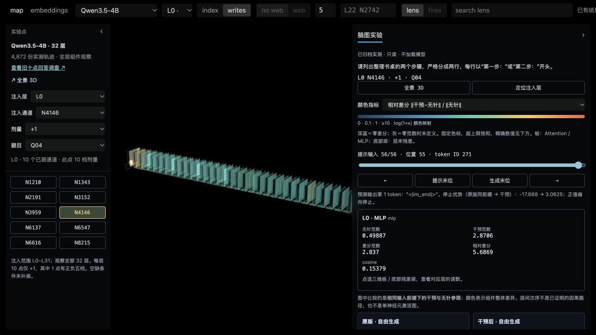

# 早层干预怎样传播到输出：现有轨迹分析

2026-10-28；状态：**ANALYZED，描述性分析**。本次仅在本地读取已核验归档、计算统计和查看原三维工具，没有运行模型、新实验或远程计算。结论适用于现有点位、剂量和八个固定问题。

**最明确的发现是：早层写入经下游组件改变下一 token 的竞争关系，随后分成提前停止、持续被干预推动的循环、错误历史支持的循环，以及内容偏离但句式仍在等不同过程。** 当前不能把这些过程合并为一个“完整语句开关”，也不能由颜色最大的一层认定根因层。

## 数据和比较方法

从已验收的 7,632 条正式记录中，取四模型注入 L0–L5 的全部 **3,680 条**：每模型 920 条，其中 912 干预、8 原版。每层十个通道的 +1 剂量有 80 条；其中一个通道另有正负五档剂量。十点 +1 与单点剂量系列有重叠，不能当作两组独立重复实验相加。4B 更深层这次未纳入结论。

入口：[归档总验收](../archive-r01/combined-verification.json)、[全量早层统计](summary.json)、[复算脚本](summarize_existing.py)、[4B 个案及原证据链接](fourb-cases.zh-CN.md)、[跨模型个案及原证据链接](cross-model-cases.md)。逐条逐步派生数据保存在 `features.jsonl.gz`；没有改动原始结果。

三维颜色比较的是**相同输入 token 历史下，干预分支与完整无干预分支的组件输出差异**。后者使用独立 cache，被强制读入干预分支已经生成的 token；以下简称“同前缀无针参照”。它与页面中的“原版自由生成回答”不同，也不是中途拔针继续生成的实验。

沿深度读图与沿生成时间读图必须分开：固定“提示末位”可追踪首个输出 token 产生前的全层变化；再移动生成位置，才能看到后续 token 如何继续偏离。所有 step 从 0 编号，step 2 是预测第 3 个输出 token。首处预测分叉采用实际 token 的 clean logit 严格低于 clean 最大值，而非 top-k 列表第一个 ID 不同，避免 BF16 并列最大值误判。

## 1. 差异从哪里开始：首先确认观测没有混入错误前缀

3,648 条干预在首预测位置的第一处差异全部是**注入层 MLP**。更浅层以及注入层自身的 attention，在所有已观测 prompt/生成输入位置差分都严格为零。32 条原版控制在全部站点、全部位置差分严格为零。

这符合注入位置与模型的计算顺序，首先是对照和采集一致性的证据，**不是发现了一个 MLP 功能区**。从下一层开始，attention、MLP、残差都可变化；这表示扰动进入了后续计算，但仅凭各站点范数不能分配各分支对最终错误的必要贡献。

另一个重要校准：本实验的单通道注入经过 down_proj 后，设计上的向量长度约等于 `|剂量| × 原版该层残差标定尺度`。实测 MLP 差分与该设计值的比值为 **0.9928–1.0077**。因此“只改一个通道”指空间位置稀疏，不意味着幅度很小；±1 已经是整个残差标定尺度量级。MLP 很亮还可能因为原本 MLP 输出范数较小。

## 2. 4B：三条具体传播链和一个同点反证

共同题目 Q04：列出整理书桌的两个步骤，严格两行，以“第一步：”“第二步：”开头。原版为：

> 第一步：将书桌上的物品分类并归位。  
> 第二步：清理桌面杂物，只保留当前使用工具。

### A. L0 N4146，+1：不是输出乱码，而是第一步就选择结束

固定提示末位，在三维图中先看 L0 MLP，再看 L1 两块组件和残差梁。差分范数是两个输出向量距离，不是损伤评分。

| 观测站点 | 干预与无针参照的差分范数 |
|---|---:|
| L0 attention（注入之前） | 0 |
| L0 MLP（注入位置） | 2.837 |
| L0 层末残差 | 2.837 |
| L1 attention | 2.504 |
| L1 MLP | 2.662 |
| L1 层末残差 | 4.271 |
| L2 层末残差 | 4.160 |
| L31 层末残差 | 69.965 |

这是一条“写入 → 后续两类组件和残差变化 → 最终预测翻转”的观测链。L1 到 L2 已有回落，且原版残差范数也从 L0 的 2.097 增长到 L31 的 53.843，因此不能把 2.837 到 69.965 直接称为病理放大 24.7 倍。

在最终词表竞争中，EOS 相对最强非 EOS 的 logit 优势从 **−17.688 变成 +3.063**。原本首选“第一步”，现在首选 `<|im_end|>`，答案为空。这里已经解释了空白的直接输出原因：终止 token 赢了，尚未证明哪一个中间组件是使它获胜的必要中介。

**同点 +0.5 是重要反证。** L31 残差相对差分仍达 0.720，三维图仍会多层变色，但 EOS 优势为 −8.25，答案仍是两条合理整理步骤。+0.25 也正常。大面积变色不能直接等于能力损坏。

Trace ID：`4b-L00-N004146-D+1__Q04`，对照 `D+0.5`、`D+0.25`。

### B. L2 N5063，+1：持续干预反复把退出方向推回循环

首预测位置，L0–L1 和 L2 attention 均为零差分；L2 MLP 差分 3.404，L3 attention 为 8.851、MLP 为 6.943、残差为 7.655，L31 残差为 65.039。输出首选从“第一步”变成 `<think>`。

然后出现 `〈think〉→双换行→〈think〉→双换行`，共 64 个 `<think>`、128 token，触及长度上限。上限本身不是失败证据，明确的重复原文才是。

把三维时间轴移动到 step 2，即已经读入 `<think>\n\n` 后：同前缀无针参照首选 `</think>`，实际 `<think>` 在其下还落后 **5.938 logit**；干预分支却继续选择 `<think>`。后续 63 次再次产生 `<think>` 时，无针参照首选全部是 `</think>`；包括首步在内，64 次 `<think>` 都不是其最优选择。

因此这条轨迹具有反复推向循环 token 的证据。它不仅仅是“第一步走错，后面自然重复”。但分支之间包含完整干预历史与不同内部 cache，不能把这个差异进一步偷换成“本 token 单次注入的独立贡献”。

Trace ID：`4b-L02-N005063-D+1__Q04`。

### C. L4 N5428，+1：句式还在，任务内容偏离

这次前两个 token“第一步”“：”仍保持，step 2 才发生严格预测分叉：无针参照偏好“将”，干预选择“李”；“李”的 clean logit 落后最优值 **18.609**。最终完整答案是：

> 第一步：李达。第二步：李斯。

首预测位置 L4 残差差分 5.396，L31 相对差分 0.928。这个案例说明“保留步骤框架”和“填入与任务有关的内容”可以出现不同结果；它没有证明 L4 就是内容区，也没有说明词语被储存在该单一通道。

Trace ID：`4b-L04-N005428-D+1__Q04`。

还有另一种 4B 循环：`4b-L02-N005251-D+1__Q05` 会反复输出英文元指令描述；128 步中 112 步的实际 token 在同前缀无针参照下也是最大 logit 候选。同点 +0.5 则给出连贯建议。它与上述 `<think>` 循环不完全相同，后续错误历史对重复的支持更明显。

## 3. 跨模型共同之处，以及明确的不共同之处

下面仍是同一道 Q04、同点剂量对照，属于说明过程的个案，不能当作全模型能力损伤率。

| 模型与点位 | 较低剂量 | 较高剂量的现象 | 逐步轨迹揭示的联系 |
|---|---|---|---|
| 2B L5 N3522 | −0.5：两个连贯步骤 | −1：反复“整理书桌／第一步：第二步” | 首词由“第一步”变成 `**`；从 step 18–127，无针参照也同选实际重复 token |
| 9B L0 N978 | +0.125：正常 | +0.25：直接 EOS；+0.5：“托”后 EOS；+1：128 个“托” | +1 首词偏转；从 step 3–127，无针参照也都选“托”，后半程 KL 中位仅 0.0159 |
| Llama L5 N1726 | −0.5：两个连贯步骤 | −1：先离题引用法律，后循环“书桌整理的具体步骤是” | 首词由“第一”变“根据”；后半程 64 步中 53 步无针参照也同选实际 token，仍有部分持续分叉 |

9B 的 +1 从 L0 MLP/残差差分 7.891，传到 L1 attention 12.271、MLP 13.268、残差 20.044，但后续并不单调增加。同点 −1 的直接注入幅度几乎一样，结果却是立即 EOS。**符号、剂量、下游读出共同影响故障类型，无法用一个幅度阈值或单一开关概括。**

Llama 的同点 +1 则前三个 token“第一”“步”“：”都没变，step 3 才偏离，step 9 EOS 优势从 −14.813 变为 +2.438，留下“第一步：把书桌整理好”就结束。首词未变也不代表后面正常。

完整早层十点 +1 调查中，**首 token 直接 EOS 的条数**如下。每格分母均为 80（十通道 × 八题），层编号从 0 开始：

| 模型 | L0 | L1 | L2 | L3 | L4 | L5 |
|---|---:|---:|---:|---:|---:|---:|
| Qwen 2B | 49 | 8 | 30 | 0 | 6 | 0 |
| Qwen 4B | 79 | 64 | 46 | 0 | 8 | 0 |
| Qwen 9B | 45 | 55 | 53 | 48 | 19 | 8 |
| Llama 3.1 8B | 0 | 0 | 0 | 0 | 0 | 0 |

Llama 连全部 912 条正负剂量干预也没有首步 EOS/空白回答，但有后续提前停止和循环。故“早层易直接停答”在这批 Qwen 数据中明显，却不能称为跨架构统一机制。该表不是语言失败率，零首步 EOS 不意味着健康。模型原版、分词、模板、架构和选中通道均不同，不宜据表直接做模型鲁棒性排名。

首预测位置的残差绝对差，从注入层到终层完全单调不减的轨迹仅为：2B 1/912、4B **0/912**、9B 41/912、Llama 141/912。图中的传播通常会增强、减弱、改变方向；“针扎一下，误差逐层不可逆爆炸”不符合这批完整数据。

## 4. 当前已经看清什么，根因还差在哪里

已经看清三个层次：**差异首次出现在何处；哪些后续组件的输出发生变化；哪一步 token 竞争翻转并形成何种实际回答。** 一些循环在错误前缀上仍受到干预推动，另一些则连无针参照也支持继续重复。这是现有跨模型结果里最具体的共同过程线索。

这比只看“早层坏、晚层好”更有解释力，也为比较不同模型提供了相同观察尺度：首处表征差异、首处预测分叉、停止竞争、后续重复是否仍被无针参照反对。**这些是可比较的过程，不是已经找到的同源脑区或可直接搬运的通道。**

仍未识别的是：哪个中间组件对最终症状必要或充分、哪个向量方向承载了相关信息、错误历史和持续注入各自贡献多少、模型之间哪些通道功能对应。现有摘要是范数/方向相似度及输出 logits，没有完整表征向量或中介替换证据，不能倒推出语义编码或功能区边界。

“同前缀无针参照也偏好重复”直接支持错误历史与重复相容，但不证明中途拔针后一定无法恢复。已有干预与基线支持整体操作改变了输出；传播中间量与症状同时出现不等于该中间量已经被证明是根因。

## 三维图复查顺序

在 [原三维工具](http://127.0.0.1:8794/?model=4b) 依次选模型、注入层、通道、剂量、Q04：先看 **L0 N4146 +0.5 → +1**，再看 **L2 N5063 +1**，最后看 **L4 N5428 +1**。前两例的截图已保留；浏览器停在 L2 循环预测第 3 个 token 的位置。

先点击“提示末位”，沿注入层 MLP、下一层 attention/MLP、层末残差查看读数；然后移动生成时间轴，对齐预测 token 和原始回答。相对差分、方向变化、绝对差分是三种视角，不要只追最亮板块。固定色标会饱和；原版幅度很小时相对比值会大；Llama 的点阵布局也不能解释成解剖空间。图上板块是组件整体变化，并不是本次采集到每个神经元的活动图。

详细个案文件提供逐步词表候选和原始记录路径；当前页面只直接显示实际 token、EOS 优势和组件读数。没有将页面未展示的 top-k 推断为已经可见。

方法限制：固定八题、预选通道、重复条件和事后挑选案例；本次不做显著性检验、不把 token 当独立样本、不用长度上限替代语义失败、不把聚合层差异当单通道功能。总体统计保留全部早层记录，案例并列低剂量正常对照及跨模型反例。单 token 解码的 `�` 可能是字节切分，不以此认定完整回答乱码。更完整的解释风险核对见 `stats-note.md`。
