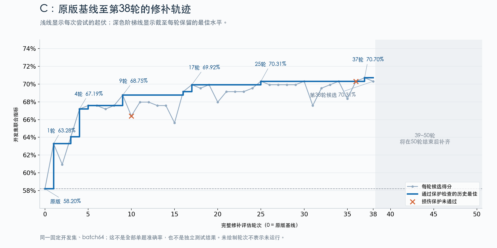

# C修补进展曲线

浅色线为各轮完整开发评估得分；深色阶梯为通过保护规则的历史最佳；橙色叉为损伤保护失败。源数据来自远端v8/C完整回执，第0轮为相同batch64的W0，未重新运行模型。38轮后区域留白以便50轮结束后更新，留白不表示这些轮次未运行。

基线58.203125%，第9轮最佳68.75%，第17轮69.921875%，第25轮70.3125%，第37轮70.703125%，第38轮候选70.3125%。这是开发集联合指标，不是全部单题准确率或独立终验。

[逐轮源数据](c-through38.json) · [SVG](c-through38.svg) · [绘图脚本](plot_c_progress.py)。用户已要求50轮结束后按同样样式补全到50轮，已写入监控任务。
